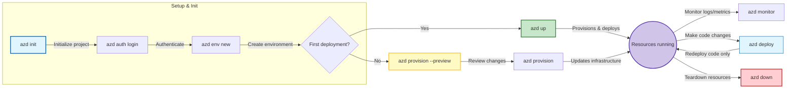
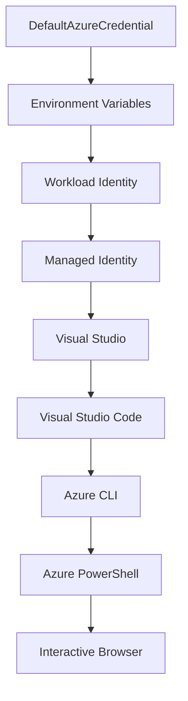

# AZD ಮೂಲಭೂತಗಳು - ಮೂಲ ತತ್ವಗಳು ಮತ್ತು ಆದರ್ಶಗಳು

**ಅಧ್ಯಾಯ ನ್ಯಾವಿಗೇಷನ್:**
- **📚 ಕೋರ್ಸ್ ಹೋಮ್**: [ಆರಂಭಿಕರಿಗಾಗಿ AZD](../../README.md)
- **📖 ಪ್ರಸ್ತುತ ಅಧ್ಯಾಯ**: ಅಧ್ಯಾಯ 1 - ಆಧಾರ ಮತ್ತು ವೇಗದ ಪ್ರಾರಂಭ
- **⬅️ ಹಿಂದಿನದು**: [ಕೋರ್ಸ್ ಅವಲೋಕನ](../../README.md#-chapter-1-foundation--quick-start)
- **➡️ ಮುಂದಿನದು**: [ಸ್ಥಾಪನೆ ಮತ್ತು ಸೆಟಪ್](installation.md)
- **🚀 ಮುಂದಿನ ಅಧ್ಯಾಯ**: [ಅಧ್ಯಾಯ 2: AI-ಮೊದಲ ಅಭಿವೃದ್ಧಿ](../chapter-02-ai-development/microsoft-foundry-integration.md)

## ಪರಿಚಯ

> `azd 1.37.2` ವಿರುದ್ಧವಾಗಿ ಪರಿಶೀಲಿಸಲಾಗಿದೆ (ನವೆಂಬರ್ 2026). Bash ಆಜ್ಞೆಗಳು ನೀವು ಬದಲಾಯಿಸಬೇಕಾದ ಉಲ್ಲೇಖಿತ Placeholder ಗಳನ್ನು ಬಳಸುತ್ತವೆ. ಟೆಂಪ್ಲೇಟು ವರ್ಕ್‌ಫ್ಲೋಗಳು текಪ್‌ಲೇಟು ಆರಂಭಿಸಲು `.` ಬಳಕೆ ಮಾಡುತ್ತವೆ; ಡೈರೆಕ್ಟರಿ ಆರ್ಗ್ಯೂಮೆಂಟ್ ಇಲ್ಲದೆ, ಟೆಂಪ್ಲೇಟು ಆರಂಭಿಸುವಿಕೆ ಉಪಡೈರೆಕ್ಟರಿಯನ್ನು ರಚಿಸುತ್ತದೆ ಮತ್ತು ನಿಮ್ಮ ಶೆಲ್‌ನ ಕಾರ್ಯನಿರ್ವಹಣಾ ಡೈರೆಕ್ಟರಿಯನ್ನು ಬದಲಾಯಿಸುವುದಿಲ್ಲ. ಉನ್ನತ ಸ್ತರದ ಸ್ನಿಪೆಟ್ ಗಳು ಪೂರ್ಣ ಪ್ರಾಜೆಕ್ಟ್ ಗಳು ಅಲ್ಲ, ಅವು ಕಲ್ಪನಾತ್ಮಕವಾಗಿವೆ.

ಈ ಪಾಠವು ನಿಮಗೆ Azure Developer CLI (azd) ಗೆ ಪರಿಚಯ ಮಾಡಿಕೊಡುತ್ತದೆ, ಇದು ಶಕ್ತಿಶಾಲಿ ಕಮಾಂಡ್ ಸಾಲ್ ಉಪಕರಣ ಆಗಿದ್ದು, ನಿಮ್ಮ ಸ್ಥಳೀಯ ಅಭಿವೃದ್ಧಿ ಯಿಂದ Azure ನಿಯೋಜನೆಗೆ ನಿಮ್ಮ ಪ್ರಯಾಣವನ್ನು ವೇಗಗೊಳಿಸುತ್ತದೆ. ನೀವು ಮೂಲಭೂತ ಸಂಪ್ರತ್ತಿಗಳನ್ನು, ಆಧಾರಭೂತ ವೈಶಿಷ್ಟ್ಯಗಳನ್ನು ಕಲಿಯುತ್ತೀರಿ ಮತ್ತು azd ಹೇಗೆ ಕ್ಲೌಡ್-ಸ್ವಾಭಾವಿಕ ಅಪ್ಲಿಕೇಶನ್ ನಿಯೋಜನೆಯನ್ನು ಆರಾಮಿಸಿದಂತೆ ಮಾಡುತ್ತದೆ ಎಂದು ತಿಳಿದುಕೊಳ್ಳುತ್ತೀರಿ.

## ಕಲಿಕೆಯ ಗುರಿಗಳು

ಈ ಪಾಠದ ಅಂತ್ಯದಲ್ಲಿ ನೀವು:
- Azure Developer CLI ಎಂದರೇನು ಮತ್ತು ಇದರ ಪ್ರಾಥಮಿಕ ಉದ್ದೇಶವನ್ನು ಅರ್ಥಮಾಡಿಕೊಳ್ಳಿ
- ಟೆಂಪ್ಲೇಟುಗಳು, ಪರಿಸರಗಳು ಮತ್ತು ಸೇವೆಗಳ ಮೂಲ ತತ್ವಗಳನ್ನು ತಿಳಿದುಕೊಳ್ಳಿ
- ಟೆಂಪ್ಲೇಟು-ಚಾಲಿತ ಅಭಿವೃದ್ಧಿ ಮತ್ತು ಇન્ફ್ರಾಸ್ಟ್ರಕ್ಚರ್ ಅಸ್ ಕೋಡ್ ಸೇರಿದಂತೆ ಪ್ರಮುಖ ವೈಶಿಷ್ಟ್ಯಗಳನ್ನು ಅನ್ವೇಷಿಸಿ
- azd ಪ್ರಾಜೆಕ್ಟ್ ರಚನೆ ಮತ್ತು ವರ್ಕ್‌ಫ್ಲೋ ಅನ್ನು ಅರ್ಥಮಾಡಿಕೊಳ್ಳಿ
- ನಿಮ್ಮ ಅಭಿವೃದ್ಧಿ ಪರಿಸರಕ್ಕಾಗಿ azd ಅನ್ನು ಸ್ಥಾಪಿಸಲು ಮತ್ತು ಸಂರಚಿಸಲು ಸಿದ್ಧರಾಗಿರಿ

## ಕಲಿಕೆಯ ಫಲಿತಾಂಶಗಳು

ಈ ಪಾಠವನ್ನು ಪೂರ್ಣಗೊಳಿಸಿದ ನಂತರ, ನೀವು ಈ ಕೆಳಗಿನವುಗಳನ್ನು ಮಾಡಬಲ್ಲಿರಿ:
- ಆಧುನಿಕ ಕ್ಲೌಡ್ ಅಭಿವೃದ್ಧಿ ಕಾರ್ಯಪ್ರವೃತ್ತಿಗಳಲ್ಲಿ azd ಪಾತ್ರವನ್ನು ವಿವರಿಸಿ
- azd ಯೋಜನೆ ರಚನೆಯ ಘಟಕಗಳನ್ನು ಗುರುತಿಸಿ
- ಟೆಂಪ್ಲೇಟುಗಳು, ಪರಿಸರಗಳು ಮತ್ತು ಸೇವೆಗಳು ಹೇಗೆ ಒಟ್ಟಾಗಿ ಕಾರ್ಯನಿರ್ವಹಿಸುತ್ತವೆ ಎಂಬುದನ್ನು ವರ್ಣಿಸಿ
- azd ನೊಂದಿಗೆ Infrastructure as Code ಯ ಲಾಭಗಳನ್ನು ಅರ್ಥಮಾಡಿಕೊಳ್ಳಿ
- ವಿವಿಧ azd ಕಮಾಂಡ್‌ಗಳನ್ನು ಮತ್ತು ಅವುಗಳ ಉದ್ದೇಶಗಳನ್ನು ಗುರುತಿಸಿ

## ಆಜೂರ್ ಡೆವಲಪರ್ CLI (azd) ಎಂದಾದರೆ ಏನು?

ಆಜೂರ್ ಡೆವಲಪರ್ CLI (azd) ನಿಮ್ಮ ಸ್ಥಳೀಯ ಅಭಿವೃದ್ಧಿಯಿಂದ ಆಜೂರ್ ನಿಯೋಜನೆಗೆ ನಿಮ್ಮ ಪ್ರಯಾಣವನ್ನು ವೇಗಗೊಳಿಸಲು ವಿನ್ಯಾಸಗೊಳಿಸಿದ ಕಮಾಂಡ್-ಲೈನ್ ಉಪಕರಣವಾಗಿದೆ. ಇದು ಆಜೂರ್ನಲ್ಲಿ ಕ್ಲೌಡ್-ಜನ್ಮಿತ ಅನ್ವಯಿಕೆಗಳನ್ನು ನಿರ್ಮಿಸುವುದು, ನಿಯೋಜಿಸುವುದು ಮತ್ತು ನಿರ್ವಹಿಸುವ ಪ್ರಕ್ರಿಯೆಯನ್ನು ಸರಳಗೊಳಿಸುತ್ತದೆ.

### azd ಒಂದರಿಂದ ನೀವು ಏನು ನಿಯೋಜಿಸಬಹುದು?

azd ಅನೇಕ ವಿಧದ ಕೆಲಸಭಾರಗಳನ್ನು ಬೆಂಬಲಿಸುತ್ತದೆ - ಮತ್ತು ಪಟ್ಟಿಗೆ ಹೊಸದುಗಳಿಂದ ಹೆಚ್ಚಿಸಲಾಗುತ್ತಿದೆ. ಇಂದು, ನೀವು azd ಅನ್ನು ಬಳಸಿಕೊಂಡು ವಿತರಿಸಬಹುದು:

| ಕೆಲಸಭಾರ ಪ್ರকার | ಉದಾಹರಣೆಗಳು | ಅದೇ ಕಾರ್ಯಪ್ರವಾಹ? |
|---------------|----------|----------------|
| **ಸಾಂಪ್ರದಾಯಿಕ ಅಪ್ಲಿಕೇಶನ್ಗಳು** | ವೆಬ್ ಅಪ್ಲಿಕೇಶನ್ಗಳು, REST API ಗಳು, ಸ್ಥಿರ ಸೈಟ್‌ಗಳು | ✅ `azd up` |
| **ಸೇವೆಗಳು ಮತ್ತು ಮಿಕ್ಕೊಸೇವೆಗಳು** | ಕಂಟೈನರ್ ಅಪ್ಲಿಕೇಶನ್ಗಳು, ಫಂಕ್ಷನ್ ಅಪ್ಲಿಕೇಶನ್ಗಳು, ಬಹು-ಸೇವೆ ಹಿನ್ನೆಲೆಗಳು | ✅ `azd up` |
| **AI ಚಾಲಿತ ಅಪ್ಲಿಕೇಶನ್ಗಳು** | ಮೈಕ್ರೋಸಾಫ್ಟ್ ಫೌಂಡ್ರಿ ಮಾದರಿಗಳೊಂದಿಗೆ ಚಾಟ್ ಅಪ್ಲಿಕೇಶನ್ಗಳು, AI ಶೋಧನದೊಂದಿಗೆ RAG ಪರಿಹಾರಗಳು | ✅ `azd up` |
| **ಬುದ್ಧಿವಂತ ಎಜೆಂಟ್‌ಗಳು** | ಫೌಂಡ್ರಿ-ಆಧಾರಿತ ಎಜೆಂಟ್‌ಗಳು, ಬಹು-ಎಜೆಂಟ್ ಸಮನ್ವಯಗಳು | ✅ `azd up` |

ಮುಖ್ಯ ಅರ್ಥ ಇದೆಂದರೆ **ನೀವು ಏನು ವಿತರಿಸುತ್ತಿದ್ದೀರಿ ಎಂಬುದಕ್ಕೆ ಬದಲಾಗದೆ azd ಜೀವನಚಕ್ರವು ಸ್ವತಃ ಒಂದೇ ಆಗಿರುತ್ತದೆ**. ನೀವು ಒಂದು ಪ್ರಾಜೆಕ್ಟ್ ಪ್ರಾರಂಭಿಸಿ, ಮೂಲಸೌಕರ್ಯವನ್ನು ಪೂರೈಸಿ, ನಿಮ್ಮ ಕಡತವನ್ನು ವಿತರಿಸಿ, ನಿಮ್ಮ ಅಪ್ಲಿಕೇಶನನ್ನು ಮೇಲ್ವಿಚಾರಣೆ ಮಾಡಿ, ಮತ್ತು ಸ್ವಚ್ಛಗೊಳಿಸಿ — ಅದು ಸರಳ ವೆಬ್‌ಸೈಟ್ ಆಗಿರಲಿ ಅಥವಾ ಅತ್ಯಾಧುನಿಕ AI ಎಜೆಂಟ್ ಆಗಿರಲಿ.

ಈ ನಿರಂತರತೆ ವಿನ್ಯಾಸದಿಂದ ಆಗಿರುತ್ತದೆ. azd AI ಸಾಮರ್ಥ್ಯಗಳನ್ನು ನಿಮ್ಮ ಅಪ್ಲಿಕೇಶನ್ಗೆ ಬಳಸಬಹುದಾದ ಬೇರೆಂಜೊ ಸೇವೆಯಂತೆ ಚಿಕಿತ್ಸೆ ಮಾಡುತ್ತದೆ, ಮೂಲತಃ ಭಿನ್ನವಾದುದಾಗಿ ಕನಸು ಕಾಣುವುದಿಲ್ಲ. ಮೈಕ್ರೋಸಾಫ್ಟ್ ಫೌಂಡ್ರಿ ಮಾದರಿಗಳು ಬೆಂಬಲಿಸಿರುವ ಚಾಟ್ ಅಂತ್ಯಬಿಂದುವು, azd ದೃಷ್ಟಿಯಿಂದ, ಕೇವಲ ಮತ್ತೊಂದು ಸೇವೆಯಾಗಿ ಸಂರಚಿಸುವುದಕ್ಕೂ ಮತ್ತು ವಿತರಿಸುವುದಕ್ಕೂ ಆಗಿರುತ್ತದೆ.

### 🎯 ಏಕೆ AZD ಬಳಸಬೇಕು? ಒಂದು ನೈಜ ಜಗತ್ತಿನ ಹೋಲಿಕೆ

ನಮ್ಮಿಗೆ ಸರಳ ವೆಬ್ ಅಪ್ಲಿಕೇಶನ್ ಅನ್ನು ಡೇಟಾಬೇಸ್ನೊಂದಿಗೆ ವಿತರಿಸುವುದನ್ನು ಹೋಲಿಸೋಣ:

#### ❌ AZD ಇಲ್ಲದೆ: ಕೈಯಿಂದ ಏಸರ್ ವಿತರಣೆ (30+ ನಿಮಿಷಗಳು)

**ಚಿತ್ರಣೀಯ Bash ಹೋಲಿಕೆ, ಚಾಲನೆಗೆ ತಯಾರಾದ ಅಪ್ಲಿಕೇಶನ್ ಸ್ಟಾರ್ಟರ್ ಅಲ್ಲ.** ಇದು ಇಡೀ ಅಪ್ಲಿಕೇಶನಿನ ಕೋಡ್, ವಿಶಿಷ್ಟ ಸಂಪನ್ಮೂಲ ಹೆಸರುಗಳು, ಏಸರ್ CLI ಪ್ರಾಮಾಣೀಕರಣ ಮತ್ತು ಬೇಕಾದ CLI ವಿಸ್ತರಣೆಗಳನ್ನು ಹೊಂದಿರುವಂತೆಯೇ ಊಹಿಸುತ್ತದೆ. ಬೆಂಬಲಿತ ಅಂತ್ಯದಿಂದ ಅಂತ್ಯ ಮಾರ್ಗದ/template ವ್ಯಾಯಾಮವನ್ನು ಕೆಳಗೆ ಬಳಸಬಹುದು.

```bash
# Step 1: Create resource group
az group create --name myapp-rg --location eastus

# Step 2: Create App Service Plan
az appservice plan create --name myapp-plan \
  --resource-group myapp-rg \
  --sku B1 --is-linux

# Step 3: Create Web App
az webapp create --name myapp-web-unique123 \
  --resource-group myapp-rg \
  --plan myapp-plan \
  --runtime "NODE:22-lts"

# Step 4: Create Cosmos DB account (10-15 minutes)
az cosmosdb create --name myapp-cosmos-unique123 \
  --resource-group myapp-rg \
  --kind MongoDB

# Step 5: Create database
az cosmosdb mongodb database create \
  --account-name myapp-cosmos-unique123 \
  --resource-group myapp-rg \
  --name tododb

# Step 6: Create collection
az cosmosdb mongodb collection create \
  --account-name myapp-cosmos-unique123 \
  --resource-group myapp-rg \
  --database-name tododb \
  --name todos

# Step 7: Get connection string
CONN_STR=$(az cosmosdb keys list \
  --name myapp-cosmos-unique123 \
  --resource-group myapp-rg \
  --type connection-strings \
  --query "connectionStrings[0].connectionString" -o tsv)

# Step 8: Configure app settings
az webapp config appsettings set \
  --name myapp-web-unique123 \
  --resource-group myapp-rg \
  --settings MONGODB_URI="$CONN_STR"

# Step 9: Enable logging
az webapp log config --name myapp-web-unique123 \
  --resource-group myapp-rg \
  --application-logging filesystem \
  --detailed-error-messages true

# Step 10: Set up Application Insights
az monitor app-insights component create \
  --app myapp-insights \
  --location eastus \
  --resource-group myapp-rg

# Step 11: Link App Insights to Web App
INSTRUMENTATION_KEY=$(az monitor app-insights component show \
  --app myapp-insights \
  --resource-group myapp-rg \
  --query "instrumentationKey" -o tsv)

az webapp config appsettings set \
  --name myapp-web-unique123 \
  --resource-group myapp-rg \
  --settings APPINSIGHTS_INSTRUMENTATIONKEY="$INSTRUMENTATION_KEY"

# Step 12: Build application locally
npm install
npm run build

# Step 13: Create deployment package
zip -r app.zip . -x "*.git*" "node_modules/*"

# Step 14: Deploy application
az webapp deployment source config-zip \
  --resource-group myapp-rg \
  --name myapp-web-unique123 \
  --src app.zip

# Step 15: Wait and pray it works 🙏
# (No automated validation, manual testing required)
```

**ಸಮಸ್ಯೆಗಳು:**
- ❌ 15+ ಆಜ್ಞೆಗಳು ನೆನಪಿಹಚ್ಚಿಕೊಳ್ಳಲು ಮತ್ತು ಕ್ರಮಾನುಗತವಾಗಿ ನಿರ್ವಹಿಸಲು  
- ❌ 30-45 ನಿಮಿಷಗಳ ಕೈಯಿಂದ ಕೆಲಸ
- ❌ ತಪ್ಪುಗಳನ್ನು ಮಾಡುವುದು ಸುಲಭ (ಟೈಪೊಗಳು, ತಪ್ಪು ಪ್ಯಾರಾಮೀಟರ್‌ಗಳು)
- ❌ ಪ್ರಮಾಣಪತ್ರಗಳಿಗೆ ವ್ಯಕ್ತिगತ ನಿರ್ವಹಣೆ ಅಗತ್ಯವಿದೆ; ಡಿಬಗ್ ಲಾಗ್‌ಗಳು ಮತ್ತು ಶೆಲ್ ಟ್ರೇಸಿಂಗ್ ಅವುಗಳನ್ನು ಬಹಿರಂಗಪಡಿಸಬಹುದು
- ❌ ಏನಾದರು ವಿಫಲವಾದರೆ ಸ್ವಯಂಚಾಲಿತ ರೋಲ್ಬ್ಯಾಕ್ ಇಲ್ಲ
- ❌ ತಂಡದ ಸದಸ್ಯರು ಅನುಕರಿಸಲು ಕಷ್ಟ
- ❌ ಪ್ರತಿ ಸಲ ವಿಭಿನ್ನ (ಪುನರುತ್ಪಾದಿಸಲಾಗದದ್ದು)

#### ✅ AZD ಜೊತೆಗೆ: ಸ್ವಯಂ ಚಾಲಿತ ನಿಯೋಜನೆ (5 ಆಜ್ಞೆಗಳು, 10-15 ನಿಮಿಷಗಳು)

```bash
# Step 1: Initialize from template
azd init --template todo-nodejs-mongo .

# Step 2: Authenticate
azd auth login

# Step 3: Select the environment created during init
azd env select dev

# Step 4: Preview changes (optional but recommended)
azd provision --preview

# Step 5: Deploy everything
azd up

# ✨ Done! Everything is deployed, configured, and monitored
```

**ಲಾಭಗಳು:**
- ✅ **5 ಆಜ್ಞೆಗಳ** ವಿರುದ್ಧ 15+ ಕೈಯಿಂದ ಹಂತಗಳು
- ✅ **ಒಟ್ಟು 10-15 ನಿಮಿಷಗಳು** (ಮುಖ್ಯವಾಗಿ ಅಜೂರ್‌ಗೆ ಕಾಯುವುದಕ್ಕೆ)
- ✅ **ಕೈಯಿಂದ ಮಾಡುವ ತಪ್ಪುಗಳು ಕಡಿಮೆ** - ಸुसಂಗತ, ಟೆಂಪ್ಲೇಟ್ ಚಾಲಿತ ಕಾರ್ಯಪ್ರವಾಹ
- ✅ **ಭದ್ರತೆಗೊಳಿಸಿದ ಗುಪ್ತ ನಿರ್ವಹಣೆ** - ಹಲವಾರು ಟೆಂಪ್ಲೇಟ್‌ಗಳು ಅಜೂರ್ ನಿರ್ವಹಿತ ಗುಪ್ತ ಸಂಗ್ರಹವನ್ನು ಬಳಕೆ ಮಾಡುತ್ತವೆ
- ✅ **ಪುನರುತ್ತೊಡೆಯಬಹುದಾದ ನಿಯೋಜನೆಗಳು** - ಪ್ರತಿ ಸಲ ಒಂದೇ ಕಾರ್ಯಪ್ರವಾಹ
- ✅ **ಪುನರುತ್ತೊಡೆಯಬಹುದಾದ ಮೂಲಸೌಕರ್ಯ ವ್ಯಾಖ್ಯಾನಗಳು** - ಅರ್ಹತೆ, ಪ್ರಾಂತ್ಯ ಲಭ್ಯತೆ ಮತ್ತು ಟೆಂಪ್ಲೇಟ್ ಆವೃತ್ತಿಗಳ ಆಧೀನ
- ✅ **ತಂಡಕ್ಕೆ ಸೂಕ್ತ** - ಯಾರಾದರೂ ಅದೇ ಆಜ್ಞೆಗಳನ್ನು ಬಳಸಿಕೊಂಡು ನಿಯೋಜಿಸಬಹುದು
- ✅ **ಕೋಡ್ ಮೂಲಕ ಮೂಲಸೌಕರ್ಯ** - ಸಂಚಿಕೆ ನಿಯಂತ್ರಿತ ಬಿಸಿಪ್ ಟೆಂಪ್ಲೇಟ್‌ಗಳು
- ✅ **ಟೆಂಪ್ಲೇಟ್ ಮೂಲಕ ವ್ಯಾಖ್ಯಾನಿತ ಮಾನಿಟರಿಂಗ್** - ಟೆಂಪ್ಲೇಟ್‌ನಲ್ಲಿ ಸೇರಿಸಿದ್ದರೆ ಅಪ್ಲಿಕೇಶನ್ ಇನ್ಸೈಟ್ಸ್

### ಸಮಯ ಮತ್ತು ನಂಬಿಕೆ

ಮೇಲಿನ ಸಮಯ ಅಂದಾಜುಗಳು, ಅಳೆಯುವಿಕೆಗಳು ಅಲ್ಲ. azd ನೀವು ನಿಯಂತ್ರಿಸಬೇಕಾದ ಆಜ್ಞೆಗಳನ್ನು ಕಡಿಮೆ ಮಾಡುತ್ತದೆ, ಆದರೆ ನಿಯೋಜನೆ ಸಮಯವನ್ನು ಖಚಿತಪಡಿಸುವುದಿಲ್ಲ, ತಪ್ಪುಗಳನ್ನು ರದ್ದುಗೊಳಿಸುವುದಿಲ್ಲ, ಅಥವಾ ಸ್ವಯಂಚಾಲಿತ ಅಪ್ಲಿಕೇಶನ್/ಡೇಟಾಬೇಸ್ ರೋಲ್ಬ್ಯಾಕ್ ನೀಡುವುದಿಲ್ಲ. ಕಾರ್ಯನಿರ್ವಹಣಾ ಸಂಚಿಕೆಗಳನ್ನು ಮೂಲ ನಿಯಂತ್ರಣದಲ್ಲಿ ಇಟ್ಟುಕೊಳ್ಳಿ ಮತ್ತು ಪುನರ್ಸೃತಿಕರಣೆ ವಿಧಾನಗಳನ್ನು ಪರೀಕ್ಷಿಸಿ.

## ಮೂಲ ಒದಗಣೆಗಳು

### ಟೆಂಪ್ಲೇಟ್‌ಗಳು
ಟೆಂಪ್ಲೇಟ್‌ಗಳು azd ನ ಆಧಾರವಾಗಿವೆ. ಅವಿ ಒಳಗೊಂಡಿವೆ:
- **ಅಪ್ಲಿಕೇಶನ್‌ ಕೋಡ್** - ನಿಮ್ಮ ಮೂಲ ಕೋಡ್ ಮತ್ತು ಅವಲಂಬನೆಗಳು
- **ಮೂಲಸೌಕರ್ಯ ವ್ಯಾಖ್ಯಾನಗಳು** - ಬಿಸಿಪ್ ಅಥವಾ ಟೆಳರಾಫಾರ್ಮ್‌ನಲ್ಲಿ ವ್ಯಾಖ್ಯಾನಿಸಲಾದ ಅಜೂರ್ ಸಂಪನ್ಮೂಲಗಳು
- **Конфಿಗೆಯೂನರ್ ಫೈಲ್‌ಗಳು** - ಸೆಟ್ಟಿಂಗ್‌ಗಳು ಮತ್ತು ಪರಿಸರ ವ್ಯತ್ಯಾಸಗಳು
- **ನಿಯೋಜನೆ ಸ್ಕ್ರಿಪ್ಟ್‌ಗಳು** - ಸ್ವಯಂಚಾಲಿತ ನಿಯೋಜನೆ ಕಾರ್ಯಪಟುಗಳು

### ಪರಿಸರಗಳು
ಪರಿಸರಗಳು ಬೇರೆಯಾದ ನಿಯೋಜನೆ ಗುರಿಗಳನ್ನು ಪ್ರತಿನಿಧಿಸುತ್ತವೆ:
- **ಅಭಿವೃದ್ಧಿ** - ಪರೀಕ್ಷಣೆ ಮತ್ತು ಅಭಿವೃದ್ಧಿಗೆ
- **ಸ್ಟೇಜಿಂಗ್** - ಉತ್ಪಾದನೆಯ ಮುಂಚೂಣಿ ಪರಿಸರ
- **ಉತ್ಪಾದನೆ** - ನೈಜ ಉತ್ಪಾದನಾ ಪರಿಸರ

ಪ್ರತಿಯೊಂದು ಪರಿಸರವೂ ತನ್ನದೇ ಆದನ್ನು ಇರಿಸುತ್ತದೆ:
- ಪರಿಸರದ ಹೆಸರು ಮತ್ತು ಮೌಲ್ಯಗಳು; ಮೂಲಸೌಕರ್ಯ ಟೆಂಪ್ಲೇಟ್ ಆಧರಿಸಿ ಸಂಪನ್ಮೂಲ ಬೇರ್ಪಡೆ
- ಸೆಟ್ಟಿಂಗ್ ಮಾರ್ಗಸೂಚಿಗಳು
- ನಿಯೋಜನೆ ಸ್ಥಿತಿ

### ಸೇವೆಗಳು
`azure.yaml` ನಲ್ಲಿ ಸೇವೆಗಳು ನಿಯೋಜಿಸಬಹುದಾದ ಅಪ್ಲಿಕೇಶನ್ ಘಟಕಗಳನ್ನು ವರ್ಣಿಸುತ್ತವೆ:
- **ಮುಂಭಾಗ** - ವೆಬ್ ಅಪ್ಲಿಕೇಶನ್‌ಗಳು, SPA ಗಳು
- **ಹಿಂಭಾಗ** - API ಗಳು, ಸೂಕ್ಷ್ಮ ಸೇವೆಗಳು

ಡೇಟಾಬೇಸ್ ಮತ್ತು ಸಂಗ್ರಹಣೆ ಸಾಮಾನ್ಯವಾಗಿ ಮೂಲಸೌಕರ್ಯ ಸಂಪನ್ಮೂಲಗಳಾಗಿ ನಿಯೋಜಿಸಲಾಗುತ್ತವೆ, ಅವಾಗಾಗೆ ಅಲ್ಲದೆ `host: postgres` ಮುಂತಾದ ನಗರಪಾಲನೆ ಸೇವಾ ಹೋಸ್ಟ್‌ಗಳು ರಚಿಸಲಾಗುವುದில்லை.

## ಪ್ರಮುಖ ವೈಶಿಷ್ಟ್ಯಗಳು

### 1. ಟೆಂಪ್ಲೇಟ್ ಚಾಲಿತ ಅಭಿವೃದ್ಧಿ
```bash
# Browse available templates
azd template list

# Initialize from a template
azd init --template "<template-name>" .
```

### 2. ಕೋಡ್ ಮೂಲಕ ಮೂಲಸೌಕರ್ಯ
- **ಬಿಸಿಪ್** - ಅಜೂರ್ ನ ವಿಶೇಷ ಭಾಷೆ
- **ಟೆರಾಫಾರ್ಮ್** - ಬಹುಕ್ಲೌಡ್ ಮೂಲಸೌಕರ್ಯ ಉಪಕರಣ
- ಬಿಸಿಪ್ ARM ಟೆಂಪ್ಲೇಟ್‌ಗಳಿಗೆ ಸಂಕಲನ ಮಾಡುತ್ತದೆ; ಅತ್ಯಶುದ್ಧ ARM JSON ಒಂದು ಪ್ರತ್ಯೇಕ ನಿರ್ಮಿತ `infra.provider` ಅಲ್ಲ.

### 3. ಏಕೀಕೃತ ಕಾರ್ಯಪ್ರವಾಹಗಳು
```bash
# Complete deployment workflow
azd up            # Provision + Deploy this is hands off for first time setup

# 🧪 NEW: Preview infrastructure changes before deployment (SAFE)
azd provision --preview    # Simulate infrastructure deployment without making changes

azd provision     # Create Azure resources if you update the infrastructure use this
azd deploy        # Deploy application code or redeploy application code once update
azd down          # Clean up resources
```

#### 🛡️ ಮುನ್ನೋಟದೊಂದಿಗೆ ಸುರಕ್ಷಿತ ಮೂಲಸೌಕರ್ಯ ಯೋಜನೆ
`azd provision --preview` ಕಮಾಂಡ್ ಸುರಕ್ಷಿತ ನಿಯೋಜನೆಗಳಿಗೆ ಕ್ರಾಂತಿಕಾರಿ:
- **ಶೂನ್ಯ ಪ್ರಯೋಗ ವಿಶ್ಲೇಷಣೆ** - ಯಾವುದು ರಚನೆಗೊಳ್ಳಲಿದೆ, ತಿದ್ದಲಾಗಲಿದೆ ಅಥವಾ ಅಳಿಸಲಾಗಲಿದೆ ತೋರಿಸುತ್ತದೆ
- **ಯಾವುದೂ ಮೂಲಸೌಕರ್ಯ ಅನ್ವಯಿಸದು** - ಪೂರೈಕೆದಾರ ಬದಲಾವಣೆಗಳನ್ನು ಪರಿಶೀಲಿಸುತ್ತದೆ; ಮೊದಲು ಯೋಜನೆ ಹೊಕ್ಕಳು ಪರಿಶೀಲಿಸಿ, ಏಕೆಂದರೆ ಹೊಕ್ಕಳು ಪಾರ್ಶ್ವ ಪರಿಣಾಮಗಳೊಂದಿಗೆ ಆಜ್ಞೆಗಳು ಚಲಿಸುವಂತೆ ಇರಬಹುದು
- **ತಂಡ ಸಹಯೋಗ** - ನಿಯೋಜನೆಯ ಮುಂಚೆಯೇ ಮುನ್ನೋಟ ಫಲಿತಾಂಶಗಳನ್ನು ಹಂಚಿಕೊಳ್ಳಿ
- **ಖರ್ಚು ಯೋಜನೆ ಒಳಟು** - ಪ್ರಸ್ತಾವಿತ SKU ಗಳನ್ನು ಪರಿಶೀಲಿಸಿ, ನಂತರ ಅಜೂರ್ ಬೆಲೆ ಲೆಕ್ಕ ತಗುಲಿಸುವಿಕೆಯ ಮೂಲಕ ಬೆಲೆ ಲೆಕ್ಕಿಸಿ; ಮುನ್ನೋಟ ಬೆಲೆಯ ಲೆಕ್ಕಾಚಾರ ಮಾಡದು

```bash
# Example preview workflow
azd provision --preview           # See what will change
# Review the output, discuss with team
azd provision                     # Apply changes with confidence
```

### 📊 ದೃಶ್ಯ: AZD ಡೆವಲಪ್ಮೆಂಟ್ ಕಾರ್ಯಪ್ರವಾಹ



**ಕಾರ್ಯಪ್ರವಾಹ ವಿವರಣೆ:**
1. **ಪ್ರಾರಂಭಿಸಿ** - ಟೆಂಪ್ಲೇಟ್ನೊಂದಿಗೆ ಅಥವಾ ಹೊಸ ಪ್ರಾಜೆಕ್ಟ್ ಆರಂಭಿಸಿ
2. **ಪ್ರಮಾಣೀಕರಣ** - ಅಜೂರ್ನೊಂದಿಗೆ ಪ್ರಮಾಣೀಕರಿಸಿ
3. **ಪರಿಸರ** - ಬែកಾದ ನಿಯೋಜನೆ ಪರಿಸರವನ್ನು ರಚಿಸಿ
4. **ಪೂರ್ವದೃಶ್ಯ** - 🆕 ಯಾವಾಗಲೂ ಮೂಲಸೌಕರ್ಯದ ಬದಲಾವಣೆಗಳನ್ನು ಮೊದಲಿಗೆ ಪೂರ್ವದೃಶ್ಯ ಮಾಡಿ (ಸುರಕ್ಷಿತ ಅಭ್ಯಾಸ)
5. **ಪ್ರೊවිಷನ್** - ಅಜೂರ್ನ ಸಂಪನ್ಮೂಲಗಳನ್ನು ರಚಿಸಿ/ನವೀಕರಿಸಿ
6. **ನಿಯೋಜಿಸಿ** - ನಿಮ್ಮ ಅಪ್ಲಿಕೇಶನ್ ಕೋಡ್ ಅನ್ನು ಒತ್ತಿ
7. **ನಿರೀಕ್ಷಿಸಿ** - ಅಪ್ಲಿಕೇಶನ್ ಕಾರ್ಯಕ್ಷಮತೆಯನ್ನು ಗಮನಿಸಿ
8. **ಮರುಪರಿಶೀಲನೆ** - ಬದಲಾವಣೆಗಳನ್ನು ಮಾಡಿ ಮತ್ತು ಕೋಡ್ ಅನ್ನು ಮರುನಿಯೋಜಿಸಿ
9. **ಶುಧ್ಧೀಕರಣ** - ಕೆಲಸ ಮುಗಿದ ಮೇಲೆ ಸಂಪನ್ಮೂಲಗಳನ್ನು ತೆಗೆದುಹಾಕಿ

### 4. ಪರಿಸರ ನಿರ್ವಹಣೆ
```bash
# Create and manage environments
azd env new "<environment-name>"
azd env select "<environment-name>"
azd env list
```

### 5. ವಿಸ್ತರಣೆಗಳು ಮತ್ತು AI ಆಜ್ಞೆಗಳು

azd ಮೂಲ CLI ಗಿಂತ ಹೆಚ್ಚುವರಿ ಸಾಮರ್ಥ್ಯಗಳನ್ನು ಸೇರ್ಪಡೆ ಮಾಡಲು ವಿಸ್ತರಣೆ ವ್ಯವಸ್ಥೆಯನ್ನು ಬಳಸುತ್ತದೆ. ಇದು ವಿಶೇಷವಾಗಿ AI ಕಾರ್ಯಭಾರಗಳಿಗೆ ಉಪಯುಕ್ತವಾಗಿದೆ:

```bash
# List available extensions
azd extension list

# Install the Foundry agents extension
azd extension install azure.ai.agents

# Initialize an AI agent project interactively
azd ai agent init

# Test a deployed agent (shows latency and time-to-first-byte)
azd ai agent invoke

# Start the MCP server for AI-assisted development (Alpha)
azd mcp start
```

**ಏಜೆಂಟ್ ಜೀವನಚಕ್ರ, ಪ್ರಾರಂಭದಿಂದ ಅಂತಿಗೆ.** ಏಜೆಂಟ್ ಜೀವನಚಕ್ರ ಕಾರ್ಯಾಚರಣೆಗಳಿಗೆ `azure.ai.agents` ಬಳಸಿ ಹಾಗೂ ಮೌಲ್ಯಮಾಪನಕ್ಕಾಗಿ ಬೆರೆತ `azure.ai.evaluations` ಅನ್ನು ಪ್ರತ್ಯೇಕವಾಗಿ ಸ್ಥಾಪಿಸಿ. ಸಂಯುಕ್ತ ಕಾರ್ಯಪ್ರವಾಹಕ್ಕೆ `azd >= 1.37.0` ಬಳಸಿ. ಮೊದಲ ದಿನವೂ ಇವುಗಳೆಲ್ಲ ಬೇಕಾಗುವುದಿಲ್ಲ:

| ಹಂತ | команда | ಅದು ಏನು ಮಾಡುತ್ತದೆ |
|-------|---------|--------------|
| **ಸ್ಕಾಫೋಲ್ಡ್** | `azd ai agent init --template <path-to-azure.yaml>` | ನಡು ಸಂದರ್ಭದಲ್ಲಿ ಏಜೆಂಟ್ ಪ್ರಾಜೆಕ್ಟ್ ಟೆಂಪ್ಲೇಟ್ನಲ್ಲಿ ಸ್ವೀಕರಿಸಿ |
| **ಪರೀಕ್ಷೆ** | `azd ai agent invoke` | ಏಜೆಂಟ್ ಅನ್ನು ಕರೆ ಮಾಡಿ ಮತ್ತು ಪ್ರತಿಕ್ರಿಯೆ ಸಮಯವನ್ನು ನೋಡಿ |
| **ಮಾಪೆ** | `azd ai eval init`, `generate`, `run start` | ಪ್ರತ್ಯೇಕ ವಿಸ್ತರಣೆ ಬಳಸಿ ಕಾನ್ಫಿಗರ್ ಮಾಡಿ, ನಿಯೋಜಿಸಿ ಮತ್ತು ಮೌಲ್ಯಮಾಪನವನ್ನು ರನ್ ಮಾಡಿ |
| **ಸಮೃದ್ಧಿಸು** | `azd ai agent optimize --eval <evaluation-name> --optimize-model <optimizer-deployment>` | ಏಜೆಂಟ್ ಅನ್ನು ಉತ್ತಮಗೊಳಿಸಲು ಹೊಂದಿಕೆಯಾಗುವ ಮೌಲ್ಯಮಾಪನವನ್ನು ಮರುಬಳಕೆ ಮಾಡಿ |
| **ಪರಿಶೀಲಿಸಿ** | `azd ai agent endpoint show` | ಲೈವ್ ಎಂಡ್ಪಾಯಿಂಟ್ ಕಾನ್ಫಿಗರೇಷನ್ ಅನ್ನು ನೋಡಿ |
| **ಶುದ್ಧೀಕರಿಸಿ** | `azd ai agent delete` | ಆರೈತ ಏಜೆಂಟ್ ಮತ್ತು ಅದರ ಎಲ್ಲಾ ಆವೃತ್ತಿಗಳನ್ನು ಅಳಿಸಿ |

> ವಿಸ್ತರಣೆಗಳನ್ನು ವಿವರವಾಗಿ [ಅಧ್ಯಾಯ 2: AI-ಫರ್ಸ್ಟ್ ಡೆವಲಪ್ಮೆಂಟ್](../chapter-02-ai-development/agents.md) ಮತ್ತು [AZD AI CLI ಆಜ್ಞೆಗಳು](../chapter-08-production/production-ai-practices.md#azd-ai-cli-commands-and-extensions) ಉಲ್ಲೇಖದಲ್ಲಿ ಒಳಗೊಂಡಿದೆ.

## 📁 ಪ್ರಾಜೆಕ್ಟ್ ರಚನೆ

ಸಾಮಾನ್ಯ azd ಪ್ರಾಜೆಕ್ಟ್ ರಚನೆ:
```
my-app/
├── .azure/                  # Local environments and selected-environment config
│   ├── config.json
│   └── dev/.env
├── .devcontainer/          # Development container config
├── .github/workflows/      # GitHub Actions
├── .vscode/               # VS Code settings
├── infra/                 # Infrastructure code
│   ├── main.bicep        # Main infrastructure template
│   ├── main.parameters.json
│   └── modules/          # Reusable modules
├── src/                  # Application source code
│   ├── api/             # Backend services
│   └── web/             # Frontend application
├── azure.yaml           # azd project configuration
└── README.md
```

## 🔧 ಸಂರಚನಾ ಫೈಲ್‌ಗಳು

### azure.yaml
ಮುಖ್ಯ ಪ್ರಾಜೆಕ್ಟ್ ಸಂರಚನಾ ಫೈಲ್:
```yaml
name: my-awesome-app
metadata:
  template: my-template@1.0.0

services:
  web:
    project: ./src/web
    language: js
    host: appservice
  api:
    project: ./src/api
    language: js
    host: appservice

hooks:
  preprovision:
    shell: pwsh
    run: echo "Preparing to provision..."
```

### .azure/config.json
ಪ್ರಾಜೆಕ್ಟ್-ಸ್ಥಳೀಯ ಡಿಫಾಲ್ಟ್ ಪರಿಸರ ಆಯ್ಕೆ (ವಿವರಣಾತ್ಮಕ; azd ಮೂಲಕ ನಿರ್ವಹಿತ):
```json
{
  "defaultEnvironment": "dev"
}
```

## 🎪 ಸಾಮಾನ್ಯ ಕಾರ್ಯಪ್ರವಾಹಗಳು ಕೈ ಚಾಲಿತ ಅಭ್ಯಾಸಗಳೊಡನೆ

> **💡 ಕಲಿಕೆಯ ಸಲಹೆ:** ನಿಮ್ಮ AZD ಕೌಶಲ್ಯಗಳನ್ನು ಕ್ರಮವಾಗಿ ಅಭಿವೃದ್ಧಿಪಡಿಸಲು ಈ ಅಭ್ಯಾಸಗಳನ್ನು ಕ್ರಮವಾಗಿ ಅನುಸರಿಸಿ.

### 🎯 ಅಭ್ಯಾಸ 1: ನಿಮ್ಮ ಮೊದಲ ಪ್ರಾಜೆಕ್ಟ್ ಪ್ರಾರಂಭಿಸಿ

**ನೀತಿ:** AZD ಪ್ರಾಜೆಕ್ಟ್ ಅನ್ನು ರಚಿಸಿ ಮತ್ತು ಅದರ ರಚನೆಯನ್ನು ಅನ್ವೇಷಿಸಿ

**ಹಂತಗಳು:**
```bash
# Use a proven template
mkdir azd-basics-practice
cd azd-basics-practice
# Choose "dev" for the environment name when prompted
azd init --template todo-nodejs-mongo .

# Explore the generated files
ls -la  # View all files including hidden ones

# Key files created:
# - azure.yaml (main config)
# - infra/ (infrastructure code)
# - src/ (application code)
```

**✅ ಯಶಸ್ಸು:** ನಿಮ್ಮ ಬಳಿ azure.yaml, infra/, ಮತ್ತು src/ ಡೈರೆಕ್ಟರಿಗಳು ಇವೆ

---

### 🎯 ಅಭ್ಯಾಸ 2: ಅಜೂರ್ನಲ್ಲಿ ನಿಯೋಜನೆ ಮಾಡಿ

**ನೀತಿ:** ಕಡೆಯಿಂದಲೇ ಅಂತ್ಯ ತನಕ ನಿಯೋಜನೆ ಸಂಪೂರ್ಣಗೊಳಿಸಿ

**ಹಂತಗಳು:**
```bash
# 1. Authenticate
azd auth login

# 2. Select the dev environment created in Exercise 1
azd env select dev
azd env set AZURE_LOCATION eastus

# 3. Preview changes (RECOMMENDED)
azd provision --preview

# 4. Deploy everything
azd up

# 5. Verify deployment
azd show    # View your app URL
```

**ಅಂದಾಜು ಸಮಯ:** 10-15 ನಿಮಿಷಗಳು  
**✅ ಯಶಸ್ಸು:** ಅಪ್ಲಿಕೇಶನ್ URL ಬ್ರೌಸರ್‌ನಲ್ಲಿ ತೆರೆಯುತ್ತದೆ

---

### 🎯 ಅಭ್ಯಾಸ 3: ಹಲವು ಪರಿಸರಗಳು

**ನೀತಿ:** dev ಮತ್ತು staging ಗೆ ನಿಯೋಜನೆ ಮಾಡಿ

**ಹಂತಗಳು:**
```bash
# Already have dev, create staging
azd env new staging
azd env set AZURE_LOCATION westus2
azd up

# Switch between them
azd env list
azd env select dev
```

**✅ ಯಶಸ್ಸು:** ಅಜೂರ್ನಲ್ಲಿನ ಎರಡು ಪ್ರತ್ಯೇಕ ಸಂಪನ್ಮೂಲ ಗುಂಪುಗಳು

**ಶುದ್ಧೀಕರಣ:** ವ್ಯಾಯಾಮ 3 ಎರಡನೇ ಬಿಲ್ಲಿಂಗ್ ವಿನ್ಯಾಸವನ್ನು ಸೃಷ್ಟಿಸುತ್ತದೆ. ಕಾರ್ಯ ಮುಗಿದಾಗ ಎರಡನ್ನೂ ಅಳಿಸಿ:

```bash
azd down --environment dev
azd down --environment staging
```

---

### 🛡️ ಧ್ವಂಸಾತ್ಮಕ ಶುದ್ಧೀಕರಣ: `azd down --force --purge`

ನೀವು ಯೋಚಿಸದೆ ಆಯ್ದ ಪರಿಸರದ ಅಜೂರ್ ಸಂಪನ್ಮೂಲಗಳನ್ನು ಅಳಿಸಲು ಬಯಸಿದಾಗ:

```bash
azd down --force --purge
```

**ಇದು ಏನು ಮಾಡುತ್ತದೆ:**
- `--force`: ಯಾವುದೇ ದೃಢೀಕರಣ ಸೂಚನೆಗಳು ಇಲ್ಲದೆ
- `--purge`: ಪರ್ಜ್ ರಕ್ಷಣೆಯನ್ನು ಅನುಮತಿಸುವಂತೆ ಬೆಂಬಲಿತ ಸಾಫ್ಟ್-ಅಳಿಸಿದ ಸಂಪನ್ಮೂಲಗಳನ್ನು (ಉದಾಹರಣೆಗೆ ಕೀ ವಾಲ್ಟ್‌ಗಳು) ಶಾಶ್ವತವಾಗಿ ಅಳಿಸುತ್ತದೆ. ಇದು ಸ್ಥಳೀಯ `.azure/` ಡೈರೆಕ್ಟರಿಯನ್ನು ಅಳಿಸುವುದಿಲ್ಲ.

**ಬಳಸಬೇಕಾದಾಗ:** ತಾತ್ಕಾಲಿಕ ಪರಿಸರವನ್ನು ಮುಗಿಸಿದಾಗ. ಧ್ವಂಸಾತ್ಮಕ ಶುದ್ಧೀಕರಣವನ್ನು ಪ್ರಾಥಮಿಕ ಪ್ರತಿಕ್ರಿಯೆಯಂತೆ ಪರಿಗಣಿಸಬೇಡಿ.authentication, quota, ಅಥವಾ ರೂಪರೇಷೆ ದೋಷಗಳಿಗೆ.

---

## 🎪 ಮೂಲ ಕಾರ್ಯಪ್ರವಾಹ ದರ್ಶನ

### ಹೊಸ ಪ್ರಾಜೆಕ್ಟ್ ಪ್ರಾರಂಭಿಸುವುದು
```bash
# Method 1: Use existing template
azd init --template todo-nodejs-mongo .

# Method 2: Start from scratch
azd init

# Method 3: Use current directory
azd init .
```

### ಅಭಿವೃದ್ಧಿ ಚಕ್ರ
```bash
# Set up development environment
azd auth login
azd env new dev
azd env select dev

# Deploy everything
azd up

# Make changes and redeploy
azd deploy

# Clean up when done
azd down --force --purge # Deletes this environment's discovered Azure resources; review before forcing deletion.
```

## `azd down --force --purge` ಅನ್ನು ಅರ್ಥಮಾಡಿಕೊಳ್ಳುವುದು
`azd down --force --purge` ಆಜ್‌ಡಿಯಲ್ಲಿ ನಿಮ್ಮ ಪರಿಸರವನ್ನು ಮತ್ತು ಸಂಬಂಧಿಸಿದ ಎಲ್ಲಾ ಸಂಪನ್ಮೂಲಗಳನ್ನು ಸಂಪೂರ್ಣವಾಗಿ ಮುರಿದುಹಾಕಲು ಶಕ್ತಿಶಾಲಿ ಆಜ್ಞೆಯಾಗಿದೆ. ಪ್ರತಿಯೊಂದು ಡ್ಯಾಶ್ ಏನು ಮಾಡುತ್ತದೆ ಎಂಬ ವಿವರ ಇಲ್ಲಿದೆ:
```
--force
```
- ದೃಢೀಕರಣ ಸೂಚನೆಗಳನ್ನು ಬಿಟ್ಟುಹೋಗುತ್ತದೆ.
- Automation ಅಥವಾ ಸ್ಕ್ರಿಪ್ಟಿಂಗ್‌ಗೆ ಉಪಯುಕ್ತ, ಅಲ್ಲಿ ಮಾನ್ಯುಯಲ್ ಇನ್ಪುಟ್ ಸಾಧ್ಯವಿಲ್ಲ.
- ಅನುಮತಿಗಳನ್ನು, ಪರ್ಜ್ ರಕ್ಷಣೆಯನ್ನು ಅಥವಾ ಅಳಿಸುವಲ್ಲಿ ವಿಫಲತೆಗಳನ್ನು ಇಗಲಿಸುವುದಿಲ್ಲ.

```
--purge
```
ಸ್ಥಾಯಿಯಾಗಿ ಬೆಂಬಲಿತ ಸಾಫ್ಟ್-ಡಿಲೀಟೆಡ್ ಆಜೂರ್ ಸಂಪನ್ಮೂಲಗಳನ್ನು ಹೆಚ್ಚುವರಿ ದೃಢೀಕರಣವಿಲ್ಲದೆ ಅಳಿಸುತ್ತದೆ. ಪರ್ಜ್ ರಕ್ಷಣಾ ಮತ್ತು ಅನುಮತಿಗಳು ಇನ್ನೂ ಅನ್ವಯಿಸುತ್ತವೆ. ಇದು **ಸ್ಥಳೀಯ ಪರಿಸರಗಳನ್ನು** ಅಥವಾ `.azure/` ಫೋಲ್ಡರ್ ಅನ್ನು ತೆಗೆದುಹಾಕುವುದಿಲ್ಲ.


### ಎರಡನ್ನೂ ಏಕೆ ಬಳಸಬೇಕು?
ನೀವು ಆಯ್ಕೆಮಾಡಲಾದ ಪರಿಸರದ ಆಜೂರ್ ಸಂಪನ್ಮೂಲಗಳನ್ನು ಅಳಿಸಲು ಮತ್ತು ಪರ್ಜ್ ಮಾಡಬಹುದಾದ ಸಂಪನ್ಮೂಲಗಳನ್ನು ತಡೆಹಿಡಿಯಲು ಉದ್ದೇಶಿಸಿದಾಗ ಮಾತ್ರ ಎರಡನ್ನೂ ಬಳಸಿ. ಇದು ವಿನಾಶಕಾರಿ ಶುದ್ಧೀಕರಣ, ಸಾಮಾನ್ಯ ನುರಿತಾನು ಮಾಡಿಕೊಂಡುಮರುವಿಕೆ ಅಥವಾ ಸ್ಥಳೀಯಸ್ಥಿತಿಯ ಮರುಹೊಂದಿಕೆ ಅಲ್ಲ.

ಇದು ತಕ್ಷಣ ಆಜೂರ್ ಪೋರ್ಟಲ್‌ನಲ್ಲಿ ಕೈಯಿಂದ ಸಂಪನ್ಮೂಲ ಅಳಿಸುವಿಕೆ ಮಾಡಿದ ನಂತರ ಅಥವಾ ಟೆಂಪ್ಲೇಟುಗಳು, ಪರಿಸರಗಳು, ಅಥವಾ ಸಂಪನ್ಮೂಲ ಗುಂಪು ಹೆಸರುಗಳ ಸಂಪ್ರದಾಯಗಳನ್ನು ಬದಲಾಯಿಸುವಾಗ ವಿಶೇಷವಾಗಿ ಸಹಾಯಕವಾಗಿರುತ್ತದೆ.


### ಬಹುಪರ್ಯಾಯ ಪರಿಸರಗಳನ್ನು ನಿರ್ವಹಿಸುವುದು
```bash
# Create staging environment
azd env new staging
azd env select staging
azd up

# Switch back to dev
azd env select dev

# Compare environments
azd env list
```

## 🔐 ದೃಢೀಕರಣ ಮತ್ತು ಪ್ರಮಾಣಪತ್ರಗಳು

ನಿಯೋಜನೆ ದೃಢೀಕರಣ (`azd auth login`) ಮತ್ತು ಅಪ್ಲಿಕೇಶನ್ SDK ದೃಢೀಕರಣ (`DefaultAzureCredential`) ಜೊತೆ ಭೇದಪಡಿಸಿ. ಅವು ಪ್ರತ್ಯೇಕವಾಗಿವೆ. azd ಡಿಫಾಲ್ಟ್‌ನಿಂದ ಆಜೂರ್ CLI ಸೂಚನಾಪತ್ರಗಳನ್ನು ಬಳಸುವುದಿಲ್ಲ.

### ಅಝೂರ್ CLI ಪ್ರಾಮಾಣೀಕರಣ (`az login`)

azd ಗೆ `azd auth login` ಅನ್ನು ಚಾಲನೆ ಮಾಡಿ. ಕೆಳಗಿನ ಅಝೂರ್ CLI ಕಮಾಂಡ್‌ಗಳು ಐಚ್ಛಿಕವಾಗಿದ್ದು ಮತ್ತು `az` ಕಮಾಂಡ್‌ಗಳನ್ನು ಪ್ರತ್ಯೇಕವಾಗಿ ಪ್ರಾಮಾಣೀಕರಿಸುತ್ತವೆ:

```bash
# Interactive login (opens browser)
az login

# Login with specific tenant
az login --tenant "<tenant-id>"

# Login with service principal
az login --service-principal -u "<app-id>" -p "<password>" --tenant "<tenant-id>"

# Check current login status
az account show

# List available subscriptions
az account list --output table

# Set default subscription
az account set --subscription "<subscription-id>"
```

### ಪ್ರಾಮಾಣೀಕರಣ ಪ್ರವಾಹ
1. **ಇಂಟರಾಕ್ಟಿವ್ ಲಾಗಿನ್**: ಪ್ರಾಮಾಣೀಕರಣಕ್ಕಾಗಿ ನಿಮ್ಮ ಡೀಫಾಲ್ಟ್ ಬ್ರೌಸರ್ ತೆರೆಯುತ್ತದೆ
2. **ಡಿವೈಸ್ ಕೋಡ್ ಫ್ಲೋ**: ಬ್ರೌಸರ್ ಪ್ರವೇಶವಿಲ್ಲದ ಪರಿಸರಗಳಿಗಾಗಿ
3. **ಸರ್ವಿಸ್ ಪ್ರಿನ್ಸಿಪಲ್**: ಸ್ವಯಂಚಾಲನೆ ಮತ್ತು CI/CD ಪರಿಸ್ಥಿತಿಗಳಿಗಾಗಿ
4. **Managed Identity**: ಅಝೂರ್‌ಗಳಲ್ಲಿ ನಿರ್ವಹಿಸಲ್ಪಡುವ ಅಪ্লಿಕೇಶನ್‌ಗಳಿಗಾಗಿ

### DefaultAzureCredential ಸರಪಳಿ

`DefaultAzureCredential` ಎಂದರೆ ಬಹುಮಾನ್ಯ ಪ್ರಾಮಾಣೀಕರಣ ಮೂಲಗಳನ್ನು ನಿರ್ದಿಷ್ಟ ಕ್ರಮದಲ್ಲಿ ಸ್ವಯಂಚಾಲಿತವಾಗಿ ಪ್ರಯತ್ನಿಸುವ ಮೂಲಕ ಸರಳীকೃತ ಪ್ರಾಮಾಣೀಕರಣ ಅನುಭವವನ್ನು ನೀಡುವ ಪ್ರಾಮಾಣೀಕರಣ ಪ್ರಕಾರವಾಗಿದೆ:

#### ಅಪ್ಲಿಕೇಶನ್ SDK ಪ್ರಾಮಾಣೀಕರಣ ಸರಪಳಿ

ನಿಖರ ಶೃಂಗಾರವು Azure Identity SDK ಭಾಷೆ, ಆವೃತ್ತಿ, ಸ್ಥಾಪಿತ ಪ್ಲಗಿನ್‌ಗಳು ಮತ್ತು ಆಯ್ಕೆಗಳು ಮೇಲೆ ಅವಲಂಬಿತವಾಗಿದೆ. ಈ ರೇಖಾಚಿತ್ರವು ಸಾಂದರ್ಭಿಕವಾಗಿದೆ, ನಿಗದಿತ azd ಪ್ರಮಾಣೀಕರಣ ಸರಣಿಯಲ್ಲ; ಇತ್ತೀಚಿನ SDK ಗಳಲ್ಲಿ Azure Developer CLI ಕ್ರೆಡೆನ್ಷಿಯಲ್ಗಳೂ ಇರಬಹುದು.


#### 1. ಪರಿಸರ ಚರಗಳು
```bash
# Set environment variables for service principal
export AZURE_CLIENT_ID="<app-id>"
export AZURE_CLIENT_SECRET="<password>"
export AZURE_TENANT_ID="<tenant-id>"
```

#### 2. ಕೆಲಸಲೋಡ್ ಗುರುತು (Kubernetes/GitHub Actions)
ಸ್ವಯಂಚಾಲಿತವಾಗಿ ಬಳಕೆಯಾಗುತ್ತದೆ:
- Azure Kubernetes Service (AKS) ಕೆಲಸಲೋಡ್ ಗುರುತಿನಿಂದ
- GitHub Actions OIDC ಫೆಡರೇಶನ್‌ನೊಂದಿಗೆ
- ಇತರ ಫೆಡರೇಟೆಡ್ ಗುರುತು ಪರಿಸರಗಳು

#### 3. ನಿರ್ವಹಿಸಲಾದ ಗುರುತು
ಕೆಳಗಿನಂತಿರುವ Azure ಸಂಪನ್ಮೂಲಗಳಿಗೆ:
- ವರ್ಚುವಲ್ ಮಷೀನ್ಗಳು
- ಅಪ್ಲಿಕೇಶನ್ ಸೇವೆ
- Azure ಫಂಕ್ಷನ್ಸ್
- ಕಂಟೇನರ್ ಉದಾಹರಣೆಗಳು

```bash
# Inspect a deployed Container App's configured identity (requires az login)
az containerapp show --name "<app-name>" --resource-group "<rg-name>" --query identity
```

#### 4. ಅಭಿವೃದ್ಧಿ ಉಪಕರಣಗಳ ಇಂಟಿಗ್ರೇಶನ್
- **ವಿಸುಯಲ್ ಸ್ಟುಡಿಯೋ**: ಸೈನ್ ಇನ್ ಆಗಿರುವ ಖಾತೆಯನ್ನು ಸ್ವಯಂಚಾಲಿತವಾಗಿ ಬಳಸುತ್ತದೆ
- **VS ಕೋಡ್**: ಬೆಂಬಲ SDK ಮತ್ತು ಅದರ ಬೆಂಬಲಿತ ಬ್ರೋಕರ್/ಪ್ಲಗಿನ್ ಸಂರಚನೆಯ ಮೇಲೆ ಅವಲಂಬಿತವಾಗಿದೆ
- **Azure CLI**: `az login` ಕ್ರೆಡೆನ್ಷಿಯಲ್ಗಳನ್ನು ಬಳಸುತ್ತದೆ (ಸ್ಥಳೀಯ ಅಭಿವೃದ್ಧಿಗೆ ಹೆಚ್ಚು ಸಾಮಾನ್ಯ)

### AZD ಪ್ರಮಾಣೀಕರಣ ಸೆಟ್‌ಅಪ್

```bash
# Method 1: Direct azd authentication (recommended)
azd auth login

# Method 2: Direct azd authentication
azd auth login --use-device-code  # For headless environments

# Method 3: Check authentication status
azd auth login --check-status

# Method 4: Logout and re-authenticate
azd auth logout
azd auth login
```

### ಪ್ರಮಾಣೀಕರಣದ ಉತ್ತಮ ಅಭ್ಯಾಸಗಳು

#### ಸ್ಥಳೀಯ ಅಭಿವೃದ್ಧಿಗಾಗಿ
```bash
# 1. Log in to azd
azd auth login

# 2. Select the subscription for this initialized environment
azd env set AZURE_SUBSCRIPTION_ID "<subscription-id>"

# 3. Check azd sign-in details (read the status message)
azd auth login --check-status
```

#### CI/CD ಪೈಪುಲೈನ್ಗಳಿಗಾಗಿ
```yaml
# Partial GitHub Actions steps: assumes checkout, azd installation,
# required AZURE_* environment values, and pipeline secret configuration.
- name: Deploy with azd
  run: |
    azd auth login --client-id ${{ secrets.AZURE_CLIENT_ID }} \
                    --client-secret ${{ secrets.AZURE_CLIENT_SECRET }} \
                    --tenant-id ${{ secrets.AZURE_TENANT_ID }}
    azd up --no-prompt
```

#### ಉತ್ಪಾದನಾ ಪರಿಸರಗಳಿಗಾಗಿ
- Azure ಸಂಪನ್ಮೂಲಗಳಲ್ಲಿ ಕಾರ್ಯನಿರ್ವಹಿಸುವಾಗ **Managed Identity** ಬಳಸಿ
- ಸ್ವಯಂಚಾಲಿತ ಪರಿಸರಗಳಿಗೆ **Service Principal** ಬಳಸಿ
- ಕೋಡ್ ಅಥವಾ ಸಂರಚನಾ ಕಡತಗಳಲ್ಲಿ ಕ್ರೆಡೆನ್ಷಿಯಲ್ಗಳನ್ನು ಸಂಗ್ರಹಿಸುವುದರನ್ನೂ ತಪ್ಪಿಸಿ
- ಸೌಕ್ಷ್ಮ ಸಂರಚನೆಗೆ **Azure Key Vault** ಬಳಸಿ

### ಸಾಮಾನ್ಯ ಪ್ರಮಾಣೀಕರಣ ಸಮಸ್ಯೆಗಳು ಮತ್ತು ಪರಿಹಾರಗಳು

#### ಸಮಸ್ಯೆ: "ಯಾವುದೇ ಚಂದಾದಾರಿಕೆ ಕಂಡುಬಂದಿಲ್ಲ"
```bash
# Solution: Set default subscription
az account list --output table
az account set --subscription "<subscription-id>"
azd env set AZURE_SUBSCRIPTION_ID "<subscription-id>"
```

#### ಸಮಸ್ಯೆ: "ಅಪರ്യാപ್ತ ಅನುಮತಿಗಳು"
```bash
# Solution: Check and assign required roles
az role assignment list --assignee $(az account show --query user.name --output tsv)

# Common required roles:
# - Contributor (for resource management)
# - User Access Administrator (for role assignments)
```

#### ಸಮಸ್ಯೆ: "ಟೋಕನ್ ಅವಧಿ ಮುಗಿದಿದೆ"
```bash
# Solution: Re-authenticate
az logout
az login
azd auth logout
azd auth login
```

### ವಿವಿಧ ಸಂದರ್ಭಗಳಲ್ಲಿ ಪ್ರಮಾಣೀಕರಣ

#### ಸ್ಥಳೀಯ ಅಭಿವೃದ್ಧಿ
```bash
# Personal development account
az login
azd auth login
```

#### ತಂಡ ಅಭಿವೃದ್ಧಿ
```bash
# Use specific tenant for organization
az login --tenant contoso.onmicrosoft.com
azd auth login --tenant-id "<tenant-id>"
```

#### ಬಹು-ಭಾಡಿಗಾರಿಕೆ ಸಂದರ್ಭಗಳು
```bash
# Switch between tenants
az login --tenant tenant1.onmicrosoft.com
azd auth login --tenant-id "<tenant-1-id>"
# Select an environment configured with tenant 1's subscription
azd env select tenant1-dev
# Deploy to tenant 1
azd up

az login --tenant tenant2.onmicrosoft.com  
azd auth login --tenant-id "<tenant-2-id>"
azd env select tenant2-dev
# Deploy to tenant 2
azd up
```

### ಭದ್ರತಾ ಪರಿಗಣನೆಗಳು

1. **ಕ್ರೆಡೆನ್ಷಿಯಲ್ ಸಂಗ್ರಹಣೆ**: ಮೂಲ ಕೋಡ್‌ನಲ್ಲಿ ಕ್ರೆಡೆನ್ಷಿಯಲ್ಗಳನ್ನು ಎಂದಿಗೂ ಸಂಗ್ರಹಿಸಬೇಡಿ
2. **ವಿಸ್ತಾರ ನಿರ್ಧಾರ**: ಸೇವಾ ಪ್ರಿನ್ಸಿಪಲ್‌ಗಳಿಗೆ ಕನಿಷ್ಠ ಹಕ್ಕುಗಳನ್ನು ಬಳಸಿರಿ
3. **ಟೋಕನ್ ರೋಟೇಷನ್**: ಸೇವಾ ಪ್ರಿನ್ಸಿಪಲ್ ರಹಸ್ಯಗಳನ್ನು ನಿರಂತರವಾಗಿ ಬದಲಾಯಿಸಿ
4. **ಆಡಿಟ್ ಟ್ರೇಲ್**: ಪ್ರಮಾಣೀಕರಣ ಮತ್ತು ನಿಯೋಜನೆ ಚಟುವಟಿಕೆಗಳನ್ನು ಮೇಲ್ವಿಚಾರಣೆ ಮಾಡಿ
5. **ನೆಟ್‌ವರ್ಕ್ ಭದ್ರತೆ**: ಸಾಧ್ಯವಾದರೆ ಖಾಸಗಿ ಎಂಡ್‌ಪಾಯಿಂಟ್‌ಗಳನ್ನು ಬಳಸಿ

### ಪ್ರಮಾಣೀಕರಣ ಸಮಸ್ಯೆಗಳನ್ನು ಪರಿಹರಿಸುವುದು

```bash
# Debug authentication issues
azd auth login --check-status
az account show
az account get-access-token

# Common diagnostic commands
whoami                          # Current user context
az ad signed-in-user show      # Microsoft Entra ID user details
az group list                  # Test resource access
```

## ಕಮಾಂಡ್ ಕಂಡುಹಿಡಿಯುವಿಕೆ

### ಕಂಡುಹಿಡಿಯುವಿಕೆ
```bash
azd template list              # Browse templates
azd template list --help       # Template discovery options
azd init --help               # Initialization options
```

### ಯೋಜನೆ ನಿರ್ವಹಣೆ
```bash
azd show                     # Project overview
azd env list                # Available environments and selected default
azd config show            # Configuration settings
```

### ಮೇಲ್ವಿಚಾರಣೆ
```bash
azd monitor                  # Open Azure portal monitoring
azd monitor --logs           # View application logs
azd monitor --live           # View live metrics
azd pipeline config          # Set up CI/CD
```

## ಉತ್ತಮ ಅಭ್ಯಾಸಗಳು

### 1. ಅರ್ಥಪೂರ್ಣ ಹೆಸರುಗಳನ್ನು ಉಪಯೋಗಿಸಿ
```bash
# Good
azd env new production-east
azd init --template todo-nodejs-mongo .

# Avoid
azd env new env1
azd init --template template1 .
```

### 2. ಟೆಂಪ್ಲೇಟ್ಗಳನ್ನು ಉಪಯೋಗಿಸಿ
- ಇರುವ ಟೆಂಪ್ಲೇಟ್ಗಳಿಂದ ಪ್ರಾರಂಭಿಸಿ
- ನಿಮ್ಮ ಅಗತ್ಯಗಳಿಗೆ ನಿಗದಿಪಡಿಸಿ
- ನಿಮ್ಮ ಸಂಸ್ಥೆಯಿಗಾಗಿ ಮರುಬಳಕೆಗೊಳ್ಳಬಹುದಾದ ಟೆಂಪ್ಲೇಟ್ಗಳನ್ನು ರಚಿಸಿ

### 3. ಪರಿಸರ ವಿಭಜನೆ
- dev/staging/prod ಗಾಗಿ ಪ್ರತ್ಯೇಕ ಪರಿಸರಗಳನ್ನು ಬಳಸಿ
- ಸಂಖ್ಯಾಪ್ರದೇಶದಿಂದ ನೇರವಾಗಿ ಉತ್ಪಾದನೆಗೆ ನಿಯೋಜಿಸಬೇಡಿ
- ಉತ್ಪಾದನಾ ನಿಯೋಜನೆಗಳಿಗೆ CI/CD ಪೈಪುಲೈನ್‌ಗಳನ್ನು ಬಳಸಿ

### 4. ಸಂರಚನಾ ನಿರ್ವಹಣೆ
- ರಹಸ್ಯಗಳಿಗೆ ನಿರ್ವಹಿಸಲಾದ ಗುರುತು ಮತ್ತು Key Vault ಬಳಸಿ; ಸಾಮಾನ್ಯ `azd env set` ಮೌಲ್ಯಗಳು ಸ್ಥಳೀಯ ಪಠ್ಯಪದ್ಧತಿಯಲ್ಲಿ ಇರುತ್ತವೆ
- ಸಂರಚನೆಯನ್ನು ಆವೃತ್ತಿ ನಿಯಂತ್ರಣದಲ್ಲಿ ಇಡಿ
- ಪರಿಸರ-ನಿರ್ದಿಷ್ಟ ಸಂರಚನೆಗಳನ್ನು ಡಾಕ್ಯುಮೆಂಟ್ ಮಾಡಿ

## ಅಧ್ಯಯನ ಪ್ರಗತಿ

### ಆರಂಭಿಕ (ವಾರ 1-2)
1. azd ಅನ್ನು ಸ್ಥಾಪಿಸಿ ಮತ್ತು ಪ್ರಮಾಣೀಕರಿಸಿ
2. ಸರಳ ಟೆಂಪ್ಲೇಟ್ನ ನಿಯೋಜನೆ ಮಾಡಿ
3. ಯೋಜನೆಯ ರಚನೆ ತಿಳಿದುಕೊಳ್ಳಿ
4. ಮೂಲ ಕಮಾಂಡ್‌ಗಳನ್ನು ಕಲಿಯಿರಿ (up, down, deploy)

### ಮಧ್ಯಮ (ವಾರ 3-4)
1. ಟೆಂಪ್ಲೇಟ್ಗಳನ್ನು ಕಸ್ಟಮೈಸ್ ಮಾಡಿ
2. ಬಹು ಪರಿಸರಗಳನ್ನು ನಿರ್ವಹಿಸಿ
3. ಇಂಡ್ರಾಸ್ಟ್ರಕ್ಚರ್ ಕೋಡ್ ತಿಳಿದುಕೊಳ್ಳಿ
4. CI/CD ಪೈಪುಲೈನ್‌ಗಳನ್ನು ಸೆಟ್‌ಅಪ್ ಮಾಡಿ

### ಹೆಚ್ಚಿನ (ವಾರ 5+)
1. ಕಸ್ಟಮ್ ಟೆಂಪ್ಲೇಟ್ಗಳನ್ನು ರಚಿಸಿ
2. ಉನ್ನತ ಇಂಡ್ರಾಸ್ಟ್ರಕ್ಚರ್ ಮಾದರಿಗಳು
3. ಬಹು-ಪ್ರದೇಶ ನಿಯೋಜನೆಗಳು
4. ಉದ್ಯಮ-ತರದ ಸಂರಚನೆಗಳು

## ಮುಂದಿನ ಹಂತಗಳು

**📖 ಅಧ್ಯಾಯ 1 ಅಧ್ಯಯನ جاري:**
- [ಸ್ಥಾಪನೆ ಮತ್ತು ಸೆಟ್‌ಅಪ್](installation.md) - azd ಸ್ಥಾಪಿಸಿ ಮತ್ತು ಸಂರಚಿಸಿ
- [ನಿಮ್ಮ ಮೊದಲ ಯೋಜನೆ](first-project.md) - ಕೈಗೊಳ್ಳುವ ತರಬೇತಿ ಪೂರ್ಣಗೊಳಿಸಿ
- [ಸಂರಚನಾ ಮಾರ್ಗದರ್ಶಿ](../chapter-03-configuration/configuration.md) - ಉನ್ನತ ಸಂರಚನಾ ಆಯ್ಕೆಗಳು

**🎯 ಮುಂದಿನ ಅಧ್ಯಾಯಕ್ಕೆ ಸಿದ್ದವಾ?**
- [ಅಧ್ಯಾಯ 2: AI-ಮೊದಲ ಅಭಿವೃದ್ದಿ](../chapter-02-ai-development/microsoft-foundry-integration.md) - AI ಆಪ್ಲಿಕೇಶನ್‌ಗಳನ್ನು ನಿರ್ಮಿಸಲು ಪ್ರಾರಂಭಿಸಿ

## ಹೆಚ್ಚುವರಿ ಸಂಪನ್ಮೂಲಗಳು

- [Azure Developer CLI ಸಂಕ್ಷಿಪ್ತಿ](https://learn.microsoft.com/en-us/azure/developer/azure-developer-cli/)
- [ಟೆಂಪ್ಲೇಟ್ ಗ್ಯಾಲರೀ](https://azure.github.io/awesome-azd/)
- [ಸಮುದಾಯ ಮಾದರಿಗಳು](https://github.com/Azure-Samples)

---

## 🙋 ಬಹುವಾರ್ಷಿಕವಾಗಿ ಕೇಳಲಾಗುವ ಪ್ರಶ್ನೆಗಳು

### ಸಾಮಾನ್ಯ ಪ್ರಶ್ನೆಗಳು

**ಪ್ರ: AZD ಮತ್ತು Azure CLI ನಡುವೆ ಏನು ವ್ಯತ್ಯಾಸ ಇದೆ?**

ಉ: Azure CLI (`az`) ವೈಯಕ್ತಿಕ Azure ಸಂಪನ್ಮೂಲಗಳ ನಿರ್ವಹಣೆಗೆ; AZD (`azd`) ಸಂಪೂರ್ಣ ಅಪ್ಲಿಕೇಶನ್ ನಿರ್ವಹಣೆಗೆ:

```bash
# Azure CLI - Low-level resource management
az webapp create --name myapp --resource-group rg
az sql server create --name myserver --resource-group rg
# ...many more commands needed

# AZD - Application-level management
azd up  # Deploys entire app with all resources
```

**ಇಗೋ ತರದಂತೆ ಚಿಂತಿಸಿ:**
- `az` = ವೈಯುಕ್ತಿಕ ಲೆಗೋ ಬ್ಲಾಕ್‌ಗಳನ್ನು ಕಾರ್ಯಗತಗೊಳಿಸುವುದು
- `azd` = ಸಂಪೂರ್ಣ ಲೆಗೋ ಸೆಟ್‌ಗಳೊಂದಿಗೆ ಕೆಲಸಮಾಡುವುದು

---

**ಪ್ರ: AZD ಉಪಯೋಗಿಸಲು ನನಗೆ Bicep ಅಥವಾ Terraform ಅರೀತೇ?**

ಉ: ಇಲ್ಲ! ಟೆಂಪ್ಲೇಟ್‌ಗಳಿಂದ ಪ್ರಾರಂಭಿಸಿ:
```bash
# Use existing template - no IaC knowledge needed
azd init --template todo-nodejs-mongo .
azd up
```

ನಂತರ, ನೀವು ಬೈಸಿಪ್ ಕಲಿತು ಇಂದಸ್ಟ್ರಕ್ಚರ್ ಕಸ್ಟಮೈಸ್ ಮಾಡಬಹುದು. ಟೆಂಪ್ಲೇಟ್ಗಳು ಕಾರ್ಯನಿರ್ವಹಿಸುವ ಉದಾಹರಣೆಗಳನ್ನು ಒದಗಿಸುತ್ತವೆ.

---

**ಪ್ರ: AZD ಟೆಂಪ್ಲೇಟ್ಗಳನ್ನು ಚಾಲನೆ ಮಾಡಲು ವೆಚ್ಚ ಎಷ್ಟು?**

ಉ: ವೆಚ್ಚವು ಪ್ರದೇಶ, SKU, ಅಪ್‌ಟೈಮ್, ಡೇಟಾಬೇಸ್ ಮೋಡ್ ಮತ್ತು ಮಾದರಿ ಬಳಕೆಯ ಮೇಲೆ ಅವಲಂಬಿತವಾಗಿದೆ. ಅಭಿವೃದ್ಧಿ ಪರಿಸರವು ನಿರಂತರವಾಗಿ ಶುಲ್ಕ ವಿಧಿಸಲಾಗಬಹುದು; ಎಲ್ಲಡೆ $50-150 ಪರಿಧಿ ಎಂದು ಊಹಿಸಬೇಡಿ:

```bash
# Preview resource changes (not prices)
azd provision --preview

# Always cleanup when not using
azd down --force --purge  # Removes all resources
```

**ಪ್ರೊ ಟಿಪ್:** ಲಭ್ಯವಿರುವ ಮುಕ್ತ ಲೇಯರ್‌ಗಳನ್ನು ಬಳಸಿ:
- ಅಪ್ಲಿಕೇಶನ್ ಸೇವೆ: F1 (ಉಚಿತ) ಲೇಯರ್
- Azure OpenAI: ಸಾಮಾನ್ಯವಾಗಿ ಮಾಸಿಕ ಉಚಿತ ಟೋಕನ್ ಭತ್ಯೆಯನ್ನು ನೀಡುವುದಿಲ್ಲ; ಪ್ರಸ್ತುತ ಮಾದರಿ ಮತ್ತು ಬೆಲೆ ಪರಿಶೀಲಿಸಿ
- Cosmos DB: ಅರ್ಹತೆ ಹೊಂದಿದ provisioned-throughput ಖಾತೆಗಳು ಉಚಿತ ಲೇಯರ್‌ಗೆ ಆಯ್ಕೆ ಮಾಡಿಕೊಳ್ಳಬಹುದು; ಸರ್ವರ್‌ಲೆಸ್ಸ್ ಟೆಂಪ್ಲೇಟ್ಗಳು ಸ್ವಯಂಚಾಲಿತ ಅರ್ಹತೆ ಹೊಂದುವುದಿಲ್ಲ

---

**ಪ್ರ: ನಾನು ಇತ್ತೀಚಿನ Azure ಸಂಪನ್ಮೂಲಗಳೊಂದಿಗೆ AZD ಬಳಸಬಹುದೇ?**

ಉ: ಹೌದು, ಆದರೆ ಹೊಸದಾಗಿ ಪ್ರಾರಂಭಿಸುವುದು ಸುಲಭ. AZD ಪೂರ್ಣ ಜೀವನಚರ್ಯೆಯನ್ನು ನಿರ್ವಹಿಸಿದಾಗ ಉತ್ತಮವಾಗಿ ಕಾರ್ಯನಿರ್ವಹಿಸುತ್ತದೆ. ಇದ್ದಿರುವ ಸಂಪನ್ಮೂಲಗಳಿಗಾಗಿ:

```bash
# Option 1: Import existing resources (advanced)
azd init
# Then modify infra/ to reference existing resources

# Option 2: Start fresh (recommended)
azd init --template "<verified-template-name>" .
azd up  # Creates new environment
```

---

**ಪ್ರ: ನನ್ನ ಯೋಜನೆಯನ್ನು ತಿಮ್ಮಿನೊಂದಿಗೆ ಹಂಚಿಕೊಳ್ಳುವುದು ಹೇಗೆ?**

ಉ: AZD ಯೋಜನೆಯನ್ನು Git ಗೆ ಕಮಿಟ್ ಮಾಡಿ (.azure ಫೋಲ್ಡರ್ ಅಲ್ಲ):

```bash
# Already in .gitignore by default
.azure/        # Contains secrets and environment data
*.env          # Environment variables

# Team members then:
git clone "<your-repo>"
# Change into the cloned repository before running the remaining commands.
azd auth login
azd env new "<their-name>-dev"
azd up
```

ಸಮಾನテンプレಟ್ಗಳಿಂದ ಎಲ್ಲರು ಒಂದೇ ಇಂಡ್ರಾಸ್ಟ್ರಕ್ಚರ್ ಪಡೆಯುತ್ತಾರೆ.

---

### ಸಮಸ್ಯೆ ನಿವಾರಣೆಯ ಪ್ರಶ್ನೆಗಳು

**ಪ್ರ: "azd up" ಮಧ್ಯದಲ್ಲೇ ವಿಫಲವಾಗಿದೆ. ಏನು ಮಾಡಬೇಕು?**

ಉ: ದೋಷವನ್ನು ಪರಿಶೀಲಿಸಿ, ಸರಿಪಡಿಸಿ, ನಂತರ ಮರುಪ್ರಯತ್ನಿಸಿ:

```bash
# Capture detailed diagnostics (redact sensitive values before sharing)
azd up --debug

# Common fixes:

# 1. If quota exceeded:
azd env set AZURE_LOCATION "westus2"  # Try different region

# 2. If resource name conflict:
azd down --force --purge  # Clean slate
azd up  # Retry

# 3. If auth expired:
az login
azd auth login
azd up
```

**ಸಾಮಾನ್ಯ ಸಮಸ್ಯೆ:** ತಪ್ಪು Azure ಚಂದಾದಾರಿಕೆ ಆಯ್ಕೆ ಮಾಡಲಾಗಿದೆ
```bash
az account list --output table
az account set --subscription "<correct-subscription>"
azd env set AZURE_SUBSCRIPTION_ID "<correct-subscription-id>"
```

---

**ಪ್ರ: ನಾವೇ ಕೋಡ್ ಬದಲಾವಣೆಗಳನ್ನು ನಿರ್ದಯವಾಗಿ ನಿಯೋಜಿಸುವುದು ಹೇಗೆ?**

ಉ: `azd deploy` ಬಳಸಿ, `azd up` ಬದಲು:

```bash
azd up          # First time: provision + deploy (slow)

# Make code changes...

azd deploy      # Subsequent times: deploy only (fast)
```

ವೆಗತೆಯ ಹೋಲಿಕೆ:
- `azd up`: 10-15 ನಿಮಿಷ (ಇಂಡ್ರಾಸ್ಟ್ರಕ್ಚರ್ Provision)
- `azd deploy`: 2-5 ನಿಮಿಷ (ಕೋಡ್ ಮಾತ್ರ)

---

**ಪ್ರ: ಇಂಡ್ರಾಸ್ಟ್ರಕ್ಚರ್ ಟೆಂಪ್ಲೇಟ್ಗಳನ್ನು ನಾನು ಕಸ್ಟಮೈಸ್ ಮಾಡಬಹುದೇ?**

ಉ: ಹೌದು! `infra/` ಒಳಗಿನ Bicep ಫೈಲ್‌ಗಳನ್ನು ಸಂಪಾದಿಸಿ:

```bash
# After azd init
cd infra/
code main.bicep  # Edit in VS Code

# Preview changes
azd provision --preview

# Apply changes
azd provision
```

**ಸಲಹೆ:** ಸಣ್ಣದರಿಂದ ಪ್ರಾರಂಭಿಸಿ - ಮೊದಲು SKU ಗಳು ಬದಲಿಸಿ:
```bicep
// infra/main.bicep
sku: {
  name: 'B1'  // Change to 'P1V2' for production
}
```

---

**ಪ್ರ: AZD ಸೃಷ್ಟಿಸಿದ ಎಲ್ಲವನ್ನೂ ಹೇಗೆ ಅಳಿಸಬಹುದು?**

ಉ: ಒಂದು ಕಮಾಂಡ್‌ ಎಲ್ಲ ಸಂಪನ್ಮೂಲಗಳನ್ನು ತೆಗೆದುಹಾಕುತ್ತದೆ:

```bash
azd down --force --purge

# This deletes:
# - Azure resources/resource groups discovered for the selected environment
# - Supported soft-deleted resources, if purge protection allows
# Local .azure files remain; shared/external resources may remain too.
```

**ಹಾಗೆ ಮಾಡಬೇಕು:**
- ಟೆಂಪ್ಲೇಟಿನ ಪರೀಕ್ಷೆ ಮುಗಿಸಿದ ನಂತರ
- ಬೇರೆ ಯೋಜನೆಗೆ ಬದಲಾಯಿಸುವಾಗ
- ಹೊಸದಾಗಿ ಪ್ರಾರಂಭಿಸಲು ಬಯಸಿದಾಗ

**ವೆಚ್ಚ ಪರಿಶೀಲನೆ:** Azure ನಲ್ಲಿ ಅಳಿಸುವಿಕೆ ಖಚಿತಪಡಿಸಿ ಮತ್ತು ಉಳಿದ/ಹಂಚಿಕೆಗೊಂಡ ಸಂಪನ್ಮೂಲಗಳಿಗಾಗಿ ಪರಿಶೀಲಿಸಿ. ಹಿಂದೆ ಆಗಿದ್ದ ಶುಲ್ಕಗಳು ಇನ್ನೂ ಅನ್ವಯಿಸುತ್ತದೆ.

---

**ಪ್ರ: ನಾನು ತಪ್ಪಾಗಿ Azure ಪೋರ್ಟಲ್ಲಿನಲ್ಲಿ ಸಂಪನ್ಮೂಲಗಳನ್ನು ಅಳಿಸಿದರೆ?**

ಉ: AZD ಸ್ಥಿತಿ ಸಿಂಕ್ರೋನೈಜ್ಡ್ ಅಲ್ಲದಿರಬಹುದು. ಸರಳ ಶುಭ್ರ ವಿಧಾನ:

```bash
# 1. Delete remaining resources only if that is your intent
azd down --force --purge

# 2. Start fresh
azd up

# Alternative: Let AZD detect and fix
azd provision  # Will create missing resources
```

---

### ಉನ್ನತ ಪ್ರಶ್ನೆಗಳು

**ಪ್ರ: ನಾನು AZD ಅನ್ನು CI/CD ಪೈಪುಲೈನ್ಗಳಲ್ಲಿ ಬಳಸಬಹುದೇ?**

ಉ: ಹೌದು! GitHub Actions ಉದಾಹರಣೆ:

```yaml
# .github/workflows/deploy.yml
name: Deploy with AZD

on:
  push:
    branches: [main]

jobs:
  deploy:
    runs-on: ubuntu-latest
    steps:
      - uses: actions/checkout@v4
      
      - name: Install azd
        run: curl -fsSL https://aka.ms/install-azd.sh | bash
      
      - name: Azure Login
        run: |
          azd auth login \
            --client-id ${{ secrets.AZURE_CLIENT_ID }} \
            --client-secret ${{ secrets.AZURE_CLIENT_SECRET }} \
            --tenant-id ${{ secrets.AZURE_TENANT_ID }}
      
      - name: Deploy
        env:
          AZURE_ENV_NAME: dev
          AZURE_LOCATION: ${{ vars.AZURE_LOCATION }}
          AZURE_SUBSCRIPTION_ID: ${{ vars.AZURE_SUBSCRIPTION_ID }}
        run: azd up --no-prompt
```

---

**ಪ್ರ: ರಹಸ್ಯಗಳು ಮತ್ತು ಸಂವೇದನಾಶೀಲ ಡೇಟಾವನ್ನು ಹೇಗೆ ನಿರ್ವಹಿಸು?**

ಉ: ಸ್ಪಷ್ಟವಾಗಿ Key Vault ಬಳಸಿ. `azd env set` ಸಾಮಾನ್ಯ ಮೌಲ್ಯಗಳನ್ನು ಸ್ಥಳೀಯ ಪರಿಸರ ಕಡತಕ್ಕೆ ಬರೆಯುತ್ತದೆ; ಸ್ವಯಂಚಾಲಿತವಾಗಿ ವಾಲ್ಟ್ ರಚಿಸುವುದು, ಪಾತ್ರಗಳನ್ನು ನಿಯೋಜಿಸುವುದು ಅಥವಾ ಅಪ್ಲಿಕೇಶನ್ಗಳಿಗೆ ರಹಸ್ಯಗಳನ್ನು ಹೋರುವುದು ಮಾಡೊಲ್ಲ.

```bash
# Interactive: create/select a Key Vault secret and save its reference
azd env set-secret DATABASE_PASSWORD
```

ನಿಮಗೆ ಸೂಕ್ತ ವಾಲ್ಟ್ ಅನುಮತಿಗಳು ಬೇಕಾಗುತ್ತದೆ. ನಿಮ್ಮ ಇಂಡ್ರಾಸ್ಟ್ರಕ್ಚರ್/ಅಪ್ಲಿಕೇಶನ್ ಇನ್ನೂ ರಹಸ್ಯ ಗ್ರಾಹಕರಿಗೆ ಸಂಪರ್ಕ ಮಾಡಬೇಕು ಮತ್ತು ರನ್‌ಟೈಮ್ ಗುರುತು ಪ್ರವೇಶ ಮಂಜೂರು ಮಾಡಬೇಕು. ಪರಿಹಾರವಾದ ರಹಸ್ಯ ಮೌಲ್ಯಗಳನ್ನು ಲಾಗ್‌ಗಳಲ್ಲಿ ಮುದ್ರಿಸಲು ಬಾರದೆ.

**ಯಾವುದೂ ಕಮಿಟ್ ಮಾಡಬೇಡಿ:**
- `.azure/` ಫೋಲ್ಡರ್ (ಪರಿಸರ ಡೇಟಾ ಹೊಂದಿದೆ)
- `.env` ಕಡತಗಳು (ಸ್ಥಳೀಯ ರಹಸ್ಯಗಳು)
- ಸಂಪರ್ಕ ಸರಪಣೆಗಳು

---

**ಪ್ರ: ನಾನು বহু ಪ್ರದೇಶಗಳಲ್ಲಿ ನಿಯೋಜಿಸಬಹುದೇ?**

ಉ: ಹೌದು, ಪ್ರತಿಯೊಂದು ಪ್ರದೇಶಕ್ಕೆ ಒಂದು ಪರಿಸರ ರಚಿಸಿ:

```bash
# East US environment
azd env new prod-eastus
azd env set AZURE_LOCATION eastus
azd up

# West Europe environment
azd env new prod-westeurope
azd env set AZURE_LOCATION westeurope
azd up

# Each environment is independent
azd env list
```

ನಿಜವಾದ ಬಹು-ಪ್ರದೇಶ ಅಪ್ಲಿಕೇಶನ್‌ಗಳಿಗಾಗಿ, ಬೈಸಿಪ್ ಟೆಂಪ್ಲೇಟ್ಗಳನ್ನು ಬದಲಾಯಿಸಿ ಎಡವಡೆ ಪ್ರತ್ಯೇಕ ಪ್ರಾಂತ್ಯಗಳಿಗೆ ನಿಯೋಜನೆ ಮಾಡಿ.

---

**ಪ್ರ: ನಾನು ತೊಂದರೆ ಹೊಡೆಯುತ್ತಿದ್ದರೆ ಸಹಾಯವನ್ನು ಎಲ್ಲಿಂದ ಪಡೆಯಬಹುದು?**

1. **AZD ಡಾಕ್ಯುಮೆಂಟೇಶನ್:** https://learn.microsoft.com/azure/developer/azure-developer-cli/
2. **GitHub Issues:** https://github.com/Azure/azure-dev/issues
3. **Discord:** [Azure Discord](https://discord.gg/microsoft-azure) - #azure-developer-cli ಚಾನಲ್
4. **Stack Overflow:** ಟ್ಯಾಗ್ `azure-developer-cli`
5. **ಈ ಕೋರ್ಸ್:** [ಸಮಸ್ಯೆ ಪರಿಹಾರ ಮಾರ್ಗದರ್ಶಿ](../chapter-07-troubleshooting/common-issues.md)

**ಪ್ರೊ ಟಿಪ್:** ಪ್ರಶ್ನೆ ಮಾಡುವ ಮೊದಲು ಈ ಕೆಳಗಿನನ್ನು ಚಾಲನೆ ಮಾಡಿ:
```bash
azd show       # Shows current state
azd version    # Shows your version
```
 ನಿಮ್ಮ ಪ್ರಶ್ನೆಗೆ ಈ ವಿವರಗಳನ್ನು ಸೇರಿಸಿ ತ್ವರಿತ ಸಹಾಯಕ್ಕೆ.

---

## 🎓 ಮುಂದೇನು?

ನೀವು ಈಗ AZD ಮೂಲಭೂತಗಳನ್ನು ಅರ್ಥಮಾಡಿಕೊಂಡಿದ್ದೀರಿ. ನಿಮ್ಮ ದಾರಿಯನ್ನು ಆರಿಸಿ:

### 🎯 ಆರಂಭಿಕರಿಗಾಗಿ:
1. **ಮುಂದಿನದು:** [ಸ್ಥಾಪನೆ ಮತ್ತು ಸೆಟ್‌ಅಪ್](installation.md) - ನಿಮ್ಮ ಯಂತ್ರದಲ್ಲಿ AZD ಸ್ಥಾಪಿಸಿ
2. **ಬೀದಿ:** [ನಿಮ್ಮ ಮೊದಲ ಯೋಜನೆ](first-project.md) - ಮೊದಲ ಅಪ್ಲಿಕೇಶನ್ ನಿಯೋಜಿಸಿ
3. **ಪ್ರಾಕ್ಟೀಸ್:** ಈ ಪಾಠದಲ್ಲಿ 3 ವ್ಯಾಯಾಮಗಳನ್ನು ಪೂರ್ಣಗೊಳಿಸಿ

### 🚀 AI ಡೆವೆಲಪರ್‌ಗಳಿಗೆ:
1. **ನೇರವಾಗಿ:** [ಅಧ್ಯಾಯ 2: AI-ಮೊದಲ ಅಭಿವೃದ್ದಿ](../chapter-02-ai-development/microsoft-foundry-integration.md)
2. **ನಿಯೋಜನೆ:** ಖಾಲಿ ಯೋಜನಾ ಡೈರೆಕ್ಟರಿಯಲ್ಲಿ, `azd init --template get-started-with-ai-chat .` ನಿಂದ ಪ್ರಾರಂಭಿಸಿ
3. **ಕಲಿಯಿರಿ:** ನಿಯೋಜಿಸುವಾಗಲೇ ನಿರ್ಮಿಸಿ

### 🏗️ ಅನುಭವಿ ಡೆವೆಲಪರ್‌ಗಳಿಗೆ:
1. **ಪರಿಶೀಲನೆ:** [ಸಂರಚನಾ ಮಾರ್ಗದರ್ಶಿ](../chapter-03-configuration/configuration.md) - ಉನ್ನತ ಸೆಟ್ಟಿಂಗ್ಗಳು
2. **ಅನುಷ್ಠಾನ:** [Infrastructure as Code](../chapter-04-infrastructure/provisioning.md) - ಬೈಸಿಪ್ ವಿಸ್ತೃತ ಅಧ್ಯಯನವ
3. **ನಿರ್ಮಾಣ:** ನಿಮ್ಮ ಸ್ಟಾಕ್‌ಗಾಗಿ ಕಸ್ಟಮ್ ಟೆಂಪ್ಲೇಟ್ಗಳನ್ನು ರಚಿಸಿ

---

**ಅಧ್ಯಾಯ ನ್ಯಾವಿಗೇಶನ್:**
- **📚 ಕೋರ್ಸ್ ಹೋಮ್**: [ಆರಂಭಿಕರಿಗಾಗಿ AZD](../../README.md)
- **📖 ಪ್ರಸ್ತುತ ಅಧ್ಯಾಯ**: ಅಧ್ಯಾಯ 1 - ಮೂಲಭೂತ ಮತ್ತು ವೇಗದ ಪ್ರಾರಂಭ  
- **⬅️ ಹಿಂದಿನದು**: [ಕೋರ್ಸ್ ನಿರೂಪಣೆ](../../README.md#-chapter-1-foundation--quick-start)
- **➡️ ಮುಂದಿನದು**: [ಸ್ಥಾಪನೆ ಮತ್ತು ಸೆಟ್‌ಅಪ್](installation.md)
- **🚀 ಮುಂದಿನ ಅಧ್ಯಾಯ**: [ಅಧ್ಯಾಯ 2: AI-ಮೊದಲ ಅಭಿವೃದ್ದಿ](../chapter-02-ai-development/microsoft-foundry-integration.md)

---

<!-- CO-OP TRANSLATOR DISCLAIMER START -->
**ಅಸ್ವೀಕಾರ**:
ಈ ದಸ್ತಾವೇಜು AI ಅನುವಾದ ಸೇವೆ [Co-op Translator](https://github.com/Azure/co-op-translator) ಬಳಸಿ ಅನುವಾದಿಸಲಾಗಿದೆ. ನಾವು ನಿಖರತೆಯನ್ನು ಸಾಧಿಸಲು ಪ್ರಯತ್ನಿಸುತ್ತಿದ್ದರೂ, ದಯವಿಟ್ಟು ಗಮನಿಸಿ, ಸ್ವಯಂಚಾಲಿತ ಅನುವಾದಗಳಲ್ಲಿ ದೋಷಗಳು ಅಥವಾ ಅಸಡ್ಡೆಗಳು ಇರಬಹುದು. ಮೂಲ ಭಾಷೆಯಲ್ಲಿರುವ ಮೂಲ ದಸ್ತಾವೇಜು ಪ್ರಾಮಾಣಿಕ ಮೂಲವೆಂದು ಪರಿಗಣಿಸಬೇಕು. ಪ್ರಮುಖ ಮಾಹಿತಿಗಾಗಿ, ವೃತ್ತಿಪರ ಮಾನವ ಅನುವಾದವನ್ನು ಶಿಫಾರಸು ಮಾಡಲಾಗುತ್ತದೆ. ಈ ಅನುವಾದವನ್ನು ಬಳಸುವ ಮೂಲಕ ಉಂಟಾಗುವ ಯಾವುದೇ ತಪ್ಪು ಅರ್ಥಗಳ ಅಥವಾ ತಪ್ಪು ವ್ಯಾಖ್ಯಾನಗಳ ಬಗ್ಗೆ ನಾವು ಹೊಣೆಗಾರರಲ್ಲ.
<!-- CO-OP TRANSLATOR DISCLAIMER END -->