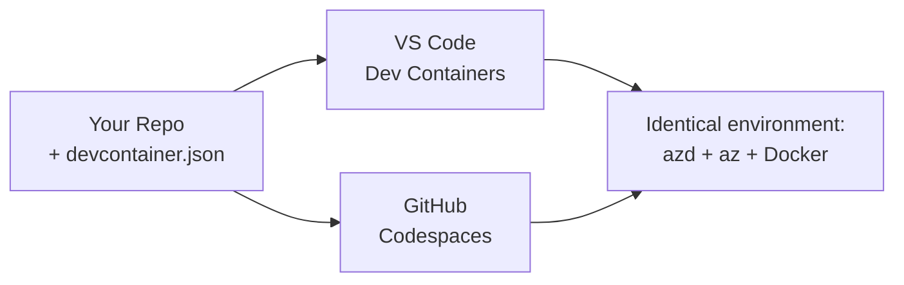

# azdಗಾಗಿ ಡೆವ್ ಕಂಟೈನರ್ಸ್ ಮತ್ತು GitHub ಕೋಡ್ಸ್ಪೇಸ್‌ಗಳು

**ಅಧ್ಯಾಯ ನ್ಯಾವಿಗೇಶನ್:**
- **📚 ಕೋರ್ಸ್ ಹೋಮ್**: [ಆರಂಬಿಕರಿಗೆ AZD](../../README.md)
- **📖 ಪ್ರಸ್ತುತ ಅಧ್ಯಾಯ**: ಅಧ್ಯಾಯ 1 - ಮೂಲಭೂತ ಮತ್ತು ತ್ವರಿತ ಪ್ರಾರಂಭ
- **⬅️ ಹಿಂದಿನದು**: [ನಿಮ್ಮದೇ ಅಪ್ಲಿಕೇಶನ್ ಅನ್ನು ತರಲು](bring-your-own-app.md)
- **🚀 ಮುಂದಿನ ಅಧ್ಯಾಯ**: [ಅಧ್ಯಾಯ 2: AI-ಪ್ರಥಮ ಅಭಿವೃದ್ಧಿ](../chapter-02-ai-development/README.md)

> ಆಜ್ಞೆ ಮತ್ತು ಸೆಟ್ಟಿಂಗ್ ಪರಿಶೀಲನೆ ಗುರಿ: `azd 1.37.2` (ನವೆಂಬರ್ 2026). ಈ ವಿಮರ್ಶೆಯ ಭಾಗವಾಗಿ ಕಂಟೈನರ್ ನಿರ್ಮಾಣಗಳು ಮತ್ತು ಅಜೂರ್ ನಿಯೋಜನೆಗಳು ಕಾರ್ಯಗತಗೊಳಿಸಲಿಲ್ಲ.

## ಪರಿಚಯ

ಪ್ರತಿಯೊಂದು ಯಂತ್ರದಲ್ಲೂ azd, ಸರಿಯಾದ ಭಾಷಾ ರನ್ಟೈಮ್, ಡೋಕರ್ ಮತ್ತು ಅಜೂರ್ CLI ಅನ್ನು ಸ್ಥಾಪಿಸುವುದು ಕಷ್ಟವಾಗಿದ್ದು, "ನನ್ನ ಯಂತ್ರದಲ್ಲಿ ಕೆಲಸ ಮಾಡುತ್ತದೆ" ಎಂದು ಹೇಳುವ ಪಾಠೋದ್ಯಮ ಬೇರೆ ಯಾರಿಗೋ ವಿಫಲವಾಗುವ ಅದರ ಪ್ರಮುಖ ಕಾರಣ. ಒಂದು **ಡೆವ್ ಕಂಟೈನರ್** ನಿಮ್ಮ ಸಂಪೂರ್ಣ ಉಪಕರಣ ಸರಣಿಯನ್ನು ಒಂದು ಫೈಲ್‌ನಲ್ಲಿ ವಿವರಿಸುವ ಮೂಲಕ ಇದನ್ನು ಪರಿಹರಿಸುತ್ತದೆ. ಯಾರು ಪ್ರಾಜೆಕ್ಟ್ ಅನ್ನು VS ಕೋಡ್ ಅಥವಾ GitHub Codespaces ನಲ್ಲಿ ತೆರೆಯುತ್ತಾರೆಯೋ ಅವರನ್ನು ದುಸ್ಸಬ್ದದ ವ್ಯತ್ಯಾಸವಿಲ್ಲದೆ ಒಂದೇ ಪರಿಸರ ದೊರೆಯುತ್ತದೆ, ಅಲ್ಲಿ azd ಈಗಾಗಲೇ ಇನ್ಸ್ಟಾಲ್ ಆಗಿರುತ್ತದೆ. ಈ ಪಾಠದಲ್ಲಿ ನೀವು ಅದನ್ನು ಹೇಗೆ ಸೇರಿಸಲು ಎಂದು ತಿಳಿಯುತ್ತೀರಿ.

## ಕಲಿಕೆಯ ಗುರಿಗಳು

ಈ ಪಾಠದ ಅಂತ್ಯಕ್ಕೆ ನೀವು:
- ಡೆವ್ ಕಂಟೈನರ್ ಎಂಬುದು ಏನು ಮತ್ತು ಅದು azd ಗೆ ಏಕೆ ಸಹಾಯ ಮಾಡುತ್ತದೆ ಎಂದು ಅರ್ಥಮಾಡಿಕೊಳ್ಳುತ್ತೀರಾ
- ಪ್ರಾಜೆಕ್ಟ್‌ಗೆ ಕನಿಷ್ಟ `.devcontainer/devcontainer.json` ಸೇರಿಸುತ್ತೀರಾ
- Dev Container *ವೈಶಿಷ್ಟ್ಯಗಳ* ಮೂಲಕ azd, Azure CLI ಮತ್ತು ಡೋಕರ್ ಅನ್ನು ಒಳಗೊಂಡಿರುತ್ತೀರಾ
- GitHub Codespaces ಅಥವಾ VS ಕೋಡ್‌ನಲ್ಲಿ ಪ್ರಾಜೆಕ್ಟ್ ತೆರೆದಿಡುತ್ತೀರಾ

## ಕಲಿಕೆಯ ಫಲಿತಾಂಶಗಳು

ಈ ಪಾಠವನ್ನು ಪೂರ್ಣಗೊಳಿಸಿದ ನಂತರ ನೀವು:
- azd ಪ್ರಾಜೆಕ್ಟ್‌ಗೆ `devcontainer.json` ರಚಿಸಬಲ್ಲಿರಿ
- ಕೈಯಿಂದ ಸ್ಥಾಪನೆಗಳಿಲ್ಲದೆ azd ಮತ್ತು ಅಜೂರ್ ಉಪಕರಣಗಳನ್ನು ಸೇರಿಸಬಲ್ಲಿರಿ
- ಕಂಟೈನರ್ ಅಥವಾ Codespace ಒಳಗೆ ಇರುತ್ತಿರುವುದು `azd up` ಅನ್ನು ಚಲಾಯಿಸಬಹುದು

---

## ಡೆವ್ ಕಂಟೈನರ್ ಎಂದರೆ ಏನು?

ಡೆವ್ ಕಂಟೈನರ್ ಎಂದರೆ ನಿಮ್ಮ ರೆಪೋಜಿಟರಿಯಲ್ಲಿರುವ `.devcontainer/devcontainer.json` ಫೈಲ್ ದ್ವಾರಾ ವ್ಯಾಖ್ಯಾನಿಸಲಾದ ಡೋಕರ್ ಆಧಾರಿತ ಅಭಿವೃದ್ಧಿ ಪರಿಸರ. ನೀವು ಪ್ರಾಜೆಕ್ಟ್ ತೆರೆಯುವಾಗ:

- **VS ಕೋಡ್** (ಡೆವ್ ಕಂಟೈನರ್ಸ್ ವಿಸ್ತರಣೆ ಜೊತೆ) ಕಂಟೈನರ್ ನಿರ್ಮಿಸಿ ಅದಕ್ಕೆ ಅಟ್ಯಾಚ್ ಆಗುತ್ತದೆ.
- **GitHub Codespaces** ಅದೇ ಕಂಟೈನರ್ ಅನ್ನು ಕ್ಲೌಡ್‌ನಲ್ಲಿ ನಿರ್ಮಿಸಿ ನಿಮಗೆ ಬ್ರೌಸರ್ ಆಧಾರಿತ ಎಡಿಟರ್ ಅನ್ನು ನೀಡುತ್ತದೆ.

ಯಾವ ರೀತಿಯಲ್ಲಾದರೂ, ಪ್ರತಿ ಸಹಯೋಗಿ ಸಮಾನ ಉಪಕರಣಗಳನ್ನು ಪಡೆಯುತ್ತಾರೆ— "ನೀವು azd ಇನ್ಸ್ಟಾಲ್ ಮಾಡಿದ್ದೀರಾ?" ಎಂಬ ಸಮಸ್ಯೆ ಇಲ್ಲ.



---

## ಹೆಜ್ಜೆ 1: devcontainer ಫೈಲ್ ರಚಿಸಿ

ನಿಮ್ಮ ಪ್ರಾಜೆಕ್ಟ್‌ನ ರೂಟ್‌ನಲ್ಲಿ `.devcontainer/devcontainer.json` ರಚಿಸಿ:

```json
{
  "name": "azd-project",
  "image": "mcr.microsoft.com/devcontainers/base:bookworm",
  "features": {
    "ghcr.io/devcontainers/features/azure-cli:1": {},
    "ghcr.io/azure/azure-dev/azd:0": { "version": "1.37.2" },
    "ghcr.io/devcontainers/features/docker-in-docker:2": {},
    "ghcr.io/devcontainers/features/node:1": {}
  },
  "customizations": {
    "vscode": {
      "extensions": [
        "ms-azuretools.azure-dev",
        "ms-azuretools.vscode-bicep"
      ]
    }
  },
  "forwardPorts": [3000],
  "postCreateCommand": "azd version"
}
```

ಪ್ರತಿ ಭಾಗ ಏನು ಮಾಡುತ್ತದೆ:

| ಕೀ | ಉದ್ದೇಶ |
|-----|---------|
| `image` | ಕಂಟೈನರ್ ಗೆ ಮೂಲ OS |
| `features` | ಪೂರ್ವ-ನಿರ್ಮಿತ ಸ್ಥಾಪಕರು—ಇಲ್ಲಿ: ಅಜೂರ್ CLI, **azd**, ಡೋಕರ್ ಮತ್ತು ನೋಡ್.js |
| `customizations.vscode.extensions` | azd ಮತ್ತು Bicep VS ಕೋಡ್ ವಿಸ್ತರಣೆಗಳನ್ನು ಸ್ವಯಂಚಾಲಿತವಾಗಿ ಸ್ಥಾಪಿಸುತ್ತದೆ |
| `forwardPorts` | ನಿಮ್ಮ ಅಪ್‌ಪ್ಲಿಕೇಶನ್‌ನ ಪೋರ್ಟ್ ಅನ್ನು ಬ್ರೌಸರ್‌ಗೆ ಬಹಿರಂಗಗೊಳಿಸುತ್ತದೆ |
| `postCreateCommand` | ಕಂಟೈನರ್ ನಿರ್ಮಿತವಾದ ನಂತರ ಒಮ್ಮೆ ನಡೆಸುತ್ತದೆ (ಇಲ್ಲಿ, ಸ್ಯಾನಿಟಿ ಪರಿಶೀಲನೆ) |

> ವೈಶಿಷ್ಟ್ಯ ಆವೃತ್ತಿ (`azd:0`) ಮತ್ತು ಇನ್ಸ್ಟಾಲ್ ಆಗಿರುವ CLI ಆವೃತ್ತಿ ಬೇರೆಬೇರೆ ಇದ್ದವೆ. CLI ಅನ್ನು ಪಿನ್ ಮಾಡಲು ವೈಶಿಷ್ಟ್ಯದ `version` ಆಯ್ಕೆಯನ್ನು `"1.37.2"` ಗೆ ಸೆಟ್ ಮಾಡಿ; ವೈಶಿಷ್ಟ್ಯ ಟ್ಯಾಗ್ ಆಗಿ CLI ಆವೃತ್ತಿಯನ್ನು ಬಳಸದಿರಿ.

---

## ಹೆಜ್ಜೆ 2: ನಿಮ್ಮ ಅಪ್ಲಿಕೇಶನ್ ಭಾಷೆಗೆ ವೈಶಿಷ್ಟ್ಯವನ್ನು ಹೊಂದಿಸಿ

ನಿಮ್ಮ ಅಪ್ಲಿಕೇಶನ್ ಬಳಸುವ ಭಾಷೆಗೆ `node` ವೈಶಿಷ್ಟ್ಯವನ್ನು ಬದಲಾಯಿಸಿ:

```jsonc
// Python project
"ghcr.io/devcontainers/features/python:1": {},

// .NET project
"ghcr.io/devcontainers/features/dotnet:2": {},

// Java project
"ghcr.io/devcontainers/features/java:1": {},

// Go project
"ghcr.io/devcontainers/features/go:1": {}
```

ಪ್ರಾದೇಶಿಕವಾಗಿ ಇಮೇಜ್‌ಗಳನ್ನು ನಿರ್ಮಿಸುವಾಗ `docker-in-docker` ಉಳಿಸಿರಿ. ಒದಗಿಸಲಾದ ದೂರಸ್ಥ ACR ನಿರ್ಮಾಣ (`docker.remoteBuild: true`) ಪರ್ಯಾಯ; ತಲಾ ಪ್ರಕಾರ ಕೇವಲ ಸ್ಥಳೀಯ ಡೋಕರ್ ಅವಶ್ಯಕವಿಲ್ಲ.

---

## ಹೆಜ್ಜೆ 3: ಅದನ್ನು ತೆರೆಯಿರಿ

**VS ಕೋಡ್‌ನಲ್ಲಿ:**
1. **ಡೆವ್ ಕಂಟೈನರ್ಸ್** ವಿಸ್ತರಣೆ ಸ್ಥಾಪಿಸಿ.
2. ಪ್ರಾಜೆಕ್ಟ್ ಫೋಲ್ಡರ್ ತೆರೆಯಿರಿ.
3. ಪ್ರಾಂಪ್ಟ್ ಬರುವಾಗ **ತ್ರುಟಿ ಪುನರ್ ತೆರೆಯಿರಿ** ಕ್ಲಿಕ್ ಮಾಡಿ (ಅಥವಾ *Dev Containers: Reopen in Container* ਚಲಾಯಿಸಿ).

**GitHub Codespaces ನಲ್ಲಿ:**
1. ರೆಪೊ GitHub ಗೆ ಪುಷ್ ಮಾಡಿ.
2. **ಕೋಡ್ → ಕೋಡ್ಸ್ಪೇಸಸ್ → ಮುಖ್ಯದಲ್ಲಿ ಕೋಡ್ಸ್ಪೇಸ್ ರಚಿಸಿ** ಕ್ಲಿಕ್ ಮಾಡಿ.
3. ಕಂಟೈನರ್ ನಿರ್ಮಾಣಕ್ಕಾಗಿ ನಿರೀಕ್ಷಿಸಿ—ಅಲ್ಲಿ ಟರ್ಮಿನಲ್‌ನಲ್ಲಿ azd ಸಿದ್ಧವಾಗಿದೆ.

---

## ಹೆಜ್ಜೆ 4: ಕಂಟೈನರ್ ಒಳಗೆನಿಂದ ನಿಯೋಜಿಸಿ

ಕಂಟೈನರ್‌ನಲ್ಲಿ azd ಇನ್‌ಸ್ಟಾಲ್ ಆಗಿರುವುದರಿಂದ ಸಹಜ ಕಾರ್ಯಪದ್ಧತಿ ಕೆಲಸ ಮಾಡುತ್ತದೆ:

```bash
azd auth login --use-device-code   # device code is handy inside Codespaces
azd up
```

> **ಏಕೆ `--use-device-code`?** ದೂರಸ್ಥ ಕಂಟೈನರ್ ಅಥವಾ ಕೋಡ್ಸ್ಪೇಸಿನಲ್ಲಿ ಸ್ಥಳೀಯ ಬ್ರೌಸರ್ ಇಲ್ಲದಿರುವುದರಿಂದ, ಸಾಧನ-ಕೊಡ್ ಲಾಗಿನ್ ವಿಶ್ವಾಸಾರ್ಹ ಮಾರ್ಗವಾಗಿದೆ. ನೀವು ಸೈನ್ ಇನ್ ಪೂರ್ಣಗೊಳಿಸಲು ಬ್ರೌಸರ್ ಟ್ಯಾಬ್‌ನಲ್ಲಿ ಕೋಡ್ ನಕಲಿಸುವಿರಿ.

---

## ಸಾಮಾನ್ಯ ದೋಷಗಳು

| ದೋಷ | ಪರಿಹಾರ |
|---------|-----|
| `azd up` ಇಮೇಜ್ ನಿರ್ಮಿಸಲು ಸಾಧ್ಯವಿಲ್ಲ | `docker-in-docker` ವೈಶಿಷ್ಟ್ಯವನ್ನು ಸೇರಿಸಿ |
| Codespaces ನಲ್ಲಿ ಬ್ರೌಸರ್ ಲಾಗಿನ್ ನಿಂತುಕೊಳ್ಳುತ್ತದೆ | `azd auth login --use-device-code` ಬಳಸಿರಿ |
| ಉಪಕರಣಗಳು ಸಹಚರರಲ್ಲಿ ವ್ಯತ್ಯಾಸ | azd ವೈಶಿಷ್ಟ್ಯದ `version` ಆಯ್ಕೆಯಿಂದ CLI ಅನ್ನು ಪಿನ್ ಮಾಡಿ ಮತ್ತು ಭಾಷಾ ರನ್ಟೈಮ್‌ಗಳನ್ನು ಪಿನ್ ಮಾಡಿ |
| ಬ್ರೌಸರ್‌ನಲ್ಲಿ ಅಪ್ಲಿಕೇಶನ್ ತಲುಪಲು ಸಾಧ್ಯವಿಲ್ಲ | `forwardPorts` ಗೆ ಪೋರ್ಟ್ ಸೇರಿಸಿ |

---

## ಸಾರಾಂಶ

- ಡೆವ್ ಕಂಟೈನರ್ ನಿಮ್ಮ azd ಉಪಕರಣ ಸರಣಿಯನ್ನು ಪ್ರತಿಯಿಂದ ಪ್ರತಿಗೆತ್ತುವಂತೆ ಮಾಡುತ್ತದೆ.
- ಡೆವ್ ಕಂಟೈನರ್ *ವೈಶಿಷ್ಟ್ಯಗಳ* ಮೂಲಕ azd, ಅಜೂರ್ CLI ಮತ್ತು ಡೋಕರ್ ಸೇರಿಸಿ.
- ನಿಮ್ಮ ಅಪ್ಲಿಕೇಶನ್‌ಗೆ ಭಾಷಾ ವೈಶಿಷ್ಟ್ಯವನ್ನು ಹೊಂದಿಸಿ ಮತ್ತು ಕಂಟೈನರ್ ಹೋಸ್ಟ್‌ಗಳಿಗೆ `docker-in-docker` ಉಳಿಸಿ.
- Codespaces ಒಳಗೆ ನಿರ್ವಹಿಸುವಾಗ ಸಾಧನ-ಕೋಡ್ ಲಾಗಿನ್ ಬಳಸಿ.

---

## 🔗 ನ್ಯಾವಿಗೇಶನ್

| ದಿಕ್ಕು | ಸಂಪನ್ಮೂಲ |
|-----------|----------|
| **ಹಿಂದಿನದು** | [ನಿಮ್ಮದೇ ಅಪ್ಲಿಕೇಶನ್ ಅನ್ನು ತರಲು](bring-your-own-app.md) |
| **ಅಧ್ಯಾಯ ಹೋಮ್** | [ಅಧ್ಯಾಯ 1: ಮೂಲಭೂತ ಮತ್ತು ತ್ವರಿತ ಪ್ರಾರಂಭ](README.md) |
| **ಮುಂದಿನ ಅಧ್ಯಾಯ** | [ಅಧ್ಯಾಯ 2: AI-ಪ್ರಥಮ ಅಭಿವೃದ್ಧಿ](../chapter-02-ai-development/README.md) |

## 📖 ಸಂಬಂಧಿಸಿದ ಸಂಪನ್ಮೂಲಗಳು

- [ಇನ್‌ಸ್ಟಲೇಷನ್ ಮತ್ತು ಸೆಟ್‌ಅಪ್](installation.md)
- [ಕಮಾಂಡ್ ಚೀಟ್ ಶೀಟ್](../../resources/cheat-sheet.md)
- [ಅಧಿಕೃತ ಡೆವ್ ಕಂಟೈನರ್ ವಿಶೇಷಣ](https://containers.dev/)
- [azd ಡೆವ್ ಕಂಟೈನರ್ ವೈಶಿಷ್ಟ್ಯ](https://github.com/Azure/azure-dev/tree/main/ext/devcontainer)

---

<!-- CO-OP TRANSLATOR DISCLAIMER START -->
**ಅಸ್ವೀಕಾರ**:
ಈ ದಸ್ತಾವೇಜು AI ಅನುವಾದ ಸೇವೆ [Co-op Translator](https://github.com/Azure/co-op-translator) ಬಳಸಿ ಅನುವಾದಿಸಲಾಗಿದೆ. ನಾವು ನಿಖರತೆಯನ್ನು ಸಾಧಿಸಲು ಪ್ರಯತ್ನಿಸುತ್ತಿದ್ದರೂ, ದಯವಿಟ್ಟು ಗಮನಿಸಿ, ಸ್ವಯಂಚಾಲಿತ ಅನುವಾದಗಳಲ್ಲಿ ದೋಷಗಳು ಅಥವಾ ಅಸಡ್ಡೆಗಳು ಇರಬಹುದು. ಮೂಲ ಭಾಷೆಯಲ್ಲಿರುವ ಮೂಲ ದಸ್ತಾವೇಜು ಪ್ರಾಮಾಣಿಕ ಮೂಲವೆಂದು ಪರಿಗಣಿಸಬೇಕು. ಪ್ರಮುಖ ಮಾಹಿತಿಗಾಗಿ, ವೃತ್ತಿಪರ ಮಾನವ ಅನುವಾದವನ್ನು ಶಿಫಾರಸು ಮಾಡಲಾಗುತ್ತದೆ. ಈ ಅನುವಾದವನ್ನು ಬಳಸುವ ಮೂಲಕ ಉಂಟಾಗುವ ಯಾವುದೇ ತಪ್ಪು ಅರ್ಥಗಳ ಅಥವಾ ತಪ್ಪು ವ್ಯಾಖ್ಯಾನಗಳ ಬಗ್ಗೆ ನಾವು ಹೊಣೆಗಾರರಲ್ಲ.
<!-- CO-OP TRANSLATOR DISCLAIMER END -->