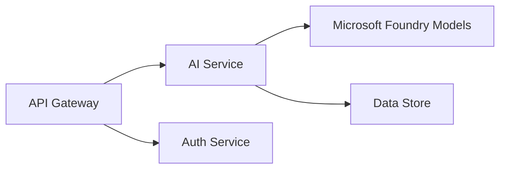
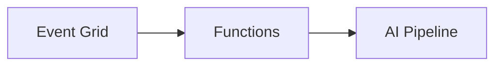

# ಅಧ್ಯಾಯ 8: ಉತ್ಪಾದನೆ ಮತ್ತು ಉದ್ಯಮ ಮಾದರಿಗಳು

**📚 ಕೋರ್ಸ್**: [ಆಜ್ಡಿ ಪ್ರಾರಂಭಿಕರಿಗೆ](../../README.md) | **⏱️ ಅವಧಿ**: 2-3 ಗಂಟೆಗಳು | **⭐ ಸಂಕೀರ್ಣತೆ**: ಮುಂದಿನ ಹಂತ

---

## ಅವಲೋಕನ

ಈ ಅಧ್ಯಾಯವು ಉದ್ಯಮ-ಸಿದ್ದತೆ ಹೊಂದಿರುವ ನಿಯೋಜನೆ ಮಾದರಿಗಳು, ಭದ್ರತಾ ಗಟ್ಟಿತನ, ನಿಗಾ ಮತ್ತು ಉತ್ಪಾದನಾ AI ಕಾರ್ಯಭಾರಗಳ ವೆಚ್ಚ ಉಪಯುಕ್ತತೆ ಕುರಿತು ಒಳಗೊಂಡಿದೆ.

ಇದು ಸම්ಪೂರ್ಣ ನಿಯೋಜಿಸಲು ಸಾಧ್ಯವಿರುವ ನಿರ್ಮಾಣ ಮಾದರಿಯಲ್ಲ, ಆದರೆ ವಾಸ್ತುವಿದೆ; ಉದಾಹರಣೆಗಳು ಸಂಯೋಜನಾ ವಿವರಗಳನ್ನು ಒಳಗೊಳ್ಳುವುದಿಲ್ಲ, ಅವು ನಿಮ್ಮ ಸ್ವಂತ ಅನ್ವಯಿಕೆಯಲ್ಲಿ ಸರಬರಾಜು ಮಾಡಿಬಳಕೆ ಮತ್ತು ಪರೀಕ್ಷೆ ಮಾಡಬೇಕಾಗುತ್ತದೆ; ಪರಿಶೀಲನಾ ಪಟ್ಟಿಯನ್ನು ಓದಲು ಉಚಿತ-ತ್ಯಾರಿಕೆಯನ್ನು ಪ್ರಮಾಣೀಕರಿಸುವುದಿಲ್ಲ.

> **ವಿಡಿರಭಾಗ ವಿಮರ್ಶನ (2026-11-04):** AI CLI ಮಾರ್ಗದರ್ಶನವನ್ನು `azd 1.37.2`, ಏಜೆಂಟ್ಗಳು `1.0.0-beta.23`, ಮತ್ತು ಮೌಲ್ಯಮಾಪನಗಳು `1.0.0-beta.2` ಡಾಕ್ಯುಮೆಂಟೇಶನ್/ಮೂಲದೊಂದಿಗೆ ಪರಿಶೀಲಿಸಲಾಗಿದೆ. ಹೊಂದಾಣಿಕೆ ಅವಶ್ಯಕತೆಗಳು ಮತ್ತು ಸ್ಥಳಾಂತರ ವಿವರಗಳಿಗಾಗಿ [ವಿಡಿರಭಾಗ ಬದಲಾವಣೆಗಳು ಮತ್ತು ಸರಿಪಡಿಕೆಗಳು](production-ai-practices.md#recent-release-changes-and-fixes) ನೋಡಿ; ಇದು ಜೀವಂತ ನಿಯೋಜನೆ ಮಾನ್ಯತೆ ಅಲ್ಲ.

## ಕಲಿಕೆಯ ಗುರಿಗಳು

ಈ ಅಧ್ಯಾಯವನ್ನು ಮುಗಿಸಿಕೊಂಡು ನೀವು:
- ಬಹು-ಪ್ರದೇಶ ತೂಕ ಇಡುವ ಅನ್ವಯಿಕೆಗಳನ್ನು ನಿಯೋಜಿಸುವಿರಿ
- ಉದ್ಯಮ ಭದ್ರತಾ ಮಾದರಿಗಳನ್ನು ಅನುಷ್ಠಾನ ಮಾಡುವಿರಿ
- ಸಮಗ್ರ ನಿಗಾ ವ್ಯವಸ್ಥೆಯನ್ನು ಸಂರಚಿಸುವಿರಿ
- ಪ್ರಮಾಣದಲ್ಲಿ ವೆಚ್ಚವನ್ನು ತಗ್ಗಿಸುವಿರಿ
- ಆಜ್ಡಿ ಸಹಿತ CI/CD ಪೈಪ್ಲೈನ್ಗಳು ಸ್ಥಾಪಿಸುವಿರಿ

---

## 📚 ಪಾಠಗಳು

| # | ಪಾಠ | ವಿವರಣೆ | ಸಮಯ |
|---|--------|-------------|------|
| 1 | [ಉತ್ಪಾದನಾ AI ಅನುಭವಗಳು](production-ai-practices.md) | ಉದ್ಯಮ ನಿಯೋಜನೆ ಮಾದರಿಗಳು | 90 ನಿಮಿ |

---

## 🚀 ಉತ್ಪಾದನಾ ಪರಿಶೀಲನಾ ಪಟ್ಟಿ

- [ ] ಮಾಡಲು ಮಲ್ಟಿ-ಪ್ರದೇಶ ನಿಯೋಜನೆ
- [ ] ದೃಢೀಕರಣಕ್ಕೆ ನಿರ್ವಹಿತ ಗುರುತು (ಕೀಳಿಲ್ಲದೆ)
- [ ] ನಿಗಾ ಉದ್ದೇಶಕ್ಕೆ ಅನ್ವಯಿಕೆ ಆಳ್ವಿಕೆಗಳ ತಿಳಿವಳಿಕೆ
- [ ] ವೆಚ್ಚ ಬಜೆಟ್‌ಗಳು ಮತ್ತು ಎಚ್ಚರಿಕೆಗಳು ನಿಗಧಿ ಮಾಡಲಾಗಿದೆ
- [ ] ಭದ್ರತಾ ತಪಾಸಣೆ ಸಕ್ರಿಯವಾಗಿದೆ
- [ ] CI/CD ಪೈಪ್ಲೈನ್ ಸಂಯೋಜನೆ
- [ ] ವಿಪತ್ತು ಪುನರುದ್ದಾರ ಯೋಜನೆ

---

## 🏗️ ವಾಸ್ತುಶಿಲ್ಪ ಮಾದರಿಗಳು

### ಮಾದರಿ 1: ಮೈಕ್ರೋಸರ್ವಿಸಸ್ AI



### ಮಾದರಿ 2: ಘಟನೆ ಚಾಲಿತ AI



---

## 🔐 ಭದ್ರತೆ ಅತ್ಯುತ್ತಮ ಅಭ್ಯಾಸಗಳು

```bicep
// Illustrative properties from different resources, NOT a standalone Bicep file.
// Attach identity to the application host:
identity: {
  type: 'SystemAssigned'
}

// AI account properties (also require private endpoints, DNS and app connectivity):
properties: {
  publicNetworkAccess: 'Disabled'
  networkAcls: {
    defaultAction: 'Deny'
  }
}
```

---

## 💰 ವೆಚ್ಚ ಉತ್ಕೃಷ್ಟೀಕರಣ

| ತಂತ್ರ | ಮುಖ್ಯ ನಿರ್ಬಂಧ |
|----------|---------|
| ಶೂನ್ಯಕ್ಕೆ ಪ್ರಮಾಣದ ಗ್ರಂಥಿ (ಕಂಟೈನರ್ ಅಪ್ಲಿಕೇಶನ್ಸ್) | ಸೂಕ್ತ ಟ್ರಿಗರ್ ಅಗತ್ಯವಿದೆ; ಇತರೆ ಸೇವೆಗಳು ವೆಚ್ಚ ತಗಲಿಸುತ್ತವೆ |
| ಅಭಿವೃದ್ಧಿಗಾಗಿ ಉಪಯೋಗದ ಅಂಶಗಳ tiers ಬಳಕೆ | ಆಯ್ಕೆ ಮಾಡಿದ ಸೇವೆಗಳ ಬೆಲೆ ಮತ್ತು ಕಾರ್ಯಭಾರವನ್ನು ಹೋಲಿಸಿ |
| ವೇಳಾಪಟ್ಟಿಯ ಪ್ರಮಾಣದ ವಿಸ್ತರಣೆ | ಬೆಂಬಲಿತ ಮೂಲಸೌಕರ್ಯ/ಸ್ವಯಂಪ್ರೇರಣದ ಮೂಲಕ ಪ್ರಮಾಣವನ್ನು ವಿಸ್ತರಿಸಿ |
| ಕಾಯ್ದಿರಿಸುವಿಕೆಯನ್ನು/ನಿಗಧಿಪಡಿಸಿದ ಸಾಮರ್ಥ್ಯ | ಬೆಂಬಲಿತವಾಗಿದ್ದಾಗ ಮಾತ್ರ; ಬದ್ಧತೆಗಳು ಶೂನ್ಯ ಸ್ಥಿತಿಯ ವೆಚ್ಚವನ್ನು ಹೆಚ್ಚಿಸಬಹುದು |

ಮಾನ್ಯ ಪ್ರಾರಂಭ ದಿನಾಂಕ, ಬಿಲ್ಲಿಂಗ್ ವ್ಯಾಪ್ತಿ, ಸ್ವೀಕರಿಸುವವರು ಮತ್ತು ಅನುಮತಿಗಳೊಂದಿಗೆ [ಸಂಪೂರ್ಣ ಬಜೆಟ್ ಸಂಪನ್ಮೂಲ ಮಾದರಿಯನ್ನು](production-ai-practices.md#2-cost-monitoring-and-budgets) ಬಳಸಿ. ಬಜೆಟ್ ಎಚ್ಚರಿಕೆಗಳನ್ನು ಕಳುಹಿಸುತ್ತದೆ; ವೆಚ್ಚವನ್ನು ಮಿತಿಗೊಳಿಸುವುದಿಲ್ಲ. ಉಳಿತಾಯವು ಮಾಪಿತ ಬಳಕೆಯ ಆಧಾರದ ಮೇಲೆ ಇರುತ್ತದೆ ಮತ್ತು ಭರತಾರಿತ ಪ್ರಮಾಣಗಳಾದ್ರು ಗ್ಯಾರಂಟಿ ಇಲ್ಲ.

---

## 📊 ನಿಗಾ ವ್ಯವಸ್ಥೆ ಸ್ಥಾಪನೆ

```bash
# Open the Application Insights logs view (requires configured monitoring)
azd monitor --logs

# Check Application Insights
azd monitor --overview

# View metrics
az monitor metrics list --resource <resource-id>
```

---

## 🔗 ನ್ಯಾವಿಗೇಶನ್

| ದಿಕ್ಕು | ಅಧ್ಯಾಯ |
|-----------|---------|
| **ಹಿಂದಿನದು** | [ಅಧ್ಯಾಯ 7: ಸಮಸ್ಯೆ ಪರಿಹಾರ](../chapter-07-troubleshooting/README.md) |
| **ಕೋರ್ಸ್ ಪೂರ್ಣಗೊಂಡಿದೆ** | [ಕೋರ್ಸ್ ಮನೆ](../../README.md) |

---

## 📖 ಸಂಬಂಧಿಸಿದ ಸಂಪನ್ಮೂಲಗಳು

- [AI ಏಜೆಂಟ್ಸ್ ಮಾರ್ಗದರ್ಶಿ](../chapter-02-ai-development/agents.md)
- [ಅನ್ವಯಿಕೆ ತಿಳಿವಳಿಕೆ](../chapter-06-pre-deployment/application-insights.md)
- [ಬಹು-ಏಜೆಂಟ್ ಪರಿಹಾರಗಳು](../chapter-05-multi-agent/README.md)
- [ಮೈಕ್ರೋಸರ್ವಿಸಸ್ ಉದಾಹರಣೆ](../../examples/microservices/README.md)

---

<!-- CO-OP TRANSLATOR DISCLAIMER START -->
**ಅಸ್ವೀಕಾರ**:
ಈ ದಸ್ತಾವೇಜು AI ಅನುವಾದ ಸೇವೆ [Co-op Translator](https://github.com/Azure/co-op-translator) ಬಳಸಿ ಅನುವಾದಿಸಲಾಗಿದೆ. ನಾವು ನಿಖರತೆಯನ್ನು ಸಾಧಿಸಲು ಪ್ರಯತ್ನಿಸುತ್ತಿದ್ದರೂ, ದಯವಿಟ್ಟು ಗಮನಿಸಿ, ಸ್ವಯಂಚಾಲಿತ ಅನುವಾದಗಳಲ್ಲಿ ದೋಷಗಳು ಅಥವಾ ಅಸಡ್ಡೆಗಳು ಇರಬಹುದು. ಮೂಲ ಭಾಷೆಯಲ್ಲಿರುವ ಮೂಲ ದಸ್ತಾವೇಜು ಪ್ರಾಮಾಣಿಕ ಮೂಲವೆಂದು ಪರಿಗಣಿಸಬೇಕು. ಪ್ರಮುಖ ಮಾಹಿತಿಗಾಗಿ, ವೃತ್ತಿಪರ ಮಾನವ ಅನುವಾದವನ್ನು ಶಿಫಾರಸು ಮಾಡಲಾಗುತ್ತದೆ. ಈ ಅನುವಾದವನ್ನು ಬಳಸುವ ಮೂಲಕ ಉಂಟಾಗುವ ಯಾವುದೇ ತಪ್ಪು ಅರ್ಥಗಳ ಅಥವಾ ತಪ್ಪು ವ್ಯಾಖ್ಯಾನಗಳ ಬಗ್ಗೆ ನಾವು ಹೊಣೆಗಾರರಲ್ಲ.
<!-- CO-OP TRANSLATOR DISCLAIMER END -->