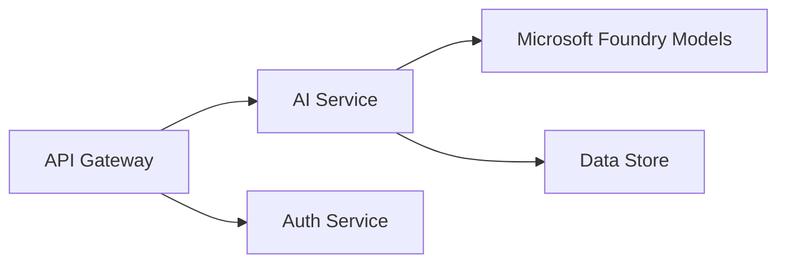
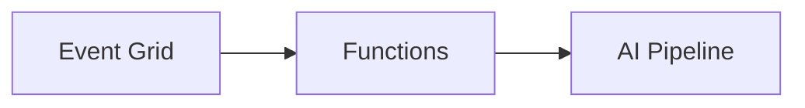

# ಅಧ್ಯಾಯ 8: ಉತ್ಪಾದನೆ & ಎಂಟರ್ಪ್ರೈಸ್ ಮಾದರಿಗಳು

**📚 ಕೋರ್ಸ್**: [ಆಜಡ್ ಫಾರ್ ಬೆಗಿನ್ನರ್ಸ್](../../README.md) | **⏱️ ಅವಧಿ**: 2-3 ಗಂಟೆಗಳು | **⭐ ಜಟಿಲತೆ**: ಮುಂದಿನ ಹಂತ

---

## ಅವಲೋಕನ

ಈ ಅಧ್ಯಾಯವು ಎಂಟರ್ಪ್ರೈಸ್ ಸಿದ್ಧ ಬಾಹ್ಯಾವಣೆ ಮಾದರಿಗಳು, ಭದ್ರತಾ ಗಟ್ಟಿತೆಯನ್ನು, ಪರಿಗಣನೆ, ಮತ್ತು ಉತ್ಪಾದನಾ AI ಕೆಲಸಭಾರಗಳ ವೆಚ್ಚದ ಆಪ್ಟಿಮೈಜೆಷನ್ ಅನ್ನು ವಿವರಿಸುತ್ತದೆ.

ಇದು ವಾಸ್ತುಶಿಲ್ಪ ಸಂಬಂಧಿತ ಸೂಚನದಾಗಿದ್ದು, ಸಂಪೂರ್ಣ ವೈಶಿಷ್ಟ್ಯಪಡಿಸಿದ ಉತ್ಪಾದನಾ ಟೆಂಪ್ಲೇಟು ಅಲ್ಲ. ಉದಾಹರಣೆಗಳು ನಿಮ್ಮ ಸ್ವಂತ ಅಪ್ಲಿಕೇಶನ್‌ನಲ್ಲಿ ಒದಗಿಸಲಾಗಬೇಕಾದ ಮತ್ತು ಪರೀಕ್ಷಿಸಲಾಗಬೇಕಾದ ಏಕೀಕರಣ ವಿವರಗಳನ್ನು ಹೊರತಾಗಿವೆ; ಪರಿಶೀಲನೆ ಪಟ್ಟಿ ಓದುವುದು ಉತ್ಪಾದನಾ ಸಿದ್ಧತೆಯನ್ನು ಪ್ರಮಾಣೀಕರಿಸುವುದಿಲ್ಲ.

> **Foundry GA ನವೀಕರಣ (2026-11-09):** Foundry ವರ್ಕ್ಫ್ಲೋಗೆ `azd >= 1.37.0` ಮತ್ತು ಸಾಮಾನ್ಯವಾಗಿ ಲಭ್ಯವಿರುವ `microsoft.foundry` 1.0 ಬಂಡಲ್ ಅನ್ನು ಬಳಸಿ; ಮೌಲ್ಯಮಾಪನಗಳು ಪ್ರತ್ಯೇಕವಾಗಿ ಸ್ಥಾಪಿಸಲಾಗುತ್ತವೆ. [ವಿಡಂಬನೆಯ ವ್ಯಾಪ್ತಿ ಮತ್ತು ವಲಸೆ](production-ai-practices.md#recent-release-changes-and-fixes) ಮತ್ತು [ಪ್ರಾಮಾಣೀಕರಿಸಿದ ಪೈಪ್‌ಲೈನ್ ಉದಾಹರಣೆ](production-ai-practices.md#cicd-pipeline-configuration) ಅನ್ನು ನೋಡಿ. ಇದು ದಾಖಲೆ ಪರಿಶೀಲನೆ, ಲೈವ್ ಬಾಹ್ಯಾವಣೆ ದೃಢೀಕರಣ ಅಥವಾ ಐಚ್ಛಿಕ ಪೂರ್ವವೀಕ್ಷಣಾ ವೈಶಿಷ್ಟ್ಯಗಳ ಸರ್ವಜನಿಕ GA ಸ್ಥಿತಿಗೆ blanket ಎಂದು ಪರಿಗಣಿಸುವುದಿಲ್ಲ.

## ಕಲಿಕೆ ಗುರಿಗಳು

ಈ ಅಧ್ಯಾಯವನ್ನು ಪೂರ್ಣಗೊಳಿಸುವ ಮೂಲಕ ನೀವು:
- ಬಹು-ಪ್ರದೇಶ ಪುನಶ್ಚೇತನ ಅಪ್ಲಿಕೇಶನ್‌ಗಳನ್ನು ನಿಯೋಜಿಸುವಿರಿ
- ಎಂಟರ್ಪ್ರೈಸ್ ಭದ್ರತಾ ಮಾದರಿಗಳನ್ನು ಅನುಷ್ಠಾನ ಮಾಡಿರಿ
- ಸಮಗ್ರ ಪರಿಗಣನೆ ಕಾನ್ಫಿಗರ್ ಮಾಡಿರಿ
- ಮಾಪಕಕ್ಕೆ ವೆಚ್ಚವನ್ನು ಆಪ್ಟಿಮೈಸು ಮಾಡಿರಿ
- ಆಜಡ್ ಬಳಸಿ CI/CD ಪೈಪ್‌ಲೈನ್‌ಗಳನ್ನು ಹಾಕಿಕೊಳ್ಳಿ

---

## 📚 ಪಾಠಗಳು

| # | ಪಾಠ | ವಿವರಣೆ | ಕಾಲಾವಧಿ |
|---|--------|-------------|------|
| 1 | [ಉತ್ಪಾದನಾ AI ಅಭ್ಯಾಸಗಳು](production-ai-practices.md) | ಎಂಟರ್ಪ್ರೈಸ್ ಬಾಹ್ಯಾವಣೆ ಮಾದರಿಗಳು | 90 ನಿಮಿಷಗಳು |

---

## 🚀 ಉತ್ಪಾದನಾ ಪರಿಶೀಲನೆ ಪಟ್ಟಿ

- [ ] ಪುನಶ್ಚೇತನಕ್ಕಾಗಿ ಬಹು-ಪ್ರದೇಶ ಬಾಹ್ಯಾವಣೆ
- [ ] ಪ್ರಮಾಣೀಕರಣಕ್ಕಾಗಿ ನಿರ್ವಹಿತ ಗುರುತು (ಕೀಲಿಗಳು ಇಲ್ಲದೆ)
- [ ] ಪರಿಗಣನೆಗಾಗಿ ಅಪ್ಲಿಕೇಶನ್ ಇನ್‌ಸೈಟ್ಸ್
- [ ] ವೆಚ್ಚ ಬಜೆಟ್ ಮತ್ತು ಎಚ್ಚರಿಕೆಗಳನ್ನು ಕಾನ್ಫಿಗರ್ ಮಾಡಲಾಗಿದೆ
- [ ] ಭದ್ರತಾ ಸ್ಕ್ಯಾನಿಂಗ್ ಸ್ರ್ಸ್ಟ್‍ತಗೊಂಡಿದೆ
- [ ] CI/CD ಪೈಪ್ಲೈನ್ ಏಕೀಕರಣ
- [ ] ವಿಪತ್ತು ಪುನರ್‌ಪ್ರಾಪ್ತಿ ಯೋಜನೆ

---

## 🏗️ ವಾಸ್ತುಶಿಲ್ಪ ಮಾದರಿಗಳು

### ಮಾದರಿ 1: ಮೈಕ್ರೋಸರ್ವಿಸ್ AI



### ಮಾದರಿ 2: ಈವೆಂಟ್-ಚಾಲಿತ AI



---

## 🔐 ಭದ್ರತಾ ಉತ್ತಮ ಅಭ್ಯಾಸಗಳು

```bicep
// Illustrative properties from different resources, NOT a standalone Bicep file.
// Attach identity to the application host:
identity: {
  type: 'SystemAssigned'
}

// AI account properties (also require private endpoints, DNS and app connectivity):
properties: {
  publicNetworkAccess: 'Disabled'
  networkAcls: {
    defaultAction: 'Deny'
  }
}
```

---

## 💰 ವೆಚ್ಚದ ಆಪ್ಟಿಮೈಸೇಶನ್

| ತಂತ್ರ | ಮುಖ್ಯ ನಿರ್ಬಂಧ |
|----------|---------|
| ಶೂನ್ಯಕ್ಕೆ масшತ್ವ (ಕಂಟೈನರ್ ಅಪ್ಸ್) | ಸೂಕ್ತ ಟ್ರಿಗರ್ ಬೇಕು; ಇತರ ಸೇವೆಗಳು ಇನ್ನೂ ವೆಚ್ಚ ಉಂಟುಮಾಡುತ್ತವೆ |
| ಡೆವ್‌ಗಾಗಿ ಬಳಕೆದಾರ ತಲೆಮಾರಿಗೆ ಬಳಸಿ | ಆಯ್ದ ಸೇವೆ ಬೆಲೆ ಮತ್ತು ಕೆಲಸಭಾರವನ್ನು ಹೋಲಿಸಿ |
| ಸಮಯಾನುಸಾರ масшತ್ವ | ಬೆಂಬಲಿತ ಒಳನಿರ್ದೇಶನ/ಸ್ವಯಂಚಾಲಿತ ಪ್ರಕ್ರಿಯೆಯಿಂದ масшತ್ವ ಮಾಡಿ |
| ಮೀಸಲು/ನಿಯೋಜಿತ ಸಾಮರ್ಥ್ಯ | ಬೆಂಬಲಿತ ಆಗಿರುವಾಗ ಮಾತ್ರ; ಬದ್ಧತೆಗಳಿಂದ ನಿರ್ಜೀವ ವೆಚ್ಚಗಳು ಹೆಚ್ಚಾಗಬಹುದು |

ಮಾನ್ಯ ಮಾಲೀಕತ್ವದ ಪ್ರಾರಂಭ ದಿನಾಂಕ, ಬಿಲ್ಲಿಂಗ್ ವ್ಯಾಪ್ತಿ, ಸ್ವೀಕರಿಸುವವರನ್ನು ಮತ್ತು ಅನುಮತಿಗಳನ್ನು ಹೊಂದಿರುವ [ಸಂಪೂರ್ಣ ಬಜೆಟ್ ಸಂಪನ್ಮೂಲ ಮಾದರಿಯ](production-ai-practices.md#2-cost-monitoring-and-budgets) ಬಳಸಿ. ಬಜೆಟ್ ಎಚ್ಚರಿಕೆಗಳನ್ನು ಕಳುಹಿಸುತ್ತದೆ; ವೆಚ್ಚವನ್ನು ಮಿತಿ ಮಾಡುವುದಿಲ್ಲ. ಉಳಿತಾಯವು ಮಾಪಿಸಲಾದ ಬಳಕೆ ಅವಲಂಬಿಸಿ ಮತ್ತು ಊಹಿಸಲಾದ ಶೇಕಡಾವಾರು ಅಲ್ಲ.

---

## 📊 ಪರಿಗಣನೆ ವ್ಯವಸ್ಥೆ

```bash
# Open the Application Insights logs view (requires configured monitoring)
azd monitor --logs

# Check Application Insights
azd monitor --overview

# View metrics
az monitor metrics list --resource <resource-id>
```

---

## 🔗 ನ್ಯಾವಿಗೇಶನ್

| ದಿಕ್ಕು | ಅಧ್ಯಾಯ |
|-----------|---------|
| **ಹಿಂದಿನದು** | [ಅಧ್ಯಾಯ 7: ಸಮಸ್ಯೆ ಪರಿಹಾರ](../chapter-07-troubleshooting/README.md) |
| **ಕೋರ್ಸ್ ಪೂರ್ಣವಾಗಿದೆ** | [ಕೋರ್ಸ್ ಹೋಮ್](../../README.md) |

---

## 📖 ಸಂಬಂಧಿಸಿದ ಸಂಪನ್ಮೂಲಗಳು

- [AI ಏಜೆಂಟ್ಸ್ ಮಾರ್ಗದರ್ಶಿ](../chapter-02-ai-development/agents.md)
- [ಅಪ್ಲಿಕೇಶನ್ ಇನ್‌ಸೈಟ್ಸ್](../chapter-06-pre-deployment/application-insights.md)
- [ಬಹು ಏಜೆಂಟ್ ಪರಿಹಾರಗಳು](../chapter-05-multi-agent/README.md)
- [ಮೈಕ್ರೋಸರ್ವಿಸಸ್ ಉದಾಹರಣೆ](../../examples/microservices/README.md)

---

<!-- CO-OP TRANSLATOR DISCLAIMER START -->
**ಅಸ್ವೀಕಾರ**:
ಈ ದಸ್ತಾವೇಜು AI ಅನುವಾದ ಸೇವೆ [Co-op Translator](https://github.com/Azure/co-op-translator) ಬಳಸಿ ಅನುವಾದಿಸಲಾಗಿದೆ. ನಾವು ನಿಖರತೆಯನ್ನು ಸಾಧಿಸಲು ಪ್ರಯತ್ನಿಸುತ್ತಿದ್ದರೂ, ದಯವಿಟ್ಟು ಗಮನಿಸಿ, ಸ್ವಯಂಚಾಲಿತ ಅನುವಾದಗಳಲ್ಲಿ ದೋಷಗಳು ಅಥವಾ ಅಸಡ್ಡೆಗಳು ಇರಬಹುದು. ಮೂಲ ಭಾಷೆಯಲ್ಲಿರುವ ಮೂಲ ದಸ್ತಾವೇಜು ಪ್ರಾಮಾಣಿಕ ಮೂಲವೆಂದು ಪರಿಗಣಿಸಬೇಕು. ಪ್ರಮುಖ ಮಾಹಿತಿಗಾಗಿ, ವೃತ್ತಿಪರ ಮಾನವ ಅನುವಾದವನ್ನು ಶಿಫಾರಸು ಮಾಡಲಾಗುತ್ತದೆ. ಈ ಅನುವಾದವನ್ನು ಬಳಸುವ ಮೂಲಕ ಉಂಟಾಗುವ ಯಾವುದೇ ತಪ್ಪು ಅರ್ಥಗಳ ಅಥವಾ ತಪ್ಪು ವ್ಯಾಖ್ಯಾನಗಳ ಬಗ್ಗೆ ನಾವು ಹೊಣೆಗಾರರಲ್ಲ.
<!-- CO-OP TRANSLATOR DISCLAIMER END -->