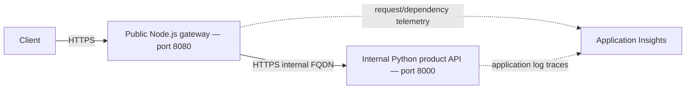

# ಎರಡು-ಸೇವಾಸ್ವರೂಪ ಮೈಕ್ರೋಸೇವೆಗಳು — ಅಜ್ಯೂರ್ ಕಂಟೈನರ್ ಅಪ್ಸ್

**ಮಟ್ಟ:** ಮಧ್ಯಮ · **ಸಮಯ:** ಸೆಟ್ ಅಪ್ ಸೇರಿದಂತೆ 45–60 ನಿಮಿಷಗಳು

ಈ ತರಬೇತಿ نمೂನೆ ಒಂದು **Node.js API ಗೇಟ್ವೇ** ಮತ್ತು ಒಂದು **ಓದಲು ಮಾತ್ರ Python
ಉತ್ಪನ್ನ ಸೇವೆ** ಅನ್ನು ಅಳವಡಿಸಿದೆ. ಮೂಲ, ಡೋಕರ್ ಫೈಲ್‌ಗಳು, ಬೈಸಪ್ ಮತ್ತು azd ಕನ್ಫಿಗರೇಶನ್ ಸೇರಿವೆ.
ಇದು ಉತ್ಪಾದನಾ-ದುರೀಕರಣ ವ್ಯವಸ್ಥೆಯಾಗಿರಲ್ಲ.

## ನೀವು ಕಲಿಯುವದು

- ಎರಡು ಸೇವೆಗಳನ್ನು ಸ್ವತಂತ್ರವಾಗಿ ನಿಯೋಜಿಸಿ.
- ಆಂತರಿಕ ಬ್ಯಾಕ್‌ಎಂಡ್ FQDN ಅನ್ನು HTTPS ಮೂಲಕ ಬಳಸಿ.
- ಯಶಸ್ಸು, ಕಂಡುಬರುವುದಿಲ್ಲ ಹಾಗೂ ಸೇವೆ ಲಭ್ಯವಿಲ್ಲದ ಪ್ರತಿಕ್ರಿಯೆಗಳನ್ನು ಪರಿಶೀಲಿಸಿ.
- ದೂರವಾಣಿ ಸಂವೇದನೆ ಮತ್ತು ಸ್ವತಂತ್ರ ಪರಿಮಾಣ ನಿಯಂತ್ರಣಗಳನ್ನು ಅರ್ಥಮಾಡಿಕೊಳ್ಳಿ.



ಉತ್ಪನ್ನ ಕ್ಯಾಟಲಾಗ್ ಒಂಭತ್ತು ನಿಗದಿತ ಉತ್ಪನ್ನಗಳನ್ನು ಸ್ಮೃತಿಯಲ್ಲಿ ಹೊಂದಿದೆ. **ಯಾವುದೇ POST,
PUT ಅಥವಾ DELETE ಹ್ಯಾಂಡ್ಲರ್‌ಗಳು**, ಡೇಟಾಬೇಸ್, ಸರ್ವಿಸ್ ಬಸ್, ಆರ್ಡರ್/ಬಳಕೆದಾರ/ಮಾಹಿತಿ ಸೇವೆ,
C# ಅಥವಾ Go ಕೋಡ್ ಇಲ್ಲ. ಅವು ಭವಿಷ್ಯ ಅಭಿವೃದ್ಧಿ ಯೋಚನೆಗಳು, ಇದೀಗ ಸೇರಿಲ್ಲ.
ಗೇಟ್ವೇ ಬಳಕೆದಾರರನ್ನು ಪ್ರಮಾಣೀಕರಿಸುವುದಿಲ್ಲ; ಆಂತರಿಕ ಇನ್ಗ್ರೆಸ್ಸ್ ಅಪ್ಲಿಕೇಶನ್ ಅನುಮತಿ ಬದಲಾವಣೆ ಅಲ್ಲ.


## ಪೂರ್ವಾಪೇಕ್ಷಿತಗಳು

ಮೊದಲು [ಒಂದು ಏಕೈక Flask API](../../../../../examples/container-app/simple-flask-api) ಪೂರ್ಣಗೊಳಿಸಿ.
ಇತ್ತೀಚಿನ ಸ್ಥಿರ azd (ಪರಿಶೀಲನೆ ಸಮಯದಲ್ಲಿ ಬಿಡುಗಡೆಯಾದรุತ್ನ: 1.37.2), ಅಜ್ಯೂರ್ CLI,
ಮತ್ತು ಡೋಕರ್ ಡೈಮನ್ ಓಡುತ್ತಿರುವ ಸ್ಥಿತಿಯಲ್ಲಿ ಇನ್‌ಸ್ಟಾಲ್ ಮಾಡಿ. ನಿಮಗೆ ಅಜ್ಯೂರ್ ಸಬ್ಸ್ಕ್ರಿಪ್ಷನ್, ಸಂಪನ್ಮೂಲ
ರಚನೆ ಅನುಮತಿಗಳು ಮತ್ತು ಕಂಟೈನರ್ ಅಪ್ಸ್ ಪ್ರಾದೇಶಿಕ ಕೋಟಾ ಬೇಕಾಗುತ್ತದೆ.

```bash
azd version
az version
docker info
azd auth login
az login
```

ಎರಡೂ CLI ಸಾಧನಗಳಲ್ಲಿ ಒಂದೇ ಸಬ್ಸ್ಕ್ರಿಪ್ಷನ್ ಬಳಸಿ. ಕೆಳಗಿನ ಆಜ್ಞೆಗಳು Bash ಅನ್ನು ಬಳಸುತ್ತವೆ.

## ನಿಯೋಜನೆಮಾಡಿ ಮತ್ತು ಪರಿಶೀಲಿಸಿ

ಸಂಗ್ರಹ ರುಟ್‌ನಿಂದ:

```bash
cd examples/container-app/microservices
azd env new microservices-demo
azd up
GATEWAY_URL=$(azd env get-value API_GATEWAY_URL)
RG_NAME=$(azd env get-value AZURE_RESOURCE_GROUP)
GATEWAY_NAME=$(azd env get-value API_GATEWAY_NAME)
PRODUCT_NAME=$(azd env get-value PRODUCT_SERVICE_NAME)

curl --fail-with-body "${GATEWAY_URL}/health"
curl --fail-with-body "${GATEWAY_URL}/api/products"
curl --fail-with-body "${GATEWAY_URL}/api/products/1"
curl -i "${GATEWAY_URL}/api/products/999"
```

**ಯಶಸ್ಸು:** ಆರೋಗ್ಯ 200; ಪಟ್ಟಿ 200 ಮತ್ತು **ಐದು** ಉತ್ಪನ್ನಗಳೊಂದಿಗೆ; ಉತ್ಪನ್ನ 1 ಲ್ಯಾಪ್ಟಾಪ್
ಬೆಲೆ 999.99 ಮತ್ತು ಸ್ಟಾಕ್ 50; незನವು ಉತ್ಪನ್ನ 404 ಅನ್ನು ಹಿಂತಿರುಗಿಸುತ್ತದೆ.
ವಿವರಣೆಗಳು ಪ್ರತಿಕ್ರಿಯೆಗಳಲ್ಲಿ ಸೇರಿವೆ; ಸಮಯ ಗುರುತುಗಳು ವೈವಿಧ್ಯಮಯವಾಗಿರುತ್ತವೆ.

ಪ್ರಾರಂಭಿಕ ವ್ಯವಸ್ಥೆ ಸಾರ್ವಜನಿಕ hello-world ಚಿತ್ರಗಳನ್ನು ಪೋರ್ಟ್ 80 ರಲ್ಲಿ ಬಳಸುತ್ತದೆ ಆದ್ದರಿಂದ ಅದು ಖಾಲಿ ರೆಜಿಸ್ಟ್ರೀದಿಂದ ಅಸ್ತಿತ್ವದಲ್ಲ olmayan ಚಿತ್ರಗಳನ್ನು ಎಳೆದುಕೊಳ್ಳಲು ಪ್ರಯತ್ನಿಸುವುದಿಲ್ಲ.
ಸೇವಾ-ನಿರ್ದಿಷ್ಟ ಬೈಸೆಪ್ ಮೋಡ್ಯೂಲ್‌ಗಳು
ಮತ್ತು ಪರಿಮಾಣ ಫೈಲ್ಗಳು ಅವುಗಳನ್ನು ನಿರ್ಮಿತ ಚಿತ್ರಗಳು ಮತ್ತು ಅಪ್ಲಿಕೇಶನ್ ಪೋರ್ಟ್‌ಗಳು/ಪ್ರೊಬ್‌ಗಳೊಂದಿಗೆ ಬದಲಿಸುತ್‌ವೆ
`azd deploy` ಸಮಯದಲ್ಲಿ. ಮುಖ್ಯ ಪರಿಮಾಣಗಳು ನಂತರದ ಒದಗಿಸಲು ಪ್ರಕಟಿತ ಚಿತ್ರದ ಹೆಸರುಗಳನ್ನು ಕಾಯ್ದುಕೊಳ್ಳುತ್ತವೆ.

## ಸೇವೆಗಳು ಮತ್ತು ನೆಟ್‌ವರ್ಕಿಂಗ್

| ಸೇವೆ | ಬಹಿರಂಗಗೊಳಿಸಿದ ಎಂಡ್‌ಪಾಯಿಂಟ್‌ಗಳು | ಡೀಫಾಲ್ಟ್ ಸಂಪನ್ಮೂಲಗಳು |
|---|---|---|
| ಗೇಟ್‌ವೇ | GET `/`, `/health`, `/api/products`, `/api/products/:id` | 1 vCPU, 2 GiB, 2–20 ನಕಲೆಗಳು |
| ಉತ್ಪನ್ನ | GET `/`, `/health`, `/products`, `/products/<id>` | 0.5 vCPU, 1 GiB, 1–10 ನಕಲೆಗಳು |

ಉತ್ಪನ್ನ ಪ್ರವೇಶದಲ್ಲಿ `external: false` ಮತ್ತು `allowInsecure: false` ಇವೆ. ಬೈಸೆಪ್ ಗೇಟ್‌ವೇಗೆ
`PRODUCT_SERVICE_URL=https://<actual-internal-fqdn>` ಸೆರೆಯುತ್ತದೆ. HTTP ಇರುತ್ತದೆ
ರಿಡೈರೆಕ್ಟ್; HTTPS ಸ್ಥಳೀಯವಾಗಿ ಸಂರಚಿತ ಇಂಗ್ರೆಸ್ಸ್‌ಗೆ ಹೊಂದಿಕೊಳ್ಳುತ್ತದೆ. ಒಂದು ಚುಟುಕಿನ DNS ಹೆಸರು
**ವಾಸ್ತವಿಕ ಕಂಟೈನರ್ ಆಪ್ ಹೆಸರಿಗೆ** ಹೊಂದಬೇಕು, ಲಾಜಿಕಲ್ ಸರ್ವಿಸ್ ಕೀಅನ್ನು ಅಲ್ಲ `product-service`.
ನಿಮ್ಮ ಲ್ಯಾಪ್‌ಟಾಪಿನಿಂದ ನೇರವಾಗಿ ಒಳಗಿನ URL ಅನ್ನು ಕರೆ ನಡೆಸಲು ಪ್ರಯತ್ನಿಸಬೇಡಿ.

ಗೇಟ್‌ವೇನಲ್ಲಿ ಉತ್ಪನ್ನ ಕರೆಗಳಿಗೆ ಐದು ಸೆಕೆಂಡಿನ ಟೈಮೌಟ್ ಇರುತ್ತದೆ. ಉತ್ಪನ್ನ IDಗಳನ್ನು ತಪ್ಪಿಸಿಕೊಳ್ಳಿ
404 ಎಂದು ಪ್ರಸಾರಗೊಳಿಸಿ; ಸಾರಿಗೆ ವಿಫಲತೆಗಳು/ಇತರೆ ಬ್ಯಾಕ್‌ಎಂಡ್ ವಿಫಲತೆಗಳು 503 ಅನ್ನು 반환ಿಸುತ್ತವೆ. ಗೇಟ್ವೇ
`/health` ಗೇಟ್ವೇ ಮಾತ್ರ ಪರಿಶೀಲಿಸುತ್ತದೆ, ಬ್ಯಾಕ್‌ಎಂಡ್ ಲಭ್ಯತೆ ಪರಿಶೀಲಿಸುವುದಿಲ್ಲ.

## ಕಡತಗಳು ಮತ್ತು ಸಂರಚನೆ

```text
azure.yaml
infra/main.bicep
infra/main.parameters.json
infra/abbreviations.json
infra/core/container-apps-environment.bicep
infra/core/monitor.bicep
infra/app/api-gateway.bicep
infra/app/api-gateway.parameters.json
infra/app/product-service.bicep
infra/app/product-service.parameters.json
src/api-gateway/{app.js,package.json,Dockerfile}
src/product-service/{main.py,requirements.txt,Dockerfile}
```

ಮಾಪನ, CPU/ಸ্মರಣೆ, ಪೋರ್ಟ್‌ಗಳು ಮತ್ತು ಪ್ರೊಬ್‌ಗಳನ್ನು `infra/app/*.bicep` ನಲ್ಲಿ ಸೆಟ್ ಮಾಡಲಾಗಿದೆ. ಅವುಗಳನ್ನು ಬದಲಾಗಿದೆ
ಫೈಲ್‌ಗಳನ್ನು ಬದಲಿಸಿ ಮತ್ತು ಮೂಲಸೌಕರ್ಯವನ್ನು ಅನ್ವಯಿಸಲು ಮತ್ತು ಮರುವಿತರಣಾ ಮಾಡಲು `azd up` ಅನ್ನು ಚಾಲನೆ ಕಾರ್ಯಗತಗೊಳಿಸಿ. ಈ ಮಾದರಿಯಲ್ಲಿ
`GATEWAY_MAX_REPLICAS` ಪರಿಸರ-ಚರವಾಗಿ ಯಾವುದೇ ಪರಿಮಿತಿ ಇಲ್ಲ.

ಕೋಡ್-ಮಾತ್ರ ಬದಲಾವಣೆಗಳಿಗೆ:

```bash
azd deploy product-service
azd deploy api-gateway
```

Node ಚಿತ್ರವು Node 22 ಅನ್ನು ಬಳಸುತ್ತದೆ; Python ಚಿತ್ರವು Python 3.11 ಅನ್ನು ಬಳಸುತ್ತದೆ. ಎರಡೂ
`0.0.0.0` ವಿರುದ್ಧ ಬಂಧಿಸುತ್ತವೆ. ಇಂಗ್ರೆಸ್/ಪ್ರೊಬ್‌ಗಳು ಕ್ರಮವಾಗಿ ಪೋರ್ಟ್ 8080 (ಗೇಟ್ವೇ) ಮತ್ತು 8000 (ಉತ್ಪನ್ನ) ಅನ್ನು ಬಳಸುತ್ತವೆ.

## ಡಾಕರ್‌ನೊಂದಿಗೆ ಸ್ಥಳೀಯ ಅಭಿವೃದ್ಧಿ

ಈ ಉದಾಹರಣಾ ಡೈರೆಕ್ಟರಿಯಿಂದ ಚಲಾಯಿಸಿ. ಬಳಕೆದಾರನಿಗ verlor ಅಲ್ಲದೆ ಜಾಲವನ್ನು ಬಳಸಿ, **ಎರಡು ಕಂಟೈನರ್‍ಗಳ ನಡುವಣ ಸಂಪರ್ಕಕ್ಕಾಗಿ `localhost`
ಬಳಸದಿರಿ**:

```bash
docker network create azd-microservices-demo
docker build -t local-product ./src/product-service
docker build -t local-gateway ./src/api-gateway
docker run -d --name azd-product --network azd-microservices-demo local-product
docker run -d --name azd-gateway --network azd-microservices-demo \
  -p 8080:8080 -e PRODUCT_SERVICE_URL=http://azd-product:8000 local-gateway
curl --fail-with-body http://localhost:8080/api/products
```

ನಿರೀಕ್ಷಿತ: ಐದು ಉತ್ಪನ್ನಗಳು. HTTP ಅನ್ನು ಈ ಸ್ಥಳೀಯ ಡೊಕರ್ ನೆಟ್ವರ್ಕ್ ಗಾಗಿ ಮಾತ್ರ ಬಳಸಲಾಗುತ್ತದೆ.

```bash
docker stop azd-product azd-gateway
docker rm azd-product azd-gateway
docker network rm azd-microservices-demo
```

## ಮೇಲ್ವಿಚಾರಣೆ

```bash
az containerapp logs show --name "$GATEWAY_NAME" --resource-group "$RG_NAME" --follow
# In a separate terminal:
az containerapp logs show --name "$PRODUCT_NAME" --resource-group "$RG_NAME" --tail 100
```

`azd monitor --logs` ಒಂದು ಪೋರ್ಟಲ್ ವೀಕ್ಷಣೆಯನ್ನು ತೆರೆಯುತ್ತದೆ; ಇದು ಟರ್ಮಿನಲ್ ಲಾಗ್‌ಗಳನ್ನು ಸ್ಟ್ರೀಮ್ ಮಾಡುವುದಿಲ್ಲ.
ನೋಡ್ SDK ಗೇಟ್ವೇ ವಿನಂತಿಗಳು/ನಿರ್ಬಂಧಗಳನ್ನು ಸಂಗ್ರହಿಸುತ್ತದೆ. ಪೈಥಾನ್‌ನ `AzureLogHandler`
**ಲಾಗ್ ಟ್ರೇಸ್‌ಗಳು** ಅನ್ನು ರಫ್ತು ಮಾಡುತ್ತದೆ, ಸ್ವಯಂಚಾಲಿತ ಫ್ಲಾಸ್ಕ್ ವಿನಂತಿಗಳು, SQL ನಿರ್ಭಂಧಗಳು, ಅಥವಾ ಪೂರ್ಣ ವಿತರಿತ ಟ್ರೇಸ್‌ಗಳನ್ನು ಅಲ್ಲ.
OpenCensus ಒಂದು ಹಳೆಯ SDK; ಈ ಮಾದರಿಯನ್ನು ವಿಸ್ತರಿಸುವಾಗ Azure Monitor OpenTelemetry ನನ್ನು ಆದ್ಯತೆ ನೀಡಿ.


ಅಪ್ಲಿಕೇಶನ್ ಇನ್ಸೈಟ್ಸ್ ಲಾಗ್‌ಗಳಲ್ಲಿ, ವಿನಂತಿಗಳನ್ನು ರಚಿಸಿ ಮತ್ತು ಪರಿಶೀಲಿಸಿ:

```kusto
requests
| where timestamp > ago(1h)
| where name contains "products"
| summarize RequestCount=count(), AvgDuration=avg(duration) by bin(timestamp, 5m)
```

ಪೈಥಾನ್ ಅಪ್ಲಿಕೇಶನ್ ಸಂದೇಶಗಳಿಗಾಗಿ:

```kusto
traces
| where timestamp > ago(1h)
| where message contains "products"
| project timestamp, message, severityLevel
```

ಜೀರ್ಣೋತ್ಪಾದನೆ ವಿಳಂಬ ಮತ್ತು ಸ್ಯಾಂಪ್ಲಿಂಗ್‌ಗೆ ಅವಕಾಶ ನೀಡಿ; ನಿಖರ ವಿನಂತಿ ಎಣಿಕೆ ಅಥವಾ ಖಚಿತತೆಯ ದೈರ್ಘ್ಯ ನಿರೀಕ್ಷಿಸಬೇಡಿ.
ಯಾವುದೇ ಕಸ್ಟಮ್ ಅಲರ್ಟ್‌ಗಳು ಅಥವಾ ಡ್ಯಾಶ್‌ಬೋರ್ಡ್‌ಗಳು ಸಂರಚಿಸಲಾಗಿದೆ ಇಲ್ಲ.

## ಪ್ರಾಯೋಗಿಕ ವ್ಯಾಯಾಮಗಳು

### ವ್ಯಾಯಾಮ 1: ಕ್ಯಾಟಲಾಗ್‌ನ್ನು ತಿದ್ದುಪಡಿ ಮಾಡಿ

**ಪ್ರಾರಂಭಿಕ ಬಿಂದುವು:** `src/product-service/main.py`.
**ಗುರಿ:** ಸ್ವತಂತ್ರ ಸೇವಾ ನಿಯೋಜನೆಯನ್ನು ಪರಿಶೀಲಿಸಿ.
ಪ್ರತಿಷ್ಠಿತ `products` ಪಟ್ಟಿ‌ನಲ್ಲಿ ಲ್ಯಾಪ್ಟಾಪಿನ ಷೇರುಗಳನ್ನು 50ರಿಂದ 49ಕ್ಕೆ ಬದಲಿಸಿ,
`azd deploy product-service` ಅನ್ನು ಚಾಲನೆ ಮಾಡಿ, ನಂತರ `${GATEWAY_URL}/api/products/1` ಕೇಳಿ.

**ಯಶಸ್ಸಿನ ಮಾನದಂಡ / ಪರಿಹಾರ:** `"stock":49` ಸಹಿತ HTTP 200. 50 ಅನ್ನು ಮರುಸ್ಥಾಪಿಸಿ ಮತ್ತು ಪುನಃ ನಿಯೋಜಿಸಿ.
**ಸಾಮಾನ್ಯ ಸಮಸ್ಯೆ:** ಕ್ಯಾಟಲೋಗ್ಗೆ ಸಂಬಂಧಿಸಿದ ಸೇವೆಯನ್ನು ಬದಲಾಗಿ ಗೇಟ್ವೆಯನ್ನು ಸಂಪಾದಿಸುವುದು.
ಇದು ಮೂಲ ಡೇಟಾವನ್ನು ಬದಲಾಯಿಸುತ್ತದೆ, ದೈಹಿಕ ಇನ್ವೆಂಟರಿ ಡೇಟಾಬೇಸ್ ಅನ್ನು ಅಲ್ಲ.

### ಅಭ್ಯಾಸ 2: ಪ್ರತಿಕೃತಿ ಸಂರಚನೆಯನ್ನು ಪರಿಶೀಲಿಸಿ

**ಪ್ರಾರಂಭದ ಬಿಂದುವು:** `infra/app/product-service.bicep`.
**ಗುರಿ:** ಆಟೋಸ್ಕೇಲಿಂಗ್ ಅನ್ನು ಊಹಿಸದೆ ಮೂಲಸೌಕರ್ಯದ ಬದಲಾವಣೆಯನ್ನು ಗಮನಿಸಿ.
`minReplicas: 1` ಅನ್ನು `minReplicas: 2` ಗೆ ಬದಲಾಯಿಸಿ, `azd up` ಅನ್ನು চালಿಸಿ, ನಂತರ:

```bash
az containerapp show --name "$PRODUCT_NAME" --resource-group "$RG_NAME" \
  --query properties.template.scale -o json
```

**ಯಶಸ್ಸಿನ ಮಾನದಂಡ:** ಸಂರಚಿಸಲಾದ ಕನಿಷ್ಠ 2 ಆಗಿದ್ದು ಗರಿಷ್ಠ 10 ಆಗಿಯೇ ಉಳಿಯುತ್ತದೆ.
ಕನಿಷ್ಠ 1 ಅನ್ನು ಮರುಸ್ಥಾಪಿಸಿ ಮತ್ತು `azd up` ಅನ್ನು ಚಲಾಯಿಸಿ.
**ಸಾಮಾನ್ಯ ಸಮಸ್ಯೆ:** `azd deploy` ಏಕಾಂಗಿಯಾಗಿ ಸಂಬಂಧಯುಕ್ತವಲ್ಲದ ಹಂಚಿಕೆಯಾಗಿರುವ
ಮೂಲಸೌಕರ್ಯಕ್ಕೆ ಬದಲಾವಣೆಗಳನ್ನು ಅನ್ವಯಿಸುವುದಿಲ್ಲ. ವಿಫಲತೆ ಅನುಕರಣವಾಗಿ `maxReplicas` ಅನ್ನು ಶೂನ್ಯಕ್ಕೆ ಸೆಟ್ ಮಾಡಬೇಡಿ.
ಇದು ಸಂರಚನೆಯನ್ನು ಪರಿಶೀಲಿಸುತ್ತದೆ, ಲೋಡ್-ಟೆಸ್ಟ್ ಅಥವಾ ಖಚಿತವಾದ ಕ್ಷಣಿಕ ಪ್ರತಿಕೃತಿ ಸಂಖ್ಯೆಯನ್ನು ಅಲ್ಲ.

### ಅಭ್ಯಾಸ 3: ಲೊಕಲ್‌ನಲ್ಲಿ ಲಭ್ಯವಿಲ್ಲದ-ಸೇವೆಯ ವ್ಯವಸ್ಥೆಯನ್ನು ಪರೀಕ್ಷಿಸಿ

**ಪ್ರಾರಂಭದ ಬಿಂದುವು:** ಮೇಲಿನ ಎರಡು ಸ್ಥಳೀಯ ಡೋಕರ್ ಕಂಟೈನರ್‌ಗಳು പ്രവർത്തಿಸುತ್ತಿವೆ.
**ಗುರಿ:** ಬ್ಯಾಕ್‌ಎಂಡ್ ವಿಫಲತೆಯನ್ನು ತಪ್ಪಿರುವ ಉತ್ಪನ್ನದಿಂದ ವಿಭಿನ್ನವಾಗಿ ಗುರುತಿಸಿ.
ಉತ್ಪನ್ನ ಕಂಟೈನರ್ ಮಾತ್ರ ನಿಲ್ಲಿಸಿ:

```bash
docker stop azd-product
curl -i http://localhost:8080/api/products
docker start azd-product
curl --fail-with-body http://localhost:8080/api/products
```

**ಯಶಸ್ಸಿನ ಮಾನದಂಡ:** ನಿಲ್ಲಿಸಿದಾಗ, ಗೇಟ್ವೇ 503 ಅನ್ನು
`"error":"Product service unavailable"` ಸಹಿತ 반환 ಮಾಡುತ್ತದೆ; ಮರುಪ್ರಾರಂಭದ ನಂತರ, ಪಟ್ಟಿ 200 ಅನ್ನು 반환 ಮಾಡುತ್ತದೆ.
ಅಗತ್ಯವಿದ್ದರೆ ಚುಲಿಕೆಯ ಪ್ರಾರಂಭ ವಿಳಂಬಕ್ಕೆ ನಂತರ ಪ್ರಯತ್ನಿಸಿ.
**ಸಾಮಾನ್ಯ ಸಮಸ್ಯೆ:** ಗೇಟ್ವೇ ನಿಲ್ಲಿಸುವುದು ಬೇರೊಂದು ವಿಫಲತೆಯನ್ನು ಪರೀಕ್ಷಿಸುವುದಾಗಿದೆ (ಯಾವುದೇ HTTP ಪ್ರತಿಕ್ರಿಯೆ ಇಲ್ಲದುವುದು).

## ವ್ಯಯಗಳು ಮತ್ತು ಉತ್ಪಾದನಾ ಗ್ಯಾಪ್‌ಗಳು

ಡೀಫಾಲ್ಟ್ ಕನಿಷ್ಠ ಪ್ರತಿಕೃತಿಗಳು ಗಣನೆ ರನ್ ಆಗಿಸುವಂತೆ ಇಡುತ್ತವೆ. ರಿಜಿಸ್ಟ್ರಿ ಮತ್ತು ಮೇಲ್ಮನिटरಿಂಗ್ ಸಹ
ಶುಲ್ಕಗಳು. ಲೆಕ್ಕ ಹಾಕಲು ಯಾವುದೇ ನಿಶ್ಚಿತ $50/ತಿಂಗಳು ಮೊತ್ತವನ್ನು ಮಾನ್ಯಗೊಳಿಸಲಾಗಿಲ್ಲ: ಪ್ರಾದೇಶಿಕ CPU/ಸ್ಮೃತಿ,
ರೆಪ್ಲಿಕಾ ಘಂಟೆಗಳು, ವಿನಂತಿಗಳು, ರಿಜಿಸ್ಟ್ರಿ ಮತ್ತು ಲಾಗ್ ನಿರ್ವಹಣೆಯನ್ನು
[Azure ಬೆಲೆ ಗಣನೆ ಯಂತ್ರ](https://azure.microsoft.com/pricing/calculator/) ನಲ್ಲಿ ಅಂದಾಜು ಮಾಡಿ.
ಕಲಿಕೆ ಸಂಪನ್ಮೂಲಗಳನ್ನು ತಕ್ಷಣ ಅಳಿಸಿ.

ಉತ್ಪಾದನಾ ಕೆಲಸದಲ್ಲಿ ಪ್ರಾಮಾಣೀಕರಣ/ಅಧಿಕೃತಿಕೆ, ವ್ಯಾಪ್ತಿಗೊಳಿಸಿರುವ ನಿರ್ವಹಿತ ಐಡೆಂಟಿಟಿಗಳು,
ಸ್ಥಿರ ಡೇಟಾ, ಇನ್‌ಪುಟ್/ಪ್ರತಿಕ್ರಿಯೆ ಮಾನ್ಯತೆ, ಬೆಂಬಲಿತ ಗಮನಾರ್ಹತೆ ಉಪಕರಣಗಳು,
ಲೋಡ್/ವిఫಲತೆ ಪರೀಕ್ಷಣೆ, CI/CD, ಎಚ್ಚರಿಕೆಗಳು, ಮತ್ತು ಪುನರ್‌ಸ್ಥಾಪನೆ ಪ್ರಕ್ರಿಯೆಗಳು ಸೇರಿವೆ. orbit
ಸೇವೆಯನ್ನು ಸೇರಿಸುವುದು, ಸಾಲು ಅಥವಾ ಡೇಟಾಬೇಸ್ ಒಂದು ಬೇರೆ ಅನುಷ್ಠಾನ ಕಾರ್ಯವಾಗಿದೆ, ಇಲ್ಲಿನ ಪೂರ್ಣಗೊಂಡ
ವ್ಯಾಯಾಮ ಅಥವಾ ಚಾಲಿತವಾಗಿದೆ ಎನ್ನುವುದಲ್ಲ.

## ಸಮಸ್ಯೆ ಪರಿಹಾರ ಮತ್ತು ಶುದ್ಧೀಕರಣ

- **ಮೊದಲ ಪ್ರದೇಶದಲ್ಲಿ ಚಿತ್ರ ಕಂಡು ಬರದದ್ದು:** ಬೂಟ್‌ಸ್ಟ್ರ್ಯಾಪ್ ಸಾರ್ವಜನಿಕ ಚಿತ್ರವನ್ನು ಬಳಸಬೇಕು;
  ಪ್ರಮುಖ ಚಿತ್ರ ಪರಿಮಿತಿಗಳು ಡೀಫಾಲ್ಟ್‌ಗಳು ಮತ್ತು ಪರಿನಿಯೋಜನೆ ಮಾಪನಗಳು ಪರಿಶೀಲಿಸಿ.
- **503 ಉತ್ಪನ್ನಗಳು:** ಉತ್ಪನ್ನ ಲಾಗ್‌ಗಳು, ಆ تصويرದ ಪರಿಷ್ಕರಣೆ ಮತ್ತು ಒಳಗಿನ HTTPS URL ಸುರಕ್ಷಿತವಾಗಿರಿಸಿ.
- **404 ಅಪ್ರತೀಕ್ಷಿತ ಮಾರ್ಗ:** ಉತ್ಪನ್ನ API ಓದಲು ಮಾತ್ರ; ಮಾರ್ಗ ಪರಿಶೀಲಿಸಿ, ಇಲ್ಲದ CRUD ನಿರ್ವಹಣೆಯಲ್ಲ.
- **ಯಾವುದೇ ಟೆಲಿಮೆಟ್ರಿ ಇಲ್ಲ:** ಸಂಚಾರ ಸುತ್ತಣ ಸ್ಟ್ರಿಂಗ್ಸ್ ಪರಿಶೀಲಿಸಿ, ಅವುಗಳನ್ನು ಬಹಿರಂಗಪಡಿಸದೆ ಮತ್ತು
  ತಿನ್ನುವ ವಿಳಂಬವನ್ನು ಅನುಮತಿಸಿ. Python ವಿನಂತಿ ಪಟ್ಟಿಗಳು ಅದರ ಲಾಗ್ ಹ್ಯಾಂಡ್ಲರ್ ಮೂಲಕ ತುಂಬವಾಗುವುದಿಲ್ಲ.

ಈ ಮಾದರಿ ಡೈರೆಕ್ಟರಿೆಯಿಂದ:

```bash
azd down
```

ಅಳಿಸುವಿಕೆ ಪ್ರಾಂಪ್ಟ್‌ಗಳನ್ನು ಪರಿಶೀಲಿಸಿ ಮತ್ತು ಮೀಸಲಾದ ಸಂಪನ್ಮೂಲ ಗುಂಪು ಅಳಿಸಲ್ಪಟ್ಟದ್ದನ್ನು ದೃಢಪಡಿಸಿ.

[ಹಿಂದಿನದು: Flask API](../../../../../examples/container-app/simple-flask-api) · [ಮುಂದಿನದು: ಡೇಟಾಬೇಸ್ ಅಪ್ಲಿಕೇಶನ್](../../../../../examples/database-app) ·
[AI ಅಭಿವೃದ್ಧಿ](../../../docs/chapter-02-ai-development/README.md) ·
[ಕೋರ್ಸ್ ಮನೆ](../../../README.md) · [ಸಮಸ್ಯೆ ವರದಿಮಾಡಿ](https://github.com/microsoft/AZD-for-beginners/issues)

---

<!-- CO-OP TRANSLATOR DISCLAIMER START -->
**ಅಸ್ವೀಕಾರ**:
ಈ ದಸ್ತಾವೇಜು AI ಅನುವಾದ ಸೇವೆ [Co-op Translator](https://github.com/Azure/co-op-translator) ಬಳಸಿ ಅನುವಾದಿಸಲಾಗಿದೆ. ನಾವು ನಿಖರತೆಯನ್ನು ಸಾಧಿಸಲು ಪ್ರಯತ್ನಿಸುತ್ತಿದ್ದರೂ, ದಯವಿಟ್ಟು ಗಮನಿಸಿ, ಸ್ವಯಂಚಾಲಿತ ಅನುವಾದಗಳಲ್ಲಿ ದೋಷಗಳು ಅಥವಾ ಅಸಡ್ಡೆಗಳು ಇರಬಹುದು. ಮೂಲ ಭಾಷೆಯಲ್ಲಿರುವ ಮೂಲ ದಸ್ತಾವೇಜು ಪ್ರಾಮಾಣಿಕ ಮೂಲವೆಂದು ಪರಿಗಣಿಸಬೇಕು. ಪ್ರಮುಖ ಮಾಹಿತಿಗಾಗಿ, ವೃತ್ತಿಪರ ಮಾನವ ಅನುವಾದವನ್ನು ಶಿಫಾರಸು ಮಾಡಲಾಗುತ್ತದೆ. ಈ ಅನುವಾದವನ್ನು ಬಳಸುವ ಮೂಲಕ ಉಂಟಾಗುವ ಯಾವುದೇ ತಪ್ಪು ಅರ್ಥಗಳ ಅಥವಾ ತಪ್ಪು ವ್ಯಾಖ್ಯಾನಗಳ ಬಗ್ಗೆ ನಾವು ಹೊಣೆಗಾರರಲ್ಲ.
<!-- CO-OP TRANSLATOR DISCLAIMER END -->