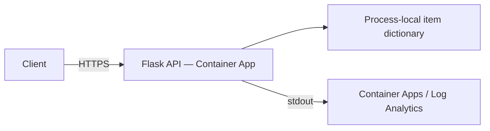

# ಸರಳ ಫ್ಲಾಸ್ಕ್ API — ಅಜೂರ್ ಕಂಟೈನರ್ ಅಪ್ಸ್

**ಮಟ್ಟ:** ಪ್ರಾಥಮಿಕ · **ಸಮಯ:** ಸ್ಥಾಪನೆ ಸೇರಿ 30–45 ನಿಮಿಷಗಳು

ಅಜೂರ್ ಡೆವಲಪರ್ CLI (azd) ಬಳಸಿ ಪೈಥಾನ್ ಫ್ಲಾಸ್ಕ್ CRUD API ಅನ್ನು ನಿಯೋಜಿಸಿ. ಮೂಲ, ಡಾಕರ್ಫೈಲ್,
ಬಿಸೆಪ್, ಹಾಗೂ ನಿಯೋಜನಾ ಪರಿಮಾಣಗಳು ಸೇರಿವೆ. ಇದು **ಕಲಿಕೆಯ ಮಾದರಿ**, ಉತ್ಪಾದನಾ-ತಯಾರ API ಅಲ್ಲ.


## ನೀವು ಏನು ಕಲಿಯುತ್ತೀರಿ

- azd ಮೂಲಕ ಕಂಟೈನರ್ ಅನ್ನು ನಿರ್ಮಿಸಿ ಮತ್ತು ಪ್ರಕಟಿಸಿ.
- ಇಂಗ್ರೆಸ್ ಮತ್ತು ಲಿವ್ನೆಸ್/ರೆಡಿನೆಸ್ ಪ್ರೋಬ್ಗಳನ್ನು ಸಂರಚಿಸಿ.
- CRUD ಪ್ರತಿಕ್ರಿಯೆಗಳನ್ನು ಪರಿಶೀಲಿಸಿ ಮತ್ತು ಅಪ್ಲಿಕೇಶನ್ ಲಾಗ್‌ಗಳನ್ನು ವೀಕ್ಷಿಸಿ.
- ಸ್ಮೃತಿ-ಮಾಡಿಕೊಂಡಿರುವ ಡೇಟಾ ದೀರ್ಘಕಾಲಿಕ ಅಪ್ಲಿಕೇಶನ್‌ಗಳಿಗೆ ಯಾಕೆ uygun ಆಗಿಲ್ಲ ಎಂಬುದನ್ನು ಅರ್ಥಮಾಡಿಕೊಳ್ಳಿ.



**ಮಹತ್ವದ:** ವಸ್ತುಗಳು ಒಂದು ಪ್ರಕ್ರಿಯೆಯಲ್ಲಿ ಇರುತ್ತವೆ. ಮೂಲಭೂತವಾಗಿ **ಒಂದು ಗುನಿಕಾರ್ನ್ ವರ್ಕರ್,
0–1 ಪ್ರತಿಗಳು** ಎಂದರೆ, ವರ್ಕರ್‌ಗಳ/ಪ್ರತಿಗಳ ನಡುವಿನ ಅಸಾಂರಭದತ್ತೆಯನ್ನು ಉದ್ದೇಶಪೂರ್ವಕವಾಗಿ ತಪ್ಪಿಸಲಾಗಿದೆ.
ವಸ್ತುಗಳು ಮರುಪ್ರಾರಂಭ, ಪರಿಷ್ಕರಣೆ ಬದಲಾವಣೆ, ಅಥವಾ ಶೂನ್ಯಕ್ಕೆ ವಿಸ್ತರಣೆಯ ಸಂದರ್ಭದಲ್ಲಿ ಕಳೆದುಹೋಗುತ್ತವೆ. ಪ್ರತಿಗಳು ಹೆಚ್ಚಿಸುವುದು
ಹಂಚಿಕೆಯ ಶಾಶ್ವತ ಸಂಗ್ರಹಣೆಯನ್ನು ಅಗತ್ಯವಿರುತ್ತದೆ. APIಗೆ ಯಾವುದೇ ಪ್ರಮಾಣೀಕರಣ ಅಥವಾ ಅನುಮೋದನೆ ಇಲ್ಲ.

## ಅಗತ್ಯತೆಗಳು

- [ನ ಜೊತೆ ಸ್ಥಿರಿತಾಂಶ azd](https://learn.microsoft.com/azure/developer/azure-developer-cli/install-azd)
  (ಪಾರೋಪಕಾರಿಕ ಬಿಡುಗಡೆ ವಿಮರ್ಶಾ ಸಮಯದಲ್ಲಿ: 1.37.2).
- ಪರಿಶೀಲನೆಗಾಗಿ [Azure CLI](https://learn.microsoft.com/cli/azure/install-azure-cli).
- ಡಾಕರ್ ಮತ್ತು ಅದರ ಡಿಮನ್ ಚಾಲನೆಯಲ್ಲಿ; ಇದು ಮೂಲಭೂತ ಸ್ಥಳೀಯ ಚಿತ್ರ ನಿರ್ಮಾಣಕ್ಕೆ ಬೇಕಾಗುತ್ತದೆ.
- Azure ಚಂದಾದಾರಿಕೆ, ಸಂಪನ್ಮೂಲ ರಚನೆ ಅನುಮತಿಗಳನ್ನು ಮತ್ತು ಕಾಂಟೇನರ್ ಅಪ್ಸ್ ಪ್ರಾದೇಶಿಕ ಕೋಟಾ.
- ಕೆಳಗಿನ ಆಜ್ಞೆಗಳಿಗಾಗಿ ಬಾಷ್ (ಅಥವಾ ಸಮಾನವಾದ PowerShell).
- ಐಚ್ಛಿಕ ಸ್ಥಳೀಯ ಅಭಿವೃದ್ಧಿಗಾಗಿ Python 3.11.

```bash
azd version
az version
docker info
azd auth login
az login
```

CLI ಉಪಕರಣಗಳು ಪ್ರತ್ಯೇಕ ಲಾಗಿನ್ ಸೆಷನ್‌ಗಳಿವೆ. ಎರಡೂ ერთಂತಹ ಚಂದಾದಾರಿಕೆಯನ್ನು ಬಳಸಿ.

## ದ್ರುತ ಪ್ರಾರಂಭ

ಸಂಗ್ರಹದ ಮೂಲದಿಂದ:

```bash
cd examples/container-app/simple-flask-api
azd env new flask-demo
azd up
API_URL=$(azd env get-value API_ENDPOINT)
RG_NAME=$(azd env get-value AZURE_RESOURCE_GROUP)
API_NAME=$(azd env get-value API_NAME)
curl --fail-with-body "${API_URL}/health"
```

ನಿರೀಕ್ಷಿತ: HTTP 200 ಮತ್ತು JSON ಲಭ್ಯವಿದೆ `"status":"healthy"`,
`"service":"simple-flask-api"` ಮತ್ತು ಪ್ರಸ್ತುತ UTC ಸಮಯದ ಟೈಮ್‌ಸ್ಟ್ಯಾಂಪ್‌.
ವಸತಿ ನೀಡುವಿಕೆ ಮತ್ತು ಚಿತ್ರ ನಿರ್ಮಾಣ ಸಾಮಾನ್ಯ ತಾನೋಬೆಯನ್ನು ತೆಗೆದುಕೊಳ್ಳುತ್ತದೆ; ಸಮಯ ಭಿನ್ನವಾಗಬಹುದು.

ಪ್ರಾಥಮಿಕ ವಸತಿ ವಿಶೇಷ ಹೆಲೋ-ವಿಶ್ವ ಚಿತ್ರವನ್ನು ಪೋರ್ಟ್ 80 ಮೇಲೆ ಕಾದು ನೋಡುತ್ತದೆ.
`azure.yaml` ಆಯ್ಕೆ ಮಾಡುತ್ತದೆ `infra/app/api.bicep` ಮತ್ತು ಅದರ ಹೊಂದಾಣಿಕೆಯ ಪರಿಸರ ಫೈಲ್‌ಗಳನ್ನು
ಸೇವಾ ನಿಯೋಜನೆಗಾಗಿ, ಇದು ಚಿತ್ರದ, ಇನ್‌ಗ್ರೆಸ್ಸಿನ, ಮತ್ತು ಪರೀಕ್ಷೆಗಳ ಪೋರ್ಟ್ 8000ಗೆ ಬದಲಾಯಿಸುತ್ತದೆ.
ಆ ನಿಯೋಜನೆ ಪರಿಮಾಣಗಳನ್ನು ಅಳಿಸಬೇಡಿ.

## CRUD ಪರಿಶೀಲನೆ

ಒಂದೇ ಪ್ರತಿಯು ಸಕ್ರಿಯವಾಗಿರುವಾಗ ಕೆಳಗಿನ ಕ್ರಮವಾಗಿ ನಡೆಸಿ:

```bash
# Create: HTTP 201; note the returned id (1 for a fresh process).
curl -i -X POST "${API_URL}/api/items" \
  -H "Content-Type: application/json" \
  -d '{"name":"Test Item","description":"My first item"}'

# Read list: HTTP 200, total 1 in a fresh process.
curl --fail-with-body "${API_URL}/api/items"

# Replace 1 if your create response returned another id.
curl --fail-with-body "${API_URL}/api/items/1"
curl -i -X PUT "${API_URL}/api/items/1" \
  -H "Content-Type: application/json" -d '{"name":"Updated Item"}'
curl -i -X DELETE "${API_URL}/api/items/1"
curl -i "${API_URL}/api/items/1"
```

ಯಶಸ್ಸು: POST 201, ಓದು/PUT 200, DELETE 204 ಬಾಡಿ ಇಲ್ಲದೆ, ನಂತರ ಕಾಣೆಯಾಗದ ವಸ್ತು 404.
ಬಂತು/ಅವಸ್ತುಗಳಲ್ಲದ JSON ಅಥವಾ ಖಾಲಿ ಹೆಸರು 400 ಅನ್ನು 반환ಿಸುತ್ತದೆ.
ವಸ್ತು ವಿನಂತಿಗಳ ನಡುವೆ ಕಾಣೆಯಾಗಿದ್ರೆ, ಮರುಪ್ರಾರಂಭ ಅಥವಾ ಶೂನ್ಯಕ್ಕೆ ವಿಸ್ತರಣೆಯ ನಿರೀಕ್ಷಿಸಿ;
ಇದು ಉದ್ದೇಶಿತ ಮೌಲ್ಯ ಸಂಗ್ರಹ ಮಿತಿಯಾಗಿದೆ, ಶಾಶ್ವತತೆ ಅಲ್ಲ.

| ಅಂತಿಮಾಂಕ | ವಿಧಾನಗಳು |
|---|---|
| `/` | GET — ಸೇವಾ ಮಾಹಿತಿ |
| `/health` | GET — ಜೀವಂತತೆ/ತಯಾರಿ |
| `/api/items` | GET, POST |
| `/api/items/{id}` | GET, PUT, DELETE |

## ಲಾಗ್‌ಗಳು ಮತ್ತು ಸಂರಚನೆ

```bash
az containerapp logs show --name "$API_NAME" --resource-group "$RG_NAME" --follow
```

ನಿರೀಕ್ಷಿತ: ಗುನಿಕಾರ್ನ್ ಆರಂಭ, ವಿನಂತಿ ಪ್ರವೇಶ ಲಾಗ್‌ಗಳು ಮತ್ತು ಅಪ್ಲಿಕೇಶನ್ ಸಂದೇಶಗಳು.
`azd monitor --logs` ಪೋರ್ಟಲ್ ವೀಕ್ಷಣೆಯನ್ನು ತೆರೆಯುತ್ತದೆ; ಇದು ಟರ್ಮಿನಲ್‌ಗೆ ನೇರ ಸಂಚಲನ ಮಾಡದು.
ಅಪ್ಲಿಕೇಶನ್ ಇನ್ಸೈಟ್ಸ್ ವಸತಿಗೊಳ್ಳಲಾಗಿದೆ ಆದರೆ **ಈ ಫ್ಲಾಸ್ಕ್ ಕೋಡ್ ಮೂಲಕ ಸಾಧನೀಕೃತವಿಲ್ಲ**;
stdout ಲಾಗ್‌ಗಳಿಗಾಗಿ Container Apps/ಲಾಗ್ ಅನಾಲಿಟಿಕ್ಸ್ ಬಳಸಿ.

`infra/app/api.bicep`ನ್ನು CPU/ಮೆಮೊರಿ, ಪ್ರತಿಗಳ ಮಿತಿಗಳು ಬದಲಾವಣೆಗೆ, ಅಥವಾ ವಿಸ್ತರಣೆ ನಿಯಮಗಳಿಗೆ ಸಂಪಾದಿಸಿ, ನಂತರ
`azd up` ಚಲಾಯಿಸಿ. ಮೂಲಭೂತ ಅಂಶಗಳು 0.5 vCPU, 1 GiB, ಕನಿಷ್ಠ 0 / ಗರಿಷ್ಟ 1 ಪ್ರತಿಯು, ಮತ್ತು
HTTP ಗಡಿಪಾರು 50 ಸಕರಾತ್ಮಕ ವಿನಂತಿಗಳು. ಶೂನ್ಯಕ್ಕೆ ವಿಸ್ತರಣೆ ಶೀತಲ ಆರಂಭಿಕ ಲಾಂಬಿಕೆ ಸೇರಿಸಬಹುದು.

ಮನಮಮಟ್ಟದ `azd env set MAX_REPLICAS`, `API_KEY`, `LOG_LEVEL`, ಅಥವಾ
`SCALE_TO_ZERO_TIMEOUT` ಮೌಲ್ಯಗಳು **ಈ ಟೆಂಪ್ಲೇಟ್ ಅಥವಾ ಅಪ್ಲಿಕೇಶನ್‌ಗೆ ಜೋಡಿಸಲ್ಪಟ್ಟಿಲ್ಲ**.
ಮೌಲ್ಯವನ್ನು ಹೊಂದಿಸುವುದರಿಂದ ಸ್ವಯಂಚಾಲಿತವಾಗಿ ಇದು ಓಡು ಸಮಯ ಪರಿಸರ ಚರ ಬದಲಾಗುವುದಿಲ್ಲ.
ಚಿತ್ರವು ಸ್ಪಷ್ಟವಾಗಿ ಪೋರ್ಟ್ 8000 ಅನ್ನು ಬಿಂಧಿಸುತ್ತದೆ; ಪೋರ್ಟ್ ಬದಲಾಯಿಸಿದರೆ ಡಾಕರ್ಫೈಲ್, ಬಿಸೆಪ್ ಇನ್‌ಗ್ರೆಸ್ಸು, ಮತ್ತು ಪರೀಕ್ಷೇಗಳನ್ನು
ಒಂದೇ ವೇಳೆ ನವೀಕರಿಸಿ.

## ಫೈಲ್‌ಗಳು

```text
azure.yaml
infra/main.bicep
infra/main.parameters.json
infra/app/container-apps.bicep       # Environment, registry, monitoring
infra/app/api.bicep                  # App, ingress, probes, scale settings
infra/app/api.parameters.json        # Image and resource values for azd deploy
src/app.py
src/Dockerfile
src/requirements.txt
```

## ಸ್ಥಳೀಯ ಅಭಿವೃದ್ಧಿ

ಈ ಉದಾಹರಣೆ ಡೈರೆಕ್ಟರಿಯಿಂದ:

```bash
python -m venv .venv
source .venv/bin/activate  # PowerShell: .\.venv\Scripts\Activate.ps1
python -m pip install -r src/requirements.txt
python src/app.py
```

ಇನ್ನೊಬ್ಬ ಟರ್ಮಿನಲ್‌ನಲ್ಲಿ `http://localhost:8000/health` ಮತ್ತು CRUD ಅಂತಿಮಾಂಕಗಳನ್ನು ಪರೀಕ್ಷಿಸಿ.
ಅಥವಾ ನಿಜವಾದ ಚಿತ್ರವನ್ನು ನಿರ್ಮಿಸಿ ಮತ್ತು ಚಲಾಯಿಸಿ:

```bash
docker build -t flask-api:local ./src
docker run --rm -p 8000:8000 flask-api:local
```

ಮೊದಲ ನಿಯೋಜನೆಯ ನಂತರ ಕೋಡ್ ಮಾತ್ರ ಬದಲಾವಣೆಗಳಿಗಾಗಿ `azd deploy api` ಅನ್ನು ಚಲಾಯಿಸಿ.
ಬಿಸೆಪ್ ಬದಲಾವಣೆಗಳಿಗೆ, ಮರು-ವಸತಿ ಮತ್ತು ನಿಯೋಜನೆಗಾಗಿ `azd up` ಅನ್ನು ಚಲಾಯಿಸಿ.

## ಪ್ರಾಯೋಗಿಕ ಅಭ್ಯಾಸಗಳು

### 1. ಇನ್‌ಪುಟ್ ನಿರಾಕರಣೆಯನ್ನು ಮಾನ್ಯಗೊಳಿಸಿ

**ಆರಂಭಿಕ ಬಿಂದು:** ನಿಯೋಜಿತ API, ಮೇಲಿನ `API_URL`.
**ಗುರಿ:** API ಅಮಾನ್ಯ JSON ರೂಪರೇಖೆ ಮತ್ತು ಇಲ್ಲದ ಹೆಸರುಗಳನ್ನು ನಿರಾಕರಿಸುತ್ತದೆ ಎಂದು ಪರಿಶೀಲಿಸಿ.

```bash
curl -i -X POST "${API_URL}/api/items" \
  -H "Content-Type: application/json" -d '[]'
curl -i -X POST "${API_URL}/api/items" \
  -H "Content-Type: application/json" -d '{"name":""}'
```

**ಯಶಸ್ವಿ ಮಾನದಂಡ / ಪರಿಹಾರ:** ಎರಡೂ 400 ಅನ್ನು JSON ದೋಷದೊಂದಿಗೆ ಹಿಂದಿರುಗಿಸುತ್ತವೆ, 500 ಅಲ್ಲ.
**ಸಾಮಾನ್ಯ ಸಮಸ್ಯೆ:** JSON ವಿಷಯ-ಪ್ರಕಾರ ಹೆಡ್ಡರ್ ಅನ್ನು ಮೊರೆತುವುದು.

### 2. ಓದಲು ಮಾತ್ರವಿರುವ ಆವೃತ್ತಿ ಅಂತಿಮಾಂಕವನ್ನು ಸೇರಿಸು

**ಆರಂಭಿಕ ಬಿಂದು:** `src/app.py`. **ಗುರಿ:** API ವಿಸ್ತರಿಸಿ ಮತ್ತು ಮರುನಿಯೋಜಿಸಿ.
`if __name__ == '__main__':` ಬ್ಲಾಕ್‌ಗಾಗಿ ಮುಂಚೆ ಇದನ್ನು ಸೇರಿಸಿ:

```python
@app.route('/version', methods=['GET'])
def version():
    return jsonify({'version': '1.0.0'})
```

`azd deploy api` ಓಡಿಸಿ, ನಂತರ `curl --fail-with-body "${API_URL}/version"`.
**ಯಶಸ್ವಿ ಮಾನದಂಡ:** HTTP 200 ಮತ್ತು `{"version":"1.0.0"}`.
**ಸಾಮಾನ್ಯ ಸಮಸ್ಯೆ:** ಬ್ಲಾಕಿಂಗ್ `app.run()` ಕರೆ ನಂತರ ಮಾರ್ಗವನ್ನು ಇಡುವುದು
`python src/app.py` ಬಳಸಿ ಪರೀಕ್ಷಿಸುವಾಗ.

### ಜ್ಞಾನ ಪರಿಶೀಲನಾ ಬಿಂದು

ದೌರ್ಲಭ್ಯವಿರುವ ಡೇಟಾಗಾಗಿ ಏಕೆ ಒಂದೇ ಕಾರ್ಮಿಕ کافیವಲ್ಲ? ಏಕೆಂದರೆ ಒಂದೇ ಪ್ರಕ್ರಿಯೆಯು ಮರುಪ್ರಾರಂಭದ ಮೇಲೆ
ಅದರ ನಿಘಂಟು ಕಳೆದುಕೊಳ್ಳುತ್ತದೆ. ಉತ್ಪಾದನಾ ಆವೃತ್ತಿಗೆ ಸ್ಥಿರ ಹಂಚಿಕೆದ ಸ್ಟೋರೇಜ್,
ದೃಢೀಕರಣ, ಅನುಮತಿ, ಸ್ಥಳಾಂತರಗಳು, ಪರೀಕ್ಷೆಗಳು, ಮತ್ತು ಕಾರ್ಯಾಚರಣೆ мониторिंग್ ಅಗತ್ಯವಿದೆ.

## ವೆಚ್ಚಗಳು ಮತ್ತು ಸಮಸ್ಯೆ ಪರಿಹಾರ

ಇದು $0 ನಿಯೋಜನೆ ಎಂದು ಖಚಿತಪಡಿಸಿಕೊಳ್ಳಲು ಸಾಧ್ಯವಿಲ್ಲ: ಮೂಲ הרשימה ಮತ್ತು ಲಾಗ್ ಸಂಗ್ರಹ/ಖಾತರಿ
ಅಪ್ಲಿಕೇಶನ್ ಗಣನೆ ಶೂನ್ಯದಲ್ಲಿದ್ದರೂ ಬಿಲ್ ಆಗಬಹುದು. ನಿಮ್ಮ ಪ್ರದೇಶಕ್ಕೆ
[ಬೆಲೆ ಲೆಕ್ಕಕಳಕ](https://azure.microsoft.com/pricing/calculator/) ಅನ್ನು ಬಳಸಿ.

- **ಡೋಕರ್ ನಿರ್ಮಾಣ ವಿಫಲತೆ:** `docker info`, ನೆಟ್‌ವರ್ಕ್ ಪ್ರವೇಶ ಮತ್ತು ಅವಲಂಬನೆಗಳನ್ನು ದೃಢೀಕರಿಸಿ.
- **ಅಸ್ವಸ್ಥ ಅಪ್:** ಕಾಂಸೋಲ್/ಸಿಸ್ಟಮ್ ಲಾಗ್ಗಳು ಪರಿಶೀಲಿಸಿ ಮತ್ತು ಇಮೇಜ್ ಪೋರ್ಟ್, ಇನ್ಗ್ರೆಸ್,
  ಮತ್ತು ಪ್ರೋಬ್ಗಳು ಒಪ್ಪಿಕೊಡುತ್ತವೆಯೇ ಎಂದು ಖಚಿತಪಡಿಸಿ. ಫ್ಲಾಸ್ಕ್ ಪೋರ್ಟ್ ಮೇಲೆ ಸ್ಥಳಪಾಲಕ ಪ್ರೋಬ್ ಮಾಡಬಾರದು.
- **403/ಅನುಮತಿ:** ಚಂದಾ ಮತ್ತು ಸಂಪನ್ಮೂಲ ನಿರ್ಮಾಣ ಅನುಮತಿಗಳನ್ನು ದೃಢೀಕರಿಸಿ.
- **ವಸ್ತುವುಗಳು ಕಾಣಿಸಹೋಗುವುದು:** ಮೆಮೊರಿಗೆಲ್ಲಾ ಸ್ಥಿತಿ ಮರುಾರಂಭ/ಶೂನ್ಯಕ್ಕೆ ಸ್ಕೇಲ್ ಮಾಡುತ್ತಿರುವಾಗ ಪುನಃಹೊಂದಿಸುತ್ತದೆ; ದೌರ್ಲಭ್ಯವಿರುವ ನಡವಳಿಕೆಗಾಗಿ ಡೇಟಾಬೇಸ್ ಸೇರಿಸಿ.


## ಸ್ವಚ್ಛತೆ ಮತ್ತು ಮುಂದಿನ ಹಂತಗಳು

```bash
azd down
```

ಅಳಿಸುವಿಕೆಯ ಪ್ರಾಂಪ್ಟ್ ಪರಿಶೀಲಿಸಿ ಮತ್ತು ಸಮರ್ಪಿತ ಸಂಪನ್ಮೂಲ ಗುಂಪು ತೆಗೆದುಹಾಕಲ್ಪಟ್ಟಿದೆ ಎಂದು ಖಚಿತಪಡಿಸಿ.
ಸಂಬಂಧವಿಲ್ಲದ ಡೇಟಾವಿರುವ ಸಂಪನ್ಮೂಲ ಗುಂಪಿನ ವಿರುದ್ಧ ಧ್ವಂಸಕಾರಕ ಸ್ವಚ್ಛತೆ ಬಳಸಬೇಡಿ.

[ಮುಂದೆ: ಡೇಟಾಬೇಸ್ ಅಪ್](../../../../../examples/database-app) · [ಮೈಕ್ರೋಸರ್ವೀಸುಗಳು](../../../../../examples/container-app/microservices) ·
[ಕಂಟೇನರ್ ಅವಲೋಕನ](../README.md) · [ಕೋರ್ಸ್ ಮನೆ](../../../README.md) ·
[ಸಮಸ್ಯೆಯನ್ನು ವರದಿ ಮಾಡು](https://github.com/microsoft/AZD-for-beginners/issues)

---

<!-- CO-OP TRANSLATOR DISCLAIMER START -->
**ಅಸ್ವೀಕಾರ**:
ಈ ದಸ್ತಾವೇಜು AI ಅನುವಾದ ಸೇವೆ [Co-op Translator](https://github.com/Azure/co-op-translator) ಬಳಸಿ ಅನುವಾದಿಸಲಾಗಿದೆ. ನಾವು ನಿಖರತೆಯನ್ನು ಸಾಧಿಸಲು ಪ್ರಯತ್ನಿಸುತ್ತಿದ್ದರೂ, ದಯವಿಟ್ಟು ಗಮನಿಸಿ, ಸ್ವಯಂಚಾಲಿತ ಅನುವಾದಗಳಲ್ಲಿ ದೋಷಗಳು ಅಥವಾ ಅಸಡ್ಡೆಗಳು ಇರಬಹುದು. ಮೂಲ ಭಾಷೆಯಲ್ಲಿರುವ ಮೂಲ ದಸ್ತಾವೇಜು ಪ್ರಾಮಾಣಿಕ ಮೂಲವೆಂದು ಪರಿಗಣಿಸಬೇಕು. ಪ್ರಮುಖ ಮಾಹಿತಿಗಾಗಿ, ವೃತ್ತಿಪರ ಮಾನವ ಅನುವಾದವನ್ನು ಶಿಫಾರಸು ಮಾಡಲಾಗುತ್ತದೆ. ಈ ಅನುವಾದವನ್ನು ಬಳಸುವ ಮೂಲಕ ಉಂಟಾಗುವ ಯಾವುದೇ ತಪ್ಪು ಅರ್ಥಗಳ ಅಥವಾ ತಪ್ಪು ವ್ಯಾಖ್ಯಾನಗಳ ಬಗ್ಗೆ ನಾವು ಹೊಣೆಗಾರರಲ್ಲ.
<!-- CO-OP TRANSLATOR DISCLAIMER END -->