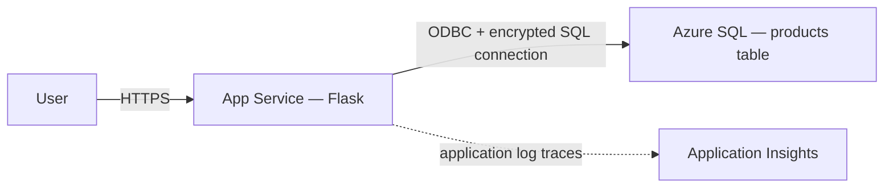

# ಫ್ಲಾಸ್ಕ್ ಮತ್ತು ಅ್ಯಾಜರ್ SQL ಆನ್ ಅಪ್ ಸರ್ವಿಸ್

**ಪದವಿ:** ಮಧ್ಯಂತರ · **ಸಮಯ:** 30-60 ನಿಮಿಷಗಳಲ್ಲಿ ಪೂರ್ವಾಪೇಕ್ಷಿತ ಒಟ್ಟು

ಈ ನಮೂನೆ ಪೈಥಾನ್ ಫ್ಲಾಸ್ಕ್ ಓದು API ಅನ್ನು **ಲಿನಕ್ಸ್ನ ಅಪ್ ಸರ್ವಿಸ್** ಗೆ ಮತ್ತು ಬೇಸಿಕ್
ಅಜೂರ್ SQL ಡೇಟಾಬೇಸ್ ಗೆ ನಿಯೋಜಿಸುತ್ತದೆ. ಮೂಲ, ಬೈಸೆಪ್, ಮತ್ತು azd ಸಂರಚನೆ ಸೇರಿಸಲಾಗಿದೆ. ಇದು
ಒಂದು ಕಲಿಕಲ್ ಅಪ್ಲಿಕೇಶನ್, ಉತ್ಪಾದನೆಗೆ ಸಿದ್ಧ ಡೇಟಾಬೇಸ್ ವಾಸ್ತುಶಿಲ್ಪವಲ್ಲ.

## ನೀವು ಕಲಿಯುವ ವಿಷಯಗಳು

- ಅಪ್ ಸರ್ವಿಸ್, SQL ಮತ್ತು ನಿರೀಕ್ಷಣಾ ಸಂಪನ್ಮೂಲಗಳನ್ನು ಬೈಸೆಪ್ ಮೂಲಕ ಒದಗಿಸುವುದು.
- ಪ್ರಮಾಣಪತ್ರಗಳನ್ನು ಕಮಿಟ್ ಮಾಡುವವರೆಗೆ ಸಂರಕ್ಷಿತ SQL ಸಂಪರ್ಕತಂತ್ರವನ್ನು ಸಂರಚಿಸುವುದು.
- ಗುನಿಕಾರ್ನ್ ಕಾರ್ಯನಿರತಗಳಿಂದ ಮೊದಲು ಸ್ಕೀಮಾ ಪ್ರಾರಂಭಿಸುವುದು.
- ಸೀಡ್ದ ಡೇಟಾ, ಹುಡುಕಲಾಗದ ಪ್ರತಿಕ್ರಿಯೆಗಳು ಮತ್ತು ಡೇಟಾಬೇಸ್ ಆರೋಗ್ಯವನ್ನು ಪರಿಶೀಲಿಸುವುದು.



ಸಂಪನ್ಮೂಲಗಳು: ಸಮರ್ಪಿತ ಸಂಪನ್ಮೂಲ ಗುಂಪು, B1 ಲಿನಕ್ಸ್ನ ಅಪ್ ಸರ್ವಿಸ್ ಯೋಜನೆ, ಪೈಥಾನ್ 3.11 ವೆಬ್
ಆಪ್, SQL ಸರ್ವರ್ ಮತ್ತು ಬೇಸಿಕ್ 2-ಜಿಬಿ ಡೇಟಾಬೇಸ್, ಅಪ್ಲಿಕೇಶನ್ ಇನ್ಸೈಟ್ಸ್, ಮತ್ತು ಲಾಗ್ ಅನಾಲೇಟಿಕ್ಸ್.
ವೆಬ್ ಆಪ್ **ಮೂಲ/ZIP ನಿಯೋಜನೆ ಮತ್ತು ಓರಿಕ್ಸ್ ಡಿಪೆಂಡೆನ್ಸಿ ಇನಸ್ಟಾಲೇಶನ್** ಅನ್ನು ಬಳಸುತ್ತದೆ;
`azd deploy` ಐಚ್ಛಿಕ ಡಾಕರ್‌ಫೈಲ್ ನಿರ್ಮಾಣ ಅಥವಾ ನಿಯೋಜನೆ ಮಾಡಲು ಬಳಸುವುದಿಲ್ಲ.

## ಪೂರ್ವಾಪೇಕ್ಷಿತ ಅಗತ್ಯಗಳು

- ಪ್ರಸ್ತುತ ಸ್ಥಿರ [azd](https://learn.microsoft.com/azure/developer/azure-developer-cli/install-azd)
  (ಪুনರ್ ಪರಿಶೀಲನೆ ಸಮಯದಲ್ಲಿನ ಬಿಡುಗಡೆ: 1.37.2).
- ಪರಿಶೀಲನೆಗಾಗಿ [ಅಜ್ಯೂರ್ CLI](https://learn.microsoft.com/cli/azure/install-azure-cli).
- ಅಜ್ಯೂರ್ ಚಂದಾದಾರಿಕೆ, ಪಟ್ಟಿಯಲ್ಲಿ ಕಾಣುವ ಸಂಪನ್ಮೂಲಗಳನ್ನು ರಚಿಸಲು ಅನುಮತಿಗಳು ಮತ್ತು ಪ್ರಾದೇಶಿಕ ಹಂಚಿಕೆ.
- ಸ್ಥಳೀಯ ಅಭಿವೃದ್ಧಿಗೆ ಪೈಥಾನ್ **3.11**; ಬದ್ಧ ಮಾಡಿದ `pyodbc==5.0.1` ಹೊಸ ಪೈಥಾನ್ ಆವೃತ್ತಿಗಳಲ್ಲಿ
  ನೈಜ ನಿರ್ಮಾಣ ಸಾಧನಗಳನ್ನು ಅಗತ್ಯವಾಗಬಹುದು.
- ಸ್ಥಳೀಯ ಯಂತ್ರಗಳಲ್ಲಿ SQL ಸರ್ವರ್‌ಗಾಗಿ ಮೈಕ್ರೋಸಾಫ್ಟ್ ODBC ಡೈವರ್ 18 (ಅಥವಾ 17). `pip install
  pyodbc` ವ್ಯವಸ್ಥೆ ಡೈವರ್ ಅನ್ನು ಇನ್ಸ್ಟಾಲ್ ಮಾಡುತ್ತಿಲ್ಲ. ನೋಡಿ
  [ODBC ಸ್ಥಾಪನೆ](https://learn.microsoft.com/sql/connect/odbc/download-odbc-driver-for-sql-server).
- ಐಚ್ಛಿಕ ಕಾಂಟೇನರ್ ಸ್ಥಳೀಯ ತಪಾಸಣೆಯಲ್ಲಿ ಡಾಕರ್ ಮಾತ್ರ.

```bash
azd version
az version
azd auth login
az login
```

ಎರಡೂ ಉಪಕರಣಗಳಲ್ಲಿ ಅದೇ ಚಂದಾದಾರಿಕೆಯನ್ನು ಉಪಯೋಗಿಸಿ. ಕೆಳಗಿನ ಕಮಾಂಡ್‌ಗಳು Bash ನ್ನು ಬಳಸುತ್ತವೆ.

## ನಿಯೋಜಿಸುವುದು

ರೆಪಾಸಿಟರಿ ಮೂಲದಿಂದ:

```bash
cd examples/database-app
azd env new sql-demo
azd provision
azd deploy
WEB_URL=$(azd env get-value WEB_APP_URI)
WEB_NAME=$(azd env get-value WEB_APP_NAME)
RG_NAME=$(azd env get-value AZURE_RESOURCE_GROUP)
```

ಬೆಂಬಲಿತ ಪ್ರಾದೇಶಿಕವನ್ನು ಆಯ್ಕೆಮಾಡಿ. `sqlAdminLogin` ಈಗಿನ ಸ್ಥಿತಿಯಲ್ಲಿ `sqladmin` ಗೆ ಡೀಫಾಲ್ಟ್ ಆಗಿರುತ್ತದೆ; ಅಗತ್ಯವಿರುವ
`sqlAdminPassword` ಒಂದು ಸುರಕ್ಷಿತ ಪರಾಮಿತಿ. ಕೇಳಿದಾಗ ಬಲವಾದ ಪಾಸ್‌ವರ್ಡ್ ಒದಗಿಸಿ.
ನಿಯೋಜನೆ ಪ್ರಮಾಣಪತ್ರಗಳನ್ನು ಗಿಟ್ ಮತ್ತು ಸಮಸ್ಯೆ ವರದಿಗಳಲ್ಲಿ ಮೀರಿಸದಿರಿ. ಸದ್ಯದ ಸಂಪರ್ಕ
ಸ್ಟ್ರಿಂಗ್ ಇಂಟರ್ಪೊಲೇಶನ್ ಕನೆಕ್ಷನ್ ಸ್ಟ್ರಿಂಗ್ ನಿರೋಧಕಗಳಿಲ್ಲದೆ ಪಾಸ್‌ವರ್ಡ್ ಅನ್ನು ನಿರೀಕ್ಷಿಸುತ್ತದೆ
`;` ಹಾಗಿದ್ದರೆ, ಅಂದರೆ ಅದರ ಪೂರ್ವಭಾವಿ ಉಪಯೋಗಕ್ಕೆ ಮುನ್ನ ಸರಿಯಾದ ಉಳಿಸು ಉಪಕ್ರಮಗಳನ್ನು ಹೊಂದಿಸಿ.

Bicep ಒಂದು ಸ್ಟಾರ್ಟಪ್ ಆಜ್ಞೆಯನ್ನು ಹೊಂದಿಸುತ್ತದೆ ಅದು `init_database()` **ಮುಂಬರುವ** Gunicorn‍ನ
ಕೆಲಸಗಾರರು ಪ್ರಾರಂಭಿಸುವ ಮೊದಲು ಓಡುವಂತೆ ಮಾಡುತ್ತದೆ. ಇದಕ್ಕೆ ಕಾರಣವೆಂದರೆ `app:app` ಅನ್ನು ಆಮದು ಮಾಡುವಾಗ
Pythonನ `if __name__ == '__main__'` ಬ್ಲಾಕ್ ಕಾರ್ಯನಿರ್ವಹಿಸುವುದಿಲ್ಲ. ಹೊಸ ಡೇಟಾಬೇಸಿನಲ್ಲಿ ಪ್ರಾರಂಭಿಕೀಕರಣವು
`products` ರಚಿಸಿ ಐದು ಸಾಲುಗಳನ್ನು ಸೇರುತ್ತದೆ. ಇದು ಸರಳವಾದ ಪಾಠದ ಬೀಜವಾಗಿದೆ, ಸಮಕಾಲೀನ ಮೈಸೂಚನಾ ಚಟುವಟಿಕೆಗೆ ಅಲ್ಲ;
ಉದಾಹರಣೆಯಾಗಿ ಸರಿ ಸಂಚಾರ ಮಾಡುವ ಮೊದಲು ಸೂಕ್ತ ಶಿಫ್ಟ್‍ಗಳನ್ನು ಉಪಯೋಗಿಸಿ.

ಆಪ್ ಸ್ಥಾಪಿಸಿದ Microsoft ODBC ಡ್ರೈವರ್ 18 ನನ್ನು ಆರಿಸುತ್ತದೆ, ನಂತರ 17 ನ್ನು, ಸಂಪರ್ಕ ಸ್ಟ್ರಿಂಗ್ ಸ್ಪಷ್ಟವಾಗಿ ಡ್ರೈವರ್ ಹೆಸರಿಲ್ಲದಿದ್ದರೆ.
ಒಂದೂ ಇಲ್ಲದಿದ್ದರೆ, ಸ್ಟಾರ್ಟಪ್ ಕಳಪೆ ಸ್ಥಾಪನಾ ದೋಷದಿಂದ ವಿಫಲವಾಗುತ್ತದೆ. ನಿಮ್ಮ ಆರಿಸಿದ
ಆಪ್ ಸರ್ವಿಸ್ ರನ್‌ಟೈಮ್‌ನಲ್ಲಿ ಡ್ರೈವರ್ ಲಭ್ಯತೆ ಪರಿಶೀಲಿಸಿ, ಊಹಿಸುವ ಬದಲಿಗೆ.


## ಪರಿಶೀಲಿಸಿ

```bash
curl --fail-with-body "${WEB_URL}/"
curl --fail-with-body "${WEB_URL}/health"
curl --fail-with-body "${WEB_URL}/products"
curl --fail-with-body "${WEB_URL}/products/1"
curl -i "${WEB_URL}/products/999"
```

ನಿರೀಕ್ಷೆ ಆಗಿದ್ದು:

- `/` ಮುಕ್ತಾಯದ ಭಾಗದ ಮಾಹಿತಿಯನ್ನು ನೀಡುತ್ತದೆ.
- `/health` 200 ಅನ್ನು `{"status":"healthy","database":"connected"}` ಜೊತೆಗೆ ನೀಡುತ್ತದೆ.
- `/products` ಹೊಸ ಡೇಟಾಬೇಸಿನಲ್ಲಿ ಐದು ಬೀಜಿತ ಉತ್ಪನ್ನಗಳನ್ನು ನೀಡುತ್ತದೆ.
- `/products/1` 1299.99 ಬೆಲೆಯಲ್ಲಿ ಲ್ಯಾಪ್‌ಟಾಪ್ ಅನ್ನು ನೀಡುತ್ತದೆ.
- ಇಲ್ಲದ ಉತ್ಪನ್ನವು 404 ಅನ್ನು `{"error":"Product not found"}` ಜೊತೆಗೆ ಹಿಂತಿರುಗಿಸುತ್ತದೆ.

API ಓದುವುದಕ್ಕೆ ಮಾತ್ರ. POST/PUT/DELETE ಮಾರ್ಗ ಅಥವಾ ಬ್ರೌಸರ್ UI ಇಲ್ಲ.
ಡೇಟಾಬೇಸ್ ಸಂಪರ್ಕ ವಿಫಲತೆ `/health` ರಿಂದ 503 ಹಿಂತಿರುಗಿಸುತ್ತದೆ; ಇದು ಯಶಸ್ವಿ ಅಲ್ಲ.

## ಕಡತಗಳು ಮತ್ತು ಸಂರಚನೆ

```text
azure.yaml                         # Python App Service source deployment
infra/main.bicep
infra/main.parameters.json
infra/abbreviations.json
infra/resources/sql-server.bicep
infra/resources/sql-database.bicep
infra/resources/app-service-plan.bicep
infra/resources/web-app.bicep       # Settings + initialization/startup command
infra/resources/app-insights.bicep
src/web/app.py
src/web/requirements.txt
src/web/Dockerfile                 # Optional local container, not the azd target
.env.sample
```

`SQL_CONNECTION_STRING` ಅನ್ನು ವೆಬ್ ಆಪ್ ಮಾಸ್ಯೂಲ್ಗೆ ಸುರಕ್ಷಿತ ಬೈಸ್ಪ್ ಪ್ಯಾರಾಮೀಟರ್ ಆಗಿ ಪಾಸ್ ಮಾಡಲಾಗುತ್ತದೆ
ಮತ್ತು ಹೊಸ ನೇಮಕ ಔಟ್‌ಪುಟ್ಸ್ ಅಲ್ಲದೆ ಆಪ್ ಸರ್ವಿಸ್ ಸೆಟ್ಟಿಂಗ್ಸ್‌ನಲ್ಲಿ ಸಂಗ್ರಹಿಸಲಾಗುತ್ತದೆ.
`APPLICATIONINSIGHTS_CONNECTION_STRING` ಲಾಗ್ ಎಕ್ಸ್ಪೋರ್ಟ್ ಅನ್ನು ಸಂರಚಿಸುತ್ತದೆ.
`SCM_DO_BUILD_DURING_DEPLOYMENT=true` ಸರ್‌ವರ್-ಬದಿಯ ಅವಲಂಬನೆ ಇನ್‌ಸ್ಟಾಲೇಶನ್ ಅನ್ನು ಸಕ್ರಿಯಗೊಳಿಸುತ್ತದೆ.
ಎಸೆ arbitrary `azd env` ಮೌಲ್ಯಗಳನ್ನು ಸೆಟ್ ಮಾಡುವುದರಿಂದ ಆ್ಯಪ್ ಸೆಟ್ಟಿಂಗ್ಸ್ ಸ್ವಯಂಚಾಲಿತವಾಗಿ ಬದಲಾಗುವುದಿಲ್ಲ.

SQL ಫೈರ್ವಾಲ್‌ನ `0.0.0.0` ನಿಯಮವು **ಅಜೂರ್ ಸೇವೆಗಳು ಸೇರಿದಂತೆ, 
ಇತರ ಗ್ರಾಹಕರ ಚಂದಾದಾರಿಕೆಗಳಿಂದ** ಸಂಪರ್ಕಗಳನ್ನು ಅವಕಾಶ ಮಾಡಿಕೊIaದೇ SQL ಪ್ರಾಮಾಣೀಕರಣಕ್ಕೆ ಒಳಪಡುತ್ತದೆ. ಇದು
ಈ ಆ್ಯಪ್ ಅಥವಾ ಚಂದಾದಾರಿಕೆಗಾಗಿ ಮಾತ್ರ ಮಿತಿ ವಿಧಿಸಲಾಗಿಲ್ಲ. SQL ಪಬ್ಲಿಕ್ ನೆಟ್‌ವರ್ಕ್ ಪ್ರವೇಶ ಸಕ್ರಿಯವಾಗಿದೆ.
ಉತ್ಪಾದನೆಯ ಮೊದಲು ಸ್ಕೋಪ್ಡ್ ನೆಟ್‌ವರ್ಕಿಂಗ್ ಮತ್ತು non-admin ಅಪ್ಲಿಕೇಶನ್ ಐಡೆಂಟಿಟಿಯನ್ನು ಬಳಸಿ.

## ಸ್ಥಳೀಯ ಅಭಿವೃದ್ಧಿ

Python 3.11 ಮತ್ತು ಇನ್ಸ್ಟಾಲ್ ಮಾಡಿದ Microsoft SQL ODBC ಡ್ರೈವರ್ ಅನ್ನು ಬಳಸಿ:

```bash
python -m venv .venv
source .venv/bin/activate  # PowerShell: .\.venv\Scripts\Activate.ps1
python -m pip install -r src/web/requirements.txt
export SQL_CONNECTION_STRING='Server=tcp:YOUR_SERVER.database.windows.net,1433;Database=YOUR_DATABASE;UID=YOUR_USER;PWD=YOUR_PASSWORD;Encrypt=yes;TrustServerCertificate=no;Connection Timeout=30;'
python src/web/app.py
```

ಪ್ಲೇಸ್‌ಹೋಲ್ಡರ್‌ಗಳನ್ನು ಸುರಕ್ಷಿತವಾಗಿ ಬದಲುಮಾಡಿ. ನಕಲಿ `.env` ಫೈಲ್ ಈ ಅಪ್ಲಿಕೇಶನ್ ಮೂಲಕ **ಸ್ವಯಂಚಾಲಿತವಾಗಿ ಲೋಡಾಗುವುದಿಲ್ಲ**
ಬದಲಾಗಿ ನಿಮ್ಮ ಪ್ರಸ್ತುತ ಶೆಲ್ ನಲ್ಲಿ ವೇರಿಯಬಲ್ಸ್ ಅನ್ನು ಎಕ್ಸ್ಪೋರ್ಟ್ ಮಾಡಿರಿ.
ಲ್ಯಾಪ್‌ಟಾಪಿನಿಂದ ಅಜೂರ್ SQL ಗೆ, ತಾತ್ಕಾಲಿಕವಾಗಿ ನಿಮ್ಮ ಸ್ವಂತ ಪಬ್ಲಿಕ್ IP ಮಾತ್ರ ಅನುಮತಿಸಿ:

```bash
SQL_SERVER=$(azd env get-value SQL_SERVER_NAME)
MY_IP=YOUR_PUBLIC_IP
az sql server firewall-rule create -g "$RG_NAME" -s "$SQL_SERVER" \
  -n AllowMyLearningIP --start-ip-address "$MY_IP" --end-ip-address "$MY_IP"
```

ಪರೀಕ್ಷೆಯ ನಂತರ ನಿಯಮವನ್ನು ತೆಗೆದುಹಾಕಿ:

```bash
az sql server firewall-rule delete -g "$RG_NAME" -s "$SQL_SERVER" -n AllowMyLearningIP
```

ಈ ಉದಾಹರಣಾ ಡೈರೆಕ್ಟರಿಗೆ ಇರುವ ಐಚ್ಛಿಕ ಕಂಟೈನರ್ ಪರೀಕ್ಷೆ:

```bash
docker build -t sql-flask:local src/web
docker run --rm -p 8000:8000 -e SQL_CONNECTION_STRING sql-flask:local
```

ಈ ಚಿತ್ರವು ಡ್ರೈವರ್ 18 ಅನ್ನು ಡೆಬಿಯನ್ 12 ಪ್ಯಾಕೇಜ್ ರೆಪೊಸಿಟರಿ ಬಳಸಿ ಇನ್ಸ್ಟ್‌ಾಲ್ ಮಾಡುತ್ತದೆ, ಇದು
বুক್‌ವರ್ಮ್ ಆಧಾರದೊಂದಿಗೆ ಹೊಂದಿಕೆಯಾಗುತ್ತದೆ, ಡೇಟಾಬೇಸ್ ಅನ್ನು ಒಂದು ಬಾರಿ ಇನಿಷಿಯಲೈಸ್ ಮಾಡಿ, ನಂತರ ಗುನಿಕಾರ್ನ್ ಅನ್ನು ಪ್ರಾರಂಭಿಸುತ್ತದೆ.

## ಮಾನಿಟರಿಂಗ್ ಮತ್ತು ಸಮಸ್ಯೆ ಪರಿಹಾರ

ಪ್ರಾರಂಭ ಸಮಯವನ್ನು ತಪಾಸಣೆಗೆ ಆನ್/ಆಫ್ ಮಾಡಿ App Service ಫೈಲ್ ಸಿಸ್ಟಮ್ ಅಪ್ಲಿಕೇಶನ್ ಲಾಗ್‌ಗಳನ್ನು ಸಕ್ರಿಯಗೊಳಿಸಿ:

```bash
az webapp log config --name "$WEB_NAME" --resource-group "$RG_NAME" \
  --application-logging filesystem --level information
az webapp log tail --name "$WEB_NAME" --resource-group "$RG_NAME"
```

ಈ ಕೋಡ್ ಹಳೆಯ OpenCensus ಹ್ಯಾಂಡ್ಲರ್ ಮೂಲಕ ಅಪ್ಲಿಕೇಶನ್ **ಲಾಗ್ ಟ್ರೇಸಸ್** ಅನ್ನು ರಫ್ತು ಮಾಡುತ್ತದೆ.
ಇದು ಸ್ವಯಂಚಾಲಿತ ಫ್ಲಾಸ್ಕ್ ವಿನಂತಿ/ನಿರ್ಭರತಾ ಟ್ರೇಸಿಂಗ್, ಲೈವ್ ಮೆಟ್ರಿಕ್ಸ್,
SQL ಆಡಿಟಿಂಗ್, ಡಯಾಗ್ನೋಸ್ಟಿಕ್ ಸೆಟ್ಟಿಂಗ್‌ಗಳು ಅಥವಾ ಎಚ್ಚರಿಕೆಗಳನ್ನು ಹೊಂದಿಸುವುದಿಲ್ಲ. ಅವುಗಳಿಗೆ ಪ್ರತ್ಯೇಕ ಸೆಟಪ್ ಅಗತ್ಯವಿದೆ.
ಹೊಸ ಸಾಧನತೆಗೆ, ಅಜೋರ್ ಮಾನಿಟರ್ OpenTelemetry ಪ್ರಾಧಾನ್ಯ ಕೊಡಿ.

ಅಪ್ಲಿಕೇಶನ್ ಇನ್ಸೈಟ್ಸ್ ಲಾಗ್‌ಗಳಲ್ಲಿ, API ವಿನಂತಿಗಳನ್ನು ಮಾಡಿಸಿದ ನಂತರ:

```kusto
traces
| where timestamp > ago(1h)
| where message contains "products" or message contains "Health check"
| project timestamp, message, severityLevel
```

ಸೇವೆಗೆ ಒಳಪಡಿಸುವಲ್ಲಿ ವಿಳಂಬವನ್ನು ಅನುಮತಿಸಿ. ಈ ಲಾಗ್-ಮಾತ್ರ ಸಾಧನತೆಗೆ ವಿನಂತಿ-ಪಟ್ಟಿ ಅಥವಾ ಲೈವ್ ಮೆಟ್ರಿಕ್ಸ್ ಚಟುವಟಿಕೆ ಪೂರ್ಣತೆಯ ಮಾನದಂಡವಲ್ಲ.


- **ಒಳಗಿನ ಚಾಲಕ ಇಲ್ಲ:** ರನ್‌ಟೈಮ್‌ನಲ್ಲಿ `pyodbc.drivers()` ಪರಿಶೀಲಿಸಿ ಮತ್ತು ಬೆಂಬಲಿತ ಮೈಕ್ರೋಸಾಫ್ಟ್ ODBC ಚಾಲಕವನ್ನು ಸ್ಥಾಪಿಸಿ.
  ಪೈಥಾನ್ ಪ್ಯಾಕೇಜ್ ಮಾತ್ರದಿಂದೇ ಸಾಕಾಗುವುದಿಲ್ಲ.
- **ಸಂಪರ್ಕ ವಿಫಲತೆ:** SQL ಸೆಟ್ಟಿಂಗ್‌ಗಳು, ಮಾನ್ಯತೆಗಳು, ಫೈರ್‌ವಾಲ್ ಮತ್ತು ಆಯ್ಕೆಮಾಡಿದ
  ಸಬ್ಸ್ಕ್ರಿಪ್‌ಶನ್ ಅನ್ನು ಪರಿಶೀಲಿಸಿ. ದೋಷವನ್ನು ತಡೆಯಲು ಎನ್‌ಕ್ರಿಪ್‌ಷನ್ ನಿಷ್ಕ್ರಿಯಗೊಳಿಸಬೇಡಿ.
- **ಉತ್ಪನ್ನಗಳ ಪಟ್ಟಿ ಇಲ್ಲ:** ಬಿಸೆಪ್ಸ್ ಸ್ಟಾರ್ಟ್‌ಅಪ್ ಆಜ್ಞೆಯನ್ನು ಜಾರಿಗೆ ತಂದುದಾಗಿ ಖಚಿತಪಡಿಸಿಕೊಳ್ಳಿ;
  ಕೇವಲ `gunicorn app:app` ಆರಂಭಿಸುವುದರಿಂದ ಆರಂಭಿಸಲಾಗುವುದಿಲ್ಲ.
- **ಪ್ಯಾಕೇಜ್ ನಿರ್ಮಾಣ ವಿಫಲತೆ:** ಪೈಥಾನ್ 3.11 ಬಳಸಿ ಅಥವಾ ಸ್ಥಳೀಯ ನಿರ್ಮಾಣ ಪೂರ್ವಾಪೇಕ್ಷತೆಗಳನ್ನು ಒದಗಿಸಿ.
- **ಶೂನ್ಯ-ಬೆಲೆ ಡೇಟಾ:** ಶೂನ್ಯವು ಮಾನ್ಯ ದಶಮಾಂಶ ಬೆಲೆ; ಇದು 0.0 ಆಗಿ ಸರಣಿಗಳನ್ನು ಹೊಂದಬೇಕು,
  `null` ಅಲ್ಲ.

## ಪ್ರಾಯೋಗಿಕ ವ್ಯಾಯಾಮಗಳು

### ವ್ಯಾಯಾಮ 1: ಇಲ್ಲದಿರುವ ಉತ್ಪನ್ನ ವರ್ತನೆಯನ್ನು ಪರಿಶೀಲಿಸುವುದು

**ಪ್ರಾರಂಭದ ಬಿಂದುವು:** ಮೇಲಿನ ನಿಯೋಜಿತ API ಮತ್ತು `WEB_URL`.
**ಉದ್ದೇಶ:** ಇಲ್ಲದಿರುವ ಸಾಲಿಯನ್ನು ಮುರಿದಿರುವ ಡೇಟಾಬೇಸ್‌ನಿಂದ ಭೇದಿಸುವುದು.
ಮೇಲಿನ ಆಜ್ಞೆಗಳನ್ನು ಬಳಸಿ `/health` ಮತ್ತು `/products/999` ಅನ್ನು ವಿನಂತಿಸಿ.
**ಯಶಸ್ವಿ ಮಾನದಂಡ / ಉತ್ತರ:** ಹيل್ತ್ 200, ಇಲ್ಲದಿರುವ ಉತ್ಪನ್ನ 404 (500 ಅಥವಾ 503 ಅಲ್ಲ).
**ಸಾಮಾನ್ಯ ಸಮಸ್ಯೆ:** ಕಂಡುಬಂದಿಲ್ಲದ ಪ್ರತಿಕ್ರಿಯೆಯು SQL ಸಂಪರ್ಕ ಬಂದಿದ್ದೀತೆಂಬುದನ್ನು ಊಹಿಸುವುದು.

### ಅಭ್ಯಾಸ 2: ಬೀಜಿತ ಮೌಲ್ಯವನ್ನು ಬದಲಾಯಿಸಿ

**ಪ್ರಾರಂಭಿಕ ಬಿಂದುವು:** ಟೆಸ್ಟ್ ಡೇಟಾಬೇಸ್‌ಗೆ ಸಂಪರ್ಕಿಸಿದ Azure SQL Query Editor.
**ಗೋಲು:** API ಡೇಟಾ ಸಂಸ್ಕರಣಾ ಸ್ಮರಣೆಯಲ್ಲಿ ಅಲ್ಲದೆ SQL ನಲ್ಲಿ ಸಂಗ್ರಹಿಸಲಾಗುತ್ತಿದೆ ಎಂದು ತೋರಿಸುವುದು.

```sql
UPDATE products SET price = 0 WHERE id = 1;
SELECT id, name, price FROM products WHERE id = 1;
```

ವಿನಂತಿ `${WEB_URL}/products/1`. **ಯಶಸ್ವಿ ಮಾನದಂಡ:** ಬೆಲೆ `0.0` ಆಗಿರಬೇಕು, `null` ಅಲ್ಲ.
ಮೌಲ್ಯವನ್ನು ಮರುಸ್ಥಾಪಿಸಿ:

```sql
UPDATE products SET price = 1299.99 WHERE id = 1;
```

**ಸಾಮಾನ್ಯ ಸಮಸ್ಯೆ:** Python ಸೀಡ್ ಪಟ್ಟಿಯನ್ನು ಸಂಪಾದನೆ ಮಾಡಿದಾಗ SQL ನಲ್ಲಿ ಇರುವ ಸಾಲುಗಳು تازه ಆಗುವುದಿಲ್ಲ.
ಉತ್ಪಾದನಾ ಡೇಟಾಬೇಸ್ ಮೇಲೆ ಸ್ಕೀಮಾ/ಡೇಟಾ ವ್ಯಾಯಾಮಗಳನ್ನು ನಡೆಸಬೇಡಿ.

### ವ್ಯಾಯಾಮ 3: ಓದಲು ಮಾತ್ರವಿರುವ ಎಣಿಕೆ ಅಂತಿಮಬಿಂದುವನ್ನು ಸೇರಿಸಿ

**ಪ್ರಾರಂಭಿಕ ಬಿಂದುವು:** `src/web/app.py`.
**ಗೋಲು:** ಪ್ಯಾರಾಮೀಟರ್ ರಹಿತ ಒಂದು ಸಂಗ್ರಹಿತ ಕ್ವೆರಿಯನ್ನು ಬಳಸಿ API ವಿಸ್ತರಿಸುವುದು.
`if __name__ == '__main__':` ಬ್ಲಾಕ್‌ಗಿಂತ ಮುನ್ನ ಈ ಕೆಳಗಿನವು ಸೇರಿಸಿ:

```python
@app.route('/product-count')
def product_count():
    from contextlib import closing
    with closing(get_db_connection()) as conn, closing(conn.cursor()) as cursor:
        cursor.execute("SELECT COUNT(*) FROM products")
        return jsonify({'count': cursor.fetchone()[0]})
```

`azd deploy web` ಚಾಲನೆ ಮಾಡಿ, ನಂತರ `${WEB_URL}/product-count` ವಿನಂತಿಸಿ.
**ಯಶಸ್ವಿ ಮಾನದಂಡ:** ಮುಟ್ಟಿಸದ ಸೀಡ್ ಡೇಟಾಬೇಸ್ ಮೇಲೆ `{"count":5}` ಜೊತೆಗೆ 200 ರ प्रत्यುತ್ತರ.
**ಸಾಮಾನ್ಯ ಸಮಸ್ಯೆ:** ಮಾರ್ಗವನ್ನು ಬದಲಾಯಿಸಿ ಆದರೆ ರೀಡೆಪ್ಲಾಯ್ ಮಾಡಲು ಮರೆತಿರುವುದು.
ಉತ್ಪಾದನೆಗಾಗಿ ದೋಷ ನಿರ್ವಹಣೆ/ಪರೀಕ್ಷೆಗಳನ್ನು ಸೇರಿಸಿ; ಈ ಸಣ್ಣ ವ್ಯಾಯಾಮ ಕ್ವೆರಿಗೇ ಕೇಂದ್ರಿತವಾಗಿದೆ.

## ವೆಚ್ಚಗಳು, ಉತ್ಪಾದನಾ ದೋಣಿಗಳು ಮತ್ತು ಸ್ವಚ್ಛತೆ

B1 ಅಪ್ಲಿಕೇಶನ್ ಸರ್ವീസ് ಮತ್ತು ಬೇಸಿಕ್ ಡೇಟಾಬೇಸ್ ಪ್ರೊವಿಷನ್ ಇದ್ದಾಗ ಬಿಲ್ ಆಗುತ್ತವೆ. ವೆಬ್ ಅಪ್ಲಿಕೇಶನ್ ನಿಲ್ಲಿಸಿದರೂ
ಅಪ್ಲಿಕೇಶನ್ ಸರ್ವೀಸ್ ಪ್ಲಾನ್ ಬಿಲ್ಲಿಂಗ್ **ನಿಲ್ಲದು**. ಲಾಗ್‌ಗಳು ಮತ್ತು ಸ್ಟೋರೇಜ್ ಹೆಚ್ಚುವರಿ ವೆಚ್ಚಗಳನ್ನು ಉಂಟುಮಾಡಬಹುದು.
ಬಳಕೆ ಮಾಡಿ [Azure ಬೆಲೆ ગણಕ](https://azure.microsoft.com/pricing/calculator/)
ಪ್ರಸ್ತುತ ಪ್ರಾದೇಶಿಕ ಬೆಲೆಗಾಗಿ. F1 ಗೆ ಸ್ವಿಚ್ ಮಾಡುವುದು ಸಹ `alwaysOn` ನಿಷ್ಕ್ರಿಯಗೊಳಿಸುವುದು ಅಗತ್ಯವಿದೆ;
ಇದು ಒಂದು ಸಾಲಿನ ಬದಲಾವಣೆ ಅಲ್ಲ. SQL ಸರ್ವರ್‌ಲೆಸ್ ಸ್ವಯಂಚಾಲಿತವಾಗಿ ಉಚಿತವಲ್ಲ.

ಉತ್ಪಾದನಾ ಕೆಲಸಕ್ಕೆ ಕನಿಷ್ಠ-ಅಧಿಕಾರವುಳ್ಳ ಆಪ್ ಗುರುತಿನ(identity) ಅಗತ್ಯವಿದೆ (SQL ಆಡಳಿತಗಾರನಲ್ಲ),
ಪ್ರಮಾಣೀಕರಣ/ಅನುಮತಿಪ್ರದಾನ, ಖಾಸಗಿ ನೆಟ್ವರ್ಕಿಂಗ್, ಸುರಕ್ಷಿತ ಸ್ಥಳಾಂತರಗಳು, ಸಂಪರ್ಕ
ಪೂಲಿಂಗ್/ಜೀವನಚರಿಯಾ ಪರಿಶೀಲನೆ, ದೂರವಾಣಿ ಪತ್ತೆ, ಪರಿಶೀಲನೆ, ಎಚ್ಚರಿಕೆಗಳು, ಪರೀಕ್ಷೆಗಳು ಮತ್ತು ಪುನરુಗಮ ಪ್ರಕ್ರಿಯೆಗಳು.
ರೆಡಿಸ್ ಕ್ಯಾಶಿಂಗ್ ಮತ್ತು ಹೆಚ್ಚುವರಿ ಟೇಬಲ್ಗಳು ಅಭಿವೃದ್ಧಿ ಯೂಜನೆಗಳು, ಜಾರಿಗೆ ಇಲ್ಲದ ಅಭ್ಯಾಸಗಳು.

ಈ ಉದಾಹರಣಾ ಡೈರೆಕ್ಟರಿಯಿಂದ:

```bash
azd down
```

ಅಳಿಸುವಿಕೆ ಪ್ರಾಂಪ್ಟ್ ಪರಿಶೀಲಿಸಿ ಮತ್ತು ಸಮರ್ಪಿತ ರಿಸೋರ್ಸ್ ಗುಂಪು ತೆಗೆದುಹಾಕಲಾಗಿದೆ ಎಂದು ದೃಢೀಕರಿಸಿ.
ಸಂಬಂಧಹೀನ ಡೇಟಾವಿರುವ ಗುಂಪುಗಳನ್ನು ಅಳಿಸಬೇಡಿ.

[ಕಂಟೇನರ್ ಉದಾಹರಣೆಗಳು](../../../../examples/container-app) ·
[ಎಐ ಅಭಿವೃದ್ದಿ](../../docs/chapter-02-ai-development/README.md) ·
[ಪಾಠ್ಯದ ಮನೆ](../../README.md) · [ಪ್ರಶ್ನೆಯನ್ನು ವರದಿಮಾಡಿ](https://github.com/microsoft/AZD-for-beginners/issues)

---

<!-- CO-OP TRANSLATOR DISCLAIMER START -->
**ಅಸ್ವೀಕಾರ**:
ಈ ದಸ್ತಾವೇಜು AI ಅನುವಾದ ಸೇವೆ [Co-op Translator](https://github.com/Azure/co-op-translator) ಬಳಸಿ ಅನುವಾದಿಸಲಾಗಿದೆ. ನಾವು ನಿಖರತೆಯನ್ನು ಸಾಧಿಸಲು ಪ್ರಯತ್ನಿಸುತ್ತಿದ್ದರೂ, ದಯವಿಟ್ಟು ಗಮನಿಸಿ, ಸ್ವಯಂಚಾಲಿತ ಅನುವಾದಗಳಲ್ಲಿ ದೋಷಗಳು ಅಥವಾ ಅಸಡ್ಡೆಗಳು ಇರಬಹುದು. ಮೂಲ ಭಾಷೆಯಲ್ಲಿರುವ ಮೂಲ ದಸ್ತಾವೇಜು ಪ್ರಾಮಾಣಿಕ ಮೂಲವೆಂದು ಪರಿಗಣಿಸಬೇಕು. ಪ್ರಮುಖ ಮಾಹಿತಿಗಾಗಿ, ವೃತ್ತಿಪರ ಮಾನವ ಅನುವಾದವನ್ನು ಶಿಫಾರಸು ಮಾಡಲಾಗುತ್ತದೆ. ಈ ಅನುವಾದವನ್ನು ಬಳಸುವ ಮೂಲಕ ಉಂಟಾಗುವ ಯಾವುದೇ ತಪ್ಪು ಅರ್ಥಗಳ ಅಥವಾ ತಪ್ಪು ವ್ಯಾಖ್ಯಾನಗಳ ಬಗ್ಗೆ ನಾವು ಹೊಣೆಗಾರರಲ್ಲ.
<!-- CO-OP TRANSLATOR DISCLAIMER END -->