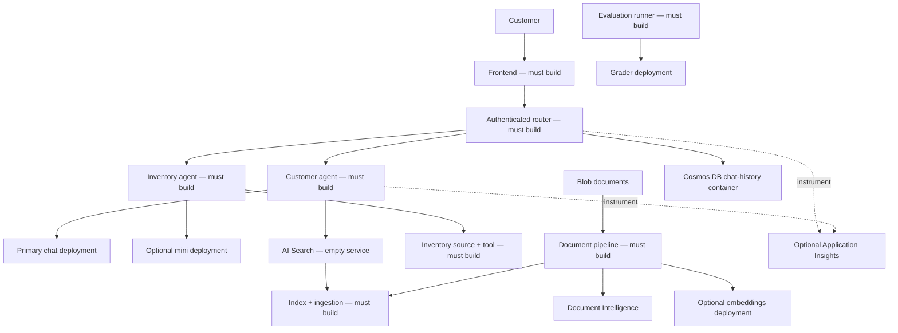

# ಬಹು-ಸಂಸ್ಕರಣಾ ಗ್ರಾಹಕ ಬೆಂಬಲ — ಚಿಲ್ಲರೆ ವಾಸ್ತುಶಿಲ್ಪ ಬ್ಲೂಪ್ರಿಂಟ್

**ಅಧ್ಯಾಯ 5: ಬಹು-ಸಂಸ್ಕರಣಾ AI ಪರಿಹಾರಗಳು**

- [ಕೋರ್ಸ್ ಹೋಮ್](../README.md)
- [ಅಧ್ಯಾಯ 5](../docs/chapter-05-multi-agent/README.md)
- [पूर्वಾಪೇಕ್ಷಿತ: AI ಏಕೀಕರಣ](../docs/chapter-02-ai-development/microsoft-foundry-integration.md)
- [ಮುಂದಿನದು: ಸಾಮರ್ಥ್ಯ ಯೋಜನೆ](../docs/chapter-06-pre-deployment/capacity-planning.md)
- [ARM ಮೂಲಸೌಕರ್ಯ ಮೇರೆಗೆ](retail-multiagent-arm-template/README.md)

> **ವಾಸ್ತುಶಿಲ್ಪ ಮಾರ್ಗದರ್ಶಿ, ಕೆಲಸಮಾಡುವ ಅಪ್ಲಿಕೇಶನ್ ಅಲ್ಲ.** ಏಕೈಕ ಚಿಲ್ಲರೆ ಅನುಷ್ಠಾನ
> ಕಡತಗಳು `azuredeploy.json`, `azuredeploy.parameters.json`, ಮತ್ತು `deploy.sh` ಯಲ್ಲಿ ಇವೆ
> `retail-multiagent-arm-template/`. ರೌಟರ್/ಮುಂಭಾಗದ ಕಂಟೈನರ್‌ಗಳು hello-world
> ಅಸ್ಥಿರಸ್ಥಾನಗಳು. ಯಾವುದೇ ಚಿಲ್ಲರೆ ಏಜೆಂಟ್, UI, ಅಂಶ ಸಂಗ್ರಹಣಾ ಪೈಪ್ಲೈನ್, ಮೌಲ್ಯಮಾಪಕ,
> ಸ್ಕ್ಯಾನರ್, ಅಥವಾ ಅಪ್ಲಿಕೇಶನ್ ಟೆಸ್ಟ್ ಸ್ಯೂಟ್ ಸ್ಥಳೀಯವಾಗಿ ಇಲ್ಲ.

## ಅವಲೋಕನ

**ಲಕ್ಷ್ಯ:** ಗ್ರಾಹಕ ಏಜೆಂಟ್ ಮತ್ತು ಇನ್ವೆಂಟರಿ ಏಜೆಂಟ್ ಜೊತೆಗೆ ಗ್ರಾಹಕ ಬೆಂಬಲ ವ್ಯವಸ್ಥೆಯನ್ನು ರೂಪಿಸಲು, ಅಂಶಗಳು ಏನು ಒದಗಿಸುತ್ತವೆ ಎಂಬುದನ್ನು ಗುರುತಿಸಲು ಮತ್ತು ಅಪ್ಲಿಕೇಶನ್ ಒಪ್ಪಂದಗಳು ಮತ್ತು ಪರಿಶೀಲನೆಗಳನ್ನು ಯೋಜಿಸಲು.


**ಪ್ರೇಕ್ಷಕರು:** ಸ್ಥಳೀಯ
[ಚಾಟ್ ಉದಾಹರಣೆ](../../../examples/azure-openai-chat) ಮತ್ತು [ಎರಡು-ಸೇವೆಯ ಕಂಟೈನರ್ ಉದಾಹರಣೆ](../../../examples/container-app/microservices) ಪೂರ್ಣಗೊಳಿಸಿದ ಅಭಿವೃದ್ಧಿಪರರು.
ವಾಸ್ತುಶಿಲ್ಪ ಅಧ್ಯಯನಕ್ಕೆ 2–3 ಗಂಟೆಗಳ ಸಮಯ ಕೊಡಬೇಕು. ಅಪ್ಲಿಕೇಶನ್ ನಿರ್ಮಾಣವು ಪ್ರತ್ಯೇಕ
ಪ್ರಾಜೆಕ್ಟ್: 80–120 ಅಭಿವೃದ್ಧಿ ಗಂಟೆಗಳು ಅನುಭವಸಂಪನ್ನ ಅಭಿವೃದ್ಧಿಪರರಿಗೆ ರೂಪರೇಖೆಯ ನಿರ್ವಹಣೆ ಒಂದು ಅಂದಾಜು, **ಡೆಲಿವರಿ ಭರವಸೆ ಅಲ್ಲ**; ಉತ್ಪಾದನಾ ಗಟ್ಟಿತನ, ಪರೀಕ್ಷೆಗಳು,
ಭದ್ರತೆ ಪರಿಶೀಲನೆ ಮತ್ತು ಕಾರ್ಯಾಚರಣೆಗಳಿಗೆ ಹೆಚ್ಚುವರಿ ಕೆಲಸ ಬೇಕು.


### ಕಲಿಕೆಯ ಫಲಿತಾಂಶಗಳು

- ಮಾರ್ಗದರ್ಶನ, ನೆಲಗೊಳ್ಳುವಿಕೆ, ಉಪಕರಣ ಅನುಮತಿಗಳು ಮತ್ತು ಸಂಭಾಷಣೆ ಮಾಲೀಕತ್ವವನ್ನು ವಿವರಿಸಿ.
- ಮಾದರಿ ಗುರುತುಗಳು, ನಿಯೋಜನಾ ಹೆಸರಿಗಳು, API ಆವೃತ್ತಿಗಳು ಮತ್ತು ARM ಆವೃತ್ತಿಗಳನ್ನು ಭಿನ್ನಪಡಿಸಿ.
- ಹೊಂದಿಕೆಯಾಗುವ ವೆಕ್ಟರ್ ಆಯಾಮಗಳೊಂದಿಗೆ ಡಾಕ್ಯುಮೆಂಟ್ ಇಂಜೆಕ್ಷನ್ ಮತ್ತು ಪಡೆಯುವಿಕೆಯನ್ನು ವಿನ್ಯಾಸಗೊಳಿಸಿ.
- ಪರಿಶೀಲಿಸಬಹುದಾದ ಕಾರ್ಯಾತ್ಮಕ, ಮೌಲ್ಯಮಾಪನ ಮತ್ತು ವೈಫಲ್ಯ ಪುನಃಪಡೆಯುವ ಅಗತ್ಯಗಳ 정의 ಮಾಡಿ.
- ಐಚಿತ್ತಿಕ ವಾಸ್ತುಶಿಲ್ಪ ಗುರಿಗಳನ್ನು ನಿಜವಾದ ಸಂಪನ್ಮೂಲಗಳಿಂದ ಪ್ರತ್ಯೇಕಿಸಿ.

## ಪರಿಹಾರ ವಾಸ್ತುಶಿಲ್ಪ



ಇದು **ಲક્ષ್ಯ ಅಪ್ಲಿಕೇಶನ್ ವಾಸ್ತುಶಿಲ್ಪ**, ಚಾಲನೆಯಲ್ಲಿರುವ ಏಜೆಂಟ್
ಸೇವೆಗಳ ರೇಖಾಚಿತ್ರವಲ್ಲ. ARM ಶೆಲ್ಫ್ ಮೂಲ ಸೇವೆಗಳು ಮತ್ತು ಎರಡು ತಾತ್ಕಾಲಿಕ
ಕಂಟೈನರ್‌ಗಳನ್ನಷ್ಟೇ ಸೃಷ್ಟಿಸುತ್ತದೆ. ಫ್ರಂಟ್ ದ್ವಾರ, ರೆಜಿಸ್ಟ್ರಿ, ನಿರ್ವಹಿಸಲಾದ ಐಡೆಂಟಿಟಿಗಳು, ಪಾತ್ರ ನಿಯೋಜನೆಗಳು,
ಖಾಸಗಿ ಅಂತಿಮ ಬಿಂದುಗಳು, ವೈಫಲ್ಯ ಪರಿಹಾರ, ಅಪ್ಲಿಕೇಶನ್ ಉಪಕರಣೋಲಿಕೆ ಮತ್ತು ಎಚ್ಚರಿಕೆಗಳನ್ನು ಸೇರಿಸಲಾಗಿಲ್ಲ.

### ಹೊಣೆಗಾರಿಕೆಗಳು ಮತ್ತು ಒಪ್ಪಂದಗಳು

| ಘಟಕ | ಬೇಕಾದ ವರ್ತನೆ | ಪೂರ್ಣಗೊಂಡೆಂದು ಕರೆಮಾಡುವ ಮುಂಚೆ ಪ್ರಮಾಣದ ಸೂಚನೆಗಳು |
|---|---|---|
| ಫ್ರಂಟ್ಎಂಡ್ | ಬಳಕೆದಾರರನ್ನು ಪ್ರಾಮಾಣೀಕರಿಸಿ, ಚಾಟ್ ರೆಂಡರ್ ಮಾಡಿ, ಡಾಕ್ಯುಮೆಂಟ್‌ಗಳನ್ನು ಸುರಕ್ಷಿತವಾಗಿ ಅಪ್‌ಲೋಡ್ ಮಾಡಿ | UI ಮತ್ತು ಅಪ್‌ಲೋಡ್ ಪರೀಕ್ಷೆಗಳು, ಪ್ರವೇಶ ಸಾಧ್ಯವಾದ ದೋಷಗಳು |
| ರೌಟರ್ | ವಿನಂತಿಗಳನ್ನು ಅನುಮತಿ ನೀಡಿ, ಏಜೆಂಟ್ ಆಯ್ಕೆಮಾಡಿ, ಬೌಂಡ್ ಟೂಲ್ ಕರೆಗಳು/ಸಮಯ ಮರುಘಟ್ಟಗಳು | ಮಾರ್ಗದರ್ಶನ ಪರೀಕ್ಷೆಗಳು, ಅನುಮತಿ ಪರಿಶೀಲನೆಗಳು, ವೈಫಲ್ಯ ಪರೀಕ್ಷೆಗಳು |
| ಗ್ರಾಹಕ ಏಜೆಂಟ್ | ನೀತಿಗಳ/ಉತ್ಪನ್ನ ಉತ್ತರಗಳನ್ನು ಅನುಮೋದಿತ ಮೂಲಗಳಲ್ಲಿ ನೆಲಗೊಳ್ಳಿಸಿ | ಸರಿಯಾದ ಉಲ್ಲೇಖಗಳು, ಡೇಟಾ ಇಲ್ಲಿದ್ದರೆ ನಿಯಂತ್ರಣ ತೋರಿಸುವಿಕೆ |
| ಇನ್ವೆಂಟರಿ ಟೂಲ್ | ಪರಿಧಿ ಅನುಮತಿಗಳೊಂದಿಗೆ ಪ್ರಾಧಿಕೃತ ಸ್ಟಾಕ್ ಓದಿ | ನಿಶ್ಚಿತ ಸ್ಟಾಕ್ ಪರೀಕ್ಷೆಗಳು; ಕಲ್ಪಿತ ಲಭ್ಯತೆ ಇಲ್ಲ |
| ಡಾಕ್ಯುಮೆಂಟ್ ಪೈಪ್‌ಲೈನ್ | ಹೊರತೆಗೆಯಿರಿ, ಭಾಗಿಸಿಕೊಂಡಿರಿ, ಇಂಭೆಡ್ ಮಾಡಿ, ಸೂಚ್ಯಂಕಿಸಿ, ನವೀಕರಿಸಿ/ಅಳಿಸಿ | ಸೂಚ್ಯಂಕ ಹೊಂದಿರುವ ಫಿಕ್ಸ್‌ಚರ್‌ಗಳು ಮತ್ತು ಮರುಪ್ರಯತ್ನ/ಡೆಡ್-ಲೆಟರ್ ವರ್ತನೆ |
| ಸಂಭಾಷಣೆ ಸಂಗ್ರಹಣೆ | ಬಳಕೆದಾರರನ್ನು ವಿಭಜಿಸಿ, ಸಂರಕ್ಷಣೆ ಜಾರಿ ಮಾಡಿ | ಅತಿರಿಕ್ತು ಬಳಕೆದಾರ ಅನುಮತಿ ಮತ್ತು TTL ಪರೀಕ್ಷೆಗಳು |
| ಮೌಲ್ಯಮಾಪನ ರನ್ನರ್ | ಹೊರಹೊಮ್ಮುವಿಕೆಯನ್ನು ನೆಲದ ಸತ್ಯ ಮತ್ತು ಮೌಲ್ಯಮಾಪನ ಫ್ರೇಮ್‌ಗೆ ಹೋಲಿಸಿ | ವ್ಯಾಪ್ತಿಯ ಭೇದ, ವೈಫಲ್ಯ ಎಣಿಕೆಗಳು, ಪುನರಾವರ್ತನೀಯ ವರದಿಗಳು |

ರೌಟರ್ ಅನ್ನು ಸ್ವಾಗತ ಡೆಸ್ಕ್ ಎಂದು ಮತ್ತು ಉಪಕರಣಗಳನ್ನು ನಿಯಂತ್ರಿತ ಆಂತರಿಕ ವ್ಯವಸ್ಥೆಗಳು ಎಂದು ಪರಿಗಣಿಸಿ:
ತಜ್ಞರನ್ನು ಆಯ್ಕೆಮಾಡುವುದು ಪ್ರತಿ ಗ್ರಾಹಕರ ದಾಖಲಾತಿಗಳಿಗೆ ಪ್ರವೇಶ ನೀಡುವುದಿಲ್ಲ.
ಅಪ್ಲಿಕೇಶನ್ ಕೋಡ್ ಮತ್ತು ದತ್ತಸೆವೆಗಳಲ್ಲಿ ಗುರುತನ್ನು ಮತ್ತು ಅನುಮತಿಗಳನ್ನು ಜಾರಿ ಮಾಡಿ, ಪ್ರಾಂಪ್ಟ್‌ಗಳಲ್ಲಿ ಅಲ್ಲ.

## ಮೂಲಸೌಕರ್ಯ ಮತ್ತು ಅಪ್ಲಿಕೇಶನ್

ಪ್ರಾವಿಜನಿಂಗ್ ಮಾಡಲು ಮುಂಚೆ [scaffold README](retail-multiagent-arm-template/README.md) ಅನ್ನು ಓದಿರಿ.
ಇದು ನಿಖರವಾದ ಸಂಪನ್ಮೂಲಗಳು, ಮೋಡ್‌ಗಳು, ವೆಚ್ಚಗಳು ಮತ್ತು ಮಿತಿಗಳನ್ನು ಪಟ್ಟಿಮಾಡುತ್ತದೆ.

| ತಾರ್ಕಿಕ ಬಳಕೆ | ARM ನಿಯೋಜನೆಯ ಹೆಸರು | ಮಾದರಿ / ಸಂಚಿಕೆ | ಡೀಫಾಲ್ಟ್ ಪ್ರದೇಶ |
|---|---|---|---|
| ಗ್ರಾಹಕರ ಚಾಟ್ | `gpt-4.1-chat` | `gpt-4.1` / `2025-04-14` | `eastus2` |
| ಇನ್ವೆಂಟರಿ | `gpt-4.1-mini-inventory` | `gpt-4.1-mini` / `2025-04-14` | `westus2`, ಐಚ್ಛಿಕ |
| ಎम्बೆಡ್ಡಿಂಗ್‌ಗಳು | `text-embedding-ada-002` | `text-embedding-ada-002` / `2` | `francecentral`, ಐಚ್ಛಿಕ |
| ಮೌಲ್ಯಮಾಪನ | `gpt-4.1-grader` | `gpt-4.1` / `2025-04-14` | ಡೀಫಾಲ್ಟ್ ಪ್ರಕಾರ ಮುಖ್ಯ ಪ್ರದೇಶ |

ಪ್ರತಿ ಪ್ರದೇಶದಲ್ಲಿ ಮಾದರಿ/ಸಂಚಿಕೆ/SKU ಲಭ್ಯತೆ ಮತ್ತು ಕೊಟಾ ಪರಿಶೀಲಿಸಿ. ಚಾಟ್/ಮಿನಿ/ಗ್ರೇಡರ್
ನಲ್ಲಿ `GlobalStandard` ಬಳಕೆ; ಎम्बೆಡ್ಡಿಂಗ್‌ಗಳಿಗೆ `Standard` ಬಳಕೆ. ಸಾಮರ್ಥ್ಯ-ಘಟಕ-देखि-TPM ನ ನಕ್ಷೆಗಳು
ಮಾದರಿ-ವಿಶಿಷ್ಟ. ವಿಸರ್ಜಿತ ಸಾಮರ್ಥ್ಯ ಘಟಕಗಳನ್ನು ಸರ್ವಕಾಲಿಕ ಕೊಟಾ ಭರವಸೆಗಾಗಿ ಸೇರಿಸಬೇಡಿ.

ಕೆಲವು Azure OpenAI ವಿನಂತಿಯ `model` ವಾದವು **ನಿರ್ವಹಣೆ ಹೆಸರಾಗಿದೆ**,  
ಕತಾಲಾಗ್ ಮಾದರಿ ಗುರುತಿಸಲು ಇರಬೇಕಾಗಿಲ್ಲ. ಡೇಟಾ-ಪ್ಲೇನ್ API ಆವೃತ್ತಿ `2024-10-21`  
ಮಾದರಿ ಆವೃತ್ತಿ `2025-04-14` ಮತ್ತು ARM ಸಂಪನ್ಮೂಲ `apiVersion` ಮಧ್ಯೆ ಭಿನ್ನವಾಗಿದೆ.  
ಲಭ್ಯವಿಲ್ಲದ ಮಾದರಿಯನ್ನು ಡೇಟಾ-ಪ್ಲೇನ್ API ಆವೃತ್ತಿ ಬದಲಾಯಿಸುವ ಮೂಲಕ ಮಾತ್ರ ಸರಿ ಮಾಡಲಾಗದು.  

`--no-multi-region` ದ್ವಿತೀಯ ಮತ್ತು ಎम्बೆಡ್ಡಿಂಗ್ ಖಾತೆಗಳನ್ನು ಬೇಡುತ್ತದೆ. ಪ್ರಾಥಮಿಕ ಚಾಟ್ ಮತ್ತು  
ಸ್ವತಂತ್ರ ಗ್ರೇಡರ್ ಖಾತೆ ಉಳಿಯುತ್ತದೆ. ಪ್ರತ್ಯೇಕ ಮಾದರಿ ಖಾತೆಗಳು ಸ್ವಯಂಚಾಲಿತ  
ಪ್ರಯೋಜನ ನೀಡುವುದಿಲ್ಲ; ಅದು ಅಪ್ಲಿಕೇಶನ್ ಮಾರ್ಗದರ್ಶನೆ, ಹೊಂದಾಣಿಕೆ ನಿರ್ವಹಣೆ, ಆರೋಗ್ಯ ತಪಾಸಣೆ,  
ಮರುಪ್ರಯತ್ನ ಮಿತಿಗಳು ಮತ್ತು ಡೇಟಾ ನಿವಾಸ ಪರಿಶೀಲನೆ ಅಗತ್ಯವಿದೆ.  

## ಜಾರಿಗೊಳಿಸುವ ಯೋಜನೆ  

### 1. ಒಂದು ಪರೀಕ್ಷಿತ ಸಂವಾದದಿಂದ ಪ್ರಾರಂಭಿಸಿ  

ದೊಡ್ಡ ಅಳತೆ ಮೇಲ್ಮೈಯನ್ನು ನಿರ್ವಹಿಸುವ ಮೊದಲು, ಸ್ಥಳೀಯ ಚಾಟ್ ಮಾದರಿಯನ್ನು ಬಳಸಿ  
ನಿರೂಪಣೆ ಸಂಪರ್ಕವನ್ನು ಸ್ಥಾಪಿಸಿ. ಒಂದು ಪ್ರತಿನಿಧಿ ಗ್ರಾಹಕ ಪ್ರಶ್ನೆಯನ್ನು ನಿರ್ಧರಿಸಿ, ಅನುಮೋದಿಸಲಾದ  
ಉತ್ತರ ಮೂಲ, ನಿರೀಕ್ಷಿತ ಉಲ್ಲೇಖ ಮತ್ತು ಆ ಮೂಲ ಕಳೆದುಹೋಗಿದಾಗ ದೋಷ ಹೋರಾಟವನ್ನು ನಿರ್ಧರಿಸಿ.  

### 2. ಮಾರ್ಗನಿರ್ದೇಶನ ಮತ್ತು ಉಪಕರಣಗಳ ಮಿತಿಗಳನ್ನು ವ್ಯಾಖ್ಯಾನಿಸಿ  

ನಿಮ್ಮದೇ ಮಾರ್ಗಗಾರ ಮೂಲ, ಅವಲಂಬನೆಯ ಮ್ಯಾನಿಫೆಸ್ಟ್, ಡೋಕರ್ ಫೈಲ್ ಮತ್ತು ಪರೀಕ್ಷೆಗಳನ್ನು ರಚಿಸಿ. ಒಂದು  
ಚಿತ್ರಣಾತ್ಮಕ ಒಪ್ಪಂದವು `POST /chat` ಮತ್ತು `{"message":"...","conversation_id":"..."}` ಆಗಿರಬಹುದು.
**ಆ ಎಂಡ್‌ಪಾಯಿಂಟ್ ಒಂದು ವಿನ್ಯಾಸ ಪ್ರಸ್ತಾವನೆಯಾಗಿದೆ; ಅದನ್ನು ARM ಟೆಂಪ್ಲೇಟ್ ಮೂಲಕ ಅನುಷ್ಠಾನಗೊಳಿಸಲಾಗಿಲ್ಲ.**

ದೇಹದ ಪ್ರಕಾರಗಳು/ಮಿತಿ ಪರಿಶೀಲಿಸಿ, ಪ್ರಾಮಾಣೀಕರಣದಿಂದ ಬಳಕೆದಾರರ ಗುರುತು ಹೊರತುಪಡಿಸಿ, 
ಸಂಭಾಷಣೆಯ ಮಾಲೀಕತ್ವವನ್ನು ಕಟ್ಟಾಯಿಸಿ, ವಿನಂತಿ ಸಮಯ ಮಿತಿ ಅನ್ವಯಿಸಿ, ಮತ್ತು ಅರ್ಥಪೂರ್ಣ ದೋಷ ಕೋಡ್‌ಗಳನ್ನು ಮರಳಿ ನೀಡಿರಿ.
HTTP ವಿಫಲತೆಗಳು ಅಥವಾ ಖಾಲಿ ಪ್ರತಿಕ್ರಿಯೆಗಳನ್ನು ಯಶಸ್ವಿ ಏಜೆಂಟ್ ಫಲಿತಾಂಶಗಳಾಗಿ ಪರಿಗಣಿಸಬೇಡಿ.

### 3. ನೆಲೆಮರೆಸುವಿಕೆ ಮತ್ತು ಸೇರವಣಿಗೆ ಅನುಷ್ಠಾನಗೊಳಿಸಿ

ARM ಟೆಂಪ್ಲೇಟ್ ಹುಡುಕಾಟ ಸೂಚ್ಯಂಕವನ್ನು ಸೃಷ್ಟಿಸುವುದಿಲ್ಲ. ಇದು ಒಂದು **ರೂಪರೆಖೆಯ JSON
ನೀವು ಹೊಂದಿದ್ದ ಇಂಡೆಕ್ಸ್ ವ್ಯಾಖ್ಯಾನದಲ್ಲಿ ಹೊಂದಿಸಲು ಕಣಗಳು**, ರೆಪೋದಲ್ಲಿ ಈಗಾಗಲೇ ಇರುವ ಫೈಲ್ ಅಲ್ಲ:

```json
{
  "name": "retail-product-index",
  "fields": [
    {"name": "id", "type": "Edm.String", "key": true},
    {"name": "title", "type": "Edm.String", "searchable": true},
    {"name": "content", "type": "Edm.String", "searchable": true},
    {"name": "category", "type": "Edm.String", "filterable": true},
    {
      "name": "content_vector",
      "type": "Collection(Edm.Single)",
      "searchable": true,
      "dimensions": 1536,
      "vectorSearchProfile": "retail-profile"
    }
  ],
  "vectorSearch": {
    "algorithms": [{"name": "retail-hnsw", "kind": "hnsw"}],
    "profiles": [{"name": "retail-profile", "algorithm": "retail-hnsw"}]
  }
}
```

ಪ್ರೊಫೈಲ್ ವೆಕ್ಟರ್ ಕ್ಷೇತ್ರವನ್ನು ಅದರ الگೊರಿಥಂಗೆ ಲಿಂಕ್ ಮಾಡುತ್ತದೆ. ಆಯಾಮಗಳು ನಿಜವಾದ
ಎम्बೆಡ್ಡಿಂಗ್ ಔಟ್‌ಪುಟ್ (ಈ `ada-002` ನಿಯೋಜನೆಗಾಗಿ 1536) ಗೆ ಹೊಂದಿಕೊಳ್ಳಬೇಕು. Python ಪ್ರಯುಕ್ತ ರಿಟ್ರೀವಲ್‌ಗಾಗಿ,
ಅಪೂರ್ಣವಿರುವ ಡಿಕ್ಷನರಿ ಬದಲಿಗೆ `azure.search.documents.models.VectorizedQuery` ಬಳಸಿ
ಅದರ ವೆಕ್ಟರ್ ಕ್ವೇರಿ ಪ್ರಕಾರವಿಲ್ಲದೆ:

```python
# Reference function only: supply an authenticated async SearchClient and an embedding.
from azure.search.documents.models import VectorizedQuery

async def retrieve(search_client, embedding):
    results = await search_client.search(
        search_text=None,
        vector_queries=[VectorizedQuery(
            vector=embedding,
            k_nearest_neighbors=5,
            fields="content_vector"
        )],
        select=["id", "title", "content"]
    )
    return [document async for document in results]
```

ಒಂದು ಬೇರೆ ಇಂಜೆಕ್ಷನ್ ಅನುಷ್ಠಾನವನ್ನು ರಚಿಸಿ ಅದು:

1. ಅಪ್‌ಲೋಡ್ ಪ್ರವೇಶವನ್ನು ಅನುಮತಿಸುತ್ತದೆ ಮತ್ತು ವಿಷಯದ ಪ್ರಕಾರ ಮತ್ತು ಗಾತ್ರವನ್ನು ಪರಿಶೀಲಿಸುತ್ತದೆ.
2. ಪ್ರಮಾಣೀಕೃತ SDK ಕರೆಗಳ ಮೂಲಕ ಖಾಸಗಿ ಬ್ಲಾಬ್‌ಗಳನ್ನು ಓದುತ್ತದೆ. ಖಾಸಗಿ ಬ್ಲಾಬ್ URL ಮಾತ್ರವೇ
   ಓದಿ Document Intelligence ಇನ್ಪುಟ್ ಅಲ್ಲ; ಡೌನ್ಲೋಡ್ ಮಾಡಿದ ಬೈಟ್‌ಗಳನ್ನು
   `AnalyzeDocumentRequest(bytes_source=...)` ಸಹಿತ ಕಳುಹಿಸಿ ಅಥವಾ ಪ್ರಾಪ್ತಿಯ ಅವಶ್ಯಕತೆಗಳನ್ನು ಪರಿಶೀಲಿಸಿದ ನಂತರ ಸೂಕ್ತ ವ್ಯಾಪ್ತಿಯ,
   ಸಣ್ಣ ಕಾಲಾವಧಿಯ SAS ಅನ್ನು ಬಳಸಿ.
3. ಪಠ್ಯವನ್ನು ಹೊರತೆಗೆದು, ಅದನ್ನು embedding ಗಡಿಗಳನ್ನು ಹೊಂದಿಸಲು ಚಂಕ್ ಮಾಡುತ್ತದೆ, ಮತ್ತು embeddings ರಚಿಸುತ್ತದೆ.
4. ಸ್ಥಿರ ಮಾನ್ಯ ದಸ್ತಾವೇಜು ಕೀಗಳನ್ನು ರಚಿಸುತ್ತದೆ ಮತ್ತು ಹೊಂದಿಕೆಯಾಗುವ ವೆಕ್ಟರ್‌ಗಳೊಂದಿಗೆ ಚಂಕ್‌ಗಳನ್ನು ಅಪ್‌ಲೋಡ್ ಮಾಡುತ್ತದೆ.
5. ಪ್ರತಿ-дokment ಸೂಚ್ಯಂಕ ಫಲಿತಾಂಶಗಳನ್ನು ಪರಿಶೀಲಿಸುತ್ತದೆ, ಮರು ಪ್ರಯತ್ನಗಳನ್ನು ನಿರ್ವಹಿಸುತ್ತದೆ ಮತ್ತು ಹಳೆ ಡೇಟಾವನ್ನು ನವೀಕರಿಸುತ್ತದೆ/ಅಳಿಸುತ್ತದೆ.

OData ಫಿಲ್ಟರ್‌ಗಳಲ್ಲಿ ಎಡತಲಾ ಬಳಕೆದಾರ ಕೀ/ಮೌಲ್ಯಗಳನ್ನು ಸಕ್ರೀಯಗೊಳಿಸಬೇಡಿ. ಕ್ಷೇತ್ರಗಳನ್ನು ಅನುಮತಿಸು ಪಟ್ಟಿಯಿಂದ ಆರಿಸಿ,
ಮೌಲ್ಯ ಪ್ರಕಾರಗಳನ್ನು ಪರಿಶೀಲಿಸಿ, ಮತ್ತು ಸ್ಟ್ರಿಂಗ್ ಉಲ್ಲೇಖಗಳನ್ನು ತಪ್ಪಿಸಿ. ಬುಲಿಯನ್ ಮತ್ತು ಸಂಖ್ಯಾತ್ಮಕ ಫಿಲ್ಟರ್‌ಗಳಿಗೆ
ಟೈಪ್ ಮಾಡಿದ_literals ಬೇಕು, ಉಲ್ಲೇಖಿತ ಸ್ಟ್ರಿಂಗ್ ಗಳು ಅಲ್ಲ.

### 4. ವೆಬ್ ನೆಲಸಲು

**Bing Search v7 ಆಗಸ್ಟ್ 11, 2025 ರಂದು ನಿವೃತ್ತಿ ಹೊಂದಿತು.** ಹಳೆಯ `Microsoft.Bing/accounts`
ಸಂಪನ್ಮೂಲ ಮತ್ತು `api.bing.microsoft.com/v7.0/search` ಉದಾಹರಣೆಗಳು ಬೆಂಬಲಿತ
ಜಾರಿಗೆ ಮಾರ್ಗವಲ್ಲ. ಮೈಕ್ರೋಸಾಫ್ಟ್ ಫೌಂಡ್ರಿಯಲ್ಲಿ ಪ್ರಸ್ತುತ ಬೆಂಬಲಿತ ಗ್ರೌಂಡಿಂಗ್ ಇಂಟಿಗ್ರೇಶನ್ ಮತ್ತು ಅದರ SDK, ಅನುಮತಿಗಳು, ಬಿಲ್ಲಿಂಗ್ ಮತ್ತು ಉಲ್ಲೇಖನೆ ಅಗತ್ಯಗಳನ್ನು ವಿಮರ್ಶಿಸಿ;
ಇಲ್ಲಿ ಯಾವುದೇ ಜಾರಿ ಮಾಡಲಿಲ್ಲ. ಇದು ನಿವೃತ್ತಿ ಹೊಂದಿದ ಅಂತim_ENDPOINTಗೆ ಡ್ರಾಪ್-ಇನ್ ಬದಲಾವಣೆ ಅಲ್ಲ.


### 5. ಟೆಲಿಮೆಟ್ರಿ ಮತ್ತು ಮೌಲ್ಯಮಾಪನ ಸೇರಿಸಿ

ಅಪ್ಲಿಕೇಶನ್ ಇನ್ಸೈಟ್ಸ್ ರಚಿಸುವುದು ಕೋಡ್ ಅನ್ನು ಸಾಧನಗೊಳಿಸುವುದಿಲ್ಲ. ಹೊಸ ಅಪ್ಲಿಕೇಶನ್ ನಿರ್ಮಿಸುವಾಗ ಬೆಂಬಲಿತ ಅಜೂರ್ ಮಾನಿಟರ್
ಓಪನ್ ಟೆಲಿಮೆಟ್ರಿ ಸಾಧನ ಉಪಕರಣಗಳನ್ನು ಬಳಸಿರಿ, ಸೇವೆಗಳಲ್ಲಿ ಟ್ರೇಸ್
ಸಂಧರ್ಭವನ್ನು ಪ್ರಸಾರ ಮಾಡಿ, ಮತ್ತು ಗ್ರಾಹಕರ ಪ್ರಾಂಪ್ಟ್‌ಗಳು, ದಾಖಲೆಗಳು ಅಥವಾ ರಹಸ್ಯಗಳನ್ನು ಲಾಗ್ ಮಾಡಬೇಡಿ.
ಒಂದು ಪ್ರಶ್ನೆಯನ್ನು ತುಂಡುಮಾಡುವುದರಿಂದ ಅದು **ವ್ಯಕ್ತಿಗತಗೊಳಿಸಲಾಗದು**.

ವಿನಂತಿಯ ಅವಧಿ, ರೌಟಿಂಗ್/ಉಪಕರಣ ದೋಷಗಳು, ಪುನ:ಪ್ರಾಪ್ತಿ ಸಂಬಂಧತೆ, ಉಲ್ಲೇಖನ
ಸರಿಯಾಗಿರುವುದು, ಟೋಕನ್ ಬಳಕೆ ಮತ್ತು ತ್ಯಾಜ್ಯವನ್ನು ಅಳೆಯಿರಿ. ಪರಿಶೀಲನಾ ಪ್ರಕರಣಗಳ ಜೊತೆಗೆ ನಿಜವಾದ ಇನ್ವೆಂಟರಿ/ನೀತಿ ಅಂಶಗಳನ್ನು ಸಂಗ್ರಹಿಸಿ: ಜಾರಿ
ಒಂದು ಗ್ರೇಡರ್ ಪ್ರಶ್ನೆ ಮತ್ತು ಉತ್ತರದಿಂದ ಮಾತ್ರ ವಾಸ್ತವಿಕತೆಯನ್ನು ವಿಶ್ವಸ್ತವಾಗಿ ನಿರ್ಧರಿಸಲಾಗದು.


ಒಂದು ಗ್ರೇಡರ್ ನಿಯೋಜನೆ ಮೌಲ್ಯಮಾಪಕ ಚಾಲಕವಲ್ಲ. ಆವೃತ್ತಿಯRubric,
ರಚನಾತ್ಮಕ ಔಟ್‌ಪುಟ್/ಸ್ಕೀಮಾ ತಪಾಸಣೆ, ಸ್ಕೋರ್ ಶ್ರೇಣಿ ಪರಿಶೀಲನೆಗಳು, ಸಾರಥಿ ವಿಫಲತೆ ಎಣಿಕೆ,
ಮತ್ತು ಮಾನವ ಪರಿಶೀಲಿತ ಪ್ರಕರಣಗಳನ್ನು ಜಾರಿ ಮಾಡಿ. ಅಪೂರ್ಣ/ದೋಷ ಪ್ರಕರಣಗಳನ್ನು ಪ್ರತ್ಯೇಕವಾಗಿ ವರದಿ ಮಾಡಿ; ಪರಿವರ್ತನೆಯೇ ಮಾಡಬೇಡಿ.
ಅವರನ್ನು ಯಶಸ್ವೀ ಗ್ರೇಡ್‌ಗಳಾಗಿ ಮಾಡಲು ಅಥವಾ ಮೌನವಾಗಿ ಅವುಗಳನ್ನು ಶೂನ್ಯ-ಗುಣಮಟ್ಟದ ಮಾದರಿ ಪ್ರತಿಕ್ರಿಯೆಗಳಾಗಿ ಸೇರಿಸುವುದು.

ಹಾಗೆಯೇ, ಕೆಲವು ಕೀಪದ ಪರಿಕ్షೆಗಳು ಭದ್ರತಾ ಪ್ರಮಾಣಪತ್ರವಲ್ಲ. ವಿಫಲವಾದ HTTP
ವಿನಂತಿ, ಕಳೆಯಲ್ಪಟ್ಟ ಪರಿಗಣನಾ ತಂತ್ರ, ಅಥವಾ ಖಾಲಿ ಪ್ರತಿಕ್ರಿಯೆ ಪರೀಕ್ಷೆಯನ್ನು **ಅನಿರ್ಣಾಯಕ ಅಥವಾ
ವಿಫಲ** ಮಾಡಬೇಕು, "100% ಭದ್ರ" ಅಂಕೆಯನ್ನು ನೀಡಬಾರದು. ಯಾವುದೇ ಉತ್ಪಾದನೆ-ಸಿದ್ಧತೆಯ ಹಕ್ಕುಹೊಂದುವ ಮೊದಲು ಸೂಕ್ತ
ಉಪಕರಣಗಳು ಮತ್ತು ಮಾನವ ಪರಿಶೀಲನೆ ಜೊತೆಗೆ ಮಂಜೂರಿನ ಪರೀಕ್ಷೆಯನ್ನು ನಡೆಸಿ.

### 6. ನಿಮ್ಮ ಅಪ್ಲಿಕೇಶನ್ ಅನ್ನು ನಿಯೋಜಿಸಿ

ನಿಮ್ಮ ಸ್ವಂತ ಮೂಲ ಡೈರೆಕ್ಟರಿಗಳು, ಮಾಣಿಫೆಸ್ಟ್‌ಗಳು, ಪರೀಕ್ಷೆಗಳು, ರಿಜಿಸ್ಟ್ರಿ ಮತ್ತು ಚಿತ್ರ-ಪೋಸ್ಟ್
ಅನುಮತಿಗಳನ್ನು ರಚಿಸಿ. ಸ್ಥಾಪಿತ ಚಿತ್ರಗಳನ್ನು ಸ್ಥಳಾಪಿಸಲಾಗಿ ಮತ್ತು ಪ್ರವೇಶ/ಪರೀಕ್ಷಣೆಗಳನ್ನು
ಪ್ರತಿ ಅಪ್ಲಿಕೇಶನ್‌ನ ಕೇಳುವ ಪೋರ್ಟ್‌ಗೆ ಹೊಂದಿಕೊಳ್ಳುವಂತೆ ನವೀಕರಿಸಿ. Bicep ನಲ್ಲಿ ಅಥವಾ ಸ್ಪಷ್ಟವಾಗಿ ಬೆಂಬಲಿತ azd ಪರಿಸರ ನಕ್ಷೆಗಳಲ್ಲಿ ಕಾರ್ಯಾಚರಣೆ ಪರಿಸರ ಚರ들을 ಸಂರಚಿಸಿ.


azd ಸೇವೆಯ ಅಡಿಯಲ್ಲಿ ಸಾಮಾನ್ಯ `config` ನಿಘಂಟು ಇರುವುದಿಲ್ಲ, ಅದು ಸ್ವಯಂಚಾಲಿತವಾಗಿ
ರನ್‌ಟೈಮ್ ಪರಿಸರವಾದಿಗಳು ರಚಿಸುತ್ತದೆ. `azd env set` ಕೇವಲ ಆ ಸಂಪನ್ಮೂಲಗಳನ್ನು ಬದಲಾಯಿಸುತ್ತದೆ,
რომლებიც ಸ್ಪಷ್ಟವಾಗಿ ಆ ಮೌಲ್ಯಗಳನ್ನು ಸೇವಿಸುತ್ತವೆ. ಯಾವುದೇ ಕ್ಯಾನರಿ, ಪ್ರದೇಶಗಳ ಪಟ್ಟಿ ಅಥವಾ ಸೂಕ್ಷ್ಮ-ಟ್ಯೂನಿಂಗ್
ಹುಕ್ ಈ ಸ್ಕ್ಯಾಫೋಲ್ಡ್‌ನಲ್ಲಿ ಜಾರಿಯಲ್ಲ.

## ಪ್ರಾಯೋಗಿಕ ವಿನ್ಯಾಸ ಅಭ್ಯಾಸಗಳು

ಇವು **ವ್ಯವಸ್ಥಾಪನ ಅಭ್ಯಾಸಗಳು**, ಕಾರ್ಯನಿರ್ವಹಣಾ ಚಿಲ್ಲರೆ ಪ್ರಾರಂಭ ಕೋಡ್‌ನ ವ್ಯಾಪ್ತಿಯ دعವಿಗಳು ಅಲ್ಲ.

### ಅಭ್ಯಾಸ 1: ಗಡಿಯ ಪರಿಶೀಲನೆ ಮಾಡಿ

**ಆರಂಭಿಕ ಬಿಂದು:** `retail-multiagent-arm-template/` ರಲ್ಲಿ ಇರುವ ಮೂರು ಫೈಲ್‌ಗಳು.
**ಗುರಿ:** ಒದಗಿಸುವಿಕೆಯನ್ನು ಅನ್ವಯಿಕೆಯ ಕಾರ್ಯಕ್ಷಮತೆಯಿಂದ ವಿಭಜಿಸುವುದು.
`azuredeploy.json` ತೆರೆಯಿರಿ, ಎರಡೂ ಕಂಟೇನರ್ ಚಿತ್ರೀಕರಣಗಳು ಮತ್ತು `targetPort` ಮೌಲ್ಯಗಳನ್ನು ಹುಡುಕಿ,
ನಂತರ ರೆಪೊಸಿಟರಿಯಿಂದ ಅಲ್ಪವಾಗಿರುವ ಅನ್ವಯಿಕೆ ಘಟಕಗಳನ್ನು ಪಟ್ಟಿ ಮಾಡಿ.

**ಯಶಸ್ಸಿನ معيار / ಉತ್ತರ:** ಎರಡೂ ಚಿತ್ರಗಳು ಹೆಲೋ-ವಿಶ್ವದ ಥಳಿಗಳಾಗಿದ್ದು, ಕೇಳುತ್ತಿದ್ದಾರೆ
ಪೋರ್ಟ್ 80 ನಲ್ಲಿ; ಏಜೆಂಟ್ಸ್, ಚಾಟ್ UI, ರೌಟರ್ ಹ್ಯಾಂಡ್ಲರ್‌ಗಳು, ಸೂಚ್ಯಂಕ/ಸಂಗ್ರಹಣೆ, ಮೌಲ್ಯಮಾಪಕ ಮತ್ತು ಸ್ಕ್ಯಾನರ್ ಇಲ್ಲ.
ಯಶಸ್ವೀ ಪ್ಲೇಸ್‌ಹೋಲ್ಡರ್ ರೂಟ್ ವಿನಂತಿ `/chat` ಅನ್ನು ಪರಿಶೀಲಿಸುವುದಿಲ್ಲ.
**ಸಾಮಾನ್ಯ ಸಮಸ್ಯೆ:** `retail-router` ಸೇರಿದಂತೆ ಸಂಪನ್ಮೂಲ ಹೆಸರುಗಳನ್ನು ಕಾರ್ಯನಿರ್ವಹಿಸುವ ಕೋಡ್ ಎಂದು ವ್ಯಾಖ್ಯಾನಿಸುವುದು.

### ವ್ಯಾಯಾಮ 2: ವೆಕ್ಟರ್ ಸಂರಚನೆಯನ್ನು ಹಾದುಹೋಗಿ

**ಪ್ರಾರಂಭಿಕ ಬಿಂದುವು:** ಮೇಲಿನ ಸೂಚ್ಯಂಕ JSON.
**ಗುರಿ:** ಕ್ಷೇತ್ರ → ಪ್ರೊಫೈಲ್ → ಅಲ್ಗೊರಿಥಮ್ ಸಂಬಂಧವನ್ನು ಅರ್ಥಮಾಡಿಕೊಳ್ಳುವುದು.
ವಿಭಿನ್ನ ಔಟ್ಪುಟ್ ಆಯಾಮದ ಎम्बೆಡ್ಡಿಂಗ್ ಮಾದರಿಗೆ ಸ್ವಿಚ್ ಮಾಡುವಾಗ ಯಾವ ಮೌಲ್ಯಗಳನ್ನು ಬದಲಾಯಿಸಬೇಕಾಗಿದ್ದು ತಿಳಿದುಕೊಳ್ಳಿ,
ನಂತರ `retrieve` ಫಂಕ್ಷನನ್ನು ಪರಿಶೀಲಿಸಿ.

**ಸಫಲತಾ ಮಾನದಂಡ / ಉತ್ತರ:** ಕ್ಷೇತ್ರ `dimensions` ಅನ್ನು ನಿಜವಾದ ವೆಕ್ಟರ್ ಉದ್ದಕ್ಕೆ ಬದಲಿಸಿ;
ಘೋಷಿತ ಪ್ರೊಫೈಲ್ ಮತ್ತು ಅದರ ಆಲ್ಗಾರಿಥಂನೊಂದಿಗೆ `vectorSearchProfile` ಅನ್ನು ಹೊಂದಿಸಿಕೊಳ್ಳಿ;
ಪ್ರಶ್ನಾ `fields` ವೆಕ್ಟರ್ ಕ್ಷೇತ್ರದ ಹೆಸರನ್ನು ಹೆಸರಿಸಬೇಕು. ಎम्बೆಡ್ಡಿಂಗ್ ಮಾದರಿ ಬದಲಾಗುವಾಗ ಅಸ್ತಿತ್ವದಲ್ಲಿರುವ ಡಾಕ್ಯುಮೆಂಟ್ ವೆಕ್ಟರ್‌ಗಳನ್ನು ಮರುಸೃಷ್ಟಿ ಮಾಡಬೇಕು.

**ಸಾಮಾನ್ಯ ಸಮಸ್ಯೆ:** ಅಸಮಂಜಸವೆಂಬ ವೆಕ್ಟರ್‌ಗಳನ್ನು ಉಳಿಸುವಾಗ ಕೇವಲ ಮಾದರಿ ಹೆಸರನ್ನು ಬದಲಾಯಿಸುವುದು.

### ವ್ಯಾಯಾಮ 3: ವೈಫಲ್ಯದ ಪರೀಕ್ಷೆಯನ್ನು ವ್ಯಾಖ್ಯಾನಿಸಿ

**ಆರಂಭಿಕ ಬಿಂದುವು:** ಜವಾಬ್ದಾರಿಗಳ ಪಟ್ಟಿ.
**ಗೋಲು:** ತಪ್ಪು ಯಶಸ್ಸನ್ನು ತಡೆಯುವುದು.
ಲಭ್ಯವಿಲ್ಲದ ಇನ್ವೆಂಟರಿ API, ಯಾವುದೇ ಹೊಂದಿಕೆಯಾಗುವ დಾಕ್ಯುಮೆಂಟ್‌ಗಳು ಇಲ್ಲದ ಹುಡುಕಾಟ ಸೂಚಿನಿ ಮತ್ತು HTTP 503 ಅನ್ನು ಹಿಂದಿರುಗಿಸುವ ಮೌಲ್ಯಮಾಪನ ವಿನಂತಿಗೆ ನಿರೀಕ್ಷಿತ ವರ್ತನೆಯನ್ನು ಬರೆಯಿರಿ.
 

**ಯಶಸ್ಸಿನ ಮಾನದಂಡ / ಉತ್ತರ:** ಕಲ್ಪಿತ ಇನ್ವೆಂಟರಿ ಮೌಲ್ಯಗಳನ್ನು ಹೊಂದದಿರುವುದು; ಸರಸಮಯಕ್ಕೆ ತಿಳಿಸುವಿಕೆ ಅಥವಾ ಇಸ್ಕಲೇಶನ್ ಸ್ಪಷ್ಟವಾಗಿ ಇರುವುದು; ಮೌಲ್ಯಮಾಪನವು ಗುಣಮಟ್ಟ ಅಥವಾ ಭದ್ರತಾ ಉತ್ತೀರ್ಣತೆಗಿಂತ ಬದಲು ಸಾರಿಗೆ ವೈಫಲ್ಯವನ್ನು ವರದಿ ಮಾಡುವುದು. ಅಪ್ಲಿಕೇಶನ್ ನಿರ್ಮಿಸುವಾಗ ಕಾರ್ಯಾಚರಣೆ ಸಾಧ್ಯವಾದ ಪರೀಕ್ಷೆಗಳನ್ನು ಸೇರಿಸಿ.
 
**ಸಾಮಾನ್ಯ ಸಮಸ್ಯೆ:** ಪ್ರತಿ исключение ಅನ್ನು ಹಿಡಿದು ಖಾಲಿ ಉತ್ತರದೊಂದಿಗೆ ಮುಂದುವರಿಯುವುದು.


- ಖಾಲಿ ಹುಡುಕು ಸೂಚ್ಯಂಕಗಳ ಮತ್ತು ಪ್ಲೇಸ್‌ಹೋಲ್ಡರ್ ಅನ್ವಯಿಕೆಗಳಿದ್ದರೂ ಮೂಲಸೌಕರ್ಯದಲ್ಲಿ ನಿರಂತರ ಶುಲ್ಕಗಳಿರುತ್ತವೆ
  ಪ್ರಸ್ತುತ ಪ್ರಾದೇಶಿಕ ಬೆಲೆಗಳನ್ನು ಬಳಸಿ; “ಸಣ್ಣ” ಅಥವಾ ಬಹು-ಪ್ರಾದೇಶಿಕ ಎಂದರೆ ಉಚಿತವೇ ಅನ್ನೋದು ಅಲ್ಲ.
- ಟೋಕನ್ ವೆಚ್ಚಗಳು ಮಾದರಿ, ಕ್ಯಾಶೆ ಮಾಡಿದ/ಕ್ಯಾಶೆ ಮಾಡದ ಇನ್ಪುಟ್, ಔಟ್‌ಪುಟ್ ಮತ್ತು ನಿಯೋಜನೆ SKU ಮೇಲೆ ಅವಲಂಬಿಸುತ್ತದೆ.
  ಮಾರ್ಗಸೂಚಿ ಮಾತ್ರ ಪ್ರಮಾಣಿತ ಕೆಲಸದ ಭಾರ ಮತ್ತು ಗುಣಮಟ್ಟ ಫಲಿತಾಂಶಗಳು ಅದನ್ನು ನ್ಯಾಯಸಮ್ಮತಗೊಳಿಸುವಾಗ ಹಣ ಉಳಿತಾಯ ಮಾಡಬಹುದು;
  ನಿಶ್ಚಿತ 60–80% ಉಳಿತಾಯ ಖಚಿತವಿಲ್ಲ.
- ನಿಯೋಜನೆಗೆ ಮೊದಲು ಮಾದರಿ ಲಭ್ಯತೆ ಮತ್ತು ಕೊಟಾ ಪರಿಶೀಲಿಸಿ; ಅನುಮತಿ,
  ನಿಯೋಜನೆ-ಹೆಸರು, ಪ್ರದೇಶ, ಮಾದರಿ ಸಂಸ್ಕರಣೆ, ಮತ್ತು API-ಸಂಸ್ಕರಣೆ ದೋಷಗಳನ್ನು ವಿಭಜಿಸಿ.
- ಕಳೆದುಹೋಯ್ದ `setup-data.sh`, ಮೌಲ್ಯಾಂಕನ CLIs, ಅಥವಾ `pytest tests/` ಆಜ್ಞೆಗಳನ್ನು ಚಾಲನೆ ಮಾಡಬೇಡಿ.
  ಅವುಗಳ ಕಾರ್ಯಗತೀಕರಣೆಗಳು ನಿಮ್ಮ ಅಭಿವೃದ್ಧಿ ಬ್ಯಾಕ್ಲಾಗ್‌ನ ಭಾಗವಾಗಿವೆ.
- ಸ್ಕೆಫೋಲ್ಡ್ ARM ಮಾತ್ರ: ಅದರ
  [ತಾಲ್ಕೋಶ ಮತ್ತು ಸ್ವಚ್ಛತೆ ಸೂಚನೆಗಳು](retail-multiagent-arm-template/README.md) ಅನುಸರಿಸಿ.
  `azd down` ಆ ಸಂಪನ್ಮೂಲಗಳನ್ನು ನಿರ್ವಹಿಸುವುದಿಲ್ಲ.

## ಸಂಬಂಧಿತ ಸಂಪನ್ಮೂಲಗಳು

- [ಕಾರ್ಯಾಂಗದಲ್ಲಿನ ಸ್ಥಳೀಯ ಚಾಟ್ ಮಾದರಿ](../../../examples/azure-openai-chat)
- [ಎರಡು-ಸೇವಾ ಕಂಟೈನರ್ ಮಾದರಿ](../../../examples/container-app/microservices)
- [AI ಹುಡುಕಿ ವೇಕ್ಟರ್ ಸೂಚ್ಯಂಕಗಳು](https://learn.microsoft.com/azure/search/vector-search-how-to-create-index)
- [ಕಂಟೈನರ್ ಅಪ್ಲಿಕೇಶನ್ ದಸ್ತಾವೇಜು](https://learn.microsoft.com/azure/container-apps/)
- [ತೊಡಕು ಪರಿಹಾರ](../docs/chapter-07-troubleshooting/common-issues.md)
- [ಒಂದು ಸಮಸ್ಯೆಯನ್ನು ವರದಿ ಮಾಡಿ](https://github.com/microsoft/AZD-for-beginners/issues)

---

<!-- CO-OP TRANSLATOR DISCLAIMER START -->
**ಅಸ್ವೀಕಾರ**:
ಈ ದಸ್ತಾವೇಜು AI ಅನುವಾದ ಸೇವೆ [Co-op Translator](https://github.com/Azure/co-op-translator) ಬಳಸಿ ಅನುವಾದಿಸಲಾಗಿದೆ. ನಾವು ನಿಖರತೆಯನ್ನು ಸಾಧಿಸಲು ಪ್ರಯತ್ನಿಸುತ್ತಿದ್ದರೂ, ದಯವಿಟ್ಟು ಗಮನಿಸಿ, ಸ್ವಯಂಚಾಲಿತ ಅನುವಾದಗಳಲ್ಲಿ ದೋಷಗಳು ಅಥವಾ ಅಸಡ್ಡೆಗಳು ಇರಬಹುದು. ಮೂಲ ಭಾಷೆಯಲ್ಲಿರುವ ಮೂಲ ದಸ್ತಾವೇಜು ಪ್ರಾಮಾಣಿಕ ಮೂಲವೆಂದು ಪರಿಗಣಿಸಬೇಕು. ಪ್ರಮುಖ ಮಾಹಿತಿಗಾಗಿ, ವೃತ್ತಿಪರ ಮಾನವ ಅನುವಾದವನ್ನು ಶಿಫಾರಸು ಮಾಡಲಾಗುತ್ತದೆ. ಈ ಅನುವಾದವನ್ನು ಬಳಸುವ ಮೂಲಕ ಉಂಟಾಗುವ ಯಾವುದೇ ತಪ್ಪು ಅರ್ಥಗಳ ಅಥವಾ ತಪ್ಪು ವ್ಯಾಖ್ಯಾನಗಳ ಬಗ್ಗೆ ನಾವು ಹೊಣೆಗಾರರಲ್ಲ.
<!-- CO-OP TRANSLATOR DISCLAIMER END -->