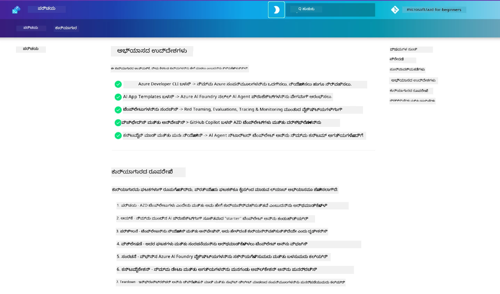

<div align="center">
  <div style="background: linear-gradient(135deg, #0078d4, #106ebe); border-radius: 10px; padding: 20px; margin: 20px 0; box-shadow: 0 4px 15px rgba(0, 120, 212, 0.3); border: 2px solid #005a9e;">
    <h2 style="color: white; margin: 0; font-size: 24px; text-shadow: 1px 1px 2px rgba(0,0,0,0.3);">
      🎯 AZD for AI Developers ಕಾರ್ಯಾಗಾರ
    </h2>
    <p style="color: white; margin: 10px 0 0 0; font-size: 16px; text-shadow: 1px 1px 2px rgba(0,0,0,0.3);">
      <strong>Azure Developer CLI ಬಳಸಿ AI ಅಪ್ಲಿಕೇಶನ್ಗಳ ನಿರ್ಮಾಣಕ್ಕೆ ಕೈಂಕರ ಪ್ರಾಯೋಗಿಕ ಕಾರ್ಯಾಗಾರ.</strong><br>
      AZD ಟೆಂಪ್ಲೇಟ್‌ಗಳು ಮತ್ತು AI ಡಿಪ್ಲಾಯ್‌ಮೆಂಟ್ ವರ್ಕ್‌ಫ್ಲೋಗಳನ್ನು ಪರಿಣತ ಮಾಡಲು 7 ವಿಭಾಗಗಳನ್ನು ಪೂರ್ಣಗೊಳಿಸಿ.
    </p>
    <div style="margin-top: 15px;">
      <span style="background: rgba(255,255,255,0.2); padding: 5px 10px; border-radius: 15px; color: white; font-size: 14px;">
        📅 ಮೂಲ ಮಾರ್ಗದರ್ಶನ ಪರಿಶೀಲನೆ: ನವೆಂಬರ್ 2026
      </span>
    </div>
  </div>
</div>

# AZD for AI Developers ಕಾರ್ಯಾಗಾರ

AI ಅಪ್ಲಿಕೇಶನ್ ಡಿಪ್ಲಾಯ್‌ಮೆಂಟ್ ಮೇಲೆ ಕೇಂದ್ರೀಕರಿಸಿ Azure Developer CLI (AZD) ಕಲಿಯಲು ಕೈಂಕರ ಪ್ರಾಯೋಗಿಕ ಕಾರ್ಯಾಗಾರಿಗೆ ಸ್ವಾಗತ. ಈ ಕಾರ್ಯಾಗಾರವು AZD ಟೆಂಪ್ಲೇಟ್‌ಗಳ ಅನ್ವಯಿಸಲಾದ ಅರ್ಥವನ್ನು 3 ಹಂತಗಳಲ್ಲಿ ಅರಿಯಲು ಸಹಾಯ ಮಾಡುತ್ತದೆ:

1. **ಅನ್ವೇಷಣೆ** - ನಿಮ್ಮಿಗೆ ಹೊಂದಿಕೊಂಡ ಟೆಂಪ್ಲೇಟ್ ಕಂಡುಹಿಡಿ.
1. **ಡಿಪ್ಲಾಯ್‌ಮೆಂಟ್** - ಡಿಪ್ಲಾಯ್ ಮಾಡಿ ಮತ್ತು ಕೆಲಸ ಮಾಡುತ್ತಿದೆಯೆಂದು ಪರಿಶೀಲಿಸಿ
1. **ಸ೦ಶೋಧನೆ** - ಸಂಪಾದಿಸಿ ಮತ್ತು ನಿಮ್ಮದಾಗಿಸಿಕೊಳ್ಳಿ!

ಈ ಕಾರ್ಯಾಗಾರದ ಅವಧಿಯಲ್ಲಿ ನೀವು ಮೂಲ ಡೆವಲಪರ್ ಉಪಕರಣಗಳು ಮತ್ತು ವರ್ಕ್‌ಫ್ಲೋಗಳಿಗೂ ಪರಿಚಿತರಾಗುತ್ತೀರಿ, ಇದು ನಿಮ್ಮ ಸಂಪೂರ್ಣ ಅಭಿವೃದ್ಧಿ ಪ್ರಯಾಣವನ್ನು ಸರಳಗೊಳಿಸಲು ಸಹಾಯ ಮಾಡುತ್ತದೆ.

<br/>

## ಬ್ರೌಸರ್ ಆಧಾರಿತ ಮಾರ್ಗದರ್ಶಿ

ಕಾರ್ಯಾಗಾರ ಪಾಠಗಳು Markdown ರೂಪದಲ್ಲಿ ಇವೆ. ನೀವು ಅವುಗಳನ್ನು ನೇರವಾಗಿ GitHub ನಲ್ಲಿ ನ್ಯಾವಿಗೇಟ್ ಮಾಡಬಹುದು - ಅಥವಾ ಕೆಳಗಿನ ಸ್ಕ್ರೀನ್‌ಶಾಟ್‌ನಲ್ಲಿ ತೋರಿಸುತ್ತಿರುವಂತೆ ಬ್ರೌಸರ್ ಆಧಾರಿತ ಪೂರ್ವವೀಕ್ಷಣೆಯನ್ನು ಪ್ರಾರಂಭಿಸಿ.



ಈ ಆಯ್ಕೆಯನ್ನು ಬಳಸಲು - ಫೋರ್ಕ್ ಅನ್ನು ನಿಮ್ಮ ಪ್ರೊಫೈಲ್‌ಗೆ ಮಾಡಿ, ಮತ್ತು GitHub Codespaces ಪ್ರಾರಂಭಿಸಿ. VS ಕೋಡ್ ಟರ್ಮಿನಲ್ ಸಕ್ರಿಯವಾದ ನಂತರ, ಈ ಆಜ್ಞೆಯನ್ನು ಟೈಪ್ ಮಾಡಿ:

ಈ ಬ್ರೌಸರ್ ಪೂರ್ವವೀಕ್ಷಣೆ GitHub Codespaces, ಡೆವ್ ಕಂಟೇನರ್‌ಗಳು, ಅಥವಾ Python ಮತ್ತು MkDocs ಸ್ಥಾಪಿಸಿದ ಸ್ಥಳೀಯ ಕ್ಲೋನ್‌ನಲ್ಲಿ ಕೆಲಸಮಾಡುತ್ತದೆ.

```bash title="" linenums="0"
python -m pip install -r requirements-dev.txt
python -m mkdocs serve --config-file workshop/mkdocs.yml
```

ಈ ಕಮಾಂಡ್‌ಗಳನ್ನು **ಕೋರ್ಸ್ ರಿಪೋಜಿಟರಿ ರೂಟ್** ಬಳಿ ಓಡಿಸಿ, ಸ್ವತಂತ್ರವಾಗಿ ಪ್ರಾರಂಭಗೊಂಡ AI ಮಾದರಿ ಅಲ್ಲ. ಮುಂದುನೋಡಿಕೆಯನ್ನು ಮುಂಭಾಗದಲ್ಲಿ ಇಟ್ಟುಕೊಳ್ಳಿ যাতে ದೋಷಗಳು ಕಾಣಿಸಿಬರುತ್ತವೆ; Ctrl+C ನಿಂದ ಅದನ್ನು ನಿಲ್ಲಿಸಿ. ಸರ್ವ್ ಮಾಡದೆ ಈ ಸೈಟ್ ಅನ್ನು ಪರಿಶೀಲಿಸಲು, `python -m mkdocs build --strict --config-file workshop/mkdocs.yml` ನಡಿಸಿ.

ಕೆಲವು ಕ್ಷಣಗಳಲ್ಲಿ, ನೀವು ಒಂದು ಪಾಪ್-ಅಪ್ ಸಂವಾದವನ್ನು ನೋಡುತ್ತೀರಿ. `Open in browser` ಆಯ್ಕೆಮಾಡಿ. ವೆಬ್ ಆಧಾರಿತ ಮಾರ್ಗಸೂಚಿ ಈಗ ಹೊಸ ಬ್ರೌಸರ್ ಟ್ಯಾಬ್‌ನಲ್ಲಿ ತೆರೆಯುತ್ತದೆ. ಈ ಮುಂದುನೋಟದ ಕೆಲವು ಲಾಭಗಳು:

1. **ಆಂತರಿಕ ಹುಡುಕು** - ಕೀವರ್ಡ್‌ಗಳು ಅಥವಾ ಪಾಠಗಳನ್ನು ತ್ವರಿತವಾಗಿ ಹುಡುಕಿ.
1. **ನಕಲು ಐಕಾನ್** - ಕೋಡ್‌ಬ್ಲಾಕ್‌ಗಳ ಮೇಲೆ ಹೋವರ್ ಮಾಡಿದಾಗ ಇದೇ ಆಯ್ಕೆ ಕಾಣುತ್ತದೆ
1. ** ಥೀಮ್ ٹಾಗಲ್** - ಡಾರ್ಕ್ ಮತ್ತು ಲೈಟ್ ಥೀಮ್‌ಗಳ ನಡುವೆ ಬದಲಾಯಿಸಿ
1. **ಸಹಾಯ ಪಡೆದುಕೊಳ್ಳಿ** - ಅಡಿಲಿನಲ್ಲಿ ಇರುವ Discord ಐಕಾನ್ ಕ್ಲಿಕ್ ಮಾಡಿ ಸೇರಲು!

<br/>

## ಕಾರ್ಯಾಗಾರದ ಅವಲೋಕನ

**ಕಾಲಾವಧಿ:** 3-4 ಗಂಟೆಗಳು  
**ಮಟ್ಟ:** ಪ್ರಾರಂಭಿಕದಿಂದ ಮಧ್ಯಮ ಮಟ್ಟ  
** ಪೂರ್ವಾಪೇಕ್ಷೆಗಳು:** Azure, AI ಸಂಧರ್ಭಗಳು, VS Code ಮತ್ತು ಕಮಾಂಡ್-ಲೈನ್ ಉಪಕರಣಗಳ ಪರಿಚಯ.

ಇದು ನೇರ ಹಸ್ತಚಾಲಿತ ಕಾರ್ಯಾಗಾರ; ನೀವು ಮಾಡುತ್ತಾ ಕಲಿಯುತ್ತೀರಿ. ವ್ಯಾಯಾಮಗಳನ್ನು ಪೂರ್ಣಗೊಳಿಸಿದ ಮೇಲೆ, ಭದ್ರತೆ ಮತ್ತು ಉತ್ಪಾದಕತೆಯ ಅತ್ಯುತ್ತಮ ಅಭ್ಯಾಸಗಳಲ್ಲಿ ನಿಮ್ಮ ಕಲಿಕೆಯನ್ನು ಮುಂದುವರಿಸಲು ನಾವು AZD For Beginners ಕೋರ್ಸು ಪರಿಶೀಲಣೆಯನ್ನ ಮಾಡಲೆಂದು ಶಿಫಾರಸು ಮಾಡುತ್ತೇವೆ.

| ಸಮಯ| ಘಟಕ  | ಗುರಿ |
|:---|:---|:---|
| 15 ನಿಮಿಷಗಳು | [ಪರಿಚಯ](docs/instructions/0-Introduction.md) | ಹಂತವನ್ನು ಸ್ಥಾಪಿಸಿ, ಗುರಿಗಳನ್ನು ಅರ್ಥಮಾಡಿಕೊಳ್ಳಿ |
| 30 ನಿಮಿಷಗಳು | [AI ಟೆಂಪ್ಲೇಟನ್ನು ಆರಿಸು](docs/instructions/1-Select-AI-Template.md) | ಆಯ್ಕೆಗಳನ್ನು ಪರಿಶೀಲಿಸಿ ಮತ್ತು ಪ್ರಾರಂಭಿಸು | 
| 30 ನಿಮಿಷಗಳು | [AI ಟೆಂಪ್ಲೇಟನ್ನು ಮಾನ್ಯಗೊಳಿಸು](docs/instructions/2-Validate-AI-Template.md) | ಡಿಫಾಲ್ಟ್ ಪರಿಹಾರವನ್ನು ಅಜೂರ್‌ಗೆ ನಿಯೋಜಿಸಿ |
| 30 ನಿಮಿಷಗಳು | [AI ಟೆಂಪ್ಲೇಟನ್ನು ಪಾರ್ಶ್ವವಾಯು ಮಾಡು](docs/instructions/3-Deconstruct-AI-Template.md) | бүт ್ಯ ಮತ್ತು ಸಂರಚನೆ ಪರಿಶೀಲಿಸಿ |
| 30 ನಿಮಿಷಗಳು | [AI ಟೆಂಪ್ಲೇಟನ್ನು ಸಂರಚಿಸು](docs/instructions/4-Configure-AI-Template.md) | ಲಭ್ಯವಿರುವ ವೈಶಿಷ್ಟ್ಯಗಳನ್ನು ಸಕ್ರಿಯ ಮಾಡಿ ಮತ್ತು ಪ್ರಯತ್ನಿಸಿ |
| 30 ನಿಮಿಷಗಳು | [AI ಟೆಂಪ್ಲೇಟನ್ನು ಕಸ್ಟಮೈಸ್ ಮಾಡು](docs/instructions/5-Customize-AI-Template.md) | ನಿಮ್ಮ ಅಗತ್ಯಗಳಿಗೆ ಆಧಾರಿತವಾಗಿ ಮಾದರಿಯನ್ನ ಹೊಂದಿಸಿಕೊಳ್ಳಿ |
| 30 ನಿಮಿಷಗಳು | [ಭೂತದಂತೆಯನ್ನು ಸಡಿಲಿಸು](docs/instructions/6-Teardown-Infrastructure.md) | ಸಂಪನ್ಮೂಲಗಳನ್ನು ಸ್ವಚ್ಛಗೊಳಿಸಿ ಮತ್ತು ಬಿಡುಗಡೆ ಮಾಡಿ |
| 15 ನಿಮಿಷಗಳು | [ಸಮಾರೋಪ ಮತ್ತು ಮುಂದಿನ ಹಂತಗಳು](docs/instructions/7-Wrap-up.md) | ಕಲಿಕಾ ಸಂಪನ್ಮೂಲಗಳು, ಕಾರ್ಯಾಗಾರದ ಸವಾಲು |

<br/>

## ನೀವು ಕಲಿಯಬಲ್ಲದ್ದು

AZD ಟೆಂಪ್ಲೇಟನ್ನು ಮೈಕ್ರೋಸಾಫ್ಟ್ ಫೌಂಡ್ರಿಯಲ್ಲಿ ಅಂತ್ಯ-ನಂತರ ಅಭಿವೃದ್ಧಿಗೆ ವಿವಿಧ ಸಾಮರ್ಥ್ಯಗಳು ಮತ್ತು ಉಪಕರಣಗಳನ್ನು ಪರಿಶೀಲಿಸಲು ಕಲಿಕೆಯ ಸ್ಯಾಂಡ್‌ಬಾಕ್ಸ್ ಎಂದು חשಿರಿಸಬಹುದು. ಈ ಕಾರ್ಯಾಗಾರದ ಅಂತ್ಯಕ್ಕೆ, ನೀವು ಈ ಸಂಧರ್ಭದಲ್ಲಿನ ವಿವಿಧ ಉಪಕರಣಗಳು ಮತ್ತು ಸಂಧರ್ಭಗಳ intuitive ಅರಿವನ್ನು ಹೊಂದಿರಬೇಕು.

| ಸಂಧರ್ಭ  | ಗುರಿ |
|:---|:---|
| **Azure Developer CLI** | ಉಪಕರಣದ ಕಮಾಂಡ್‌ಗಳು ಮತ್ತು ಕೆಲಸದ ಪ್ರಕ್ರಿಯೆಗಳನ್ನು ಅರ್ಥಮಾಡಿಕೊಳ್ಳಿ|
| **AZD ಟೆಂಪ್ಲೇಟುಗಳು**| ಯೋಜನಾ ರಚನೆ ಮತ್ತು ಸಂರಚನೆಯನ್ನು ಅರ್ಥಮಾಡಿಕೊಳ್ಳಿ|
| **Azure AI ಏಜೆಂಟ್**| ಮೈಕ್ರೋಸಾಫ್ಟ್ ಫೌಂಡ್ರಿ ಯೋಜನೆಯನ್ನು ಒದಗಿಸಿ ಮತ್ತು ನಿಯೋಜಿಸಿ  |
| **Azure AI ಹುಡುಕಾಟ**| ಏಜೆಂಟ್‌ಗಳೊಂದಿಗೆ ಸಂಧರ್ಭ ಎಂಜಿನಿಯರಿಂಗ್ ಸಕ್ರಿಯಗೊಳಿಸಿ |
| **ನಿರೀಕ್ಷಣೆ**| ಹಾದಿ ಅನುಸರಣೆ, ಮೇಲ್ವಿಚಾರಣೆ ಮತ್ತು ಮೌಲ್ಯಾಂಕನಗಳನ್ನು ಪರಿಶೀಲಿಸಿ |
| **ರೆಡ್ ತಂಡ**| ಪ್ರತಿದ್ವಂದ್ವಿ ಪರೀಕ್ಷೆ ಮತ್ತು ಕಡಿತಗೊಳ್ಳುವಿಕೆಗಳನ್ನು ಪರಿಶೀಲಿಸಿ |

<br/>

## ಕಾರ್ಯಾಗಾರದ ರಚನೆ

ಕಾರ್ಯಾಗಾರವು ಟೆಂಪ್ಲೇಟಿನ ಸಂಶೋಧನೆ, ನಿಯೋಜನೆ, ಪಾರ್ಶ್ವವಾಯು ಮತ್ತು ಕಸ್ಟಮೈಸ್ ಮಾಡುವ ಪ್ರಯಾಣವನ್ನು ತೆಗೆದುಕೊಳ್ಳುವಂತೆ ರಚಿಸಲಾಗಿದೆ - ಅಧಿಕೃತ [Getting Started with AI Agents](https://github.com/Azure-Samples/get-started-with-ai-agents) ಪ್ರಾರಂಭಿಕ ಟೆಂಪ್ಲೇಟನ್ನು ಆಧಾರವಾಗಿ ಬಳಸಿಕೊಂಡು.

### [ಘಟಕ 1: AI ಟೆಂಪ್ಲೇಟನ್ನು ಆರಿಸು](docs/instructions/1-Select-AI-Template.md) (30 ನಿಮಿಷಗಳು)

- AI ಟೆಂಪ್ಲೇಟುಗಳು ಏನು?
- ನಾನು ಎಲ್ಲಿ AI ಟೆಂಪ್ಲೇಟುಗಳನ್ನು ಕಂಡುಕೊಳ್ಳಬಹುದು?
- AI ಏಜೆಂಟ್‌ಗಳನ್ನು ನಿರ್ಮಿಸಲು ನಾನು ಹೇಗೆ ಪ್ರಾರಂಭಿಸಬಹುದು?
- ** ಪ್ರಯೋಗಾಲಯ**: Codespaces ಅಥವಾ ಡೆವ್ ಕಂಟೇನರ್‌ನಲ್ಲಿ ತ್ವರಿತ ಪ್ರಾರಂಭ

### [ಘಟಕ 2: AI ಟೆಂಪ್ಲೇಟನ್ನು ಮಾನ್ಯಗೊಳಿಸು](docs/instructions/2-Validate-AI-Template.md) (30 ನಿಮಿಷಗಳು)

- AI ಟೆಂಪ್ಲೇಟ್ ವಾಸ್ತುಶಿಲ್ಲೆ ಏನು?
- AZD ಅಭಿವೃದ್ಧಿ ಕಾರ್ಯಪ್ರವಾಹವೇನು?
- AZD ಅಭಿವೃದ್ಧಿಯಲ್ಲಿ ಸಹಾಯವನ್ನು ನಾನು ಹೇಗೆ ಪಡೆಯಬಹುದು?
- ** ಪ್ರಯೋಗಾಲಯ**: AI ಏಜೆಂಟ್‌ಗಳ ಟೆಂಪ್ಲೇಟನ್ನು ನಿಯೋಜಿಸಿ ಮತ್ತು ಮಾನ್ಯಗೊಳಿಸು

### [ಘಟಕ 3: AI ಟೆಂಪ್ಲೇಟನ್ನು ಪಾರ್ಶ್ವವಾಯು ಮಾಡು](docs/instructions/3-Deconstruct-AI-Template.md) (30 ನಿಮಿಷಗಳು)

- ನಿಮ್ಮ ಪರಿಸರವನ್ನು `.azure/` ನಲ್ಲಿ ಪರಿಶೀಲಿಸಿ 
- ನಿಮ್ಮ ಸಂಪನ್ಮೂಲ ಹೊಂದಿಕೆಯನ್ನು `infra/` ನಲ್ಲಿ ಪರಿಶೀಲಿಸಿ 
- ನಿಮ್ಮ AZD ಸಂರಚನೆಯನ್ನು `azure.yaml` ಗಳು ವಿವರಣೆ ಮಾಡಿ
- ** ಪ್ರಯೋಗಾಲಯ**: ಪರಿಸರ ವ್ಯತ್ಯಾಸಗಳನ್ನು ಬದಲಾಯಿಸಿ ಮತ್ತು ಮರುನಿಯೋಜಿಸಿ

### [ಘಟಕ 4: AI ಟೆಂಪ್ಲೇಟನ್ನು ಸಂರಚಿಸು](docs/instructions/4-Configure-AI-Template.md) (30 ನಿಮಿಷಗಳು)
- ಪರಿಶೀಲಿಸಿ: ರೀಟ್ರೀವಲ್ ಆಗ್ಗ್ಮೆಂಟೆಡ್ ಜನರೇಶನ್
- ಪರಿಶೀಲಿಸಿ: ಏಜೆಂಟ್ ಮೌಲ್ಯಾಂಕನ ಮತ್ತು ರೆಡ್ ತಂಡ
- ಪರಿಶೀಲಿಸಿ: ಹಾದಿ ಅನುಸರಣೆ ಮತ್ತು ಮೇಲ್ವಿಚಾರಣೆ
- ** ಪ್ರಯೋಗಾಲಯ**: AI ಏಜೆಂಟ್ ಮತ್ತು ನಿರೀಕ್ಷಣೆ ಪರಿಶೀಲನೆ

### [ಘಟಕ 5: AI ಟೆಂಪ್ಲೇಟನ್ನು ಕಸ್ಟಮೈಸ್ ಮಾಡು](docs/instructions/5-Customize-AI-Template.md) (30 ನಿಮಿಷಗಳು)
- ವ್ಯಾಖ್ಯಾನಿಸು: ಪರಿಸ್ಥಿತಿಕ ಜ್ಞಾಪಕಗಳೊಂದಿಗೆ PRD
- ಸಂರಚಿಸು: AZDಗೆ ಪರಿಸರ ವ್ಯತ್ಯಾಸಗಳು
- ಅನ್ವಯಿಸು: ಹೆಚ್ಚುವರಿ ಕಾರ್ಯಕ್ಕೂ ಜೀವನಚಕ್ರ ಹೂکسುಗಳು
- ** ಪ್ರಯೋಗಾಲಯ**: ನನ್ನ ಪರಿಸ್ಥಿತಿಗೆ ಟೆಂಪ್ಲೇಟನ್ನು ಕಸ್ಟಮೈಸ್ ಮಾಡು

### [ಘಟಕ 6: ಭೂತದಂತೆಯನ್ನು ಸಡಿಲಿಸು](docs/instructions/6-Teardown-Infrastructure.md) (30 ನಿಮಿಷಗಳು)
- ಪುನರ್ ಪರಿಶೀಲನೆ: AZD ಟೆಂಪ್ಲೇಟುಗಳು ಯಾವುವು?
- ಪುನರ್ ಪರಿಶೀಲನೆ: ಏಕೆ Azure Developer CLI ಬಳಕೆ ಮಾಡಬೇಕು?
- ಮುಂದಿನ ಹಂತಗಳು: ಬೇರೆಯ テンプ್ಲೇಟನ್ನು ಪ್ರಯತ್ನಿಸಿ!
- ** ಪ್ರಯೋಗಾಲಯ**: ಭೂತದಂತೆಯನ್ನು ತೆಗೆಯಿರಿ ಮತ್ತು ಸ್ವಚ್ಛತೆ ಮಾಡಿ

<br/>

## ಕಾರ್ಯಾಗಾರದ ಸವಾಲು

ಇನ್ನಷ್ಟು ಮಾಡಲು ನಿಮ್ಮನ್ನು ಸವಿಯಾಗಿ ನೋಡಲು ಬಯಸುತ್ತೀರಾ? ಇಲ್ಲಿವೆ ಕೆಲವು ಯೋಜನಾ ಸಲಹೆಗಳು - ಅಥವಾ ನಿಮ್ಮ ಆಲೋಚನೆಗಳನ್ನು ನಮ್ಮೊಂದಿಗೆ ಹಂಚಿಕೊಳ್ಳಿ!!

| ಯೋಜನೆ | ವಿವರಣೆ |
|:---|:---|
|1. **ಸಂಕೀರ್ಣ AI ಟೆಂಪ್ಲೇಟನ್ನು ಪಾರ್ಶ್ವವಾಯು ಮಾಡು** | ನಾವು ವಿವರಿಸಿದ ಕಾರ್ಯಪ್ರವಾಹ ಮತ್ತು ಉಪಕರಣಗಳನ್ನು ಬಳಸಿ, ಬೇರೆಯ AI ಪರಿಹಾರ ಟೆಂಪ್ಲೇಟನ್ನು ನಿಯೋಜಿಸಿ, ಮಾನ್ಯಗೊಳಿಸಿ ಮತ್ತು ಕಸ್ಟಮೈಸ್ ಮಾಡಬಹುದೇ ಎಂದು ಪರಿಶೀಲಿಸಿ. _ನೀವು ಏನು ಕಲಿತಿರಿ?_|
|2. **ನಿಮ್ಮ ಪರಿಸ್ಥಿತಿಯೊಂದಿಗೆ ಕಸ್ಟಮೈಸ್ ಮಾಡಿ**  | ಬೇರೆಯ ಪರಿಸ್ಥಿತಿಗೆ PRD (ಉತ್ಪನ್ನ ಅಗತ್ಯಗಳ ಡಾಕ್ಯುಮೆಂಟ್) ಬರೆಯಲು ಪ್ರಯತ್ನಿಸಿ. ನಂತರ ನಿಮ್ಮ ಟೆಂಪ್ಲೇಟು ರೆಪೊದಲ್ಲಿ GitHub Copilot ಅನ್ನು Agent Model ನಲ್ಲಿಟ್ಟು, ಅದು ಒಂದು ಕಸ್ಟಮೈಸ್ ಕಾರ್ಯಪ್ರವಾಹವನ್ನು ಸೃಷ್ಟಿಸಲು ಕೇಳಿ. _ನೀವು ಏನು ಕಲಿತಿರಿ? ಈ ಸಲಹೆಗಳನ್ನು ನೀವು ಹೇಗೆ ಸುಧಾರಿಸಬಹುದು?_|
| | |

## ಪ್ರತಿಕ್ರಿಯಾ ಇದೆಯೇ?

1. ಈ ರೆಪೋದಲ್ಲಿ ವಿಷಯವನ್ನು ಪೋಸ್ಟ್ ಮಾಡಿ - ಅದರಲ್ಲಿ `Workshop` ಟ್ಯಾಗ್ ಬಳಸಿ ಸುಲಭಕ್ಕಾಗಿ.
1. ಮೈಕ್ರೋಸಾಫ್ಟ್ ಫೌಂಡ್ರಿ Discord ಗೆ ಸೇರಿ - ನಿಮ್ಮ ಸಹೋದ್ಯೋಗಿಗಳೊಂದಿಗೆ ಸಂಪರ್ಕ ಸಾಧಿಸಿ!


| | | 
|:---|:---|
| **📚 ಕೋರ್ಸ್ ಮನೆ**| [AZD For Beginners](../README.md)|
| **📖 ದಾಖಲೆ** | [AI ಟೆಂಪ್ಲೇಟುಗಳೊಂದಿಗೆ ಪ್ರಾರಂಭಿಸಿ](https://learn.microsoft.com/en-us/azure/ai-foundry/how-to/develop/ai-template-get-started)|
| **🛠️AI ಟೆಂಪ್ಲೇಟುಗಳು** | [Microsoft Foundry Templates](https://ai.azure.com/templates) |
|**🚀 ಮುಂದಿನ ಹಂತಗಳು** | [ಕಾರ್ಯಾಗಾರ ಆರಂಭಿಸಿ](#workshop-overview) |
| | |

<br/>

---

**ನ್ಯಾವಿಗೇಶನ್:** [ಮುಖ್ಯ ಕೋರ್ಸ್](../README.md) | [ಪರಿಚಯ](docs/instructions/0-Introduction.md) | [ಘಟಕ 1: ಟೆಂಪ್ಲೇಟನ್ನು ಆರಿಸು](docs/instructions/1-Select-AI-Template.md)

**AZD ಜೊತೆ AI ಅಪ್ಲಿಕೇಶನ್‌ಗಳನ್ನು ನಿರ್ಮಿಸಲು ತಯಾರಾಗಿದ್ದೀರಾ?**

[ಕಾರ್ಯಾಗಾರ ಆರಂಭಿಸಿ: ಪರಿಚಯ →](docs/instructions/0-Introduction.md)

---

<!-- CO-OP TRANSLATOR DISCLAIMER START -->
**ಅಸ್ವೀಕಾರ**:
ಈ ದಸ್ತಾವೇಜು AI ಅನುವಾದ ಸೇವೆ [Co-op Translator](https://github.com/Azure/co-op-translator) ಬಳಸಿ ಅನುವಾದಿಸಲಾಗಿದೆ. ನಾವು ನಿಖರತೆಯನ್ನು ಸಾಧಿಸಲು ಪ್ರಯತ್ನಿಸುತ್ತಿದ್ದರೂ, ದಯವಿಟ್ಟು ಗಮನಿಸಿ, ಸ್ವಯಂಚಾಲಿತ ಅನುವಾದಗಳಲ್ಲಿ ದೋಷಗಳು ಅಥವಾ ಅಸಡ್ಡೆಗಳು ಇರಬಹುದು. ಮೂಲ ಭಾಷೆಯಲ್ಲಿರುವ ಮೂಲ ದಸ್ತಾವೇಜು ಪ್ರಾಮಾಣಿಕ ಮೂಲವೆಂದು ಪರಿಗಣಿಸಬೇಕು. ಪ್ರಮುಖ ಮಾಹಿತಿಗಾಗಿ, ವೃತ್ತಿಪರ ಮಾನವ ಅನುವಾದವನ್ನು ಶಿಫಾರಸು ಮಾಡಲಾಗುತ್ತದೆ. ಈ ಅನುವಾದವನ್ನು ಬಳಸುವ ಮೂಲಕ ಉಂಟಾಗುವ ಯಾವುದೇ ತಪ್ಪು ಅರ್ಥಗಳ ಅಥವಾ ತಪ್ಪು ವ್ಯಾಖ್ಯಾನಗಳ ಬಗ್ಗೆ ನಾವು ಹೊಣೆಗಾರರಲ್ಲ.
<!-- CO-OP TRANSLATOR DISCLAIMER END -->