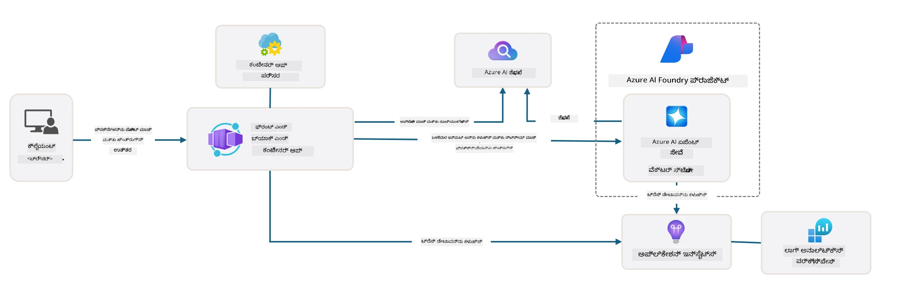

# 3. ಟೆಂಪ್ಲೇಟ್ನ್ನು ವಿಭಜಿಸು

!!! tip "ಈ ಮೊಡ್ಯೂಲ್ ಕೊನೆಯಲ್ಲಿ ನೀವು सक्षमವಾಗಿರುತ್ತೀರಿ"

    - [ ] Use GitHub Copilot and optional MCP tools for Azure documentation and read-only exploration
    - [ ] Identify the template's application, infrastructure, configuration, and test entry points
    - [ ] Verify generated explanations against actual repository files
    - [ ] **Lab 3:** Trace one request and one configuration input through the project

---

## 1. GitHub Copilot ಅನ್ನು ಸಕ್ರಿಯಗೊಳಿಸಿ

ಪ್ರಾರಂಭಿಸಿರುವ AI ಉದಾಹರಣೆಯನ್ನು VS Code ನಲ್ಲಿ ತೆರೆಯಿರಿ ಮತ್ತು [GitHub Copilot](https://code.visualstudio.com/docs/copilot/chat/chat-agent-mode) ಅನ್ನು ಸಕ್ರಿಯಗೊಳಿಸಿ. ಯೋಗ್ಯ ಯೋಜನೆಯೊಂದಿಗೆ ಖಾತೆಯಲ್ಲಿ సाइनಿನ್ ಮಾಡಿ; ಬಳಕೆ ಮಿತಿ ಬದಲಾಗಬಹುದು. ಪರಿವರ್ತನೆಗಳ ಅನುಮೋದನೆಗೆ ಮೊದಲು Copilot ನಿಂದ ಸಂಗ್ರಹವನ್ನು ವಿವರಿಸುವಂತೆ ಕೇಳಿ.

### ಐಚ್ಛಿಕ MCP ಸರ್ವರ್‌ಗಳು

ಈ ಸೇವೆಗಳು ಹೆಚ್ಚುವರಿ ಸಾಧನಗಳನ್ನು ಒದಗಿಸಬಹುದು:

- [Azure MCP Server](https://learn.microsoft.com/azure/developer/azure-mcp-server/overview)
- [Microsoft Learn MCP Server](https://learn.microsoft.com/training/support/mcp)

VS Code ನಲ್ಲಿ, [MCP ಸಂರಚನಾ ಮಾರ್ಗದರ್ಶಿ](https://code.visualstudio.com/docs/copilot/chat/mcp-servers) ಪರಿಶೀಲಿಸಿ ಮತ್ತು ಅಗತ್ಯವಿದ್ದರೆ `.vscode/mcp.json` ರಚಿಸಿ:

```json
{
  "servers": {
    "Azure MCP Server": {
      "type": "stdio",
      "command": "npx",
      "args": ["-y", "@azure/mcp@latest", "server", "start"]
    },
    "microsoft.docs.mcp": {
      "type": "http",
      "url": "https://learn.microsoft.com/api/mcp"
    }
  }
}
```

`npx` ಆಜ್ಞೆಗೆ ಬೆಂಬಲಿತ Node.js/npm ಇನ್‌ಸ್ಟಾಲೇಶನ್ ಅಗತ್ಯವಿದೆ ಮತ್ತು ಕಾರ್ಯನಿರ್ವಹಣಾ ಕೋಡ್ ಡೌನ್‌ಲೋಡ್ ಮಾಡುತ್ತದೆ. ಪ್ಯಾಕೇಜ್ ಪರಿಶೀಲಿಸಿ ಮತ್ತು ತಂಡದ ಪುನಃನಿರ್ಮಾಣಕ್ಕೆ ಅನುಕೂಲವಾದ ಆವೃತ್ತಿಯನ್ನು ಪಿನ್ ಮಾಡಿ. VS Code ನ MCP ನಿಯಂತ್ರಣಗಳನ್ನು ಬಳಸಿ ಸರ್ವರ್‌ಗಳನ್ನು ಪ್ರಾರಂಭಿಸಿ ಮತ್ತು ಅವರ ಲಭ್ಯವಿರುವ ಸಾಧನಗಳನ್ನು ಪರಿಶೀಲಿಸಿ; ಹೆಸರುಗಳು ಆವೃತ್ತಿಗಳು ನಡುವೆ ಬದಲಾಗಬಹುದು.

**ಅಧಿಕಾರೀಕರಣವು ವಿಭಿನ್ನವಾಗಿರುತ್ತದೆ.** AZD ನಿಗಾಗಿ `azd auth login` ಬಳಸಿ. ಅದರ ಸಾಧನಗಳಿಗಾಗಿ Azure MCP ನ ದಾಖಲೆ ಹೊಂದಿದ ಅಧಿಕೃತ ಛಂದಸಳೆಯನ್ನು ಅನುಸರಿಸಿ; AZD ಲಾಗಿನ್ ಮಾತ್ರ MCP ಸೆಷನ್ ಸ್ಥಾಪಿಸುವುದಿಲ್ಲ. ವ್ಯಾಯಾಮ ಅಥವಾ ಹೂಕ್ Azure CLI ಅನ್ನು ಕರೆಸುವಾಗ `az login` ಅನ್ನು ಪ್ರತ್ಯೇಕವಾಗಿ ಬಳಸಿ.

ಓದ-only ಪ್ರಾಂಪ್ಟ್‌ಗಳನ್ನು ಪ್ರಯತ್ನಿಸಿ:

1. “Microsoft Learn MCP ಬಳಸಿ Azure Developer CLI ಸಂರಚನಾ ದಾಖಲೆಗಳನ್ನು ಹುಡುಕಿ.”
2. “ಈ ಸಂಗ್ರಹದ `azure.yaml` ಅನ್ನು ವಿವರಿಸಿ; ಪ್ರತಿಯೊಂದು ಹೂಕ್ ಅನ್ನು ಅನುಷ್ಠಾನ ಮಾಡುವ ಕಡತಗಳನ್ನು ಉಲ್ಲೇಖಿಸಿ.”
3. “ಲಭ್ಯವಿರುವ Azure MCP ಸಾಧನಗಳನ್ನು ಉಪಯೋಗಿಸಿ, ನನ್ನ ನಿಯೋಜಿಸಿದ ಸಂಪನ್ಮೂಲಗಳನ್ನು ಏನೂ ಸಿನಿಮಾ ಮಾಡದೆ ಪಟ್ಟಿ ಮಾಡಿ.”

ಆಯ್ದ ಟೆನಂಟ್/ಚಂದಾದಾರಿಕೆ ಮತ್ತು ಪ್ರಸ್ತಾವಿತ ಸಾಧನ ಕರೆಗಳನ್ನು ಪರಿಶೀಲಿಸಿ. ವಾಸ್ತುಶಿಲ್ಪವನ್ನು ಅನ್ವೇಷಿಸಲು ಮಾತ್ರ ಸಂಪನ್ಮೂಲ ರಚನೆ, ಅಳಿಸುವಿಕೆ ಅಥವಾ ಪ್ರವೇಶ ಬದಲಾವಣೆಗಳಿಗೆ ಅನುಮೋದನೆ ನೀಡಬೇಡಿ.

## 2. ವಾಸ್ತುಶಿಲ್ಪವನ್ನು ಅರ್ಥಮಾಡಿಕೊಳ್ಳಿ

ಉದಾಹರಣೆ Python FastAPI ಬ್ಯಾಕ್ಎಂಡ್ ಮತ್ತು React/TypeScript ಫ್ರಂಟ್‌ಎಂಡ್ ಅನ್ನು Azure Container Apps ನಲ್ಲಿ ಹೊಂದಿದೆ. ಬ್ಯಾಕ್ಎಂಡ್ Microsoft Foundry ಯೋಜನೆಯಲ್ಲಿ ಒಂದೊಂದು ಏಜೆಂಟ್ ಜೊತೆಗೆ ಸಂವಹನ ಮಾಡುತ್ತದೆ. ಪ್ರಾಪ್ತಿ ಮತ್ತು ಗಮನದಾಯಕತೆ ಸಕ್ರಿಯಗೊಳಿಸಲಾದ ಟೆಂಪ್ಲೇಟ್ನ ವೈಶಿಷ್ಟ್ಯಗಳ ಹಾಗೂ ಯಶಸ್ವಿಯಾಗಿ ಸೆಟ್ ಅಪ್ ಮಾಡಲಾದ ಮೇಲೆ ಅವಲಂಬಿತವಾಗಿವೆ; ಅಪ್ಲಿಕೇಶನ್ ನಿಯೋಜನೆಯಿಂದ ಮಾತ್ರ ಅವು ಖಚಿತವಲ್ಲ.



ಈ ಚಿತ್ರಣವನ್ನು [ಪ್ರಚಲಿತ ಅಪ್‌ಸ್ಟ್ರೀಮ್ ನಿಯೋಜನಾ ಮಾರ್ಗದರ್ಶನ](https://github.com/Azure-Samples/get-started-with-ai-agents/blob/main/docs/deployment.md) ಮತ್ತು ನಿಮ್ಮ ನಿಜವಾದ ಸಂಪನ್ಮೂಲಗಳೊಂದಿಗೆ ಹೋಲಿಸಿ. ಸಂರಚಿತ ಮಾದರಿ ನಿಯೋಜನೆ, ಏಜೆಂಟ್ ಸಾಧನಗಳು, ನಿರ್ವಹಿತ ಗುರುತು, ಪಾತ್ರ ನಿಯೋಜನೆಗಳು ಮತ್ತು ಐಚ್ಛಿಕ AI ಶೋಧ/ಅಪ್ಲಿಕೇಶನ್ ಇನ್‌ಸೈಟ್ಸ್ ಸಂಪನ್ಮೂಲಗಳನ್ನು ಪರಿಶೀಲಿಸಿ.

**ವ್ಯಾಯಾಮ:** Copilot ನಿಂದ ಫ್ರಂಟ್‌ಎಂಡ್ ನಲ್ಲಿ ಚಾಟ್ ವಿನಂತಿಯನ್ನು API ಮೂಲಕ Foundry ಗೆೆ ಹಾದುಹೋಗುವ ದಾರಿಯನ್ನು ಕಡತ ಮತ್ತು ಕಾರ್ಯದ ಸೂಚನೆಗಳೊಡನೆ ಟ್ರೇಸ್ ಮಾಡಲು ಕೇಳಿ. ಆ ಸೂಚನೆಗಳನ್ನು ತೆರೆಯಿರಿ ಮತ್ತು ವಿವರಣೆಯನ್ನು ಪರಿಶೀಲಿಸಿ. ಚಿತ್ರಣದಿಂದ ಮಾತ್ರ ಅನುಷ್ಠಾನಗೊಳ್ಳುವ ಅಧಿಕೃತತೆ, ಮಾರ್ಗ ನಿರ್ಣಯ ಅಥವಾ ಅನುಮೋದನೆಯನ್ನು ಊಹಿಸಬೇಡಿ.

## 3. ಸಂಗ್ರಹದ ಸಂರಚನೆ

ಕೆಳಗಿನ ಆಯ್ದ ಮಾರ್ಗಗಳನ್ನು ನವೆಂಬರ್ 4, 2026 ರಂದು ಸ್ಯಾಂಪಲ್ ವಿರುದ್ಧ ಪರಿಶೀಲಿಸಲಾಗಿದೆ. ನಿಮ್ಮ ಆರಂಭಿಕ ಮರುಪೂರ್ತಿಯು ಸತ್ಯ ಮೂಲವಾಗಿರುತ್ತದೆ:

```text
get-started-with-ai-agents/
  azure.yaml
  docker-compose.yaml
  requirements-dev.txt
  .devcontainer/
  infra/
    main.bicep
    main.parameters.json
    api.bicep
    core/
  src/
    Dockerfile
    pyproject.toml
    requirements.txt
    api/
      main.py
      routes.py
      search_index_manager.py
    frontend/
      package.json
      src/
    files/
  scripts/
    validate_env_vars.sh
    validate_env_vars.ps1
    postdeploy.sh
    postdeploy.ps1
  tests/
    test_evaluation.py
    test_red_teaming.py
  docs/
    deployment.md
    deploy_customization.md
    ai_search.md
    observability.md
    local_development.md
    troubleshooting.md
```

### ಮೂಲಸೌಕರ್ಯ ಮತ್ತು ಸಂರಚನೆ

`infra/main.bicep` ಸಂಪನ್ಮೂಲಗಳನ್ನು ഏകDennisಮಾಡುತ್ತದೆ; `main.parameters.json` ಟೆಂಪ್ಲೇಟ್ನ ಇನ್ಪುಟ್‌ಗಳನ್ನು AZD ಪರಿಸರ ಮೌಲ್ಯಗಳಿಗೆ ಸಂಪರ್ಕಿಸುತ್ತದೆ. `azure.yaml` ಅಪ್ಲಿಕೇಶನ್ ಸೇವೆ ಮತ್ತು ಜೀವನಚಕ್ರ ಹೂಕ್‌ಗಳನ್ನು ಆಯ್ಕೆಮಾಡುತ್ತದೆ. `USE_AZURE_AI_SEARCH_SERVICE` ಇಂತಹ ಇನ್ಪುಟ್ ಅನ್ನು ಈ ಕಡತಗಳಲ್ಲಿ ಹಾದುಹೋಗಿಸಿ ಏನು ಬದಲಾಯಿಸುವುದೇನೊ ಕಂಡುಹಿಡಿಯಿರಿ.

### ಅಪ್ಲಿಕೇಶನ್ ಮತ್ತು ಗುರುತು

`src/api/` ಮತ್ತು `src/frontend/` ಅನ್ನು ಸೇರಿಸಿ ಓದಿ. ಏಜೆಂಟ್ ಎಲ್ಲಿ ನಿರ್ಮಿಸಲಾಗಿದ್ದು ಅಥವಾ ಪಡೆದುಕೊಳ್ಳಲ್ಪಟ್ಟಿದ್ದು, ಸೂಚನೆಗಳು/ಸಾಧನಗಳು ಎಲ್ಲಿ ಸಂರಚಿತವಾಗಿರುವವು ಮತ್ತು ಪ್ರತಿಯೊಂದು Azure ಕರೆ ಯಾವ ಗುರುತನ್ನು ಬಳಕೆಮಾಡುತ್ತದೆ ಎಂದು ಗುರುತಿಸಿ. `src/files/` ಅಡಿಯಲ್ಲಿ ಉದಾಹರಣೆ ಕಡತಗಳು ಪ್ರದರ್ಶನ ಪಡೆದ ಡೇಟಾ; ಉತ್ಪಾದನಾ ಸಾಕ್ಷರಿಕೆ ಅಥವಾ ಅನುಮೋದನಾ ಮಾದರಿ ಅಲ್ಲ.

### ಪರೀಕ್ಷೆಗಳು ಮತ್ತು ಗಮನಾರ್ಹತೆ

ಪ್ರಸ್ತುತ ಮೌಲ್ಯಮಾಪನ ಮತ್ತು ರೆಡ್-ಟೀಮಿಂಗ್ ಪ್ರವೇಶ ಬಿಂದುಗಳು `tests/` ಅಡಿಯಲ್ಲಿ; ಹಳೆಯ `evals/` ಮತ್ತು `airedteaming/` ಡೈರೆಕ್ಟರಿಗಳು ಈ ಉದಾಹರಣೆಗೆ ಹಳೆಯದು. ಬಯಲು ಪರೀಕ್ಷೆಗಿಂತ ಮುಂಚಿತವಾಗಿ `docs/observability.md` ಓದಿ ಆಶ್ಚರ್ಯಗಳು ಮತ್ತು ವೆಚ್ಚಗಳನ್ನು ತಿಳಿದುಕೊಳ್ಳಿ. ಈ Python ಪರೀಕ್ಷೆಗಳು ಐಚ್ಛಿಕ `azure.ai.evaluations` AZD ವಿಸ್ತರಣೆಗಿಂತ ವಿಭಿನ್ನವಾಗಿವೆ.

## 4. ನಿಮ್ಮ ಕಂಡುಹಿಡಿದ ಸಂಗತಿಗಳನ್ನು ಪರಿಶೀಲಿಸಿ

- ಒಂದು ಉದಾಹರಣಾ ಪ್ರಶ್ನೆಗೆ API ಮಾರ್ಗ, ಏಜೆಂಟ್ ಸಂವಹನ ಮತ್ತು ಗೋಚರಿಸುವ ಕೋಡ್ ಗುರುತಿಸಿ.
- Foundry ಗೆ ಯಾವ ಗುರುತು ಪ್ರವেশ ಹೊಂದಿಸುತ್ತದೆ ಮತ್ತು ಅದರ ಅಂತಿಮ ಕ್ರಮವನ್ನು ಯಾವ ಸಂರಚನೆ ಆಯ್ಕೆಮಾಡುತ್ತದೆ ಎಂದು ವಿವರಿಸಿ.
- ನಿಜವಾದ ಪೂರ್ವ-ಅಪ್ಲೋಡ್ ಮತ್ತು ನಂತರ ನಿಯೋಜಿಸುವ ಸ್ಕ್ರಿಪ್ಟ್‌ಗಳು ಹಾಗೂ ಅವುಗಳ ದೋಷ ನಿರ್ವಹಣೆ ನಡೆಯುವ ವಿಧಾನವನ್ನು ಕಂಡುಹಿಡಿಯಿರಿ.
- ನಿಮ್ಮ ನಿಯೋಜನೆಯಲ್ಲಿ ಕಾಣದ ಯಾವುದೇ ಅವಲಂಬನೆಗಳು ಅಥವಾ ಐಚ್ಛಿಕ ವೈಶಿಷ್ಟ್ಯಗಳ ಪಟ್ಟಿ ಮಾಡಿ.

ಮುಂದುವರೆಸಿ [ಟೆಂಪ್ಲೇಟನ್ನು ಸಂರಚಿಸಿ](4-Configure-AI-Template.md).

---

<!-- CO-OP TRANSLATOR DISCLAIMER START -->
**ಅಸ್ವೀಕಾರ**:
ಈ ದಸ್ತಾವೇಜು AI ಅನುವಾದ ಸೇವೆ [Co-op Translator](https://github.com/Azure/co-op-translator) ಬಳಸಿ ಅನುವಾದಿಸಲಾಗಿದೆ. ನಾವು ನಿಖರತೆಯನ್ನು ಸಾಧಿಸಲು ಪ್ರಯತ್ನಿಸುತ್ತಿದ್ದರೂ, ದಯವಿಟ್ಟು ಗಮನಿಸಿ, ಸ್ವಯಂಚಾಲಿತ ಅನುವಾದಗಳಲ್ಲಿ ದೋಷಗಳು ಅಥವಾ ಅಸಡ್ಡೆಗಳು ಇರಬಹುದು. ಮೂಲ ಭಾಷೆಯಲ್ಲಿರುವ ಮೂಲ ದಸ್ತಾವೇಜು ಪ್ರಾಮಾಣಿಕ ಮೂಲವೆಂದು ಪರಿಗಣಿಸಬೇಕು. ಪ್ರಮುಖ ಮಾಹಿತಿಗಾಗಿ, ವೃತ್ತಿಪರ ಮಾನವ ಅನುವಾದವನ್ನು ಶಿಫಾರಸು ಮಾಡಲಾಗುತ್ತದೆ. ಈ ಅನುವಾದವನ್ನು ಬಳಸುವ ಮೂಲಕ ಉಂಟಾಗುವ ಯಾವುದೇ ತಪ್ಪು ಅರ್ಥಗಳ ಅಥವಾ ತಪ್ಪು ವ್ಯಾಖ್ಯಾನಗಳ ಬಗ್ಗೆ ನಾವು ಹೊಣೆಗಾರರಲ್ಲ.
<!-- CO-OP TRANSLATOR DISCLAIMER END -->