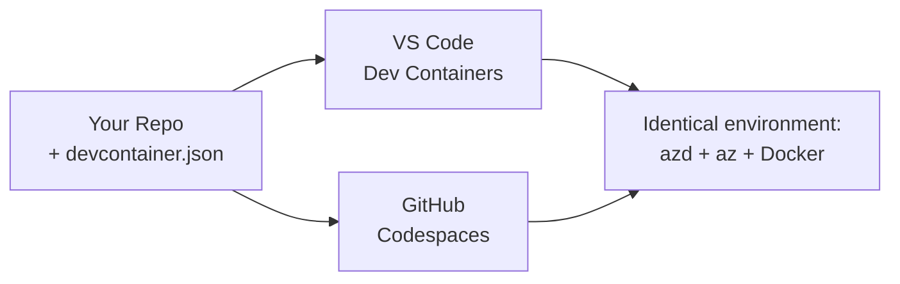

# azd를 위한 Dev Containers 및 GitHub Codespaces

**챕터 내비게이션:**
- **📚 코스 홈**: [초보자를 위한 AZD](../../README.md)
- **📖 현재 챕터**: 1장 - 기초 및 빠른 시작
- **⬅️ 이전**: [Bring Your Own App](bring-your-own-app.md)
- **🚀 다음 챕터**: [2장: AI-퍼스트 개발](../chapter-02-ai-development/README.md)

> 명령 및 구성 검토 대상: `azd 1.37.2` (2026년 11월). 이 검토에는 컨테이너 빌드 및 Azure 배포는 포함되지 않았습니다.

## 소개

모든 머신에 azd, 올바른 언어 런타임, Docker, Azure CLI를 설치하는 것은 귀찮은 일이고, "내 머신에서는 잘 되는데" 하는 튜토리얼이 다른 사람에게는 실패하는 가장 큰 이유입니다. <strong>dev container</strong>는 파일에 전체 도구 체인을 기술하여 이 문제를 해결합니다. 프로젝트를 VS Code나 GitHub Codespaces에서 여는 사람은 누구나 azd가 이미 설치된 동일한 환경을 받습니다. 이 수업에서는 dev container를 추가하는 방법을 보여줍니다.

## 학습 목표

이 수업을 마치면 다음을 할 수 있습니다:
- dev container가 무엇이고 azd에 왜 도움이 되는지 이해하기
- 프로젝트에 최소한의 `.devcontainer/devcontainer.json` 추가하기
- Dev Container <em>features</em>를 통해 azd, Azure CLI 및 Docker 포함하기
- GitHub Codespaces 또는 VS Code에서 프로젝트 열기

## 학습 결과

이 수업을 완료하면 다음을 할 수 있습니다:
- azd 프로젝트용 `devcontainer.json` 작성하기
- 수동 설치 없이 azd 및 Azure 도구 추가하기
- 컨테이너나 Codespace 내부에서 `azd up` 실행하기

---

## Dev Container란?

Dev container는 리포지터리의 `.devcontainer/devcontainer.json` 파일로 정의된 Docker 기반 개발 환경입니다. 프로젝트를 열면:

- **VS Code** (Dev Containers 확장과 함께)는 컨테이너를 빌드하고 연결합니다.
- <strong>GitHub Codespaces</strong>는 클라우드에서 동일한 컨테이너를 빌드하고 브라우저 기반 편집기를 제공합니다.

어느 방식을 사용하든 모든 참여자가 동일한 도구를 받기 때문에 "azd를 설치했나요?"라는 문제 해결이 필요 없습니다.



---

## 1단계: devcontainer 파일 만들기

프로젝트 루트에 `.devcontainer/devcontainer.json` 파일을 만드세요:

```json
{
  "name": "azd-project",
  "image": "mcr.microsoft.com/devcontainers/base:bookworm",
  "features": {
    "ghcr.io/devcontainers/features/azure-cli:1": {},
    "ghcr.io/azure/azure-dev/azd:0": { "version": "1.37.2" },
    "ghcr.io/devcontainers/features/docker-in-docker:2": {},
    "ghcr.io/devcontainers/features/node:1": {}
  },
  "customizations": {
    "vscode": {
      "extensions": [
        "ms-azuretools.azure-dev",
        "ms-azuretools.vscode-bicep"
      ]
    }
  },
  "forwardPorts": [3000],
  "postCreateCommand": "azd version"
}
```

각 부분의 역할:

| 키 | 목적 |
|-----|---------|
| `image` | 컨테이너의 기본 OS |
| `features` | 사전 빌드된 설치 프로그램—여기서는 Azure CLI, **azd**, Docker, Node.js |
| `customizations.vscode.extensions` | azd 및 Bicep VS Code 확장 자동 설치 |
| `forwardPorts` | 앱의 포트를 브라우저로 노출 |
| `postCreateCommand` | 컨테이너 빌드 후 한 번 실행(여기서는 기본 검사) |

> 기능 버전(`azd:0`)과 설치된 CLI 버전이 다릅니다. CLI 버전을 고정하려면 기능의 `version` 옵션을 `"1.37.2"`로 설정하세요; CLI 버전을 기능 태그로 사용하지 마십시오.

---

## 2단계: 앱의 언어에 맞는 Feature 선택

앱에서 사용하는 언어에 맞게 `node` 기능을 교체하세요:

```jsonc
// Python project
"ghcr.io/devcontainers/features/python:1": {},

// .NET project
"ghcr.io/devcontainers/features/dotnet:2": {},

// Java project
"ghcr.io/devcontainers/features/java:1": {},

// Go project
"ghcr.io/devcontainers/features/go:1": {}
```

로컬에서 이미지를 빌드할 때는 `docker-in-docker`를 유지하세요. 구성된 원격 ACR 빌드(`docker.remoteBuild: true`)가 대안이며, 호스트 유형만으로 항상 로컬 Docker가 필요한 것은 아닙니다.

---

## 3단계: 열기

**VS Code에서:**
1. **Dev Containers** 확장 설치
2. 프로젝트 폴더 열기
3. 메시지가 나타나면 **Reopen in Container** 클릭 (또는 *Dev Containers: Reopen in Container* 실행)

**GitHub Codespaces에서:**
1. 리포지터리를 GitHub에 푸시
2. **Code → Codespaces → Create codespace on main** 클릭
3. 컨테이너 빌드 완료 대기—터미널에 azd가 준비되어 있습니다.

---

## 4단계: 컨테이너 내부에서 배포

컨테이너에는 azd가 미리 설치되어 있으므로 일반 워크플로가 바로 작동합니다:

```bash
azd auth login --use-device-code   # device code is handy inside Codespaces
azd up
```

> **왜 `--use-device-code`인가?** 원격 컨테이너나 Codespace에서는 로컬 브라우저가 없어 리디렉션할 수 없으므로 device-code 로그인 방식이 신뢰할 만한 방법입니다. 브라우저 탭에 코드를 붙여 넣어 로그인 절차를 완료합니다.

---

## 흔한 실수

| 문제점 | 해결법 |
|---------|-----|
| `azd up`가 이미지를 빌드하지 못함 | `docker-in-docker` 기능 추가 |
| Codespaces에서 브라우저 로그인이 멈춤 | `azd auth login --use-device-code` 사용 |
| 팀원 간 도구 버전 차이 | azd 기능의 `version` 옵션으로 CLI 고정 및 언어 런타임 고정 |
| 브라우저에서 앱에 접속 불가 | 포트를 `forwardPorts`에 추가 |

---

## 요약

- dev container는 모든 사람에게 azd 도구 체인을 재현 가능하게 만듭니다.
- Dev Container <em>features</em>를 통해 azd, Azure CLI, Docker를 추가합니다.
- 앱에 맞는 언어 기능을 적용하고 컨테이너 호스트에는 `docker-in-docker`를 유지하세요.
- Codespaces 내에서는 device-code 로그인을 사용하세요.

---

## 🔗 내비게이션

| 방향 | 리소스 |
|-----------|----------|
| <strong>이전</strong> | [Bring Your Own App](bring-your-own-app.md) |
| **챕터 홈** | [1장: 기초 및 빠른 시작](README.md) |
| **다음 챕터** | [2장: AI-퍼스트 개발](../chapter-02-ai-development/README.md) |

## 📖 관련 리소스

- [설치 및 설정](installation.md)
- [명령어 치트 시트](../../resources/cheat-sheet.md)
- [공식 Dev Containers 사양](https://containers.dev/)
- [azd Dev Container 기능](https://github.com/Azure/azure-dev/tree/main/ext/devcontainer)

---

<!-- CO-OP TRANSLATOR DISCLAIMER START -->
**면책 조항**:
이 문서는 AI 번역 서비스 [Co-op Translator](https://github.com/Azure/co-op-translator)를 사용하여 번역되었습니다. 정확성을 기하기 위해 노력하고 있으나, 자동 번역은 오류나 부정확한 부분이 있을 수 있음을 유의하시기 바랍니다. 원본 문서의 원어본이 권위 있는 자료로 간주되어야 합니다. 중요한 정보의 경우, 전문가의 인간 번역을 권장합니다. 이 번역 사용으로 인해 발생하는 오해나 잘못된 해석에 대해 당사는 책임을 지지 않습니다.
<!-- CO-OP TRANSLATOR DISCLAIMER END -->