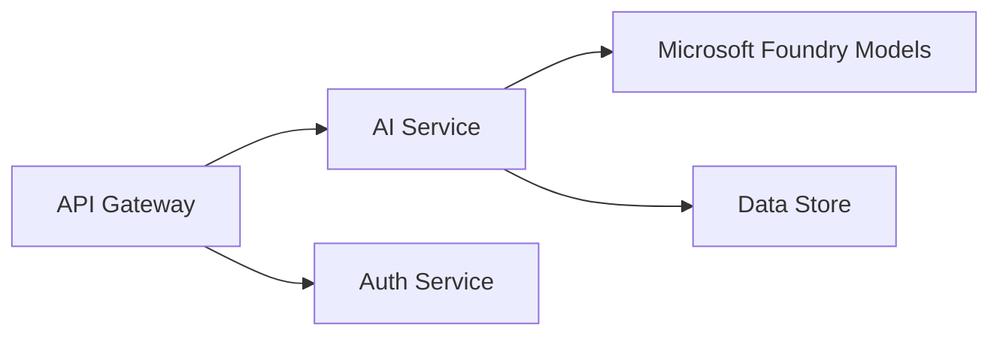
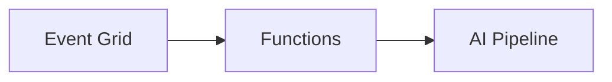

# 8장: 프로덕션 및 엔터프라이즈 패턴

**📚 과정**: [AZD 초보자](../../README.md) | **⏱️ 소요 시간**: 2-3시간 | **⭐ 난이도**: 고급

---

## 개요

이 장에서는 엔터프라이즈 준비가 된 배포 패턴, 보안 강화, 모니터링, 그리고 프로덕션 AI 워크로드의 비용 최적화를 다룹니다.

이 문서는 전체 배포 가능한 프로덕션 템플릿이 아닌 아키텍처 참조입니다. 예제는 통합 세부 정보를 생략하며, 이는 귀하의 애플리케이션에서 제공되고 테스트되어야 합니다; 체크리스트만 읽는다고 해서 프로덕션 준비 상태가 인증되는 것은 아닙니다.

> **Foundry GA 업데이트 (2026-11-09):** Foundry 워크플로우에는 `azd >= 1.37.0` 및 일반 제공되는 `microsoft.foundry` 1.0 번들을 사용하세요; 평가판은 별도로 설치됩니다. [릴리스 범위 및 마이그레이션](production-ai-practices.md#recent-release-changes-and-fixes)과 [인증된 파이프라인 예제](production-ai-practices.md#cicd-pipeline-configuration)를 참조하십시오. 이는 문서 검토이며 실시간 배포 검증이나 선택적 미리보기 기능에 대한 포괄적 GA 상태가 아닙니다.

## 학습 목표

이 장을 완료하면 다음을 할 수 있습니다:
- 다중 지역 내구성 애플리케이션 배포하기
- 엔터프라이즈 보안 패턴 구현하기
- 종합적인 모니터링 구성하기
- 대규모 비용 최적화하기
- AZD로 CI/CD 파이프라인 설정하기

---

## 📚 강의

| # | 강의 | 설명 | 시간 |
|---|--------|-------------|------|
| 1 | [프로덕션 AI 관행](production-ai-practices.md) | 엔터프라이즈 배포 패턴 | 90분 |

---

## 🚀 프로덕션 체크리스트

- [ ] 내구성을 위한 다중 지역 배포
- [ ] 인증을 위한 관리 ID(키 없음)
- [ ] 모니터링을 위한 Application Insights
- [ ] 비용 예산 및 알림 구성
- [ ] 보안 스캐닝 활성화
- [ ] CI/CD 파이프라인 통합
- [ ] 재해 복구 계획

---

## 🏗️ 아키텍처 패턴

### 패턴 1: 마이크로서비스 AI



### 패턴 2: 이벤트 기반 AI



---

## 🔐 보안 모범 사례

```bicep
// Illustrative properties from different resources, NOT a standalone Bicep file.
// Attach identity to the application host:
identity: {
  type: 'SystemAssigned'
}

// AI account properties (also require private endpoints, DNS and app connectivity):
properties: {
  publicNetworkAccess: 'Disabled'
  networkAcls: {
    defaultAction: 'Deny'
  }
}
```

---

## 💰 비용 최적화

| 전략 | 주요 제약 조건 |
|----------|---------|
| 0으로 축소 (컨테이너 앱) | 적절한 트리거 필요; 다른 서비스는 계속 비용 발생 |
| 개발을 위한 소비 계층 사용 | 선택한 서비스 가격 및 작업량 비교 |
| 예약된 스케일링 | 지원 인프라/자동화를 통한 스케일링 |
| 예약/프로비저닝 용량 | 지원될 때만; 약정은 유휴 비용 증가 가능 |

유효한 시작일, 청구 범위, 수신자 및 권한과 함께 [완전한 예산 리소스 패턴](production-ai-practices.md#2-cost-monitoring-and-budgets)을 사용하세요. 예산은 경고를 보내며 지출 한도는 없습니다. 절감액은 측정된 사용량에 따라 달라지며 보장된 비율이 아닙니다.

---

## 📊 모니터링 설정

```bash
# Open the Application Insights logs view (requires configured monitoring)
azd monitor --logs

# Check Application Insights
azd monitor --overview

# View metrics
az monitor metrics list --resource <resource-id>
```

---

## 🔗 탐색

| 방향 | 챕터 |
|-----------|---------|
| <strong>이전</strong> | [7장: 문제 해결](../chapter-07-troubleshooting/README.md) |
| **과정 완료** | [과정 홈](../../README.md) |

---

## 📖 관련 자료

- [AI 에이전트 가이드](../chapter-02-ai-development/agents.md)
- [Application Insights](../chapter-06-pre-deployment/application-insights.md)
- [다중 에이전트 솔루션](../chapter-05-multi-agent/README.md)
- [마이크로서비스 예제](../../examples/microservices/README.md)

---

<!-- CO-OP TRANSLATOR DISCLAIMER START -->
**면책 조항**:
이 문서는 AI 번역 서비스 [Co-op Translator](https://github.com/Azure/co-op-translator)를 사용하여 번역되었습니다. 정확성을 기하기 위해 노력하고 있으나, 자동 번역은 오류나 부정확한 부분이 있을 수 있음을 유의하시기 바랍니다. 원본 문서의 원어본이 권위 있는 자료로 간주되어야 합니다. 중요한 정보의 경우, 전문가의 인간 번역을 권장합니다. 이 번역 사용으로 인해 발생하는 오해나 잘못된 해석에 대해 당사는 책임을 지지 않습니다.
<!-- CO-OP TRANSLATOR DISCLAIMER END -->