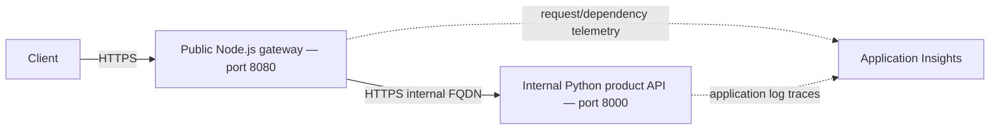

# 두 개의 서비스 마이크로서비스 — Azure Container Apps

**레벨:** 중급 · **시간:** 설정 포함 45–60분

이 학습 샘플은 <strong>Node.js API Gateway</strong>와 <strong>읽기 전용 Python 제품 서비스</strong>를 구현합니다.
소스, Dockerfiles, Bicep, 및 azd 구성이 포함되어 있습니다.
이는 실제 운영용으로 강화된 시스템이 아닙니다.

## 학습 내용

- 두 서비스를 독립적으로 배포합니다.
- HTTPS를 통한 내부 백엔드 FQDN을 사용합니다.
- 성공, 찾을 수 없음, 서비스 사용 불가 응답을 확인합니다.
- 텔레메트리와 독립적 확장 경계에 대해 이해합니다.



제품 카탈로그에는 메모리에 다섯 개의 고정된 제품이 포함되어 있습니다. **POST, 
PUT, 또는 DELETE 핸들러**, 데이터베이스, Service Bus, 주문/사용자/알림 서비스,
C# 또는 Go 코드는 없습니다. 이는 향후 개발 아이디어일 뿐 포함된 기능이 아닙니다.
게이트웨이는 사용자를 인증하지 않습니다. 내부 인그레스는 애플리케이션 권한 부여를 
대체하지 않습니다.

## 전제 조건

먼저 [단일 Flask API](../../../../../examples/container-app/simple-flask-api)를 완료하십시오.
현재 안정 버전 azd(검토 시점 발행 버전: 1.37.2), Azure CLI 및 Docker를 설치하고
데몬이 실행 중이어야 합니다. Azure 구독, 리소스 생성 권한 및 Container Apps 지역 할당량이 필요합니다.


```bash
azd version
az version
docker info
azd auth login
az login
```

두 CLI 도구에서 동일한 구독을 사용하십시오. 아래 명령은 Bash를 사용합니다.

## 배포 및 확인

저장소 루트에서:

```bash
cd examples/container-app/microservices
azd env new microservices-demo
azd up
GATEWAY_URL=$(azd env get-value API_GATEWAY_URL)
RG_NAME=$(azd env get-value AZURE_RESOURCE_GROUP)
GATEWAY_NAME=$(azd env get-value API_GATEWAY_NAME)
PRODUCT_NAME=$(azd env get-value PRODUCT_SERVICE_NAME)

curl --fail-with-body "${GATEWAY_URL}/health"
curl --fail-with-body "${GATEWAY_URL}/api/products"
curl --fail-with-body "${GATEWAY_URL}/api/products/1"
curl -i "${GATEWAY_URL}/api/products/999"
```

**성공:** health 200; 목록 200에 <strong>다섯</strong> 개 제품 포함; 제품 1은 가격이 999.99이고 재고가 50인 노트북
; 알 수 없는 제품은 404 반환.
설명이 응답에 포함되어 있으며, 타임스탬프는 다를 수 있습니다.

초기 프로비저닝은 포트 80에서 공개 hello-world 이미지를 사용하므로 존재하지 않는 이미지를
빈 레지스트리에서 가져오려 하지 않습니다. 서비스별 Bicep 모듈
그리고 매개변수 파일은 빌드된 이미지와 앱 포트/프로브로 대체됩니다
`azd deploy` 동안. 주요 매개변수는 나중 프로비저닝을 위해 게시된 이미지 이름을 유지합니다.

## 서비스 및 네트워킹

| 서비스 | 노출된 엔드포인트 | 기본 리소스 |
|---|---|---|
| 게이트웨이 | GET `/`, `/health`, `/api/products`, `/api/products/:id` | 1 vCPU, 2 GiB, 2–20 복제본 |
| 제품 | GET `/`, `/health`, `/products`, `/products/<id>` | 0.5 vCPU, 1 GiB, 1–10 복제본 |

제품 인그레스에는 `external: false` 및 `allowInsecure: false`가 있습니다. Bicep은
`PRODUCT_SERVICE_URL=https://<actual-internal-fqdn>`를 게이트웨이에 주입합니다. HTTP는
리디렉션되며, HTTPS는 구성된 인그레스와 일치합니다. 짧은 DNS 이름은
<strong>실제 Container App 이름</strong>과 일치해야 하며, 논리적 서비스 키 `product-service`가 아닙니다.
노트북에서 내부 URL을 직접 호출하지 마십시오.

게이트웨이는 제품 호출에 대해 5초 타임아웃을 가집니다. 누락된 제품 ID는
404로 전파되고, 전송 실패/기타 백엔드 실패는 503을 반환합니다. 게이트웨이
`/health`는 백엔드 가용성이 아닌 게이트웨이만 검사합니다.

## 파일 및 구성

```text
azure.yaml
infra/main.bicep
infra/main.parameters.json
infra/abbreviations.json
infra/core/container-apps-environment.bicep
infra/core/monitor.bicep
infra/app/api-gateway.bicep
infra/app/api-gateway.parameters.json
infra/app/product-service.bicep
infra/app/product-service.parameters.json
src/api-gateway/{app.js,package.json,Dockerfile}
src/product-service/{main.py,requirements.txt,Dockerfile}
```

스케일링, CPU/메모리, 포트 및 프로브는 `infra/app/*.bicep`에 설정됩니다. 해당
파일들을 변경하고 `azd up`를 실행하여 인프라를 적용하고 재배포하세요. 이 샘플에는
`GATEWAY_MAX_REPLICAS` 환경 변수 매개변수가 없습니다.

코드 전용 변경 사항의 경우:

```bash
azd deploy product-service
azd deploy api-gateway
```

Node 이미지는 Node 22를 사용하며, Python 이미지는 Python 3.11을 사용합니다. 둘 다
`0.0.0.0`에 바인딩됩니다. Ingress/프로브는 각각 포트 8080(게이트웨이)과 8000(제품)을 사용합니다.

## Docker를 이용한 로컬 개발

이 예제 디렉터리에서 실행하세요. 사용자 정의 네트워크를 사용하고, **`localhost`가 아닙니다.
한 컨테이너에서 다른 컨테이너에 도달하기까지**:

```bash
docker network create azd-microservices-demo
docker build -t local-product ./src/product-service
docker build -t local-gateway ./src/api-gateway
docker run -d --name azd-product --network azd-microservices-demo local-product
docker run -d --name azd-gateway --network azd-microservices-demo \
  -p 8080:8080 -e PRODUCT_SERVICE_URL=http://azd-product:8000 local-gateway
curl --fail-with-body http://localhost:8080/api/products
```

예상: 다섯 개의 제품. HTTP는 이 로컬 Docker 네트워크에서만 사용됩니다.

```bash
docker stop azd-product azd-gateway
docker rm azd-product azd-gateway
docker network rm azd-microservices-demo
```

## 모니터링

```bash
az containerapp logs show --name "$GATEWAY_NAME" --resource-group "$RG_NAME" --follow
# In a separate terminal:
az containerapp logs show --name "$PRODUCT_NAME" --resource-group "$RG_NAME" --tail 100
```

`azd monitor --logs` 는 포털 뷰를 열며, 터미널 로그를 스트리밍하지 않습니다.
Node SDK는 게이트웨이 요청/종속성을 수집합니다. Python의 `AzureLogHandler`
는 자동 Flask 요청, SQL 종속성, 전체 분산 추적이 아니라 <strong>로그 추적</strong>을 내보냅니다.
OpenCensus는 구식 SDK입니다; 이 샘플을 확장할 때는 Azure Monitor OpenTelemetry를 사용하는 것이 좋습니다.


Application Insights Logs에서 requests를 생성하고 검사합니다:

```kusto
requests
| where timestamp > ago(1h)
| where name contains "products"
| summarize RequestCount=count(), AvgDuration=avg(duration) by bin(timestamp, 5m)
```

Python 애플리케이션 메시지의 경우:

```kusto
traces
| where timestamp > ago(1h)
| where message contains "products"
| project timestamp, message, severityLevel
```

수집 지연과 샘플링을 허용하세요; 정확한 요청 수나 보장된 대기 시간을 기대하지 마십시오. 사용자 지정 경고나 대시보드는 구성되어 있지 않습니다.


## 실제 연습

### 연습 1: 카탈로그 수정

**출발점:** `src/product-service/main.py`.
**목표:** 독립 서비스 배포 확인.
고정된 `products` 목록에서 노트북의 재고를 50에서 49로 변경한 후,
`azd deploy product-service`를 실행하고, 그 다음 `${GATEWAY_URL}/api/products/1`를 요청하세요.

**성공 기준 / 해결책:** `"stock":49`가 포함된 HTTP 200. 50을 복원하고 다시 배포합니다.
**일반적인 문제:** 카탈로그를 소유한 서비스 대신 게이트웨이를 편집하는 것.
이것은 지속적인 인벤토리 데이터베이스가 아닌 원본 데이터를 변경합니다.

### 연습 2: 복제본 구성 확인

**시작점:** `infra/app/product-service.bicep`.
**목표:** 오토스케일링을 추측하지 않고 인프라 변화를 관찰합니다.
`minReplicas: 1`을 `minReplicas: 2`로 변경하고 `azd up`을 실행한 후:

```bash
az containerapp show --name "$PRODUCT_NAME" --resource-group "$RG_NAME" \
  --query properties.template.scale -o json
```

**성공 기준:** 구성된 최소값은 2이고 최대값은 여전히 10이어야 합니다.
최소값을 1로 복원하고 `azd up`을 실행합니다.
**일반적인 문제:** `azd deploy`만으로는 관련 없는 공유
인프라에 변경 사항을 적용하지 않습니다. 실패 시뮬레이션으로 `maxReplicas`를 0으로 설정하지 마세요.
이는 구성을 검증하는 것이며, 부하 테스트나 즉각적인 복제본 수 보장을 의미하지 않습니다.

### 연습 3: 로컬에서 서비스 불능 처리 테스트

**시작점:** 위 두 개의 로컬 Docker 컨테이너가 실행 중입니다.
**목표:** 백엔드 실패와 제품 누락을 구분합니다.
제품 컨테이너만 중지합니다:

```bash
docker stop azd-product
curl -i http://localhost:8080/api/products
docker start azd-product
curl --fail-with-body http://localhost:8080/api/products
```

**성공 기준:** 중지된 동안 게이트웨이가 503을 반환하고
`"error":"Product service unavailable"`를 반환합니다; 재시작 후 목록은 200을 반환합니다.
필요 시 짧은 시작 지연 후에 재시도합니다.
**일반적인 문제:** 게이트웨이를 중지하면 다른 실패(HTTP 응답 없음)가 테스트됩니다.

## 비용 및 프로덕션 격차

기본 최소 복제본은 컴퓨트를 계속 실행합니다. 레지스트리와 모니터링도
비용이 발생합니다. 검증된 월 총 $50 고정 비용은 없으며, 지역 CPU/메모리,
복제본 시간, 요청, 레지스트리 및 로그 보존을
[Azure 가격 계산기](https://azure.microsoft.com/pricing/calculator/).
학습 리소스를 즉시 삭제하세요.

프로덕션 작업에는 인증/권한 부여, 범위가 지정된 관리 ID,
지속 데이터, 입력/응답 검증, 지원되는 관찰 계측,
부하/장애 테스트, CI/CD, 알림 및 복구 절차가 포함됩니다. 주문
서비스, 큐 또는 데이터베이스 추가는 별도의 구현 작업이며,
여기에서 이미 제공되는 완성된 연습 또는 기능이 아닙니다.

## 문제 해결 및 정리

- **초기 프로비저닝 시 이미지가 없음:** 부트스트랩은 공개 이미지를 사용해야 합니다;
  기본 이미지 매개변수와 배포 모듈 매핑을 확인하세요.
- **503 제품:** 제품 로그, 이미지 수정 및 주입된 내부 HTTPS URL을 확인하세요.
- **404 예상치 못한 경로:** 제품 API는 읽기 전용입니다; 라우트를 확인하고 존재하지 않는 CRUD 핸들러가 아닌지 확인하세요.
- **원격 측정 없음:** 런타임 연결 문자열을 노출하지 않고 검사하고
  수집 지연을 허용하세요. Python 요청 테이블은 로그 핸들러로 채워지지 않습니다.

이 샘플 디렉터리에서:

```bash
azd down
```

삭제 프롬프트를 검토하고 전용 리소스 그룹이 제거되었는지 확인하세요.

[이전: Flask API](../../../../../examples/container-app/simple-flask-api) · [다음: 데이터베이스 앱](../../../../../examples/database-app) ·
[AI 개발](../../../docs/chapter-02-ai-development/README.md) ·
[강좌 홈](../../../README.md) · [문제 신고](https://github.com/microsoft/AZD-for-beginners/issues)

---

<!-- CO-OP TRANSLATOR DISCLAIMER START -->
**면책 조항**:
이 문서는 AI 번역 서비스 [Co-op Translator](https://github.com/Azure/co-op-translator)를 사용하여 번역되었습니다. 정확성을 기하기 위해 노력하고 있으나, 자동 번역은 오류나 부정확한 부분이 있을 수 있음을 유의하시기 바랍니다. 원본 문서의 원어본이 권위 있는 자료로 간주되어야 합니다. 중요한 정보의 경우, 전문가의 인간 번역을 권장합니다. 이 번역 사용으로 인해 발생하는 오해나 잘못된 해석에 대해 당사는 책임을 지지 않습니다.
<!-- CO-OP TRANSLATOR DISCLAIMER END -->