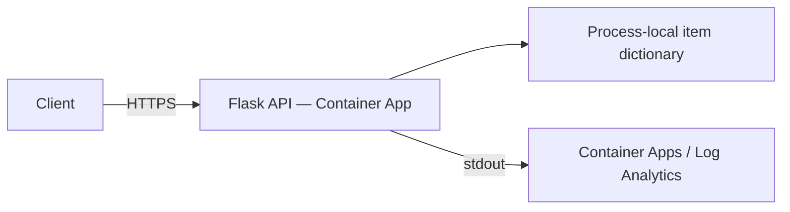

# 간단한 Flask API — Azure 컨테이너 앱

**레벨:** 초급 · **소요 시간:** 설정 포함 30–45분

Azure Developer CLI(azd)를 사용하여 Python Flask CRUD API를 배포합니다. 소스, Dockerfile,
Bicep, 및 배포 매개 변수가 포함되어 있습니다. 이것은 <strong>학습 샘플</strong>이며,
상용 API가 아닙니다.

## 배우게 될 내용

- azd를 통해 컨테이너를 빌드하고 게시합니다.
- 인그레스와 liveness/readiness 프로브를 구성합니다.
- CRUD 응답을 확인하고 애플리케이션 로그를 검사합니다.
- 인메모리 데이터가 내구성 있는 애플리케이션에 부적합한 이유를 이해합니다.



**중요:** 항목은 하나의 프로세스에 저장됩니다. 기본값은 **하나의 Gunicorn 워커,
0–1개의 복제본**이며, 워커/복제본 간 데이터 불일치를 의도적으로 방지합니다.
항목은 재시작, 버전 변경, 또는 0으로 축소될 때 손실됩니다. 복제본 수를 늘리려면
공유 영속 스토리지가 필요합니다. 이 API에는 인증이나 권한 부여가 없습니다.

## 선행 조건

- [현재 안정 버전 azd](https://learn.microsoft.com/azure/developer/azure-developer-cli/install-azd)
  (검토 시점에 게시된 릴리스: 1.37.2).
- 확인용 [Azure CLI](https://learn.microsoft.com/cli/azure/install-azure-cli).
- Docker 및 데몬 실행 중; 기본 로컬 이미지 빌드에 필요합니다.
- Azure 구독, 리소스 생성 권한 및 컨테이너 앱 지역 쿼터.
- 아래 명령어용 Bash (또는 동등한 PowerShell).
- 옵션인 로컬 개발용 Python 3.11.

```bash
azd version
az version
docker info
azd auth login
az login
```

CLI 도구들은 별도의 로그인 세션을 가집니다. 두 도구 모두에서 동일한 구독을 사용하세요.

## 빠른 시작

저장소 루트에서:

```bash
cd examples/container-app/simple-flask-api
azd env new flask-demo
azd up
API_URL=$(azd env get-value API_ENDPOINT)
RG_NAME=$(azd env get-value AZURE_RESOURCE_GROUP)
API_NAME=$(azd env get-value API_NAME)
curl --fail-with-body "${API_URL}/health"
```

예상: HTTP 200 및 `"status":"healthy"`, 
`"service":"simple-flask-api"`, 그리고 현재 UTC 타임스탬프가 포함된 JSON.
프로비저닝과 이미지 빌드는 보통 몇 분이 걸리며; 시간은 다를 수 있습니다.

초기 프로비저닝은 포트 80에서 수신하는 공개 hello-world 이미지를 사용합니다.
`azure.yaml` 는 서비스 배포를 위해 `infra/app/api.bicep`와 해당 매칭 파라미터 파일을 선택하는데, 
이는 이미지, 인그레스, 프로브를 포트 8000으로 전환합니다.
해당 배포 파라미터들은 삭제하지 마십시오.

## CRUD 검증

동일 복제본이 활성 상태인 동안 다음 명령들을 순차적으로 실행하세요:

```bash
# Create: HTTP 201; note the returned id (1 for a fresh process).
curl -i -X POST "${API_URL}/api/items" \
  -H "Content-Type: application/json" \
  -d '{"name":"Test Item","description":"My first item"}'

# Read list: HTTP 200, total 1 in a fresh process.
curl --fail-with-body "${API_URL}/api/items"

# Replace 1 if your create response returned another id.
curl --fail-with-body "${API_URL}/api/items/1"
curl -i -X PUT "${API_URL}/api/items/1" \
  -H "Content-Type: application/json" -d '{"name":"Updated Item"}'
curl -i -X DELETE "${API_URL}/api/items/1"
curl -i "${API_URL}/api/items/1"
```

성공: POST 201, 읽기/PUT 200, DELETE 204 (본문 없음) 이후 누락된 항목 404.
형식 오류 또는 비객체 JSON, 또는 빈 이름은 400을 반환합니다.
요청 간 항목이 사라지면 재시작 또는 0 스케일링을 확인하세요;
이것은 영속성이 아닌 의도된 메모리 내 제한입니다.

| 엔드포인트 | 메서드 |
|---|---|
| `/` | GET — 서비스 정보 |
| `/health` | GET — 라이브니스/레디니스 |
| `/api/items` | GET, POST |
| `/api/items/{id}` | GET, PUT, DELETE |

## 로그 및 구성

```bash
az containerapp logs show --name "$API_NAME" --resource-group "$RG_NAME" --follow
```

예상: Gunicorn 시작, 요청 액세스 로그, 그리고 애플리케이션 메시지.
`azd monitor --logs` 는 포털 뷰를 열며; 터미널로 스트리밍하지 않습니다.
Application Insights는 프로비저닝 되었지만 **이 Flask 코드에 의해 계측되지 않았습니다**;
stdout 로그는 Container Apps/Log Analytics를 사용하세요.

CPU/메모리, 복제본 한도, 또는 스케일 규칙을 위해 `infra/app/api.bicep` 를 편집한 후,
`azd up` 를 실행하세요. 기본값은 0.5 vCPU, 1 GiB, 최소 0 / 최대 1 복제본, 
HTTP 임계값은 50 동시 요청입니다. 스케일 투 제로는 콜드 스타트 지연을 추가할 수 있습니다.

임의의 `azd env set MAX_REPLICAS`, `API_KEY`, `LOG_LEVEL`, 또는 
`SCALE_TO_ZERO_TIMEOUT` 값들은 **이 템플릿이나 앱에 연결되어 있지 않습니다**.
값을 설정해도 자동으로 런타임 환경 변수로 만들지는 않습니다.
이미지는 포트 8000에 명시적으로 바인딩합니다; 포트를 변경할 경우 Dockerfile,
Bicep 인그레스, 프로브를 함께 업데이트하세요.

## 파일

```text
azure.yaml
infra/main.bicep
infra/main.parameters.json
infra/app/container-apps.bicep       # Environment, registry, monitoring
infra/app/api.bicep                  # App, ingress, probes, scale settings
infra/app/api.parameters.json        # Image and resource values for azd deploy
src/app.py
src/Dockerfile
src/requirements.txt
```

## 로컬 개발

이 예제 디렉터리에서:

```bash
python -m venv .venv
source .venv/bin/activate  # PowerShell: .\.venv\Scripts\Activate.ps1
python -m pip install -r src/requirements.txt
python src/app.py
```

다른 터미널에서 `http://localhost:8000/health` 와 CRUD 엔드포인트를 테스트하세요.
또는 실제 이미지를 빌드하고 실행하세요:

```bash
docker build -t flask-api:local ./src
docker run --rm -p 8000:8000 flask-api:local
```

최초 배포 후 코드 변경은 `azd deploy api` 를 실행하세요.
Bicep 변경은 프로비저닝 및 배포를 위해 `azd up` 를 실행하세요.

## 실습 연습

### 1. 입력 거부 확인

**출발점:** 위 `API_URL` 에서 배포된 API.
**목표:** API가 잘못된 JSON 구조 및 누락된 이름을 거부하는지 확인.

```bash
curl -i -X POST "${API_URL}/api/items" \
  -H "Content-Type: application/json" -d '[]'
curl -i -X POST "${API_URL}/api/items" \
  -H "Content-Type: application/json" -d '{"name":""}'
```

**성공 기준 / 해결책:** 둘 다 500이 아닌 JSON 오류와 함께 400을 반환.
**일반 문제:** JSON 콘텐츠 유형 헤더 누락.

### 2. 읽기 전용 버전 엔드포인트 추가

**출발점:** `src/app.py`. **목표:** API 확장 및 재배포.
`if __name__ == '__main__':` 블록 앞에 이것을 추가하세요:

```python
@app.route('/version', methods=['GET'])
def version():
    return jsonify({'version': '1.0.0'})
```

`azd deploy api` 실행 후 `curl --fail-with-body "${API_URL}/version"` 실행.
**성공 기준:** HTTP 200 및 `{"version":"1.0.0"}`.
**일반적인 문제:** 블로킹 `app.run()` 호출 이후에 라우트를 배치할 때
`python src/app.py`로 테스트하기.

### 지식 점검

내구성 있는 데이터에 왜 한 명의 작업자가 충분하지 않은가? 그 이유는 단 하나의 프로세스라도 재시작 시
사전을 잃어버리기 때문이다. 실사용 버전은 영속적 공유 저장소,
인증, 권한 부여, 마이그레이션, 테스트, 운영 모니터링이 필요하다.

## 비용 및 문제 해결

이것은 보장된 $0 배포가 아닙니다: 기본 레지스트리 및 로그 저장/수집
은 앱 컴퓨트가 0일 때에도 비용이 발생할 수 있습니다. 지역별
[가격 계산기](https://azure.microsoft.com/pricing/calculator/)를 사용하세요.

- **Docker 빌드 실패:** `docker info`, 네트워크 접근 및 종속성을 확인하세요.
- **비정상 앱:** 콘솔/시스템 로그를 검사하고 이미지 포트, 인그레스,
  및 프로브가 일치하는지 확인하세요. 플레이스홀더는 Flask 포트에서 프로브를 받아서는 안 됩니다.
- **403/권한 오류:** 구독 및 리소스 생성 권한을 확인하세요.
- **항목이 사라짐:** 메모리 내 상태는 재시작/스케일-투-제로 시 초기화됩니다; 내구성을 위해 데이터베이스를 추가하세요.


## 정리 및 다음 단계

```bash
azd down
```

삭제 메시지를 검토하고 전용 리소스 그룹이 제거되었는지 확인하세요.
관련 없는 데이터가 포함된 리소스 그룹에 대해 파괴적인 정리를 사용하지 마세요.

[다음: 데이터베이스 앱](../../../../../examples/database-app) · [마이크로서비스](../../../../../examples/container-app/microservices) ·
[컨테이너 개요](../README.md) · [코스 홈](../../../README.md) ·
[문제 신고](https://github.com/microsoft/AZD-for-beginners/issues)

---

<!-- CO-OP TRANSLATOR DISCLAIMER START -->
**면책 조항**:
이 문서는 AI 번역 서비스 [Co-op Translator](https://github.com/Azure/co-op-translator)를 사용하여 번역되었습니다. 정확성을 기하기 위해 노력하고 있으나, 자동 번역은 오류나 부정확한 부분이 있을 수 있음을 유의하시기 바랍니다. 원본 문서의 원어본이 권위 있는 자료로 간주되어야 합니다. 중요한 정보의 경우, 전문가의 인간 번역을 권장합니다. 이 번역 사용으로 인해 발생하는 오해나 잘못된 해석에 대해 당사는 책임을 지지 않습니다.
<!-- CO-OP TRANSLATOR DISCLAIMER END -->