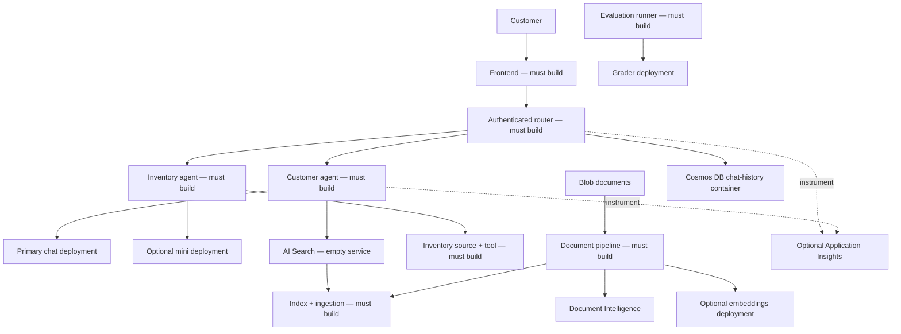

# 다중 에이전트 고객 지원 — 소매 아키텍처 블루프린트

**5장: 다중 에이전트 AI 솔루션**

- [강좌 홈](../README.md)
- [5장](../docs/chapter-05-multi-agent/README.md)
- [선행 조건: AI 통합](../docs/chapter-02-ai-development/microsoft-foundry-integration.md)
- [다음: 용량 계획](../docs/chapter-06-pre-deployment/capacity-planning.md)
- [ARM 인프라 스캐폴드](retail-multiagent-arm-template/README.md)

> **아키텍처 가이드이며, 작동하는 애플리케이션이 아닙니다.** 유일한 소매 구현
> 파일은 `azuredeploy.json`, `azuredeploy.parameters.json`, 그리고 `deploy.sh`가
> `retail-multiagent-arm-template/`에 있습니다. 라우터/프론트엔드 컨테이너는 헬로월드
> 자리 표시자입니다. 소매 에이전트, UI, 수집 파이프라인, 평가자, 스캐너,
> 또는 애플리케이션 테스트 스위트가 로컬에 존재하지 않습니다.

## 개요

**목표:** 고객 에이전트와 재고 에이전트가 있는 고객 지원 시스템을 설계하고,
인프라가 제공하는 것을 식별하며, 누락된 애플리케이션 계약과 검증을 계획하는 것.


**대상:** 로컬을 완료한 개발자
[챗 샘플](../../../examples/azure-openai-chat) 및 [두 서비스 컨테이너 샘플](../../../examples/container-app/microservices).
아키텍처 학습에 2~3시간이 소요됩니다. 애플리케이션 빌드는 별도의
프로젝트로, 숙련된 개발자를 위한 80~120 개발 시간을 예시적 계획 추정치이며,
**납품 약속이 아닙니다**; 프로덕션 하드닝, 테스트,
보안 검토 및 운영은 추가 작업이 필요합니다.

### 학습 결과

- 라우팅, 그라운딩, 도구 권한 및 대화 소유권 설명
- 모델 식별자, 배포 이름, API 버전 및 ARM 버전 구분
- 일치하는 벡터 차원으로 문서 수집 및 검색 설계
- 검증 가능한 기능, 평가 및 장애 복구 요구사항 정의
- 선택적 아키텍처 목표와 실제 프로비저닝된 리소스 구분

## 솔루션 아키텍처



이것은 실행 중인 에이전트 서비스 다이어그램이 아니라 <strong>목표 애플리케이션 아키텍처</strong>입니다.
ARM 스캐폴드는 기본 서비스와 두 개의 플레이스홀더
컨테이너만 생성합니다. 프론트 도어, 레지스트리, 관리형 ID, 역할 할당,
프라이빗 엔드포인트, 장애 조치, 애플리케이션 계측 및 경고는 포함되지 않습니다.

### 책임과 계약

| 구성요소 | 필수 동작 | 완료 전 증거 |
|---|---|---|
| 프런트엔드 | 사용자 인증, 채팅 렌더링, 안전한 문서 업로드 | UI 및 업로드 테스트, 접근 가능한 오류 |
| 라우터 | 요청 승인, 에이전트 선택, 도구 호출/타임아웃 제한 | 라우팅 테스트, 승인 검사, 실패 테스트 |
| 고객 에이전트 | 승인된 소스에 정책/제품 답변 근거 제공 | 올바른 인용, 데이터 없을 시 보류 |
| 인벤토리 도구 | 범위 권한으로 권위 있는 재고 읽기 | 결정론적 재고 테스트; 임의 가용성 없음 |
| 문서 파이프라인 | 추출, 청크, 임베드, 인덱스, 업데이트/삭제 | 인덱스 고정물 및 재시도/데드레터 동작 |
| 대화 저장소 | 사용자 격리, 보존 시행 | 사용자 간 권한 및 TTL 테스트 |
| 평가 러너 | 출력물을 진실 기준 및 룹릭과 비교 | 커버리지, 실패 횟수, 재현 가능한 보고서 |

라우터를 접수 데스크로, 도구를 제한된 내부 시스템으로 생각하세요:
전문가 선택이 모든 고객 기록 접근 승인을 의미하지 않습니다.
신원과 권한은 프롬프트가 아니라 애플리케이션 코드와 데이터 서비스에서 시행하세요.

## 인프라 대 애플리케이션

프로비저닝 전에 [스캐폴드 README](retail-multiagent-arm-template/README.md)를 읽으세요.
정확한 리소스, 모드, 비용 및 제한 사항이 나와 있습니다.

| 논리적 사용처 | ARM 배포 이름 | 모델 / 버전 | 기본 지역 |
|---|---|---|---|
| 고객 채팅 | `gpt-4.1-chat` | `gpt-4.1` / `2025-04-14` | `eastus2` |
| 인벤토리 | `gpt-4.1-mini-inventory` | `gpt-4.1-mini` / `2025-04-14` | `westus2`, 선택 사항 |
| 임베딩 | `text-embedding-ada-002` | `text-embedding-ada-002` / `2` | `francecentral`, 선택 사항 |
| 평가 | `gpt-4.1-grader` | `gpt-4.1` / `2025-04-14` | 기본적으로 주요 지역 |

모델/버전/SKU 가용성과 쿼터를 <strong>각 지역</strong>에서 확인하세요. 챗/미니/그레이더는
`GlobalStandard`, 임베딩은 `Standard`를 사용합니다. 용량 단위 대 TPM 매핑은
모델별입니다. 서로 다른 용량 단위를 보편적인 쿼터 보장으로 추가하지 마세요.

Azure OpenAI 요청의 `model` 인수는 <strong>배포 이름</strong>이며,
반드시 카탈로그 모델 식별자는 아닙니다. 데이터 플레인 API 버전 `2024-10-21`은
모델 버전 `2025-04-14` 및 ARM 리소스 `apiVersion`와는 다릅니다.
데이터 플레인 API 버전만 변경하여 사용 불가능한 모델을 고칠 수 없습니다.

`--no-multi-region`는 보조 및 임베딩 계정을 건너뜁니다. 기본 채팅과
독립 평가자 계정이 남습니다. 별도의 모델 계정은 자동 장애 조치를 제공하지 않으며,
애플리케이션 라우팅, 호환 배포, 상태 검사,
재시도 제한 및 데이터 거주 검토가 필요합니다.

## 구현 로드맵

### 1. 테스트된 하나의 상호작용으로 시작

대규모 스캐폴드 프로비저닝 전에 로컬 챗 샘플을 사용해
추론 연결성을 설정하세요. 하나의 대표 고객 질문, 승인된
답변 소스, 예상 인용 및 해당 소스가 없을 때 실패 동작을 정의하세요.

### 2. 라우팅 및 도구 경계 정의

자체 라우터 소스, 의존성 매니페스트, Dockerfile 및 테스트를 만드세요.  
예시 계약은 `POST /chat`와 `{"message":"...","conversation_id":"..."}` 일 수 있습니다.  
**해당 엔드포인트는 설계 제안이며 ARM 템플릿에 의해 구현되지 않았습니다.**  

본문 유형/제한을 검증하고, 인증에서 사용자 식별을 도출하며,  
대화 소유권을 강제하고, 요청 시간 초과를 적용하며, 의미 있는 오류 코드를 반환하세요.  
HTTP 실패나 빈 응답을 성공적인 에이전트 결과로 취급하지 마세요.  

### 3. 그라운딩 및 인제스트 구현  

ARM 템플릿은 검색 인덱스를 생성하지 않습니다.  
이는 **참고용 JSON 조각으로, 자체 인덱스 정의에 맞게 조정하는 것이며**,  

```json
{
  "name": "retail-product-index",
  "fields": [
    {"name": "id", "type": "Edm.String", "key": true},
    {"name": "title", "type": "Edm.String", "searchable": true},
    {"name": "content", "type": "Edm.String", "searchable": true},
    {"name": "category", "type": "Edm.String", "filterable": true},
    {
      "name": "content_vector",
      "type": "Collection(Edm.Single)",
      "searchable": true,
      "dimensions": 1536,
      "vectorSearchProfile": "retail-profile"
    }
  ],
  "vectorSearch": {
    "algorithms": [{"name": "retail-hnsw", "kind": "hnsw"}],
    "profiles": [{"name": "retail-profile", "algorithm": "retail-hnsw"}]
  }
}
```
  
프로필은 벡터 필드를 알고리즘과 연결합니다. 차원이 일치해야 합니다.  
실제 임베딩 출력 (이 `ada-002` 배포의 경우 1536). Python 검색용,
벡터 쿼리 종류가 누락된 불완전한 딕셔너리 대신 `azure.search.documents.models.VectorizedQuery`를 사용하세요:


```python
# Reference function only: supply an authenticated async SearchClient and an embedding.
from azure.search.documents.models import VectorizedQuery

async def retrieve(search_client, embedding):
    results = await search_client.search(
        search_text=None,
        vector_queries=[VectorizedQuery(
            vector=embedding,
            k_nearest_neighbors=5,
            fields="content_vector"
        )],
        select=["id", "title", "content"]
    )
    return [document async for document in results]
```

별도의 수집 구현을 만드세요:

1. 업로드 권한을 승인하고 콘텐츠 유형과 크기를 검증합니다.
2. 인증된 SDK 호출을 사용하여 비공개 블롭을 읽습니다. 비공개 블롭 URL은 자체적으로
   는 **읽을 수 있는 Document Intelligence 입력값이 아닙니다**; 다운로드한 바이트를
   `AnalyzeDocumentRequest(bytes_source=...)`와 함께 보내거나 액세스 요구사항을 검토한 후 적절한 범위의,
   단기간 유효한 SAS를 사용하세요.
3. 텍스트를 추출하고 임베딩 제한에 맞게 청크로 나눈 다음 임베딩을 생성합니다.
4. 안정적이고 유효한 문서 키를 생성하고 해당 벡터와 매칭되는 청크를 업로드합니다.
5. 문서별 인덱싱 결과를 점검하고 재시도 처리를 하며 오래된 데이터를 업데이트/삭제합니다.

임의의 사용자 키/값을 OData 필터에 보간하지 마세요. 허용 목록 필드를 지정하고,
값 유형을 검증하며, 문자열 따옴표를 이스케이프하세요. 부울 및 숫자 필터는
따옴표가 아닌 타입화된 리터럴이어야 합니다.

### 4. 웹 기반 연동

**Bing Search v7은 2025년 8월 11일에 중단되었습니다.** 이전의 `Microsoft.Bing/accounts`
리소스와 `api.bing.microsoft.com/v7.0/search` 예시는 지원되는
구현 경로가 아닙니다. Microsoft Foundry 및 해당 SDK, 권한, 청구, 인용 요구사항을
검토하여 현재 지원되는 기반 연동을 평가하세요; 여기에는 구현되어 있지 않습니다.
이는 중단된 엔드포인트의 드롭인 교체 용도가 아닙니다.

### 5. 원격 측정 및 평가 추가

Application Insights 생성은 코드 계측을 수행하지 않습니다. 새 애플리케이션 구축 시 지원되는 Azure Monitor
OpenTelemetry 계측을 사용하고, 서비스 간 추적 컨텍스트를 전파하며,
고객 프롬프트, 문서, 비밀값의 로깅은 피하세요.
쿼리를 잘라도 **익명화되지 않습니다**.

요청 기간, 라우팅/도구 실패, 검색 관련성, 인용 정확도, 토큰 사용, 회피 여부를 측정하세요.
평가 사례와 함께 GT(ground-truth) 인벤토리/정책 사실을 저장하세요:
평가자가 질문과 답변만으로 사실 정확성을 신뢰성 있게 판단할 수 없습니다.


평가 배포판은 평가 실행기가 아닙니다. 버전 관리된 평가 기준,
구조화된 출력/스키마 검증, 점수 범위 검사, 전송 실패 카운트,
그리고 사람 리뷰된 사례를 구현하세요. 미완성/오류 사례는 별도로 보고하고,
성공 등급으로 전환하거나 무음으로 0 품질 모델 응답에 포함하지 마세요.

마찬가지로, 몇 가지 키워드 검사로 보안 인증이 되는 것이 아닙니다. HTTP
요청 실패, 누락된 테스트 전략 또는 빈 응답은 테스트를 **불확실 또는 실패** 상태로 만들어야 하며,
"100% 보안" 점수를 주지 마세요. 적절한 도구와 사람 리뷰를 통한 권한 있는 테스트를
수행하여 프로덕션 준비 상태를 주장하기 전에 확실히 하세요.

### 6. 애플리케이션 배포

자체 소스 디렉터리, 매니페스트, 테스트, 레지스트리, 이미지 풀 권한을 생성하세요.
플레이스홀더를 빌드된 이미지로 교체하고 각 앱의 수신 포트에 맞게 ingress/probe를
업데이트하세요. Bicep에서 런타임 환경 변수를 구성하세요.
또는 명시적으로 지원되는 azd 환경 매핑.

azd 서비스 아래에 런타임 환경 변수를 자동으로 생성하는 일반적인 `config` 사전이 없습니다.
`azd env set`는 명시적으로 이러한 값을 사용하는 리소스만 변경합니다. 이 스캐폴드에는
카나리, 리전 목록 또는 세밀한 조정 후크가 구현되어 있지 않습니다.


## 실용적 설계 연습

이것들은 <strong>아키텍처 연습</strong>이며 실행 가능한 소매 시작 코드의 주장이 아닙니다.

### 연습 1: 경계 확인

**시작점:** `retail-multiagent-arm-template/`의 세 파일.
**목표:** 프로비저닝과 애플리케이션 기능 구분.
`azuredeploy.json`를 열어 컨테이너 이미지와 `targetPort` 값을 모두 찾고,
저장소에 없는 애플리케이션 구성 요소를 나열하세요.

**성공 기준 / 답:** 두 이미지는 모두 포트 80에서 수신하는 hello-world 플레이스홀더입니다;
에이전트, 챗 UI, 라우터 핸들러, 인덱스/인게스팅, 평가자, 스캐너는 없습니다.
성공적인 플레이스홀더 루트 요청은 `/chat`를 검증하지 않습니다.
**일반 문제:** `retail-router`와 같은 리소스 이름을 작동하는 코드로 해석하는 것.

### 연습 2: 벡터 구성 추적

**시작점:** 위 인덱스 JSON.
**목표:** 필드 → 프로필 → 알고리즘 관계 이해.
출력 차원이 다른 임베딩 모델로 전환할 때 변경해야 할 값을 식별하고,
그런 다음 `retrieve` 함수를 검사하세요.

**성공 기준 / 답:** 필드 `dimensions`를 실제 벡터 길이로 변경;
`vectorSearchProfile`는 선언된 프로필과 해당 알고리즘에 맞게 유지;
쿼리 `fields`는 벡터 필드를 명시해야 합니다. 임베딩 모델이 변경될 때
기존 문서 벡터를 재생성하세요.
**일반 문제:** 호환되지 않는 벡터를 유지하면서 모델 이름만 변경하는 것.

### 연습 3: 실패 테스트 정의

**시작점:** 책임 테이블.
**목표:** 거짓 성공 방지.
사용할 수 없는 인벤토리 API, 일치하는 문서가 없는 검색 인덱스, HTTP 503을 반환하는 평가 요청에 대한 예상 동작을 작성하세요.


평가는 품질 또는 보안 통과 대신 전송 실패를 보고합니다. 애플리케이션을 빌드할 때 실행 가능한 테스트를 추가하세요.
**일반 문제:** 모든 예외를 잡고 빈 답변으로 계속하는 것.

## 비용, 문제 해결, 정리

- 인프라스트럭처는 비어 있는 검색 인덱스 및 플레이스홀더가 있어도 지속적인 비용이 발생합니다.

- 인프라는 빈 검색 인덱스 및 플레이스홀더가 있어도 지속적인 비용이 발생합니다
  앱. 현재 지역 가격을 사용하십시오; “최소한” 또는 다중 지역이라고 해서 무료를 의미하지 않습니다.
- 토큰 비용은 모델, 캐시된/비캐시된 입력, 출력 및 배포 SKU에 따라 다릅니다.
  라우팅은 측정된 작업량과 품질 결과가 이를 정당화할 경우에만 비용을 절감할 수 있습니다;
  고정된 60–80% 절감은 보장되지 않습니다.
- 프로비저닝 전에 모델 가용성과 할당량을 확인하세요; 권한,
  배포 이름, 지역, 모델 버전 및 API 버전 오류를 구분하세요.
- 누락된 `setup-data.sh`, 평가기 CLI 또는 `pytest tests/` 명령을 실행하지 마세요.
  이들의 구현은 개발 백로그의 일부입니다.
- 스캐폴드는 ARM 전용입니다: 다음을 따르세요
  [검증 및 정리 지침](retail-multiagent-arm-template/README.md).
  `azd down`는 해당 리소스를 관리하지 않습니다.

## 관련 리소스

- [작동하는 로컬 채팅 샘플](../../../examples/azure-openai-chat)
- [작동하는 두 서비스 컨테이너 샘플](../../../examples/container-app/microservices)
- [AI Search 벡터 인덱스](https://learn.microsoft.com/azure/search/vector-search-how-to-create-index)
- [컨테이너 앱 문서](https://learn.microsoft.com/azure/container-apps/)
- [문제 해결](../docs/chapter-07-troubleshooting/common-issues.md)
- [문제 보고](https://github.com/microsoft/AZD-for-beginners/issues)

---

<!-- CO-OP TRANSLATOR DISCLAIMER START -->
**면책 조항**:
이 문서는 AI 번역 서비스 [Co-op Translator](https://github.com/Azure/co-op-translator)를 사용하여 번역되었습니다. 정확성을 기하기 위해 노력하고 있으나, 자동 번역은 오류나 부정확한 부분이 있을 수 있음을 유의하시기 바랍니다. 원본 문서의 원어본이 권위 있는 자료로 간주되어야 합니다. 중요한 정보의 경우, 전문가의 인간 번역을 권장합니다. 이 번역 사용으로 인해 발생하는 오해나 잘못된 해석에 대해 당사는 책임을 지지 않습니다.
<!-- CO-OP TRANSLATOR DISCLAIMER END -->