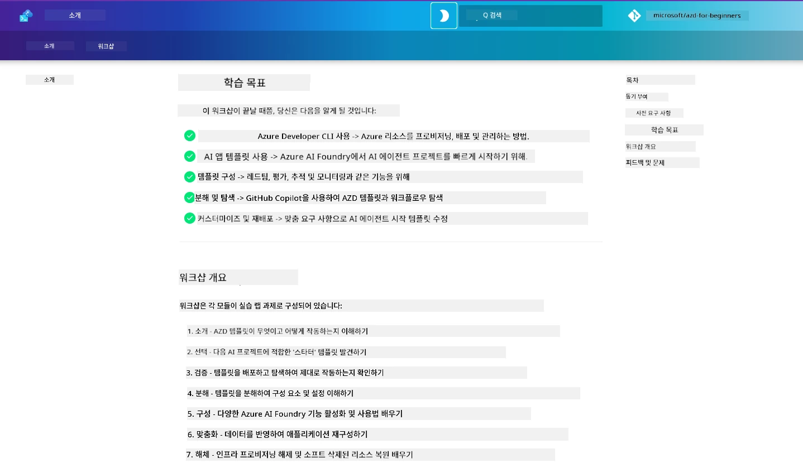

<div align="center">
  <div style="background: linear-gradient(135deg, #0078d4, #106ebe); border-radius: 10px; padding: 20px; margin: 20px 0; box-shadow: 0 4px 15px rgba(0, 120, 212, 0.3); border: 2px solid #005a9e;">
    <h2 style="color: white; margin: 0; font-size: 24px; text-shadow: 1px 1px 2px rgba(0,0,0,0.3);">
      🎯 AI 개발자를 위한 AZD 워크숍
    </h2>
    <p style="color: white; margin: 10px 0 0 0; font-size: 16px; text-shadow: 1px 1px 2px rgba(0,0,0,0.3);">
      <strong>Azure Developer CLI를 사용해 AI 애플리케이션을 구축하는 실습 워크숍입니다.</strong><br>
      총 7개의 모듈을 완료하여 AZD 템플릿과 AI 배포 워크플로를 마스터하세요.
    </p>
    <div style="margin-top: 15px;">
      <span style="background: rgba(255,255,255,0.2); padding: 5px 10px; border-radius: 15px; color: white; font-size: 14px;">
        📅 출처 안내 검토일: 2026년 11월
      </span>
    </div>
  </div>
</div>

# AI 개발자를 위한 AZD 워크숍

AI 애플리케이션 배포에 중점을 둔 Azure Developer CLI(AZD) 학습을 위한 실습 워크숍에 오신 것을 환영합니다. 이 워크숍은 3단계로 AZD 템플릿에 대한 적용된 이해를 돕습니다:

1. <strong>발견</strong> - 내게 적합한 템플릿을 찾기.
1. <strong>배포</strong> - 배포하고 정상 작동하는지 검증
1. **사용자 지정** - 수정 및 반복하여 나만의 것으로 만들기!

워크숍 전반에 걸쳐 핵심 개발 도구 및 워크플로도 소개되어, 종단 간 개발 여정을 간소화할 수 있게 도와드립니다.

<br/>

## 브라우저 기반 가이드

워크숍 수업은 Markdown으로 되어 있습니다. GitHub에서 직접 탐색하거나 아래 스크린샷과 같이 브라우저 기반 미리보기를 실행할 수 있습니다.



이 옵션을 사용하려면 - 리포지토리를 내 프로필로 포크한 후 GitHub Codespaces를 실행하세요. VS Code 터미널이 활성화되면 다음 명령을 입력합니다:

이 브라우저 미리보기는 GitHub Codespaces, 개발 컨테이너 또는 Python과 MkDocs가 설치된 로컬 클론에서 작동합니다.

```bash title="" linenums="0"
python -m pip install -r requirements-dev.txt
python -m mkdocs serve --config-file workshop/mkdocs.yml
```

명령은 별도 초기화된 AI 샘플이 아닌 <strong>과정 리포지토리 루트</strong>에서 실행하세요. 미리보기를 전면에 두어 오류가 보이도록 하고, Ctrl+C로 중지하세요. 사이트를 서빙하지 않고 확인하려면 `python -m mkdocs build --strict --config-file workshop/mkdocs.yml`을 실행하세요.

몇 초 후 팝업 대화상자가 나타납니다. `Open in browser` 옵션을 선택하세요. 웹 기반 가이드가 새 브라우저 탭에서 열립니다. 이 미리보기의 장점은:

1. **내장 검색** - 키워드나 수업을 빠르게 찾기.
1. **복사 아이콘** - 코드 블록에 마우스를 올려 이 옵션 보기
1. **테마 전환** - 다크/라이트 테마 전환
1. **도움 받기** - 풋터의 Discord 아이콘을 클릭해 참여!

<br/>

## 워크숍 개요

**소요 시간:** 3~4시간  
**난이도:** 초급에서 중급  
**필수 조건:** Azure, AI 개념, VS Code 및 커맨드라인 도구에 대한 친숙함.

이 워크숍은 직접 배우는 실습 형태입니다. 연습을 완료한 후에는 보안을 포함한 생산성 모범 사례 학습을 계속하기 위해 AZD 초보자 커리큘럼을 검토하는 것을 권장합니다.

| 시간| 모듈  | 목표 |
|:---|:---|:---|
| 15 분 | [소개](docs/instructions/0-Introduction.md) | 목표 설정 및 이해 |
| 30 분 | [AI 템플릿 선택](docs/instructions/1-Select-AI-Template.md) | 옵션 탐색 및 시작 템플릿 선택 | 
| 30 분 | [AI 템플릿 검증](docs/instructions/2-Validate-AI-Template.md) | 기본 솔루션을 Azure에 배포하기 |
| 30 분 | [AI 템플릿 분해](docs/instructions/3-Deconstruct-AI-Template.md) | 구조 및 설정 탐색 |
| 30 분 | [AI 템플릿 구성](docs/instructions/4-Configure-AI-Template.md) | 기능 활성화 및 체험 |
| 30 분 | [AI 템플릿 사용자 지정](docs/instructions/5-Customize-AI-Template.md) | 템플릿을 내 필요에 맞게 변경 |
| 30 분 | [인프라 해체](docs/instructions/6-Teardown-Infrastructure.md) | 정리 및 리소스 해제 |
| 15 분 | [마무리 및 다음 단계](docs/instructions/7-Wrap-up.md) | 학습 자료, 워크숍 미션 |

<br/>

## 주요 학습 내용

AZD 템플릿을 Microsoft Foundry에서 종단 간 개발을 위한 다양한 기능과 도구를 탐구하는 학습 샌드박스로 생각하세요. 이 워크숍이 완료되면 해당 맥락의 여러 도구와 개념에 대해 직관적으로 이해할 수 있을 것입니다.

| 개념  | 목표 |
|:---|:---|
| **Azure Developer CLI** | 도구 명령어와 워크플로 이해 |
| **AZD 템플릿** | 프로젝트 구조 및 구성 이해 |
| **Azure AI 에이전트** | Microsoft Foundry 프로젝트 프로비저닝 및 배포 |
| **Azure AI 검색** | 에이전트와 함께 컨텍스트 엔지니어링 활성화 |
| <strong>관측성</strong> | 추적, 모니터링 및 평가 탐구 |
| <strong>레드팀</strong> | 적대적 테스트와 완화책 탐구 |

<br/>

## 워크숍 구성

워크숍은 템플릿 발견부터 배포, 분해, 사용자 지정까지 여정을 따라 진행되며, 공식 [AI 에이전트 시작하기](https://github.com/Azure-Samples/get-started-with-ai-agents) 시작 템플릿을 기반으로 합니다.

### [모듈 1: AI 템플릿 선택](docs/instructions/1-Select-AI-Template.md) (30분)

- AI 템플릿이란 무엇인가?
- AI 템플릿은 어디서 찾을 수 있는가?
- AI 에이전트 구축을 어떻게 시작할 수 있나?
- <strong>실습</strong>: Codespaces 또는 개발 컨테이너에서 빠른 시작

### [모듈 2: AI 템플릿 검증](docs/instructions/2-Validate-AI-Template.md) (30분)

- AI 템플릿 아키텍처란?
- AZD 개발 워크플로는?
- AZD 개발 도움 받는 방법은?
- <strong>실습</strong>: AI 에이전트 템플릿 배포 & 검증

### [모듈 3: AI 템플릿 분해](docs/instructions/3-Deconstruct-AI-Template.md) (30분)

- `.azure/`에서 환경 탐색
- `infra/`에서 리소스 설정 탐색
- `azure.yaml`에서 AZD 구성 탐색
- <strong>실습</strong>: 환경 변수 수정 및 재배포

### [모듈 4: AI 템플릿 구성](docs/instructions/4-Configure-AI-Template.md) (30분)
- 탐색: 검색 증강 생성(RAG)
- 탐색: 에이전트 평가 및 레드팀
- 탐색: 추적 및 모니터링
- <strong>실습</strong>: AI 에이전트 및 관측성 탐험

### [모듈 5: AI 템플릿 사용자 지정](docs/instructions/5-Customize-AI-Template.md) (30분)
- 정의: 시나리오 요구사항 PRD
- 구성: AZD 환경 변수
- 구현: 추가 작업을 위한 라이프사이클 후크
- <strong>실습</strong>: 내 시나리오에 맞게 템플릿 맞춤화

### [모듈 6: 인프라 해체](docs/instructions/6-Teardown-Infrastructure.md) (30분)
- 요약: AZD 템플릿이란?
- 요약: Azure Developer CLI 사용 이유
- 다음 단계: 다른 템플릿 시도!
- <strong>실습</strong>: 인프라 해체 및 정리

<br/>

## 워크숍 미션

더 도전하고 싶나요? 다음은 프로젝트 제안입니다 - 또는 여러분의 아이디어를 공유해 주세요!!

| 프로젝트 | 설명 |
|:---|:---|
|1. **복잡한 AI 템플릿 분해** | 우리가 제시한 워크플로와 도구를 사용하여 다른 AI 솔루션 템플릿을 배포, 검증 및 사용자 지정해 보세요. _무엇을 배웠나요?_|
|2. **나만의 시나리오로 사용자 지정**  | 다른 시나리오에 대한 PRD(제품 요구사항 문서)를 작성해 보세요. 그런 다음 GitHub Copilot을 템플릿 리포지토리의 에이전트 모델에서 사용해 맞춤화 워크플로를 생성하도록 요청하세요. _무엇을 배웠나요? 이 제안을 어떻게 개선할 수 있나요?_|
| | |

## 피드백이 있나요?

1. 이 저장소에 이슈를 게시하고 편의를 위해 `Workshop` 태그를 달아 주세요.
1. Microsoft Foundry Discord에 참여하여 동료와 연결하세요!


| | | 
|:---|:---|
| **📚 과정 홈**| [AZD 초보자용](../README.md)|
| **📖 문서** | [AI 템플릿 시작하기](https://learn.microsoft.com/en-us/azure/ai-foundry/how-to/develop/ai-template-get-started)|
| **🛠️ AI 템플릿** | [Microsoft Foundry 템플릿](https://ai.azure.com/templates) |
|**🚀 다음 단계** | [워크숍 시작하기](#workshop-overview) |
| | |

<br/>

---

**내비게이션:** [메인 코스](../README.md) | [소개](docs/instructions/0-Introduction.md) | [모듈 1: 템플릿 선택](docs/instructions/1-Select-AI-Template.md)

**AZD로 AI 애플리케이션 개발을 시작할 준비가 되셨나요?**

[워크숍 시작하기: 소개 →](docs/instructions/0-Introduction.md)

---

<!-- CO-OP TRANSLATOR DISCLAIMER START -->
**면책 조항**:
이 문서는 AI 번역 서비스 [Co-op Translator](https://github.com/Azure/co-op-translator)를 사용하여 번역되었습니다. 정확성을 기하기 위해 노력하고 있으나, 자동 번역은 오류나 부정확한 부분이 있을 수 있음을 유의하시기 바랍니다. 원본 문서의 원어본이 권위 있는 자료로 간주되어야 합니다. 중요한 정보의 경우, 전문가의 인간 번역을 권장합니다. 이 번역 사용으로 인해 발생하는 오해나 잘못된 해석에 대해 당사는 책임을 지지 않습니다.
<!-- CO-OP TRANSLATOR DISCLAIMER END -->