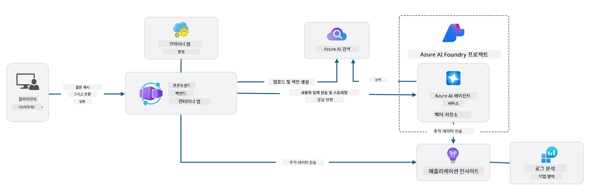

# 3. 템플릿 분석하기

!!! tip "이 모듈을 완료하면 다음을 수행할 수 있습니다"

    - [ ] Use GitHub Copilot and optional MCP tools for Azure documentation and read-only exploration
    - [ ] Identify the template's application, infrastructure, configuration, and test entry points
    - [ ] Verify generated explanations against actual repository files
    - [ ] **Lab 3:** Trace one request and one configuration input through the project

---

## 1. GitHub Copilot 활성화하기

초기화된 AI 샘플을 VS Code에서 열고 [GitHub Copilot](https://code.visualstudio.com/docs/copilot/chat/chat-agent-mode)을 활성화하세요. 적합한 플랜이 있는 계정으로 로그인하세요; 사용 제한이 다릅니다. 변경 권한을 부여하기 전 저장소에 대해 Copilot에게 설명을 요청하세요.

### 선택적 MCP 서버

이 서비스들은 추가 도구를 제공합니다:

- [Azure MCP 서버](https://learn.microsoft.com/azure/developer/azure-mcp-server/overview)
- [Microsoft Learn MCP 서버](https://learn.microsoft.com/training/support/mcp)

VS Code에서 [MCP 구성 지침](https://code.visualstudio.com/docs/copilot/chat/mcp-servers)을 검토하고 필요시 `.vscode/mcp.json`를 생성하세요:

```json
{
  "servers": {
    "Azure MCP Server": {
      "type": "stdio",
      "command": "npx",
      "args": ["-y", "@azure/mcp@latest", "server", "start"]
    },
    "microsoft.docs.mcp": {
      "type": "http",
      "url": "https://learn.microsoft.com/api/mcp"
    }
  }
}
```

`npx` 명령은 지원되는 Node.js/npm 설치가 필요하며 실행 가능한 코드를 다운로드합니다. 패키지를 검토하고 승인된 버전을 고정하여 팀의 재현 가능한 설정을 만드세요. VS Code의 MCP 제어를 사용해 서버를 시작하고 사용 가능한 도구를 확인하세요; 버전마다 이름이 변경될 수 있습니다.

**인증은 별도입니다.** AZD에는 `azd auth login`를 사용하세요. Azure MCP 도구의 인증 절차를 따르세요; AZD 로그인만으로는 MCP 세션이 설정되지 않습니다. 연습 또는 훅 실행 시 Azure CLI가 호출될 때 별도로 `az login`를 사용하세요.

읽기 전용 프롬프트를 시도해보세요:

1. “Microsoft Learn MCP를 사용하여 Azure Developer CLI 구성 문서를 찾아주세요.”
2. “이 저장소의 `azure.yaml`를 설명해 주세요; 각 훅을 구현한 파일을 인용해주세요.”
3. “사용 가능한 Azure MCP 도구를 사용하여 아무 것도 변경하지 않고 내 배포된 리소스를 나열해 주세요.”

선택된 테넌트/구독과 제안된 도구 호출을 검토하세요. 아키텍처 탐색만을 위해 리소스 생성, 삭제 또는 접근 변경을 승인하지 마세요.

## 2. 아키텍처 이해하기

샘플은 Azure Container Apps에 Python FastAPI 백엔드와 React/TypeScript 프런트엔드를 호스팅합니다. 백엔드는 Microsoft Foundry 프로젝트의 에이전트와 통신합니다. 검색 및 관찰 가능성은 활성화된 템플릿 기능과 성공적인 설정에 의존하며, 애플리케이션 배포만으로는 보장되지 않습니다.



이 다이어그램을 [최신 상류 배포 가이드](https://github.com/Azure-Samples/get-started-with-ai-agents/blob/main/docs/deployment.md) 및 실제 리소스와 비교하세요. 구성된 모델 배포, 에이전트 도구, 관리 ID, 역할 할당 및 선택적 AI Search/Application Insights 리소스를 확인하세요.

**연습:** Copilot에게 프런트엔드에서 API를 거쳐 Foundry로의 채팅 요청 경로를 파일 및 함수 참조와 함께 추적하도록 요청하세요. 해당 참조를 열어 설명을 검증하세요. 다이어그램만 보고 인증, 라우팅 또는 권한 부여가 구현되었다고 추론하지 마세요.

## 3. 저장소 구조

다음 선택된 경로들은 2026년 11월 4일 샘플과 대조했습니다. 초기화한 리비전이 최종 기준입니다:

```text
get-started-with-ai-agents/
  azure.yaml
  docker-compose.yaml
  requirements-dev.txt
  .devcontainer/
  infra/
    main.bicep
    main.parameters.json
    api.bicep
    core/
  src/
    Dockerfile
    pyproject.toml
    requirements.txt
    api/
      main.py
      routes.py
      search_index_manager.py
    frontend/
      package.json
      src/
    files/
  scripts/
    validate_env_vars.sh
    validate_env_vars.ps1
    postdeploy.sh
    postdeploy.ps1
  tests/
    test_evaluation.py
    test_red_teaming.py
  docs/
    deployment.md
    deploy_customization.md
    ai_search.md
    observability.md
    local_development.md
    troubleshooting.md
```

### 인프라 및 구성

`infra/main.bicep`는 리소스를 조율하며; `main.parameters.json`는 템플릿 입력을 AZD 환경 값에 연결합니다. `azure.yaml`는 애플리케이션 서비스와 생명주기 훅을 선택합니다. `USE_AZURE_AI_SEARCH_SERVICE` 같은 입력을 이 파일들을 통해 추적하여 실제 변경되는 내용을 찾으세요.

### 애플리케이션 및 ID

`src/api/`와 `src/frontend/`를 함께 읽으세요. 에이전트가 생성되거나 호출되는 위치, 지시사항/도구가 구성되는 위치, 각 Azure 호출에 사용되는 ID를 파악하세요. `src/files/` 아래 샘플 파일들은 데모 데이터이며, 프로덕션 카탈로그나 권한 모델이 아닙니다.

### 테스트 및 관찰 가능성

현재 평가 및 레드-티밍 진입점은 `tests/` 아래 있으며; 이전 `evals/` 및 `airedteaming/` 디렉터리 참조는 이 샘플에서 더 이상 유효하지 않습니다. 클라우드 테스트 실행 전 `docs/observability.md`를 읽어 요구사항 및 비용을 확인하세요. 이 Python 테스트는 선택적 `azure.ai.evaluations` AZD 확장과 별개입니다.

## 4. 확인 사항 검증

- 하나의 샘플 질문에 대해 API 경로, 에이전트 상호작용, 검색 코드를 확인하세요.
- Foundry에 접근하는 ID와 엔드포인트를 선택하는 구성을 설명하세요.
- 실제 사전 배포 및 사후 배포 스크립트와 오류 처리 방식을 찾으세요.
- 배포에 없는 종속성이나 선택적 기능을 나열하세요.

계속해서 [템플릿 구성하기](4-Configure-AI-Template.md)로 진행하세요.

---

<!-- CO-OP TRANSLATOR DISCLAIMER START -->
**면책 조항**:
이 문서는 AI 번역 서비스 [Co-op Translator](https://github.com/Azure/co-op-translator)를 사용하여 번역되었습니다. 정확성을 기하기 위해 노력하고 있으나, 자동 번역은 오류나 부정확한 부분이 있을 수 있음을 유의하시기 바랍니다. 원본 문서의 원어본이 권위 있는 자료로 간주되어야 합니다. 중요한 정보의 경우, 전문가의 인간 번역을 권장합니다. 이 번역 사용으로 인해 발생하는 오해나 잘못된 해석에 대해 당사는 책임을 지지 않습니다.
<!-- CO-OP TRANSLATOR DISCLAIMER END -->