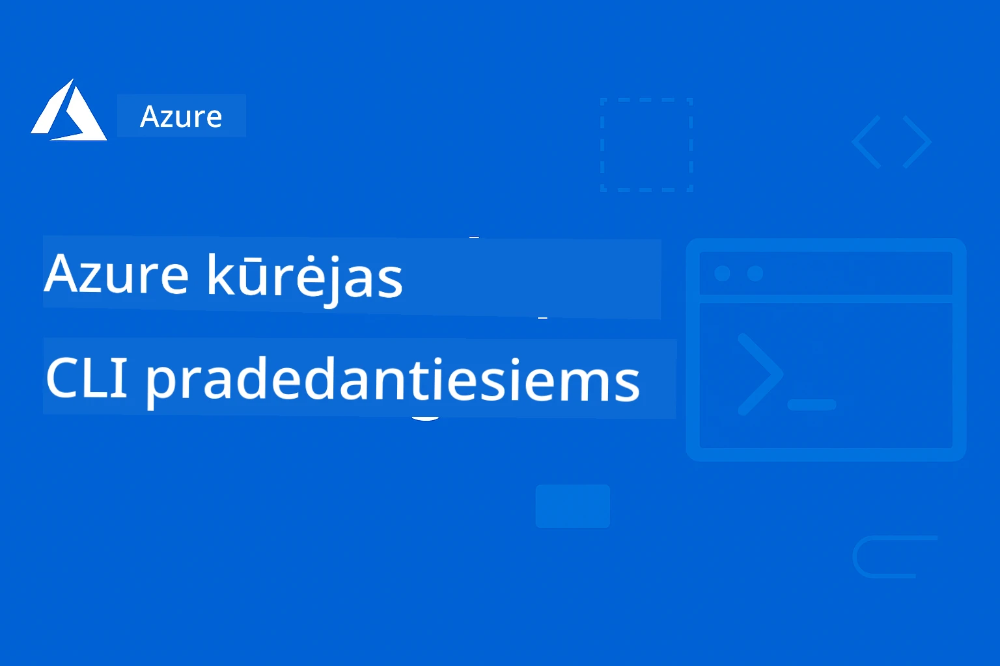

# AZD Pradedantiesiems: Struktūruota mokymosi kelionė

 

[](https://github.com/microsoft/AZD-for-beginners)
[](https://GitHub.com/microsoft/azd-for-beginners/network/)
[](https://github.com/microsoft/AZD-for-beginners)

[](https://discord.com/invite/nkVh3dp)
[](https://discord.gg/nTYy5BXMWG)

---

### Automatiniai vertimai (Visada atnaujinti)

<!-- CO-OP TRANSLATOR LANGUAGES TABLE START -->
[Arabic](../ar/README.md) | [Bengali](../bn/README.md) | [Bulgarian](../bg/README.md) | [Burmese (Myanmar)](../my/README.md) | [Chinese (Simplified)](../zh-CN/README.md) | [Chinese (Traditional, Hong Kong)](../zh-HK/README.md) | [Chinese (Traditional, Macau)](../zh-MO/README.md) | [Chinese (Traditional, Taiwan)](../zh-TW/README.md) | [Croatian](../hr/README.md) | [Czech](../cs/README.md) | [Danish](../da/README.md) | [Dutch](../nl/README.md) | [Estonian](../et/README.md) | [Finnish](../fi/README.md) | [French](../fr/README.md) | [German](../de/README.md) | [Greek](../el/README.md) | [Hebrew](../he/README.md) | [Hindi](../hi/README.md) | [Hungarian](../hu/README.md) | [Indonesian](../id/README.md) | [Italian](../it/README.md) | [Japanese](../ja/README.md) | [Kannada](../kn/README.md) | [Khmer](../km/README.md) | [Korean](../ko/README.md) | [Lithuanian](./README.md) | [Malay](../ms/README.md) | [Malayalam](../ml/README.md) | [Manipuri (Meitei Mayek)](../mni/README.md) | [Marathi](../mr/README.md) | [Nepali](../ne/README.md) | [Nigerian Pidgin](../pcm/README.md) | [Norwegian](../no/README.md) | [Persian (Farsi)](../fa/README.md) | [Polish](../pl/README.md) | [Portuguese (Brazil)](../pt-BR/README.md) | [Portuguese (Portugal)](../pt-PT/README.md) | [Punjabi (Gurmukhi)](../pa/README.md) | [Romanian](../ro/README.md) | [Russian](../ru/README.md) | [Serbian (Cyrillic)](../sr/README.md) | [Slovak](../sk/README.md) | [Slovenian](../sl/README.md) | [Spanish](../es/README.md) | [Swahili](../sw/README.md) | [Swedish](../sv/README.md) | [Tagalog (Filipino)](../tl/README.md) | [Tamil](../ta/README.md) | [Telugu](../te/README.md) | [Thai](../th/README.md) | [Turkish](../tr/README.md) | [Ukrainian](../uk/README.md) | [Urdu](../ur/README.md) | [Vietnamese](../vi/README.md)

> **Norite kopijuoti vietoje?**
>
> Šis saugykla apima daugiau nei 50 kalbų vertimus, kurie ženkliai padidina atsisiuntimo dydį. Norėdami nukopijuoti be vertimų, naudokite sparse checkout:
>
> **Bash / macOS / Linux:**
> ```bash
> git clone --filter=blob:none --sparse https://github.com/microsoft/AZD-for-beginners.git
> cd AZD-for-beginners
> git sparse-checkout set --no-cone '/*' '!translations' '!translated_images'
> ```
>
> **CMD (Windows):**
> ```cmd
> git clone --filter=blob:none --sparse https://github.com/microsoft/AZD-for-beginners.git
> cd AZD-for-beginners
> git sparse-checkout set --no-cone "/*" "!translations" "!translated_images"
> ```
>
> Tai suteikia viską, ko reikia kursui baigti, su daug greitesniu atsisiuntimu.
<!-- CO-OP TRANSLATOR LANGUAGES TABLE END -->

## 🆕 Kas naujo azd šiandien

> 📌 **AI CLI leidimo apžvalga (2026-11-04):** Vadovas patikrintas pagal paskelbtus **`azd 1.37.2`**, **agents `1.0.0-beta.23`** ir **evaluations `1.0.0-beta.2`** dokumentacijos / šaltinių šaltinius. Naudokite `azd >= 1.37.0` suderintam darbo eigai. Paleiskite `azd version` ir [atnaujinkite pagrindinį CLI](https://learn.microsoft.com/azure/developer/azure-developer-cli/install-azd) prieš plėtinius. Žr. [leidimo pakeitimus ir pataisas](docs/chapter-08-production/production-ai-practices.md#recent-release-changes-and-fixes). Tai nėra viso kurso gyvos diegimo patikra.

Azure Developer CLI palaiko daug programų tipų, įskaitant internetines programas, API ir AI agentus, per palaikomas platformas, šablonus ir plėtinius.

Štai ką tai reiškia jums:

- **AI agentai dabar yra pirmos klasės azd darbo užduotys.** Galite inicializuoti, diegti ir valdyti AI agentų projektus naudodami tą patį `azd init` → `azd up` darbo eigą, kurią jau pažįstate.
- **Agentų gyvavimo ciklas per du plėtinius.** Naudokite `azure.ai.agents` agentams inicializuoti, paleisti, optimizuoti ir pensijuoti. Įdiekite atskirai **`azure.ai.evaluations`** už `azd ai eval init`, `generate` ir `run start`. Agentų beta.22 pakeitė senąją vertinimo darbo eigą ir pakeitė optimizavimo konfigūraciją; sekite [migracijos gidą](docs/chapter-08-production/production-ai-practices.md#evaluation-migration-and-quality-checks).
- **Daugiau AI statybinių blokų.** Nauji peržiūros plėtiniai — `azure.ai.skills` ir `azure.ai.connections` — leidžia valdyti pakartotinai naudojamus agentų įgūdžius ir Foundry ryšius tiesiogiai su azd.
- **Microsoft Foundry integracija** atneša modelio diegimą, agentų talpinimą ir AI paslaugų konfigūraciją tiesiogiai į azd šablonų ekosistemą.
- **Paprastesnės kasdienės pagrindinės funkcijos.** Naujausi leidimai padarė `azd init` idempotentinį (saugų pakartotinį paleidimą), auto-tikrina pasenusį `azd auth login` žetonus ir pridėjo draugišką `azd tool` pirmojo paleidimo nustatymo raginimą.
- **Pagrindinė darbo eiga nepasikeitė.** Nesvarbu, ar diegiate todo programėlę, mikroservisą ar daugagentinį AI sprendimą, komandos yra tos pačios.

> **Pastaba Aspire naudotojams:** Microsoft dabar produktą vadina tiesiog **Aspire** (anksčiau ".NET Aspire"). azd Aspire palaikymas nepasikeitė – tik atnaujintas pavadinimas.

Jei anksčiau naudojote azd, AI palaikymas yra natūrali išplėtimo dalis — ne atskiras įrankis ar pažengęs kelias. Jei pradedate naujai, išmoksite vieną darbo eigą, veikiančią viskam.

---

## 🚀 Kas yra Azure Developer CLI (azd)?

**Azure Developer CLI (azd)** yra programuotojams draugiškas komandų eilutės įrankis, supaprastinantis programų diegimą į Azure. Vietoj to, kad rankiniu būdu kurtumėte ir sujungtumėte dešimtis Azure išteklių, galite visą programą diegti viena komanda.

### Magija vadinasi `azd up`

```bash
# This single command does everything:
# ✅ Creates all Azure resources  
# ✅ Configures networking and security
# ✅ Builds your application code
# ✅ Deploys to Azure
# ✅ Gives you a working URL
azd up
```

Šablonas tiekia programos ir infrastruktūros konfigūraciją. Sėkmingam diegimui vis tiek reikia palaikomų paslaugų/modelių, pakankamų kvotų ir leidimų, teisingų įvestų duomenų ir patvirtinimo, kad programa veikia. `azd up` automatiškai nepadaro šablono saugiu, atitinkančiu ar gamybinės kokybės.

---

## ❓ Azure Developer CLI ar Azure CLI: Kuo skiriasi?

Tai dažniausias klausimas pradedantiesiems. Štai paprastas atsakymas:

| Funkcija | **Azure CLI (`az`)** | **Azure Developer CLI (`azd`)** |
|---------|---------------------|--------------------------------|
| **Tikslas** | Valdyti atskirus Azure išteklius | Diegti pilnas programas |
| **Mąstymas** | Į infrastruktūrą orientuotas | Į programą orientuotas |
| **Pavyzdys** | `az webapp create --name myapp...` | `azd up` |
| **Mokymosi kreivė** | Reikia žinoti Azure paslaugas | Tereikia žinoti savo programą |
| **Verta naudoti** | DevOps, infrastruktūra | Programuotojams, prototipavimui |

### Paprastas palyginimas

- **Azure CLI** - tai kaip turėti visus įrankius namui statyti - plaktukus, pjūklus, vinis. Galite pastatyti bet ką, bet turite mokėti statybą.
- **Azure Developer CLI** - tai kaip samdyti rangovą - jūs aprašote, ko norite, o jis atlieka statybas.

### Kada naudoti kurį

| Scenarijus | Naudokite šį |
|----------|----------|
| „Noriu greitai įdiegti savo internetinę programą“ | `azd up` |
| „Turiu sukurti tik saugyklos paskyrą“ | `az storage account create` |
| „Kuriu pilną AI programą“ | `azd init --template azure-search-openai-demo` |
| „Turiu derinti konkretų Azure išteklių“ | `az resource show` |
| „Noriu diegti į savo sukonfigūruotą gamybos aplinką“ | Prieš `azd up --environment production` peržiūrėkite konfigūraciją, prieigos, sąnaudų ir operacinius reikalavimus |

### Jie dirba kartu!

AZD ir Azure CLI turi atskirą autentifikaciją ir konfigūraciją. Naudokite `azd auth login` AZD, o kai reikalinga įžeidimo ar diagnostikos komanda, kuri aiškiai reikalauja Azure CLI, naudokite `az login`. Galite naudoti abu:
```bash
# Deploy your app with AZD
azd up

# Then fine-tune specific resources with Azure CLI
az webapp config set --name myapp --always-on true
```

---

## 🌟 Raskite šablonus Awesome AZD

Neskubėkite pradėti nuo nulio! **Awesome AZD** yra bendruomenės kolekcija paruoštų naudoti diegimo šablonų:

| Ištekliai | Aprašymas |
|----------|-------------|
| 🔗 [**Awesome AZD galerija**](https://azure.github.io/awesome-azd/) | Naršykite daugiau nei 200 šablonų su vieno paspaudimo diegimu |
| 🔗 [**Pateikti šabloną**](https://github.com/Azure/awesome-azd/issues) | Prisidėkite savo šablonu bendruomenei |
| 🔗 [**GitHub saugykla**](https://github.com/Azure/awesome-azd) | Pažymėkite žvaigždute ir tyrinėkite šaltinius |

### Populiarūs AI šablonai iš Awesome AZD

Pasirinkite vieną šabloną savo tuščiame kataloge; žemiau pateiktos komandos yra alternatyvos. Pabaigoje esantis `.` inicializuoja tą katalogą.

```bash
# RAG Chat with Microsoft Foundry Models + AI Search
azd init --template azure-search-openai-demo .

# Quick AI Chat Application
azd init --template openai-chat-app-quickstart .

# AI Agents with Foundry Agents
azd init --template get-started-with-ai-agents .
```

---

## 🎯 Pradėkite per 3 žingsnius

Prieš pradedant, įsitikinkite, kad jūsų įrenginys pasiruošęs šablonui, kurį norite diegti:

**Windows:**
```powershell
.\validate-setup.ps1
```

**macOS / Linux:**
```bash
bash ./validate-setup.sh
```

Jei kas nors iš būtinu patikrinimų nepavyksta, pirmiausia išspręskite tą problemą, tada tęskite greitai pradžiai.

### Žingsnis 1: Įdiekite AZD (2 minutės)

**Windows:**
```powershell
winget install microsoft.azd
```

**macOS:**
```bash
brew tap azure/azd && brew install azd
```

**Linux:**
```bash
curl -fsSL https://aka.ms/install-azd.sh | bash
```

### Žingsnis 2: Autentifikacija AZD

```bash
# Optional if you plan to use Azure CLI commands directly in this course
az login

# Required for AZD workflows
azd auth login
```

Jei nesate tikri, kurio jums reikia, sekite visą nustatymo procesą [Instaliavimas ir konfigūracija](docs/chapter-01-foundation/installation.md#authentication-setup).

### Žingsnis 3: Įdiekite savo pirmąją programą

```bash
# Initialize from a template
azd init --template todo-nodejs-mongo .

# Deploy to Azure (creates everything!)
azd up
```

**🎉 Viskas!** Jūsų programa dabar veikia Azure.

### Išvalymas (Nepamirškite!)

```bash
# Remove all resources when done experimenting
azd down --force --purge
```

---

## 📚 Kaip naudotis šiuo kursu

Šis kursas yra skirtas **progresyviam mokymuisi** – pradėkite nuo to, kas jums patogu, ir žingsnis po žingsnio tobulėkite:

| Jūsų patirtis | Pradėkite čia |
|-----------------|------------|
| **Naujas Azure naudotojas** | [1 skyrius: Pagrindai](#-chapter-1-foundation--quick-start) |
| **Pažįsta Azure, bet ne AZD** | [1 skyrius: Pagrindai](#-chapter-1-foundation--quick-start) |
| **Nori diegti AI programas** | [2 skyrius: AI-pirmasis vystymas](#-chapter-2-ai-first-development-recommended-for-ai-developers) |
| **Nori praktinių užsiėmimų** | [🎓 Interaktyvus seminaras](workshop/README.md) – 3-4 valandų vedama laboratorija |
| **Reikia gamybinių modelių** | [8 skyrius: Gamyba ir įmonės](#-chapter-8-production--enterprise-patterns) |

### Greitas nustatymas

1. **Padarykite šaką šioje saugykloje**: [](https://GitHub.com/microsoft/azd-for-beginners/fork)
2. **Klonuokite ją**: `git clone https://github.com/YOUR-USERNAME/azd-for-beginners.git`
3. **Gaukite pagalbą**: [Azure Discord bendruomenė](https://discord.com/invite/ByRwuEEgH4)

> **Norite kopijuoti vietoje?**

> Ši saugykla apima daugiau nei 50 kalbų vertimus, kurie ženkliai padidina atsisiuntimo dydį. Norėdami nukopijuoti be vertimų, naudokite sparse checkout:
> ```bash
> git clone --filter=blob:none --sparse https://github.com/microsoft/AZD-for-beginners.git
> cd AZD-for-beginners
> git sparse-checkout set --no-cone '/*' '!translations' '!translated_images'
> ```
> Tai suteikia jums viską, ko reikia kursui užbaigti daug greitesniu atsisiuntimu.


## Kurso apžvalga

Paversti Azure Developer CLI (azd) meistru per struktūrizuotus skyrius, skirtus palaipsniam mokymuisi. **Ypatingas dėmesys AI programų diegimui su Microsoft Foundry integracija.**

### Kodėl šis kursas yra būtinas šiuolaikiniams kūrėjams

AI darbų kūrėjams dažnai reikia pagalbos dėl:
- Sudėtingos daugiapakopės AI paslaugų architektūros
- Geriausia praktika AI gamybos diegimui  
- Azure AI paslaugų integracija ir konfigūracija
- AI darbų kaštų optimizavimas
- AI diegimo problemų trikčių šalinimas

### Mokymosi tikslai

Baigę šį struktūrizuotą kursą, jūs:
- **Išmoksite AZD pagrindus**: Pagrindinės sąvokos, diegimas ir konfigūracija
- **Diegsite AI programas**: Naudosite AZD kartu su Microsoft Foundry paslaugomis
- **Įdiegsit infrastruktūrą kaip kodą**: Valdykite Azure išteklius su Bicep šablonais
- **Spręsite diegimo problemas**: Išspręsite dažnas problemas ir derinsite gedimus
- **Optimizuosite gamybai**: Saugumas, skalavimas, stebėjimas ir sąnaudų valdymas
- **Kursite daugiapakopes agentų sprendimus**: Diegsite sudėtingas AI architektūras

## Prieš pradedant: paskyros, prieiga ir prielaidos

Prieš pradėdami 1 skyrių, įsitikinkite, kad turite šiuos dalykus. Diegimo žingsniai šiame vadove daro prielaidą, kad šie pagrindai jau sutvarkyti.

- **Azure prenumerata**: Galite naudoti esamą prenumeratą iš darbo ar savo paskyros arba sukurti [nemokamą bandomąją versiją](https://aka.ms/azurefreetrial) pradžiai.
- **Leidimas kurti Azure išteklius**: Daugumai užduočių reikėtų bent **Bendradarbio** prieigos prie tikslinės prenumeratos ar išteklių grupės. Kai kurie skyriai taip pat gali reikalauti galimybės kurti išteklių grupes, valdomas tapatybes ir RBAC priskyrimus.
- [**GitHub paskyra**](https://github.com): Tai naudinga atsisiuntimui iš saugyklos, nuosaviems pakeitimams sekti ir GitHub Codespaces naudojimui dirbtuvių metu.
- **Šablonų vykdymo prielaidos**: Kai kuriems šablonams reikalingi vietiniai įrankiai, tokie kaip Node.js, Python, Java ar Docker. Prieš pradėdami patikrinkite, ar turite reikiamus įrankius.
- **Pagrindinės terminalo žinios**: Nebūtina būti ekspertu, tačiau turėtumėte patogiai valdyti komandų, pvz., `git clone`, `azd auth login` ir `azd up`, vykdymą.

> **Dirbate įmonės prenumeratoje?**
> Jei jūsų Azure aplinką valdo administratorius, iš anksto patikrinkite, ar galite diegti išteklius pasirinktoje prenumeratoje ar išteklių grupėje. Jei ne, paprašykite smėlio dėžės prenumeratos arba Bendradarbio prieigos prieš pradėdami.

> **Naujas Azure vartotojas?**
> Pradėkite nuo asmeninės Azure bandomosios ar mokėkite už naudojimąsi prenumerata adresu https://aka.ms/azurefreetrial, kad galėtumėte pilnai atlikti užduotis nekliudomi laukti nuomininko patvirtinimų.

## 🗺️ Kurso žemėlapis: greita navigacija pagal skyrių

Kiekvienas skyrius turi savo README su mokymosi tikslais, pradžios instrukcijomis ir užduotimis:

| Skyrius | Tema | Pamokos | Trukmė | Sudėtingumas |
|---------|-------|---------|----------|------------|
| **[1 skyrius: Pagrindai](docs/chapter-01-foundation/README.md)** | Pradžia | [AZD pagrindai](docs/chapter-01-foundation/azd-basics.md) &#124; [Diegimas](docs/chapter-01-foundation/installation.md) &#124; [Pirmas projektas](docs/chapter-01-foundation/first-project.md) | 30-45 min | ⭐ |
| **[2 skyrius: AI kūrimas](docs/chapter-02-ai-development/README.md)** | AI-first programos | [Foundry integracija](docs/chapter-02-ai-development/microsoft-foundry-integration.md) &#124; [AI agentai](docs/chapter-02-ai-development/agents.md) &#124; [Modelio diegimas](docs/chapter-02-ai-development/ai-model-deployment.md) &#124; [Dirbtuvės](docs/chapter-02-ai-development/ai-workshop-lab.md) | 1-2 val | ⭐⭐ |
| **[3 skyrius: Konfigūracija](docs/chapter-03-configuration/README.md)** | Autentifikacija ir saugumas | [Konfigūracija](docs/chapter-03-configuration/configuration.md) &#124; [Autentifikacija ir saugumas](docs/chapter-03-configuration/authsecurity.md) | 45-60 min | ⭐⭐ |
| **[4 skyrius: Infrastruktūra](docs/chapter-04-infrastructure/README.md)** | IaC ir diegimas | [Diegimo vadovas](docs/chapter-04-infrastructure/deployment-guide.md) &#124; [Resursų paruošimas](docs/chapter-04-infrastructure/provisioning.md) | 1-1.5 val | ⭐⭐⭐ |
| **[5 skyrius: Daugiapakopiai agentai](docs/chapter-05-multi-agent/README.md)** | AI agentų sprendimai | [Mažmeninės prekybos scenarijus](examples/retail-scenario.md) &#124; [Koordinavimo šablonai](docs/chapter-06-pre-deployment/coordination-patterns.md) | 2-3 val | ⭐⭐⭐⭐ |
| **[6 skyrius: Prieš diegimą](docs/chapter-06-pre-deployment/README.md)** | Planavimas ir patikra | [Prieš skrydžio patikros](docs/chapter-06-pre-deployment/preflight-checks.md) &#124; [Talpos planavimas](docs/chapter-06-pre-deployment/capacity-planning.md) &#124; [SKU parinkimas](docs/chapter-06-pre-deployment/sku-selection.md) &#124; [Programų analizė](docs/chapter-06-pre-deployment/application-insights.md) | 1 val | ⭐⭐ |
| **[7 skyrius: Trikčių šalinimas](docs/chapter-07-troubleshooting/README.md)** | Derinimas ir taisymas | [Dažnos problemos](docs/chapter-07-troubleshooting/common-issues.md) &#124; [Derinimas](docs/chapter-07-troubleshooting/debugging.md) &#124; [AI problemos](docs/chapter-07-troubleshooting/ai-troubleshooting.md) | 1-1.5 val | ⭐⭐ |
| **[8 skyrius: Gamyba](docs/chapter-08-production/README.md)** | Įmonių šablonai | [Gamybos praktikos](docs/chapter-08-production/production-ai-practices.md) | 2-3 val | ⭐⭐⭐⭐ |
| **[🎓 Dirbtuvės](workshop/README.md)** | Praktika | [Įvadas](workshop/docs/instructions/0-Introduction.md) &#124; [Pasirinkimas](workshop/docs/instructions/1-Select-AI-Template.md) &#124; [Patikra](workshop/docs/instructions/2-Validate-AI-Template.md) &#124; [Išardymas](workshop/docs/instructions/3-Deconstruct-AI-Template.md) &#124; [Konfigūracija](workshop/docs/instructions/4-Configure-AI-Template.md) &#124; [Pritaikymas](workshop/docs/instructions/5-Customize-AI-Template.md) &#124; [Išardymas](workshop/docs/instructions/6-Teardown-Infrastructure.md) &#124; [Apibendrinimas](workshop/docs/instructions/7-Wrap-up.md) | 3-4 val | ⭐⭐ |

**Bendras kurso laikas:** ~10-14 val | **Įgūdžių lygio progresas:** Pradedantysis → Gamybai paruoštas

---

## 📚 Mokymosi skyriai

*Pasirinkite mokymosi kelią pagal patirties lygį ir tikslus*

### 🚀 1 skyrius: Pagrindai ir greitas startas
**Reikalavimai**: Azure prenumerata, pagrindinės komandų eilutės žinios  
**Trukmė**: 30-45 minutės  
**Sudėtingumas**: ⭐

#### Ko išmoksite
- Suprasti Azure Developer CLI pagrindus
- Įdiegti AZD jūsų platformoje
- Pirmasis sėkmingas diegimas

#### Mokymosi šaltiniai
- **🎯 Pradėkite čia**: [Kas yra Azure Developer CLI?](#-what-is-azure-developer-cli-azd)
- **📖 Teorija**: [AZD pagrindai](docs/chapter-01-foundation/azd-basics.md) - Pagrindinės sąvokos ir terminai
- **⚙️ Diegimas**: [Diegimo ir nustatymo vadovas](docs/chapter-01-foundation/installation.md) - Platformos specifiniai vadovai
- **🛠️ Praktika**: [Jūsų pirmasis projektas](docs/chapter-01-foundation/first-project.md) - Žingsnis po žingsnio pamoka
- **📋 Greitoji nuoroda**: [Komandų suvestinė](resources/cheat-sheet.md)

#### Praktinės užduotys
```bash
# Quick installation check
azd version

# Deploy your first application
azd init --template todo-nodejs-mongo .
azd up
```

**💡 Skyriaus rezultatas**: Sėkmingai diegti paprastą žiniatinklio programą Azure naudojant AZD

**✅ Sėkmės patikra:**
```bash
# After completing Chapter 1, you should be able to:
azd version              # Shows installed version
azd init --template todo-nodejs-mongo  # Initializes project
azd up                  # Deploys to Azure
azd show                # Displays running app URL
# Application opens in browser and works
azd down --force --purge  # Cleans up resources
```

**📊 Laiko investicija:** 30-45 minutės  
**📈 Įgūdžių lygis po**: Galite savarankiškai diegti paprastas programas

---

### 🤖 2 skyrius: AI-first kūrimas (Rekomenduojama AI kūrėjams)
**Reikalavimai**: Užbaigtas 1 skyrius  
**Trukmė**: 1-2 valandos  
**Sudėtingumas**: ⭐⭐

#### Ko išmoksite
- Microsoft Foundry integracija su AZD
- AI pagrįstų programų diegimas
- Suprasti AI paslaugų konfigūracijas

#### Mokymosi šaltiniai
- **🎯 Pradėkite čia**: [Microsoft Foundry integracija](docs/chapter-02-ai-development/microsoft-foundry-integration.md)
- **🤖 AI agentai**: [AI agentų vadovas](docs/chapter-02-ai-development/agents.md) - Diegti protingus agentus su AZD
- **📖 Šablonai**: [AI modelio diegimas](docs/chapter-02-ai-development/ai-model-deployment.md) - Diegti ir valdyti AI modelius
- **🛠️ Dirbtuvės**: [AI dirbtuvių laboratorija](docs/chapter-02-ai-development/ai-workshop-lab.md) - Paruoškite savo AI sprendimus naudoti AZD
- **🎥 Interaktyvus vadovas**: [Dirbtuvių medžiaga](workshop/README.md) - Naršyklės pagrindu mokymasis su MkDocs * DevContainer aplinka
- **📋 Šablonai**: [Microsoft Foundry šablonai](#featured-microsoft-foundry-templates)
- **📝 Pavyzdžiai**: [AZD diegimo pavyzdžiai](examples/README.md)

#### Praktinės užduotys
```bash
# Deploy your first AI application
azd init --template azure-search-openai-demo .
azd up

# Try additional AI templates
azd init --template openai-chat-app-quickstart .
azd init --template agent-openai-python-prompty .
```

**💡 Skyriaus rezultatas**: Diegti ir konfigūruoti AI pokalbių programą su RAG galimybėmis

**✅ Sėkmės patikra:**
```bash
# After Chapter 2, you should be able to:
azd init --template azure-search-openai-demo .
azd up
# Test the AI chat interface
# Ask questions and get AI-powered responses with sources
# Verify search integration works
azd monitor  # Check Application Insights shows telemetry
azd down --force --purge
```

**📊 Laiko investicija:** 1-2 valandos  
**📈 Įgūdžių lygis po:** Galite diegti AI mokymosi programas ir atpažinti papildomus gamybai paruoštumo reikalavimus
**💰 Sąnaudų suvokimas:** Suprasti $80-150/mėn kūrimo sąnaudas, $300-3500/mėn gamybos sąnaudas

#### 💰 Sąnaudų svarstymai AI diegimams

**Kūrimo aplinka (apytiksliai $80-150/mėn):**
- Microsoft Foundry modeliai (mokėjimas pagal naudojimą): $0-50/mėn (priklausomai nuo tokenų naudojimo)
- AI paieška (pagrindinė kategorija): $75/mėn
- Konteinerių programos (vartojimo pagrindu): $0-20/mėn
- Saugykla (standartinė): $1-5/mėn

**Gamybos aplinka (apytiksliai $300-3,500+/mėn):**
- Microsoft Foundry modeliai (PTU dėl pastovios diasklės): $3,000+/mėn ARBA Mokėjimas pagal naudojimą su didelio apimties vartojimu
- AI paieška (standartinė kategorija): $250/mėn
- Konteinerių programos (dedikuotos): $50-100/mėn
- Programų analizė: $5-50/mėn
- Saugykla (premium): $10-50/mėn

**💡 Sąnaudų optimizavimo patarimai:**
- Patikrinkite modelio spėjimo kainodara ir paskyros kreditus; Azure OpenAI neturi universalaus 50 000 tokenų mėnesinio nemokamo limito
- Vykdykite `azd down`, kad ištrintumėte išteklius, kai jų nebereikia, patikrinę pasirinktą aplinką
- Pradėkite nuo vartojimu pagrįsto apmokėjimo, PTU pereikite tik gamybai
- Naudokite `azd provision --preview`, kad peržiūrėtumėte numatomą infrastruktūrą, tada įvertinkite išteklius su Azure kainų skaičiuokle
- Įjunkite automatinį skalavimą: mokėkite tik už faktinį naudojimą

**Sąnaudų stebėsena:**
```bash
# Inspect planned resources (this does not calculate prices)
azd provision --preview

# Monitor actual costs in Azure Portal
az consumption budget list --resource-group <your-rg>
```

---

### ⚙️ 3 skyrius: Konfigūracija ir autentifikacija
**Reikalavimai**: Užbaigtas 1 skyrius  
**Trukmė**: 45-60 minučių  
**Sudėtingumas**: ⭐⭐

#### Ko išmoksite
- Aplinkos konfigūracija ir valdymas
- Autentifikacijos ir saugumo geriausia praktika
- Išteklių pavadinimų ir organizavimo taisyklės

#### Mokymosi šaltiniai
- **📖 Konfigūracija**: [Konfigūracijos vadovas](docs/chapter-03-configuration/configuration.md) - Aplinkos paruošimas
- **🔐 Saugumas**: [Autentifikacijos šablonai ir valdomos tapatybės](docs/chapter-03-configuration/authsecurity.md) - Autentifikacijos šablonai
- **📝 Pavyzdžiai**: [Duomenų bazės programos pavyzdys](examples/database-app/README.md) - AZD duomenų bazės pavyzdžiai

#### Praktinės užduotys
- Konfigūruoti kelias aplinkas (vystymas, demonstracija, gamyba)
- Nustatyti valdomas tapatybės autentifikaciją
- Įdiegti aplinkai specifines konfigūracijas

**💡 Skyriaus rezultatas**: Valdyti kelias aplinkas su tinkama autentifikacija ir saugumu

---

### 🏗️ 4 skyrius: Infrastruktūra kaip kodas ir diegimas
**Reikalavimai**: Užbaigti 1-3 skyriai  
**Trukmė**: 1-1.5 valandos  
**Sudėtingumas**: ⭐⭐⭐

#### Ko išmoksite
- Pažangūs diegimo modeliai
- Infrastruktūra kaip kodas su Bicep
- Išteklių paruošimo strategijos

#### Mokymosi šaltiniai
- **📖 Diegimas**: [Diegimo vadovas](docs/chapter-04-infrastructure/deployment-guide.md) - Pilni darbo procesai
- **🏗️ Paruošimas**: [Išteklių paruošimas](docs/chapter-04-infrastructure/provisioning.md) - Azure išteklių valdymas
- **📝 Pavyzdžiai**: [Konteinerių programos pavyzdys](../../examples/container-app) - Konteinerių diegimai

#### Praktinės užduotys
- Kurti pritaikytus Bicep šablonus
- Diegti daugiapakopes paslaugas
- Įdiegti blue-green diegimo strategijas

**💡 Skyriaus rezultatas**: Diegti sudėtingas daugiapakopes programas naudojant pritaikytus infrastruktūros šablonus

---

### 🎯 5 skyrius: Daugiapakopiai AI agentų sprendimai (Pažengęs lygis)
**Reikalavimai**: Užbaigti 1-2 skyriai  
**Trukmė**: 2-3 valandos  
**Sudėtingumas**: ⭐⭐⭐⭐

#### Ko išmoksite
- Daugiapakopės agentų architektūros modeliai
- Agentų orkestravimas ir koordinavimas
- Gamybai paruošti AI diegimai

#### Mokymosi šaltiniai
- **🤖 Pateiktas dizainas**: [Mažmeninės prekybos daugiapakopis agentų sprendimas](examples/retail-scenario.md) - Architektūros brėžinys, nebaigta programa
- **🛠️ ARM Šablonai**: [ARM Šablonų paketas](../../examples/retail-multiagent-arm-template) - Infrastruktūros karkasas; peržiūrėti išankstinius reikalavimus ir trūkstamas programų dalis
- **📖 Architektūra**: [Daugiagentės koordinacijos šablonai](docs/chapter-06-pre-deployment/coordination-patterns.md) - Šablonai

#### Praktiniai užsiėmimai
```bash
# Inspect the retail infrastructure scaffold before choosing to deploy it
cd examples/retail-multiagent-arm-template
cat README.md

# After an intentional deployment, inspect infrastructure state
az deployment group show --resource-group <rg-name> --name <deployment-name>
```

**💡 Skyriaus rezultatas**: Suprasti daugiagentę dizainą ir nustatyti įgyvendinimą, patikrinimą bei veiklos darbus, reikalingus papildomai infrastruktūros karkasui

---

### 🔍 6 skyrius: Išankstinis patikrinimas ir planavimas prieš diegimą
**Išankstiniai reikalavimai**: Baigtas 4 skyrius  
**Trukmė**: 1 valanda  
**Sunkumas**: ⭐⭐

#### Ko išmoksite
- Talpos planavimas ir išteklių patikra
- SKU atrankos strategijos
- Išankstiniai patikrinimai ir automatizavimas

#### Mokymosi ištekliai
- **📊 Planavimas**: [Talpos planavimas](docs/chapter-06-pre-deployment/capacity-planning.md) - Išteklių patikra
- **💰 Atranka**: [SKU atranka](docs/chapter-06-pre-deployment/sku-selection.md) - Ekonomiški pasirinkimai
- **✅ Patikra**: [Išankstiniai patikrinimai](docs/chapter-06-pre-deployment/preflight-checks.md) - Automatizuoti skriptai

#### Praktiniai užsiėmimai
- Vykdyti talpos patikros skriptus
- Optimizuoti SKU atrankas sąnaudų atžvilgiu
- Įgyvendinti automatizuotus išankstinius patikrinimus prieš diegimą

**💡 Skyriaus rezultatas**: Patikrinti ir optimizuoti diegimus prieš vykdymą

---

### 🚨 7 skyrius: Problemų sprendimas ir derinimas
**Išankstiniai reikalavimai**: Užbaigtas bet kuris diegimo skyrius  
**Trukmė**: 1-1.5 valandos  
**Sunkumas**: ⭐⭐

#### Ko išmoksite
- Sistemingas derinimo požiūris
- Paprastos problemos ir sprendimai
- AI specifinis problemų sprendimas

#### Mokymosi ištekliai
- **🔧 Dažnos problemos**: [Dažnos problemos](docs/chapter-07-troubleshooting/common-issues.md) - DUK ir sprendimai
- **🕵️ Derinimas**: [Derinimo vadovas](docs/chapter-07-troubleshooting/debugging.md) - Žingsnis po žingsnio strategijos
- **🤖 AI problemos**: [AI specifinis problemų sprendimas](docs/chapter-07-troubleshooting/ai-troubleshooting.md) - AI paslaugų problemos

#### Praktiniai užsiėmimai
- Diagnostikuoti diegimo gedimus
- Išspręsti autentifikavimo problemas
- Derinti AI paslaugų ryšį

**💡 Skyriaus rezultatas**: Savarankiškai diagnozuoti ir spręsti dažnas diegimo problemas

---

### 🏢 8 skyrius: Produkciniai ir įmonių šablonai
**Išankstiniai reikalavimai**: Baigti 1-4 skyriai  
**Trukmė**: 2-3 valandos  
**Sunkumas**: ⭐⭐⭐⭐

#### Ko išmoksite
- Produkcinio diegimo strategijos
- Įmonių saugumo modeliai
- Stebėjimas ir sąnaudų optimizavimas

#### Mokymosi ištekliai
- **🏭 Produkcija**: [Geriausios AI gamybos praktikos](docs/chapter-08-production/production-ai-practices.md) - Įmonių šablonai
- **📝 Pavyzdžiai**: [Mikropaslaugų pavyzdys](../../examples/microservices) - Sudėtingos architektūros
- **📊 Stebėjimas**: [Application Insights integracija](docs/chapter-06-pre-deployment/application-insights.md) - Stebėjimas

#### Praktiniai užsiėmimai
- Įgyvendinti įmonių saugumo šablonus
- Užtikrinti išsamų stebėjimą
- Diegti į produkciją su tinkamu valdymu

**💡 Skyriaus rezultatas**: Diegti įmonėms paruoštas programas su pilnomis produkcijos galimybėmis

---

## 🎓 Darbo seminaro apžvalga: Praktinė mokymosi patirtis

> **⚠️ DARBO SEMINARO BŪKLĖ: Aktyvus vystymas**  
> Darbo seminaro medžiaga šiuo metu kuriama ir tobulinama. Pagrindiniai moduliai veikia, tačiau kai kurios pažengusios dalys nėra baigtos. Aktyviai dirbame, kad visas turinys būtų baigtas. [Stebėkite pažangą →](workshop/README.md)

### Interaktyvios darbo seminaro medžiagos
**Visapusiškas praktinis mokymasis su naršyklėje veikiančiais įrankiais ir vedamais pratimais**

Mūsų darbo seminaro medžiagos suteikia struktūruotą, interaktyvią mokymosi patirtį, papildančią aukščiau pateiktą skyrių programą. Šis seminaras skirtas tiek savarankiškam mokymuisi, tiek dėstytojo vedamoms sesijoms.

#### 🛠️ Darbo seminaro ypatybės
- **Naršyklėje veikianti sąsaja**: Pilnas MkDocs pagrįstas seminaras su paieška, kopijavimo ir temos funkcijomis
- **GitHub Codespaces integracija**: Vieno spustelėjimo kūrimo aplinkos paleidimas
- **Struktūruota mokymosi eiga**: 8 modulių vedami pratimai (viso 3-4 valandos)
- **Progresyvi metodika**: Įvadas → Atranka → Patikra → Analizė → Konfigūravimas → Individualizavimas → Išmontavimas → Apibendrinimas
- **Interaktyvi DevContainer aplinka**: Iš anksto sukonfigūruoti įrankiai ir priklausomybės

#### 📚 Darbo seminaro modulio struktūra
Seminaras remiasi **8 moduliais progresyvia metodika**, kuri nuveda nuo atradimo iki diegimo meistriškumo:

| Modulis | Tema | Ką darysite | Trukmė |
|--------|-------|----------------|----------|
| **0. Įvadas** | Darbo seminaro apžvalga | Suprasti mokymosi tikslus, išankstinius reikalavimus ir seminaro struktūrą | 15 min |
| **1. Atranka** | Šablonų atradimas | Išnagrinėti AZD šablonus ir pasirinkti tinkamą AI šabloną savo scenarijai | 20 min |
| **2. Patikra** | Diegimas ir tikrinimas | Diegti šabloną su `azd up` ir patvirtinti infrastruktūros veikimą | 30 min |
| **3. Analizė** | Suprasti struktūrą | Naudoti GitHub Copilot tyrinėti šablono architektūrą, Bicep failus ir kodo organizavimą | 30 min |
| **4. Konfigūravimas** | azure.yaml gilesnis pažinimas | Išmokti `azure.yaml` konfigūraciją, gyvavimo ciklo kablius ir aplinkos kintamuosius | 30 min |
| **5. Individualizavimas** | Padaryti jį savo | Įjungti AI paiešką, sekimą, vertinimą ir pritaikyti pagal savo scenarijų | 45 min |
| **6. Išmontavimas** | Išvalymas | Saugiu būdu nutraukti išteklių naudojimą su `azd down --purge` | 15 min |
| **7. Apibendrinimas** | Tolimesni žingsniai | Peržiūrėti pasiektus rezultatus, pagrindines sąvokas ir tęsti mokymosi kelią | 15 min |

**Darbo seminaro eiga:**
```
Introduction → Selection → Validation → Deconstruction → Configuration → Customization → Teardown → Wrap-up
     ↓            ↓           ↓              ↓               ↓              ↓            ↓           ↓
  Overview    Find the     Deploy &      Explore        Master         Customize     Clean up    Review &
             right        verify        code &        azure.yaml      for your      resources   next steps
             template                   structure                     scenario
```

#### 🚀 Darbo seminaro pradžia
```bash
# Option 1: GitHub Codespaces (Recommended)
# Click "Code" → "Create codespace on main" in the repository

# Option 2: Local Development
git clone https://github.com/microsoft/azd-for-beginners.git
cd azd-for-beginners/workshop
# Follow the setup instructions in workshop/README.md
```

#### 🎯 Darbo seminaro mokymosi rezultatai
Baigę seminarą dalyviai:
- **Diegs produkcines AI programas**: Naudos AZD su Microsoft Foundry paslaugomis
- **Valdys daugiagentines architektūras**: Įgyvendins koordinuotus AI agentų sprendimus
- **Įgyvendins saugumo gerąsias praktikas**: Konfigūruos autentifikaciją ir prieigos kontrolę
- **Optimizuos mastą**: Kurs ekonomiškus ir našius diegimus
- **Spręs diegimo problemas**: Savarankiškai išspręs dažnas problemas

#### 📖 Darbo seminaro ištekliai
- **🎥 Interaktyvus vadovas**: [Darbo seminaro medžiagos](workshop/README.md) - Naršyklėje veikianti mokymosi aplinka
- **📋 Modulis po modulio instrukcijos**:
  - [0. Įvadas](workshop/docs/instructions/0-Introduction.md) - Seminaro apžvalga ir tikslai
  - [1. Atranka](workshop/docs/instructions/1-Select-AI-Template.md) - Rasti ir pasirinkti AI šablonus
  - [2. Patikra](workshop/docs/instructions/2-Validate-AI-Template.md) - Diegti ir tikrinti šablonus
  - [3. Analizė](workshop/docs/instructions/3-Deconstruct-AI-Template.md) - Tyrinėti šablono architektūrą
  - [4. Konfigūravimas](workshop/docs/instructions/4-Configure-AI-Template.md) - Išmokti azure.yaml
  - [5. Individualizavimas](workshop/docs/instructions/5-Customize-AI-Template.md) - Pritaikyti pagal savo scenarijų
  - [6. Išmontavimas](workshop/docs/instructions/6-Teardown-Infrastructure.md) - Išvalyti išteklius
  - [7. Apibendrinimas](workshop/docs/instructions/7-Wrap-up.md) - Peržiūra ir tolimesni žingsniai
- **🛠️ AI darbo seminaro laboratorija**: [AI darbo seminaro laboratorija](docs/chapter-02-ai-development/ai-workshop-lab.md) - AI orientuoti pratimai
- **💡 Greita pradžia**: [Darbo seminaro įdiegimo vadovas](workshop/README.md#browser-based-guide) - Aplinkos konfigūracija

**Puikiai tinka**: Korporatyviniam mokymui, universitetų kursams, savarankiškam mokymuisi ir kūrėjų stovykloms.

---

## 📖 Gilus pažinimas: AZD galimybės

Be pagrindų, AZD suteikia galingas galimybes produkciniams diegimams:

- **Šablonais grįsti diegimai** - Naudokite paruoštus šablonus bendroms programų struktūroms
- **Infrastruktūra kaip kodas** - Valdykite Azure išteklius naudojant Bicep arba Terraform  
- **Integruoti darbų srautai** - Sklandus programų teikimas, diegimas ir stebėjimas
- **Kūrėjui draugiška** - Optimizuota kūrėjų produktyvumui ir patirčiai

### **AZD + Microsoft Foundry: Tobula AI diegimams**

**Kodėl rinktis AZD AI sprendimams?** AZD sprendžia pagrindines AI kūrėjų problemas:

- **AI paruošti šablonai** - Iš anksto sukonfigūruoti šablonai Microsoft Foundry modeliams, Azure AI paslaugoms ir ML darbo krūviams
- **Saugūs AI diegimai** - Integruoti saugumo šablonai AI paslaugoms, API raktams ir modelių galinėms stotelėms  
- **Produkciniai AI modeliai** - Geriausios praktikos skalabiliai ir ekonomiškai AI programų diegimui
- **Pilnas AI darbų eigos ciklas** - Nuo modelio vystymo iki produkcinio diegimo su stebėjimu
- **Sąnaudų optimizavimas** - Išmanių išteklių paskirstymo ir skalavimo strategijos AI darbo krūviams
- **Microsoft Foundry integracija** - Sklandi jungtis su Microsoft Foundry modelių katalogu ir galinėmis stotelėmis

---

## 🎯 Šablonų ir pavyzdžių biblioteka

### Rekomenduojama: Microsoft Foundry šablonai
**Pradėkite čia, jei diegiate AI programas!**

> **Pastaba:** Šie šablonai demonstruoja įvairius AI šablonus. Kai kurie yra išorės Azure pavyzdžiai, kiti yra vietinės įgyvendinimo versijos.

| Šablonas | Skyrius | Sunkumas | Paslaugos | Tipas |
|----------|---------|------------|----------|------|
| [**Pradėkite su AI pokalbiu**](https://github.com/Azure-Samples/get-started-with-ai-chat) | 2 skyrius | ⭐⭐ | AzureOpenAI + Azure AI Model Inference API + Azure AI Search + Azure Container Apps + Application Insights | Išorinis |
| [**Pradėkite su AI agentais**](https://github.com/Azure-Samples/get-started-with-ai-agents) | 2 skyrius | ⭐⭐ | Foundry agentai + AzureOpenAI + Azure AI Search + Azure Container Apps + Application Insights| Išorinis |
| [**Azure Search + OpenAI demonstracija**](https://github.com/Azure-Samples/azure-search-openai-demo) | 2 skyrius | ⭐⭐ | Azure OpenAI + Azure AI Search + Container Apps (numatytasis) + Saugykla | Išorinis |
| [**OpenAI pokalbio programos greitas startas**](https://github.com/Azure-Samples/openai-chat-app-quickstart) | 2 skyrius | ⭐ | AzureOpenAI + Container Apps + Application Insights | Išorinis |
| [**Agent OpenAI Python Prompty**](https://github.com/Azure-Samples/agent-openai-python-prompty) | 5 skyrius | ⭐⭐⭐ | AzureOpenAI + Azure Functions + Prompty | Išorinis |
| [**Contoso pokalbio RAG**](https://github.com/Azure-Samples/contoso-chat) | 8 skyrius | ⭐⭐⭐⭐ | AzureOpenAI + AI Search + Cosmos DB + Container Apps | Išorinis |
| [**Mažmeninės prekybos daugiagentis sprendimas**](examples/retail-scenario.md) | 5 skyrius | ⭐⭐⭐⭐ | Siūloma architektūra ir infrastruktūros karkasas; reikalaujama programos įgyvendinimo | **Vietinė schema** |

### Rekomenduojama: Pilni mokymosi scenarijai
**Produkcijai paruošti programų šablonai, susieti su mokymosi skyriais**

| Šablonas | Mokymosi skyrius | Sunkumas | Pagrindinė pamoka |
|----------|------------------|------------|--------------|
| [**openai-chat-app-quickstart**](https://github.com/Azure-Samples/openai-chat-app-quickstart) | 2 skyrius | ⭐ | Pagrindiniai AI diegimo šablonai |
| [**azure-search-openai-demo**](https://github.com/Azure-Samples/azure-search-openai-demo) | 2 skyrius | ⭐⭐ | RAG įgyvendinimas su Azure AI Search |
| [**pradėkite su AI agentais**](https://github.com/Azure-Samples/get-started-with-ai-agents) | 2 skyrius | ⭐⭐ | Agentų pagrindu veikiantis pokalbis ir specifiniai vertinimo testai |
| [**agent-openai-python-prompty**](https://github.com/Azure-Samples/agent-openai-python-prompty) | 5 skyrius | ⭐⭐⭐ | Agentų sistema ir funkcijų kvietimas |
| [**contoso-chat**](https://github.com/Azure-Samples/contoso-chat) | 8 skyrius | ⭐⭐⭐ | Įmonių AI koordinavimas |
| [**retail-multi-agent-solution**](examples/retail-scenario.md) | 5 skyrius | ⭐⭐⭐⭐ | Daugiagentinė architektūra su Klientų ir Inventoriaus agentais |

### Mokymasis pagal pavyzdžių tipą

> **📌 Vietiniai ir išoriniai pavyzdžiai:**  
> **Vietiniai pavyzdžiai** (šioje saugykloje) = Peržiūrėkite README dėl įgyvendinimo būklės ir išankstinių reikalavimų
> **Išoriniai pavyzdžiai** (Azure pavyzdžiai) = Klonuokite iš susieto saugyklų

#### Vietiniai pavyzdžiai (Paruošti naudoti)
- [**Mažmeninės prekybos daugiagentis sprendimas**](examples/retail-scenario.md) - Architektūros schema su ARM infrastruktūros karkasu
  - Siūlomi Klientų ir Inventoriaus agentų vaidmenys
  - Būtina įgyvendinti ir patikrinti stebėjimą, vertinimą ir programos kodą
  - Tik išteklių suteikimas neužtikrina veikiančios mažmeninės prekybos programos

#### Vietiniai pavyzdžiai - konteinerių programos (2-5 skyriai)
**Išsamūs konteinerių diegimo pavyzdžiai šioje saugykloje:**
- [**Konteinerių programų pavyzdžiai**](examples/container-app/README.md) - Išsamus vadovas konteinerizuotiems diegimams
  - [Paprasta Flask API](../../examples/container-app/simple-flask-api) - Pagrindinis REST API su automatinio nulio mastelio palaikymu
  - [Mikropaslaugų architektūra](../../examples/container-app/microservices) - Dviejų paslaugų mokymosi pavyzdys; produkcijos stiprinimas reikalauja papildomo darbo
  - Greitas startas, produkcija ir pažangūs diegimo šablonai
  - Stebėjimo, saugumo ir sąnaudų optimizavimo gairės

#### Išoriniai pavyzdžiai - paprastos programos (1-2 skyriai)
**Klonuokite šias Azure pavyzdžių saugyklas, kad pradėtumėte:**
- [Paprasta interneto programa - Node.js + MongoDB](https://github.com/Azure-Samples/todo-nodejs-mongo) - Pagrindiniai diegimo šablonai
- [Statinis tinklalapis - React SPA](https://github.com/Azure-Samples/todo-csharp-sql-swa-func) - Statinio turinio diegimas
- [Konteinerių programa - Python Flask](https://github.com/Azure-Samples/container-apps-store-api-microservice) - REST API diegimas

#### Išoriniai pavyzdžiai - duomenų bazės integracija (3-4 skyriai)  
- [Duomenų bazės programa - C# + SQL](https://github.com/Azure-Samples/todo-csharp-sql) - Duomenų bazės ryšio šablonai
- [Funkcijos + Cosmos DB](https://github.com/Azure-Samples/todo-python-mongo-swa-func) - Serverless duomenų srautas

#### Išoriniai pavyzdžiai – pažangūs šablonai (4–8 skyriai)
- [Java mikroservisai](https://github.com/Azure-Samples/java-microservices-aca-lab) - Daugiaservisinės architektūros
- [Container Apps Jobs](https://github.com/Azure-Samples/container-apps-jobs) - Fonas vykdoma apdorojimas  
- [Enterprise ML pipeline](https://github.com/Azure/mlops-v2) - MLOps atskaitos šablonai; nėra tiesioginis AZD šablonas

### Išorinės šablonų kolekcijos
- [**Oficiali AZD šablonų galerija**](https://azure.github.io/awesome-azd/) - Atrinkti oficialūs ir bendruomenės šablonai
- [**Azure Developer CLI šablonai**](https://learn.microsoft.com/en-us/azure/developer/azure-developer-cli/azd-templates) - Microsoft Learn šablonų dokumentacija
- [**Pavyzdžių katalogas**](examples/README.md) - Vietiniai mokomieji pavyzdžiai su detaliomis paaiškinimais

---

## 📚 Mokymosi ištekliai ir nuorodos

### Greitos nuorodos
- [**Komandų atmintinė**](resources/cheat-sheet.md) - Pagrindinės azd komandos pagal skyrių
- [**Žodynas**](resources/glossary.md) - Azure ir azd terminologija  
- [**DUK**](resources/faq.md) - Dažnai užduodami klausimai pagal mokymosi skyrių
- [**Studijų gidas**](resources/study-guide.md) - Išsamūs pratimai

### Praktiniai seminarai
- [**AI seminaras laboratorijoje**](docs/chapter-02-ai-development/ai-workshop-lab.md) - Padarykite savo AI sprendimus įdiegtus per AZD (2–3 val.)
- [**Interaktyvus seminaras**](workshop/README.md) - 8 modulių vedami pratimai su MkDocs ir GitHub Codespaces
  - Sekos tvarka: Įvadas → Pasirinkimas → Patvirtinimas → Deconstruction → Konfigūracija → Personalizavimas → Užbaigimas → Apibendrinimas

### Išoriniai mokymosi ištekliai
- [Azure Developer CLI dokumentacija](https://learn.microsoft.com/en-us/azure/developer/azure-developer-cli/)
- [Azure architektūros centras](https://learn.microsoft.com/en-us/azure/architecture/)
- [Azure kainų skaičiuoklė](https://azure.microsoft.com/pricing/calculator/)
- [Azure statusas](https://status.azure.com/)

### AI agentų įgūdžiai jūsų redaktoriui
- [**Microsoft Azure įgūdžiai skills.sh**](https://skills.sh/microsoft/github-copilot-for-azure) - 37 atviri agentų įgūdžiai Azure AI, Foundry, diegimui, diagnostikai, sąnaudų optimizavimui ir kt. Įdiekite juos GitHub Copilot, Cursor, Claude Code arba bet kuriam palaikomam agentui:
  ```bash
  npx skills add microsoft/github-copilot-for-azure
  ```

---

## 🔧 Greita trikčių šalinimo vadovas

**Dažnos problemos, su kuriomis susiduria pradedantieji, ir greiti sprendimai:**

<details>
<summary><strong>❌ „azd: komanda nerasta“</strong></summary>

```bash
# Install AZD first
# Windows (PowerShell):
winget install microsoft.azd

# macOS:
brew tap azure/azd && brew install azd

# Linux:
curl -fsSL https://aka.ms/install-azd.sh | bash

# Verify installation
azd version
```
</details>

<details>
<summary><strong>❌ „Prenumeratos nerasta“ arba „Prenumerata nenustatyta“</strong></summary>

```bash
# List available subscriptions
az account list --output table

# Set default subscription
az account set --subscription "<subscription-id-or-name>"

# Set for AZD environment
azd env set AZURE_SUBSCRIPTION_ID "<subscription-id>"

# Verify
az account show
```
</details>

<details>
<summary><strong>❌ „InsufficientQuota“ arba „Kvota viršyta“</strong></summary>

```bash
# Try different Azure region
azd env set AZURE_LOCATION "westus2"
azd up

# Or use smaller SKUs in development
# Edit infra/main.parameters.json:
{
  "sku": "B1"  // Instead of "P1V2"
}
```
</details>

<details>
<summary><strong>❌ „azd up“ nepavyksta pusėje kelio</strong></summary>

```bash
# Option 1: Inspect the error and retry after correcting its cause
azd show
azd up --debug

# Option 2: Just fix infrastructure
azd provision

# Option 3: Check detailed status
azd show

# Option 4: Check logs in Azure Monitor
azd monitor --logs
```
</details>

<details>
<summary><strong>❌ „Autentifikacija nepavyko“ arba „Žetonas pasibaigė“</strong></summary>

```bash
# Re-authenticate for AZD
azd auth logout
azd auth login

# Optional: refresh Azure CLI too if you are running az commands
az logout
az login

# Verify authentication
az account show
```
</details>

<details>
<summary><strong>❌ „Resursas jau egzistuoja“ arba pavadinimo konflikto problemos</strong></summary>

```bash
# Inspect the conflicting resource before changing or deleting anything.
# For an isolated new deployment, create a separate environment:
azd env new dev-v2
azd up
```
</details>

<details>
<summary><strong>❌ Šablono diegimas užtrunka per ilgai</strong></summary>

**Įprasti laukimo laikai:**
- Paprasta žiniatinklio programa: 5–10 minučių
- Programa su duomenų baze: 10–15 minučių
- AI taikomosios programos: 15–25 minučių (OpenAI provisionavimas lėtas)

```bash
# Check progress
azd show

# If stuck >30 minutes, check Azure Portal:
azd monitor --overview
# Look for failed deployments
```
</details>

<details>
<summary><strong>❌ „Leidimas uždraustas“ arba „Draudžiama“</strong></summary>

```bash
# Check your Azure role
az role assignment list --assignee $(az account show --query user.name -o tsv)

# You need at least "Contributor" role
# Ask your Azure admin to grant:
# - Contributor (for resources)
# - User Access Administrator (for role assignments)
```
</details>

<details>
<summary><strong>❌ Negaliu rasti įdiegto programos URL</strong></summary>

```bash
# Show all service endpoints
azd show

# Or open Azure Portal
azd monitor

# Check specific service
azd env get-values
# Look for *_URL variables
```
</details>

### 📚 Pilnos trikčių šalinimo ištekliai

- **Bendros problemos vadovas:** [Išsamūs sprendimai](docs/chapter-07-troubleshooting/common-issues.md)
- **AI specifinės problemos:** [AI trikčių šalinimas](docs/chapter-07-troubleshooting/ai-troubleshooting.md)
- **Derinimo vadovas:** [Žingsnis po žingsnio derinimas](docs/chapter-07-troubleshooting/debugging.md)
- **Prašyti pagalbos:** [Azure Discord](https://discord.gg/microsoft-azure) #azure-developer-cli

---

## 🎓 Kurso baigimas ir sertifikavimas

### Progreso sekimas
Stebėkite savo mokymosi progresą kiekviename skyriuje:

- [ ] **1 skyrius**: Pagrindai ir greitas startas ✅
- [ ] **2 skyrius**: AI pirmojo kūrimo metodika ✅  
- [ ] **3 skyrius**: Konfigūravimas ir autentifikacija ✅
- [ ] **4 skyrius**: Infrastruktūra kaip kodas ir diegimas ✅
- [ ] **5 skyrius**: Multi-agentų AI sprendimai ✅
- [ ] **6 skyrius**: Patvirtinimas prieš diegimą ir planavimas ✅
- [ ] **7 skyrius**: Trikčių šalinimas ir derinimas ✅
- [ ] **8 skyrius**: Gamybos ir įmonių modeliai ✅

### Žinių patikrinimas
Baigę kiekvieną skyrių patikrinkite savo žinias:
1. **Praktinis pratimas**: Atlikite rankinį diegimą pagal skyriaus užduotį
2. **Žinių patikra**: Peržiūrėkite DUK jūsų skyriui
3. **Bendruomenės diskusijos**: Pasidalinkite patirtimi Azure Discord
4. **Kitas skyrius**: Pereikite prie kito sudėtingumo lygio

### Kurso baigimo privalumai
Baigę visus skyrius turėsite:
- **Gamybos patirtis**: Įdiegėte tikras AI programas Azure aplinkoje
- **Profesinius įgūdžius**: Įmonių diegimui paruoštas gebėjimas  
- **Bendruomenės pripažinimą**: Aktyvus Azure kūrėjų bendruomenės narys
- **Karjeros galimybes**: Paklausa dėl AZD ir AI diegimo žinių

---

## 🤝 Bendruomenė ir pagalba

### Prašykite pagalbos ir palaikymo
- **Techninės problemos**: [Praneškite apie klaidas ir siūlykite funkcijas](https://github.com/microsoft/azd-for-beginners/issues)
- **Mokymosi klausimai**: [Microsoft Azure Discord bendruomenė](https://discord.gg/microsoft-azure) ir [](https://discord.gg/nTYy5BXMWG)
- **AI specifinė pagalba**: Prisijunkite prie [](https://discord.gg/nTYy5BXMWG)
- **Dokumentacija**: [Oficiali Azure Developer CLI dokumentacija](https://learn.microsoft.com/en-us/azure/developer/azure-developer-cli/)

### Bendruomenės įžvalgos iš Microsoft Foundry Discord

**Bendruomenėje aptariamos temos:**
- Daugiaservisiniai diegimai, kredencialų valdymas ir gamybos paruošimas
- AI specifiniai šablonai, trikčių šalinimo gidai ir gerosios praktikos

**Prisijunkite prie mūsų bendruomenės, kad:**
- Dalintumėtės AZD + AI patirtimi ir gautumėte pagalbą
- Gautumėte ankstyvas naujų AI šablonų peržiūras
- Prisidėtumėte prie AI diegimo geriausių praktikų
- Darytumėte įtaką ateities AI + AZD funkcijų vystymui

### Kurso indėlis
Kviečiame prisidėti! Perskaitykite mūsų [Indėlio gaires](CONTRIBUTING.md) informacijos apie:
- **Turinio patobulinimai**: Tobulinkite esamus skyrius ir pavyzdžius
- **Nauji pavyzdžiai**: Pridėkite realaus pasaulio scenarijus ir šablonus  
- **Vertimas**: Padėkite palaikyti kelių kalbų palaikymą
- **Klaidų pranešimai**: Pagerinkite tikslumą ir aiškumą
- **Bendruomenės standartai**: Laikykitės įtraukiančių bendruomenės taisyklių

---

## 📄 Kurso informacija

### Licencija
Šis projektas licencijuotas pagal MIT licenciją – žr. [LICENSE](../../LICENSE) failą.

### Susiję Microsoft mokymosi ištekliai

Mūsų komanda kuria kitus išsamius mokymosi kursus:

<!-- CO-OP TRANSLATOR OTHER COURSES START -->
### LangChain
[](https://aka.ms/langchain4j-for-beginners)
[](https://aka.ms/langchainjs-for-beginners?WT.mc_id=m365-94501-dwahlin)
[](https://github.com/microsoft/langchain-for-beginners?WT.mc_id=m365-94501-dwahlin)
---

### Azure / Edge / MCP / Agentai
[](https://github.com/microsoft/AZD-for-beginners?WT.mc_id=academic-105485-koreyst)
[](https://github.com/microsoft/edgeai-for-beginners?WT.mc_id=academic-105485-koreyst)
[](https://github.com/microsoft/mcp-for-beginners?WT.mc_id=academic-105485-koreyst)
[](https://github.com/microsoft/ai-agents-for-beginners?WT.mc_id=academic-105485-koreyst)

---
 
### Generatyvinis AI serija
[](https://github.com/microsoft/generative-ai-for-beginners?WT.mc_id=academic-105485-koreyst)
[-9333EA?style=for-the-badge&labelColor=E5E7EB&color=9333EA)](https://github.com/microsoft/Generative-AI-for-beginners-dotnet?WT.mc_id=academic-105485-koreyst)
[-C084FC?style=for-the-badge&labelColor=E5E7EB&color=C084FC)](https://github.com/microsoft/generative-ai-for-beginners-java?WT.mc_id=academic-105485-koreyst)
[-E879F9?style=for-the-badge&labelColor=E5E7EB&color=E879F9)](https://github.com/microsoft/generative-ai-with-javascript?WT.mc_id=academic-105485-koreyst)

---
 
### Pagrindinis mokymasis
[](https://aka.ms/ml-beginners?WT.mc_id=academic-105485-koreyst)
[](https://aka.ms/datascience-beginners?WT.mc_id=academic-105485-koreyst)
[](https://aka.ms/ai-beginners?WT.mc_id=academic-105485-koreyst)
[](https://github.com/microsoft/Security-101?WT.mc_id=academic-96948-sayoung)
[](https://aka.ms/webdev-beginners?WT.mc_id=academic-105485-koreyst)
[](https://aka.ms/iot-beginners?WT.mc_id=academic-105485-koreyst)
[](https://github.com/microsoft/xr-development-for-beginners?WT.mc_id=academic-105485-koreyst)

---
 
### Copilot serija
[](https://aka.ms/GitHubCopilotAI?WT.mc_id=academic-105485-koreyst)
[](https://github.com/microsoft/mastering-github-copilot-for-dotnet-csharp-developers?WT.mc_id=academic-105485-koreyst)
[](https://github.com/microsoft/CopilotAdventures?WT.mc_id=academic-105485-koreyst)
<!-- CO-OP TRANSLATOR OTHER COURSES END -->

---

## 🗺️ Kurso navigacija

**🚀 Pasiruošę pradėti mokytis?**

**Pradedantieji**: Pradėkite nuo [1 skyriaus: Pagrindai ir greitas startas](#-chapter-1-foundation--quick-start)  
**AI kūrėjai**: Pereikite į [2 skyrių: AI pirmojo kūrimo metodika](#-chapter-2-ai-first-development-recommended-for-ai-developers)  
**Patyrę kūrėjai**: Pradėkite nuo [3 skyriaus: Konfigūravimas ir autentifikacija](#️-chapter-3-configuration--authentication)

**Kiti žingsniai**: [Pradėti 1 skyrių - AZD pagrindai](docs/chapter-01-foundation/azd-basics.md) →

---

<!-- CO-OP TRANSLATOR DISCLAIMER START -->
**Atsakomybės apribojimas**:
Šis dokumentas buvo išverstas naudojant dirbtinio intelekto vertimo paslaugą [Co-op Translator](https://github.com/Azure/co-op-translator). Nors siekiame tikslumo, prašome atkreipti dėmesį, kad automatiniai vertimai gali turėti klaidų ar netikslumų. Originalus dokumentas jo gimtąja kalba laikomas autoritetingu šaltiniu. Svarbiai informacijai rekomenduojama naudoti profesionalų žmogiškąjį vertimą. Mes neatsakome už jokius nesusipratimus ar neteisingą interpretaciją, kilusią naudojantis šiuo vertimu.
<!-- CO-OP TRANSLATOR DISCLAIMER END -->