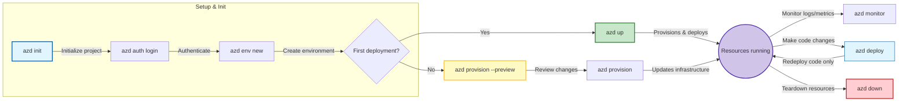
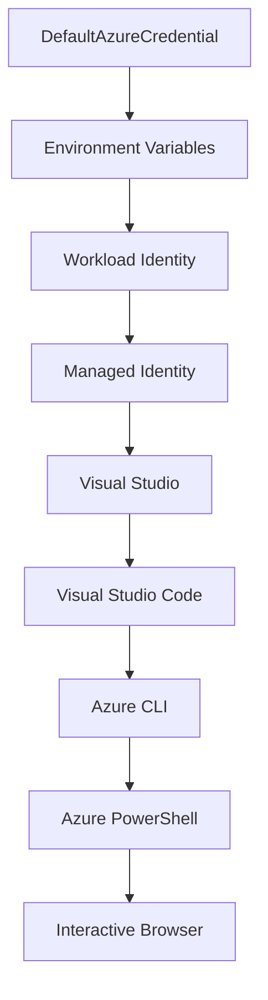

# AZD Pagrindai – Pagrindinės sąvokos ir esmė

**Skyriaus navigacija:**
- **📚 Kurso pradžia**: [AZD pradedantiesiems](../../README.md)
- **📖 Dabartinis skyrius**: 1 skyrius – Pagrindai ir greitas startas
- **⬅️ Ankstesnis**: [Kurso apžvalga](../../README.md#-chapter-1-foundation--quick-start)
- **➡️ Kitas**: [Diegimas ir nustatymai](installation.md)
- **🚀 Kitas skyrius**: [2 skyrius: AI-pirmas vystymas](../chapter-02-ai-development/microsoft-foundry-integration.md)

## Įvadas

> Peržiūrėta pagal `azd 1.37.2` (2026 m. lapkritis). Bash komandos naudoja kabučiuose esančius vietos rezervavimo ženklus, kuriuos turite pakeisti. Šablonų darbo eigos naudoja `.` pasirenkant dabartinį katalogą; be katalogo argumento, šablono inicializavimas sukuria poaplankį ir nekeičia jūsų terminalo darbinio katalogo. Sudėtingi fragmentai yra iliustraciniai, ne pilni projektai.

Ši pamoka supažindina jus su Azure Developer CLI (azd), galingu komandine eilute valdomu įrankiu, kuris pagreitina jūsų kelią nuo vietinio kūrimo iki Azure diegimo. Išmoksite pagrindines sąvokas, pagrindines funkcijas ir suprasite, kaip azd supaprastina debesų natūralios aplikacijos diegimą.

## Mokymosi tikslai

Baigę šią pamoką, jūs:
- Suprasite, kas yra Azure Developer CLI ir koks jo pagrindinis tikslas
- Išmoksite pagrindines šablonų, aplinkų ir paslaugų sąvokas
- Išnagrinėsite svarbias funkcijas, įskaitant šablonais pagrįstą vystymą ir infrastruktūrą kaip kodą
- Suprasite azd projekto struktūrą ir darbo eigą
- Būsite pasiruošę įdiegti ir sukonfigūruoti azd savo vystymo aplinkoje

## Mokymosi rezultatai

Baigę pamoką, galėsite:
- Paaiškinti azd vaidmenį šiuolaikinėse debesų kūrimo darbo eigoje
- Nustatyti azd projekto struktūros komponentus
- Aprašyti, kaip šablonai, aplinkos ir paslaugos sąveikauja
- Suprasti infrastruktūros kaip kodo privalumus su azd
- Atpažinti skirtingas azd komandas ir jų paskirtį

## Kas yra Azure Developer CLI (azd)?

Azure Developer CLI (azd) yra komandų eilutės įrankis, sukurtas pagreitinti jūsų kelią nuo vietinio vystymo iki Azure diegimo. Jis supaprastina debesų natūralių programų kūrimo, diegimo ir valdymo procesą Azure.

### Ką galite diegti naudodami azd?

azd palaiko daugybę darbo krūvių – ir sąrašas nuolat auga. Šiandien galite naudoti azd diegimui:

| Darbo krūvio tipas | Pavyzdžiai | Ta pati darbo eiga? |
|------------------|------------|--------------------|
| **Tradicinės programos** | Tinklapių programos, REST API, statiniai puslapiai | ✅ `azd up` |
| **Paslaugos ir mikroservisai** | Container Apps, Function Apps, daugiapaslaugiai serveriai | ✅ `azd up` |
| **Dirbtiniu intelektu paremti sprendimai** | Pokalbių programos su Microsoft Foundry modeliais, RAG sprendimai su AI paieška | ✅ `azd up` |
| **Išmanieji agentai** | Foundry valdomi agentai, daugiaagentų orchestracijos | ✅ `azd up` |

Pagrindinė įžvalga yra ta, kad **azd gyvenimo ciklas išlieka toks pats nepriklausomai nuo to, ką diegiate**. Jūs inicijuojate projektą, teikiate infrastruktūrą, diegiate kodą, stebite programą ir išvalote – nesvarbu, ar tai paprastas tinklapis, ar sudėtingas DI agentas.

Ši tęstinumas yra sąmoningas dizainas. azd traktuoja DI galimybes kaip dar vieną paslaugos tipą, kuria jūsų programa gali pasinaudoti, o ne kaip kažką esmiškai skirtingo. Pokalbių taškas, paremta Microsoft Foundry modeliais, iš azd perspektyvos yra tiesiog dar viena paslauga konfigūruoti ir diegti.

### 🎯 Kodėl naudoti AZD? Tikro pasaulio palyginimas

Palyginkime paprastos internetinės programos su duomenų baze diegimą:

#### ❌ BE AZD: Rankinis Azure diegimas (30+ minučių)

**Iliustracinis Bash pavyzdys, ne vykdomasis programos pradžios taškas.** Tai reikalauja esamos programos kodo, unikalių išteklių pavadinimų, Azure CLI autentifikacijos ir reikiamų CLI plėtinių. Naudokite šablono pratimą žemiau end-to-end palaikomam procesui.

```bash
# Step 1: Create resource group
az group create --name myapp-rg --location eastus

# Step 2: Create App Service Plan
az appservice plan create --name myapp-plan \
  --resource-group myapp-rg \
  --sku B1 --is-linux

# Step 3: Create Web App
az webapp create --name myapp-web-unique123 \
  --resource-group myapp-rg \
  --plan myapp-plan \
  --runtime "NODE:22-lts"

# Step 4: Create Cosmos DB account (10-15 minutes)
az cosmosdb create --name myapp-cosmos-unique123 \
  --resource-group myapp-rg \
  --kind MongoDB

# Step 5: Create database
az cosmosdb mongodb database create \
  --account-name myapp-cosmos-unique123 \
  --resource-group myapp-rg \
  --name tododb

# Step 6: Create collection
az cosmosdb mongodb collection create \
  --account-name myapp-cosmos-unique123 \
  --resource-group myapp-rg \
  --database-name tododb \
  --name todos

# Step 7: Get connection string
CONN_STR=$(az cosmosdb keys list \
  --name myapp-cosmos-unique123 \
  --resource-group myapp-rg \
  --type connection-strings \
  --query "connectionStrings[0].connectionString" -o tsv)

# Step 8: Configure app settings
az webapp config appsettings set \
  --name myapp-web-unique123 \
  --resource-group myapp-rg \
  --settings MONGODB_URI="$CONN_STR"

# Step 9: Enable logging
az webapp log config --name myapp-web-unique123 \
  --resource-group myapp-rg \
  --application-logging filesystem \
  --detailed-error-messages true

# Step 10: Set up Application Insights
az monitor app-insights component create \
  --app myapp-insights \
  --location eastus \
  --resource-group myapp-rg

# Step 11: Link App Insights to Web App
INSTRUMENTATION_KEY=$(az monitor app-insights component show \
  --app myapp-insights \
  --resource-group myapp-rg \
  --query "instrumentationKey" -o tsv)

az webapp config appsettings set \
  --name myapp-web-unique123 \
  --resource-group myapp-rg \
  --settings APPINSIGHTS_INSTRUMENTATIONKEY="$INSTRUMENTATION_KEY"

# Step 12: Build application locally
npm install
npm run build

# Step 13: Create deployment package
zip -r app.zip . -x "*.git*" "node_modules/*"

# Step 14: Deploy application
az webapp deployment source config-zip \
  --resource-group myapp-rg \
  --name myapp-web-unique123 \
  --src app.zip

# Step 15: Wait and pray it works 🙏
# (No automated validation, manual testing required)
```

**Problemos:**
- ❌ Reikia prisiminti ir vykdyti 15+ komandų iš eilės
- ❌ 30-45 minučių rankinio darbo
- ❌ Lengva suklysti (rašybos klaidos, neteisingi parametrai)
- ❌ Kredencialai reikalauja aiškaus tvarkymo; klaidų žurnalai ir terminalo sekimas gali juos atskleisti
- ❌ Nėra automatizuoto atstatymo, jei kažkas nepavyksta
- ❌ Sunku pakartoti komandai
- ❌ Kiekvieną kartą skiriasi (nenuspėjama)

#### ✅ SU AZD: Automatizuotas diegimas (5 komandos, 10-15 minučių)

```bash
# Step 1: Initialize from template
azd init --template todo-nodejs-mongo .

# Step 2: Authenticate
azd auth login

# Step 3: Select the environment created during init
azd env select dev

# Step 4: Preview changes (optional but recommended)
azd provision --preview

# Step 5: Deploy everything
azd up

# ✨ Done! Everything is deployed, configured, and monitored
```

**Privalumai:**
- ✅ **5 komandos** prieš 15+ rankinių žingsnių
- ✅ **10-15 minučių** bendrai (daugiausia laiko laukimas Azure)
- ✅ **Mažiau rankinių klaidų** – nuosekli, šablonais valdoma darbo eiga
- ✅ **Saugus slaptų duomenų tvarkymas** – daug šablonų naudoja Azure valdomą slaptų duomenų saugyklą
- ✅ **Pakartojami diegimai** – ta pati darbo eiga kiekvieną kartą
- ✅ **Pakartojami infrastruktūros aprašai** – priklauso nuo kvotų, regiono prieinamumo ir šablono versijų
- ✅ **Paruošta komandai** – kas nors gali diegti su tomis pačiomis komandomis
- ✅ **Infrastruktūra kaip kodas** – versijų kontroliuojami Bicep šablonai
- ✅ **Šablonais apibrėžtas stebėjimas** – Application Insights įtraukta šablone

### Laikas ir patikimumas

Aukščiau pateikti laikai yra apytikriai, ne etalonai. azd sumažina komandų koordinavimo poreikį, tačiau negarantuoja diegimo trukmės, klaidų pašalinimo ar automatinio programos/duomenų bazės atstatymo. Laikykite veikiančias versijas šaltinio valdyme ir testuokite atkūrimo procedūras.

## Pagrindinės sąvokos

### Šablonai
Šablonai yra azd pamatas. Jie apima:
- **Programos kodą** – Jūsų šaltinio kodas ir priklausomybės
- **Infrastruktūros aprašus** – Azure resursai aprašyti Bicep arba Terraform
- **Konfigūracijos failus** – Nustatymai ir aplinkos kintamieji
- **Diegimo scenarijus** – Automatizuotos diegimo darbo eigos

### Aplinkos
Aplinkos atspindi skirtingas diegimo paskirties vietas:
- **Vystymui** – Bandymui ir kūrimui
- **Paruošiamajai** – Prieš gamybinė aplinka
- **Gamybinė** – Veikianti gamybinė aplinka

Kiekviena aplinka turi savo:
- Aplinkos pavadinimą ir reikšmes; resursų izoliacija priklauso nuo infrastruktūros šablono
- Konfigūracijos nustatymus
- Diegimo būseną

### Paslaugos
Paslaugos `azure.yaml` apibūdina diegiamus programos komponentus:
- **Frontend** – Tinklapio programos, SPA
- **Backend** – API, mikroservisai

Duomenų bazės ir saugyklos paprastai tiekiamos kaip infrastruktūros resursai, o ne kaip išrasti paslaugų talpinimo įrankiai, tokie kaip `host: postgres`.

## Svarbiausios funkcijos

### 1. Šablonais valdoma vystymosi eiga
```bash
# Browse available templates
azd template list

# Initialize from a template
azd init --template "<template-name>" .
```

### 2. Infrastruktūra kaip kodas
- **Bicep** – Azure domeno specifinė kalba
- **Terraform** – Daugiadebesų infrastruktūros įrankis
- Bicep kompiliuoja į ARM šablonus; žali ARM JSON nėra atskira integruota `infra.provider`.

### 3. Integruotos darbo eigos
```bash
# Complete deployment workflow
azd up            # Provision + Deploy this is hands off for first time setup

# 🧪 NEW: Preview infrastructure changes before deployment (SAFE)
azd provision --preview    # Simulate infrastructure deployment without making changes

azd provision     # Create Azure resources if you update the infrastructure use this
azd deploy        # Deploy application code or redeploy application code once update
azd down          # Clean up resources
```

#### 🛡️ Saugus infrastruktūros planavimas su peržiūra
Komanda `azd provision --preview` pakeičia žaidimo taisykles saugiam diegimui:
- **Sausojo paleidimo analizė** – Parodo, kas bus sukurta, pakeista ar ištrinta
- **Nevykdo infrastruktūros taikymo** – Peržiūri tiekėjo pakeitimus; pirmiausia peržiūrėkite projekto kablius, nes jie gali vykdyti komandas su pašaliniais efektais
- **Komandinė bendradarbiavimas** – Dalijasi peržiūros rezultatais prieš diegimą
- **Išlaidų planavimo įvestis** – Peržiūrėkite siūlomus SKU, tada įvertinkite juos Azure kainų skaičiuokle; peržiūra nekainuoja kainos

```bash
# Example preview workflow
azd provision --preview           # See what will change
# Review the output, discuss with team
azd provision                     # Apply changes with confidence
```

### 📊 Vizualizacija: AZD vystymo darbo eiga



**Darbo eigos paaiškinimas:**
1. **Init** – Pradžia nuo šablono ar naujo projekto
2. **Auth** – Prisijungimas prie Azure
3. **Environment** – Sukuriama izoliuota diegimo aplinka
4. **Preview** – 🆕 Visada pirmiausia peržiūrėkite infrastruktūros pakeitimus (saugaus darbo praktika)
5. **Provision** – Sukurkite / atnaujinkite Azure resursus
6. **Deploy** – Įkelkite programos kodą
7. **Monitor** – Stebėkite programos veikimą
8. **Iterate** – Darykite pakeitimus ir pakartotinai diegkite kodą
9. **Cleanup** – Išvalykite resursus po darbo pabaigos

### 4. Aplinkos valdymas
```bash
# Create and manage environments
azd env new "<environment-name>"
azd env select "<environment-name>"
azd env list
```

### 5. Plėtiniai ir DI komandos

azd naudoja plėtinių sistemą, leidžiančią pridėti funkcijų, kurios viršija pagrindinę CLI galią. Tai ypač naudinga DI darbo krūviams:

```bash
# List available extensions
azd extension list

# Install the Foundry agents extension
azd extension install azure.ai.agents

# Initialize an AI agent project interactively
azd ai agent init

# Test a deployed agent (shows latency and time-to-first-byte)
azd ai agent invoke

# Start the MCP server for AI-assisted development (Alpha)
azd mcp start
```

**Agentų gyvenimo ciklas nuo pradžios iki pabaigos.** Naudokite `azure.ai.agents` agentų gyvenimo ciklo operacijoms ir atskirai įdiekite `azure.ai.evaluations` vertinimui. Naudokite `azd >= 1.37.0` bendrame darbo eigoje. Viso to nereikia turėti iš karto:

| Etapas | Komanda | Ką daro |
|-------|---------|---------|
| **Scaffold** | `azd ai agent init --template <path-to-azure.yaml>` | Pritaikykite dabartinį agento projekto šabloną |
| **Test** | `azd ai agent invoke` | Iškvieskite agentą ir stebėkite atsakymo laiką |
| **Measure** | `azd ai eval init`, `generate`, `run start` | Konfigūruokite, diegkite ir vykdykite vertinimus su atskiru plėtiniu |
| **Improve** | `azd ai agent optimize --eval <evaluation-name> --optimize-model <optimizer-deployment>` | Pakartotinai naudokite suderinamą vertinimą agento optimizavimui |
| **Inspect** | `azd ai agent endpoint show` | Peržiūrėkite tiesioginį pabaigos taško konfigūraciją |
| **Clean up** | `azd ai agent delete` | Ištrinkite talpinamą agentą ir visas jo versijas |

> Plėtiniai išsamiau aptariami [2 skyriuje: AI-pirmas vystymas](../chapter-02-ai-development/agents.md) ir [AZD DI CLI komandų](../chapter-08-production/production-ai-practices.md#azd-ai-cli-commands-and-extensions) referencijoje.

## 📁 Projekto struktūra

Tipinė azd projekto struktūra:
```
my-app/
├── .azure/                  # Local environments and selected-environment config
│   ├── config.json
│   └── dev/.env
├── .devcontainer/          # Development container config
├── .github/workflows/      # GitHub Actions
├── .vscode/               # VS Code settings
├── infra/                 # Infrastructure code
│   ├── main.bicep        # Main infrastructure template
│   ├── main.parameters.json
│   └── modules/          # Reusable modules
├── src/                  # Application source code
│   ├── api/             # Backend services
│   └── web/             # Frontend application
├── azure.yaml           # azd project configuration
└── README.md
```

## 🔧 Konfigūracijos failai

### azure.yaml
Pagrindinis projekto konfigūracijos failas:
```yaml
name: my-awesome-app
metadata:
  template: my-template@1.0.0

services:
  web:
    project: ./src/web
    language: js
    host: appservice
  api:
    project: ./src/api
    language: js
    host: appservice

hooks:
  preprovision:
    shell: pwsh
    run: echo "Preparing to provision..."
```

### .azure/config.json
Projekto vietinis numatytos aplinkos pasirinkimas (iliustracinis; valdomas azd):
```json
{
  "defaultEnvironment": "dev"
}
```

## 🎪 Dažnos darbo eigos su praktiniais pratimais

> **💡 Mokymosi patarimas:** Sekite šiuos pratimus tvarkingai, kad palaipsniui įgytumėte AZD įgūdžių.

### 🎯 Pratimas 1: Inicializuokite pirmąjį projektą

**Tikslas:** Sukurti AZD projektą ir ištirti jo struktūrą

**Veiksmai:**
```bash
# Use a proven template
mkdir azd-basics-practice
cd azd-basics-practice
# Choose "dev" for the environment name when prompted
azd init --template todo-nodejs-mongo .

# Explore the generated files
ls -la  # View all files including hidden ones

# Key files created:
# - azure.yaml (main config)
# - infra/ (infrastructure code)
# - src/ (application code)
```

**✅ Sėkmė:** Turite azure.yaml, infra/ ir src/ katalogus

---

### 🎯 Pratimas 2: Diegimas į Azure

**Tikslas:** Atlikti ištisinį diegimą

**Veiksmai:**
```bash
# 1. Authenticate
azd auth login

# 2. Select the dev environment created in Exercise 1
azd env select dev
azd env set AZURE_LOCATION eastus

# 3. Preview changes (RECOMMENDED)
azd provision --preview

# 4. Deploy everything
azd up

# 5. Verify deployment
azd show    # View your app URL
```

**Numatomas laikas:** 10-15 minučių  
**✅ Sėkmė:** Naršyklėje atsidaro programos URL

---

### 🎯 Pratimas 3: Kelios aplinkos

**Tikslas:** Diegimas į dev ir staging aplinkas

**Veiksmai:**
```bash
# Already have dev, create staging
azd env new staging
azd env set AZURE_LOCATION westus2
azd up

# Switch between them
azd env list
azd env select dev
```

**✅ Sėkmė:** Du atskiri resursų grupės Azure portale

**Išvalymas:** Pratimas 3 sukuria antrą apmokamą diegimą. Ištrinkite abu pabaigę:

```bash
azd down --environment dev
azd down --environment staging
```

---

### 🛡️ Naikinantis išvalymas: `azd down --force --purge`

Kai ketinate tyčia ištrinti pasirinktų aplinkų Azure resursus:

```bash
azd down --force --purge
```

**Kas vyksta:**
- `--force`: Be patvirtinimo raginimų
- `--purge`: Taip pat nuolatai ištrina palaikomus minkšto ištrynimo resursus (pavyzdžiui, Key Vault), kai leidžiama apsauga nuo ištrynimo. Vietinis `.azure/` katalogas neištrinamas.

**Naudoti:** kai baigėte su vienkartine aplinka. Nepasirinkite naikinančio išvalymo kaip pirmosios reakcijos į autentifikacijos, kvotų ar konfigūracijos klaidą.

---

## 🎪 Originalios darbo eigos nuoroda

### Naujo projekto pradžia
```bash
# Method 1: Use existing template
azd init --template todo-nodejs-mongo .

# Method 2: Start from scratch
azd init

# Method 3: Use current directory
azd init .
```

### Vystymo ciklas
```bash
# Set up development environment
azd auth login
azd env new dev
azd env select dev

# Deploy everything
azd up

# Make changes and redeploy
azd deploy

# Clean up when done
azd down --force --purge # Deletes this environment's discovered Azure resources; review before forcing deletion.
```

## Kas yra `azd down --force --purge`
Komanda `azd down --force --purge` yra galingas būdas visiškai išardyti azd aplinką ir visus susijusius resursus. Štai ką kiekvienas ženklas atlieka:
```
--force
```
- Praleidžia patvirtinimo raginimus.
- Naudinga automatizavimui ar scenarijų rašymui, kai rankinis įvestis neįmanoma.
- Nepereinama per teises, apsaugą nuo išvalymo ar ištrynimo klaidas.

```
--purge
```
Nuolatinai ištrina palaikomus minkšto ištrynimo Azure resursus be papildomo patvirtinimo. Galioja apsauga nuo išvalymo ir teisės. **Neištrina** vietinių aplinkų ar `.azure/` aplanko.


### Kodėl naudoti abu?
Naudokite abu tik tada, kai ketinate pašalinti pasirinktų aplinkų Azure resursus ir išvalyti atkuriamus resursus. Tai naikinantis išvalymas, o ne bendras gedimų taisymas ar vietinės būsenos resetas.

Tai ypač praverčia po rankinio išteklių panaikinimo Azure portale arba keičiant šablonus, aplinkas ar resursų grupių pavadinimo konvencijas.


### Kelios aplinkos valdymas
```bash
# Create staging environment
azd env new staging
azd env select staging
azd up

# Switch back to dev
azd env select dev

# Compare environments
azd env list
```

## 🔐 Autentifikacija ir kredencialai

Skirkite diegimo autentifikaciją (`azd auth login`) nuo programos SDK autentifikacijos (`DefaultAzureCredential`). Tai nepriklausomos sritys. Pagal nutylėjimą azd nenaudoja Azure CLI kredencialų.

### Azure CLI autentifikacija (`az login`)

Vykdykite `azd auth login` azd. Toliau pateiktos Azure CLI komandos yra neprivalomos ir autentifikuoja `az` komandas atskirai:

```bash
# Interactive login (opens browser)
az login

# Login with specific tenant
az login --tenant "<tenant-id>"

# Login with service principal
az login --service-principal -u "<app-id>" -p "<password>" --tenant "<tenant-id>"

# Check current login status
az account show

# List available subscriptions
az account list --output table

# Set default subscription
az account set --subscription "<subscription-id>"
```

### Autentifikacijos eiga
1. **Interaktyvus prisijungimas**: Atveria numatytąją naršyklę autentifikacijai
2. **Įrenginio kodo srautas**: Skirta aplinkoms be naršyklės
3. **Paslaugų principas**: Automatizavimui ir CI/CD scenarijams
4. **Valdomas tapatumas**: Azure talpinamoms programoms

### DefaultAzureCredential grandinė

`DefaultAzureCredential` yra kredencialų tipas, kuris supaprastina autentifikaciją, automatiškai bandydamas kelis kredencialų šaltinius tam tikra tvarka:

#### Programos SDK kredencialų grandinė

Tiksli grandinė priklauso nuo Azure Identity SDK kalbos, versijos, įdiegtų papildinių ir parinkčių. Šis diagrama yra konceptualus, o ne fiksuota azd autentifikacijos seka; naujausi SDK taip pat gali apimti Azure Developer CLI kredencialus.


#### 1. Aplinkos kintamieji
```bash
# Set environment variables for service principal
export AZURE_CLIENT_ID="<app-id>"
export AZURE_CLIENT_SECRET="<password>"
export AZURE_TENANT_ID="<tenant-id>"
```

#### 2. Darbo krūvio tapatybė (Kubernetes/GitHub Actions)
Naudojama automatiškai:
- Azure Kubernetes Service (AKS) su Darbo krūvio tapatybe
- GitHub Actions su OIDC federacija
- Kitose federuotose tapatybės scenarijuose

#### 3. Valdomoji tapatybė
Skirta Azure ištekliams, tokiems kaip:
- Virtualios mašinos
- App Service
- Azure Functions
- Konteinerių instancijos

```bash
# Inspect a deployed Container App's configured identity (requires az login)
az containerapp show --name "<app-name>" --resource-group "<rg-name>" --query identity
```

#### 4. Kūrėjų įrankių integracija
- **Visual Studio**: Automatiškai naudoja prisijungusį paskyrą
- **VS Code**: Parama priklauso nuo SDK ir palaikomų brokerių/papildinių
- **Azure CLI**: Naudoja `az login` kredencialus (dažniausiai vietiniam kūrimui)

### AZD autentifikacijos nustatymas

```bash
# Method 1: Direct azd authentication (recommended)
azd auth login

# Method 2: Direct azd authentication
azd auth login --use-device-code  # For headless environments

# Method 3: Check authentication status
azd auth login --check-status

# Method 4: Logout and re-authenticate
azd auth logout
azd auth login
```

### Geriausios autentifikacijos praktikos

#### Vietinei kūrimui
```bash
# 1. Log in to azd
azd auth login

# 2. Select the subscription for this initialized environment
azd env set AZURE_SUBSCRIPTION_ID "<subscription-id>"

# 3. Check azd sign-in details (read the status message)
azd auth login --check-status
```

#### CI/CD vamzdynams
```yaml
# Partial GitHub Actions steps: assumes checkout, azd installation,
# required AZURE_* environment values, and pipeline secret configuration.
- name: Deploy with azd
  run: |
    azd auth login --client-id ${{ secrets.AZURE_CLIENT_ID }} \
                    --client-secret ${{ secrets.AZURE_CLIENT_SECRET }} \
                    --tenant-id ${{ secrets.AZURE_TENANT_ID }}
    azd up --no-prompt
```

#### Produkcinėms aplinkoms
- Naudokite **Valdomą tapatybę** kai veikia Azure ištekliuose
- Automatizavimo scenarijams naudokite **Paslaugų principalą**
- Venkite saugoti kredencialus kode ar konfigūracijos failuose
- Naudokite **Azure Key Vault** jautrioms konfigūracijoms

### Dažnos autentifikacijos problemos ir sprendimai

#### Problema: „Nerasta prenumerata“
```bash
# Solution: Set default subscription
az account list --output table
az account set --subscription "<subscription-id>"
azd env set AZURE_SUBSCRIPTION_ID "<subscription-id>"
```

#### Problema: „Neužtenka leidimų“
```bash
# Solution: Check and assign required roles
az role assignment list --assignee $(az account show --query user.name --output tsv)

# Common required roles:
# - Contributor (for resource management)
# - User Access Administrator (for role assignments)
```

#### Problema: „Token'o galiojimo laikas pasibaigė“
```bash
# Solution: Re-authenticate
az logout
az login
azd auth logout
azd auth login
```

### Autentifikacija įvairiuose scenarijuose

#### Vietinis kūrimas
```bash
# Personal development account
az login
azd auth login
```

#### Komandinis kūrimas
```bash
# Use specific tenant for organization
az login --tenant contoso.onmicrosoft.com
azd auth login --tenant-id "<tenant-id>"
```

#### Daugiapakopiai scenarijai
```bash
# Switch between tenants
az login --tenant tenant1.onmicrosoft.com
azd auth login --tenant-id "<tenant-1-id>"
# Select an environment configured with tenant 1's subscription
azd env select tenant1-dev
# Deploy to tenant 1
azd up

az login --tenant tenant2.onmicrosoft.com  
azd auth login --tenant-id "<tenant-2-id>"
azd env select tenant2-dev
# Deploy to tenant 2
azd up
```

### Saugumo aspektai

1. **Kredencialų saugojimas**: Niekuomet nesaugokite kredencialų šaltinio kode
2. **Apribojimų taikymas**: Naudokite mažiausio teisių principą paslaugų principalams
3. **Token'o rotacija**: Reguliariai keiskite paslaugų principalų slaptus raktus
4. **Audito sekimas**: Stebėkite autentifikacijos ir diegimo veiksmus
5. **Tinklų saugumas**: Naudokite privačius galinius taškus, kai įmanoma

### Autentifikacijos trikčių šalinimas

```bash
# Debug authentication issues
azd auth login --check-status
az account show
az account get-access-token

# Common diagnostic commands
whoami                          # Current user context
az ad signed-in-user show      # Microsoft Entra ID user details
az group list                  # Test resource access
```

## Komandų atrankos nustatymas

### Atranka
```bash
azd template list              # Browse templates
azd template list --help       # Template discovery options
azd init --help               # Initialization options
```

### Projekto valdymas
```bash
azd show                     # Project overview
azd env list                # Available environments and selected default
azd config show            # Configuration settings
```

### Stebėjimas
```bash
azd monitor                  # Open Azure portal monitoring
azd monitor --logs           # View application logs
azd monitor --live           # View live metrics
azd pipeline config          # Set up CI/CD
```

## Geriausios praktikos

### 1. Naudokite prasmingus pavadinimus
```bash
# Good
azd env new production-east
azd init --template todo-nodejs-mongo .

# Avoid
azd env new env1
azd init --template template1 .
```

### 2. Pasinaudokite šablonais
- Pradėkite nuo esamų šablonų
- Priderinkite pagal savo poreikius
- Sukurkite pakartotinai naudojamus organizacijos šablonus

### 3. Aplinkos izoliacija
- Naudokite atskiras aplinkas vystymui/testavimui/produkcijai
- Niekada nediekite tiesiogiai į gamybą iš vietinio kompiuterio
- Produkcijos diegimams naudokite CI/CD vamzdynus

### 4. Konfigūracijos valdymas
- Slaptažodžiams naudokite valdomą tapatybę ir Key Vault; įprasti `azd env set` reikšmės yra vietinė tekstinė eilutė
- Laikykite konfigūraciją versijų valdymo sistemoje
- Dokumentuokite aplinkai specifinius nustatymus

## Mokymosi eiga

### Pradedantiesiems (1-2 savaitė)
1. Įdiegti azd ir autentifikuotis
2. Diegti paprastą šabloną
3. Suprasti projekto struktūrą
4. Išmokti pagrindines komandas (up, down, deploy)

### Vidutiniams vartotojams (3-4 savaitė)
1. Priderinti šablonus
2. Valdyti kelias aplinkas
3. Suprasti infrastruktūros kodą
4. Nustatyti CI/CD vamzdynus

### Pažengusiems (5+ savaitė)
1. Kurti savo šablonus
2. Pažangūs infrastruktūros modeliai
3. Daugiarajonės diegimo galimybės
4. Įmonių lygio konfigūracijos

## Tolimesni žingsniai

**📖 Tęsti 1 skyrių mokymus:**
- [Įdiegimas ir nustatymas](installation.md) - Įdiekite ir konfigur uokite azd
- [Jūsų pirmasis projektas](first-project.md) - Baigiamas praktinis vadovas
- [Konfigūracijos gidas](../chapter-03-configuration/configuration.md) - Pažangios konfigūracijos parinktys

**🎯 Pasiruošę kitam skyriui?**
- [2 skyrius: AI-pirmasis kūrimas](../chapter-02-ai-development/microsoft-foundry-integration.md) - Pradėkite kurti AI programas

## Papildomi ištekliai

- [Azure Developer CLI apžvalga](https://learn.microsoft.com/en-us/azure/developer/azure-developer-cli/)
- [Šablonų galerija](https://azure.github.io/awesome-azd/)
- [Bendruomenės pavyzdžiai](https://github.com/Azure-Samples)

---

## 🙋 Dažniausiai užduodami klausimai

### Bendrieji klausimai

**K: Kuo skiriasi AZD ir Azure CLI?**

A: Azure CLI (`az`) skirtas valdyti atskirus Azure išteklius. AZD (`azd`) skirtas valdyti visoms programoms:

```bash
# Azure CLI - Low-level resource management
az webapp create --name myapp --resource-group rg
az sql server create --name myserver --resource-group rg
# ...many more commands needed

# AZD - Application-level management
azd up  # Deploys entire app with all resources
```

**Pagalvokite taip:**
- `az` = Veiksmas su atskiromis Lego kaladėlėmis
- `azd` = Darbas su visais Lego rinkiniais

---

**K: Ar reikia mokėti Bicep arba Terraform naudotis AZD?**

A: Ne! Pradėkite nuo šablonų:
```bash
# Use existing template - no IaC knowledge needed
azd init --template todo-nodejs-mongo .
azd up
```

Vėliau galite išmokti Bicep, kad pritaikytumėte infrastruktūrą. Šablonai suteikia veikiantį pavyzdį mokymuisi.

---

**K: Kiek kainuoja naudoti AZD šablonus?**

A: Kainos priklauso nuo regiono, SKU, veikimo laiko, duomenų bazės režimo ir modelio naudojimo. Vystymo aplinka gali kainuoti nemažai net kai nenaudojama; nenumatykite vieno universalio diapazono $50-150:

```bash
# Preview resource changes (not prices)
azd provision --preview

# Always cleanup when not using
azd down --force --purge  # Removes all resources
```

**Profesionalus patarimas:** Naudokitės nemokamomis galimybėmis, kur įmanoma:
- App Service: F1 (Nemokama) lygis
- Azure OpenAI: nėra bendro garantuoto mėnesinio nemokamo tokenų kiekio; tikrinkite esamų modelių ir pasiūlymų kainas
- Cosmos DB: tinkami būsenos pagal srautą paskyros gali pasirinkti nemokamą lygį; serverless šablonai automatiškai netinka

---

**K: Ar galiu naudoti AZD su esamais Azure ištekliais?**

A: Taip, bet lengviau pradėti iš naujo. AZD geriausiai veikia valdyti visą ciklą. Su esamais ištekliais:

```bash
# Option 1: Import existing resources (advanced)
azd init
# Then modify infra/ to reference existing resources

# Option 2: Start fresh (recommended)
azd init --template "<verified-template-name>" .
azd up  # Creates new environment
```

---

**K: Kaip pasidalinti projektu su komandos nariais?**

A: Įkelkite AZD projektą į Git (bet NE .azure aplanką):

```bash
# Already in .gitignore by default
.azure/        # Contains secrets and environment data
*.env          # Environment variables

# Team members then:
git clone "<your-repo>"
# Change into the cloned repository before running the remaining commands.
azd auth login
azd env new "<their-name>-dev"
azd up
```

Visi gauna identišką infrastruktūrą iš tų pačių šablonų.

---

### Problematikos klausimai

**K: „azd up“ nepavyko pusiau. Ką daryti?**

A: Patikrinkite klaidą, ištaisykite ir bandykite dar kartą:

```bash
# Capture detailed diagnostics (redact sensitive values before sharing)
azd up --debug

# Common fixes:

# 1. If quota exceeded:
azd env set AZURE_LOCATION "westus2"  # Try different region

# 2. If resource name conflict:
azd down --force --purge  # Clean slate
azd up  # Retry

# 3. If auth expired:
az login
azd auth login
azd up
```

**Dažniausia problema:** Pasirinkta neteisinga Azure prenumerata
```bash
az account list --output table
az account set --subscription "<correct-subscription>"
azd env set AZURE_SUBSCRIPTION_ID "<correct-subscription-id>"
```

---

**K: Kaip diegti tik kodo pakeitimus be infrastruktūros diegimo?**

A: Venkite naudoti `azd up`, naudokite `azd deploy`:

```bash
azd up          # First time: provision + deploy (slow)

# Make code changes...

azd deploy      # Subsequent times: deploy only (fast)
```

Greičio palyginimas:
- `azd up`: 10-15 minučių (įdiegia infrastruktūrą)
- `azd deploy`: 2-5 minutės (tik kodas)

---

**K: Ar galiu pritaikyti infrastruktūros šablonus?**

A: Taip! Redaguokite Bicep failus `infra/`:

```bash
# After azd init
cd infra/
code main.bicep  # Edit in VS Code

# Preview changes
azd provision --preview

# Apply changes
azd provision
```

**Patarimas:** Pradėkite nuo nedidelių pakeitimų - keiskite SKU:
```bicep
// infra/main.bicep
sku: {
  name: 'B1'  // Change to 'P1V2' for production
}
```

---

**K: Kaip ištrinti viską, ką sukūrė AZD?**

A: Viena komanda pašalina visus išteklius:

```bash
azd down --force --purge

# This deletes:
# - Azure resources/resource groups discovered for the selected environment
# - Supported soft-deleted resources, if purge protection allows
# Local .azure files remain; shared/external resources may remain too.
```

**Visada vykdykite šią komandą, kai:**
- Baigėte šablono testavimą
- Perėjote prie kito projekto
- Norite pradėti iš naujo

**Kainos patikra:** Patikrinkite Azure dėl ištrynimo ir galimų laikomų/bendrų išteklių. Ankstesnės išlaidos lieka galiojančios.

---

**K: Ką daryti, jei netyčia ištryniau išteklius Azure portale?**

A: AZD būsena gali išsiderinti. Naudokite švaraus lapo metodą:

```bash
# 1. Delete remaining resources only if that is your intent
azd down --force --purge

# 2. Start fresh
azd up

# Alternative: Let AZD detect and fix
azd provision  # Will create missing resources
```

---

### Pažangūs klausimai

**K: Ar galiu naudoti AZD CI/CD vamzdynuose?**

A: Taip! GitHub Actions pavyzdys:

```yaml
# .github/workflows/deploy.yml
name: Deploy with AZD

on:
  push:
    branches: [main]

jobs:
  deploy:
    runs-on: ubuntu-latest
    steps:
      - uses: actions/checkout@v4
      
      - name: Install azd
        run: curl -fsSL https://aka.ms/install-azd.sh | bash
      
      - name: Azure Login
        run: |
          azd auth login \
            --client-id ${{ secrets.AZURE_CLIENT_ID }} \
            --client-secret ${{ secrets.AZURE_CLIENT_SECRET }} \
            --tenant-id ${{ secrets.AZURE_TENANT_ID }}
      
      - name: Deploy
        env:
          AZURE_ENV_NAME: dev
          AZURE_LOCATION: ${{ vars.AZURE_LOCATION }}
          AZURE_SUBSCRIPTION_ID: ${{ vars.AZURE_SUBSCRIPTION_ID }}
        run: azd up --no-prompt
```

---

**K: Kaip tvarkyti slaptažodžius ir jautrius duomenis?**

A: Naudokite Key Vault tiesiogiai. `azd env set` rašo paprastas reikšmes į vietinį aplinkos failą; jis automatiškai nesukuria vault'o, nepriskiria vaidmenų ar neįterpia slaptažodžių į programą.

```bash
# Interactive: create/select a Key Vault secret and save its reference
azd env set-secret DATABASE_PASSWORD
```

Jums reikia tinkamų vault teisių. Jūsų infrastruktūra/programa turi prijungti slaptažodį prie vartotojo ir suteikti vykdymo tapatybės prieigą. Nespausdinkite išspręstų slaptažodžių žurnaluose.

**Niekada nekelkite:**
- `.azure/` aplanko (turi aplinkos duomenis)
- `.env` failų (vietiniai slaptažodžiai)
- Prisijungimo eilutės

---

**K: Ar galima diegti keliuose regionuose?**

A: Taip, sukurkite aplinką pagal regioną:

```bash
# East US environment
azd env new prod-eastus
azd env set AZURE_LOCATION eastus
azd up

# West Europe environment
azd env new prod-westeurope
azd env set AZURE_LOCATION westeurope
azd up

# Each environment is independent
azd env list
```

Tikrų daugiarajonių programų atveju, pritaikykite Bicep šablonus diegimui keliuose regionuose vienu metu.

---

**K: Kur gauti pagalbą, jei užstrigau?**

1. **AZD dokumentacija:** https://learn.microsoft.com/azure/developer/azure-developer-cli/
2. **GitHub problemos:** https://github.com/Azure/azure-dev/issues
3. **Discord:** [Azure Discord](https://discord.gg/microsoft-azure) - #azure-developer-cli kanalas
4. **Stack Overflow:** Žymė `azure-developer-cli`
5. **Šis kursas:** [Trikčių šalinimo gidas](../chapter-07-troubleshooting/common-issues.md)

**Profesionalus patarimas:** Prieš klausdami, vykdykite:
```bash
azd show       # Shows current state
azd version    # Shows your version
```
Pateikite šią informaciją klausime dėl greitesnės pagalbos.

---

## 🎓 Kas toliau?

Dabar suprantate AZD pagrindus. Pasirinkite savo kelią:

### 🎯 Pradedantiesiems:
1. **Kitas žingsnis:** [Įdiegimas ir nustatymas](installation.md) - Įdiekite AZD savo kompiuteryje
2. **Tada:** [Jūsų pirmasis projektas](first-project.md) - Diekite savo pirmąją programą
3. **Praktikuokitės:** Atlikite visus 3 pratimus šiame pamokoje

### 🚀 AI kūrėjams:
1. **Praleiskite:** [2 skyrius: AI-pirmasis kūrimas](../chapter-02-ai-development/microsoft-foundry-integration.md)
2. **Diegti:** Tuščio projekto kataloge pradėkite su `azd init --template get-started-with-ai-chat .`
3. **Mokykitės:** Kurkite diegiant

### 🏗️ Patyrusiems kūrėjams:
1. **Peržiūrėti:** [Konfigūracijos gidas](../chapter-03-configuration/configuration.md) - Pažangūs nustatymai
2. **Tyrinėti:** [Infrastruktūra kaip kodas](../chapter-04-infrastructure/provisioning.md) - Gilaus Bicep apžvalga
3. **Kurti:** Sukurkite savo šablonus savo stalui

---

**Skyrių navigacija:**
- **📚 Kurso pradžia**: [AZD Pradedantiesiems](../../README.md)
- **📖 Dabartinis skyrius**: 1 skyrius - Pagrindai ir greitas startas  
- **⬅️ Ankstesnis**: [Kurso apžvalga](../../README.md#-chapter-1-foundation--quick-start)
- **➡️ Kitas**: [Įdiegimas ir nustatymas](installation.md)
- **🚀 Kitas skyrius**: [2 skyrius: AI-pirmasis kūrimas](../chapter-02-ai-development/microsoft-foundry-integration.md)

---

<!-- CO-OP TRANSLATOR DISCLAIMER START -->
**Atsakomybės apribojimas**:
Šis dokumentas buvo išverstas naudojant dirbtinio intelekto vertimo paslaugą [Co-op Translator](https://github.com/Azure/co-op-translator). Nors siekiame tikslumo, prašome atkreipti dėmesį, kad automatiniai vertimai gali turėti klaidų ar netikslumų. Originalus dokumentas jo gimtąja kalba laikomas autoritetingu šaltiniu. Svarbiai informacijai rekomenduojama naudoti profesionalų žmogiškąjį vertimą. Mes neatsakome už jokius nesusipratimus ar neteisingą interpretaciją, kilusią naudojantis šiuo vertimu.
<!-- CO-OP TRANSLATOR DISCLAIMER END -->