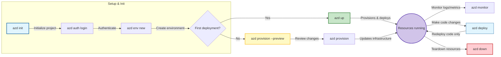
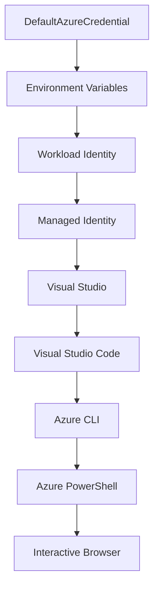

# AZD Pagrindai – Pagrindinės sąvokos ir pagrindai

**Skyriaus navigacija:**
- **📚 Kurso pradžia**: [AZD Pradedantiesiems](../../README.md)
- **📖 Dabartinis skyrius**: 1 skyrius – Pamatai ir greitas pradėjimas
- **⬅️ Ankstesnis**: [Kurso apžvalga](../../README.md#-chapter-1-foundation--quick-start)
- **➡️ Kitas**: [Įdiegimas ir nustatymas](installation.md)
- **🚀 Kitas skyrius**: [2 skyrius: DI pirmoji plėtra](../chapter-02-ai-development/microsoft-foundry-integration.md)

## Įvadas

> Peržiūrėta pagal `azd 1.37.2` (2026 m. lapkritis). Bash komandos naudoja kabutes, kurias turite pakeisti. Šablonų darbo eigos naudoja `.` dabartinei direktorijai inicijuoti; be direktorijos argumento, šablono inicijavimas sukuria pogrindį ir nekeičia Jūsų apvalkalo darbo katalogo. Pažangūs fragmentai yra iliustraciniai, o ne pilni projektai.

Ši pamoka supažindins jus su Azure Developer CLI (azd) – galingu komandiniu įrankiu, kuris pagreitina jūsų kelią nuo vietinio kūrimo iki Azure diegimo. Sužinosite pagrindines sąvokas, pagrindines funkcijas ir suprasite, kaip azd supaprastina debesų natūralių programų diegimą.

## Mokymosi tikslai

Baigę šią pamoką, jūs:
- Suprasite, kas yra Azure Developer CLI ir koks jo pagrindinis tikslas
- Susipažinsite su šablonų, aplinkų ir paslaugų pagrindinėmis sąvokomis
- Išmoksite pagrindines funkcijas, įskaitant šablonų pagrindu vykdomą plėtrą ir infrastruktūrą kaip kodą
- Suprasite azd projekto struktūrą ir darbo eigą
- Būsite pasiruošę įdiegti ir konfigūruoti azd savo kūrimo aplinkai

## Mokymosi rezultatai

Baigę šią pamoką, galėsite:
- Paaiškinti azd vaidmenį moderniose debesų kūrimo darbo eigos srityse
- Identifikuoti azd projekto struktūros komponentus
- Apibūdinti, kaip šablonai, aplinkos ir paslaugos veikia kartu
- Suprasti azd teikiamus infrastruktūros kaip kodo privalumus
- Atpažinti skirtingas azd komandas ir jų paskirtį

## Kas yra Azure Developer CLI (azd)?

Azure Developer CLI (azd) yra komandų eilutės įrankis, sukurtas pagreitinti jūsų kelią nuo vietinio kūrimo iki Azure diegimo. Jis supaprastina debesų natūralių programų statybos, diegimo ir valdymo procesą Azure aplinkoje.

### Ką galite diegti su azd?

azd palaiko platų darbo krūvių spektrą – ir šis sąrašas nuolatos auga. Šiandien galite naudoti azd diegti:

| Darbo krūvio tipas | Pavyzdžiai | Tas pats darbo eiga? |
|---------------|----------|----------------|
| **Tradici­ninės programos** | Žiniatinklio programėlės, REST API, statinės svetainės | ✅ `azd up` |
| **Paslaugos ir mikroservisai** | Container Apps, Function Apps, daugpaslauginiai backend’ai | ✅ `azd up` |
| **DI valdomos programos** | Pokalbių programėlės su Microsoft Foundry modeliais, RAG sprendimai su DI paieška | ✅ `azd up` |
| **Išmanieji agentai** | Foundry host’inami agentai, daugagentų orkestracijos | ✅ `azd up` |

Svarbiausia įžvalga – **azd gyvavimo ciklas išlieka toks pat, nepriklausomai nuo to, ką jūs diegiate**. Jūs inicijuojate projektą, teikiate infrastruktūrą, diegiate kodą, stebite programą ir išvalote – nesvarbu, ar tai paprasta svetainė ar sudėtingas DI agentas.

Ši tęstinumas yra suplanuotas. azd traktuoja DI funkcionalumą kaip dar vieną paslaugą, kurią jūsų programa gali naudoti, o ne kaip ką nors fundamentaliai skirtingo. Pokalbių galinis taškas, paremta Microsoft Foundry Modeliais, azd požiūriu yra tiesiog dar viena paslauga, kurią reikia konfigūruoti ir diegti.

### 🎯 Kodėl verta naudoti AZD? Realaus pasaulio palyginimas

Palyginkime paprastos žiniatinklio programėlės diegimą su duomenų baze:

#### ❌ BE AZD: Rankinis Azure diegimas (30+ minučių)

**Iliustracinis Bash palyginimas, ne vykdoma programos pradžia.** Ši prielaida – esamas programos kodas, unikalūs resursų pavadinimai, Azure CLI autentifikacija ir bet kokie reikalingi CLI plėtiniai. Naudokite žemiau pateiktą šablono pratimą palaikomam galutiniam keliui.

```bash
# Step 1: Create resource group
az group create --name myapp-rg --location eastus

# Step 2: Create App Service Plan
az appservice plan create --name myapp-plan \
  --resource-group myapp-rg \
  --sku B1 --is-linux

# Step 3: Create Web App
az webapp create --name myapp-web-unique123 \
  --resource-group myapp-rg \
  --plan myapp-plan \
  --runtime "NODE:22-lts"

# Step 4: Create Cosmos DB account (10-15 minutes)
az cosmosdb create --name myapp-cosmos-unique123 \
  --resource-group myapp-rg \
  --kind MongoDB

# Step 5: Create database
az cosmosdb mongodb database create \
  --account-name myapp-cosmos-unique123 \
  --resource-group myapp-rg \
  --name tododb

# Step 6: Create collection
az cosmosdb mongodb collection create \
  --account-name myapp-cosmos-unique123 \
  --resource-group myapp-rg \
  --database-name tododb \
  --name todos

# Step 7: Get connection string
CONN_STR=$(az cosmosdb keys list \
  --name myapp-cosmos-unique123 \
  --resource-group myapp-rg \
  --type connection-strings \
  --query "connectionStrings[0].connectionString" -o tsv)

# Step 8: Configure app settings
az webapp config appsettings set \
  --name myapp-web-unique123 \
  --resource-group myapp-rg \
  --settings MONGODB_URI="$CONN_STR"

# Step 9: Enable logging
az webapp log config --name myapp-web-unique123 \
  --resource-group myapp-rg \
  --application-logging filesystem \
  --detailed-error-messages true

# Step 10: Set up Application Insights
az monitor app-insights component create \
  --app myapp-insights \
  --location eastus \
  --resource-group myapp-rg

# Step 11: Link App Insights to Web App
INSTRUMENTATION_KEY=$(az monitor app-insights component show \
  --app myapp-insights \
  --resource-group myapp-rg \
  --query "instrumentationKey" -o tsv)

az webapp config appsettings set \
  --name myapp-web-unique123 \
  --resource-group myapp-rg \
  --settings APPINSIGHTS_INSTRUMENTATIONKEY="$INSTRUMENTATION_KEY"

# Step 12: Build application locally
npm install
npm run build

# Step 13: Create deployment package
zip -r app.zip . -x "*.git*" "node_modules/*"

# Step 14: Deploy application
az webapp deployment source config-zip \
  --resource-group myapp-rg \
  --name myapp-web-unique123 \
  --src app.zip

# Step 15: Wait and pray it works 🙏
# (No automated validation, manual testing required)
```

**Problemų:**
- ❌ Reikia prisiminti ir vykdyti daugiau nei 15 komandų eilės tvarka
- ❌ 30-45 minučių rankinio darbo
- ❌ Lengva padaryti klaidų (rašybos klaidos, netinkami parametrai)
- ❌ Kredencialai reikalauja aiškaus valdymo; derinimo žurnalai ir apvalkalo sekimas gali juos atskleisti
- ❌ Nėra automatizuoto atstatymo, jei kažkas nepavyksta
- ❌ Sunkiai pakartojama komandai
- ❌ Kaskart skiriasi (nepakartojama)

#### ✅ SU AZD: Automatizuotas diegimas (5 komandos, 10-15 minučių)

```bash
# Step 1: Initialize from template
azd init --template todo-nodejs-mongo .

# Step 2: Authenticate
azd auth login

# Step 3: Select the environment created during init
azd env select dev

# Step 4: Preview changes (optional but recommended)
azd provision --preview

# Step 5: Deploy everything
azd up

# ✨ Done! Everything is deployed, configured, and monitored
```

**Privalumai:**
- ✅ **5 komandos** prieš 15+ rankinių žingsnių
- ✅ **10–15 minučių** bendrai (daugiausia laukiant Azure)
- ✅ **Mažiau rankinių klaidų** – nuosekli, šablonų pagrindu vykdoma darbo eiga
- ✅ **Saugus slaptų duomenų valdymas** – daug šablonų naudoja Azure valdomą slaptą saugyklą
- ✅ **Pakartojami diegimai** – tas pats darbo eiga kiekvieną kartą
- ✅ **Pakartojamos infrastruktūros apibrėžtys** – priklauso nuo kvotų, regiono prieinamumo ir šablonų versijų
- ✅ **Paruošta komandai** – kiekvienas gali diegti su tomis pačiomis komandomis
- ✅ **Infrastruktūra kaip kodas** – peržiūrima Bicep šablonais
- ✅ **Šablono apibrėžtas stebėjimas** – Application Insights, jei įtraukta į šabloną

### Laikas ir patikimumas

Aukščiau pateikti laikai yra apytiksliai, ne etalonai. azd sumažina komandas, kurias reikia koordinuoti, bet negarantuoja diegimo trukmės, nepašalina klaidų ar nepateikia automatinio programos/duomenų bazės atkūrimo. Laikykite veikiančias versijas šaltinio valdyme ir testuokite atkūrimo procedūras.

## Pagrindinės sąvokos

### Šablonai
Šablonai yra azd pagrindas. Jie apima:
- **Programos kodą** – jūsų šaltinio kodą ir priklausomybes
- **Infrastruktūros apibrėžtis** – Azure išteklius, apibrėžtus Bicep arba Terraform
- **Konfigūracijos failus** – nustatymai ir aplinkos kintamieji
- **Diegimo scenarijus** – automatizuotos diegimo darbo eigos

### Aplinkos
Aplinkos reiškia skirtingus diegimo taikinius:
- **Kūrimo aplinka** – testavimui ir kūrimui
- **Laikina aplinka** – priešprodukcinė aplinka
- **Gamybinė aplinka** – tiesioginė gamybinė aplinka

Kiekviena aplinka turi savo:
- Aplinkos pavadinimą ir reikšmes; išteklių izoliacija priklauso nuo infrastruktūros šablono
- Konfigūracijos nustatymus
- Diegimo būseną

### Paslaugos
Paslaugos `azure.yaml` aprašo diegiamus programų komponentus:
- **Frontend** – interneto programos, SPAs
- **Backend** – API, mikroservisai

Duomenų bazės ir saugyklos paprastai yra teikiamos kaip infrastruktūros ištekliai, o ne kaip sugalvoti paslaugų serveriai, tokie kaip `host: postgres`.

## Pagrindinės savybės

### 1. Šablonais grįstas vystymas
```bash
# Browse available templates
azd template list

# Initialize from a template
azd init --template "<template-name>" .
```

### 2. Infrastruktūra kaip kodas
- **Bicep** – „Azure“ domenui skirta kalba
- **Terraform** – daugiashibridinė infrastruktūros priemonė
- Bicep kompiliuojamas į ARM šablonus; neapdorotas ARM JSON nėra atskira integruota `infra.provider`.

### 3. Integruoti darbų srautai
```bash
# Complete deployment workflow
azd up            # Provision + Deploy this is hands off for first time setup

# 🧪 NEW: Preview infrastructure changes before deployment (SAFE)
azd provision --preview    # Simulate infrastructure deployment without making changes

azd provision     # Create Azure resources if you update the infrastructure use this
azd deploy        # Deploy application code or redeploy application code once update
azd down          # Clean up resources
```

#### 🛡️ Saugus infrastruktūros planavimas su peržiūra
`azd provision --preview` komanda yra proveržis saugiems diegimams:
- **Sausasis bandymas** – Rodo, kas bus sukurta, pakeista arba pašalinta
- **Be infrastruktūros taikymo** – Peržiūri tiekėjo pakeitimus; pirmiausia patikrinkite projekto kablius, nes kablys gali vykdyti komandas su šalutiniais poveikiais
- **Komandos bendradarbiavimas** – Dalinkitės peržiūros rezultatais prieš diegiant
- **Išlaidų planavimo įvestis** – Tikrinkite siūlomus SKU, tada įvertinkite juos naudodami „Azure Pricing Calculator“; peržiūra neskaiciuoja kainų

```bash
# Example preview workflow
azd provision --preview           # See what will change
# Review the output, discuss with team
azd provision                     # Apply changes with confidence
```

### 📊 Vizualizacija: AZD vystymo darbų srautas



**Darbų srauto paaiškinimas:**
1. **Init** – Pradėkite nuo šablono arba naujo projekto
2. **Auth** – Autentifikuokitės „Azure“
3. **Environment** – Sukurkite izoliuotą diegimo aplinką
4. **Preview** – 🆕 Visada pirmiausia peržiūrėkite infrastruktūros pakeitimus (saugi praktika)
5. **Provision** – Kurkite/atnaujinkite „Azure“ išteklius
6. **Deploy** – Įkelkite savo programos kodą
7. **Monitor** – Stebėkite programos veikimą
8. **Iterate** – Darykite pakeitimus ir iš naujo diegkite kodą
9. **Cleanup** – Išvalykite išteklius, kai baigsite

### 4. Aplinkos valdymas
```bash
# Create and manage environments
azd env new "<environment-name>"
azd env select "<environment-name>"
azd env list
```

### 5. Išplėtimai ir DI komandos

azd naudoja plėtinių sistemą, kad pridėtų galimybes, kurios viršija pagrindinę CLI funkciją. Tai ypač naudinga DI apkrovoms:

```bash
# List available extensions
azd extension list

# Install the GA Foundry bundle (requires azd >= 1.37.0)
azd ext install microsoft.foundry

# Initialize an AI agent project interactively
azd ai agent init

# Test a deployed agent (shows latency and time-to-first-byte)
azd ai agent invoke

# Start the MCP server for AI-assisted development (Alpha)
azd mcp start
```

**Agentų gyvavimo ciklas nuo pradžios iki pabaigos.** GA `microsoft.foundry` paketas apima `azure.ai.agents` ir dar šešis pagrindinius plėtinius. Atskirai įdiekite `azure.ai.evaluations` vertinimui. Naudokite `azd >= 1.37.0` šiam darbų srautui. Jums nereikia visų iš karto dienos pradžioje:

| Etapas | Komanda | Ką daro |
|-------|---------|--------------|
| **Struktūros kūrimas** | `azd ai agent init --template <path-to-azure.yaml>` | Priimkite esamą agento projekto šabloną |
| **Paleidimas lokaliai** | `azd ai agent run`, tada `azd ai agent invoke --local "Test prompt"` kitame terminale | Sekite lokalią veiklą Agent Inspector; modelio kvietimai vis dar naudoja „Azure“ |
| **Diegimas** | `azd deploy` | Kodo režimo talpinamiems agentams įkelkite šaltinį nuotoliniam „Foundry“ kūrimui |
| **Testavimas** | `azd ai agent invoke` | Kvieskite agentą ir žiūrėkite atsako laiką |
| **Matavimas** | `azd ai eval init`, `generate`, `run start` | Konfigūruokite, diegkite ir vykdykite vertinimus naudodami atskirą plėtinį |
| **Tobulinimas** | `azd ai agent optimize --eval <evaluation-name> --optimize-model <optimizer-deployment>` | Pernaudokite suderinamą vertinimą agento optimizavimui |
| **Tikrinimas** | `azd ai agent endpoint show` | Peržiūrėkite tiesioginio taško konfigūraciją |
| **Valymas** | `azd ai agent delete` | Ištrinkite talpinamą agentą ir visas jo versijas |

> Pradėkite nuo [GA talpinamo agento vedlio](../chapter-02-ai-development/microsoft-foundry-integration.md#hosted-agent-walkthrough-ga), kuriame aprašomi išankstiniai reikalavimai, resursų teikimas ir saugus valymas. Plėtiniai aptariami toliau [AZD DI CLI komandų](../chapter-08-production/production-ai-practices.md#azd-ai-cli-commands-and-extensions) dokumentacijoje.

## 📁 Projekto struktūra

Tipinė azd projekto struktūra:
```
my-app/
├── .azure/                  # Local environments and selected-environment config
│   ├── config.json
│   └── dev/.env
├── .devcontainer/          # Development container config
├── .github/workflows/      # GitHub Actions
├── .vscode/               # VS Code settings
├── infra/                 # Infrastructure code
│   ├── main.bicep        # Main infrastructure template
│   ├── main.parameters.json
│   └── modules/          # Reusable modules
├── src/                  # Application source code
│   ├── api/             # Backend services
│   └── web/             # Frontend application
├── azure.yaml           # azd project configuration
└── README.md
```

## 🔧 Konfigūracijos failai

### azure.yaml
Pagrindinis projekto konfigūracijos failas:
```yaml
name: my-awesome-app
metadata:
  template: my-template@1.0.0

services:
  web:
    project: ./src/web
    language: js
    host: appservice
  api:
    project: ./src/api
    language: js
    host: appservice

hooks:
  preprovision:
    shell: pwsh
    run: echo "Preparing to provision..."
```

### .azure/config.json
Projekto lokalus numatytos aplinkos pasirinkimas (iliustracinė; valdoma azd):
```json
{
  "defaultEnvironment": "dev"
}
```

## 🎪 Dažni darbų srautai su praktinėmis užduotimis

> **💡 Mokymosi patarimas:** Vykdykite šias užduotis nuosekliai, kad palaipsniui ugdytumėte AZD įgūdžius.

### 🎯 Užduotis 1: Inicializuokite savo pirmąjį projektą

**Tikslas:** Sukurti AZD projektą ir ištirti jo struktūrą

**Veiksmai:**
```bash
# Use a proven template
mkdir azd-basics-practice
cd azd-basics-practice
# Choose "dev" for the environment name when prompted
azd init --template todo-nodejs-mongo .

# Explore the generated files
ls -la  # View all files including hidden ones

# Key files created:
# - azure.yaml (main config)
# - infra/ (infrastructure code)
# - src/ (application code)
```

**✅ Sėkmė:** Turite azure.yaml, infra/ ir src/ katalogus

---

### 🎯 Užduotis 2: Diegimas į Azure

**Tikslas:** Užbaigti nuo pradžios iki galo diegimą

**Veiksmai:**
```bash
# 1. Authenticate
azd auth login

# 2. Select the dev environment created in Exercise 1
azd env select dev
azd env set AZURE_LOCATION eastus

# 3. Preview changes (RECOMMENDED)
azd provision --preview

# 4. Deploy everything
azd up

# 5. Verify deployment
azd show    # View your app URL
```

**Numatomas laikas:** 10–15 minučių  
**✅ Sėkmė:** Programos URL atsidaro naršyklėje

---

### 🎯 Užduotis 3: Kelios aplinkos

**Tikslas:** Diegti dev ir staging aplinkose

**Veiksmai:**
```bash
# Already have dev, create staging
azd env new staging
azd env set AZURE_LOCATION westus2
azd up

# Switch between them
azd env list
azd env select dev
```

**✅ Sėkmė:** Dvi atskiros išteklių grupės Azure portale

**Valymas:** Užduotis 3 sukuria antrą apmokestinamą diegimą. Ištrinkite abi, kai baigsite:

```bash
azd down --environment dev
azd down --environment staging
```

---

### 🛡️ Žalingas valymas: `azd down --force --purge`

Kai norite tyčia ištrinti pasirinktų aplinkos „Azure“ išteklius:

```bash
azd down --force --purge
```

**Ką tai daro:**
- `--force`: Be patvirtinimo užklausų
- `--purge`: Taip pat visam laikui ištrina palaikomus minkštai ištrintus išteklius (pvz., Key Vault galiojančius), kur leidžia išvalymo apsauga. Vietinio `.azure/` katalogo nepašalina.

**Naudokite, kai:** baigėte su išmetama aplinka. Nenaudokite žalingo valymo kaip pirmosios reakcijos į autentifikacijos, kvotos ar konfigūracijos klaidas.

---

## 🎪 Pirminis darbų srauto šaltinis

### Naujo projekto pradžia
```bash
# Method 1: Use existing template
azd init --template todo-nodejs-mongo .

# Method 2: Start from scratch
azd init

# Method 3: Use current directory
azd init .
```

### Vystymo ciklas
```bash
# Set up development environment
azd auth login
azd env new dev
azd env select dev

# Deploy everything
azd up

# Make changes and redeploy
azd deploy

# Clean up when done
azd down --force --purge # Deletes this environment's discovered Azure resources; review before forcing deletion.
```

## Supratimas apie `azd down --force --purge`
`azd down --force --purge` komanda yra galinga priemonė visiškai išardyti jūsų azd aplinką ir visus susijusius išteklius. Štai ką daro kiekvienas parametras:
```
--force
```
- Praleidžia patvirtinimo užklausas.
- Naudinga automatizavimui arba scenarijų rašymui, kai rankinis įvedimas neįmanomas.
- Nepraeina per leidimus, išvalymo apsaugą ar ištrynimo klaidas.

```
--purge
```
Palaikomas minkštai ištrintų „Azure“ išteklių nuolatinis ištrynimas be papildomo patvirtinimo. Galioja išvalymo apsauga ir teisės. Tai **neištrina** vietinių aplinkų arba `.azure/` aplanko.


### Kodėl naudoti abu?
Naudokite abu tik tada, kai ketinate ištrinti pasirinktų aplinkų „Azure“ išteklius ir išvalyti atkuriamus išteklius. Tai destruktyvus valymas, o ne bendras taisymas ar vietinės būsenos atstatymas.

Tai ypač naudinga po rankinio išteklių ištrynimo „Azure“ portale arba keičiant šablonus, aplinkas ar išteklių grupių pavadinimų konvencijas.


### Kelių aplinkų valdymas
```bash
# Create staging environment
azd env new staging
azd env select staging
azd up

# Switch back to dev
azd env select dev

# Compare environments
azd env list
```

## 🔐 Autentifikavimas ir prisijungimo duomenys

Atškirkite diegimo autentifikavimą (`azd auth login`) nuo programos SDK autentifikavimo (`DefaultAzureCredential`). Jie yra atskiri. azd pagal numatytuosius nustatymus nenaudoja „Azure CLI“ prisijungimo duomenų.

### „Azure CLI“ autentifikavimas (`az login`)

Vykdykite `azd auth login` azd atveju. Toliau išvardytos „Azure CLI“ komandos yra neprivalomos ir atskirai autentifikuoja `az` komandas:

```bash
# Interactive login (opens browser)
az login

# Login with specific tenant
az login --tenant "<tenant-id>"

# Login with service principal
az login --service-principal -u "<app-id>" -p "<password>" --tenant "<tenant-id>"

# Check current login status
az account show

# List available subscriptions
az account list --output table

# Set default subscription
az account set --subscription "<subscription-id>"
```

### Autentifikavimo eiga
1. **Interaktyvus prisijungimas**: Atidaro numatytąjį naršyklę autentifikavimui
2. **Įrenginio kodo srautas**: skirta aplinkoms be naršyklės prieigos
3. **Paslaugų principalas**: automatikos ir CI/CD scenarijoms
4. **Valdomoji tapatybė**: Azure talpinamoms programoms

### DefaultAzureCredential grandinė

`DefaultAzureCredential` yra leidimų tipas, teikiantis supaprastintą autentifikacijos patirtį, automatiškai išbando kelis leidimų šaltinius tam tikra tvarka:

#### Programos SDK leidimų grandinė

Tiksli grandinė priklauso nuo Azure Identity SDK kalbos, versijos, įdiegtų papildinių ir parinkčių. Ši diagrama yra konceptuali, ne fiksuota azd autentifikacijos seka; naujesni SDK taip pat gali įtraukti Azure Developer CLI leidimus.


#### 1. Aplinkos kintamieji
```bash
# Set environment variables for service principal
export AZURE_CLIENT_ID="<app-id>"
export AZURE_CLIENT_SECRET="<password>"
export AZURE_TENANT_ID="<tenant-id>"
```

#### 2. Darbo krūvio tapatybė (Kubernetes/GitHub Actions)
Naudojama automatiškai:
- Azure Kubernetes Service (AKS) su darbo krūvio tapatybe
- GitHub Actions su OIDC federacija
- Kitose federuotų tapatybių situacijose

#### 3. Valdomoji tapatybė
Skirta Azure ištekliams, tokiems kaip:
- Virtualios mašinos
- App Service
- Azure Functions
- Konteinerių instancijos

```bash
# Inspect a deployed Container App's configured identity (requires az login)
az containerapp show --name "<app-name>" --resource-group "<rg-name>" --query identity
```

#### 4. Vystymo įrankių integracija
- **Visual Studio**: automatiškai naudoja prisijungusį paskyrą
- **VS Code**: palaikymas priklauso nuo SDK ir palaikomo brokerio/papildinio sąrankos
- **Azure CLI**: naudoja `az login` leidimus (dažniausiai vietiniam vystymui)

### AZD autentifikacijos nustatymas

```bash
# Method 1: Direct azd authentication (recommended)
azd auth login

# Method 2: Direct azd authentication
azd auth login --use-device-code  # For headless environments

# Method 3: Check authentication status
azd auth login --check-status

# Method 4: Logout and re-authenticate
azd auth logout
azd auth login
```

### Autentifikacijos geriausios praktikos

#### Vietiniam vystymui
```bash
# 1. Log in to azd
azd auth login

# 2. Select the subscription for this initialized environment
azd env set AZURE_SUBSCRIPTION_ID "<subscription-id>"

# 3. Check azd sign-in details (read the status message)
azd auth login --check-status
```

#### CI/CD grandinėms
```yaml
# Partial GitHub Actions steps: assumes checkout, azd installation,
# required AZURE_* environment values, and pipeline secret configuration.
- name: Deploy with azd
  run: |
    azd auth login --client-id ${{ secrets.AZURE_CLIENT_ID }} \
                    --client-secret ${{ secrets.AZURE_CLIENT_SECRET }} \
                    --tenant-id ${{ secrets.AZURE_TENANT_ID }}
    azd up --no-prompt
```

#### Produkcijos aplinkoms
- Naudokite **valdomą tapatybę**, kai veikia Azure ištekliuose
- Naudokite **paslaugų principalą** automatizavimo scenarijose
- Venkite saugoti leidimus kode ar konfigūracijos failuose
- Naudokite **Azure Key Vault** jautriai konfigūracijai

### Dažnos autentifikacijos problemos ir sprendimai

#### Problema: „Prenumerata nerasta“
```bash
# Solution: Set default subscription
az account list --output table
az account set --subscription "<subscription-id>"
azd env set AZURE_SUBSCRIPTION_ID "<subscription-id>"
```

#### Problema: „Nepakankamos teisės“
```bash
# Solution: Check and assign required roles
az role assignment list --assignee $(az account show --query user.name --output tsv)

# Common required roles:
# - Contributor (for resource management)
# - User Access Administrator (for role assignments)
```

#### Problema: „Žetonas pasibaigė“
```bash
# Solution: Re-authenticate
az logout
az login
azd auth logout
azd auth login
```

### Autentifikacija skirtingose situacijose

#### Vietiniam vystymui
```bash
# Personal development account
az login
azd auth login
```

#### Komandiniam vystymui
```bash
# Use specific tenant for organization
az login --tenant contoso.onmicrosoft.com
azd auth login --tenant-id "<tenant-id>"
```

#### Daugiausiai nuomininkų situacijos
```bash
# Switch between tenants
az login --tenant tenant1.onmicrosoft.com
azd auth login --tenant-id "<tenant-1-id>"
# Select an environment configured with tenant 1's subscription
azd env select tenant1-dev
# Deploy to tenant 1
azd up

az login --tenant tenant2.onmicrosoft.com  
azd auth login --tenant-id "<tenant-2-id>"
azd env select tenant2-dev
# Deploy to tenant 2
azd up
```

### Saugumo svarstymai

1. **Leidimų saugojimas**: niekada nesaugokite leidimų šaltinio kode
2. **Apribojimo sritis**: taikykite mažiausių teisių principą paslaugų principalams
3. **Žetonų rotacija**: reguliariai keiskite paslaugų principalų slaptažodžius
4. **Auditavimo pėdsakas**: stebėkite autentifikacijos ir diegimo veiklas
5. **Tinklo saugumas**: jei įmanoma, naudokite privačius galinius taškus

### Autentifikacijos trikčių šalinimas

```bash
# Debug authentication issues
azd auth login --check-status
az account show
az account get-access-token

# Common diagnostic commands
whoami                          # Current user context
az ad signed-in-user show      # Microsoft Entra ID user details
az group list                  # Test resource access
```

## Komandų paieška

### Paieška
```bash
azd template list              # Browse templates
azd template list --help       # Template discovery options
azd init --help               # Initialization options
```

### Projekto valdymas
```bash
azd show                     # Project overview
azd env list                # Available environments and selected default
azd config show            # Configuration settings
```

### Stebėjimas
```bash
azd monitor                  # Open Azure portal monitoring
azd monitor --logs           # View application logs
azd monitor --live           # View live metrics
azd pipeline config          # Set up CI/CD
```

## Geriausios praktikos

### 1. Naudokite prasmingus pavadinimus
```bash
# Good
azd env new production-east
azd init --template todo-nodejs-mongo .

# Avoid
azd env new env1
azd init --template template1 .
```

### 2. Išnaudokite šablonus
- Pradėkite nuo esamų šablonų
- Adaptuokite pagal savo poreikius
- Kurkite daugkartinio naudojimo šablonus savo organizacijai

### 3. Aplinkos izoliacija
- Naudokite atskiras aplinkas vystymui/testavimui/produkcinėms
- Niekada diegti tiesiai į produkciją iš vietinio kompiuterio
- Naudokite CI/CD grandines produkcijos diegimams

### 4. Konfigūracijos valdymas
- Naudokite valdomą tapatybę ir Key Vault slaptažodžiams; paprastos `azd env set` reikšmės yra vietinės atviro teksto
- Laikykite konfigūraciją versijų kontrolėje
- Dokumentuokite aplinkos specifinius nustatymus

## Mokymosi pažanga

### Pradedantiesiems (1-2 savaitės)
1. Įdiekite azd ir autentifikuokitės
2. Išdiekite paprastą šabloną
3. Supraskite projekto struktūrą
4. Išmokite pagrindines komandas (up, down, deploy)

### Vidutiniams (3-4 savaitės)
1. Adaptuokite šablonus
2. Valdykite kelias aplinkas
3. Supraskite infrastruktūros kodą
4. Sukurkite CI/CD grandines

### Pažengusiems (5 savaitė ir daugiau)
1. Kurkite pasirinktinus šablonus
2. Pažangūs infrastruktūros modeliai
3. Daugiau regionų diegimai
4. Įmonių klasės konfigūracijos

## Kiti žingsniai

**📖 Tęskite 1 skyrių mokymąsi:**
- [Įdiegimas ir sąranka](installation.md) - Įdiekite ir sukonfigūruokite azd
- [Jūsų pirmas projektas](first-project.md) - Atlikite praktinį pamokymą
- [Konfigūracijos vadovas](../chapter-03-configuration/configuration.md) - Pažangios konfigūracijos parinktys

**🎯 Pasiruošę kitam skyriui?**
- [2 skyrius: Dirbtinio intelekto pirmumo vystymas](../chapter-02-ai-development/microsoft-foundry-integration.md) - Pradėkite kurti DI programas

## Papildomi ištekliai

- [Azure Developer CLI apžvalga](https://learn.microsoft.com/en-us/azure/developer/azure-developer-cli/)
- [Šablonų galerija](https://azure.github.io/awesome-azd/)
- [Bendruomenės pavyzdžiai](https://github.com/Azure-Samples)

---

## 🙋 Dažniausiai užduodami klausimai

### Bendrieji klausimai

**K: Kuo skiriasi AZD ir Azure CLI?**

A: Azure CLI (`az`) skirta valdyti atskiriems Azure ištekliams. AZD (`azd`) – visoms programoms valdyti:

```bash
# Azure CLI - Low-level resource management
az webapp create --name myapp --resource-group rg
az sql server create --name myserver --resource-group rg
# ...many more commands needed

# AZD - Application-level management
azd up  # Deploys entire app with all resources
```

**Galvokite taip:**
- `az` = Veikimas su atskirais Lego kaladėlėmis
- `azd` = Darbas su pilnais Lego rinkiniais

---

**K: Ar reikia mokėti Bicep ar Terraform, kad naudoti AZD?**

A: Ne! Pradėkite nuo šablonų:
```bash
# Use existing template - no IaC knowledge needed
azd init --template todo-nodejs-mongo .
azd up
```

Vėliau galite išmokti Bicep, kad pritaikytumėte infrastruktūrą. Šablonai suteikia veikianti pavyzdį, nuo kurio mokytis.

---

**K: Kiek kainuoja paleisti AZD šablonus?**

A: Kainos priklauso nuo regiono, SKU, veikimo laiko, duomenų bazės režimo ir modelio naudojimo. Vystymo aplinka gali generuoti dideles mėnesines išlaidas net tuščia; nesitikėkite visuotinio $50-150 diapazono:

```bash
# Preview resource changes (not prices)
azd provision --preview

# Always cleanup when not using
azd down --force --purge  # Removes all resources
```

**Patarimas:** Naudokite nemokamas pakopas, kai įmanoma:
- App Service: F1 (nemokama) pakopa
- Azure OpenAI: nėra bendro garantuoto mėnesinio nemokamo žetonų kiekio; patikrinkite dabartinius modelio ir pasiūlymo kainoraščius
- Cosmos DB: tinkami paskirstyti pralaidumą abonementai gali pasirinkti nemokamą pakopą; serverless šablonai automatiškai netelpa

---

**K: Ar galiu naudoti AZD su esamais Azure ištekliais?**

A: Taip, bet lengviau pradėti nuo nulio. AZD geriausiai veikia valdant visą gyvavimo ciklą. Esamiems ištekliams:

```bash
# Option 1: Import existing resources (advanced)
azd init
# Then modify infra/ to reference existing resources

# Option 2: Start fresh (recommended)
azd init --template "<verified-template-name>" .
azd up  # Creates new environment
```

---

**K: Kaip pasidalinti projektu su komandos nariais?**

A: Įsipareigokite AZD projektą į Git (bet NE .azure aplanką):

```bash
# Already in .gitignore by default
.azure/        # Contains secrets and environment data
*.env          # Environment variables

# Team members then:
git clone "<your-repo>"
# Change into the cloned repository before running the remaining commands.
azd auth login
azd env new "<their-name>-dev"
azd up
```

Visi gauna tą patį infrastruktūros pagrindą iš tų pačių šablonų.

---

### Trikčių šalinimo klausimai

**K: „azd up“ nepavyko per vidurį. Ką daryti?**

A: Patikrinkite klaidą, ištaisykite ją ir bandykite dar kartą:

```bash
# Capture detailed diagnostics (redact sensitive values before sharing)
azd up --debug

# Common fixes:

# 1. If quota exceeded:
azd env set AZURE_LOCATION "westus2"  # Try different region

# 2. If resource name conflict:
azd down --force --purge  # Clean slate
azd up  # Retry

# 3. If auth expired:
az login
azd auth login
azd up
```

**Dažniausia problema:** Pasirinkta neteisinga Azure prenumerata
```bash
az account list --output table
az account set --subscription "<correct-subscription>"
azd env set AZURE_SUBSCRIPTION_ID "<correct-subscription-id>"
```

---

**K: Kaip diegti tik kodo pakeitimus be pakartotinio išteklių suteikimo?**

A: Naudokite `azd deploy` vietoje `azd up`:

```bash
azd up          # First time: provision + deploy (slow)

# Make code changes...

azd deploy      # Subsequent times: deploy only (fast)
```

Greičio palyginimas:
- `azd up`: 10-15 minučių (suteikia infrastruktūrą)
- `azd deploy`: 2-5 minutės (tik kodas)

---

**K: Ar galiu pritaikyti infrastruktūros šablonus?**

A: Taip! Redaguokite Bicep failus `infra/`:

```bash
# After azd init
cd infra/
code main.bicep  # Edit in VS Code

# Preview changes
azd provision --preview

# Apply changes
azd provision
```

**Patarimas:** Pradėkite nuo mažų pakeitimų – keiskite SKU pirmiausia:
```bicep
// infra/main.bicep
sku: {
  name: 'B1'  // Change to 'P1V2' for production
}
```

---

**K: Kaip ištrinti viską, ką sukūrė AZD?**

A: Viena komanda pašalina visus išteklius:

```bash
azd down --force --purge

# This deletes:
# - Azure resources/resource groups discovered for the selected environment
# - Supported soft-deleted resources, if purge protection allows
# Local .azure files remain; shared/external resources may remain too.
```

**Visada vykdykite kai:**
- Baigėte testuoti šabloną
- Pereinate prie kito projekto
- Norite pradėti iš naujo

**Sąnaudų patikrinimas:** Patvirtinkite ištrynimą Azure ir patikrinkite, ar nėra išlaikyti / bendri ištekliai. Anksčiau atsiradusios sąnaudos vis tiek galioja.

---

**K: Kas, jei netyčia ištryniau išteklius Azure portale?**

A: AZD būsena gali nesutapti. Naudokite švaros pradžios metodą:

```bash
# 1. Delete remaining resources only if that is your intent
azd down --force --purge

# 2. Start fresh
azd up

# Alternative: Let AZD detect and fix
azd provision  # Will create missing resources
```

---

### Pažangūs klausimai

**K: Ar galiu naudoti AZD CI/CD grandinėse?**

A: Taip! GitHub Actions pavyzdys:

```yaml
# .github/workflows/deploy.yml
name: Deploy with AZD

on:
  push:
    branches: [main]

jobs:
  deploy:
    runs-on: ubuntu-latest
    steps:
      - uses: actions/checkout@v4
      
      - name: Install azd
        run: curl -fsSL https://aka.ms/install-azd.sh | bash
      
      - name: Azure Login
        run: |
          azd auth login \
            --client-id ${{ secrets.AZURE_CLIENT_ID }} \
            --client-secret ${{ secrets.AZURE_CLIENT_SECRET }} \
            --tenant-id ${{ secrets.AZURE_TENANT_ID }}
      
      - name: Deploy
        env:
          AZURE_ENV_NAME: dev
          AZURE_LOCATION: ${{ vars.AZURE_LOCATION }}
          AZURE_SUBSCRIPTION_ID: ${{ vars.AZURE_SUBSCRIPTION_ID }}
        run: azd up --no-prompt
```

---

**K: Kaip tvarkyti slaptažodžius ir jautrią informaciją?**

A: Naudokite Key Vault išraiškingai. `azd env set` rašo paprastas reikšmes į vietinį aplinkos failą; jis automatiškai nesukuria skrynios, neskiria vaidmenų ar neįdiegia paslaptis į jūsų programą.

```bash
# Interactive: create/select a Key Vault secret and save its reference
azd env set-secret DATABASE_PASSWORD
```

Jums reikalingos atitinkamos skrynios teisės. Jūsų infrastruktūra/programa turi susieti paslaptį su jos vartotoju ir suteikti veikimo tapatybės prieigą. Nespausdinkite ištirtų paslapčių reikšmių žurnaluose.

**Niekada neįsipareigokite:**
- `.azure/` aplanką (turintį aplinkos duomenis)
- `.env` failus (vietines paslaptis)
- Prisijungimo eilutes

---

**K: Ar galiu diegti keliuose regionuose?**

A: Taip, sukurkite aplinką kiekvienam regionui:

```bash
# East US environment
azd env new prod-eastus
azd env set AZURE_LOCATION eastus
azd up

# West Europe environment
azd env new prod-westeurope
azd env set AZURE_LOCATION westeurope
azd up

# Each environment is independent
azd env list
```

Tikroms daugregioninėms programoms pritaikykite Bicep šablonus diegimui keliuose regionuose vienu metu.

---

**K: Kur galiu gauti pagalbą, jei užstrigau?**

1. **AZD dokumentacija:** https://learn.microsoft.com/azure/developer/azure-developer-cli/
2. **GitHub issues:** https://github.com/Azure/azure-dev/issues
3. **Discord:** [Azure Discord](https://discord.gg/microsoft-azure) - kanalas #azure-developer-cli
4. **Stack Overflow:** žyma `azure-developer-cli`
5. **Šis kursas:** [Trikčių šalinimo vadovas](../chapter-07-troubleshooting/common-issues.md)

**Patarimas:** prieš klausdami vykdykite:
```bash
azd show       # Shows current state
azd version    # Shows your version
```
Įtraukite šią informaciją į savo klausimą greitesnei pagalbai.

---

## 🎓 Kas toliau?

Dabar suprantate AZD pagrindus. Pasirinkite savo kelią:

### 🎯 Pradedantiesiems:
1. **Toliau:** [Įdiegimas ir sąranka](installation.md) - Įdiekite AZD savo kompiuteryje
2. **Tada:** [Jūsų pirmas projektas](first-project.md) - Išdiekite savo pirmą programą
3. **Praktikuokitės:** Atlikite visus 3 pratimus šiame pamokoje

### 🚀 Dirbtinio intelekto kūrėjams:
1. **Eikite į:** [2 skyrius: Dirbtinio intelekto pirmumo vystymas](../chapter-02-ai-development/microsoft-foundry-integration.md)
2. **Išdiekite:** tuščiame projekto kataloge pradėkite nuo `azd init --template get-started-with-ai-chat .`
3. **Mokykitės:** kurkite diegdami

### 🏗️ Patyrusiems kūrėjams:
1. **Peržiūrėkite:** [Konfigūracijos vadovas](../chapter-03-configuration/configuration.md) - Pažangūs nustatymai
2. **Tyrinėkite:** [Infrastruktūra kaip kodas](../chapter-04-infrastructure/provisioning.md) - Gilus Bicep tyrinėjimas
3. **Kurkite:** kurkite pasirinktinius šablonus savo stogui

---

**Skyrių navigacija:**
- **📚 Kurso pradžia**: [AZD pradedantiesiems](../../README.md)
- **📖 Dabartinis skyrius**: 1 skyrius - pagrindai ir greitas startas  
- **⬅️ Ankstesnis**: [Kurso apžvalga](../../README.md#-chapter-1-foundation--quick-start)
- **➡️ Sekantis**: [Įdiegimas ir sąranka](installation.md)
- **🚀 Kitas skyrius**: [2 skyrius: Dirbtinio intelekto pirmumo vystymas](../chapter-02-ai-development/microsoft-foundry-integration.md)

---

<!-- CO-OP TRANSLATOR DISCLAIMER START -->
**Atsakomybės apribojimas**:
Šis dokumentas buvo išverstas naudojant dirbtinio intelekto vertimo paslaugą [Co-op Translator](https://github.com/Azure/co-op-translator). Nors siekiame tikslumo, prašome atkreipti dėmesį, kad automatiniai vertimai gali turėti klaidų ar netikslumų. Originalus dokumentas jo gimtąja kalba laikomas autoritetingu šaltiniu. Svarbiai informacijai rekomenduojama naudoti profesionalų žmogiškąjį vertimą. Mes neatsakome už jokius nesusipratimus ar neteisingą interpretaciją, kilusią naudojantis šiuo vertimu.
<!-- CO-OP TRANSLATOR DISCLAIMER END -->