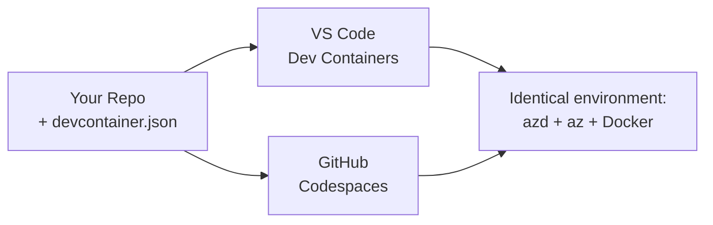

# Dev konteineriai ir GitHub Codespaces skirti azd

**Skyrių navigacija:**
- **📚 Kurso pradžia**: [AZD pradedantiesiems](../../README.md)
- **📖 Dabartinis skyrius**: 1 skyrius - Pagrindai ir greitas pradėjimas
- **⬅️ Ankstesnis**: [Atsinešk savo aplikaciją](bring-your-own-app.md)
- **🚀 Kitas skyrius**: [2 skyrius: AI pirmasis kūrimas](../chapter-02-ai-development/README.md)

> Komandų ir konfigūracijos peržiūros tikslas: `azd 1.37.2` (2026 m. lapkritis). Konteinerių kūrimai ir Azure diegimai nebuvo atlikti šios peržiūros metu.

## Įžanga

Įdiegti azd, tinkamą programavimo kalbos vykdymo aplinką, Docker ir Azure CLI kiekviename kompiuteryje – tai varginantis darbas, ir tai pagrindinė priežastis, kodėl pamoka, kuri „veikia mano kompiuteryje“, nepavyksta kažkam kitam. **Dev konteineris** tai išsprendžia aprašydamas visą jūsų įrankių grandinę faile. Kiekvienas, atidaręs projektą VS Code arba GitHub Codespaces, gauna tą pačią aplinką su iš anksto įdiegta azd. Ši pamoka parodys, kaip pridėti tokį konteinerį.

## Mokymosi tikslai

Pamokos pabaigoje jūs:
- Suprasite, kas yra dev konteineris ir kaip jis padeda naudojant azd
- Pridėsite minimalų `.devcontainer/devcontainer.json` į projektą
- Įtrauksite azd, Azure CLI ir Docker per Dev Container *features*
- Atidarysite projektą GitHub Codespaces arba VS Code aplinkoje

## Išmokimo rezultatai

Baigę pamoką galėsite:
- Rašyti `devcontainer.json` azd projektui
- Pridėti azd ir Azure įrankius be rankinių įdiegimų
- Vykdyti `azd up` iš konteinerio arba Codespace aplinkos

---

## Kas yra Dev konteineris?

Dev konteineris yra Docker pagrindu sukurta vystymo aplinka, aprašyta `.devcontainer/devcontainer.json` faile jūsų saugykloje. Kai atidarote projektą:

- **VS Code** (su Dev Containers plėtiniu) sukuria konteinerį ir prijungiasi prie jo.
- **GitHub Codespaces** sukuria tą patį konteinerį debesyje ir suteikia naršyklės pagrindu veikiantį redaktorių.

Bet kuriuo atveju, kiekvienas dalyvis gauna identiškus įrankius – jokių problemų, ar įdiegė azd.



---

## 1 žingsnis: sukurti devcontainer failą

Sukurkite `.devcontainer/devcontainer.json` savo projekto šaknyje:

```json
{
  "name": "azd-project",
  "image": "mcr.microsoft.com/devcontainers/base:bookworm",
  "features": {
    "ghcr.io/devcontainers/features/azure-cli:1": {},
    "ghcr.io/azure/azure-dev/azd:0": { "version": "1.37.2" },
    "ghcr.io/devcontainers/features/docker-in-docker:2": {},
    "ghcr.io/devcontainers/features/node:1": {}
  },
  "customizations": {
    "vscode": {
      "extensions": [
        "ms-azuretools.azure-dev",
        "ms-azuretools.vscode-bicep"
      ]
    }
  },
  "forwardPorts": [3000],
  "postCreateCommand": "azd version"
}
```

Ką atlieka kiekviena dalis:

| Raktas | Paskirtis |
|-----|---------|
| `image` | Konteinerio bazinė OS |
| `features` | Iš anksto paruošti diegėjai – čia: Azure CLI, **azd**, Docker ir Node.js |
| `customizations.vscode.extensions` | Automatiškai įdiegia azd ir Bicep VS Code plėtinius |
| `forwardPorts` | Atveria jūsų aplikacijos portą naršyklėje |
| `postCreateCommand` | Vykdomas vieną kartą po konteinerio sukūrimo (čia – patikrinimas) |

> Funkcijos versija (`azd:0`) ir įdiegta CLI versija yra skirtingos. Nustatykite funkcijos `version` opciją kaip `"1.37.2"`, kad užrakintumėte CLI versiją; nenaudokite funkcijos žymės kaip CLI versijos.

---

## 2 žingsnis: suderinkite funkciją su savo aplikacijos kalba

Pakeiskite `node` funkciją į tą, kurią naudoja jūsų aplikacija:

```jsonc
// Python project
"ghcr.io/devcontainers/features/python:1": {},

// .NET project
"ghcr.io/devcontainers/features/dotnet:2": {},

// Java project
"ghcr.io/devcontainers/features/java:1": {},

// Go project
"ghcr.io/devcontainers/features/go:1": {}
```

Išlaikykite `docker-in-docker` lokalų statymą, kai kuriate atvaizdus lokalioje aplinkoje. Konfigūruotas nuotolinis ACR kūrimas (`docker.remoteBuild: true`) yra alternatyva; pagal šeimininko tipą automatinių Docker nereikia visada.

---

## 3 žingsnis: atidarykite projektą

**VS Code aplinkoje:**
1. Įdiekite **Dev Containers** plėtinį.
2. Atidarykite projekto katalogą.
3. Paspauskite **Reopen in Container**, kai pasirodo raginimas (arba paleiskite *Dev Containers: Reopen in Container* komandą).

**GitHub Codespaces aplinkoje:**
1. Nusiųskite saugyklą į GitHub.
2. Paspauskite **Code → Codespaces → Create codespace on main**.
3. Palaukite, kol konteineris bus sukurtas – azd bus paruoštas terminale.

---

## 4 žingsnis: diegimas iš konteinerio viduje

Konteineryje iš anksto įdiegtas azd, tad įprasta darbo eiga veikia iš karto:

```bash
azd auth login --use-device-code   # device code is handy inside Codespaces
azd up
```

> **Kodėl `--use-device-code`?** Nuotoliniame konteineryje arba Codespace nėra vietinės naršyklės, todėl patikimiausias būdas yra prisijungimas naudojant įrenginio kodą. Turėsite įvesti kodą naršyklės lange, kad užbaigtumėte prisijungimą.

---

## Dažnos klaidos

| Klaida | Sprendimas |
|---------|-----|
| `azd up` nepavyksta sukurti atvaizdo | Pridėkite `docker-in-docker` funkciją |
| Naršyklės prisijungimas stringa Codespaces | Naudokite `azd auth login --use-device-code` |
| Skirtingi įrankiai tarp komandos narių | Užrakinkite CLI per azd funkcijos `version` opciją ir užrakinkite kalbos vykdymo aplinkas |
| Aplikacija neprieinama naršyklėje | Pridėkite portą prie `forwardPorts` |

---

## Santrauka

- Dev konteineris padaro jūsų azd įrankių grandinę atkuriamą visiems.
- Pridėkite azd, Azure CLI ir Docker per Dev Container *features*.
- Suderinkite kalbos funkciją su savo aplikacija ir išlaikykite `docker-in-docker` konteinerio šeimininkams.
- Vykdant Codespaces naudokite įrenginio kodo prisijungimą.

---

## 🔗 Navigacija

| Kryptis | Ištekliai |
|-----------|----------|
| **Ankstesnis** | [Atsinešk savo aplikaciją](bring-your-own-app.md) |
| **Skyriaus pradžia** | [1 skyrius: Pagrindai ir greitas pradėjimas](README.md) |
| **Kitas skyrius** | [2 skyrius: AI pirmasis kūrimas](../chapter-02-ai-development/README.md) |

## 📖 Susiję ištekliai

- [Įdiegimas ir nustatymas](installation.md)
- [Komandų atmintinė](../../resources/cheat-sheet.md)
- [Oficiali Dev Containers specifikacija](https://containers.dev/)
- [azd Dev Container funkcija](https://github.com/Azure/azure-dev/tree/main/ext/devcontainer)

---

<!-- CO-OP TRANSLATOR DISCLAIMER START -->
**Atsakomybės apribojimas**:
Šis dokumentas buvo išverstas naudojant dirbtinio intelekto vertimo paslaugą [Co-op Translator](https://github.com/Azure/co-op-translator). Nors siekiame tikslumo, prašome atkreipti dėmesį, kad automatiniai vertimai gali turėti klaidų ar netikslumų. Originalus dokumentas jo gimtąja kalba laikomas autoritetingu šaltiniu. Svarbiai informacijai rekomenduojama naudoti profesionalų žmogiškąjį vertimą. Mes neatsakome už jokius nesusipratimus ar neteisingą interpretaciją, kilusią naudojantis šiuo vertimu.
<!-- CO-OP TRANSLATOR DISCLAIMER END -->