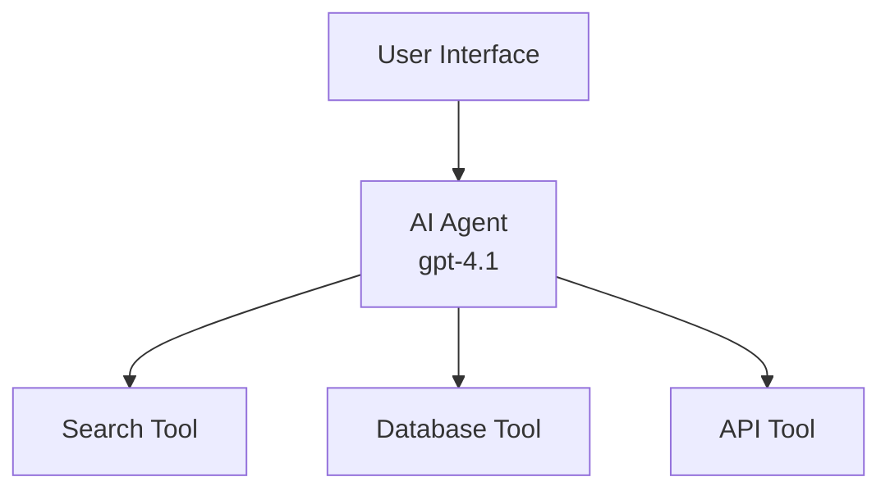
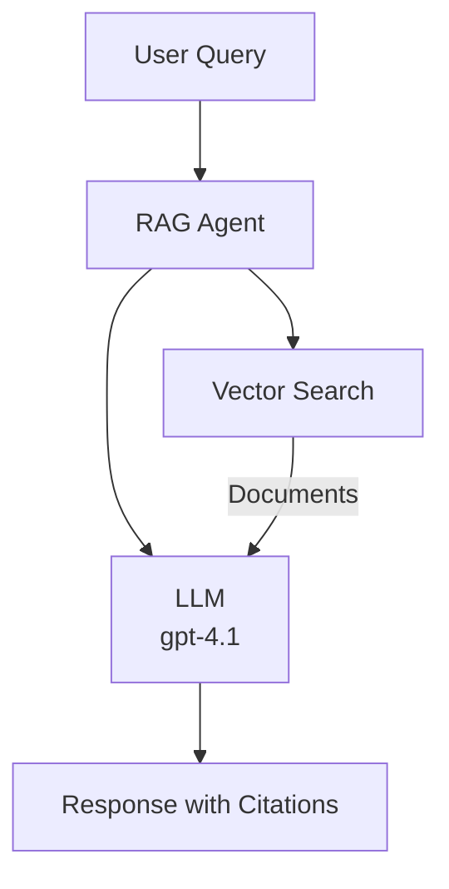
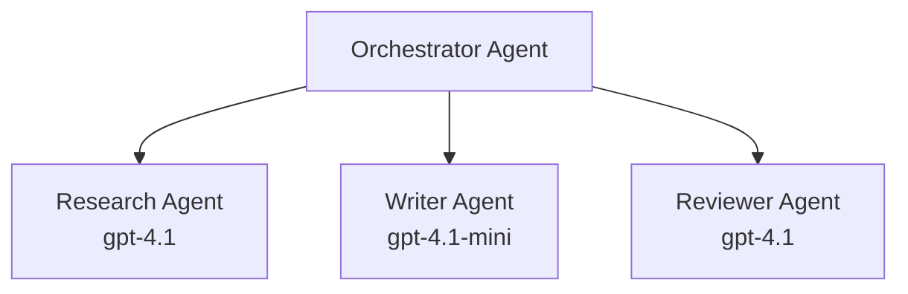

# Dirbtinio intelekto agentai su Azure Developer CLI

**Skyriaus navigacija:**
- **📚 Kurso pradžia**: [AZD pradedantiesiems](../../README.md)
- **📖 Dabartinis skyrius**: 2 skyrius - Dirbtinio intelekto pirmumo vystymas
- **⬅️ Ankstesnis**: [Microsoft Foundry integracija](microsoft-foundry-integration.md)
- **➡️ Kitas**: [DI modelio diegimas](ai-model-deployment.md)
- **🚀 Išplėstinis**: [Daugių agentų sprendimai](../../examples/retail-scenario.md)

---

## Įvadas

Dirbtinio intelekto agentai – tai autonominės programos, kurios gali suvokti savo aplinką, priimti sprendimus ir imtis veiksmų siekdamos konkrečių tikslų. Skirtingai nei paprasti pokalbių robotai, kurie atsako į užklausas, agentai gali:

- **Naudoti įrankius** – kviesti API, ieškoti duomenų bazėse, vykdyti kodą
- **Planuoti ir mąstyti** – sudėtingas užduotis suskaidyti į žingsnius
- **Mokytis iš konteksto** – palaikyti atmintį ir prisitaikyti prie elgesio
- **Bendradarbiauti** – dirbti su kitais agentais (daugių agentų sistemos)

Šiame vadove parodysime, kaip diegti DI agentus Azure naudojant Azure Developer CLI (azd).

Pokalbių konteksto naudojimas nėra modelio mokymas: nuolatinė atmintis, prieigos kontrolė ir saugojimas turi būti įgyvendinti/konfigūruoti programos.

> **Foundry GA atnaujinimas (2026-11-09):** Įdiekite viešai prieinamą `microsoft.foundry` 1.0 paketą su `azd >= 1.37.0`. Vertinimai įdiegiami atskirai; neprivalomi peržiūros funkcionalumai ir žemiau pateiktas klasikinis SDK fragmentas nebus paskelbti GA su paketo paskelbimu. Ši rekomendacija paremta [GA paskelbimu](https://devblogs.microsoft.com/azure-sdk/microsoft-foundry-azure-developer-cli-ga/) ir dokumentacija, ne tiesiogine Azure diegimu.

## Mokymosi tikslai

Baigę šį vadovą Jūs:
- Suprasite, kas yra DI agentai ir kuo jie skiriasi nuo pokalbių robotų
- Išmoksite diegti iš anksto paruoštus DI agentų šablonus naudojant AZD
- Konfigūruosite Foundry agentus individualiems agentams
- Įgyvendinsite pagrindinius agentų modelius (įrankių naudojimas, RAG, daugių agentų sistema)
- Seksite ir derinsite diegtus agentus

## Pasiekimai po mokymosi

Baigę sugebėsite:
- Vienu komandos įdiegti DI agentų programas Azure
- Konfigūruoti agentų įrankius ir galimybes
- Įgyvendinti atgavimo pagrindu papildomą generavimą (RAG) su agentais
- Kurti daugių agentų architektūras sudėtingiems darbo srautams
- Spręsti dažniausias agentų diegimo problemas

---

## 🤖 Kas Skiria Agentą Nuo Pokalbių Roboto?

| Savybė | Pokalbių robotas | DI agentas |
|---------|-----------------|----------|
| **Elgesys** | Atsako į užklausas | Imasi autonominių veiksmų |
| **Įrankiai** | Gali naudoti paiešką ar įrankius | Paprastai naudoja įrankius tikslo siekimo cikle |
| **Atmintis** | Priklauso nuo programos | Nuolatinė atmintis tik jei aiškiai įgyvendinta |
| **Planavimas** | Vienkartinis atsakymas | Daugiapakopis mąstymas |
| **Bendradarbiavimas** | Vienas subjektas | Gali dirbti su kitais agentais |

### Paprasta analogija

- **Pokalbių robotas** = Pagalbininkas, atsakantis į klausimus informacijos centre
- **DI agentas** = Asmeninis asistentas, kuris gali skambinti, užsakyti susitikimus ir atlikti užduotis už jus

---

## 🚀 Greitas pradžios vadovas: Pirmojo agente diegimas

Pasirinkite vieną variantą **naujame tuščiame darbo kataloge**. Galinį `.` ten inicijuoja; be aiškios paskirties, dabartinis AZD gali sukurti pasikartojančio šablono pavadinimo poaplankį ir nepakeis Jūsų terminalo katalogo. Laikykite atskirus šablonus/aplinkas atskiruose kataloguose.

Toliau pateikti laiko/kainos intervalai yra apytiksliai, ne patvirtintos kainos. Prieš diegdami patikrinkite kiekvieno pavyzdžio dabartinius reikalavimus, kainodarą, modelio kvotą ir papildomas paslaugas.

### 1 variantas: Foundry agentų šablonas (rekomenduojama)

```bash
# Initialize the AI agents template
azd init --template get-started-with-ai-agents .

# Deploy to Azure
azd up
```

**Kas diegiama:** Šablono dabartinė infrastruktūra ir pasirinktos parinktys lemia modelį, įrankius, talpinimą ir stebėjimo išteklius. Peržiūrėkite jo README ir `infra/` prieš diegdami; ne kiekvienas agentų šablonas apima Paiešką ar žiniatinklio sąsają.

**Laikas:** apie 15-20 minučių
**Kaina:** apie 100-150 USD/mėn (vystymui)

### 2 variantas: Kūrybinio rašymo agentai su Prompty

```bash
# Initialize the Prompty-based agent template
azd init --template https://github.com/Azure-Samples/contoso-creative-writer .

# Deploy to Azure
azd up
```

**Kas diegiama:** FastAPI/Prompty daugių agentų rašymo pavyzdys, naudojantis Azure OpenAI, Bing Grounding ir Azure AI Search. Ankstesnis `agent-openai-python-prompty` repozitorijos adresas nukreipia čia; tai nėra minimalus Azure Functions orų agento šablonas. Vadovaukitės jo dabartiniu README, kad sužinotumėte apie talpinimą, modelio kvotą ir Bing Grounding išankstinius reikalavimus.

**Laikas:** apie 10-15 minučių
**Kaina:** apie 50-100 USD/mėn (vystymui)

### 3 variantas: RAG pokalbių agentas

```bash
# Initialize RAG chat template
azd init --template azure-search-openai-demo .

# Deploy to Azure
azd up
```

**Kas diegiama:**
- ✅ Microsoft Foundry modeliai
- ✅ Azure AI Search su pavyzdiniais duomenimis
- ✅ Dokumentų apdorojimo srautas
- ✅ Pokalbių sąsaja su citatomis

**Laikas:** apie 15-25 minutes
**Kaina:** apie 80-150 USD/mėn (vystymui)

### 4 variantas: Talpinamas agentas su GA Foundry paketu

Naudokite [pilną talpinamo agento apžvalgą](microsoft-foundry-integration.md#hosted-agent-walkthrough-ga) su pagrindiniu Python Agent Framework Responses API pavyzdžiu. Šis kodo diegimo kelias reikalauja Python 3.13+, dabartinio uv, Foundry leidimų ir regioninės modelio kvotos. Autentifikuokite vietines SDK užklausas atskirai, kai naudojate Azure CLI kredencialus.

```bash
azd auth login
azd ext install microsoft.foundry
```

Naujame kataloge inicijuokite pavyzdį:

```text
azd ai agent init --template https://github.com/microsoft-foundry/foundry-samples/blob/main/samples/python/hosted-agents/agent-framework/responses/01-basic/azure.yaml --deploy-mode code --src .
```

Pasirinkite naują ar esamą projektą, peržiūrėkite `azure.yaml` ir paleiskite `azd provision`. Naudokite `azd ai agent run` norėdami atidaryti Agent Inspector ir iš kito to paties katalogo terminalo paleiskite `azd ai agent invoke --local "Explain how this agent is hosted."`. Patvirtinę vietoje, naudokite `azd deploy` ir `azd ai agent invoke "Explain how this agent is hosted."`, kad palygintumėte diegiamą atsakymą. Foundry kuria įkeliamą šaltinį nuotoliniu būdu; vietinis konteinerio kūrimas nėra būtinas.

**Kada naudoti `azd ai agent init` vs `azd init --template`:**

| Požiūris | Geriausia skirta | Kaip veikia |
|----------|----------------|----------|
| `azd init --template` | Pradėti nuo veikiančio pavyzdžio programos | Nukopijuoja pilną šablono repozitoriją su kodu ir infrastruktūra |
| `azd ai agent init --template` | Įsisavinti esamą Foundry agentų projektą | Naudoja `azure.yaml` projekto dokumentą ir jo aprašymus |

> **Patariama:** 1–3 variantai prasideda nuo pilnų programų šablonų; 4 variantas moko GA talpinamo agento darbo eigos. Nei vienas inicijavimo komanda automatiškai nemigruoja senųjų agentų manifestų. Norėdami pridėti tiesioginį agento aprašymą prie esamo projekto, žr. [inicijavimo ir migracijos gaires](../chapter-08-production/production-ai-practices.md#initializing-agent-projects-with-azd-ai-agent-init).

Įdiekite `azure.ai.evaluations` atskirai, jei norite generuoti ir peržiūrėti testinius duomenis/kriterijus, sukonfigūruoti vertinimą ir paleisti jį naudodami `azd ai eval`. Optimizavimas gali pakartotinai naudoti suderinamą vertinimą; peržiūrėkite kandidatus prieš konkrečiai diegdami. Vadovaukitės [vertinimo darbo eiga](../chapter-08-production/production-ai-practices.md#evaluation-migration-and-quality-checks) ir [optimizavimo migracija](../chapter-08-production/production-ai-practices.md#optimization-configuration-migration) prieš naudodami senesnius pavyzdžius. Valymui, pakartotinai naudojamo Foundry projekto ištekliai lieka po `azd down`; naujo projekto išteklių grupė ištrinami. Žr. [valymo gairės](microsoft-foundry-integration.md#7-clean-up-deliberately).

---

## 🏗️ Agentų architektūros modeliai

### Modelis 1: Vienas agentas su įrankiais

Paprasčiausias agento modelis – vienas agentas, galintis naudoti kelis įrankius.



**Geriausia skirta:**
- Klientų aptarnavimo robotai
- Tyrimų asistentai
- Duomenų analizės agentai

**Susijęs programos pavyzdys:** `azure-search-openai-demo` demonstruoja RAG, o ne bendrą įrankių agentų ciklą.

### Modelis 2: RAG agentas (pagal paiešką pagrįsta generacija)

Agentas, kuris išgauna susijusius dokumentus prieš generuodamas atsakymus.



**Geriausia skirta:**
- Įmonių žinių bazėms
- Dokumentų klausimų ir atsakymų sistemoms
- Atitikties ir teisiniams tyrimams

**AZD šablonas:** `azure-search-openai-demo`

### Modelis 3: Daugių agentų sistema

Keli specializuoti agentai dirbantys kartu sudėtingoms užduotims.



**Geriausia skirta:**
- Sudėtingam turinio kūrimui
- Daugiapakopiams darbo srautams
- Užduotims reikalaujančioms skirtingų kompetencijų

**Sužinokite daugiau:** [Daugių agentų koordinavimo modeliai](../chapter-06-pre-deployment/coordination-patterns.md)

---

## ⚙️ Agentų įrankių konfigūravimas

Agentai tampa galingi, kai gali naudoti įrankius. Štai kaip sukonfigūruoti dažnus įrankius:

### Įrankių konfigūracija Foundry agentuose

Šis **klasikinis Agent Service SDK fragmentas** orientuotas į `azure-ai-projects==1.0.0` ir `azure-ai-agents==1.1.0` naudojant `azure-identity`. Tai nėra naujesnis versioned-agent/Responses API, kurį naudoja kai kurie dabartiniai Foundry šablonai, taip pat ne `azure.ai.agents` AZD plėtinys (tai kitoks paketas). Nesimaišykite šių API versijų. Nustatykite `PROJECT_ENDPOINT` klasikiniam Foundry projekto galui ir `MODEL_DEPLOYMENT_NAME` esamam palaikomam modelio diegimui; vietoje autentifikuokitės naudodami `az login` ir suteikite reikiamas projekto teises.

```python
# agent_config.py
import os
from azure.ai.projects import AIProjectClient
from azure.ai.agents.models import FunctionTool
from azure.identity import DefaultAzureCredential

def search_knowledge_base(query: str) -> str:
    """Search the demonstration knowledge base.

    :param query: Search text.
    :return: Matching demonstration information.
    """
    # Local fixture only, not a production search implementation.
    return "Demo policy: returns are accepted within 30 days."

project_client = AIProjectClient(
    endpoint=os.environ["PROJECT_ENDPOINT"],
    credential=DefaultAzureCredential(),
)
search_tool = FunctionTool(functions={search_knowledge_base})
project_client.agents.enable_auto_function_calls(search_tool)
agent = project_client.agents.create_agent(
    model=os.environ["MODEL_DEPLOYMENT_NAME"],
    name="Support Agent",
    instructions="Use search_knowledge_base for policy questions. Label results as demo data.",
    tools=search_tool.definitions,
)
```

Funkcijos schemos registravimas nevykdo Python paslaugos pusėje. Šiame SDK, `enable_auto_function_calls` kartu su `agents.runs.create_and_process(...)` paleidžia užregistruotus atgalinius kvietimus jūsų kliento procese. Žr. [išleistą SDK pavyzdį](https://github.com/Azure/azure-sdk-for-python/blob/azure-ai-agents_1.1.0/sdk/ai/azure-ai-agents/samples/agents_tools/sample_agents_auto_function_call.py). Baigę uždarykite klientą ir ištrinkite demonstracinius agentus/siūlus.

### Aplinkos konfigūracija

Toliau pateikti pavadinimai yra **iliustraciniai pasirinktiniai šablono įvestys**, ne įmontuoti AZD perjungimai. Pirmiausia perleiskite kiekvieną reikšmę per `infra/main.parameters.json`, infrastruktūrą ir programos kodą. Vien `azd env set` nekeičia agento įrankių ar instrukcijų.

```bash
# Set up agent-specific environment variables
azd env set AZURE_OPENAI_MODEL "gpt-4.1"
azd env set AGENT_INSTRUCTIONS "You are a helpful assistant..."
azd env set ENABLE_CODE_INTERPRETER "true"
azd env set ENABLE_FILE_SEARCH "true"

# Apply wired infrastructure and application changes
azd up
```

---

## 📊 Agentų stebėsena

### Application Insights integracija

Jei jūsų pasirinktas šablonas diegia Application Insights ir konfigūruoja instrumentaciją:

```bash
# Open monitoring dashboard
azd monitor --overview

# Open the Application Insights logs view (not a streaming log tail)
azd monitor --logs

# View live metrics
azd monitor --live
```

### Pagrindiniai stebimi rodikliai

| Rodiklis | Aprašymas | Tikslas |
|----------|-----------|---------|
| Atsako vėlinimas | Laikas sugeneruoti atsakymą | < 5 sekundžių |
| Žetonų naudojimas | Žetonai už užklausą | Stebėti sąnaudas |
| Įrankio kvietimo sėkmės rodiklis | % sėkmingų įrankių vykdymų | > 95% |
| Klaidos rodiklis | Nepavykę agentų užklausimai | < 1% |
| Vartotojo pasitenkinimas | Atsiliepimų balai | > 4.0/5.0 |

### Pasirinktinis žurnalas agentams

```python
import os
from azure.monitor.opentelemetry import configure_azure_monitor
from opentelemetry import trace

# Configure Azure Monitor with OpenTelemetry
configure_azure_monitor(
    connection_string=os.environ["APPLICATIONINSIGHTS_CONNECTION_STRING"]
)

tracer = trace.get_tracer(__name__)

def log_agent_interaction(user_query, agent_response, tools_used, latency_ms):
    with tracer.start_as_current_span("agent_interaction") as span:
        span.set_attributes({
            "query_length": len(user_query),  # Do not log raw prompts or personal data
            "response_length": len(agent_response),
            "tools_used": tools_used,
            "latency_ms": latency_ms
        })
```

> **Pastaba:** Įdiekite reikalingą paketą: `pip install azure-monitor-opentelemetry`. Jis atneša OpenTelemetry priklausomybes; importavimas namespace nėra būtinas, norint įdiegti paketą pavadinimu `opentelemetry`.

---

## 💰 Sąnaudų apsvarstymai

### Apskaičiuotos mėnesinės sąnaudos pagal modelį

Tai iliustraciniai planavimo diapazonai, o ne kainų pasiūlymai ar išlaidų apribojimai. Regionas, modelio žetonai, Paieškos/kompiuterijos SKU, įrankių seansai, saugykla ir srautas gali viršyti šiuos kriterijus. Prieš `azd up` patikrinkite pavyzdžio kainodaros gaires ir Azure kainas.

| Modelis | Vystymo aplinka | Produkcija |
|---------|-----------------|------------|
| Vienas agentas | $50-100 | $200-500 |
| RAG agentas | $80-150 | $300-800 |
| Daugių agentų sistema (2-3 agentai) | $150-300 | $500-1,500 |
| Įmonių daugių agentų sistema | $300-500 | $1,500-5,000+ |

### Sąnaudų optimizavimo patarimai

1. **Naudokite gpt-4.1-mini paprastoms užduotims** (tik jei jūsų šablonas naudoja šį įvestį)
   ```bash
   azd env set AZURE_OPENAI_MODEL "gpt-4.1-mini"
   ```

2. **Įgyvendinkite apimtą kešavimą saugioms pakartotinėms užklausoms.** Apimkite nuomininko/vartotojo autorizaciją, modelio diegimą, instrukcijas ir paieškos versiją kešo rakte; nustatykite galiojimo laiką. Nesidalinkite privačiais pokalbių atsakymais per visišką tik skaitymui skirtą kešą. SDK agentų objektas neturi bendros `agent.run()` funkcijos.

3. **Nustatykite žetonų limitus kiekvienam vykdymui**
   ```python
   # Set max_completion_tokens when running the agent, not during creation
   run = project_client.agents.runs.create_and_process(
       thread_id=thread.id,
       agent_id=agent.id,
       max_completion_tokens=1000  # Budget across the run; may finish as incomplete
   )
   ```

4. **Mastelizuokite tinkamus Container Apps į nulį, kai nenaudojami**
   ```bash
   # Custom-template input: must map to template.scale.minReplicas
   azd env set MIN_REPLICAS "0"
   ```
   Pritaikykite infrastruktūros pakeitimą su `azd provision` arba `azd up`. Mastelis į nulį reikalauja tinkamo suveikimo signalo ir nesustabdo Paieškos, saugyklos ar modeliavimo/įrankių mokėjimų.

---

## 🔧 Agentų trikčių šalinimas

### Dažnos problemos ir sprendimai

<details>
<summary><strong>❌ Agentas nereaguoja į įrankio kvietimus</strong></summary>

```bash
# Inspect the application deployment (not the agent's registered tools)
azd show

# Verify OpenAI deployment
az cognitiveservices account deployment list \
  --name $AZURE_OPENAI_NAME \
  --resource-group $RG_NAME

# Check agent logs
azd monitor --logs
```

**Dažnos priežastys:**
- Įrankio funkcijos signatūros neatitikimas
- Trūksta privalomų teisių
- API pabaigos taškas neprieinamas
</details>

<details>
<summary><strong>❌ Aukštas agentų atsakymų vėlavimas</strong></summary>

```bash
# Check Application Insights for bottlenecks
azd monitor --live

# Consider using a faster model
azd env set AZURE_OPENAI_MODEL "gpt-4.1-mini"
azd up
```

**Optimizavimo patarimai:**
- Naudokite srautinį atsakymą
- Įgyvendinkite atsakymo kešavimą
- Sumažinkite konteksto lango dydį
</details>

<details>
<summary><strong>❌ Agentas pateikia neteisingą arba halucinacinę informaciją</strong></summary>

```python
# Improve with better system prompts
instructions = """
You are a helpful assistant. IMPORTANT:
- Only answer based on provided context
- If you don't know, say "I don't know"
- Always cite your sources
- Never make up information
"""

# Use these instructions in the agent definition.
# For classic file search, first upload/index documents in a vector store,
# then use FileSearchTool(vector_store_ids=[...]) and pass both its
# .definitions and .resources when creating the agent.
```
Instrukcijos ir paieška sumažina riziką; nė viena neužtikrina faktinių atsakymų. Vertinkite pagrįstus ir neįtrauktus klausimus pagal žinomas atsakymus.
</details>

<details>
<summary><strong>❌ Viršytos žetonų riba klaidos</strong></summary>

```python
# Implement context window management
def truncate_context(messages, max_tokens=8000, model="gpt-4.1"):
    """Approximate content-only budget for objects with .content strings."""
    import tiktoken
    encoding = tiktoken.encoding_for_model(model)
    total_tokens = 0
    truncated = []
    
    for msg in reversed(messages):
        msg_tokens = len(encoding.encode(msg.content))
        if total_tokens + msg_tokens > max_tokens:
            break
        truncated.insert(0, msg)
        total_tokens += msg_tokens
    
    return truncated
```
Šis padėjėjas pašalina vaidmens/įrankio schemas, sistemos instrukcijas, vaizdų žetonus ir protokolo apkrovą. Rezervuokite vietos jiems ir užbaigimui; neskaldykite įrankio kvietimų/rezultatų porų ar neatmeskite reikiamų sistemos instrukcijų. Įdiekite `tiktoken` atskirai. Tai nėra bendras konteksto lango validatorius.
</details>

---

## 🎓 Praktinės užduotys

### Užduotis 1: Pagrindinio agento diegimas (20 minučių)

**Tikslas:** Pirmojo DI agento diegimas naudojant AZD

```bash
# Step 1: Initialize template
azd init --template get-started-with-ai-agents .

# Step 2: Login to Azure
azd auth login
# If you work across tenants, add --tenant-id <tenant-id>

# Step 3: Deploy
azd up

# Step 4: Test the agent
# Expected output after deployment:
#   Deployment Complete!
#   Endpoint: https://<app-name>.<region>.azurecontainerapps.io
# Open the URL shown in the output and try asking a question

# Step 5: View monitoring
azd monitor --overview

# Step 6: Review the listed resources and confirm cleanup
azd down
```

**Sėkmės kriterijai:**
- [ ] Agentas atsako į klausimus
- [ ] Gali pasiekti stebėjimo prietaisų skydelį per `azd monitor`
- [ ] Ištekliai sėkmingai išvalyti

### Užduotis 2: Pridėti pasirinktą įrankį (30 minučių)

**Tikslas:** Išplėsti agentą pasirinktu įrankiu

**Pradinė vieta:** Naudokite klasikinį SDK klientą iš [Tool Configuration](#tool-configuration-in-foundry-agents), o ne bet kokį šabloną su kita SDK generacija.

1. Pridėkite šį deterministinį testą į `agent_config.py`:
   ```python
   def get_weather(location: str) -> str:
       """Return demonstration weather, not live conditions.

       :param location: City name.
       :return: A clearly labelled fixture.
       """
       print(f"TOOL_CALLED: {location}")
       return f"Demo weather in {location}: Sunny, 72°F (fixture, not live)"
   ```
2. Pakeiskite paieškos įrankio registracijos ir kūrimo bloką į:
   ```python
   weather_tool = FunctionTool(functions={get_weather})
   project_client.agents.enable_auto_function_calls(weather_tool)
   agent = project_client.agents.create_agent(
       model=os.environ["MODEL_DEPLOYMENT_NAME"],
       name="Weather Agent",
       instructions="Call get_weather for weather questions; explain that it returns demo data.",
       tools=weather_tool.definitions,
   )
   thread = project_client.agents.threads.create()
   try:
       project_client.agents.messages.create(
           thread_id=thread.id, role="user", content="Use get_weather for Seattle."
       )
       run = project_client.agents.runs.create_and_process(
           thread_id=thread.id, agent_id=agent.id
       )
       if run.status != "completed":
           raise RuntimeError(f"Run status: {run.status}; error: {run.last_error}")
       for message in project_client.agents.messages.list(thread_id=thread.id):
           for text in message.text_messages:
               print(text.text.value)
   finally:
       project_client.agents.threads.delete(thread.id)
       project_client.agents.delete_agent(agent.id)
       project_client.close()
   ```
3. Vykdykite vietoje (tai kviečia esamą Azure projektą ir sukelia modelio mokesčius):
   ```bash
   python agent_config.py
   # Expected: TOOL_CALLED: Seattle, then a completed answer labelled demo data.
   ```

**Sėkmės kriterijai:**
- [ ] Agentas atpažįsta su oru susijusius klausimus
- [ ] Įrankis kviečiamas teisingai
- [ ] Atsakyme yra oro sąlygų informacija

### Užduotis 3: Sukurti RAG agentą (45 minutės)

**Tikslas:** Sukurti agentą, kuris atsako į klausimus pagal jūsų dokumentus

```bash
# Step 1: Deploy RAG template
azd init --template azure-search-openai-demo .
azd up

# Step 2: Upload your documents
# For the sample's local ingestion path, place supported files in data/.
# Run from the sample root after following its Python environment setup:
./scripts/prepdocs.sh
# Windows PowerShell equivalent: .\\scripts\\prepdocs.ps1

# Step 3: Test with domain-specific questions
# Open the web app URL from the azd up output
# Ask questions about your uploaded documents
# Responses should include citation references like [doc.pdf]
```

**Sėkmės kriterijai:**
- [ ] Agentas atsako remdamasis įkeltiniais dokumentais
- [ ] Atsakymai turi citatas
- [ ] Už užribio klausimus atsakoma be nepalaikomų teiginių (ne garantija kiekvienam ateities klausimui)

Jei `USE_CLOUD_INGESTION=true`, naudokite pavyzdžio debesies įkėlimo/apdorojimo darbo eigą; vietinė apgaubiklio funkcija sąmoningai praleidžia įkėlimą. Po testavimo paleiskite `azd down` RAG aplinkoje ir peržiūrėkite ištrynimui skirtus išteklius.

---

## 📚 Kiti žingsniai

Dabar, kai suprantate AI agentus, tyrinėkite šias pažangias temas:

| Tema | Aprašymas | Nuoroda |
|-------|-------------|------|
| **Daugiagentės sistemos** | Kurkite sistemas su keliais bendradarbiaujančiais agentais | [Retail Multi-Agent Example](../../examples/retail-scenario.md) |
| **Koordinavimo modeliai** | Išmokite orkestravimo ir komunikacijos modelius | [Coordination Patterns](../chapter-06-pre-deployment/coordination-patterns.md) |
| **Produkcijos diegimas** | Agentų diegimas įmonės lygmeniu | [Production AI Practices](../chapter-08-production/production-ai-practices.md) |
| **Agentų vertinimas** | Testuokite ir vertinkite agentų našumą | [AI Troubleshooting](../chapter-07-troubleshooting/ai-troubleshooting.md) |
| **AI dirbtuvės** | Praktika: paruoškite savo AI sprendimą AZD | [AI Workshop Lab](ai-workshop-lab.md) |

---

## 📖 Papildomi ištekliai

### Oficialūs dokumentai
- [Microsoft Foundry Agent Service](https://learn.microsoft.com/azure/ai-services/agents/)
- [Microsoft Foundry Agent Service Quickstart](https://learn.microsoft.com/azure/ai-services/agents/quickstart)
- [Semantic Kernel Agent Framework](https://learn.microsoft.com/semantic-kernel/)

### AZD šablonai agentams
- [Pradėkite darbą su AI agentais](https://github.com/Azure-Samples/get-started-with-ai-agents)
- [Kūrybiniai rašymo agentai su Prompty](https://github.com/Azure-Samples/contoso-creative-writer)
- [Azure Search OpenAI demonstracija](https://github.com/Azure-Samples/azure-search-openai-demo)

### Bendruomenės ištekliai
- [Awesome AZD - agentų šablonai](https://azure.github.io/awesome-azd/?tags=ai-agents)
- [Azure AI Discord](https://discord.gg/microsoft-azure)
- [Microsoft Foundry Discord](https://discord.gg/nTYy5BXMWG)

### Agentų įgūdžiai jūsų redaktoriui
- [**Microsoft Azure agentų įgūdžiai**](https://skills.sh/microsoft/github-copilot-for-azure) - Įdiekite pakartotinai naudojamus AI agentų įgūdžius Azure kūrimui GitHub Copilot, Cursor ar bet kuriame palaikomame agente. Apima įgūdžius [Azure AI](https://skills.sh/microsoft/github-copilot-for-azure/azure-ai), [Microsoft Foundry](https://skills.sh/microsoft/github-copilot-for-azure/microsoft-foundry), [diegimui](https://skills.sh/microsoft/github-copilot-for-azure/azure-deploy) ir [diagnostikai](https://skills.sh/microsoft/github-copilot-for-azure/azure-diagnostics):
  ```bash
  npx skills add microsoft/github-copilot-for-azure
  ```

---

**Navigacija**
- **Ankstesnė pamoka**: [Microsoft Foundry integracija](microsoft-foundry-integration.md)
- **Kita pamoka**: [AI modelio diegimas](ai-model-deployment.md)

---

<!-- CO-OP TRANSLATOR DISCLAIMER START -->
**Atsakomybės apribojimas**:
Šis dokumentas buvo išverstas naudojant dirbtinio intelekto vertimo paslaugą [Co-op Translator](https://github.com/Azure/co-op-translator). Nors siekiame tikslumo, prašome atkreipti dėmesį, kad automatiniai vertimai gali turėti klaidų ar netikslumų. Originalus dokumentas jo gimtąja kalba laikomas autoritetingu šaltiniu. Svarbiai informacijai rekomenduojama naudoti profesionalų žmogiškąjį vertimą. Mes neatsakome už jokius nesusipratimus ar neteisingą interpretaciją, kilusią naudojantis šiuo vertimu.
<!-- CO-OP TRANSLATOR DISCLAIMER END -->