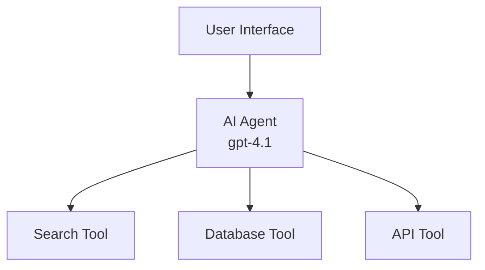
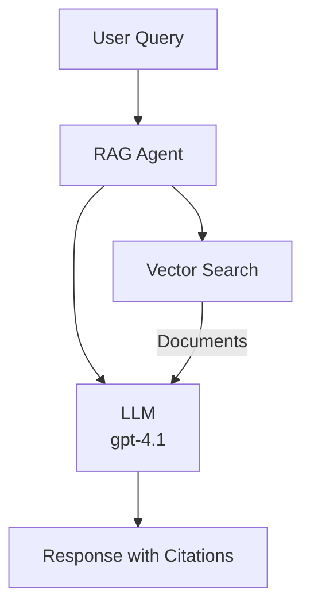
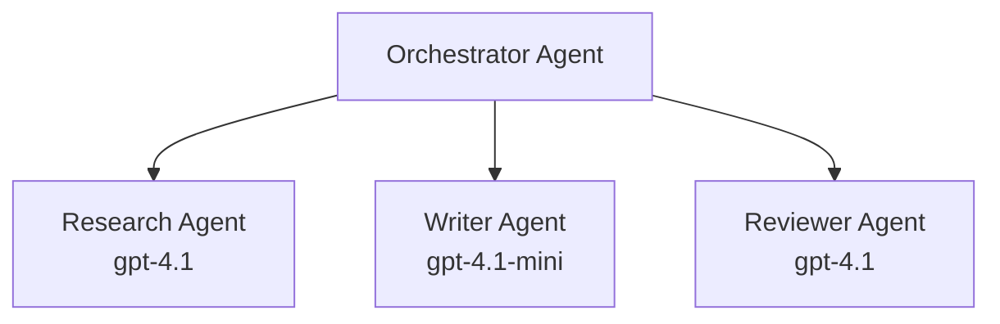

# AI Agentai su Azure Developer CLI

**Skyriaus naršymas:**
- **📚 Kurso pradžia**: [AZD Pradedantiesiems](../../README.md)
- **📖 Dabartinis skyrius**: 2 skyrius - AI-pirmoji plėtra
- **⬅️ Ankstesnis**: [Microsoft Foundry integracija](microsoft-foundry-integration.md)
- **➡️ Sekantis**: [AI modelio diegimas](ai-model-deployment.md)
- **🚀 Pažengusiems**: [Daugiagentinės sprendimų galimybės](../../examples/retail-scenario.md)

---

## Įvadas

AI agentai yra autonominės programos, kurios gali suvokti savo aplinką, priimti sprendimus ir imtis veiksmų, siekdami specifinių tikslų. Skirtingai nei paprasti pokalbių robotai, kurie atsako į užklausas, agentai gali:

- **Naudoti įrankius** – iškviesti API, ieškoti duomenų bazėse, vykdyti kodą
- **Planuoti ir mąstyti** – sudėtingas užduotis suskaidyti į žingsnius
- **Mokytis iš konteksto** – palaikyti atmintį ir prisitaikyti prie elgesio
- **Bendradarbiauti** – dirbti su kitais agentais (daugiagentinės sistemos)

Šiame vadove paaiškinsime, kaip diegti AI agentus Azure platformoje naudojant Azure Developer CLI (azd).

Pokalbio konteksto naudojimas nėra modelio mokymas: nuolatinė atmintis, prieigos kontrolė ir saugojimas turi būti įgyvendinti / sukonfigūruoti programos.

> **Leidimo apžvalga (2026-11-04):** CLI pavyzdžiai buvo patikrinti su `azd` `1.37.2`, `azure.ai.agents` `1.0.0-beta.23` ir `azure.ai.evaluations` `1.0.0-beta.2` dokumentacija/šaltiniu, ne tiesioginiu Azure diegimu. Naudokite `azd >= 1.37.0` kombinuotam darbo eigai. Prieš atnaujinant senesnius projektus, peržiūrėkite [naujausius pakeitimus ir pataisas](../chapter-08-production/production-ai-practices.md#recent-release-changes-and-fixes).

## Mokymosi tikslai

Baigę šį vadovą, jūs:
- Suprasite, kas yra AI agentai ir kuo jie skiriasi nuo pokalbių robotų
- Išmoksite diegti iš anksto paruoštus AI agentų šablonus naudojant AZD
- Sužinosite, kaip sukonfigūruoti Foundry agentus individualiems agentams
- Įgyvendinsite pagrindines agentų schemas (įrankių naudojimas, RAG, daugiagentinis)
- Stebėsite ir derinsite įdiegtus agentus

## Mokymosi rezultatai

Baigę, galėsite:
- Diegti AI agentų programas Azure viena komanda
- Konfigūruoti agentų įrankius ir galimybes
- Įgyvendinti atsižvelgiant į paiešką generavimą (RAG) su agentais
- Kurti daugiagentines architektūras sudėtingoms darbo srovėms
- Išspręsti dažniausias agentų diegimo problemas

---

## 🤖 Kas daro agentą skirtingu nuo pokalbių roboto?

| Savybė | Pokalbių robotas | AI agentas |
|---------|---------|----------|
| **Elgesys** | Atsako į užklausas | Imasi autonominių veiksmų |
| **Įrankiai** | Gali naudoti paiešką ar įrankius | Paprastai naudoja įrankius siekdamas tikslų |
| **Atmintis** | Priklauso nuo programos | Nuolatinė atmintis tik jei aiškiai įgyvendinta |
| **Planavimas** | Vienkartinis atsakymas | Daugiapakopis mąstymas |
| **Bendradarbiavimas** | Vienas subjektas | Gali dirbti su kitais agentais |

### Paprasta analogija

- **Pokalbių robotas** = Naudingas asmuo, atsakantis į klausimus informacijos punkte
- **AI agentas** = Asmeninis asistentas, kuris gali skambinti, užsakyti susitikimus ir atlikti užduotis už jus

---

## 🚀 Greitas startas: Išbandykite pirmąjį agentą

Pasirinkite vieną variantą **naujoje tuščioje darbo direktorijoje**. Baiginys `.` inicializuoja ten; be nurodyto tikslo, dabartinis AZD gali sukurti šablono pavadinimą turinčią potaplį ir nekeičia jūsų apvalkalo direktorijos. Laikykite skirtingus šablonus/aplankus atskirai.

Toliau pateikti laiko/kainos intervalai yra iliustraciniai, ne patvirtinti pasiūlymai. Prieš diegdami pasitikrinkite kiekvieno pavyzdžio dabartines prielaidas, kainodarą, modelio kvotą ir pasirenkamas paslaugas.

### 1 variantas: Foundry agentų šablonas (rekomenduojamas)

```bash
# Initialize the AI agents template
azd init --template get-started-with-ai-agents .

# Deploy to Azure
azd up
```

**Kas diegiama:** Šablono dabartinė infrastruktūra ir pasirinktinos parinktys lemia modelį, įrankius, talpinimą ir stebėjimo išteklius. Peržiūrėkite jo README ir `infra/` prieš tiekimą; neskirkite, kad kiekvienas agento šablonas turi paiešką ar žiniatinklio sąsają.

**Laikas:** ~15-20 minučių
**Kaina:** ~$100-150/mėn. (plėtra)

### 2 variantas: Kūrybinio rašymo agentai su Prompty

```bash
# Initialize the Prompty-based agent template
azd init --template https://github.com/Azure-Samples/contoso-creative-writer .

# Deploy to Azure
azd up
```

**Kas diegiama:** FastAPI/Prompty daugiagentinis rašymo pavyzdys, naudojantis Azure OpenAI, Bing Grounding ir Azure AI Search. Ankstesnis `agent-openai-python-prompty` saugyklos adresas dabar nukreipia čia; tai nėra minimalus Azure Functions orų agento šablonas. Sekite dabartinį README dėl talpinimo, modelio kvotos ir Bing Grounding reikalavimų.

**Laikas:** ~10-15 minučių
**Kaina:** ~$50-100/mėn. (plėtra)

### 3 variantas: RAG pokalbių agentas

```bash
# Initialize RAG chat template
azd init --template azure-search-openai-demo .

# Deploy to Azure
azd up
```

**Kas diegiama:**
- ✅ Microsoft Foundry modeliai
- ✅ Azure AI Search su pavyzdiniais duomenimis
- ✅ Dokumentų apdorojimo kanalas
- ✅ Pokalbių sąsaja su citatomis

**Laikas:** ~15-25 minučių
**Kaina:** ~$80-150/mėn. (plėtra)

### 4 variantas: AZD AI Agent Init (projektų šablono peržiūra)

Naudokite `azd ai agent init` interaktyviai arba pritaikykite esamą `azure.yaml` agento projektą su `--template`/`-t`. Senasis `--manifest`/`-m` variantas yra pasenęs aliansas, o ne senų manifestų keitiklis.

```bash
# Install the AI agents extension
azd extension install azure.ai.agents

# Optional: verify the installed preview version
azd extension show azure.ai.agents

# Initialize from a current agent project template (supply your template path)
azd ai agent init --template ./templates/support-agent/azure.yaml

# Deploy to Azure
azd up

# Test the deployed agent (shows latency + time-to-first-byte)
azd ai agent invoke
```

**Kada naudoti `azd ai agent init` prieš `azd init --template`:**

| Požiūris | Geriausias atvejis | Kaip veikia |
|----------|----------|------|
| `azd init --template` | Pradėti nuo veikiančios pavyzdinės programos | Nukopijuoja visą šablono saugyklą su kodu + infrastruktūra |
| `azd ai agent init --template` | Priimant esamą Foundry agentų projektą | Naudoja `azure.yaml` projekto dokumentą ir jo aprašymus |

> **Patarimas:** Naudokite `azd init --template` mokymuisi (1-3 variantai aukščiau). Naudokite `azd ai agent init` Foundry agentų darbui. Norėdami pridėti tiesioginį agento aprašymą prie esamo projekto, žr. [inicijavimo ir migracijos gaires](../chapter-08-production/production-ai-practices.md#initializing-agent-projects-with-azd-ai-agent-init).

Po `azd up` naudokite `azd ai agent invoke` testavimui, atskirą `azure.ai.evaluations` plėtinį (`azd ai eval init`, `generate` ir `run start`) kokybei matuoti ir `azd ai agent optimize`, kad pagerintumėte naudodami naują įvertinimo konfigūraciją. Agentai beta.22 pakeitė seną įvertinimo darbo eigą ir pasikeitė optimizavimo `--config` formatas. Žr. [įvertinimo migraciją](../chapter-08-production/production-ai-practices.md#evaluation-migration-and-quality-checks) ir [optimizavimo migraciją](../chapter-08-production/production-ai-practices.md#optimization-configuration-migration) prieš naudojant senesnius pavyzdžius.

---

## 🏗️ Agentų architektūros šablonai

### Šablonas 1: Vienas agentas su įrankiais

Paprasčiausias agento modelis – vienas agentas, kuris gali naudoti keletą įrankių.



**Geriausias panaudojimas:**
- Klientų aptarnavimo robotai
- Tyrimų asistentai
- Duomenų analizės agentai

**Susijęs programos pavyzdys:** `azure-search-openai-demo` demonstruoja RAG, o ne bendrą savavališko įrankio agento ciklą.

### Šablonas 2: RAG agentas (paieškos papildyta generacija)

Agentas, kuris prieš generuodamas atsakymus surenka susijusius dokumentus.



**Geriausias panaudojimas:**
- Įmonių žinių bazės
- Dokumentų klausimų-atsakymų sistemos
- Atitikties ir teisinių tyrimų sritys

**AZD šablonas:** `azure-search-openai-demo`

### Šablonas 3: Daugiagentinė sistema

Keletas specializuotų agentų dirba kartu sudėtingoms užduotims.



**Geriausias panaudojimas:**
- Sudėtinga turinio generacija
- Daugiapakopės darbo eigos
- Užduotys, reikalaujančios skirtingų sričių ekspertizės

**Sužinokite daugiau:** [Daugiagentinių koordinavimo šablonai](../chapter-06-pre-deployment/coordination-patterns.md)

---

## ⚙️ Agentų įrankių konfigūravimas

Agentai tampa galingi, kai gali naudoti įrankius. Štai kaip konfigūruoti dažniausiai naudojamus įrankius:

### Įrankių konfigūracija Foundry agentuose

Šis **klasikinis Agent Service SDK fragmentas** taikomas `azure-ai-projects==1.0.0` ir `azure-ai-agents==1.1.0` su `azure-identity`. Tai nėra naujesnė versijuoto agento/Responses API, kurią naudoja kai kurie dabartiniai Foundry šablonai, nei `azure.ai.agents` AZD plėtinys (kita paketo versija). Nesimaišykite skirtingų API kartų. Nustatykite `PROJECT_ENDPOINT` į klasikinių Foundry projektų galinį tašką ir `MODEL_DEPLOYMENT_NAME` į esamą palaikomą modelio diegimą; autentifikacija vykdoma lokaliai per `az login` ir suteikiamos reikiamos projekto teisės.

```python
# agent_config.py
import os
from azure.ai.projects import AIProjectClient
from azure.ai.agents.models import FunctionTool
from azure.identity import DefaultAzureCredential

def search_knowledge_base(query: str) -> str:
    """Search the demonstration knowledge base.

    :param query: Search text.
    :return: Matching demonstration information.
    """
    # Local fixture only, not a production search implementation.
    return "Demo policy: returns are accepted within 30 days."

project_client = AIProjectClient(
    endpoint=os.environ["PROJECT_ENDPOINT"],
    credential=DefaultAzureCredential(),
)
search_tool = FunctionTool(functions={search_knowledge_base})
project_client.agents.enable_auto_function_calls(search_tool)
agent = project_client.agents.create_agent(
    model=os.environ["MODEL_DEPLOYMENT_NAME"],
    name="Support Agent",
    instructions="Use search_knowledge_base for policy questions. Label results as demo data.",
    tools=search_tool.definitions,
)
```

Funkcijos schemos registracija nevykdo Python serveryje. Šiame SDK `enable_auto_function_calls` kartu su `agents.runs.create_and_process(...)` vykdo registruotus atgalinius kvietimus jūsų kliento procese. Žr. [pateiktą SDK pavyzdį](https://github.com/Azure/azure-sdk-for-python/blob/azure-ai-agents_1.1.0/sdk/ai/azure-ai-agents/samples/agents_tools/sample_agents_auto_function_call.py). Baigę uždarykite klientą ir ištrinkite demonstracinius agentus/siūlus.

### Aplinka konfigūracija

Toliau pateikti pavadinimai yra **iliustraciniai tinkintų šablonų įvesties pavyzdžiai**, ne įmontuoti AZD jungikliai. Pirmiausia kiekvieną reikšmę perduokite per `infra/main.parameters.json`, infrastruktūrą ir programos kodą. Vien `azd env set` nepakeičia agento įrankių ar instrukcijų.

```bash
# Set up agent-specific environment variables
azd env set AZURE_OPENAI_MODEL "gpt-4.1"
azd env set AGENT_INSTRUCTIONS "You are a helpful assistant..."
azd env set ENABLE_CODE_INTERPRETER "true"
azd env set ENABLE_FILE_SEARCH "true"

# Apply wired infrastructure and application changes
azd up
```

---

## 📊 Agentų stebėjimas

### Application Insights integracija

Jei jūsų pasirinktas šablonas tiekia Application Insights ir konfigūruoja instrumentaciją:

```bash
# Open monitoring dashboard
azd monitor --overview

# Open the Application Insights logs view (not a streaming log tail)
azd monitor --logs

# View live metrics
azd monitor --live
```

### Svarbiausi stebėjimo rodikliai

| Rodiklis | Aprašymas | Tikslas |
|--------|-------------|--------|
| Atsakymo delsimas | Laikas sugeneruoti atsakymą | < 5 sekundžių |
| Žetonų naudojimas | Žetonai už užklausą | Stebėti kaštus |
| Įrankių iškvietimo sėkmės rodiklis | Sėkmingų įrankių vykdymų % | > 95% |
| Klaidos dažnis | Nepavykę agentų užklausimai | < 1% |
| Vartotojų pasitenkinimas | Atsiliepimų balai | > 4.0/5.0 |

### Tinkintas agentų žurnalas

```python
import os
from azure.monitor.opentelemetry import configure_azure_monitor
from opentelemetry import trace

# Configure Azure Monitor with OpenTelemetry
configure_azure_monitor(
    connection_string=os.environ["APPLICATIONINSIGHTS_CONNECTION_STRING"]
)

tracer = trace.get_tracer(__name__)

def log_agent_interaction(user_query, agent_response, tools_used, latency_ms):
    with tracer.start_as_current_span("agent_interaction") as span:
        span.set_attributes({
            "query_length": len(user_query),  # Do not log raw prompts or personal data
            "response_length": len(agent_response),
            "tools_used": tools_used,
            "latency_ms": latency_ms
        })
```

> **Pastaba:** Įdiekite reikiamą paketą: `pip install azure-monitor-opentelemetry`. Jis prideda OpenTelemetry priklausomybes; importavimo vardų sritis nėra paketo pavadinimo `opentelemetry` įsidiegimo reikalavimas.

---

## 💰 Kainų svarstymai

### Numatomos mėnesinės sąnaudos pagal modelį

Tai yra iliustraciniai planavimo intervalai, ne pasiūlymai ar išlaidų ribos. Regionas, modelio žetonai, Search / compute SKU, įrankių sesijos, saugykla ir srautas gali viršyti šias ribas. Prieš `azd up`, patikrinkite pavyzdžių sąnaudų nurodymus ir Azure kainodarą.

| Modelis | Plėtros aplinka | Gamyba |
|---------|-----------------|------------|
| Vienas agentas | $50-100 | $200-500 |
| RAG agentas | $80-150 | $300-800 |
| Daugiagentinis (2-3 agentai) | $150-300 | $500-1,500 |
| Įmonių daugiagentinis | $300-500 | $1,500-5,000+ |

### Patarimai kainų optimizavimui

1. **Naudokite gpt-4.1-mini paprastiems uždaviniams** (tik jei jūsų šablonas naudoja šį įėjimą)
   ```bash
   azd env set AZURE_OPENAI_MODEL "gpt-4.1-mini"
   ```

2. **Įgyvendinkite ribotą kešavimą saugioms, kartotinėms užklausoms.** Įtraukite nuomininko / vartotojo autorizaciją, modelio diegimą, instrukcijas ir paieškos versiją į kešo raktą; nustatykite galiojimo laiką. Nesidalinkite privatiais pokalbio atsakymais per procesui bendrą tik užklausų kešą. SDK agento objektas neturi bendros `agent.run()` metodo.

3. **Nustatykite žetonų limitus kiekvienam vykdymui**
   ```python
   # Set max_completion_tokens when running the agent, not during creation
   run = project_client.agents.runs.create_and_process(
       thread_id=thread.id,
       agent_id=agent.id,
       max_completion_tokens=1000  # Budget across the run; may finish as incomplete
   )
   ```

4. **Sumažinkite tinkamas Container Apps iki nulio, kai nenaudojamos**
   ```bash
   # Custom-template input: must map to template.scale.minReplicas
   azd env set MIN_REPLICAS "0"
   ```
   Pritaikykite infrastruktūros keitimą su `azd provision` arba `azd up`. Sumažinimas iki nulio reikalauja tinkamo trigerio ir nesustabdo Search, saugyklos ar modelio/įrankių mokesčių.

---

## 🔧 Agentų trikčių šalinimas

### Dažnos problemos ir sprendimai

<details>
<summary><strong>❌ Agentas neatsako į įrankių kvietimus</strong></summary>

```bash
# Inspect the application deployment (not the agent's registered tools)
azd show

# Verify OpenAI deployment
az cognitiveservices account deployment list \
  --name $AZURE_OPENAI_NAME \
  --resource-group $RG_NAME

# Check agent logs
azd monitor --logs
```

**Dažnos priežastys:**
- Įrankio funkcijos parašo neatitikimas
- Trūksta reikiamų leidimų
- API endpoint nepasiekiamas
</details>

<details>
<summary><strong>❌ Aukštas atsakymų delsimas agentui</strong></summary>

```bash
# Check Application Insights for bottlenecks
azd monitor --live

# Consider using a faster model
azd env set AZURE_OPENAI_MODEL "gpt-4.1-mini"
azd up
```

**Optimizavimo patarimai:**
- Naudokite srautinio perdavimo atsakymus
- Įgyvendinkite atsakymų kešavimą
- Sumažinkite konteksto lango dydį
</details>

<details>
<summary><strong>❌ Agentas pateikia neteisingą arba halucinacinę informaciją</strong></summary>

```python
# Improve with better system prompts
instructions = """
You are a helpful assistant. IMPORTANT:
- Only answer based on provided context
- If you don't know, say "I don't know"
- Always cite your sources
- Never make up information
"""

# Use these instructions in the agent definition.
# For classic file search, first upload/index documents in a vector store,
# then use FileSearchTool(vector_store_ids=[...]) and pass both its
# .definitions and .resources when creating the agent.
```
Instrukcijos ir paieška mažina riziką; jokios garantijos dėl faktinių atsakymų nėra. Įvertinkite pagrįstus ir už srities ribų klausimus pagal žinomas atsakymus.
</details>

<details>
<summary><strong>❌ Viršyti žetonų limito klaidos</strong></summary>

```python
# Implement context window management
def truncate_context(messages, max_tokens=8000, model="gpt-4.1"):
    """Approximate content-only budget for objects with .content strings."""
    import tiktoken
    encoding = tiktoken.encoding_for_model(model)
    total_tokens = 0
    truncated = []
    
    for msg in reversed(messages):
        msg_tokens = len(encoding.encode(msg.content))
        if total_tokens + msg_tokens > max_tokens:
            break
        truncated.insert(0, msg)
        total_tokens += msg_tokens
    
    return truncated
```
Šis pagalbininkas neįtraukia rolės/įrankių schemų, sistemos instrukcijų, vaizdo žetonų ir protokolo režijos. Palikite vietos jiems ir užbaigimui; neskaidykite įrankių kvietimo / rezultatų porų arba neišmeskite reikalingų sistemos instrukcijų. Įdiekite `tiktoken` atskirai. Tai nėra bendras konteksto lango tikrintuvas.
</details>

---

## 🎓 Praktiniai užsiėmimai

### Užduotis 1: Diegti pagrindinį agentą (20 minučių)

**Tikslas:** Diegti pirmą AI agentą naudojant AZD

```bash
# Step 1: Initialize template
azd init --template get-started-with-ai-agents .

# Step 2: Login to Azure
azd auth login
# If you work across tenants, add --tenant-id <tenant-id>

# Step 3: Deploy
azd up

# Step 4: Test the agent
# Expected output after deployment:
#   Deployment Complete!
#   Endpoint: https://<app-name>.<region>.azurecontainerapps.io
# Open the URL shown in the output and try asking a question

# Step 5: View monitoring
azd monitor --overview

# Step 6: Clean up
azd down --force --purge
```

**Sėkmės kriterijai:**
- [ ] Agentas atsako į klausimus
- [ ] Gali prieiti prie stebėjimo skydelio per `azd monitor`
- [ ] Ištekliai sėkmingai sutvarkyti

### Užduotis 2: Pridėti tinkintą įrankį (30 minučių)

**Tikslas:** Praplėsti agentą su tinkintu įrankiu

**Pradinis taškas:** Naudokite klasikinį SDK klientą iš [Įrankių konfigūravimo](#tool-configuration-in-foundry-agents), o ne savavališką šabloną su kita SDK karta.

1. Pridėkite šį deterministinį testinį duomenų rinkinį prie `agent_config.py`:
   ```python
   def get_weather(location: str) -> str:
       """Return demonstration weather, not live conditions.

       :param location: City name.
       :return: A clearly labelled fixture.
       """
       print(f"TOOL_CALLED: {location}")
       return f"Demo weather in {location}: Sunny, 72°F (fixture, not live)"
   ```
2. Pakeiskite paieškos įrankio registracijos ir kūrimo bloką į:
   ```python
   weather_tool = FunctionTool(functions={get_weather})
   project_client.agents.enable_auto_function_calls(weather_tool)
   agent = project_client.agents.create_agent(
       model=os.environ["MODEL_DEPLOYMENT_NAME"],
       name="Weather Agent",
       instructions="Call get_weather for weather questions; explain that it returns demo data.",
       tools=weather_tool.definitions,
   )
   thread = project_client.agents.threads.create()
   try:
       project_client.agents.messages.create(
           thread_id=thread.id, role="user", content="Use get_weather for Seattle."
       )
       run = project_client.agents.runs.create_and_process(
           thread_id=thread.id, agent_id=agent.id
       )
       if run.status != "completed":
           raise RuntimeError(f"Run status: {run.status}; error: {run.last_error}")
       for message in project_client.agents.messages.list(thread_id=thread.id):
           for text in message.text_messages:
               print(text.text.value)
   finally:
       project_client.agents.threads.delete(thread.id)
       project_client.agents.delete_agent(agent.id)
       project_client.close()
   ```
3. Paleiskite vietoje (tai kviečia esamą Azure projektą ir atsiranda modelio mokesčiai):
   ```bash
   python agent_config.py
   # Expected: TOOL_CALLED: Seattle, then a completed answer labelled demo data.
   ```

**Sėkmės kriterijai:**
- [ ] Agentas atpažįsta orui susijusius užklausimus
- [ ] Įrankis kviečiamas teisingai
- [ ] Atsakyme yra oro informacija

### 3 pratimai: Sukurkite RAG agentą (45 minutės)

**Tikslas:** Sukurti agentą, kuris atsako į klausimus iš jūsų dokumentų

```bash
# Step 1: Deploy RAG template
azd init --template azure-search-openai-demo .
azd up

# Step 2: Upload your documents
# For the sample's local ingestion path, place supported files in data/.
# Run from the sample root after following its Python environment setup:
./scripts/prepdocs.sh
# Windows PowerShell equivalent: .\\scripts\\prepdocs.ps1

# Step 3: Test with domain-specific questions
# Open the web app URL from the azd up output
# Ask questions about your uploaded documents
# Responses should include citation references like [doc.pdf]
```

**Sėkmės kriterijai:**
- [ ] Agentas atsako iš įkeltų dokumentų
- [ ] Atsakymai yra su citatomis
- [ ] Už kadro klausimai valdomi be nepalaikomų teiginių (nenaudotina kaip garantija kiekvienam būsimam klausimui)

Jei `USE_CLOUD_INGESTION=true`, vietoje to naudokite pavyzdžio debesies įsisavinimo/įkėlimo darbo eigą; vietinis įvyniojimas sąmoningai praleidžia įsisavinimą. Išbandę, paleiskite `azd down` RAG aplinkoje ir peržiūrėkite ištrintinas išteklius.

---

## 📚 Kiti žingsniai

Kadangi suprantate AI agentus, pažvelkite į šias pažengusias temas:

| Tema | Aprašymas | Nuoroda |
|-------|-------------|------|
| **Daugiagentinės sistemos** | Kurkite sistemas su keliais bendradarbiaujančiais agentais | [Retail Multi-Agent Example](../../examples/retail-scenario.md) |
| **Koordinavimo modeliai** | Sužinokite apie orkestravimo ir komunikacijos modelius | [Coordination Patterns](../chapter-06-pre-deployment/coordination-patterns.md) |
| **Produkcinis diegimas** | Įmonėms pritaikytas agentų diegimas | [Production AI Practices](../chapter-08-production/production-ai-practices.md) |
| **Agentų vertinimas** | Testuokite ir vertinkite agentų veikimą | [AI Troubleshooting](../chapter-07-troubleshooting/ai-troubleshooting.md) |
| **AI darbo grupės laboratorija** | Praktinė veikla: padarykite savo AI sprendimą paruoštą AZD | [AI Workshop Lab](ai-workshop-lab.md) |

---

## 📖 Papildomi ištekliai

### Oficiali dokumentacija
- [Microsoft Foundry Agent Service](https://learn.microsoft.com/azure/ai-services/agents/)
- [Microsoft Foundry Agent Service Quickstart](https://learn.microsoft.com/azure/ai-services/agents/quickstart)
- [Semantic Kernel Agent Framework](https://learn.microsoft.com/semantic-kernel/)

### AZD šablonai agentams
- [Pradėkite su AI agentais](https://github.com/Azure-Samples/get-started-with-ai-agents)
- [Kūrybinio rašymo agentai su Prompty](https://github.com/Azure-Samples/contoso-creative-writer)
- [Azure Search OpenAI demonstracija](https://github.com/Azure-Samples/azure-search-openai-demo)

### Bendruomenės ištekliai
- [Awesome AZD - agentų šablonai](https://azure.github.io/awesome-azd/?tags=ai-agents)
- [Azure AI Discord](https://discord.gg/microsoft-azure)
- [Microsoft Foundry Discord](https://discord.gg/nTYy5BXMWG)

### Agentų įgūdžiai jūsų redaktoriui
- [**Microsoft Azure agentų įgūdžiai**](https://skills.sh/microsoft/github-copilot-for-azure) - Įdiekite pakartotinai naudojamus AI agentų įgūdžius Azure kūrimui GitHub Copilot, Cursor ar bet kuriame palaikomame agentų įrankyje. Įtraukti įgūdžiai [Azure AI](https://skills.sh/microsoft/github-copilot-for-azure/azure-ai), [Microsoft Foundry](https://skills.sh/microsoft/github-copilot-for-azure/microsoft-foundry), [diegimo](https://skills.sh/microsoft/github-copilot-for-azure/azure-deploy) ir [diagnostikos](https://skills.sh/microsoft/github-copilot-for-azure/azure-diagnostics):
  ```bash
  npx skills add microsoft/github-copilot-for-azure
  ```

---

**Navigacija**
- **Ankstesnis pamokas**: [Microsoft Foundry integracija](microsoft-foundry-integration.md)
- **Kitas pamokas**: [AI modelio diegimas](ai-model-deployment.md)

---

<!-- CO-OP TRANSLATOR DISCLAIMER START -->
**Atsakomybės apribojimas**:
Šis dokumentas buvo išverstas naudojant dirbtinio intelekto vertimo paslaugą [Co-op Translator](https://github.com/Azure/co-op-translator). Nors siekiame tikslumo, prašome atkreipti dėmesį, kad automatiniai vertimai gali turėti klaidų ar netikslumų. Originalus dokumentas jo gimtąja kalba laikomas autoritetingu šaltiniu. Svarbiai informacijai rekomenduojama naudoti profesionalų žmogiškąjį vertimą. Mes neatsakome už jokius nesusipratimus ar neteisingą interpretaciją, kilusią naudojantis šiuo vertimu.
<!-- CO-OP TRANSLATOR DISCLAIMER END -->