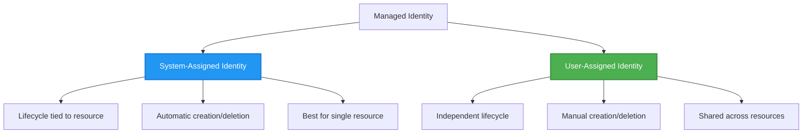

# Autentifikavimo modeliai ir valdomoji tapatybė

⏱️ **Numatomas laikas**: 45-60 minučių skaitymas; skirkite papildomo laiko pratimų integravimui | 💰 **Kainos poveikis**: Tapatybė/RBAC yra nemokami; išdiegti kompiuteriai, saugykla ir Raktų saugykla yra apmokestinami | ⭐ **Sudėtingumas**: Vidutinis

> Peržiūrėta pagal `azd 1.37.2` (2026 m. lapkritis). Ši pamoka pateikia **iliustracinius integracijos fragmentus, o ne pilną atsisiunčiamą `secure-app` šabloną**. Sukurkite nurodytus failus, pateikite atitinkamą infrastruktūrą ir pakeiskite vietos žymes prieš diegdami. Apžvalgos metu Azure ištekliai nebuvo teikiami.

**📚 Mokymosi kelias:**
- ← Ankstesnė: [Konfigūracijos valdymas](configuration.md) - Aplinkos kintamųjų ir slaptažodžių valdymas
- 🎯 **Esate čia**: Autentifikavimas ir saugumas (valdomoji tapatybė, Raktų saugykla, saugūs modeliai)
- → Toliau: [Infrastruktūra kaip kodas](../chapter-04-infrastructure/README.md) - Ištekliai teikti ir diegti
- 🏠 [Kurso pradžia](../../README.md)

---

## Ko išmoksite

Baigę šią pamoką, jūs:
- Suprasite Azure autentifikavimo modelius (raktai, ryšio eilutės, valdomoji tapatybė)
- Įgyvendinsite **Valdomąją tapatybę** be slaptažodžių autentifikavimui
- Apsaugosite slaptažodžius naudodami **Azure Raktų saugyklos** integraciją
- Konfigūruosite **pareigybių pagrindu veikiančią prieigos kontrolę (RBAC)** AZD diegimams
- Taikysite geriausią saugumo praktiką Container Apps ir Azure paslaugose
- Migruosite nuo raktų pagrindu veikiančios prieigos prie tapatybės pagrindu veikiančios autentifikacijos

## Kodėl svarbi valdomoji tapatybė

### Problema: tradicinis autentifikavimas

**Prieš valdoma tapatybę:**
```javascript
// ❌ SECURITY RISK: Hardcoded secrets in code
const connectionString = "Server=mydb.database.windows.net;User=admin;Password=P@ssw0rd123";
const storageKey = "xK7mN9pQ2wR5tY8uI0oP3aS6dF1gH4jK...";
const cosmosKey = "C2x7B9n4M1p8Q5w3E6r0T2y5U8i1O4p7...";
```

**Problemos:**
- 🔴 **Iššifruotos paslaptys** kode, konfigūracijos failuose, aplinkos kintamuosiuose
- 🔴 **Kredencialų pasikeitimas** reikalauja kodų pakeitimų ir persiuntimo
- 🔴 **Audito sunkumai** – kas, kada ir ką pasiekė?
- 🔴 **Išsibarsčiusios paslaptys** – slaptažodžiai išsibarstę keliuose sistemose
- 🔴 **Atitikties rizikos** – nesilaikoma saugumo auditų reikalavimų

### Sprendimas: valdomoji tapatybė

**Po valdomos tapatybės:**
```javascript
// ✅ SECURE: No secrets in code
const credential = new DefaultAzureCredential();
const client = new BlobServiceClient(
  "https://mystorageaccount.blob.core.windows.net",
  credential  // Azure automatically handles authentication
);
```

**Privalumai:**
- ✅ **Jokių paslapčių** kode ar konfiguracijoje
- ✅ **Automatinis keitimas** – Azure juo rūpinasi
- ✅ **Pilnas audito įrašas** Microsoft Entra ID žurnaluose
- ✅ **Centralizuota sauga** – valdoma per Azure portalą
- ✅ **Atitiktis** – atitinka saugumo standartus

**Palyginimas**: tradicinis autentifikavimas yra kaip nešiotis daug fizinių raktų į skirtingas duris. Valdomoji tapatybė – tai kaip turėti saugumo kortelę, kuri automatiškai suteikia prieigą pagal tai, kas tu esi – be raktų, kuriuos reikia pamesti, kopijuoti ar keisti.

---

## Architektūros apžvalga

### Autentifikavimo srautas su valdomąja tapatybe

```mermaid
sequenceDiagram
    participant App as Your Application<br/>(Container App)
    participant MI as Managed Identity<br/>(Microsoft Entra ID)
    participant KV as Key Vault
    participant Storage as Azure Storage
    participant DB as Azure SQL
    
    App->>MI: Request access token<br/>(automatic)
    MI->>MI: Verify identity<br/>(no password needed)
    MI-->>App: Return token for requested audience<br/>(lifetime varies)
    
    App->>KV: Get secret<br/>(using token)
    KV->>KV: Check RBAC permissions
    KV-->>App: Return secret value
    
    App->>Storage: Upload blob<br/>(using token)
    Storage->>Storage: Check RBAC permissions
    Storage-->>App: Success
    
    App->>DB: Query data<br/>(using token)
    DB->>DB: Check SQL permissions
    DB-->>App: Return results
    
    Note over App,DB: Request a separate token for each service audience;<br/>SDK credentials handle caching and renewal
```

### Valdomosios tapatybės tipai



| Funkcija | Sistemos priskirta | Vartotojo priskirta |
|---------|------------------|------------------|
| **Gyvavimo ciklas** | Priklauso nuo ištekliaus | Nepriklausoma |
| **Sukūrimas** | Automatiškai su ištekliumi | Rankinis sukūrimas |
| **Ištrynimas** | Ištrinamas su ištekliumi | Išlieka po ištekliaus ištrynimo |
| **Dalijimasis** | Tik vienas išteklius | Keletas išteklių |
| **Naudojimo atvejis** | Paprastos situacijos | Sudėtingos kelių išteklių situacijos |
| **Šablono pasirinkimas** | Nustatyta infrastruktūroje | Nustatyta infrastruktūroje |

---

## Pradinės sąlygos

### Reikalingi įrankiai

Turėtumėte jau turėti įdiegtus iš ankstesnių pamokų:

```bash
# Verify Azure Developer CLI
azd version
# ✅ Expected: azd version 1.0.0 or higher

# Verify Azure CLI
az --version
# ✅ Expected: azure-cli 2.50.0 or higher
```

### Azure reikalavimai

- Aktyvi Azure prenumerata
- Leidimai:
  - Kurti valdomąsias tapatybes
  - Priskirti RBAC pareigybes
  - Kurti Raktų saugyklos išteklius
  - Diegti Container Apps

### Žinių pradinės sąlygos

Turėtumėte būti baigę:
- [Įdiegimo vadovas](../chapter-01-foundation/installation.md) - AZD diegimas
- [AZD pagrindai](../chapter-01-foundation/azd-basics.md) - Pagrindinės sąvokos
- [Konfigūracijos valdymas](configuration.md) - Aplinkos kintamieji

---

## Pamoka 1: Autentifikavimo modelių supratimas

### Modelis 1: Ryšio eilutės (senieji – vengti)

**Kaip tai veikia:**
```bash
# Connection string contains credentials
STORAGE_CONNECTION_STRING="DefaultEndpointsProtocol=https;AccountName=myaccount;AccountKey=xK7mN9pQ2wR5..."
COSMOS_CONNECTION_STRING="AccountEndpoint=https://myaccount.documents.azure.com:443/;AccountKey=C2x7..."
SQL_CONNECTION_STRING="Server=myserver.database.windows.net;User=admin;Password=P@ssw0rd..."
```

**Problemos:**
- ❌ Slaptažodžiai matomi aplinkos kintamuosiuose
- ❌ Registruojami diegimo sistemose
- ❌ Sunkiai keičiami
- ❌ Nėra prieigos audito įrašo

**Kada naudoti:** Kai tikslinei paslaugai reikia autentifikavimo raktų pagrindu. Pirmenybę teikite tapatybei, kai palaikoma; kitaip saugiai saugokite raktus ir reguliariai juos keiskite, įskaitant gamybinę aplinką.

---

### Modelis 2: Key Vault nuorodos (geriau)

**Kaip tai veikia:**
**Dalinės Bicep ištraukos:** būtini saugyklos laukai, Container App tapatybė ir jos `configuration.secrets` įrašas atmetami. `secretRef` nurodo Container App slaptažodį; tai **nėra Key Vault URI**. Naudojant Key Vault, apibrėžkite šį vardinį slaptažodį su `keyVaultUrl` ir autorizuotą `identity`.

```bicep
// Store secret in Key Vault
resource keyVault 'Microsoft.KeyVault/vaults@2023-02-01' = {
  name: 'mykv'
  properties: {
    enableRbacAuthorization: true
  }
}

// Reference in Container App
env: [
  {
    name: 'STORAGE_KEY'
    secretRef: 'storage-key'  // References Key Vault
  }
]
```

**Privalumai:**
- ✅ Slaptažodžiai saugiai saugomi Key Vault
- ✅ Centralizuotas slaptažodžių valdymas
- ✅ Keitimas be kodo pakeitimų

**Apribojimai:**
- ⚠️ Vis dar naudojami raktai/slaptažodžiai
- ⚠️ Reikia valdyti Key Vault prieigą

**Kada naudoti:** Perėjimo žingsnis nuo ryšio eilučių prie valdomos tapatybės.

---

### Modelis 3: Valdoma tapatybė (geriausia praktika)

**Kaip tai veikia:**
**Dalinis Bicep:** sujungti tapatybės bloką į pilną Container App ir pateikti `storageAccount` bei rolės apibrėžimą. Rolės priskyrimui taip pat reikalingas deterministinis `name`.

```bicep
// Enable managed identity
resource containerApp 'Microsoft.App/containerApps@2023-05-01' = {
  name: 'myapp'
  identity: {
    type: 'SystemAssigned'  // Automatically creates identity
  }
}

// Grant permissions
resource roleAssignment 'Microsoft.Authorization/roleAssignments@2022-04-01' = {
  name: guid(storageAccount.id, containerApp.id, storageBlobDataContributorRole)
  scope: storageAccount
  properties: {
    roleDefinitionId: storageBlobDataContributorRole
    principalId: containerApp.identity.principalId
    principalType: 'ServicePrincipal'
  }
}
```

**Programos kodas:**
```javascript
// No secrets needed!
const { DefaultAzureCredential } = require('@azure/identity');
const { BlobServiceClient } = require('@azure/storage-blob');

const credential = new DefaultAzureCredential();
const blobServiceClient = new BlobServiceClient(
  'https://mystorageaccount.blob.core.windows.net',
  credential
);
```

**Privalumai:**
- ✅ Nėra paslapčių kode/konfigūracijoje
- ✅ Automatinis kredencialų keitimas
- ✅ Pilnas audito įrašas
- ✅ Pareigybių pagrindu RBAC leidimai
- ✅ Atitiktis

**Kada naudoti:** Teikti pirmenybę Azure talpinamoms programoms, kurios pasiekia paslaugas, palaikančias Microsoft Entra autentifikavimą.

---

### Modelis 4: Paslaugų pagrindai (CI/CD ir automatizavimas)

Valdoma tapatybė yra aukso standartas *ištekliams, veikiančioms Azure viduje*. O ką daryti su dalykais, kurie veikia **už Azure ribų** – pavyzdžiui, CI/CD vamzdžiu statybos agentui arba scenarijų kompiuteryje, kuris negali naudoti interaktyvaus prisijungimo? Tuomet tinka **paslaugų pagrindas**: ne žmogaus tapatybė su savomis kredencialomis, į kurias automatinis procesas gali prisijungti.

**Kaip tai veikia:**

Sukurkite paslaugų pagrindą apribotą išteklių grupei (mažiausio leidimų principas):

```bash
az ad sp create-for-rbac \
  --name "myapp-cicd" \
  --role contributor \
  --scopes "/subscriptions/<sub-id>/resourceGroups/<rg-name>"
```

Tai atspausdina kliento ID, kliento slaptažodį ir nuomininko ID. azd gali prisijungti su jais neinteraktyviai:

```bash
azd auth login \
  --client-id "<appId>" \
  --client-secret "<password>" \
  --tenant-id "<tenant>"
```

**Pirmenybę teikite federuotoms kredencialoms (OIDC), o ne slaptažodžiams.** Vietoje ilgalaikio kliento slaptažodžio, konfigūruokite federuotą kredencialą, kad vamzdis mainytų trumpalaikį žetoną – nėra slaptažodžio, kurį galima nutekinti ar keisti:

```bash
azd auth login \
  --client-id "<appId>" \
  --federated-credential-provider "github" \
  --tenant-id "<tenant>"
```

> `azd pipeline config` tai nustato jums automatiškai. Peržiūrėkite CI/CD vadovus [8 skyriuje](../chapter-08-production/production-ai-practices.md).

**Privalumai:**
- ✅ Veikia už Azure ribų (statybos agentai, vietos kompiuteriai, kiti debesys)
- ✅ Gali būti apribota vienai išteklių grupei su viena role
- ✅ Federuotoji (OIDC) versija nenaudoja saugomų slaptažodžių

**Trūkumai:**
- ⚠️ Slaptažodžių pagrindu veikianti versija reikalauja kruopštaus saugojimo ir keitimo
- ⚠️ Nutekėjęs slaptažodis suteikia SP visas teises – laikykite aprėptį griežtą

**Kada naudoti:** CI/CD vamzdžiams ir automatizavimui, kurie negali naudoti valdomos tapatybės. Visada pirmenybę teikite **federuotajai/OIDC** versijai vietoje kliento slaptažodžio ir naudokite valdomąją tapatybę, kai darbo krūvis vyksta Azure viduje.

**Kaip saugiai saugoti kredencialus:**
- Niekada neįkelkite slaptažodžių į viešas vietas – naudokite savo vamzdžio slaptų reikšmių saugyklą (GitHub Actions secrets, Azure DevOps kintamųjų grupes / Raktų saugyklą).
- Apribokite SP prieigą iki mažiausios reikalingos rolės ir išteklių grupės.
- Nustatykite galiojimo laiką ir reguliariai keiskite arba panaikinkite slaptažodį naudodami OIDC.

---

## Pamoka 2: Valdomosios tapatybės implementavimas su AZD

### Žingsnis po žingsnio įgyvendinimas

Toliau pateikti fragmentai rodo, kaip integruoti valdomąją tapatybę į Container App projektą. Jie **nėra tiesiogiai kopijuojami ir paleidžiami**: Saugyklos modulis, visa valdomos aplinkos/registrų infrastruktūra, Dockerfile ir parametrų failas čia nėra pilnai pateikti. Pradėkite nuo veikiančio Container Apps šablono ir sujunkite šiuos modelius, išlaikydami jo registrų konfigūraciją ir paslaugų etiketes.

### Projekto struktūra

```
secure-app/
├── azure.yaml                 # AZD configuration
├── infra/
│   ├── main.bicep            # Main infrastructure
│   ├── core/
│   │   ├── identity.bicep    # Managed identity setup
│   │   ├── keyvault.bicep    # Key Vault configuration
│   │   └── storage.bicep     # Storage with RBAC
│   └── app/
│       └── container-app.bicep
└── src/
    ├── app.js                # Application code
    ├── package.json
    └── Dockerfile
```

### 1. Konfigūruokite AZD (azure.yaml)

```yaml
name: secure-app
metadata:
  template: secure-app@1.0.0

services:
  api:
    project: ./src
    language: js
    host: containerapp

# Managed identity must be enabled in the infrastructure, not by this YAML.
```

### 2. Infrastruktūra: įgalinkite valdomą tapatybę

**Failas: `infra/main.bicep`**

```bicep
targetScope = 'subscription'

param environmentName string
param location string = 'eastus'
param containerAppsEnvironmentId string
param containerImage string

var tags = { 'azd-env-name': environmentName }

// Resource group
resource rg 'Microsoft.Resources/resourceGroups@2021-04-01' = {
  name: 'rg-${environmentName}'
  location: location
  tags: tags
}

// Storage Account
module storage './core/storage.bicep' = {
  name: 'storage'
  scope: rg
  params: {
    name: 'st${uniqueString(rg.id)}'
    location: location
    tags: tags
  }
}

// Key Vault
module keyVault './core/keyvault.bicep' = {
  name: 'keyvault'
  scope: rg
  params: {
    name: 'kv-${uniqueString(rg.id)}'
    location: location
    tags: tags
  }
}

// Container App with Managed Identity
module containerApp './app/container-app.bicep' = {
  name: 'container-app'
  scope: rg
  params: {
    name: 'ca-${environmentName}'
    location: location
    tags: tags
    storageAccountName: storage.outputs.name
    keyVaultName: keyVault.outputs.name
    containerAppsEnvironmentId: containerAppsEnvironmentId
    containerImage: containerImage
  }
}

// Grant Container App access to Storage
module storageRoleAssignment './core/role-assignment.bicep' = {
  name: 'storage-role'
  scope: rg
  params: {
    principalId: containerApp.outputs.identityPrincipalId
    roleDefinitionId: 'ba92f5b4-2d11-453d-a403-e96b0029c9fe'  // Storage Blob Data Contributor
    targetResourceType: 'storage'
    targetResourceName: storage.outputs.name
  }
}

// Grant Container App access to Key Vault
module kvRoleAssignment './core/role-assignment.bicep' = {
  name: 'kv-role'
  scope: rg
  params: {
    principalId: containerApp.outputs.identityPrincipalId
    roleDefinitionId: '4633458b-17de-408a-b874-0445c86b69e6'  // Key Vault Secrets User
    targetResourceType: 'keyvault'
    targetResourceName: keyVault.outputs.name
  }
}

// Outputs
output AZURE_STORAGE_ACCOUNT_NAME string = storage.outputs.name
output AZURE_KEY_VAULT_NAME string = keyVault.outputs.name
output APP_URL string = containerApp.outputs.url
```

### 3. Container App su sistemos priskirta tapatybe

**Failas: `infra/app/container-app.bicep`**

```bicep
param name string
param location string
param tags object = {}
param storageAccountName string
param keyVaultName string
param containerAppsEnvironmentId string
param containerImage string

resource containerApp 'Microsoft.App/containerApps@2023-05-01' = {
  name: name
  location: location
  tags: union(tags, { 'azd-service-name': 'api' })
  identity: {
    type: 'SystemAssigned'  // 🔑 Enable managed identity
  }
  properties: {
    managedEnvironmentId: containerAppsEnvironmentId
    configuration: {
      ingress: {
        external: true
        targetPort: 3000
      }
    }
    template: {
      containers: [
        {
          name: 'api'
          image: containerImage // Must exist; configure registry credentials for private images
          resources: {
            cpu: json('0.5')
            memory: '1Gi'
          }
          env: [
            {
              name: 'AZURE_STORAGE_ACCOUNT_NAME'
              value: storageAccountName
            }
            {
              name: 'AZURE_KEY_VAULT_NAME'
              value: keyVaultName
            }
            // 🔑 No secrets - managed identity handles authentication!
          ]
        }
      ]
    }
  }
}

// Output the identity for RBAC assignments
output identityPrincipalId string = containerApp.identity.principalId
output id string = containerApp.id
output url string = 'https://${containerApp.properties.configuration.ingress.fqdn}'
```

### 4. RBAC rolės priskyrimo modulis

**Failas: `infra/core/role-assignment.bicep`**

```bicep
param principalId string
param roleDefinitionId string  // Azure built-in role ID
@allowed(['storage', 'keyvault'])
param targetResourceType string
param targetResourceName string

// Typed existing resources give Bicep a valid resource scope, not a string ID.
resource storageTarget 'Microsoft.Storage/storageAccounts@2023-01-01' existing = {
  name: targetResourceName
}
resource vaultTarget 'Microsoft.KeyVault/vaults@2023-02-01' existing = {
  name: targetResourceName
}

resource storageAssignment 'Microsoft.Authorization/roleAssignments@2022-04-01' = if (targetResourceType == 'storage') {
  name: guid(storageTarget.id, principalId, roleDefinitionId)
  scope: storageTarget
  properties: {
    roleDefinitionId: subscriptionResourceId('Microsoft.Authorization/roleDefinitions', roleDefinitionId)
    principalId: principalId
    principalType: 'ServicePrincipal'
  }
}

resource vaultAssignment 'Microsoft.Authorization/roleAssignments@2022-04-01' = if (targetResourceType == 'keyvault') {
  name: guid(vaultTarget.id, principalId, roleDefinitionId)
  scope: vaultTarget
  properties: {
    roleDefinitionId: subscriptionResourceId('Microsoft.Authorization/roleDefinitions', roleDefinitionId)
    principalId: principalId
    principalType: 'ServicePrincipal'
  }
}

// This module assigns at the target resource scope, not the whole resource group.
```

### 5. Programos kodas su valdomąja tapatybe

**Failas: `src/app.js`**

```javascript
const express = require('express');
const { DefaultAzureCredential } = require('@azure/identity');
const { BlobServiceClient } = require('@azure/storage-blob');
const { SecretClient } = require('@azure/keyvault-secrets');

const app = express();
const PORT = process.env.PORT || 3000;

// 🔑 Initialize credential (works automatically with managed identity)
const credential = new DefaultAzureCredential();

// Azure Storage setup
const storageAccountName = process.env.AZURE_STORAGE_ACCOUNT_NAME;
const blobServiceClient = new BlobServiceClient(
  `https://${storageAccountName}.blob.core.windows.net`,
  credential  // No keys needed!
);

// Key Vault setup
const keyVaultName = process.env.AZURE_KEY_VAULT_NAME;
const secretClient = new SecretClient(
  `https://${keyVaultName}.vault.azure.net`,
  credential  // No keys needed!
);

// Health check
app.get('/health', (req, res) => {
  res.json({ status: 'healthy', authentication: 'managed-identity' });
});

// Upload file to blob storage
app.post('/upload', async (req, res) => {
  try {
    const containerClient = blobServiceClient.getContainerClient('uploads');
    await containerClient.createIfNotExists();
    
    const blobName = `file-${Date.now()}.txt`;
    const blockBlobClient = containerClient.getBlockBlobClient(blobName);
    
    const content = 'Hello from managed identity!';
    await blockBlobClient.upload(content, Buffer.byteLength(content));
    
    res.json({
      success: true,
      blobName: blobName,
      message: 'File uploaded using managed identity!'
    });
  } catch (error) {
    console.error('Upload error:', error);
    res.status(500).json({ error: error.message });
  }
});

// Get secret from Key Vault
app.get('/secret/:name', async (req, res) => {
  try {
    const secretName = req.params.name;
    const secret = await secretClient.getSecret(secretName);
    
    res.json({
      name: secretName,
      retrieved: secret.value !== undefined, // Never return the secret value to callers
      message: 'Secret retrieved using managed identity!'
    });
  } catch (error) {
    console.error('Secret error:', error);
    res.status(500).json({ error: error.message });
  }
});

// List blob containers (demonstrates read access)
app.get('/containers', async (req, res) => {
  try {
    const containers = [];
    for await (const container of blobServiceClient.listContainers()) {
      containers.push(container.name);
    }
    
    res.json({
      containers: containers,
      count: containers.length,
      message: 'Containers listed using managed identity!'
    });
  } catch (error) {
    console.error('List error:', error);
    res.status(500).json({ error: error.message });
  }
});

app.listen(PORT, () => {
  console.log(`Secure API listening on port ${PORT}`);
  console.log('Authentication: Managed Identity (passwordless)');
});
```

**Failas: `src/package.json`**

```json
{
  "name": "secure-app",
  "version": "1.0.0",
  "dependencies": {
    "express": "^4.18.2",
    "@azure/identity": "^4.0.0",
    "@azure/storage-blob": "^12.17.0",
    "@azure/keyvault-secrets": "^4.7.0"
  },
  "scripts": {
    "start": "node app.js"
  }
}
```

### 6. Diegimas ir testavimas

Šias komandas vykdykite **tik po** to, kai pabaigsite trūkstamą infrastruktūrą, Dockerfile ir atitinkamą `main.parameters.json` savo projekte. Prisijunkite prie azd su `azd auth login`; atskirai įeikite su `az login` Azure CLI patikroms vėliau. Čia rodomi galiniai taškai yra demonstraciniai ir prieš viešai naudojant reikalauja atitinkamų prieigos kontrolės nustatymų.

```bash
# Initialize AZD environment
azd init

# Deploy infrastructure and application
azd up

# Get the app URL
APP_URL=$(azd env get-value APP_URL)

# Test health check
curl $APP_URL/health
```

**✅ Tikėtinas išvestis:**
```json
{
  "status": "healthy",
  "authentication": "managed-identity"
}
```

**Tikrinimo apvalkalų įkėlimas:**
```bash
curl -X POST $APP_URL/upload
```

**✅ Tikėtinas rezultatas:**
```json
{
  "success": true,
  "blobName": "file-1700404800000.txt",
  "message": "File uploaded using managed identity!"
}
```

**Tikrinimo konteinerių sąrašas:**
```bash
curl $APP_URL/containers
```

**✅ Tikėtinas rezultatas:**
```json
{
  "containers": ["uploads"],
  "count": 1,
  "message": "Containers listed using managed identity!"
}
```

---

## Dažnos Azure RBAC pareigybės

### Integruotos rolės ID valdomajai tapatybei

| Paslauga | Rolės pavadinimas | Rolės ID | Leidimai |
|---------|-------------------|----------|----------|
| **Saugykla** | Saugyklos blokų duomenų skaitytojas | `2a2b9908-6ea1-4ae2-8e65-a410df84e7d1` | Skaityti blokus ir konteinerius |
| **Saugykla** | Saugyklos blokų duomenų bendradarbis | `ba92f5b4-2d11-453d-a403-e96b0029c9fe` | Skaityti, rašyti, trinti blokus |
| **Saugykla** | Saugyklos eilės duomenų bendradarbis | `974c5e8b-45b9-4653-ba55-5f855dd0fb88` | Skaityti, rašyti, trinti eilutes/pranešimus |
| **Raktų saugykla** | Raktų saugyklos slaptažodžių naudotojas | `4633458b-17de-408a-b874-0445c86b69e6` | Skaityti slaptažodžius |
| **Raktų saugykla** | Raktų saugyklos slaptažodžių pareigūnas | `b86a8fe4-44ce-4948-aee5-eccb2c155cd7` | Skaityti, rašyti, trinti slaptažodžius |
| **Cosmos DB** | Cosmos DB integruotas duomenų skaitytojas | `00000000-0000-0000-0000-000000000001` | Skaityti Cosmos DB duomenis |
| **Cosmos DB** | Cosmos DB integruotas duomenų bendradarbis | `00000000-0000-0000-0000-000000000002` | Skaityti, rašyti Cosmos DB duomenis |
| **SQL Duomenų bazė** | SQL DB bendradarbis | `9b7fa17d-e63e-47b0-bb0a-15c516ac86ec` | Valdyti duomenų bazės išteklius; nesuteikia prieigos prie SQL duomenų |
| **Paslaugų magistralė** | Azure Paslaugų magistralės duomenų savininkas | `090c5cfd-751d-490a-894a-3ce6f1109419` | Siųsti, gauti, valdyti pranešimus |

### Kaip rasti rolės ID

Cosmos DB NoSQL du du vardiniai ID yra **gimtosios Cosmos duomenų lygmens rolės apibrėžimai**, o ne Azure RBAC prenumeratos rolės ID. Juos priskirkite su `az cosmosdb sql role assignment create` (arba `Microsoft.DocumentDB/databaseAccounts/sqlRoleAssignments`), o ne su `az role assignment create`. SQL duomenų prieiga reikalauja Entra duomenų bazės vartotojo ir SQL leidimų.

```bash
# List all built-in roles
az role definition list --query "[].{Name:roleName, ID:name}" --output table

# Search for specific role
az role definition list --query "[?contains(roleName, 'Storage Blob')].{Name:roleName, ID:name}" --output table

# Get role details
az role definition list --name "Storage Blob Data Contributor"
```

---

## Praktiniai pratimai

**Integracijos reikalavimai visiems trims pratimams:** veikiantis Container App šablonas jūsų projekte, atitinkami Bicep ištekliai, prisijungimas prie Azure CLI/azd ir teisės priskirti reikalingas roles. Tai yra vadovaujamos adaptacijos, o ne atskiri vietiniai pradiniai kodai; pakeiskite pavyzdžiuose esamus išteklių pavadinimus į savo išdiegtus.

### Pratimas 1: Įgalinti valdomą tapatybę esamai programai ⭐⭐ (vidutinis)

**Tikslas**: pridėti valdomą tapatybę esamam Container App diegimui

**Situacija**: turite Container App, naudojantį ryšio eilutes. Pakeiskite į valdomą tapatybę.

**Pradinė būsena**: Container App su šia konfigūracija:

```bicep
// ❌ Current: Using connection string
env: [
  {
    name: 'STORAGE_CONNECTION_STRING'
    secretRef: 'storage-connection'
  }
]
```

**Žingsniai**:

1. **Įgalinti valdomą tapatybę Bicep'e:**

```bicep
resource containerApp 'Microsoft.App/containerApps@2023-05-01' = {
  name: 'myapp'
  identity: {
    type: 'SystemAssigned'  // Add this
  }
  // ... rest of configuration
}
```

2. **Suteikti Saugyklos prieigą:**

```bicep
// Get storage account reference
resource storageAccount 'Microsoft.Storage/storageAccounts@2023-01-01' existing = {
  name: storageAccountName
}

// Assign role
resource roleAssignment 'Microsoft.Authorization/roleAssignments@2022-04-01' = {
  name: guid(containerApp.id, 'ba92f5b4-2d11-453d-a403-e96b0029c9fe', storageAccount.id)
  scope: storageAccount
  properties: {
    roleDefinitionId: subscriptionResourceId('Microsoft.Authorization/roleDefinitions', 'ba92f5b4-2d11-453d-a403-e96b0029c9fe')
    principalId: containerApp.identity.principalId
    principalType: 'ServicePrincipal'
  }
}
```

3. **Atnaujinti programos kodą:**

**Ankstesnė būsena (ryšio eilutė):**
```javascript
const { BlobServiceClient } = require('@azure/storage-blob');

const blobServiceClient = BlobServiceClient.fromConnectionString(
  process.env.STORAGE_CONNECTION_STRING
);
```

**Po (valdoma tapatybė):**
```javascript
const { DefaultAzureCredential } = require('@azure/identity');
const { BlobServiceClient } = require('@azure/storage-blob');

const credential = new DefaultAzureCredential();
const blobServiceClient = new BlobServiceClient(
  `https://${process.env.STORAGE_ACCOUNT_NAME}.blob.core.windows.net`,
  credential
);
```

4. **Atnaujinti aplinkos kintamuosius:**

```bicep
env: [
  {
    name: 'STORAGE_ACCOUNT_NAME'
    value: storageAccountName  // Just the name, no secrets!
  }
  // Remove STORAGE_CONNECTION_STRING
]
```

5. **Diegti ir testuoti:**

```bash
# Redeploy
azd up

# Test that it still works
APP_URL=$(azd show --output json | jq -er '.services.api.ingressUrl')
curl --fail -X POST "$APP_URL/upload"
```

**✅ Sėkmės kriterijai:**
- ✅ Programa diegiasi be klaidų
- ✅ Saugyklos operacijos veikia (įkėlimas, sąrašas, atsisiuntimas)
- ✅ Ryšio eilutės nėra aplinkos kintamuosiuose
- ✅ Tapatybė matoma Azure portale “Identity” skiltyje

**Patikrinimas:**

```bash
# Check managed identity is enabled
az containerapp show \
  --name myapp \
  --resource-group rg-myapp \
  --query "identity.type"
# ✅ Expected: "SystemAssigned"

# Check role assignment
az role assignment list \
  --assignee $(az containerapp show --name myapp --resource-group rg-myapp --query "identity.principalId" -o tsv) \
  --scope /subscriptions/{sub-id}/resourceGroups/rg-myapp/providers/Microsoft.Storage/storageAccounts/mystorageaccount
# ✅ Expected: Shows "Storage Blob Data Contributor" role
```

**Laikas**: 20-30 minučių

---

### Pratimas 2: Daugiaservisinė prieiga su vartotojo priskirta tapatybe ⭐⭐⭐ (pažengęs)

**Tikslas**: sukurti vartotojo priskirtą tapatybę, kuri būtų dalijama keliems Container Apps

**Situacija**: turite 3 mikroservisus, kuriems visiems reikalinga prieiga prie to paties Saugyklos paskyros ir Raktų saugyklos.

**Žingsniai**:

1. **Sukurti vartotojo priskirtą tapatybę:**

**Failas: `infra/core/identity.bicep`**

```bicep
param name string
param location string
param tags object = {}

resource userAssignedIdentity 'Microsoft.ManagedIdentity/userAssignedIdentities@2023-01-31' = {
  name: name
  location: location
  tags: tags
}

output id string = userAssignedIdentity.id
output principalId string = userAssignedIdentity.properties.principalId
output clientId string = userAssignedIdentity.properties.clientId
```

2. **Priskirti roles vartotojo priskirtai tapatybei:**

```bicep
// In main.bicep
module userIdentity './core/identity.bicep' = {
  name: 'user-identity'
  scope: rg
  params: {
    name: 'id-${environmentName}'
    location: location
    tags: tags
  }
}

// Grant Storage access
resource storageRoleAssignment 'Microsoft.Authorization/roleAssignments@2022-04-01' = {
  name: guid(storageAccount.id, environmentName, 'storage-contributor')
  scope: storageAccount
  properties: {
    roleDefinitionId: subscriptionResourceId('Microsoft.Authorization/roleDefinitions', 'ba92f5b4-2d11-453d-a403-e96b0029c9fe')
    principalId: userIdentity.outputs.principalId
    principalType: 'ServicePrincipal'
  }
}

// Grant Key Vault access
resource kvRoleAssignment 'Microsoft.Authorization/roleAssignments@2022-04-01' = {
  name: guid(keyVault.id, environmentName, 'kv-secrets-user')
  scope: keyVault
  properties: {
    roleDefinitionId: subscriptionResourceId('Microsoft.Authorization/roleDefinitions', '4633458b-17de-408a-b874-0445c86b69e6')
    principalId: userIdentity.outputs.principalId
    principalType: 'ServicePrincipal'
  }
}
```

3. **Priskirkite tapatybę kelioms Container Apps:**

```bicep
resource apiGateway 'Microsoft.App/containerApps@2023-05-01' = {
  name: 'api-gateway'
  identity: {
    type: 'UserAssigned'
    userAssignedIdentities: {
      '${userIdentity.outputs.id}': {}
    }
  }
  // ... rest of config
}

resource productService 'Microsoft.App/containerApps@2023-05-01' = {
  name: 'product-service'
  identity: {
    type: 'UserAssigned'
    userAssignedIdentities: {
      '${userIdentity.outputs.id}': {}
    }
  }
  // ... rest of config
}

resource orderService 'Microsoft.App/containerApps@2023-05-01' = {
  name: 'order-service'
  identity: {
    type: 'UserAssigned'
    userAssignedIdentities: {
      '${userIdentity.outputs.id}': {}
    }
  }
  // ... rest of config
}
```

4. **Programos kodas (visi servisai naudoja tą pačią schemą):**

```javascript
const { ManagedIdentityCredential } = require('@azure/identity');
const { BlobServiceClient } = require('@azure/storage-blob');

// For user-assigned identity, specify the client ID
const credential = new ManagedIdentityCredential(
  process.env.AZURE_CLIENT_ID  // User-assigned identity client ID
);

// Alternative (choose ONE credential declaration):
// const { DefaultAzureCredential } = require('@azure/identity');
// const credential = new DefaultAzureCredential({
//   managedIdentityClientId: process.env.AZURE_CLIENT_ID
// });

const blobServiceClient = new BlobServiceClient(
  `https://${process.env.STORAGE_ACCOUNT_NAME}.blob.core.windows.net`,
  credential
);
```

Nustatykite kiekvienos Container App runtime `AZURE_CLIENT_ID` į `userIdentity.outputs.clientId` ir `STORAGE_ACCOUNT_NAME` į savo saugyklos pavadinimą Bicep. Vien tik tapatybės priskyrimas ar `azd env set` vykdymas nekeičia šių runtime reikšmių.

5. **Išdiekite ir patikrinkite:**

```bash
azd up

# Test all services can access storage
# Replace with the actual ingress URLs reported for your three services
curl --fail -X POST "$API_GATEWAY_URL/upload"
curl --fail -X POST "$PRODUCT_SERVICE_URL/upload"
curl --fail -X POST "$ORDER_SERVICE_URL/upload"
```

**✅ Sėkmės kriterijai:**
- ✅ Viena tapatybė, naudojama 3 servisuose
- ✅ Visi servisai gali pasiekti Storage ir Key Vault
- ✅ Tapatybė išlieka, jei ištrinate vieną servisą
- ✅ Centralizuotas leidimų valdymas

**Vartotojo priskirtos tapatybės privalumai:**
- Viena tapatybė valdymui
- Nuoseklūs leidimai tarp servisų
- Išlieka po serviso ištrynimo
- Geriau sudėtingoms architektūroms

**Laikas**: 30-40 minučių

---

### Užduotis 3: Įgyvendinkite Key Vault slaptumo sukimą ⭐⭐⭐ (Pažengusi)

**Tikslas**: Saugykite trečiųjų šalių API raktus Key Vault ir prieikite prie jų naudodami valdomą tapatybę

**Situacija**: Jūsų programa turi kviesti išorinį API (OpenAI, Stripe, SendGrid), kuriam reikalingi API raktai.

**Veiksmai**:

1. **Sukurkite Key Vault su RBAC:**

**Failas: `infra/core/keyvault.bicep`**

```bicep
param name string
param location string
param tags object = {}

resource keyVault 'Microsoft.KeyVault/vaults@2023-02-01' = {
  name: name
  location: location
  tags: tags
  properties: {
    enableRbacAuthorization: true  // Use RBAC instead of access policies
    sku: {
      family: 'A'
      name: 'standard'
    }
    tenantId: subscription().tenantId
    enableSoftDelete: true
    softDeleteRetentionInDays: 90
  }
}

// Allow Container App to read secrets
output id string = keyVault.id
output name string = keyVault.name
output uri string = keyVault.properties.vaultUri
```

2. **Saugykite slaptus duomenis Key Vault:**

```bash
# Get Key Vault name
KV_NAME=$(azd env get-value AZURE_KEY_VAULT_NAME)

# Store third-party API keys
az keyvault secret set \
  --vault-name $KV_NAME \
  --name "OpenAI-ApiKey" \
  --value "sk-proj-xxxxxxxxxxxxx"

az keyvault secret set \
  --vault-name $KV_NAME \
  --name "Stripe-ApiKey" \
  --value "sk_live_xxxxxxxxxxxxx"

az keyvault secret set \
  --vault-name $KV_NAME \
  --name "SendGrid-ApiKey" \
  --value "SG.xxxxxxxxxxxxx"
```

3. **Programos kodas, skirtas slaptumams paimti:**

**Failas: `src/config.js`**

```javascript
const { DefaultAzureCredential } = require('@azure/identity');
const { SecretClient } = require('@azure/keyvault-secrets');

class Config {
  constructor() {
    this.credential = new DefaultAzureCredential();
    this.secretClient = new SecretClient(
      `https://${process.env.AZURE_KEY_VAULT_NAME}.vault.azure.net`,
      this.credential
    );
    this.cache = {};
  }

  async getSecret(secretName) {
    // Check cache first
    if (this.cache[secretName]) {
      return this.cache[secretName];
    }

    try {
      const secret = await this.secretClient.getSecret(secretName);
      this.cache[secretName] = secret.value;
      console.log(`✅ Retrieved secret: ${secretName}`);
      return secret.value;
    } catch (error) {
      console.error(`❌ Failed to get secret ${secretName}:`, error.message);
      throw error;
    }
  }

  async getOpenAIKey() {
    return this.getSecret('OpenAI-ApiKey');
  }

  async getStripeKey() {
    return this.getSecret('Stripe-ApiKey');
  }

  async getSendGridKey() {
    return this.getSecret('SendGrid-ApiKey');
  }
}

module.exports = new Config();
```

4. **Naudokite slaptumus programoje:**

**Failas: `src/app.js`**

Šis **pakeitimo programos fragmentas** reikalauja `npm install openai`, tikro trečiosios šalies rakto, prieinamo modelio ir infrastruktūros iš jūsų veikiamo projekto. Jis tiesiogiai kviečia OpenAI, o ne Azure OpenAI diegimą. Žemiau pateikti laikinieji raktai neautorizuoja užklausos.

```javascript
const express = require('express');
const config = require('./config');
const { OpenAI } = require('openai');

const app = express();

// Initialize OpenAI with key from Key Vault
let openaiClient;

async function initializeServices() {
  const openaiKey = await config.getOpenAIKey();
  openaiClient = new OpenAI({ apiKey: openaiKey });
  console.log('✅ Services initialized with secrets from Key Vault');
}

app.post('/chat', async (req, res) => {
  try {
    const completion = await openaiClient.chat.completions.create({
      model: 'gpt-4.1',
      messages: [{ role: 'user', content: 'Hello!' }]
    });
    
    res.json({
      response: completion.choices[0].message.content,
      authentication: 'Key from Key Vault via Managed Identity'
    });
  } catch (error) {
    res.status(500).json({ error: error.message });
  }
});

// Start listening only after initialization succeeds.
initializeServices().then(() => {
  app.listen(3000, () => console.log('Key Vault demo running'));
}).catch(error => {
  console.error('Initialization failed:', error.message);
  process.exitCode = 1;
});
```

5. **Išdiekite ir išbandykite:**

```bash
azd up

# Test that API keys work
curl -X POST https://myapp.azurecontainerapps.io/chat \
  -H "Content-Type: application/json" \
  -d '{"message":"Hello AI"}'
```

**✅ Sėkmės kriterijai:**
- ✅ Nėra API raktų kode ar aplinkos kintamuosiuose
- ✅ Programa paima raktus iš Key Vault
- ✅ Trečiųjų šalių API veikia tinkamai
- ✅ Raktų sukimą galima atlikti be kodo pakeitimų

**Sukite slaptumą:**

```bash
# Update secret in Key Vault
az keyvault secret set \
  --vault-name $KV_NAME \
  --name "OpenAI-ApiKey" \
  --value "sk-proj-NEW_KEY_HERE"

# Find the active revision name, then restart it to clear the in-process cache
az containerapp revision list --name myapp --resource-group rg-myapp --output table
az containerapp revision restart \
  --name myapp \
  --resource-group rg-myapp \
  --revision "<active-revision-name>"
```

**Laikas**: 25-35 minutės

---

## Žinių patikrinimas

### 1. Autentifikavimo šablonai ✓

Patikrinkite savo supratimą:

- [ ] **Klausimas 1**: Kokie yra trys pagrindiniai autentifikavimo šablonai? 
  - **Atsakymas**: Ryšio eilutės (senstelėję), Key Vault nuorodos (perėjimo laikotarpis), Valdoma tapatybė (geriausia)

- [ ] **Klausimas 2**: Kodėl valdoma tapatybė yra geresnė už ryšio eilutes?
  - **Atsakymas**: Nėra paslapčių kode, automatinis sukimasis, pilnas audito žurnalas, RBAC leidimai

- [ ] **Klausimas 3**: Kada naudotumėte vartotojo priskirtą tapatybę vietoje sistemos priskirtos?
  - **Atsakymas**: Kai tapatybė dalijama tarp kelių išteklių arba kai tapatybės gyvenimo ciklas nepriklauso nuo išteklių gyvenimo ciklo

**Praktinis patvirtinimas:**
```bash
# Check what type of identity your app uses
az containerapp show \
  --name myapp \
  --resource-group rg-myapp \
  --query "identity.type"

# List all role assignments for the identity
az role assignment list \
  --assignee $(az containerapp show --name myapp --resource-group rg-myapp --query "identity.principalId" -o tsv)
```

---

### 2. RBAC ir leidimai ✓

Patikrinkite savo supratimą:

- [ ] **Klausimas 1**: Koks yra „Storage Blob Data Contributor“ vaidmens ID?
  - **Atsakymas**: `ba92f5b4-2d11-453d-a403-e96b0029c9fe`

- [ ] **Klausimas 2**: Kokius leidimus suteikia „Key Vault Secrets User“?
  - **Atsakymas**: Tik skaitymo prieiga prie paslapčių (negali kurti, atnaujinti ar trinti)

- [ ] **Klausimas 3**: Kaip suteikti Container App prieigą prie Azure SQL?
  - **Atsakymas**: Sukonfigūruokite Microsoft Entra autentifikaciją, sukurkite tapatybę kaip duomenų bazės vartotoją ir suteikite reikiamus SQL leidimus. „SQL DB Contributor“ valdo tik Azure išteklius; jis neatlieka SQL užklausų autorizacijos.

**Praktinis patvirtinimas:**
```bash
# Find specific role
az role definition list --name "Storage Blob Data Contributor"

# Check what roles are assigned to your identity
PRINCIPAL_ID=$(az containerapp show --name myapp --resource-group rg-myapp --query "identity.principalId" -o tsv)
az role assignment list --assignee $PRINCIPAL_ID --output table
```

---

### 3. Key Vault integracija ✓

Patikrinkite savo supratimą:

- [ ] **Klausimas 1**: Kaip įjungti RBAC Key Vault vietoje prieigos politikų?
  - **Atsakymas**: Nustatykite `enableRbacAuthorization: true` Bicep faile

- [ ] **Klausimas 2**: Kuri Azure SDK biblioteka tvarko valdomos tapatybės autentifikaciją?
  - **Atsakymas**: `@azure/identity` su `DefaultAzureCredential` klase

- [ ] **Klausimas 3**: Kaip ilgai Key Vault paslaptys lieka talpykloje?
  - **Atsakymas**: Priklauso nuo programos; įgyvendinkite savo talpyklos strategiją

**Praktinis patvirtinimas:**
```bash
# Test Key Vault access
az keyvault secret show \
  --vault-name $KV_NAME \
  --name "OpenAI-ApiKey" \
  --query "{name:name,enabled:attributes.enabled}"

# Check RBAC is enabled
az keyvault show \
  --name $KV_NAME \
  --query "properties.enableRbacAuthorization"
# ✅ Expected: true
```

---

## Saugumo geriausios praktikos

### ✅ DARYKITE:

1. **Visada naudokite valdomą tapatybę gamyboje**
   ```bicep
   identity: {
     type: 'SystemAssigned'
   }
   ```

2. **Naudokite mažiausių teisių RBAC vaidmenis**
   - Naudokite „Reader“ vaidmenis, kai įmanoma
   - Venkite „Owner“ arba „Contributor“, jei nėra būtinybės

3. **Saugykite trečiųjų šalių raktus Key Vault**
   ```javascript
   const apiKey = await secretClient.getSecret('ThirdPartyApiKey');
   ```

4. **Įjunkite audito žurnalavimą** (iš dalies resurso fragmentas; sujunkite su savo vault ir workspace deklaracijomis)
   ```bicep
   resource vaultDiagnostics 'Microsoft.Insights/diagnosticSettings@2021-05-01-preview' = {
     name: 'vault-audit'
     scope: keyVault
     properties: {
       workspaceId: logAnalytics.id
       logs: [{ category: 'AuditEvent', enabled: true }]
     }
   }
   ```

5. **Naudokite skirtingas tapatybes kūrimui/testing/gamybai**
   ```bash
   azd env new dev
   azd env new staging
   azd env new prod
   ```

6. **Reguliariai sukimkite slaptumus**
   - Nustatykite galiojimo datas Key Vault paslaptims
   - Automatizuokite sukimą su Azure Functions

### ❌ NEDARYKITE:

1. **Niekada nerakinkite paslapčių į kodą**
   ```javascript
   // ❌ BAD
   const apiKey = "sk-proj-xxxxxxxxxxxxx";
   ```

2. **Negalima gamyboje naudoti ryšio eilučių**
   ```javascript
   // ❌ BAD
   BlobServiceClient.fromConnectionString(process.env.STORAGE_CONNECTION_STRING)
   ```

3. **Nesuteikite per daug leidimų**
   ```bicep
   // ❌ BAD - too much access
   roleDefinitionId: subscriptionResourceId('Microsoft.Authorization/roleDefinitions', '8e3af657-a8ff-443c-a75c-2fe8c4bcb635')
   
   // ✅ GOOD - least privilege
   roleDefinitionId: subscriptionResourceId('Microsoft.Authorization/roleDefinitions', '2a2b9908-6ea1-4ae2-8e65-a410df84e7d1')
   ```

4. **Neloginkite paslapčių**
   ```javascript
   // ❌ BAD
   console.log('API Key:', apiKey);
   
   // ✅ GOOD
   console.log('API Key retrieved successfully');
   ```

5. **Nedalinkite gamybinių tapatybių tarp aplinkų**
   ```bicep
   // ❌ BAD - same identity for dev and prod
   // ✅ GOOD - separate identities per environment
   ```

---

## Gedimų šalinimo vadovas

### Problema: „Unauthorized“ klaida prieinant Azure Storage

**Simptomai:**
```
Error: Unauthorized (403)
AuthorizationPermissionMismatch: This request is not authorized to perform this operation
```

**Diagnozė:**

```bash
# Check if managed identity is enabled
az containerapp show \
  --name myapp \
  --resource-group rg-myapp \
  --query "identity.type"
# ✅ Expected: "SystemAssigned" or "UserAssigned"

# Check role assignments
PRINCIPAL_ID=$(az containerapp show --name myapp --resource-group rg-myapp --query "identity.principalId" -o tsv)
az role assignment list --assignee $PRINCIPAL_ID

# Expected: Should see "Storage Blob Data Contributor" or similar role
```

**Sprendimai:**

1. **Suteikite tinkamą RBAC vaidmenį:**
```bash
STORAGE_ID=$(az storage account show --name mystorageaccount --resource-group rg-myapp --query "id" -o tsv)
az role assignment create \
  --assignee $PRINCIPAL_ID \
  --role "Storage Blob Data Contributor" \
  --scope $STORAGE_ID
```

2. **Palaukite propagavimą (gali užtrukti 5–10 minučių):**
```bash
# Check role assignment status
az role assignment list --assignee $PRINCIPAL_ID --scope $STORAGE_ID
```

3. **Patikrinkite, ar programos kodas naudoja tinkamus kredencialus:**
```javascript
// Make sure you're using DefaultAzureCredential
const credential = new DefaultAzureCredential();
```

---

### Problema: Prieiga į Key Vault uždrausta

**Simptomai:**
```
Error: Forbidden (403)
The user, group or application does not have secrets get permission
```

**Diagnozė:**

```bash
# Check Key Vault RBAC is enabled
az keyvault show \
  --name $KV_NAME \
  --query "properties.enableRbacAuthorization"
# ✅ Expected: true

# Check role assignments
az role assignment list \
  --assignee $PRINCIPAL_ID \
  --scope /subscriptions/{sub-id}/resourceGroups/rg-myapp/providers/Microsoft.KeyVault/vaults/$KV_NAME
```

**Sprendimai:**

1. **Įjunkite RBAC Key Vault:**
```bash
az keyvault update \
  --name $KV_NAME \
  --enable-rbac-authorization true
```

2. **Suteikite Key Vault Secrets User vaidmenį:**
```bash
KV_ID=$(az keyvault show --name $KV_NAME --query "id" -o tsv)
az role assignment create \
  --assignee $PRINCIPAL_ID \
  --role "Key Vault Secrets User" \
  --scope $KV_ID
```

---

### Problema: DefaultAzureCredential nepavyksta lokaliai

**Simptomai:**
```
Error: DefaultAzureCredential failed to retrieve a token
CredentialUnavailableError: No credential available
```

**Diagnozė:**

```bash
# Check if you're logged in
az account show

# Check Azure CLI authentication
az ad signed-in-user show
```

**Sprendimai:**

1. **Prisijunkite prie Azure CLI:**
```bash
az login
```

2. **Nustatykite Azure prenumeratą:**
```bash
az account set --subscription "Your Subscription Name"
```

3. **Lokaliam kūrimui naudokite aplinkos kintamuosius:**
```bash
export AZURE_TENANT_ID="your-tenant-id"
export AZURE_CLIENT_ID="your-client-id"
export AZURE_CLIENT_SECRET="your-client-secret"
```

4. **Arba naudokite kitokius kredencialus lokaliai:**
```javascript
const { DefaultAzureCredential, AzureCliCredential } = require('@azure/identity');

// Use AzureCliCredential for local dev
const credential = process.env.NODE_ENV === 'production' 
  ? new DefaultAzureCredential()
  : new AzureCliCredential();
```

---

### Problema: Vaidmens priskyrimas užtrunka pernelyg ilgai

**Simptomai:**
- Vaidmuo priskirtas sėkmingai
- Vis dar gaunami 403 klaidos pranešimai
- Nevienodas prieigos veikimas (kartais veikia, kartais ne)

**Paaiškinimas:**
Azure RBAC pakeitimams gali prireikti 5-10 minučių, kad jie pasidalyti visame pasaulyje.

**Sprendimas:**

```bash
# Wait and retry
echo "Waiting for RBAC propagation..."
sleep 300  # Wait 5 minutes

# Test access
curl --fail -X POST "$APP_URL/upload"

# If still failing, restart the app
az containerapp revision restart \
  --name myapp \
  --resource-group rg-myapp \
  --revision "<active-revision-name>"
```

---

## Kainų svarstymai

### Valdomos tapatybės kainos

| Išteklius | Kaina |
|----------|------|
| **Valdoma tapatybė** | 🆓 **NEMOKAMAI** - Mokesčio nėra |
| **RBAC vaidmenų priskyrimai** | 🆓 **NEMOKAMAI** - Mokesčio nėra |
| **Microsoft Entra ID tokenų užklausos** | 🆓 **NEMOKAMAI** - Įskaičiuota |
| **Key Vault operacijos** | $0.03 už 10 000 operacijų |
| **Key Vault slaptumo saugojimas** | Pasitikrinkite dabartines kainas; nenaudokite mėnesinio mokesčio už slaptumą prielaidos |

**Valdoma tapatybė taupo pinigus dėl:**
- ✅ Pašalina Key Vault operacijas tarp servisų autentifikacijos
- ✅ Mažina saugumo incidentus (nėra nutekėjusių kredencialų)
- ✅ Sumažina veiklos apkrovą (nereikia rankinio sukimų)

Programos užklausų skaičius nelygus Key Vault operacijų skaičiui: talpyklos ir sukimų šablonai lemia paslapčių skaitymo kaštus. Tapatybė nekeičia kompiutavimo/saugojimo mokesčių. Tikrinkite [Key Vault kainoraštį](https://azure.microsoft.com/pricing/details/key-vault/) ir Azure kainų skaičiuoklę savo regione, o ne darykite išvadas pagal užklausų skaičių vien tik.

---

## Sužinokite daugiau

### Oficialioji dokumentacija
- [Azure Managed Identity](https://learn.microsoft.com/entra/identity/managed-identities-azure-resources/overview)
- [Azure RBAC](https://learn.microsoft.com/azure/role-based-access-control/overview)
- [Azure Key Vault](https://learn.microsoft.com/azure/key-vault/general/overview)
- [DefaultAzureCredential](https://learn.microsoft.com/dotnet/api/azure.identity.defaultazurecredential)

### SDK dokumentacija
- [@azure/identity (Node.js)](https://www.npmjs.com/package/@azure/identity)
- [Azure.Identity (C#)](https://www.nuget.org/packages/Azure.Identity/)
- [azure-identity (Python)](https://pypi.org/project/azure-identity/)

### Tolimesni veiksmai šiame kurse
- ← Ankstesnis: [Konfigūravimo valdymas](configuration.md)
- → Kitas: [Infrastruktūra kaip kodas](../chapter-04-infrastructure/README.md)
- 🏠 [Kurso pradžia](../../README.md)

### Susiję pavyzdžiai
- [Microsoft Foundry Models Chat pavyzdys](../../../../examples/azure-openai-chat) - Naudoja valdomą tapatybę Microsoft Foundry Models
- [Mikroservisų pavyzdys](../../../../examples/microservices) - Daugiapatvirtinimo šablonai

---

## Santrauka

**Jūs išmokote:**
- ✅ Trys autentifikavimo modeliai (ryšio eilutės, Key Vault, valdomos tapatybės)
- ✅ Kaip įjungti ir konfigūruoti valdomą tapatybę AZD
- ✅ RBAC vaidmenų priskyrimus Azure servisams
- ✅ Key Vault integraciją trečiųjų šalių paslaptims
- ✅ Vartotojo priskiras vs sistemos priskirtas tapatybes
- ✅ Saugumo geriausias praktikas ir gedimų šalinimą

**Pagrindinės išvados:**
1. **Visada naudokite valdomą tapatybę gamyboje** - Nėra paslapčių, automatinis sukimasis
2. **Naudokite mažiausių teisių RBAC vaidmenis** - Suteikite tik reikalingus leidimus
3. **Saugykite trečiųjų šalių raktus Key Vault** - Centralizuotas paslapčių valdymas
4. **Atskirkite tapatybes pagal aplinką** - Kūrimo, testavimo, gamybos izoliacija
5. **Įjunkite audito žurnalavimą** - Sekite, kas ir ką pasiekė

**Tolimesni žingsniai:**
1. Atlikite aukščiau nurodytas praktines užduotis
2. Perveskite esamą programą nuo ryšio eilučių prie valdomos tapatybės
3. Peržiūrėkite pradinį diegimo srautą: [Pirmasis projektas](../chapter-01-foundation/first-project.md)

---

<!-- CO-OP TRANSLATOR DISCLAIMER START -->
**Atsakomybės apribojimas**:
Šis dokumentas buvo išverstas naudojant dirbtinio intelekto vertimo paslaugą [Co-op Translator](https://github.com/Azure/co-op-translator). Nors siekiame tikslumo, prašome atkreipti dėmesį, kad automatiniai vertimai gali turėti klaidų ar netikslumų. Originalus dokumentas jo gimtąja kalba laikomas autoritetingu šaltiniu. Svarbiai informacijai rekomenduojama naudoti profesionalų žmogiškąjį vertimą. Mes neatsakome už jokius nesusipratimus ar neteisingą interpretaciją, kilusią naudojantis šiuo vertimu.
<!-- CO-OP TRANSLATOR DISCLAIMER END -->