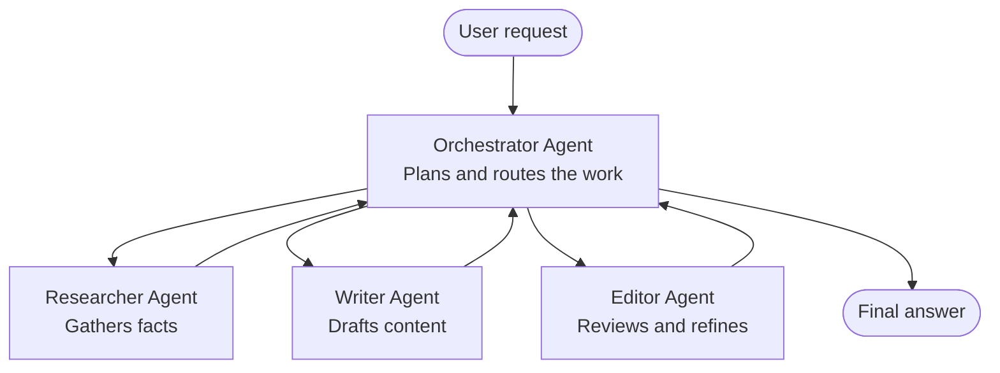

# Daugiaagentė esmė – diegkite savo pirmąją koordinuotą DI sistemą

**Skyriaus navigacija:**
- **📚 Kursų pradžia**: [AZD pradedantiesiems](../../README.md)
- **📖 Dabartinis skyrius**: 5 skyrius – daugiaagentės DI sprendimai
- **⬅️ Ankstesnis**: [4 skyrius: infrastruktūra](../chapter-04-infrastructure/README.md)
- **➡️ Kitas**: [Koordinacijos modeliai](../chapter-06-pre-deployment/coordination-patterns.md)

> Komandų instrukcijos peržiūrėtos pagal išleistą `azd 1.37.2` referenciją. Debesų diegimai nebuvo vykdyti.

## Įvadas

Ankstesniuose skyriuose jūs įdiegėte vieną programą, o 2 skyriuje – vieną DI agentą. Ši pamoka žengia kitą žingsnį: diegiate **daugiaagentę sistemą**, kur kelis specializuoti agentai bendradarbiauja spręsdami problemą, kurios vienas agentas negalėtų gerai išspręsti pats.

Gera naujiena pradedantiesiems: **nereikia naujų komandų.** Daugiaagentis sprendimas vis dar yra azd projektas. Jūs naudosite `azd init`, `azd up`, testuosite ir `azd down` — tiksliai tą darbo eigą, kurią jau žinote. Kinta tik programos *forma* viduje.

## Mokymosi tikslai

Šios pamokos pabaigoje jūs:
- Suprasite, ką reiškia „daugiaagentė“ ir kada verta papildoma sudėtingumas
- Atpažinsite įprastas daugiaagentės sistemos roles (koordinatorius + specialistai)
- Įdiegsite veikiantį daugiaagentį šabloną su `azd up`
- Suprasite Azure išteklius, kurie palaiko daugiaagentę programą
- Žinosite, kaip saugiai patikrinti, pritaikyti ir išardyti sprendimą

## Mokymosi rezultatai

Įvykdę šią pamoką galėsite:
- Paaiškinti skirtumą tarp vieno agento ir daugiaagentės sistemos
- Pasirinkti tarp vieno agente su įrankiais ir tikros daugiaagentės architektūros
- Išdiegti ir išbandyti daugiaagentį šabloną nuo pradžios iki pabaigos su azd
- Nustatyti, kur veikia kiekvienas agentas ir kaip jie komunikuoja
- Išvalyti visus išteklius, kad būtų išvengta nuolatinių išlaidų

---

## Kas yra daugiaagentė sistema?

Vienas DI agentas yra vienas modelis su instrukcijų rinkiniu ir (pasirenkamai) kai kuriais įrankiais. Tai veikia gerai susitelktiems užduotims. Tačiau užduočiai augant — tyrimas, rašymas, taisymas, faktų tikrinimas — viską sutalpinti į vieną užklausą daro agentą lėtesnį, mažiau patikimą ir sunkiau išsigryninti klaidas.

**Daugiaagentė sistema** daro darbą, kad kiekvienas specialistas gerai atlieka vieną užduotį, koordinuojamą koordinatoriaus:



### Dvi roles, kurias visada matysite

| Rolis | Užduotis | Pavyzdys |
|------|----------|----------|
| **Koordinatorius** | Nusprendžia *ką daryti toliau* ir nukreipia darbą tarp agentų | „Pirmiausia tyrinėk, tada rašyk, tada redaguok“ |
| **Specialistas** | Atlieka vieną sutelktą darbą ir pateikia rezultatą | „Tyrėjas“, kuris tik renka faktus |

### Ar iš tiesų reikia kelių agentų?

Pradėkite paprastai. Pasirinkite daugiaagentę **tik** kai kuris nors iš šių teisingas:

- ✅ Užduotis turi **atskirus etapus**, kurie naudingai naudoja skirtingas instrukcijas (tyrimas vs. rašymas vs. peržiūra)
- ✅ Norite, kad specialistai dirbtų **lygiagrečiai**, kad sutaupytumėte laiko
- ✅ Skirtingiems žingsniams reikia **skirtingų įrankių ar duomenų šaltinių**
- ✅ Kiekvienam etapui reikia būti **atskirose testavimo ir gedimų šalinimo galimybėse**

Jei jūsų užduotis – vienas klausimas-atsakymas arba paprastas įrankio kvietimas, **vieno agento su įrankiais** (2 skyrius) sprendimas yra paprastesnis, pigesnis ir lengviau valdomas.

> **Pradedančiojo patarimas:** „Daugiau agentų“ nereiškia „geriau.“ Kiekvienas agentas prideda vėlavimą, kainą ir dar vieną stebimą dalyką. Agentus pridėkite tik tada, kai problema aiškiai suskyla į dalis.

---

## Du būdai sukurti daugiaagentę Azure aplinkoje

| Požiūris | Kas tai yra | Geriausia skirta |
|----------|------------|----------------|
| **Vienas agentas + įrankiai** | Vienas Foundry agentas, kuris kviečia funkcijas/įrankius | Paprastos darbo eigos, pradžia |
| **Keli koordinuoti agentai** | Keli agentai su koordinatoriumi | Atskiri etapai, lygiagretus darbas, specializacija |

Ši pamoka daugiausia dėmesio skiria antrajai strategijai, naudojant **paruoštą šabloną**, kad galėtumėte pamatyti veikiančią daugiaagentę sistemą prieš kurdami savo.

---

## Praktika: įdiekite veikiantį daugiaagentę programą

Diegsime **Contoso Creative Writer**, oficialų Azure pavyzdį, kuris koordinuoja tyrimo, produkto, rašymo ir redagavimo agentus straipsniui sukurti. Prieš tęsdami, patikrinkite [pavyzdžio reikalavimus ir išlaidas](https://github.com/Azure-Samples/contoso-creative-writer#azure-account-requirements): reikalingas modelio kvotas, Azure AI Search, Bing Grounding prieiga, Python, Docker ir Bash palaikymas. Modelio ir regiono prieinamumas priklauso nuo jūsų prenumeratos; diegimas ne visada garantuotas pasirinkus konkretų regioną.

### 1 žingsnis: inicializuokite šabloną

```bash
# Create a working folder
mkdir creative-writer && cd creative-writer

# Initialize from the official multi-agent template
azd init --template Azure-Samples/contoso-creative-writer .
```

> Daugiau daugiaagentžių šablonų galite rasti bet kada [Awesome AZD AI galerijoje](https://azure.github.io/awesome-azd/?tags=ai). Kitos pradedantiesiems draugiškos galimybės yra `get-started-with-ai-agents` ir `azure-ai-travel-agents`.

### 2 žingsnis: autentifikuokitės

```bash
# Required for azd workflows
azd auth login

# Also required by this sample's Azure CLI hooks
az login
```

### 3 žingsnis: patikrinkite aplinką

```bash
# init normally creates/selects an environment; confirm it before proceeding
azd env list
# Only if you need an additional environment:
# azd env new dev
```

### 4 žingsnis: peržiūrėkite, tada diegkite

```bash
# See what will be created before spending anything (recommended)
azd provision --preview

# Provision infrastructure and deploy all agents in one step
azd up
```

`azd up` paprašys trūkstamų prenumeratos ir regiono nustatymų, tada paskirstys išteklius ir įdiegs programą. Peržiūra nerezervuoja kvotos ir negarantuoja sėkmės; šablono kabliai gali veikti per paskirstymo peržiūrą, todėl juos pirmiausia peržiūrėkite. Norėdami pratęsti azd laukimo laiką kiekvienam **paslaugos diegimui** (ne modelio įvedimui):

```bash
azd deploy --timeout 1800
```

Laiko limitas sustabdo azd laukimą; jis neatšaukia diegimo Azure. Prieš bandydami dar kartą patikrinkite išteklių būseną.

> **Dėmesio dėl sąnaudų ir pajėgumų:** daugiaagentės programos diegia DI modelius, kurie naudoja kvotą ir sukelia išlaidas. Jei `azd up` nepavyksta dėl modelio kvotos, žiūrėkite [DI trikčių šalinimą](../chapter-07-troubleshooting/ai-troubleshooting.md) dėl regiono ir kvotų pataisymų, taip pat 6 skyrių [Pajėgumų planavimas](../chapter-06-pre-deployment/capacity-planning.md).

---

## Supratimas, ką įdiegėte

Tipinė daugiaagentė programa tokia paskiria Azure išteklių rinkinį, kuris tiesiogiai atspindi atsakomybę pagal aukščiau esančią schemą:

| Išteklius | Kodėl jis reikalingas |
|-----------|---------------------|
| **Microsoft Foundry / Modeliai** | Talpina kalbos modelius, kuriuos naudoja kiekvienas agentas |
| **Azure AI Search** | Suteikia tyrimo agentui išgrįstas duomenų paieškas |
| **Container Apps** (arba App Service) | Talpina koordinatoriumi ir agentų kodą |
| **Cosmos DB** (kai kuriuose pavyzdžiuose) | Laiko bendrą būseną / atmintį, kurią perduoda agentai |
| **Application Insights** | Seką užklausas *per* agentus, kad galėtumėte derinti srautą |

### Kaip agentai tarpusavyje kalbasi

Daugelyje azd daugiaagentžių pavyzdžių **koordinatorius veikia jūsų programos kode** (pvz., naudodamas Semantic Kernel arba Microsoft Agent Framework). Koordinatorius paeiliui kviečia specialistus agentus, perduoda rezultatus ir surenka galutinį atsakymą. Agentai dalijasi kontekstu per:

- **Funkcijų/įrankių kvietimus** — koordinatorius iškviečia specialistą ir gauna atsakymą
- **Bendrą atmintį** — duomenų bazė (dažnai Cosmos DB) laiko būseną, kurią skaito abu agentai
- **Žinutes/įvykius** — laisvesniam susiejimui agentai komunikuoja per eilę arba Service Bus

> **Kodėl tai svarbu derinimui:** kadangi kiekvienas žingsnis yra atskiras, Application Insights parodo *koks* agentas buvo lėtas ar nepavyko. Tai viena pagrindinių priežasčių darbą skaldyti tarp agentų.

---

## Patikrinkite diegimą

Patvirtinkite, kad sistema išties veikia prieš einant toliau:

```bash
# Show the deployed endpoints
azd show

# Open the app's monitoring dashboard
azd monitor

# Open Application Insights Logs (not a terminal log stream)
azd monitor --logs
```

Tada atidarykite programos URL iš `azd show` ir paprašykite trumpą straipsnį. Naudokite pavyzdžio derinimo rodinį agentų darbo eigai patikrinti. Application Insights užklausų paieška gali parodyti atskirus žingsnius, jei pavyzdys juos instrumentuoja ir koreliuoja; azd automatiškai neprideda agentų spanų.

**Sėkmės kriterijai:**
- ✅ `azd show` pateikia pasiekiamą galinį tašką
- ✅ Užklausa duoda rezultatą, kuris aiškiai praėjo kelis etapus
- ✅ Derinimo rodinyje matosi keli agentų veiksmai; jei įtraukta stebėsena, patikrinkite atitinkamą telemetriją po įvedimo

---

## Tinkinkite: pridėkite arba pakoreguokite agentą

Kadangi kiekvienas agentas yra tik instrukcijos plius įrankiai, tinkinimas yra prieinamas:

1. **Suraskite agentų aprašymus** šablone (dažnai `prompts/`, `agents/` arba `*.prompty` bylų rinkinyje).
2. **Pakeiskite agente instrukcijas** – pavyzdžiui, nurodykite redaktoriaus agentui laikytis tam tikro tono ar žodžių skaičiaus.
3. **Perdiegi tik kodą** (infrastruktūra nesikeičia):

   ```bash
   azd deploy
   ```

Norėdami kurti *savo* Foundry agentų projektą, naudokite agentų plėtinio interaktyvų inicializavimą:

```bash
azd extension install azure.ai.agents
azd ai agent init
azd up
azd ai agent invoke      # test, with response timing
```

Žr. [2 skyrių: agentai](../chapter-02-ai-development/agents.md) ir [AZD DI CLI referenciją](../chapter-08-production/production-ai-practices.md#azd-ai-cli-commands-and-extensions) dėl viso gyvavimo ciklo: agentas `invoke`, atskiras vertinimo plėtinys `azd ai eval` darbo eiga, agento `optimize` ir agento `delete`.

---

## Išvalykite

Daugiaagentės programos veikia kelias mokamas paslaugas. Išardykite viską, kai baigsite:

```bash
# Review the resources and confirm deletion interactively
azd down
```

Trinimas yra destruktyvus. Laikinuose laboratorijose `azd down --force --purge` praleidžia trynimą ir palaiko švelnaus trinimo patvirtinimus; ištrynimas yra negrįžtamas ten, kur palaikomas, ir gali būti blokuojamas purvo apsauga. Švelnus trynimas susijęs su atkūrimu/pavadinimo pakartotiniu panaudojimu, o ne tiesioginių mokesčių įrodymu. Po išvalymo patikrinkite išlaikytus išteklius ir atsiskaitymą.

---

## Pastaba apie daugiaagentes gamybos sistemas

Šiame repozitoriume esantis [Mažmeninės prekybos daugiabrolio agento sprendimas](../../examples/retail-scenario.md) yra **architektūrinis planas**, o ne vieno komandos šablonas—jame dokumentuojama, kaip *galėtų* būti sukuriama gamybinė mažmeninės prekybos sistema (ir aiškiai nurodoma, kad pilnas kūrimas yra reikšmingas darbas). Naudokite jį kaip dizaino nuorodą *tik po* to, kai čia sudiegsite veikiantį pavyzdį. Dėl gamybai svarbių klausimų (patvarumas, kaštai, stebėjimas, valdymas) žiūrėkite [8 skyrių: Gamybinės DI praktikos](../chapter-08-production/production-ai-practices.md).

---

## Santrauka

- Daugiabrolis agentų sistema paskirsto darbus tarp specialistų, kuriuos koordinuoja orkestratorius.
- Naudokite tai tik, kai užduotis turi atskirus etapus, lygiagretiškumą arba skirtingus įrankius kiekviename žingsnyje—priešingu atveju geriau naudoti vieną agentą.
- azd darbo eiga nesikeičia: `azd init` → `azd up` → testavimas → `azd down`.
- Tikras šablonas kaip `contoso-creative-writer` leidžia šiandien pamatyti ir pritaikyti veikiantį daugiabrolio agento programą.
- Application Insights stebėjimas tarp agentų yra viena svarbiausių praktinių daugiabrolio agento dizaino naudų.

---

## 🔗 Navigacija

| Kryptis | Pamoka |
|-----------|--------|
| **Ankstesnė** | [4 skyrius: Infrastruktūra](../chapter-04-infrastructure/README.md) |
| **Kita** | [Koordinavimo Modeliai](../chapter-06-pre-deployment/coordination-patterns.md) |

## 📖 Susiję Šaltiniai

- [DI Agentų Vadovas](../chapter-02-ai-development/agents.md)
- [Koordinavimo Modeliai](../chapter-06-pre-deployment/coordination-patterns.md)
- [DI Kūrimo Praktikos](../chapter-08-production/production-ai-practices.md)
- [DI Problemų Sprendimas](../chapter-07-troubleshooting/ai-troubleshooting.md)

---

<!-- CO-OP TRANSLATOR DISCLAIMER START -->
**Atsakomybės apribojimas**:
Šis dokumentas buvo išverstas naudojant dirbtinio intelekto vertimo paslaugą [Co-op Translator](https://github.com/Azure/co-op-translator). Nors siekiame tikslumo, prašome atkreipti dėmesį, kad automatiniai vertimai gali turėti klaidų ar netikslumų. Originalus dokumentas jo gimtąja kalba laikomas autoritetingu šaltiniu. Svarbiai informacijai rekomenduojama naudoti profesionalų žmogiškąjį vertimą. Mes neatsakome už jokius nesusipratimus ar neteisingą interpretaciją, kilusią naudojantis šiuo vertimu.
<!-- CO-OP TRANSLATOR DISCLAIMER END -->