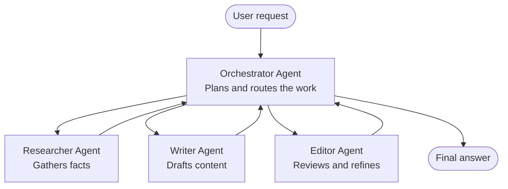

# Daugiaprogramė sistema – Įdiekite savo pirmą koordinuotą DI sistemą

**Skyriaus navigacija:**
- **📚 Kurso pradžia**: [AZD pradedantiesiems](../../README.md)
- **📖 Dabartinis skyrius**: 5 skyrius – Daugiaprogramės DI sprendimai
- **⬅️ Ankstesnis**: [4 skyrius: Infrastruktūra](../chapter-04-infrastructure/README.md)
- **➡️ Kitas**: [Koordinavimo modeliai](../chapter-06-pre-deployment/coordination-patterns.md)

> Komandų nurodymas patikrintas pagal paskelbtą `azd 1.37.2` šaltinį. Debesuotieji diegimai nebuvo vykdomi.

## Įvadas

Ankstesniuose skyriuose įdiegėte vieną programą – o 2 skyriuje įdiegėte vieną DI agentą. Ši pamoka žengia kitą žingsnį: įdiegti **daugiaprogramę sistemą**, kur keli specializuoti agentai dirba kartu, kad išspręstų problemą, kurios vienas agentas vienas pats negalėtų gerai atlikti.

Geros naujienos pradedantiesiems: **nereikia naujų komandų.** Daugiaprogramis sprendimas vis tiek yra azd projektas. Jūs naudosite `azd init`, `azd up`, testuosite ir `azd down` — būtent tą darbo eigą, kurią jau pažįstate. Pakeičia tik programos vidinė *struktūra*.

## Mokymosi tikslai

Šios pamokos pabaigoje jūs:
- Suprasite, ką reiškia "daugiaprogramis" ir kada verta priimti didesnį sudėtingumą
- Atpažinsite dažniausias daugiaprogramės sistemos roles (organizatorius + specialistai)
- Įdiegsite tikrą veikiančią daugiaprogramę šabloną su `azd up`
- Suprasite Azure išteklius, kurie palaiko daugiaprogramę programą
- Žinosite, kaip patikrinti, pritaikyti ir saugiai pašalinti sprendimą

## Mokymosi rezultatai

Įveikę šią pamoką sugebėsite:
- Paaiškinti skirtumą tarp vieno agento ir daugiaprogramės sistemos
- Pasirinkti tarp vieno agento su įrankiais ir tikro daugiaprogramio dizaino
- Įdiegti ir testuoti daugiaprogramį šabloną nuo pradžios iki pabaigos naudojant azd
- Nustatyti, kur vykdomas kiekvienas agentas ir kaip jie bendrauja
- Išvalyti visus išteklius, kad išvengtumėte tęstinių mokesčių

---

## Kas yra daugiaprogramė sistema?

Vienas DI agentas yra vienas modelis su instrukcijų rinkiniu ir (nebūtinai) kai kuriais įrankiais. Tai gerai veikia sutelktiems užduotims. Tačiau kai užduotis didėja – tyrimai, rašymas, redagavimas, faktų tikrinimas – viską sudėti į vieną užklausą daro agentą lėtesnį, mažiau patikimą ir sunkiau derinamą.

**Daugiaprogramė sistema** daro darbą specialistais, kurie kiekvienas gerai atlieka vieną užduotį, koordinuojami organizatoriaus:



### Dvi rolės, kurias visada matysite

| Rolė | Užduotis | Pavyzdys |
|------|----------|----------|
| **Organizatorius** | Nustato *kas toliau vyksta* ir paskirsto darbą tarp agentų | „Pirmiausia tyrimai, tada rašymas, paskui redagavimas“ |
| **Specialistas** | Atlieka vieną sutelktą užduotį ir pateikia rezultatą | „Tyrėjas“, kuris tik renka faktus |

### Ar tikrai reikia kelių agentų?

Pradėkite paprastai. Imkitės daugiaprogramio **tik tada**, kai galioja bent vienas iš šių punktų:

- ✅ Užduotis turi **aiškias stadijas**, kurios naudingos su skirtingomis instrukcijomis (tyrimai, rašymas, peržiūra)
- ✅ Norite, kad specialistai veiktų **paraleliai**, kad taupytų laiką
- ✅ Skirtingiems veiksmams reikia **skirtingų įrankių ar duomenų šaltinių**
- ✅ Kiekvienas žingsnis turi būti **nepriklausomai testuojamas ir derinamas**

Jei jūsų užduotis yra vienas klausimas ir atsakymas arba paprastas įrankio kvietimas, **vienas agentas su įrankiais** (2 skyrius) yra paprastesnis, pigesnis ir lengviau valdomas.

> **Pradedančiojo patarimas:** „Daugiau agentų“ nereiškia „geriau“. Kiekvienas agentas prideda delsą, kainą ir naują stebėtiną dalyką. Pridėkite agentus tik tada, kai problema aiškiai suskaidoma į dalis.

---

## Du būdai kurti daugiaprogramį Azure aplinkoje

| Požiūris | Kas tai yra | Geriausia taikyti |
|----------|-------------|------------------|
| **Vienas agentas + įrankiai** | Vienas Foundry agentas, kuris kviečia funkcijas/įrankius | Paprastos darbo eigos, pradžia |
| **Daug kelių koordinuotų agentų** | Keli agentai su organizatoriumi | Aiškios stadijos, paralelinis darbas, specializacija |

Ši pamoka orientuota į antrą požiūrį, naudojant **paruoštą šabloną**, kad pamatytumėte tikrą daugiaprogramę sistemą veikiančią prieš kurdami savo.

---

## Praktinė užduotis: įdiekite veikiančią daugiaprogramę programą

Įdiegsime **Contoso Creative Writer** – oficialų Azure pavyzdį, koordinuojantį tyrimų, produkto, rašymo ir redagavimo agentus straipsnio išleidimui. Prieš tęsdami, patikrinkite [pavyzdžio reikalavimus ir kainas](https://github.com/Azure-Samples/contoso-creative-writer#azure-account-requirements): reikia modelio kvotos, Azure AI Search, Bing Grounding prieigos, Python, Docker ir Bash suderinamų įrankių. Modelių ir regionų prieinamumas priklauso nuo jūsų prenumeratos; diegimas nebus garantuotas pasirinkus tam tikrą regioną.

### 1 žingsnis: inicializuokite šabloną

```bash
# Create a working folder
mkdir creative-writer && cd creative-writer

# Initialize from the official multi-agent template
azd init --template Azure-Samples/contoso-creative-writer .
```

> Bet kada galite peržiūrėti daugiau daugiaprogramių šablonų [Awesome AZD AI galerijoje](https://azure.github.io/awesome-azd/?tags=ai). Kiti pradedančiajam draugiški variantai: `get-started-with-ai-agents` ir `azure-ai-travel-agents`.

### 2 žingsnis: autentifikuokitės

```bash
# Required for azd workflows
azd auth login

# Also required by this sample's Azure CLI hooks
az login
```

### 3 žingsnis: patikrinkite aplinką

```bash
# init normally creates/selects an environment; confirm it before proceeding
azd env list
# Only if you need an additional environment:
# azd env new dev
```

### 4 žingsnis: peržiūra ir diegimas

```bash
# See what will be created before spending anything (recommended)
azd provision --preview

# Provision infrastructure and deploy all agents in one step
azd up
```

`azd up` paprašys trūkstamų prenumeratos ir regiono nustatymų, tada paruoš išteklius ir įdiegs programą. Peržiūra neužrezervuoja kvotos ir negarantuoja sėkmės; šablono įrankiai gali veikti ir peržiūros metu – patikrinkite juos pirmiausia. Norėdami pratęsti laukimo laiką kiekvienam **paslaugos diegimui** (o ne modelio paruošimui):

```bash
azd deploy --timeout 1800
```

Laukimo laiko viršijimas stabdo azd laukimą; jis neatšaukia diegimo Azure aplinkoje. Prieš bandydami dar kartą, patikrinkite išteklių būseną.

> **Dėmesio į kainą ir talpą:** Daugiaprogramės programos įdiegia DI modelius, kurie naudoja kvotą ir generuoja išlaidas. Jei `azd up` nepavyksta modelio kvotos, žr. [DI trikčių šalinimą](../chapter-07-troubleshooting/ai-troubleshooting.md) dėl regiono ir kvotos pataisymų bei 6 skyrių [Talpos planavimas](../chapter-06-pre-deployment/capacity-planning.md).

---

## Supraskite, ką įdiegėte

Tokia tipiška daugiaprogramė programa paruošia Azure išteklių rinkinį, kuris tiesiogiai atitinka anksčiau parodytą atsakomybės schemą:

| Išteklius | Kodėl jis reikalingas |
|----------|-----------------------|
| **Microsoft Foundry / Modeliai** | Talpina kalbos modelius, kuriuos naudoja kiekvienas agentas |
| **Azure AI Search** | Tyrimo agentui suteikia prieigą prie pagrįstų duomenų paieškoms |
| **Container Apps** (arba App Service) | Talpina organizatoriaus ir agentų kodą |
| **Cosmos DB** (kai kuriuose pavyzdžiuose) | Saugo bendrą būseną/atmintį, perduodamą tarp agentų |
| **Application Insights** | Sekite užklausas *tarp* agentų, kad galėtumėte derinti srautą |

### Kaip agentai bendrauja tarpusavyje

Daugumoje azd daugiaprogramių pavyzdžių **organizatorius veikia jūsų programos kode** (pvz., naudojant Semantic Kernel arba Microsoft Agent Framework). Organizatorius paeiliui kviečia kiekvieną specialistą, perduoda rezultatus ir sujungia galutinį atsakymą. Agentai dalijasi kontektu per:

- **Funkcijų/įrankių kvietimus** — organizatorius kviečia specialistą ir gauna rezultatą
- **Bendrą atmintį** — duomenų bazę (dažnai Cosmos DB), kurį galima skaityti abiem agentams
- **Žinutes/įvykius** — siekiant mažesnio susiejimo, agentai komunikuoja per eilę ar Service Bus

> **Kodėl tai svarbu derinimui:** kadangi kiekvienas žingsnis atskiras, Application Insights parodo *kuris* agentas buvo lėtas ar nepavyko. Tai pagrindinė priežastis, kodėl verta dalyti darbą tarp agentų.

---

## Patikrinkite diegimą

Patvirtinkite, kad sistema tikrai veikia prieš tęsdami:

```bash
# Show the deployed endpoints
azd show

# Open the app's monitoring dashboard
azd monitor

# Open Application Insights Logs (not a terminal log stream)
azd monitor --logs
```

Tada atidarykite programos URL iš `azd show` ir paprašykite trumpo straipsnio. Naudokite pavyzdžio derinimo peržiūrą, kad apžiūrėtumėte agentų darbo eigą. Application Insights užklausų paieška rodo atskirus žingsnius tik jei pavyzdys juos instrumentuoja ir koreliuoja; azd automatiškai neprideda agentų žymių.

**Sėkmės kriterijai:**
- ✅ `azd show` rodo pasiekiamą galinę tašką
- ✅ Užklausa sukuria rezultatą, kuris aiškiai praėjo keliomis stadijomis
- ✅ Derinimo peržiūroje matosi keli agentų žingsniai; jei įjungta sekimas, patikrinkite atitinkamą telemetriją po užkrovimo

---

## Pritaikykite: pridėkite arba pakoreguokite agentą

Kadangi kiekvienas agentas yra instrukcijos plius įrankiai, pritaikyti nėra sunku:

1. **Raskite agentų aprašus** šablone (dažnai `prompts/`, `agents/` arba `*.prompty` failų rinkinys).
2. **Patikslinkite agento instrukcijas** – pvz., nurodykite redaktoriui laikytis konkretaus tono ar žodžių skaičiaus.
3. **Perdiegi tik kodą** (infrastruktūra lieka nepakitusi):

   ```bash
   azd deploy
   ```

Norėdami giliau pažinti *savo* Foundry agentų projektą, naudokite GA paketą su AZD 1.37.0+ atskirame tuščiame kataloge:

```bash
azd ext install microsoft.foundry
azd ai agent init
azd up
azd ai agent invoke      # test, with response timing
```

Žiūrėkite [GA valdomo agento žingsnis po žingsnio vadovą](../chapter-02-ai-development/microsoft-foundry-integration.md#hosted-agent-walkthrough-ga) vietiniam Agent Inspector testavimui, nuotoliniam kodo diegimui ir išvalymo valdymui. [AZD DI CLI referencija](../chapter-08-production/production-ai-practices.md#azd-ai-cli-commands-and-extensions) aptaria ir atskirą vertinimo plėtinį, optimizavimą bei agento naikinimą.

---

## Išvalykite

Daugiaprogramės programos paleidžia kelias apmokestinamas paslaugas. Išvalykite viską, kai baigsite:

```bash
# Review the resources and confirm deletion interactively
azd down
```

Ištrynimas yra destruktyvus. Dėl laikinųjų laboratorijų, `azd down --force --purge` praleidžia ištrynimą ir palaiko minkšto ištrynimo patvirtinimus; tokie ištrynimai yra neatšaukiami ir gali būti blokuojami apsaugos nuo ištrynimo. Minkštas ištrynimas susijęs su atkūrimu/pavadinimų pakartotiniu naudojimu, o ne su tęstiniais mokesčiais. Pasitikrinkite išlaikytus išteklius ir apmokėjimą po išvalymo.

Jei taip pat inicializavote valdomą agentą esamam Foundry projektui, `azd down` palieka to projekto agentą ir kitus išteklius vietoje. Pašalinkite tik nepageidaujamus savo nuosavybėje esančius resursus atskirai. Naujam Foundry projektui, sukurtam jo AZD aplinkos, `azd down` ištrina išteklių grupę ir viską joje.

---

## Pastaba apie gamybines daugiaprogrames sistemas

Šiame repozitorijoje esanti [Mažmeninės prekybos daugiaprogramė sprendimas](../../examples/retail-scenario.md) yra **architektūrinė schema**, o ne vieno komandos šablonas – ji dokumentuoja, kaip *būtų* sukuriama gamybinė mažmeninės prekybos sistema (ir aiškiai nurodo, kad pilnas kūrimas yra reikšmingas darbas). Naudokite ją kaip dizaino nuorodą *po* to, kai čia įdiegsite veikiančią pavyzdinę versiją. Dėl gamybos aspektų (atsparumo, išlaidų, stebėjimo, valdymo) tęskite skaitymą [8 skyriuje: Gamybinio AI praktikos](../chapter-08-production/production-ai-practices.md).

---

## Santrauka

- Daugiaprogramė sistema paskirsto darbą specialistams, koordinuojama organizatoriaus.
- Naudokite ją tik kai užduotyje yra aiškios stadijos, lygiagretumas arba skirtingi įrankiai kiekviename žingsnyje – kitu atveju geriau naudoti vieną agentą.
- „azd“ darbo eiga nesikeičia: `azd init` → `azd up` → testas → `azd down`.
- Tikras šablonas, kaip `contoso-creative-writer`, leidžia šiandien pamatyti ir pritaikyti veikiančią daugiaprogramę programėlę.
- „Application Insights“ sekimas tarp agentų yra vienas didžiausių praktinių daugiaprogramės dizaino privalumų.

---

## 🔗 Navigacija

| Kryptis | Pamoka |
|-----------|--------|
| **Ankstesnė** | [4 skyrius: Infrastruktūra](../chapter-04-infrastructure/README.md) |
| **Kita** | [Koordinavimo modeliai](../chapter-06-pre-deployment/coordination-patterns.md) |

## 📖 Susiję ištekliai

- [AI agentų vadovas](../chapter-02-ai-development/agents.md)
- [Koordinavimo modeliai](../chapter-06-pre-deployment/coordination-patterns.md)
- [Gamybinio AI praktikos](../chapter-08-production/production-ai-practices.md)
- [AI trikčių šalinimas](../chapter-07-troubleshooting/ai-troubleshooting.md)

---

<!-- CO-OP TRANSLATOR DISCLAIMER START -->
**Atsakomybės apribojimas**:
Šis dokumentas buvo išverstas naudojant dirbtinio intelekto vertimo paslaugą [Co-op Translator](https://github.com/Azure/co-op-translator). Nors siekiame tikslumo, prašome atkreipti dėmesį, kad automatiniai vertimai gali turėti klaidų ar netikslumų. Originalus dokumentas jo gimtąja kalba laikomas autoritetingu šaltiniu. Svarbiai informacijai rekomenduojama naudoti profesionalų žmogiškąjį vertimą. Mes neatsakome už jokius nesusipratimus ar neteisingą interpretaciją, kilusią naudojantis šiuo vertimu.
<!-- CO-OP TRANSLATOR DISCLAIMER END -->