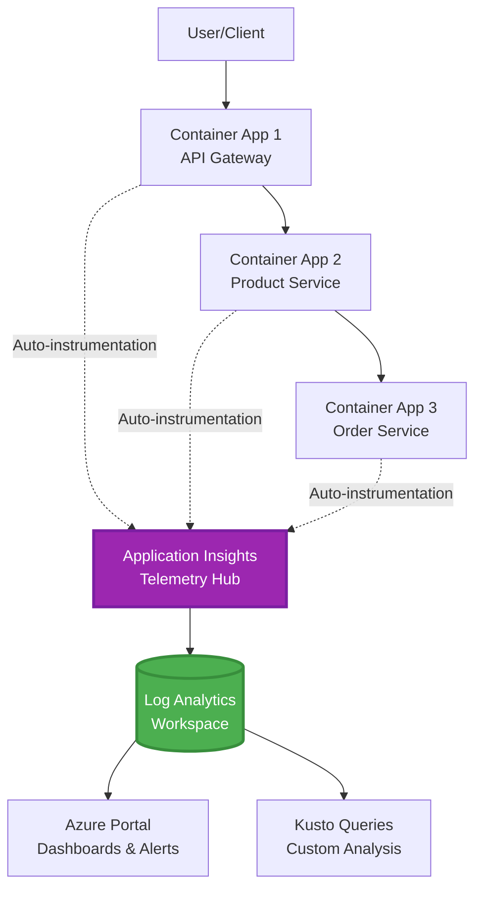
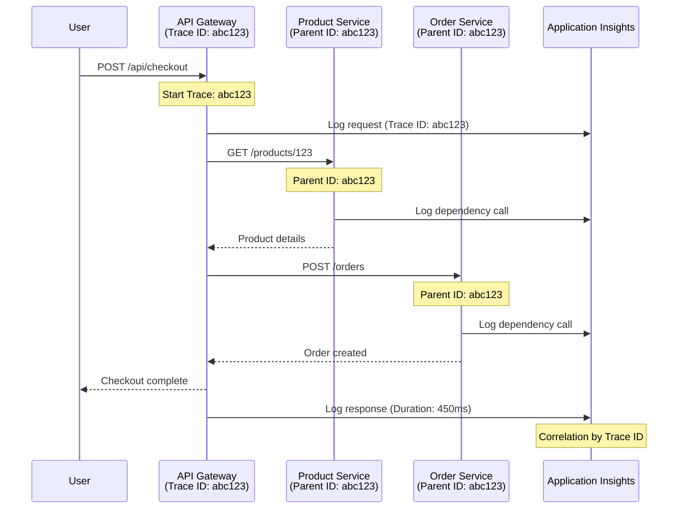

# Application Insights integracija su AZD

⏱️ **Numatomas laikas**: 40-50 minučių | 💰 **Kainos įtaka**: ~5-15 $/mėn | ⭐ **Sudedamumas**: Vidutinio lygio

**📚 Mokymosi kelias:**
- ← Ankstesnis: [Priešdiegiamos patikros](preflight-checks.md) - Diegimo patikrinimas
- 🎯 **Esate čia**: Application Insights integracija (Stebėjimas, telemetrija, derinimas)
- → Kitas: [Diegimo vadovas](../chapter-04-infrastructure/deployment-guide.md) - Diegimas Azure
- 🏠 [Kurso pradžia](../../README.md)

---

## Ką išmoksite

Baigę šią pamoką, jūs:
- Deklaruosite **Application Insights** AZD infrastruktūroje ir sukonfigūruosite SDK instrumentaciją
- Sukonfigūruosite **išplitusį sekimą** mikroservisams
- Įgyvendinsite **pasirinktą telemetriją** (metrimas, įvykiai, priklausomybės)
- Nustatysite **gyvą metrikų stebėjimą** realiu laiku
- Kursite **įspėjimus ir valdymo skydelius** iš AZD diegimų
- Derinsite produkcijos problemas naudodami **telemetrijos užklausas**
- Optimaliuosite **išlaidų ir mėginių ėmimo** strategijas
- Stebėsite **AI/LLM programas** (žetonai, delsimas, išlaidos)

## Kodėl svarbu naudoti Application Insights su AZD

### Iššūkis: Produkcijos stebėjimas

**Be Application Insights:**
```
❌ No visibility into production behavior
❌ Manual log aggregation across services
❌ Reactive debugging (wait for customer complaints)
❌ No performance metrics
❌ Cannot trace requests across services
❌ Unknown failure rates and bottlenecks
```

**Su Application Insights + AZD:**
```
✅ Automatic telemetry collection
✅ Centralized logs from all services
✅ Proactive issue detection
✅ End-to-end request tracing
✅ Performance metrics and insights
✅ Real-time dashboards
✅ AZD provisions the monitoring declared in your templates
```

**Palyginimas**: Application Insights yra tarsi jūsų programos „juodoji dėžė“ ir kabinos valdymo pultas. Jūs matote visa, kas vyksta realiu laiku, ir galite peržiūrėti bet kokį incidentą.

---

## Architektūros apžvalga

### Application Insights AZD architektūroje



### Kas stebima automatiškai

Palaikoma automatinė instrumentacija fiksuoja užklausas/priklausomybes instrumentuotose bibliotekose. Pasirinktiniai įvykiai ir metrika reikalauja programos kodo; prieinamumo testai turi būti sukonfigūruoti atskirai. Ji nesurinks kiekvienos eilutės žemiau tik todėl, kad šis resursas egzistuoja.

| Telemetrijos tipas | Ką fiksuoja | Panaudojimas |
|----------------|------------------|----------|
| **Užklausos** | HTTP užklausos, statuso kodai, trukmė | API našumo stebėjimas |
| **Priklausomybės** | Išoriniai iškvietimai (DB, API, saugykla) | Butelio kaklelio identifikavimas |
| **Išimtys** | Nenumatytos klaidos su steko atsekimu | Gedimų derinimas |
| **Pasirinktiniai įvykiai** | Verslo įvykiai (registracija, pirkimas) | Analitika ir funneliai |
| **Metrika** | Veikimo skaitikliai, pasirinktiniai matavimai | Talpos planavimas |
| **Sekos** | Žurnalo pranešimai su svarba | Derinimas ir auditavimas |
| **Prieinamumas** | Veikimo laiko ir atsako testai | SLA stebėjimas |

---

## Prieš sąlygos

### Reikalingi įrankiai

```bash
# Verify Azure Developer CLI
azd version
# Command reference baseline: azd 1.37.2

# Verify Azure CLI
az --version
# ✅ Expected: azure-cli 2.50.0 or higher
```

### Azure reikalavimai

- Aktyvi Azure prenumerata
- Leidimai kurti:
  - Application Insights išteklius
  - Log Analytics darbo erdves
  - Container Apps
  - Resursų grupes

### Žinių prieš sąlygos

Turėtumėte būti pabaigę:
- [AZD pagrindai](../chapter-01-foundation/azd-basics.md) - Pagrindinės AZD sąvokos
- [Konfigūracija](../chapter-03-configuration/configuration.md) - Aplinkos nustatymas
- [Pirmas projektas](../chapter-01-foundation/first-project.md) - Pagrindinis diegimas

---

## Pamoka 1: Automatinis Application Insights su AZD

### Kaip AZD paruošia Application Insights

AZD sukuria Application Insights **tik jei projekto infrastruktūra tai deklaruoja**. `azure.yaml` viena nepateikia stebėjimo ir neinstrumentuoja programos kodo.

> **Pavyzdinis aprėptis:** Šioje pamokoje yra integracijos fragmentai, o ne visiškas `monitored-app` projektas šiame saugyklos kataloge. Prieš diegimą pateikite pagrindinį šabloną su parametrų žemėlapiu, Container Apps aplinką, registrą/image bei tapatybės konfigūraciją, Dockerfile ir paslaugų žymes. Vėlesnėse pamokose pateikiami alternatyvūs/plėtiniai fragmentai, o ne visiškai pakeičiamos bylos. Pradėkite nuo veikianties [mikroservisų pavyzdžio](../../../../examples/microservices), jei reikia bėgančios pradžios bazės.

### Projekto struktūra

```
monitored-app/
├── azure.yaml                     # AZD configuration
├── infra/
│   ├── main.bicep                # Main infrastructure
│   ├── core/
│   │   └── monitoring.bicep      # Application Insights + Log Analytics
│   └── app/
│       └── api.bicep             # Container App with monitoring
└── src/
    ├── app.py                    # Application with telemetry
    ├── requirements.txt
    └── Dockerfile
```

---

### 1 žingsnis: Konfigūruokite AZD (azure.yaml)

**Byla: `azure.yaml`**

```yaml
name: monitored-app
metadata:
  template: monitored-app@1.0.0

services:
  api:
    project: ./src
    language: python
    host: containerapp

# Monitoring must be declared in infra/ and enabled in application code.
```

Tai deklaruoja diegiamą paslaugą. Tolimesnės Bicep ir SDK konfigūracijos pateikia stebėjimą; azd jų implicitiai neprideda.

---

### 2 žingsnis: Stebėjimo infrastruktūra (Bicep)

**Byla: `infra/core/monitoring.bicep`**

```bicep
param logAnalyticsName string
param applicationInsightsName string
param location string = resourceGroup().location
param tags object = {}

// Log Analytics Workspace (required for Application Insights)
resource logAnalytics 'Microsoft.OperationalInsights/workspaces@2022-10-01' = {
  name: logAnalyticsName
  location: location
  tags: tags
  properties: {
    sku: {
      name: 'PerGB2018'  // Pay-as-you-go pricing
    }
    retentionInDays: 30  // Keep logs for 30 days
    features: {
      enableLogAccessUsingOnlyResourcePermissions: true
    }
  }
}

// Application Insights
resource applicationInsights 'Microsoft.Insights/components@2020-02-02' = {
  name: applicationInsightsName
  location: location
  tags: tags
  kind: 'web'
  properties: {
    Application_Type: 'web'
    WorkspaceResourceId: logAnalytics.id
    IngestionMode: 'LogAnalytics'
    publicNetworkAccessForIngestion: 'Enabled'
    publicNetworkAccessForQuery: 'Enabled'
  }
}

// Outputs for Container Apps
output logAnalyticsWorkspaceId string = logAnalytics.id
output logAnalyticsWorkspaceName string = logAnalytics.name
output applicationInsightsConnectionString string = applicationInsights.properties.ConnectionString
output applicationInsightsInstrumentationKey string = applicationInsights.properties.InstrumentationKey
output applicationInsightsName string = applicationInsights.name
output applicationInsightsId string = applicationInsights.id
```

---

### 3 žingsnis: Prijunkite Container App prie Application Insights

**Byla: `infra/app/api.bicep`**

```bicep
param name string
param location string
param tags object = {}
param containerAppsEnvironmentId string
param containerImage string
param applicationInsightsConnectionString string

resource containerApp 'Microsoft.App/containerApps@2023-05-01' = {
  name: name
  location: location
  tags: tags
  properties: {
    managedEnvironmentId: containerAppsEnvironmentId
    configuration: {
      ingress: {
        external: true
        targetPort: 8000
      }
      secrets: [
        {
          name: 'appinsights-connection-string'
          value: applicationInsightsConnectionString
        }
      ]
    }
    template: {
      containers: [
        {
          name: 'api'
          image: containerImage // Supply an accessible image and registry authentication
          resources: {
            cpu: json('0.5')
            memory: '1Gi'
          }
          env: [
            {
              name: 'APPLICATIONINSIGHTS_CONNECTION_STRING'
              secretRef: 'appinsights-connection-string'
            }
            {
              name: 'APPLICATIONINSIGHTS_ENABLED'
              value: 'true'
            }
          ]
        }
      ]
    }
  }
}

output uri string = 'https://${containerApp.properties.configuration.ingress.fqdn}'
```

---

### 4 žingsnis: Programos kodas su telemetrija

**Byla: `src/app.py`**

```python
from flask import Flask, request, jsonify
from azure.monitor.opentelemetry import configure_azure_monitor
import logging
import os

app = Flask(__name__)

# Get Application Insights connection string
connection_string = os.environ.get('APPLICATIONINSIGHTS_CONNECTION_STRING')

if connection_string:
    # Azure Monitor OpenTelemetry instruments supported libraries, including Flask.
    configure_azure_monitor(
        connection_string=connection_string,
        logger_name=__name__,
        enable_live_metrics=True
    )
    logger = logging.getLogger(__name__)
    logger.setLevel(logging.INFO)
    
    print("✅ Application Insights enabled")
else:
    logger = logging.getLogger(__name__)
    logger.setLevel(logging.INFO)
    print("⚠️ Application Insights not configured")

@app.route('/health')
def health():
    logger.info('Health check endpoint called')
    return jsonify({'status': 'healthy', 'monitoring': 'enabled' if connection_string else 'disabled'})

@app.route('/api/products')
def get_products():
    logger.info('Fetching products')
    
    # In-memory fixture: this is not a database dependency call.
    products = [
        {'id': 1, 'name': 'Laptop', 'price': 999.99},
        {'id': 2, 'name': 'Mouse', 'price': 29.99},
        {'id': 3, 'name': 'Keyboard', 'price': 79.99}
    ]
    
    logger.info(f'Returned {len(products)} products')
    return jsonify(products)

@app.route('/api/error-test')
def error_test():
    """Test error tracking"""
    logger.error('Testing error tracking')
    try:
        raise ValueError('This is a test exception')
    except Exception as e:
        logger.exception('Exception occurred in error-test endpoint')
        return jsonify({'error': str(e)}), 500

@app.route('/api/slow')
def slow_endpoint():
    """Test performance tracking"""
    import time
    logger.info('Slow endpoint called')
    time.sleep(3)  # Simulate slow operation
    logger.warning('Endpoint took 3 seconds to respond')
    return jsonify({'message': 'Slow operation completed'})

if __name__ == '__main__':
    app.run(host='0.0.0.0', port=8000)
```

**Byla: `src/requirements.txt`**

```txt
Flask
azure-monitor-opentelemetry
gunicorn
requests
openai
```

Išspręskite šias priklausomybes savo projekte, išbandykite kartu ir užrakinkite galutines versijas. Naujiems projektams rekomenduojama naudoti Azure Monitor OpenTelemetry, o ne nutrauktus OpenCensus Python eksportuotojus.

---

### 5 žingsnis: Diegimas ir patikrinimas

```bash
# Deploy only after completing and wiring the infrastructure fragments above
azd up

# Get app URL
APP_URL=$(azd env get-value API_URL) # Requires this output in main.bicep

# Generate telemetry
curl $APP_URL/health
curl $APP_URL/api/products
curl $APP_URL/api/error-test
curl $APP_URL/api/slow
```

**✅ Laukiamas rezultatas:**
```json
{
  "status": "healthy",
  "monitoring": "enabled"
}
```

---

### 6 žingsnis: Peržiūrėkite telemetriją Azure portale

```bash
# Get Application Insights details
azd env get-values | grep APPLICATIONINSIGHTS

# Open in Azure Portal
az monitor app-insights component show \
  --app $(azd env get-values | grep APPLICATIONINSIGHTS_NAME | cut -d '=' -f2 | tr -d '"') \
  --resource-group $(azd env get-values | grep AZURE_RESOURCE_GROUP | cut -d '=' -f2 | tr -d '"') \
  --query "appId" -o tsv
```

**Eikite į Azure portalo → Application Insights → Transaction Search**

Jūs turėtumėte matyti:
- ✅ HTTP užklausas su statuso kodais
- ✅ Užklausos trukmę (3+ sekundės `/api/slow`)
- ✅ Išimčių detales iš `/api/error-test`
- ✅ Pasirinktinius žurnalo pranešimus

---

## Pamoka 2: Pasirinktinė telemetrija ir įvykiai

### Sekite verslo įvykius

Pridėsime pasirinktinę telemetriją verslo kritiniams įvykiams.

**Byla: `src/telemetry.py`**

```python
from contextlib import contextmanager
from azure.monitor.opentelemetry import configure_azure_monitor
from opentelemetry import metrics, trace
from opentelemetry.trace import SpanKind
import logging
import os

class TelemetryClient:
    """Custom telemetry client for Application Insights"""
    
    def __init__(self, connection_string=None):
        self.connection_string = connection_string or os.environ.get('APPLICATIONINSIGHTS_CONNECTION_STRING')
        
        # Configure once per process. If app.py already calls this, keep only
        # one configure_azure_monitor call and use logger_name='telemetry'.
        if self.connection_string:
            configure_azure_monitor(
                connection_string=self.connection_string,
                logger_name=__name__,
                enable_live_metrics=True
            )
        self.logger = logging.getLogger(__name__)
        self.logger.setLevel(logging.INFO)
        self.tracer = trace.get_tracer(__name__)
        self.meter = metrics.get_meter(__name__)
        self.instruments = {}
    
    def track_event(self, event_name: str, properties: dict = None):
        """Track custom business event"""
        properties = properties or {}
        self.logger.info(
            f"CustomEvent: {event_name}",
            extra={
                # OTel log attributes become customDimensions in App Insights.
                    'event_name': event_name,
                    **properties
            }
        )
    
    def track_metric(self, metric_name: str, value: float, properties: dict = None):
        """Track custom metric"""
        properties = properties or {}
        if metric_name not in self.instruments:
            self.instruments[metric_name] = self.meter.create_histogram(metric_name)
        self.instruments[metric_name].record(value, attributes=properties)
    
    @contextmanager
    def track_dependency(self, name: str):
        """Time the real operation inside a client span; exceptions mark failure."""
        with self.tracer.start_as_current_span(name, kind=SpanKind.CLIENT) as span:
            yield span

# Global telemetry client
telemetry = TelemetryClient()
```

### Atnaujinkite programą su pasirinktinais įvykiais

**Byla: `src/app.py` (patobulinta)**

Pridėkite šias maršrutų taisykles prie jau esamos Flask programos; palikite ankstesnius sveikatos/testo maršrutus. Trumpesnis blokas žemiau rodo atskirą programą aiškumui. Telemetrijos inicializacija dabar gyvena `telemetry.py`—neinicializuokite eksportuotojų du kartus.

```python
from flask import Flask, request, jsonify
from telemetry import telemetry
import time
import random
import os

app = Flask(__name__)

@app.route('/api/purchase', methods=['POST'])
def purchase():
    """Track purchase event with custom telemetry"""
    data = request.get_json(silent=True) or {}
    product_id = data.get('product_id')
    quantity = data.get('quantity', 1)
    price = data.get('price', 0)
    if not isinstance(quantity, int) or quantity < 1 or \
       not isinstance(price, (int, float)) or price < 0:
        return jsonify({'error': 'quantity and price must be non-negative numbers; quantity >= 1'}), 400
    
    # Track business event
    telemetry.track_event('Purchase', {
        'product_id': product_id,
        'quantity': quantity,
        'total_amount': price * quantity,
        'user_id': request.headers.get('X-User-Id', 'anonymous')
    })
    
    # Track revenue metric
    telemetry.track_metric('Revenue', price * quantity, {
        'product_id': product_id,
        'currency': 'USD'
    })
    
    return jsonify({
        'order_id': f'ORD-{random.randint(1000, 9999)}',
        'status': 'confirmed',
        'total': price * quantity
    })

@app.route('/api/search')
def search():
    """Track search queries"""
    query = request.args.get('q', '')
    
    start_time = time.time()
    
    # Simulate search (would be real database query)
    results = [{'id': 1, 'name': f'Result for {query}'}]
    
    duration = (time.time() - start_time) * 1000  # Convert to ms
    
    # Track search event
    telemetry.track_event('Search', {
        'query': query,
        'results_count': len(results),
        'duration_ms': duration
    })
    
    # Track search performance metric
    telemetry.track_metric('SearchDuration', duration, {
        'query_length': len(query)
    })
    
    return jsonify({'results': results, 'count': len(results)})

@app.route('/api/external-call')
def external_call():
    """Track external API dependency"""
    import requests
    
    try:
        # Set an actual test endpoint; api.example.com is not a working API.
        with telemetry.track_dependency('ExternalAPI'):
            response = requests.get(os.environ['EXTERNAL_API_URL'], timeout=5)
            response.raise_for_status()
            result = response.json()
    except Exception as e:
        return jsonify({'error': 'External dependency failed'}), 502
    
    return jsonify(result)

if __name__ == '__main__':
    app.run(host='0.0.0.0', port=8000)
```

### Išbandykite pasirinktą telemetriją

```bash
# Track purchase event
curl -X POST $APP_URL/api/purchase \
  -H "Content-Type: application/json" \
  -H "X-User-Id: user123" \
  -d '{"product_id": 1, "quantity": 2, "price": 29.99}'

# Track search event
curl "$APP_URL/api/search?q=laptop"

# Track external dependency
curl $APP_URL/api/external-call
```

**Peržiūra Azure portale:**

Eikite į Application Insights → Logs, tada vykdykite:

```kusto
// View purchase events
traces
| where customDimensions.event_name == "Purchase"
| project 
    timestamp,
    product_id = tostring(customDimensions.product_id),
    total_amount = todouble(customDimensions.total_amount),
    user_id = tostring(customDimensions.user_id)
| order by timestamp desc

// Revenue recorded in Purchase events (not a billing ledger)
traces
| where customDimensions.event_name == "Purchase"
| summarize TotalRevenue = sum(todouble(customDimensions.total_amount)) by bin(timestamp, 1h)
| render timechart

// View search performance
traces
| where customDimensions.event_name == "Search"
| summarize 
    AvgDuration = avg(todouble(customDimensions.duration_ms)),
    SearchCount = count()
  by bin(timestamp, 5m)
| render timechart
```

---

## Pamoka 3: Išplitęs sekimas mikroservisuose

### Įgalinkite tarp-paslaugų sekimą

Su suderinama instrumentacija ir W3C trace-context propagacija, Application Insights koreliuoja užklausas tarp paslaugų. Vien tik ryšio eilutės dalijimasis nesukuria tėvų-vaikų sekų. Tolimesnis architektūros fragmentas nurodo modulius, kuriuos turite įgyvendinti.

**Byla: `infra/main.bicep`**

```bicep
targetScope = 'subscription'

param environmentName string
param location string = 'eastus'

var tags = { 'azd-env-name': environmentName }

resource rg 'Microsoft.Resources/resourceGroups@2021-04-01' = {
  name: 'rg-${environmentName}'
  location: location
  tags: tags
}

// Monitoring (shared by all services)
module monitoring './core/monitoring.bicep' = {
  name: 'monitoring'
  scope: rg
  params: {
    logAnalyticsName: 'log-${environmentName}'
    applicationInsightsName: 'appi-${environmentName}'
    location: location
    tags: tags
  }
}

// API Gateway
module apiGateway './app/api-gateway.bicep' = {
  name: 'api-gateway'
  scope: rg
  params: {
    name: 'ca-gateway-${environmentName}'
    location: location
    tags: union(tags, { 'azd-service-name': 'gateway' })
    applicationInsightsConnectionString: monitoring.outputs.applicationInsightsConnectionString
  }
}

// Product Service
module productService './app/product-service.bicep' = {
  name: 'product-service'
  scope: rg
  params: {
    name: 'ca-products-${environmentName}'
    location: location
    tags: union(tags, { 'azd-service-name': 'products' })
    applicationInsightsConnectionString: monitoring.outputs.applicationInsightsConnectionString
  }
}

// Order Service
module orderService './app/order-service.bicep' = {
  name: 'order-service'
  scope: rg
  params: {
    name: 'ca-orders-${environmentName}'
    location: location
    tags: union(tags, { 'azd-service-name': 'orders' })
    applicationInsightsConnectionString: monitoring.outputs.applicationInsightsConnectionString
  }
}

output APPLICATIONINSIGHTS_CONNECTION_STRING string = monitoring.outputs.applicationInsightsConnectionString
output GATEWAY_URL string = apiGateway.outputs.uri
```

### Peržiūrėkite viso proceso seką



**Užklausa visos sekos pabaigai:**

```kusto
// Find complete request flow
let traceId = "abc123...";  // Copy operation_Id from a request in Application Insights
dependencies
| union requests
| where operation_Id == traceId
| project 
    timestamp,
    type = itemType,
    name,
    duration,
    success,
    cloud_RoleName
| order by timestamp asc
```

---

## Pamoka 4: Gyvų metrų srautas ir realaus laiko stebėjimas

### Įgalinkite gyvų metrų srautą

Gyvos metrikos teikia beveik realaus laiko telemetriją, kai tai palaiko ir leidžia SDK. Tai nėra delsimo SLA. Python OpenTelemetry diegime aukščiau įjungta per `enable_live_metrics=True`.

**Prieiga prie gyvų metrų:**

```bash
# Get Application Insights resource
APPI_NAME=$(azd env get-values | grep APPLICATIONINSIGHTS_NAME | cut -d '=' -f2 | tr -d '"')

# Get resource group
RG_NAME=$(azd env get-values | grep AZURE_RESOURCE_GROUP | cut -d '=' -f2 | tr -d '"')

echo "Navigate to: Azure Portal → Resource Groups → $RG_NAME → $APPI_NAME → Live Metrics"
```

**Ką matote realiu laiku:**
- ✅ Įeinančių užklausų dažnis (užklausos/sek)
- ✅ Išeinančių priklausomybių iškvietimai
- ✅ Išimčių skaičius
- ✅ CPU ir atminties naudojimas
- ✅ Aktyvių serverių skaičius
- ✅ Telemetrijos pavyzdžiai

### Generuokite apkrovą testavimui

```bash
# Generate load to see live metrics
for i in {1..100}; do
  curl --silent --max-time 10 "$APP_URL/api/products"
  curl --silent --max-time 10 "$APP_URL/api/search?q=test$i"
done

# Watch live metrics in Azure Portal
# You should see request rate spike
```

---

## Praktiniai pratimai

### Pratimas 1: Nustatykite įspėjimus ⭐⭐ (Vidutinio lygio)

**Tikslas**: Sukurti įspėjimus dėl didelio klaidų lygio ir lėto atsako.

**Veiksmai:**

1. **Sukurkite įspėjimą dėl klaidų dažnio:**

```bash
# Get Application Insights resource ID
APPI_ID=$(az monitor app-insights component show \
  --app $APPI_NAME \
  --resource-group $RG_NAME \
  --query "id" -o tsv)

# Create metric alert for failed requests
az monitor metrics alert create \
  --name "High-Error-Rate" \
  --resource-group $RG_NAME \
  --scopes $APPI_ID \
  --condition "count requests/failed > 10" \
  --window-size 5m \
  --evaluation-frequency 1m \
  --description "Alert when failed request count exceeds 10 per 5 minutes"
```

2. **Sukurkite įspėjimą dėl lėtų atsakymų:**

```bash
az monitor metrics alert create \
  --name "Slow-Responses" \
  --resource-group $RG_NAME \
  --scopes $APPI_ID \
  --condition "avg requests/duration > 3000" \
  --window-size 5m \
  --evaluation-frequency 1m \
  --description "Alert when average response time exceeds 3 seconds"
```

3. **Sukurkite įspėjimą per Bicep (pageidautina AZD):**

**Byla: `infra/core/alerts.bicep`**

```bicep
param applicationInsightsId string
param actionGroupId string = ''
param location string = resourceGroup().location

// High error rate alert
resource errorRateAlert 'Microsoft.Insights/metricAlerts@2018-03-01' = {
  name: 'high-error-rate'
  location: 'global'
  properties: {
    description: 'Alert when error rate exceeds threshold'
    severity: 2
    enabled: true
    scopes: [
      applicationInsightsId
    ]
    evaluationFrequency: 'PT1M'
    windowSize: 'PT5M'
    criteria: {
      'odata.type': 'Microsoft.Azure.Monitor.SingleResourceMultipleMetricCriteria'
      allOf: [
        {
          name: 'Error rate'
          metricName: 'requests/failed'
          operator: 'GreaterThan'
          threshold: 10
          timeAggregation: 'Count'
        }
      ]
    }
    actions: actionGroupId != '' ? [
      {
        actionGroupId: actionGroupId
      }
    ] : []
  }
}

// Slow response alert
resource slowResponseAlert 'Microsoft.Insights/metricAlerts@2018-03-01' = {
  name: 'slow-responses'
  location: 'global'
  properties: {
    description: 'Alert when response time is too high'
    severity: 3
    enabled: true
    scopes: [
      applicationInsightsId
    ]
    evaluationFrequency: 'PT1M'
    windowSize: 'PT5M'
    criteria: {
      'odata.type': 'Microsoft.Azure.Monitor.SingleResourceMultipleMetricCriteria'
      allOf: [
        {
          name: 'Response duration'
          metricName: 'requests/duration'
          operator: 'GreaterThan'
          threshold: 3000
          timeAggregation: 'Average'
        }
      ]
    }
  }
}

output errorAlertId string = errorRateAlert.id
output slowResponseAlertId string = slowResponseAlert.id
```

4. **Išbandykite įspėjimus:**

```bash
# Generate errors
for i in {1..20}; do
  curl $APP_URL/api/error-test
done

# Generate slow responses
for i in {1..10}; do
  curl $APP_URL/api/slow
done

# Check rule configuration (not fired/resolved alert-instance history)
az monitor metrics alert list \
  --resource-group $RG_NAME \
  --query "[].{Name:name, Enabled:enabled}" \
  --output table
```

**✅ Sėkmės kriterijai:**
- ✅ Įspėjimai sėkmingai sukurti
- ✅ Įspėjimai aktyvuojami viršijus ribas
- ✅ Gali matyti įspėjimų istoriją Azure portale
- ✅ Integruota su AZD diegimu

**Laikas**: 20-25 minutės

---

### Pratimas 2: Sukurkite pasirinktinius valdymo skydelius ⭐⭐ (Vidutinio lygio)

**Tikslas**: Sukurti valdymo skydelį su pagrindine programos metrika.

**Veiksmai:**

1. **Sukurkite valdymo skydelį per Azure Portal:**

Eikite į: Azure Portal → Valdymo skydeliai → Naujas valdymo skydelis

2. **Pridėkite blokus pagrindinei metrikai:**

- Užklausų skaičius (per paskutines 24 valandas)
- Vidutinis atsako laikas
- Klaidų lygis
- Top 5 lėčiausios operacijos
- Naudotojų geografinis pasiskirstymas

3. **Sukurkite valdymo skydelį per Bicep:**

**Byla: `infra/core/dashboard.bicep`**

```bicep
param dashboardName string
param applicationInsightsId string
param location string = resourceGroup().location

resource dashboard 'Microsoft.Portal/dashboards@2020-09-01-preview' = {
  name: dashboardName
  location: location
  properties: {
    lenses: [
      {
        order: 0
        parts: [
          // Request count
          {
            position: {
              x: 0
              y: 0
              rowSpan: 4
              colSpan: 6
            }
            metadata: {
              type: 'Extension/Microsoft_OperationsManagementSuite_Workspace/PartType/LogsDashboardPart'
              inputs: [
                {
                  name: 'resourceId'
                  value: applicationInsightsId
                }
                {
                  name: 'query'
                  value: '''
                    requests
                    | summarize RequestCount = count() by bin(timestamp, 1h)
                    | render timechart
                  '''
                }
              ]
            }
          }
          // Error rate
          {
            position: {
              x: 6
              y: 0
              rowSpan: 4
              colSpan: 6
            }
            metadata: {
              type: 'Extension/Microsoft_OperationsManagementSuite_Workspace/PartType/LogsDashboardPart'
              inputs: [
                {
                  name: 'resourceId'
                  value: applicationInsightsId
                }
                {
                  name: 'query'
                  value: '''
                    requests
                    | summarize 
                        Total = count(),
                        Failed = countif(success == false)
                    | extend ErrorRate = (Failed * 100.0) / Total
                    | project ErrorRate
                  '''
                }
              ]
            }
          }
        ]
      }
    ]
  }
}

output dashboardId string = dashboard.id
```

4. **Diegti valdymo skydelį:**

```bicep
// Add to a subscription-scoped main.bicep with rg and monitoring declared
module dashboard './core/dashboard.bicep' = {
  name: 'dashboard'
  scope: rg
  params: {
    dashboardName: 'dashboard-${environmentName}'
    applicationInsightsId: monitoring.outputs.applicationInsightsId
    location: location
  }
}
```

```bash
# Deploy
azd up
```

**✅ Sėkmės kriterijai:**
- ✅ Valdymo skydelis rodo pagrindinę metriką
- ✅ Gali prisegti prie Azure portalo pradžios puslapio
- ✅ Atnaujina realiu laiku
- ✅ Diegiamas per AZD

**Laikas**: 25-30 minučių

---

### Pratimas 3: Stebėkite AI/LLM programą ⭐⭐⭐ (Pažengęs)

**Tikslas**: Sekti Microsoft Foundry modelių naudojimą (žetonai, kainos, delsimas).

**Veiksmai:**

1. **Sukurkite AI stebėjimo įvyniojimą:**

**Byla: `src/ai_telemetry.py`**

```python
from telemetry import telemetry
from openai import AzureOpenAI
import time

class MonitoredAzureOpenAI:
    """Microsoft Foundry Models client with automatic telemetry"""
    
    def __init__(self, api_key, endpoint, input_usd_per_million,
                 output_usd_per_million, api_version="2024-10-21"):
        self.client = AzureOpenAI(
            api_key=api_key,
            api_version=api_version,
            azure_endpoint=endpoint
        )
        self.input_rate = input_usd_per_million
        self.output_rate = output_usd_per_million
    
    def chat_completion(self, model: str, messages: list, **kwargs):
        """Track chat completion with telemetry"""
        start_time = time.time()
        
        try:
            # Call Microsoft Foundry Models
            response = self.client.chat.completions.create(
                model=model,
                messages=messages,
                **kwargs
            )
            
            duration = (time.time() - start_time) * 1000  # ms
            
            # Extract usage
            usage = response.usage
            prompt_tokens = usage.prompt_tokens
            completion_tokens = usage.completion_tokens
            total_tokens = usage.total_tokens
            
            # Approximation: supply actual deployment/region/contract rates.
            # Cached input, batch, provisioned and other charges need separate accounting.
            prompt_cost = (prompt_tokens / 1_000_000) * self.input_rate
            completion_cost = (completion_tokens / 1_000_000) * self.output_rate
            total_cost = prompt_cost + completion_cost
            
            # Track custom event
            telemetry.track_event('OpenAI_Request', {
                'model': model,
                'prompt_tokens': prompt_tokens,
                'completion_tokens': completion_tokens,
                'total_tokens': total_tokens,
                'duration_ms': duration,
                'cost_usd': total_cost,
                'success': True
            })
            
            # Track metrics
            telemetry.track_metric('OpenAI_Tokens', total_tokens, {
                'model': model,
                'type': 'total'
            })
            
            telemetry.track_metric('OpenAI_Cost', total_cost, {
                'model': model,
                'currency': 'USD'
            })
            
            telemetry.track_metric('OpenAI_Duration', duration, {
                'model': model
            })
            
            return response
            
        except Exception as e:
            duration = (time.time() - start_time) * 1000
            
            telemetry.track_event('OpenAI_Request', {
                'model': model,
                'duration_ms': duration,
                'success': False,
                'error': str(e)
            })
            
            raise
```

2. **Naudokite stebimą klientą:**

```python
from flask import Flask, request, jsonify
from ai_telemetry import MonitoredAzureOpenAI
import os

app = Flask(__name__)

# Initialize monitored OpenAI client
openai_client = MonitoredAzureOpenAI(
    api_key=os.environ['AZURE_OPENAI_API_KEY'],
    endpoint=os.environ['AZURE_OPENAI_ENDPOINT'],
    input_usd_per_million=float(os.environ['INPUT_USD_PER_MILLION']),
    output_usd_per_million=float(os.environ['OUTPUT_USD_PER_MILLION'])
)

@app.route('/api/chat', methods=['POST'])
def chat():
    data = request.json
    user_message = data.get('message')
    
    # Call with automatic monitoring
    response = openai_client.chat_completion(
        model=os.environ['AZURE_OPENAI_DEPLOYMENT'], # Deployment name, not catalog ID
        messages=[
            {'role': 'user', 'content': user_message}
        ]
    )
    
    return jsonify({
        'response': response.choices[0].message.content,
        'tokens': response.usage.total_tokens
    })
```

3. **Užklauskite AI metrikas:**

```kusto
// Total AI spend over time
traces
| where customDimensions.event_name == "OpenAI_Request"
| where tobool(customDimensions.success) == true
| summarize TotalCost = sum(todouble(customDimensions.cost_usd)) by bin(timestamp, 1h)
| render timechart

// Token usage by model
traces
| where customDimensions.event_name == "OpenAI_Request"
| summarize 
    TotalTokens = sum(toint(customDimensions.total_tokens)),
    RequestCount = count()
  by Model = tostring(customDimensions.model)

// Average latency
traces
| where customDimensions.event_name == "OpenAI_Request"
| summarize AvgDuration = avg(todouble(customDimensions.duration_ms))
| project AvgDurationSeconds = AvgDuration / 1000

// Cost per request
traces
| where customDimensions.event_name == "OpenAI_Request"
| extend Cost = todouble(customDimensions.cost_usd)
| summarize 
    TotalCost = sum(Cost),
    RequestCount = count(),
    AvgCostPerRequest = avg(Cost)
```

**✅ Sėkmės kriterijai:**
- ✅ Kiekvienas OpenAI iškvietimas automatiškai stebimas
- ✅ Matomas žetonų naudojimas ir kainos
- ✅ Stebimas delsimas
- ✅ Gali nustatyti biudžeto įspėjimus

**Laikas**: 35-45 minutės

---

## Išlaidų optimizavimas

### Mėginių ėmimo strategijos

Kontroliuokite išlaidas mėginių ėmimu telemetrijoje:

```python
import os

# Configure before the one configure_azure_monitor() call in your process.
os.environ["OTEL_TRACES_SAMPLER"] = "microsoft.fixed_percentage"
os.environ["OTEL_TRACES_SAMPLER_ARG"] = "0.1" # 10% trace sampling
```

Sekos mėginimas nesumažina kiekvienos telemetrijos kategorijos 90%. Metrikai ir savarankiškai siunčiami žurnalai reikalauja savo apimties valdymo. Pasirinkite rodiklį pagal stebėjimo poreikius, o ne bendrą draudimą produkcijoje.

Nustatykite SDK mėginių ėmimą aiškiai; komponento `SamplingPercentage` savybė nėra pakaitalas Python OpenTelemetry mėginių ėmimo konfigūrai.

### Duomenų saugojimo laikas

```bicep
resource logAnalytics 'Microsoft.OperationalInsights/workspaces@2022-10-01' = {
  name: logAnalyticsName
  properties: {
    retentionInDays: 30  // Minimum (cheapest)
    // Options: 30, 31, 60, 90, 120, 180, 270, 365, 550, 730
  }
}
```

### Mėnesinės kainos įvertinimai

| Duomenų apimtis | Saugojimo trukmė | Mėnesio kaina |
|-------------|-----------|--------------|
| 1 GB per mėn. | 30 dienų | ~2-5 $ |
| 5 GB per mėn. | 30 dienų | ~10-15 $ |
| 10 GB per mėn. | 90 dienų | ~25-40 $ |
| 50 GB per mėn. | 90 dienų | ~100-150 $ |

Šie skaičiai yra iliustraciniai, o ne pasiūlymai. Patikrinkite įkėlimo, saugojimo, įspėjimo ir testavimo kainas savo regione ir sutartyje; nemokami limitai dalijami ir apriboti pagal Azure Monitor kainodarą, o ne garantuojami kaip atskira nemokama SKU kiekvienam Application Insights ištekliui.

---

## Žinių tikrinimo punktas

### 1. Pagrindinė integracija ✓

Patikrinkite savo žinias:

- [ ] **Klausimas 1**: Kaip AZD paruošia Application Insights?
  - **A**: Jis diegia stebėjimo išteklius, kuriuos aiškiai nurodo projekto Bicep/Terraform šablonai.

- [ ] **Klausimas 2**: Kuris aplinkos kintamasis įjungia Application Insights?
  - **A**: `APPLICATIONINSIGHTS_CONNECTION_STRING`

- [ ] **Klausimas 3**: Kokie yra trys pagrindiniai telemetrijos tipai?
  - **A**: Užklausos (HTTP iškvietimai), Priklausomybės (išoriniai iškvietimai), Išimtys (klaidos)

**Praktinis patikrinimas:**
```bash
# Check if Application Insights is configured
azd env get-values | grep APPLICATIONINSIGHTS

# Verify telemetry is flowing
az monitor app-insights metrics show \
  --app $APPI_NAME \
  --resource-group $RG_NAME \
  --metric "requests/count"
```

---

### 2. Pasirinktinė telemetrija ✓

Patikrinkite savo žinias:

- [ ] **Klausimas 1**: Kaip sekti pasirinktinius verslo įvykius?
  - **A**: Šioje pamokoje naudojamas įvyniojimas rašo struktūruotus OTel žurnalus su `event_name` atributais, kuriuos galima užklausti klientėje `traces`; jie automatiškai nėra `customEvents`.

- [ ] **Klausimas 2**: Kuo skiriasi įvykiai ir metrika?
  - **A**: Įvykiai yra atskiri įvykiai, metrika - skaitiniai matavimai

- [ ] **Klausimas 3**: Kaip susieti telemetriją tarp paslaugų?
  - **A**: Application Insights automatiškai naudoja `operation_Id` koreliacijai

**Praktinis patikrinimas:**
```kusto
// Verify custom events
traces
| where customDimensions.event_name != ""
| summarize count() by tostring(customDimensions.event_name)
```

---

### 3. Produkcijos stebėjimas ✓

Patikrinkite savo žinias:

- [ ] **Klausimas 1**: Kas yra mėginimas ir kodėl jį naudoti?
  - **A**: Mėginimas sumažina duomenų kiekį (ir išlaidas), fiksuodamas tik dalį telemetrijos

- [ ] **Klausimas 2**: Kaip nustatyti įspėjimus?
  - **A**: Naudokite metrikų įspėjimus Bicep arba Azure portale pagal Application Insights metrikas

- [ ] **Klausimas 3**: Kuo skiriasi Log Analytics ir Application Insights?
  - **A**: Application Insights saugo duomenis Log Analytics darbo aplinkoje; App Insights teikia specifines programos peržiūras

**Praktinis patikrinimas:**
```bash
# Check the sampler configured for the running application, not only the ARM component.
az containerapp show --name "$APP_NAME" --resource-group "$RG_NAME" \
  --query "properties.template.containers[].env[?starts_with(name, 'OTEL_TRACES_SAMPLER')]"
```

---

## Geriausios praktikos

### ✅ DARYKITE:

1. **Naudokite koreliacijos ID**
   ```python
   logger.info('Processing order', extra={
           'order_id': order_id,
           'user_id': user_id
   })
   ```

2. **Nustatykite įspėjimus kritinėms metrikoms**
   ```bicep
   // Error rate, slow responses, availability
   ```

3. **Naudokite struktūruotą žurnalavimą**
   ```python
   # ✅ GOOD: Structured
   logger.info('User signup', extra={'user_id': 'pseudonymous-id'})
   
   # ❌ BAD: Unstructured
   logger.info(f'User 123 signed up')
   ```

4. **Stebėkite priklausomybes**
   ```python
   # Automatically track database calls, HTTP requests, etc.
   ```

5. **Naudokite Live Metrics diegimų metu**

### ❌ NEDARYKITE:

1. **Neloginkite jautrios informacijos**
   ```python
   # ❌ BAD
   logger.info(f'Login: {username}:{password}')
   
   # ✅ GOOD
   logger.info('Login attempt', extra={'result': 'failed'})
   ```

2. **Nenaudokite ėminių be tūrio ir diagnostikos poreikių įvertinimo**
   ```python
   # ❌ Expensive
   # 100% traces may be appropriate for a small workload or investigation.
   
   # ✅ Cost-effective
   # A lower trace rate reduces visibility; validate coverage before enabling.
   ```

3. **Nepamirškite spręsti mirusių laiškų eilių**

4. **Nepamirškite nustatyti duomenų saugojimo ribų**

---

## Gedimų šalinimas

### Problema: Nėra jokios telemetrijos

**Diagnostika:**
```bash
# Check connection string is set
azd env get-values | grep APPLICATIONINSIGHTS

# Check application logs via Azure Monitor
azd monitor --logs

# Or use Azure CLI for Container Apps:
az containerapp logs show --name $APP_NAME --resource-group $RG_NAME --tail 50
```

**Sprendimas:**
```bash
# Verify connection string in Container App
az containerapp show \
  --name $APP_NAME \
  --resource-group $RG_NAME \
  --query "properties.template.containers[0].env" \
  | grep -i applicationinsights
```

---

### Problema: Didelės išlaidos

**Diagnostika:**
```bash
# Query ingestion volume in the linked Log Analytics workspace.
# WORKSPACE_ID is the workspace customer ID (GUID), not its ARM resource ID.
az monitor log-analytics query --workspace "$WORKSPACE_ID" \
  --analytics-query "Usage | where TimeGenerated > ago(30d) | where IsBillable == true | summarize IngestedMB=sum(Quantity) by DataType"
```

**Sprendimas:**
- Sumažinkite ėminių dažnį
- Trumpinkite saugojimo laikotarpį
- Pašalinkite išsamią žurnalų registraciją

---

## Sužinokite daugiau

### Oficialūs dokumentai
- [Application Insights apžvalga](https://learn.microsoft.com/azure/azure-monitor/app/app-insights-overview)
- [Azure Monitor OpenTelemetry nustatymas](https://learn.microsoft.com/azure/azure-monitor/app/opentelemetry-enable?tabs=python)
- [Kusto užklausų kalba](https://learn.microsoft.com/azure/data-explorer/kusto/query/)
- [AZD monitoravimas](https://learn.microsoft.com/azure/developer/azure-developer-cli/monitor-your-app)

### Kiti žingsniai šiame kurse
- ← Ankstesnis: [Paruošiamieji patikrinimai](preflight-checks.md)
- → Tolimesnis: [Diegimo vadovas](../chapter-04-infrastructure/deployment-guide.md)
- 🏠 [Kurso pradžia](../../README.md)

### Susiję pavyzdžiai
- [Microsoft Foundry modelių pavyzdys](../../../../examples/azure-openai-chat) - DI telemetrija
- [Mikropaslaugų pavyzdys](../../../../examples/microservices) - Išskirstytasis sekimas

---

## Santrauka

**Išmokote:**
- ✅ Automatinis Application Insights įvedimas su AZD
- ✅ Individualizuota telemetrija (įvykiai, metrika, priklausomybės)
- ✅ Išskaidytasis sekimas tarp mikropaslaugų
- ✅ Tiesioginė metrika ir realaus laiko stebėjimas
- ✅ Įspėjimai ir informaciniai skydeliai
- ✅ DI/LLM programų stebėjimas
- ✅ Kaštų optimizavimo strategijos

**Pagrindinės įžvalgos:**
1. **Aiškiai deklaruokite stebėjimą** - AZD diegia šablonus; SDK instrumentacija siunčia telemetriją
2. **Naudokite struktūruotą žurnalų registravimą** - Palengvina užklausų kūrimą
3. **Stebėkite verslo įvykius** - Ne tik techninę metriką
4. **Stebėkite DI kaštus** - Sekite žetonus ir išlaidas
5. **Nustatykite įspėjimus** - Būkite proaktyvūs, o ne reaguojantys
6. **Optimizuokite kaštus** - Naudokite ėminius ir saugojimo limitus

**Tolimesni žingsniai:**
1. Įvykdykite praktines užduotis
2. Pridėkite Application Insights į savo AZD projektus
3. Sukurkite individualius informacinius skydelius savo komandai
4. Išmokite [Diegimo vadovas](../chapter-04-infrastructure/deployment-guide.md)

---

<!-- CO-OP TRANSLATOR DISCLAIMER START -->
**Atsakomybės apribojimas**:
Šis dokumentas buvo išverstas naudojant dirbtinio intelekto vertimo paslaugą [Co-op Translator](https://github.com/Azure/co-op-translator). Nors siekiame tikslumo, prašome atkreipti dėmesį, kad automatiniai vertimai gali turėti klaidų ar netikslumų. Originalus dokumentas jo gimtąja kalba laikomas autoritetingu šaltiniu. Svarbiai informacijai rekomenduojama naudoti profesionalų žmogiškąjį vertimą. Mes neatsakome už jokius nesusipratimus ar neteisingą interpretaciją, kilusią naudojantis šiuo vertimu.
<!-- CO-OP TRANSLATOR DISCLAIMER END -->