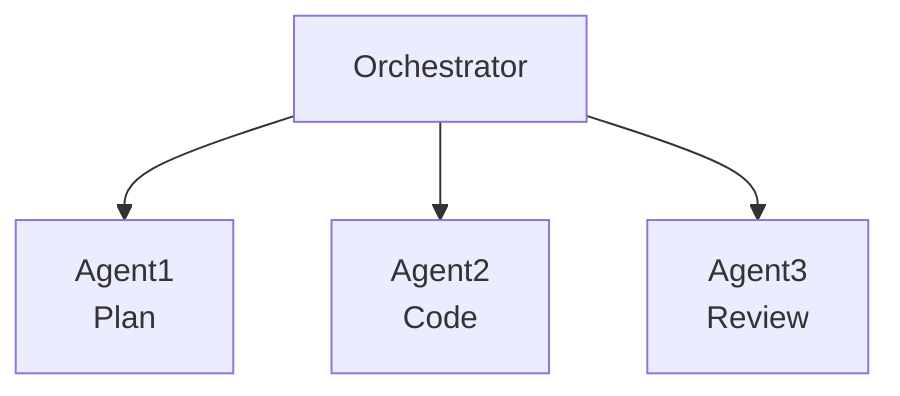
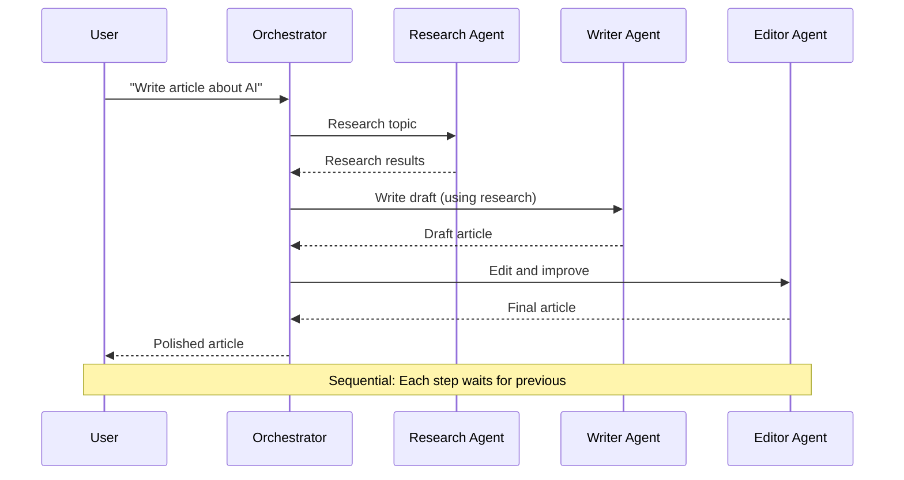
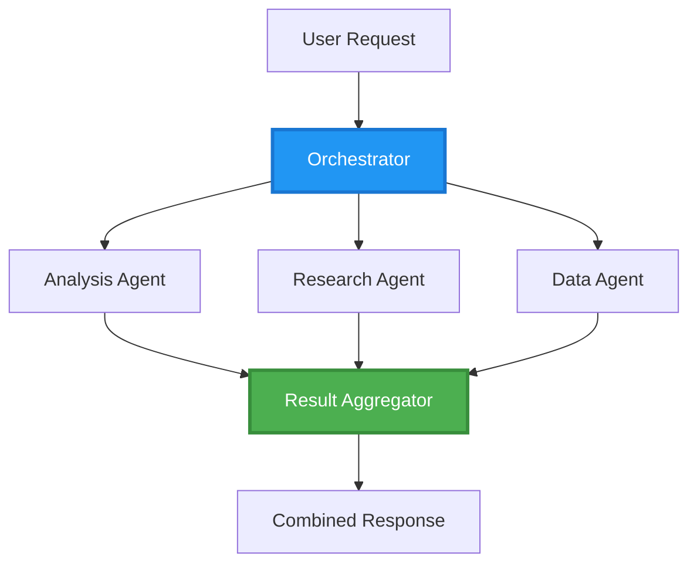
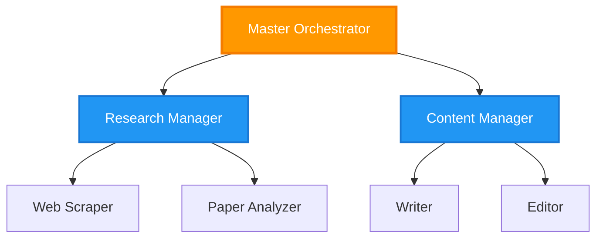
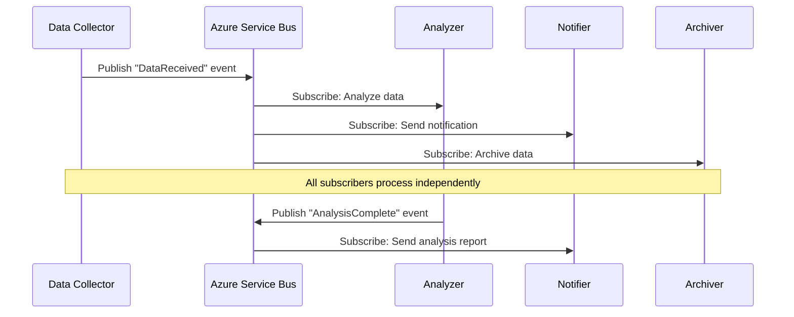
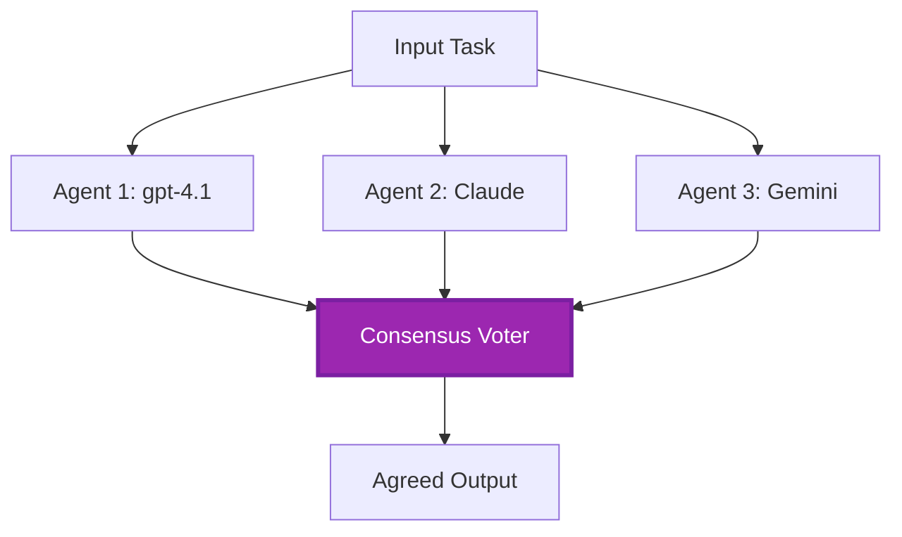
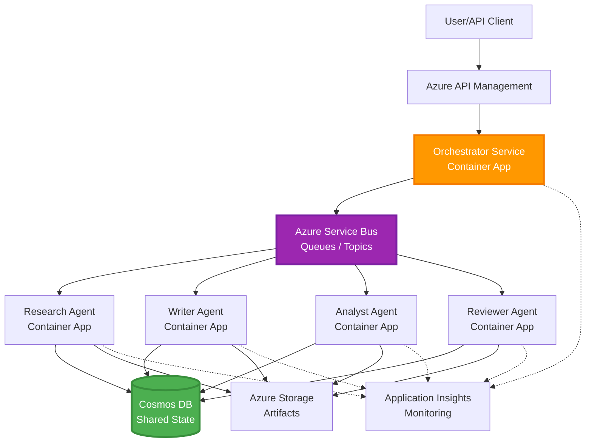

# Daugiaagentinės koordinacijos modeliai

⏱️ **Apskaičiuotas laikas**: 60-75 minučių skaitymui; keli valandų įgyvendinimui | 💰 **Apskaičiuotos sąnaudos**: priklauso nuo darbo krūvio | ⭐ **Sudėtingumas**: pažengęs

**📚 Mokymosi kelias:**
- ← Ankstesnis: [Talpos planavimas](capacity-planning.md) - Resursų dydžio nustatymas ir mastelio keitimo strategijos
- 🎯 **Jūs čia esate**: Daugiaagentinės koordinacijos modeliai (Orkestracija, komunikacija, būsenos valdymas)
- → Kitas: [SKU parinkimas](sku-selection.md) - Tinkamų Azure paslaugų pasirinkimas
- 🏠 [Kurso pradžia](../../README.md)

---

## Ko išmoksite

Įvykdę šią pamoką, jūs:
- Suprasite **daugiaagentinės architektūros** modelius ir kada juos naudoti
- Įgyvendinsite **orkestracijos modelius** (centralizuotą, decentralizuotą, hierarchinę)
- Sukursite **agentų komunikacijos** strategijas (sinchronines, asinchronines, įvykių valdomas)
- Valdysite **bendrą būseną** tarp paskirstytų agentų
- Diegsite **daugiaagentines sistemas** Azure naudojant AZD
- Taikysite **koordinacijos modelius** realioms dirbtinio intelekto situacijoms
- Stebėsite ir derinsite paskirstytas agentų sistemas

## Kodėl svarbi daugiaagentinė koordinacija

### Evoliucija: nuo vieno agento iki daugiaagentinės sistemos

**Vienas agentas (paprasta):**
```
User → Agent → Response
```
- ✅ Lengva suprasti ir įgyvendinti
- ✅ Greita paprastoms užduotims
- ❌ Ribojama vieno modelio galimybėmis
- ❌ Negalima atlikti sudėtingų užduočių lygiagrečiai
- ❌ Nėra specializacijos

**Daugiaagentinė sistema (pažengusi):**

- ✅ Specializuoti agentai konkrečioms užduotims
- ✅ Lygiagretus vykdymas greičiui
- ✅ Modulinė ir prižiūrima struktūra
- ✅ Geresnė sudėtingiems darbo srautams
- ⚠️ Reikalauja koordinacijos logikos

**Panašumas**: vienas agentas kaip viena asmenybė, atliekanti visas užduotis. Daugiaagentė sistema – kaip komanda, kur kiekvienas narys turi specializuotus įgūdžius (tyrėjas, programuotojas, vertintojas, rašytojas), dirbdama kartu.

---

## Pagrindiniai koordinacijos modeliai

### Modelis 1: Sekvencinė koordinacija (atsakomybės grandinė)

**Kada naudoti**: užduotys turi būti atliekamos tam tikra tvarka, kiekvienas agentas remiasi ankstesniu rezultatu.



**Privalumai:**
- ✅ Aiškus duomenų srautas
- ✅ Lengva derinti klaidas
- ✅ Prognozuojama vykdymo tvarka

**Trūkumai:**
- ❌ Lėtesnis vykdymas (nėra lygiagretumo)
- ❌ Viena klaida blokuoja visą grandinę
- ❌ Negali apdoroti tarpusavyje priklausomų užduočių

**Pavyzdiniai naudojimo atvejai:**
- Turinio kūrimo kanalas (tyrimai → rašymas → redagavimas → publikavimas)
- Kodo generavimas (planavimas → įgyvendinimas → testavimas → diegimas)
- Ataskaitų kūrimas (duomenų rinkimas → analizė → vizualizacija → santrauka)

---

### Modelis 2: Lygiagretus koordinavimas (Fan-Out/Fan-In)

**Kada naudoti**: nepriklausomos užduotys vykdomos tuo pačiu metu, rezultatai sujungiami gale.



**Privalumai:**
- ✅ Greitas (lygiagretus vykdymas)
- ✅ Atsparus klaidoms (daliniai rezultatai priimtini)
- ✅ Horizontaliai mastelį keičiantis

**Trūkumai:**
- ⚠️ Rezultatai gali atvykti ne tvarka
- ⚠️ Reikia agregacijos logikos
- ⚠️ Sudėtingas būsenos valdymas

**Pavyzdiniai naudojimo atvejai:**
- Daugiakanalių duomenų rinkimas (API + duomenų bazės + interneto nuskaitymas)
- Konkurencinė analizė (keli modeliai generuoja sprendimus, parenkamas geriausias)
- Vertimo paslaugos (vertimas į kelias kalbas vienu metu)

---

### Modelis 3: Hierarchinė koordinacija (Vadovas-Darbuotojas)

**Kada naudoti**: sudėtingi darbo srautai su po-užduotimis, reikia delegavimo.



**Privalumai:**
- ✅ Tvarko sudėtingus darbo srautus
- ✅ Modulinis ir prižiūrimas
- ✅ Aiškios atsakomybės ribos

**Trūkumai:**
- ⚠️ Sudėtingesnė architektūra
- ⚠️ Didesnis delsimas (daug sluoksnių)
- ⚠️ Reikalauja sudėtingos orkestracijos

**Pavyzdiniai naudojimo atvejai:**
- Įmonių dokumentų apdorojimas (klasifikuoti → nukreipti → apdoroti → archyvuoti)
- Daugiapakopės duomenų srovės (rinkti → valyti → transformuoti → analizuoti → ataskaitos)
- Sudėtingos automatizacijos darbo tėkmės (planavimas → resursų paskirstymas → vykdymas → stebėjimas)

---

### Modelis 4: Įvykių valdymo koordinacija (Publikavimas-Prenumeravimas)

**Kada naudoti**: agentai turi reaguoti į įvykius, pageidautinas silpnas sujungimas.



**Privalumai:**
- ✅ Silpnas susiejimas tarp agentų
- ✅ Lengva pridėti naujus agentus (tiesiog užsiprenumeruokite)
- ✅ Asinchroninis apdorojimas
- ✅ Atsparumas (pranešimų išlikimas)

**Trūkumai:**
- ⚠️ Galutinė duomenų nuoseklumas
- ⚠️ Sudėtingas derinimas
- ⚠️ Pranešimų užsakymo problemos

**Pavyzdiniai naudojimo atvejai:**
- Realaus laiko stebėjimo sistemos (įspėjimai, prietaisų skydeliai, žurnalai)
- Daugiakanalės pranešimų sistemos (el. paštas, SMS, push, Slack)
- Duomenų apdorojimo srovės (keletas vartotojų to paties duomenų srauto)

---

### Modelis 5: Konsenso pagrindu veikianti koordinacija (Balsavimas/Quorum)

**Kada naudoti**: reikalingas kelių agentų sutarimas prieš tęsiant.



**Privalumai:**
- ✅ Didresnis tikslumas (kelios nuomonės)
- ✅ Atsparumas klaidoms (mažumos klaidos priimtinos)
- ✅ Įdiegta kokybės užtikrinimo sistema

**Trūkumai:**
- ❌ Brangu (daugybė modelių kvietimų)
- ❌ Lėtesnis (laukiama visų agentų)
- ⚠️ Reikalingas konfliktų sprendimas

**Pavyzdiniai naudojimo atvejai:**
- Turinio moderavimas (kelis modeliai peržiūri turinį)
- Kodo peržiūra (keli tikrintojai/analizatoriai)
- Medicininė diagnozė (keli DI modeliai, ekspertų patvirtinimas)

---

## Architektūros apžvalga

### Pilna daugiaagentinė sistema Azure platformoje



**Pagrindinės sudedamosios dalys:**

| Komponentas | Paskirtis | Azure paslauga |
|-----------|---------|---------------|
| **API Gateway** | Įėjimo taškas, srautų ribojimas, autentifikacija | API Management |
| **Orkestratorius** | Koordinuoja agentų darbo srautus | Container Apps |
| **Žinučių eilė** | Asinchroninė komunikacija | Service Bus / Event Hubs |
| **Agentai** | Specializuoti DI darbuotojai | Container Apps / Functions |
| **Būsenos saugykla** | Bendroji būsena, užduočių sekimas | Cosmos DB |
| **Vertybių saugykla** | Dokumentai, rezultatai, žurnalai | Blob Storage |
| **Stebėjimas** | Paskirstytas sekimas, žurnalai | Application Insights |

Service Bus eilės/temos ir Event Hubs yra skirtingos paslaugos su skirtingais pristatymo/naudojimo modeliais; Event Hubs nėra tiesioginis Service Bus darbuotojo kodo pakaitalas žemiau. Lygiagretumas, išlikę pranešimai ir modelių balsavimas patys savaime negarantuoja klaidų tolerancijos ar didesnio tikslumo.

---

## Išankstiniai reikalavimai

### Būtinos priemonės

```bash
# Verify Azure Developer CLI
azd version
# Command reference baseline: azd 1.37.2

# Verify Azure CLI
az --version
# ✅ Expected: azure-cli 2.50.0 or higher

# Verify Docker (for local testing)
docker --version
# ✅ Expected: Docker version 20.10 or higher
```

### Azure reikalavimai

- Aktyvi Azure prenumerata
- Leidimai kurti:
  - Container Apps
  - Service Bus erdves
  - Cosmos DB paskyras
  - Saugyklos paskyras
  - Application Insights

### Žinių išankstiniai reikalavimai

Jūs turėtumėte būti baigę:
- [Konfigūracijos valdymas](../chapter-03-configuration/configuration.md)
- [Autentifikacija ir saugumas](../chapter-03-configuration/authsecurity.md)
- [Mikropaslaugų pavyzdys](../../../../examples/microservices)

---

## Įgyvendinimo vadovas

> **Tai yra dizaino fragmentai, o ne diegiamas laboratorinis darbas:** Projekto medžio ir žemiau pateikti `File:` žymėjimai aprašo failus, kuriuos turite sukurti savo projekte; šis saugyklos repo neturi visos `multi-agent-system` programos. Trūksta pagrindinių/parametrų šablonų, Container Apps aplinkos/registre, Docker failų ir priklausomybių užrakinimo, Cosmos duomenų bazės/ konteinerio nustatymo, modelių diegimų, tapatybės/vaidmenų konfigūracijos, mastelio keitimo taisyklių ir lygiagrečių darbuotojų/eilių. Nereikėtų tikėtis, kad `azd init` sugeneruos šiuos failus ar `azd up` įdiegs fragmentus nepakitusius. Norint gauti įvykdomą pradžią, užbaikite [Daugiaagentinės pagrindus](../chapter-05-multi-agent/multi-agent-basics.md).

**Vykdymo prielaidos:** Python 3.10+, `azure-servicebus`, `azure-cosmos`, `openai`, Flask ir (stebėjimui) `azure-monitor-opentelemetry`; įdėkite `shared` į Python importavimo kelią kiekviename paslaugos paveiksle. Cosmos `agent-state/tasks` konteineris jau turi egzistuoti su šaknimis raktu `/id`. Pagrindais pagrįstos jungtys supaprastina šiuos fragmentus, bet tai nėra gamybinės rekomendacijos: pirmenybę teikite valdomoms tapatybėms su apribotais Service Bus/Cosmos/OpenAI duomenų plano vaidmenimis. Neskelbkite raktų išvestyse ar žurnaluose.

Service Bus pristatymas yra **bent vienas**. Išlaikykite užduoties **ir žingsnio** idempotentiškumą, naudokite optimistinę konkurenciją (ETags) nuskaityti/keisti/rašyti būseną ir atnaujinkite žinutės užraktus ilgo apdorojimo metu. Žemiau esantis paprastas būsenos valdytojas yra tik sekvencinis ir neįgyvendina šių gamybinių garantijų.

### Projekto struktūra

```
multi-agent-system/
├── azure.yaml                    # AZD configuration
├── infra/
│   ├── main.bicep               # Main infrastructure
│   ├── core/
│   │   ├── servicebus.bicep     # Message queue
│   │   ├── cosmos.bicep         # State store
│   │   ├── storage.bicep        # Artifact storage
│   │   └── monitoring.bicep     # Application Insights
│   └── app/
│       ├── orchestrator.bicep   # Orchestrator service
│       └── agent.bicep          # Agent template
└── src/
    ├── orchestrator/            # Orchestration logic
    │   ├── app.py
    │   ├── workflows.py
    │   └── Dockerfile
    ├── agents/
    │   ├── research/            # Research agent
    │   ├── writer/              # Writer agent
    │   ├── analyst/             # Analyst agent
    │   └── reviewer/            # Reviewer agent
    └── shared/
        ├── state_manager.py     # Shared state logic
        └── message_handler.py   # Message handling
```

---

## Pamoka 1: Sekvencinio koordinavimo modelis

### Įgyvendinimas: Turinio kūrimo kanalas

Sukurkime sekvencinį kanalą: tyrinėjimas → rašymas → redagavimas. Publikavimas neįtrauktas į šį pavyzdį.

### 1. AZD konfigūracija

**Failas: `azure.yaml`**

```yaml
name: content-pipeline
metadata:
  template: multi-agent-sequential@1.0.0

services:
  orchestrator:
    project: ./src/orchestrator
    language: python
    host: containerapp
  
  research-agent:
    project: ./src/agents/research
    language: python
    host: containerapp
  
  writer-agent:
    project: ./src/agents/writer
    language: python
    host: containerapp
  
  editor-agent:
    project: ./src/agents/editor
    language: python
    host: containerapp
```

### 2. Infrastruktūra: Service Bus koordinavimui

**Failas: `infra/core/servicebus.bicep`**

```bicep
param name string
param location string
param tags object = {}

resource serviceBusNamespace 'Microsoft.ServiceBus/namespaces@2022-10-01-preview' = {
  name: name
  location: location
  tags: tags
  sku: {
    name: 'Standard'
    tier: 'Standard'
  }
  properties: {
    minimumTlsVersion: '1.2'
  }
}

// Queue for orchestrator → research agent
resource researchQueue 'Microsoft.ServiceBus/namespaces/queues@2022-10-01-preview' = {
  parent: serviceBusNamespace
  name: 'research-tasks'
  properties: {
    maxDeliveryCount: 3
    lockDuration: 'PT5M'
    deadLetteringOnMessageExpiration: true
  }
}

// Queue for research agent → writer agent
resource writerQueue 'Microsoft.ServiceBus/namespaces/queues@2022-10-01-preview' = {
  parent: serviceBusNamespace
  name: 'writer-tasks'
  properties: {
    maxDeliveryCount: 3
    lockDuration: 'PT5M'
  }
}

// Queue for writer agent → editor agent
resource editorQueue 'Microsoft.ServiceBus/namespaces/queues@2022-10-01-preview' = {
  parent: serviceBusNamespace
  name: 'editor-tasks'
  properties: {
    maxDeliveryCount: 3
    lockDuration: 'PT5M'
  }
}

output namespace string = serviceBusNamespace.name
// Do not output RootManageSharedAccessKey. Resolve scoped credentials
// securely or use managed identity in the application and scale rules.
```

### 3. Bendros būsenos valdytojas

**Failas: `src/shared/state_manager.py`**

```python
from azure.cosmos import CosmosClient, PartitionKey
from datetime import datetime, timezone
import os

class StateManager:
    """Manages shared state across agents using Cosmos DB"""
    
    def __init__(self):
        endpoint = os.environ['COSMOS_ENDPOINT']
        key = os.environ['COSMOS_KEY']
        
        self.client = CosmosClient(endpoint, key)
        self.database = self.client.get_database_client('agent-state')
        self.container = self.database.get_container_client('tasks')
    
    def create_task(self, task_id: str, task_type: str, input_data: dict):
        """Create a new task"""
        task = {
            'id': task_id,
            'type': task_type,
            'status': 'pending',
            'input': input_data,
            'created_at': datetime.now(timezone.utc).isoformat(),
            'steps': []
        }
        self.container.create_item(task)
        return task
    
    def update_task_step(self, task_id: str, step_name: str, result: dict):
        """Update task with completed step"""
        task = self.container.read_item(task_id, partition_key=task_id)
        
        task['steps'].append({
            'name': step_name,
            'completed_at': datetime.now(timezone.utc).isoformat(),
            'result': result
        })
        
        self.container.replace_item(task_id, task)
        return task
    
    def complete_task(self, task_id: str, final_result: dict):
        """Mark task as complete"""
        task = self.container.read_item(task_id, partition_key=task_id)
        task['status'] = 'completed'
        task['result'] = final_result
        task['completed_at'] = datetime.now(timezone.utc).isoformat()
        self.container.replace_item(task_id, task)
        return task
    
    def get_task(self, task_id: str):
        """Retrieve task state"""
        return self.container.read_item(task_id, partition_key=task_id)
```

### 4. Orkestratoriaus paslauga

**Failas: `src/orchestrator/app.py`**

```python
from flask import Flask, request, jsonify
from azure.servicebus import ServiceBusClient, ServiceBusMessage
import json
import uuid
import os
from shared.state_manager import StateManager

app = Flask(__name__)
state_manager = StateManager()

# Service Bus connection
servicebus_connection_str = os.environ['SERVICEBUS_CONNECTION_STRING']
servicebus_client = ServiceBusClient.from_connection_string(servicebus_connection_str)

@app.route('/health', methods=['GET'])
def health():
    return jsonify({'status': 'healthy', 'service': 'orchestrator'})

@app.route('/create-content', methods=['POST'])
def create_content():
    """
    Sequential workflow: Research → Write → Edit (returns a draft; no publishing)
    """
    data = request.get_json(silent=True) or {}
    topic = data.get('topic')
    
    if not topic:
        return jsonify({'error': 'Topic required'}), 400
    
    # Create task in state store
    task_id = str(uuid.uuid4())
    task = state_manager.create_task(
        task_id=task_id,
        task_type='content_creation',
        input_data={'topic': topic}
    )
    
    # Send message to research agent (first step)
    sender = servicebus_client.get_queue_sender('research-tasks')
    message = ServiceBusMessage(
        body=json.dumps({
            'task_id': task_id,
            'topic': topic,
            'next_queue': 'writer-tasks'  # Where to send results
        }),
        content_type='application/json'
    )
    
    with sender:
        sender.send_messages(message)
    
    return jsonify({
        'task_id': task_id,
        'status': 'started',
        'workflow': 'sequential',
        'steps': ['research', 'write', 'edit'],
        'message': 'Content creation pipeline initiated'
    }), 202

@app.route('/task/<task_id>', methods=['GET'])
def get_task_status(task_id):
    """Check task status"""
    try:
        task = state_manager.get_task(task_id)
        return jsonify(task)
    except Exception as e:
        return jsonify({'error': str(e)}), 404

if __name__ == '__main__':
    app.run(host='0.0.0.0', port=8080)
```

### 5. Tyrimo agentas

**Failas: `src/agents/research/app.py`**

```python
from azure.servicebus import ServiceBusClient, ServiceBusMessage
from openai import AzureOpenAI
import json
import os
import time
from shared.state_manager import StateManager

# Initialize clients
state_manager = StateManager()
servicebus_client = ServiceBusClient.from_connection_string(
    os.environ['SERVICEBUS_CONNECTION_STRING']
)

openai_client = AzureOpenAI(
    api_key=os.environ['AZURE_OPENAI_API_KEY'],
    api_version="2024-10-21",
    azure_endpoint=os.environ['AZURE_OPENAI_ENDPOINT']
)

def process_research_task(message_data):
    """Process research request and pass to writer"""
    task_id = message_data['task_id']
    topic = message_data['topic']
    next_queue = message_data['next_queue']
    
    print(f"🔬 Researching: {topic}")
    
    # Call Microsoft Foundry Models for research
    response = openai_client.chat.completions.create(
        model=os.environ['AZURE_OPENAI_DEPLOYMENT'],
        messages=[
            {"role": "system", "content": "You are a research assistant. Provide comprehensive research on the given topic."},
            {"role": "user", "content": f"Research this topic thoroughly: {topic}"}
        ],
        max_tokens=1500
    )
    
    research_results = response.choices[0].message.content
    
    # Update state
    state_manager.update_task_step(
        task_id=task_id,
        step_name='research',
        result={'research': research_results}
    )
    
    # Send to next agent (writer)
    sender = servicebus_client.get_queue_sender(next_queue)
    message = ServiceBusMessage(
        body=json.dumps({
            'task_id': task_id,
            'topic': topic,
            'research': research_results,
            'next_queue': 'editor-tasks'
        }),
        content_type='application/json'
    )
    
    with sender:
        sender.send_messages(message)
    
    print(f"✅ Research complete for task {task_id}")

def main():
    """Listen to research queue"""
    receiver = servicebus_client.get_queue_receiver('research-tasks')
    
    print("🔬 Research Agent started, listening for tasks...")
    
    with receiver:
        while True:
            messages = receiver.receive_messages(max_wait_time=5)
            for message in messages:
                try:
                    message_data = json.loads(str(message))
                    process_research_task(message_data)
                    receiver.complete_message(message)
                except Exception as e:
                    print(f"❌ Error processing message: {e}")
                    receiver.abandon_message(message)

if __name__ == '__main__':
    main()
```

### 6. Rašytojo agentas

**Failas: `src/agents/writer/app.py`**

```python
from azure.servicebus import ServiceBusClient, ServiceBusMessage
from openai import AzureOpenAI
import json
import os
from shared.state_manager import StateManager

state_manager = StateManager()
servicebus_client = ServiceBusClient.from_connection_string(
    os.environ['SERVICEBUS_CONNECTION_STRING']
)

openai_client = AzureOpenAI(
    api_key=os.environ['AZURE_OPENAI_API_KEY'],
    api_version="2024-10-21",
    azure_endpoint=os.environ['AZURE_OPENAI_ENDPOINT']
)

def process_writing_task(message_data):
    """Write article based on research"""
    task_id = message_data['task_id']
    topic = message_data['topic']
    research = message_data['research']
    next_queue = message_data['next_queue']
    
    print(f"✍️ Writing article: {topic}")
    
    # Call Microsoft Foundry Models to write article
    response = openai_client.chat.completions.create(
        model=os.environ['AZURE_OPENAI_DEPLOYMENT'],
        messages=[
            {"role": "system", "content": "You are a professional writer. Write engaging, well-structured articles."},
            {"role": "user", "content": f"Based on this research:\n\n{research}\n\nWrite a comprehensive article about: {topic}"}
        ],
        max_tokens=2000
    )
    
    article_draft = response.choices[0].message.content
    
    # Update state
    state_manager.update_task_step(
        task_id=task_id,
        step_name='writing',
        result={'draft': article_draft}
    )
    
    # Send to editor
    sender = servicebus_client.get_queue_sender(next_queue)
    message = ServiceBusMessage(
        body=json.dumps({
            'task_id': task_id,
            'topic': topic,
            'draft': article_draft
        }),
        content_type='application/json'
    )
    
    with sender:
        sender.send_messages(message)
    
    print(f"✅ Article draft complete for task {task_id}")

def main():
    """Listen to writer queue"""
    receiver = servicebus_client.get_queue_receiver('writer-tasks')
    
    print("✍️ Writer Agent started, listening for tasks...")
    
    with receiver:
        while True:
            messages = receiver.receive_messages(max_wait_time=5)
            for message in messages:
                try:
                    message_data = json.loads(str(message))
                    process_writing_task(message_data)
                    receiver.complete_message(message)
                except Exception as e:
                    print(f"❌ Error: {e}")
                    receiver.abandon_message(message)

if __name__ == '__main__':
    main()
```

### 7. Redaktoriaus agentas

**Failas: `src/agents/editor/app.py`**

```python
from azure.servicebus import ServiceBusClient
from openai import AzureOpenAI
import json
import os
from shared.state_manager import StateManager

state_manager = StateManager()
servicebus_client = ServiceBusClient.from_connection_string(
    os.environ['SERVICEBUS_CONNECTION_STRING']
)

openai_client = AzureOpenAI(
    api_key=os.environ['AZURE_OPENAI_API_KEY'],
    api_version="2024-10-21",
    azure_endpoint=os.environ['AZURE_OPENAI_ENDPOINT']
)

def process_editing_task(message_data):
    """Edit and finalize article"""
    task_id = message_data['task_id']
    topic = message_data['topic']
    draft = message_data['draft']
    
    print(f"📝 Editing article: {topic}")
    
    # Call Microsoft Foundry Models to edit
    response = openai_client.chat.completions.create(
        model=os.environ['AZURE_OPENAI_DEPLOYMENT'],
        messages=[
            {"role": "system", "content": "You are an expert editor. Improve grammar, clarity, and structure."},
            {"role": "user", "content": f"Edit and improve this article:\n\n{draft}"}
        ],
        max_tokens=2000
    )
    
    final_article = response.choices[0].message.content
    
    # Mark task as complete
    state_manager.complete_task(
        task_id=task_id,
        final_result={
            'topic': topic,
            'final_article': final_article,
            'word_count': len(final_article.split())
        }
    )
    
    print(f"✅ Article finalized for task {task_id}")

def main():
    """Listen to editor queue"""
    receiver = servicebus_client.get_queue_receiver('editor-tasks')
    
    print("📝 Editor Agent started, listening for tasks...")
    
    with receiver:
        while True:
            messages = receiver.receive_messages(max_wait_time=5)
            for message in messages:
                try:
                    message_data = json.loads(str(message))
                    process_editing_task(message_data)
                    receiver.complete_message(message)
                except Exception as e:
                    print(f"❌ Error: {e}")
                    receiver.abandon_message(message)

if __name__ == '__main__':
    main()
```

### 8. Diegimas ir testavimas

Šie komandiniai įrašai taikomi **tik po to, kai įgyvendinate trūkstamus projekto failus**. Interaktyvi „Foundry“ agente inicializacija yra atskiras darbo srautas; jis negamina šio Service Bus dizaino.

```bash
# In your completed custom project
azd up

# Alternative in a SEPARATE empty folder (agents beta.23 requires azd >= 1.37)
azd extension install azure.ai.agents
azd ai agent init
azd up
```

> Peržiūrėkite [AZD DI CLI komandas](../chapter-08-production/production-ai-practices.md#azd-ai-cli-commands-and-extensions) dėl visų `azd ai` žymų ir parinkčių.

```bash
# Get orchestrator URL
ORCHESTRATOR_URL=$(azd env get-values | grep ORCHESTRATOR_URL | cut -d '=' -f2 | tr -d '"')

# Create content
curl -X POST $ORCHESTRATOR_URL/create-content \
  -H "Content-Type: application/json" \
  -d '{"topic": "The Future of AI in Healthcare"}'
```

**✅ Tikėtinas rezultatas:**
```json
{
  "task_id": "a1b2c3d4-e5f6-7890-abcd-ef1234567890",
  "status": "started",
  "workflow": "sequential",
  "steps": ["research", "write", "edit"],
  "message": "Content creation pipeline initiated"
}
```

**Patikrinkite užduoties eigą:**
```bash
TASK_ID="a1b2c3d4-e5f6-7890-abcd-ef1234567890"
curl $ORCHESTRATOR_URL/task/$TASK_ID
```

**✅ Tikėtinas rezultatas (baigta):**
```json
{
  "id": "a1b2c3d4-e5f6-7890-abcd-ef1234567890",
  "type": "content_creation",
  "status": "completed",
  "steps": [
    {
      "name": "research",
      "completed_at": "2025-11-19T10:30:00Z",
      "result": {"research": "..."}
    },
    {
      "name": "writing",
      "completed_at": "2025-11-19T10:32:00Z",
      "result": {"draft": "..."}
    }
  ],
  "result": {
    "topic": "The Future of AI in Healthcare",
    "final_article": "...",
    "word_count": 1500
  }
}
```

---

## Pamoka 2: Lygiagretaus koordinavimo modelis

### Įgyvendinimas: daugiakanalio tyrimo agregatorius

Sukurkime lygiagretų sistemą, kuris renka informaciją iš kelių šaltinių vienu metu.

### Lygiagretus orkestratorius

**Failas: `src/orchestrator/parallel_workflow.py`**

```python
from flask import Flask, request, jsonify
from azure.servicebus import ServiceBusClient, ServiceBusMessage
import json
import uuid
import os
from shared.state_manager import StateManager

app = Flask(__name__)
state_manager = StateManager()

servicebus_client = ServiceBusClient.from_connection_string(
    os.environ['SERVICEBUS_CONNECTION_STRING']
)

@app.route('/research-parallel', methods=['POST'])
def research_parallel():
    """
    Parallel workflow: Multiple agents work simultaneously
    """
    data = request.json
    query = data.get('query')
    
    task_id = str(uuid.uuid4())
    task = state_manager.create_task(
        task_id=task_id,
        task_type='parallel_research',
        input_data={
            'query': query,
            'agents': ['web', 'academic', 'news', 'social']
        }
    )
    
    # Fan-out: publish sequentially; workers may process concurrently.
    agents = [
        ('web-research-queue', 'web'),
        ('academic-research-queue', 'academic'),
        ('news-research-queue', 'news'),
        ('social-research-queue', 'social')
    ]
    
    for queue_name, agent_type in agents:
        sender = servicebus_client.get_queue_sender(queue_name)
        message = ServiceBusMessage(
            body=json.dumps({
                'task_id': task_id,
                'query': query,
                'agent_type': agent_type,
                'result_queue': 'aggregation-queue'
            }),
            content_type='application/json'
        )
        
        with sender:
            sender.send_messages(message)
    
    return jsonify({
        'task_id': task_id,
        'status': 'started',
        'workflow': 'parallel',
        'agents_dispatched': 4,
        'message': 'Parallel research initiated'
    }), 202

if __name__ == '__main__':
    app.run(host='0.0.0.0', port=8080)
```

### Agregacijos logika

**Failas: `src/agents/aggregator/app.py`**

```python
from azure.servicebus import ServiceBusClient
import json
import os
from collections import defaultdict
from shared.state_manager import StateManager

state_manager = StateManager()
servicebus_client = ServiceBusClient.from_connection_string(
    os.environ['SERVICEBUS_CONNECTION_STRING']
)

# Single-process demo only: not durable or shared across replicas.
# Production: use durable unique (task_id, agent_type) result records.
task_results = defaultdict(dict)
expected_agents = 4  # web, academic, news, social

def process_result(message_data):
    """Aggregate results from parallel agents"""
    task_id = message_data['task_id']
    agent_type = message_data['agent_type']
    result = message_data['result']
    
    # Store result
    task_results[task_id][agent_type] = {
        'agent': agent_type,
        'data': result
    }
    
    print(f"📊 Received result from {agent_type} agent ({len(task_results[task_id])}/{expected_agents})")
    
    # Check if all agents completed (fan-in)
    if len(task_results[task_id]) == expected_agents:
        print(f"✅ All agents completed for task {task_id}. Aggregating...")
        
        # Combine results
        aggregated = {
            'query': message_data['query'],
            'sources': list(task_results[task_id].values()),
            'summary': generate_summary(list(task_results[task_id].values()))
        }
        
        # Mark complete
        state_manager.complete_task(task_id, aggregated)
        
        # Clean up
        del task_results[task_id]
        
        print(f"✅ Aggregation complete for task {task_id}")

def generate_summary(results):
    """Generate summary from all sources"""
    summaries = [r['data'].get('summary', '') for r in results]
    return '\n\n'.join(summaries)

def main():
    """Listen to aggregation queue"""
    receiver = servicebus_client.get_queue_receiver('aggregation-queue')
    
    print("📊 Aggregator started, listening for results...")
    
    with receiver:
        while True:
            messages = receiver.receive_messages(max_wait_time=5)
            for message in messages:
                try:
                    message_data = json.loads(str(message))
                    process_result(message_data)
                    receiver.complete_message(message)
                except Exception as e:
                    print(f"❌ Error: {e}")
                    receiver.abandon_message(message)

if __name__ == '__main__':
    main()
```

**Lygiagretaus modelio privalumai:**
- ⚡ **Galimai mažesnis delsimas** (ribojamas lėčiausio darbuotojo plius koordinavimo sąnaudos)
- 🔄 **Gali palaikyti dalinius rezultatus** su aiškiomis terminų ir klaidų politika (neįgyvendinta paprastame agregatoriuje)
- 📈 **Mastelį keičianti** (lengva pridėti daugiau agentų)

---

## Praktinės užduotys

### Užduotis 1: Pridėti laiko išskyrimą ⭐⭐ (Vidutinis)

**Tikslas**: įgyvendinti laiko pabaigos logiką, kad agregatorius nelauktų amžinai lėtų agentų.

**Pradinis taškas:** paleiskite vietinę terminų imitaciją prieš įtraukdami į eilės darbuotoją. Laiko išskyrimas, tikrinamas tik atvykstant kitai žinutei, niekada nesuveikia, jeigu trūkstantis darbuotojas nieko nesiunčia.

**Žingsniai**:

1. **Pridėkite laiko išskyrimo stebėjimą agregatoriui:**

```python
import asyncio

async def simulated_agent(name, delay):
    await asyncio.sleep(delay)
    return {'agent': name, 'result': 'done'}

async def main():
    tasks = [asyncio.create_task(simulated_agent(name, delay))
             for name, delay in [('web', 0.1), ('academic', 0.2),
                                 ('news', 0.3), ('social', 3)]]
    done, pending = await asyncio.wait(tasks, timeout=1)
    results = [task.result() for task in done]
    for task in pending:
        task.cancel()
    await asyncio.gather(*pending, return_exceptions=True)
    print({'completed_agents': len(results), 'timed_out': bool(pending)})
    assert len(results) == 3 and pending

asyncio.run(main())
```

2. **Tikėtinas rezultatas:**

```text
{'completed_agents': 3, 'timed_out': True}
```

3. **Eilių sistemos integracija (dizaino užduotis):** Išlaikyti siuntimo terminą ir laukiamus agentus kuriant užduotį, periodiškai perbraukti terminą nepriklausomai nuo gaunamų rezultatų, atomizuotai užbaigti dalinius rezultatus, ir ignoruoti vėlyvas/dubliuotas žinutes užbaigtoms užduotims. Vietinis laiko išskyrimas neatšaukia nuotolinių darbuotojų.

Tik jūsų įgyvendintam projektui:

```bash
azd deploy aggregator

# Submit task
curl -X POST $ORCHESTRATOR_URL/research-parallel \
  -H "Content-Type: application/json" \
  -d '{"query": "AI safety research"}'

# Check results after 30 seconds
curl $ORCHESTRATOR_URL/task/$TASK_ID
```

**✅ Sėkmės kriterijai:**
- ✅ Vietinis testas baigiasi po vienos sekundės termino, net jei vienas agentas nebaigtas
- ✅ Atsakymas rodo dalinius rezultatus (`"timed_out": true`)
- ✅ Grąžinami visi turimi rezultatai (3 iš 4 agentų)

**Laikas**: 20-25 minutės

---

### Užduotis 2: Įgyvendinti pakartotinio bandymo logiką ⭐⭐⭐ (Pažengęs)

**Tikslas**: automatiškai kartoti nesėkmingas agentų užduotis, kol nepasiduoda.

**Žingsniai**:

1. **Naudokite Service Bus pristatymo skaičius vietoje savarankiškų pakartotinių skaitiklių:**

```python
import json
import time
# Integration fragment: use a live peek-lock ServiceBusReceiver.
# Set queue maxDeliveryCount to 4 for one attempt + up to three retries.
```

2. **Pridėkite pakartotinio bandymo apdorotoją agentams:**

```python
def process_with_retry(message, receiver, process_func):
    """Process message with automatic retry on failure"""
    try:
        message_data = json.loads(str(message))
        
        # Process the message
        process_func(message_data)
        
        # Success - complete
        receiver.complete_message(message)
        
    except Exception as e:
        if message.delivery_count < 4:
            # Bounded exponential delay: 5s, 10s, 20s.
            # Renew the lock if processing + waiting can exceed its duration.
            time.sleep(5 * 2 ** (message.delivery_count - 1))
            receiver.abandon_message(message)
        else:
            # Max retries exceeded - move to dead letter queue
            print(f"❌ Max attempts exceeded for message {message.message_id}")
            receiver.dead_letter_message(
                message,
                reason="MaxRetriesExceeded",
                error_description=str(e)
            )
```

3. **Stebėkite „dead letter“ eilę:**

```python
def monitor_dead_letters():
    """Check dead letter queue for failed messages"""
    receiver = servicebus_client.get_queue_receiver(
        'research-tasks',
        sub_queue='deadletter'
    )
    
    with receiver:
        messages = receiver.receive_messages(max_wait_time=5)
        for message in messages:
            print(f"☠️ Dead letter: {message.message_id}")
            print(f"Reason: {message.dead_letter_reason}")
            print(f"Description: {message.dead_letter_error_description}")
```

**✅ Sėkmės kriterijai:**
- ✅ Nepavykusios užduotys automatiškai kartojamos (iki 3 kartų)
- ✅ Pakartojimų laikotarpiuose taikomas eksponentinis atidėjimas (5s, 10s, 20s), su žinutės užraktų atnaujinimu, kur reikia
- ✅ Po maksimalaus pakartojimų skaičiaus, žinutės siunčiamos į dead letter eilę
- ✅ Dead letter žinutės gali būti peržiūrėtos; atkūrimas vyksta atskiru idempotentiniu darbo srautu

**Laikas**: 30-40 minučių

---

### Užduotis 3: Įgyvendinti grandinės nutrūkimo mechanizmą (Circuit Breaker) ⭐⭐⭐ (Pažengęs)

**Tikslas**: užkirsti kelią gedimų pagreičiui, sustabdant užklausas klaidaujančiam agentui.

**Žingsniai**:

1. **Sukurkite grandinės nutrūkimo klasę:**

```python
from enum import Enum
from datetime import datetime, timedelta, timezone

class CircuitState(Enum):
    CLOSED = "closed"      # Normal operation
    OPEN = "open"          # Failing, reject requests
    HALF_OPEN = "half_open"  # Testing if recovered

class CircuitBreaker:
    def __init__(self, failure_threshold=5, timeout_seconds=60):
        self.failure_threshold = failure_threshold
        self.timeout_seconds = timeout_seconds
        self.failure_count = 0
        self.last_failure_time = None
        self.state = CircuitState.CLOSED
    
    def call(self, func):
        """Execute function with circuit breaker protection"""
        if self.state == CircuitState.OPEN:
            # Check if timeout expired
            if datetime.now(timezone.utc) - self.last_failure_time > timedelta(seconds=self.timeout_seconds):
                self.state = CircuitState.HALF_OPEN
                print("🔄 Circuit breaker: HALF_OPEN (testing)")
            else:
                raise Exception(f"Circuit breaker OPEN for agent. Try again in {self.timeout_seconds}s")
        
        try:
            result = func()
            
            # Success
            self.failure_count = 0 # Count consecutive failures only
            if self.state == CircuitState.HALF_OPEN:
                self.state = CircuitState.CLOSED
                self.failure_count = 0
                print("✅ Circuit breaker: CLOSED (recovered)")
            
            return result
            
        except Exception as e:
            self.failure_count += 1
            self.last_failure_time = datetime.now(timezone.utc)
            
            if self.failure_count >= self.failure_threshold:
                self.state = CircuitState.OPEN
                print(f"🔴 Circuit breaker: OPEN (too many failures)")
            
            raise
```

2. **Pritaikykite agentų kvietimams:**

```python
# In orchestrator
agent_circuits = {
    'web': CircuitBreaker(failure_threshold=5, timeout_seconds=60),
    'academic': CircuitBreaker(failure_threshold=5, timeout_seconds=60),
    'news': CircuitBreaker(failure_threshold=5, timeout_seconds=60),
    'social': CircuitBreaker(failure_threshold=5, timeout_seconds=60)
}

def send_to_agent(agent_type, message_data):
    """Send with circuit breaker protection"""
    circuit = agent_circuits[agent_type]
    
    try:
        circuit.call(lambda: send_message(agent_type, message_data))
    except Exception as e:
        print(f"⚠️ Skipping {agent_type} agent: {e}")
        # Continue with other agents
```

Ši grandinė saugo **siuntimo operaciją**, o ne nuotolinio darbo baigtį: sėkmingas žinutės užkėlimas į eilę nieko nepasako apie tai, ar agentas yra gyvas. `send_message` yra jūsų programos siuntimo funkcija. Vykdymo grandinėms stebėkite užduočių klaidas/laiko viršijimus ir perduokite jas patvariam koordinatoriui. Ši atminties klasė yra vieno gijos demonstracija, ne paskirstytas grandinės svertuvas.

3. **Išbandykite grandinės svertuvą vietoje:**

```python
# Run after the class definition; no Azure changes required.
circuit = CircuitBreaker(failure_threshold=5, timeout_seconds=0)
def fail():
    raise RuntimeError("simulated failure")
for _ in range(5):
    try:
        circuit.call(fail)
    except RuntimeError:
        pass
assert circuit.state == CircuitState.OPEN
assert circuit.call(lambda: "recovered") == "recovered"
assert circuit.state == CircuitState.CLOSED
print("Circuit breaker recovery verified")
```

**✅ Sėkmės kriterijai:**
- ✅ Po 5 klaidų grandinė atsiveria (atmeta užklausas)
- ✅ Po 60 sekundžių grandinė tampa pusiau atvira (testuoja atkūrimą)
- ✅ Kiti agentai toliau dirba normaliai
- ✅ Grandinė automatiškai užsidaro, kai agentas pasveiksta

**Laikas**: 40–50 minučių

---

## Stebėjimas ir derinimas

### Paskirstytasis sekimas su Application Insights

**Failas: `src/shared/tracing.py`**

```python
from azure.monitor.opentelemetry import configure_azure_monitor
from opentelemetry import trace
from opentelemetry.trace import SpanKind
import logging
import os

connection_string = os.environ.get('APPLICATIONINSIGHTS_CONNECTION_STRING')

# Configure once per process. Message send/receive trace-context propagation
# and agent attributes on exceptions need explicit instrumentation.
if connection_string:
    configure_azure_monitor(connection_string=connection_string, logger_name=__name__)
tracer = trace.get_tracer(__name__)

# Configure logging
logger = logging.getLogger(__name__)
logger.setLevel(logging.INFO)

def trace_agent_call(agent_name, task_id, operation_name, operation):
    """Trace agent operations"""
    with tracer.start_as_current_span(f'agent.{agent_name}.{operation_name}', kind=SpanKind.CLIENT) as span:
        span.set_attribute('agent', agent_name)
        span.set_attribute('task_id', task_id)
        span.set_attribute('operation', operation_name)
        
        try:
            result = operation()
            span.set_attribute('status', 'success')
            logger.info('Agent operation completed', extra={
                'agent': agent_name, 'task_id': task_id, 'operation': operation_name
            })
            return result
        except Exception as e:
            span.set_attribute('status', 'error')
            logger.exception('Agent operation failed', extra={
                'agent': agent_name, 'task_id': task_id, 'operation': operation_name
            })
            raise
```

### Application Insights užklausos

**Sekite kelių agentų darbo eigą:**

```kusto
// Trace complete workflow for a task
traces
| where customDimensions.task_id == "a1b2c3d4-..."
| project timestamp, message, customDimensions.agent, customDimensions.operation
| order by timestamp asc
```

**Agentų našumo palyginimas:**

```kusto
// Compare agent execution times
dependencies
| where name contains "agent"
| summarize 
    avg_duration = avg(duration),
    p95_duration = percentile(duration, 95),
    count = count()
  by agent = tostring(customDimensions.agent)
| order by avg_duration desc
```

**Klaidų analizė:**

```kusto
// Find which agents fail most
exceptions
| where customDimensions.agent != ""
| summarize 
    failure_count = count(),
    unique_errors = dcount(outerMessage)
  by agent = tostring(customDimensions.agent)
| order by failure_count desc
```

---

## Sąnaudų analizė

### Kelių agentų sistemos sąnaudos (mėnesio apytiksliai duomenys)

Iliustraciniai planavimo skaičiai, ne kainų pasiūlymai: žemiau suma yra **$240–565 per mėnesį**. Patikrinkite dabartinius regioninius tarifus, aktyvių/nemandagiai naudojamų kopijų valandas, įvesties/išvesties simbolių mišinį, saugyklą ir telemetriją. Serverless neturi minimalaus rezervuoto pralaidumo, bet vis tiek apmokestina už užklausas ir saugyklą.

| Komponentas | Konfigūracija | Kaina |
|-----------|--------------|------|
| **Orkestras** | 1 konteinerio programa (1 vCPU, 2GB) | $30–50 |
| **4 agentai** | 4 konteinerių programos (0.5 vCPU, po 1GB) | $60–120 |
| **Service Bus** | Standartinis lygis, 10M žinučių | $10–20 |
| **Cosmos DB** | Serverless, 5GB saugykla, 1M RUs | $25–50 |
| **Blob Storage** | 10GB saugykla, 100K operacijų | $5–10 |
| **Application Insights** | 5GB įkėlimas | $10–15 |
| **Microsoft Foundry modeliai** | gpt-4.1, 10M simbolių | $100–300 |
| **Viso** | | **$240–565/mėn** |

### Sąnaudų optimizavimo strategijos

1. **Naudokite serverless, kur įmanoma:**
   ```bicep
   // Cosmos DB serverless (no minimum cost)
   properties: {
     databaseAccountOfferType: 'Standard'
     capabilities: [{ name: 'EnableServerless' }]
   }
   ```

2. **Agentus pritemdykite iki nulio, kai nenaudojami:**
   ```bicep
   scale: {
     minReplicas: 0  // Requires a Service Bus/KEDA scale rule to wake workers
     maxReplicas: 10
   }
   ```

3. **Naudokite grupavimą Service Bus:**
   ```python
   # Send messages in batches (cheaper)
   sender.send_messages([message1, message2, message3])
   ```

4. **Talpinkite dažnai naudojamus rezultatus:**
   ```python
   # Use Azure Cache for Redis
   if cache.exists(query_hash):
       return cache.get(query_hash)
   ```

---

## Gerosios praktikos

### ✅ DARYKITE:

1. **Naudokite idempotentines operacijas**
   ```python
   # Pseudocode: implement a durable, atomic per-step deduplication claim.
   def process_task(task_id):
       raise NotImplementedError("Claim (task_id, step) atomically, execute, persist outcome")
   ```

2. **Įgyvendinkite išsamų žurnalo vedimą**
   ```python
   logger.info(f"Agent: {agent_name}, Task: {task_id}, Action: {action}")
   ```

3. **Naudokite koreliacijos ID**
   ```python
   # Pass task_id through entire workflow
   message_data = {
       'task_id': task_id,  # Correlation ID
       'timestamp': datetime.utcnow().isoformat()
   }
   ```

4. **Nustatykite žinutės galiojimo laiką (TTL)**
   ```bicep
   properties: {
     defaultMessageTimeToLive: 'PT1H'  // 1 hour max
   }
   ```

5. **Stebėkite negyvų laiškų eilutes**
   ```python
   # Regular monitoring of failed messages
   monitor_dead_letters()
   ```

### ❌ NEDARYKITE:

1. **Nesukurkite ciklinių priklausomybių**
   ```python
   # ❌ BAD: Agent A → Agent B → Agent A (infinite loop)
   # ✅ GOOD: Define clear directed acyclic graph (DAG)
   ```

2. **Neužblokuokite agentų gijų**
   ```python
   # ❌ BAD: Synchronous wait
   while not task_complete:
       time.sleep(1)
   
   # ✅ GOOD: Use message queue callbacks
   ```

3. **Nelaikykite nepilnų klaidų nepaisomomis**
   ```python
   # ❌ BAD: Fail entire workflow if one agent fails
   # ✅ GOOD: Return partial results with error indicators
   ```

4. **Nenaudokite neribotų pakartojimų**
   ```python
   # ❌ BAD: retry forever
   # ✅ GOOD: max_retries = 3, then dead letter
   ```

---

## Gedimų šalinimo vadovas

### Problema: Žinutės įstringa eilėje

**Simptomai:**
- Žinutės kaupiasi eilėje
- Agentai neapdoroja
- Užduoties būsena įstringa "laukiama"

**Diagnozė:**
```bash
# Check queue depth
az servicebus queue show \
  --resource-group "$RG_NAME" \
  --namespace-name mybus \
  --name research-tasks \
  --query "countDetails"

# Check agent logs using Azure CLI
az containerapp logs show --name research-agent --resource-group $RG_NAME --tail 50
```

**Sprendimai:**

1. **Padidinkite agentų kopijų skaičių:**
   ```bash
   az containerapp update \
     --resource-group "$RG_NAME" \
     --name research-agent \
     --min-replicas 3 \
     --max-replicas 10
   ```

2. **Patikrinkite negyvų laiškų eilutę:**
   ```bash
   az servicebus queue show \
     --resource-group "$RG_NAME" \
     --namespace-name mybus \
     --name research-tasks \
     --query "countDetails.deadLetterMessageCount"
   ```

---

### Problema: Užduoties laiko limitas / neužbaigiama

**Simptomai:**
- Užduoties būsena „vykdoma“
- Kai kurie agentai baigia, kiti – ne
- Nėra klaidų pranešimų

**Diagnozė:**
```bash
# Check task state
curl $ORCHESTRATOR_URL/task/$TASK_ID

# Check Application Insights
# Run query: traces | where customDimensions.task_id == "..."
```

**Sprendimai:**

1. **Įgyvendinkite laiko limitą agregatoriuje (1 pratimas)**

2. **Patikrinkite agentų klaidas naudodami Azure Monitor:**
   ```bash
   # View logs via azd monitor
   azd monitor --logs
   
   # Or use Azure CLI to check specific container app logs
   az containerapp logs show --name <agent-name> --resource-group $RG_NAME --follow | grep "ERROR\|FAIL"
   ```

3. **Įsitikinkite, kad visi agentai veikia:**
   ```bash
   az containerapp list \
     --resource-group rg-agents \
     --query "[].{name:name, status:properties.runningStatus}"
   ```

---

## Sužinokite daugiau

### Oficialioji dokumentacija
- [Azure Service Bus](https://learn.microsoft.com/azure/service-bus-messaging/service-bus-messaging-overview)
- [Cosmos DB](https://learn.microsoft.com/azure/cosmos-db/introduction)
- [Container Apps DAPR](https://learn.microsoft.com/azure/container-apps/dapr-overview)
- [AI Agent Orchestration Patterns](https://learn.microsoft.com/azure/architecture/ai-ml/guide/ai-agent-design-patterns)

### Tolimesni veiksmai šiame kurse
- ← Ankstesnis: [Talpos planavimas](capacity-planning.md)
- → Sekantis: [SKU pasirinkimas](sku-selection.md)
- 🏠 [Kurso pradžia](../../README.md)

### Susiję pavyzdžiai
- [Mikropaslaugų pavyzdys](../../../../examples/microservices) - Paslaugų komunikacijos šablonai
- [Microsoft Foundry modelių pavyzdys](../../../../examples/azure-openai-chat) - DI integracija

---

## Santrauka

**Jūs išmokote:**
- ✅ Penki koordinacijos šablonai (seka, lygiagretusis, hierarchinis, įvykių valdomas, konsensusas)
- ✅ Kelių agentų architektūra Azure (Service Bus, Cosmos DB, Container Apps)
- ✅ Būsenos valdymas paskirstytuose agentuose
- ✅ Laiko limitų valdymas, pakartotiniai bandymai ir grandinės svertuvai
- ✅ Paskirstytų sistemų stebėjimas ir derinimas
- ✅ Sąnaudų optimizavimo strategijos

**Pagrindinės išvados:**
1. **Pasirinkite tinkamą šabloną** – sekos užduotims, lygiagrečiai – greičiui, įvykių valdomam – lankstumui
2. **Atsargiai valdykite būseną** – naudokite Cosmos DB ar panašų bendrąją būseną
3. **Tvarkykite klaidas gražiai** – laiko limitai, pakartotiniai bandymai, grandinės svertuvai, negyvų laiškų eilutės
4. **Stebėkite viską** – paskirstytasis sekimas būtinas derinimui
5. **Optimizuokite sąnaudas** – sumažinkite iki nulio, naudokite serverless, įgyvendinkite talpyklą

**Tolimesni veiksmai:**
1. Atlikite praktinius pratimus
2. Sukurkite kelių agentų sistemą savo naudai
3. Išmokite [SKU pasirinkimą](sku-selection.md), kad optimizuotumėte našumą ir sąnaudas

---

<!-- CO-OP TRANSLATOR DISCLAIMER START -->
**Atsakomybės apribojimas**:
Šis dokumentas buvo išverstas naudojant dirbtinio intelekto vertimo paslaugą [Co-op Translator](https://github.com/Azure/co-op-translator). Nors siekiame tikslumo, prašome atkreipti dėmesį, kad automatiniai vertimai gali turėti klaidų ar netikslumų. Originalus dokumentas jo gimtąja kalba laikomas autoritetingu šaltiniu. Svarbiai informacijai rekomenduojama naudoti profesionalų žmogiškąjį vertimą. Mes neatsakome už jokius nesusipratimus ar neteisingą interpretaciją, kilusią naudojantis šiuo vertimu.
<!-- CO-OP TRANSLATOR DISCLAIMER END -->