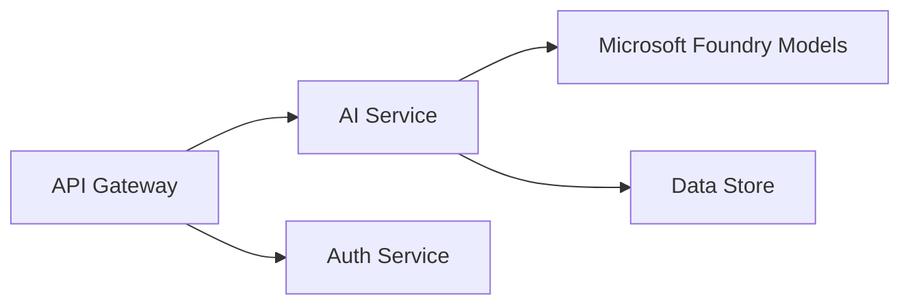
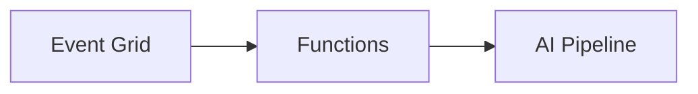

# 8 skyrius: Gamyba ir įmonių modeliai

**📚 Kursas**: [AZD pradedantiesiems](../../README.md) | **⏱️ Trukmė**: 2-3 valandos | **⭐ Sudėtingumas**: Pažengęs

---

## Apžvalga

Šiame skyriuje aptariami įmonėms pritaikyti diegimo modeliai, saugumo stiprinimas, stebėjimas ir kaštų optimizavimas gamybinėms AI apkrovoms.

Tai architektūrinė nuoroda, nebaigtas diegimo šablonas gamybai. Pavyzdžiai neprideda integracijos detalių, kurias turite patys įdiegti ir ištestuoti savo programoje; perskaičius kontrolinį sąrašą, negalima laikyti, kad gamyba yra paruošta.

> **Foundry GA atnaujinimas (2026-11-09):** Naudokite `azd >= 1.37.0` ir viešai prieinamą `microsoft.foundry` 1.0 paketą Foundry darbo eigai; įvertinimai diegiami atskirai. Žr. [išleidimo apimtis ir migracija](production-ai-practices.md#recent-release-changes-and-fixes) bei [autentifikuoto proceso pavyzdį](production-ai-practices.md#cicd-pipeline-configuration). Tai dokumentacijos peržiūra, ne tiesioginio diegimo patvirtinimas ar bendras GA statusas pasirenkamoms peržiūros funkcijoms.

## Mokymosi tikslai

Užbaigus šį skyrių, jūs:
- Išdėstysite daugregiones atsparias programas
- Įgyvendinsite įmonių saugumo modelius
- Konfigūruosite išsamų stebėjimą
- Optimizuosite išlaidas mastu
- Įkursite CI/CD dujotiekio sistemas su AZD

---

## 📚 Pamokos

| # | Pamoka | Aprašymas | Laikas |
|---|--------|-------------|------|
| 1 | [Gamybinės AI praktikos](production-ai-practices.md) | Įmonių diegimo modeliai | 90 min |

---

## 🚀 Gamybinis kontrolinis sąrašas

- [ ] Daugregionis diegimas atsparumui
- [ ] Valdomas identitetas autentifikavimui (be raktų)
- [ ] Application Insights stebėjimui
- [ ] Nustatyti kaštų biudžetai ir įspėjimai
- [ ] Įgalintas saugumo skenavimas
- [ ] CI/CD dujotiekio integracija
- [ ] Atsparumo avariniams atvejams planas

---

## 🏗️ Architektūriniai modeliai

### Modelis 1: Microservices AI



### Modelis 2: Įvykių valdomas AI



---

## 🔐 Saugumo gerosios praktikos

```bicep
// Illustrative properties from different resources, NOT a standalone Bicep file.
// Attach identity to the application host:
identity: {
  type: 'SystemAssigned'
}

// AI account properties (also require private endpoints, DNS and app connectivity):
properties: {
  publicNetworkAccess: 'Disabled'
  networkAcls: {
    defaultAction: 'Deny'
  }
}
```

---

## 💰 Kaštų optimizavimas

| Strategija | Pagrindinis apribojimas |
|----------|---------|
| Skalavimas iki nulio (Container Apps) | Reikia tinkamo paleidiklio; kitos paslaugos vis tiek sukelia kaštus |
| Naudoti vartojimo lygius kūrimui | Palyginkite paslaugos kainodarą ir apkrovą |
| Tvarkaraščio skalavimas | Skalavimas per palaikomą infrastruktūrą/automatizavimą |
| Rezervacijos / priskirta talpa | Tik jei palaikoma; įsipareigojimai gali didinti neveikimo kaštus |

Naudokite [pilną biudžeto išteklių modelį](production-ai-practices.md#2-cost-monitoring-and-budgets) su galiojančia pradžios data, apskaitos sritimi, gavėjais ir leidimais. Biudžetas siunčia įspėjimus; jis neriboja išlaidų. Taupymas priklauso nuo išmatuoto naudojimo ir nėra garantuotas procentas.

---

## 📊 Stebėjimo nustatymas

```bash
# Open the Application Insights logs view (requires configured monitoring)
azd monitor --logs

# Check Application Insights
azd monitor --overview

# View metrics
az monitor metrics list --resource <resource-id>
```

---

## 🔗 Navigacija

| Kryptis | Skyrius |
|-----------|---------|
| **Ankstesnis** | [7 skyrius: trikčių šalinimas](../chapter-07-troubleshooting/README.md) |
| **Kurso pabaiga** | [Kurso pradžia](../../README.md) |

---

## 📖 Susiję ištekliai

- [AI agentų vadovas](../chapter-02-ai-development/agents.md)
- [Application Insights](../chapter-06-pre-deployment/application-insights.md)
- [Daugagentinės sprendimai](../chapter-05-multi-agent/README.md)
- [Microservices pavyzdys](../../examples/microservices/README.md)

---

<!-- CO-OP TRANSLATOR DISCLAIMER START -->
**Atsakomybės apribojimas**:
Šis dokumentas buvo išverstas naudojant dirbtinio intelekto vertimo paslaugą [Co-op Translator](https://github.com/Azure/co-op-translator). Nors siekiame tikslumo, prašome atkreipti dėmesį, kad automatiniai vertimai gali turėti klaidų ar netikslumų. Originalus dokumentas jo gimtąja kalba laikomas autoritetingu šaltiniu. Svarbiai informacijai rekomenduojama naudoti profesionalų žmogiškąjį vertimą. Mes neatsakome už jokius nesusipratimus ar neteisingą interpretaciją, kilusią naudojantis šiuo vertimu.
<!-- CO-OP TRANSLATOR DISCLAIMER END -->