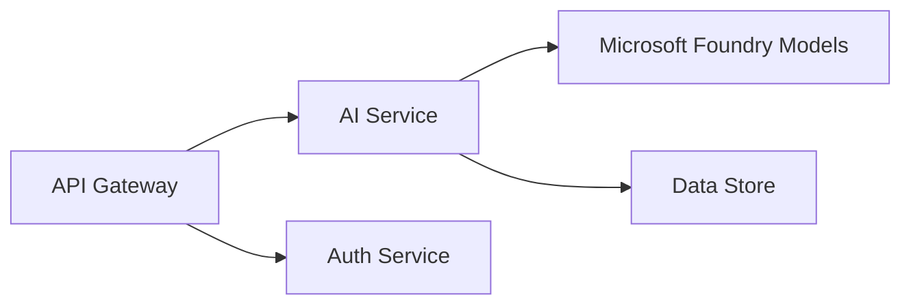
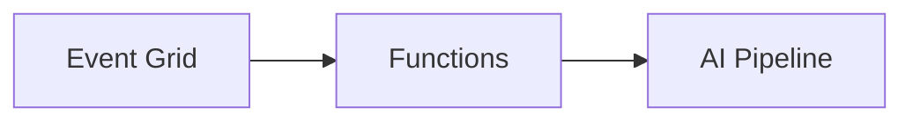

# 8 skyrius: Produkcijos ir įmonių modeliai

**📚 Kursas**: [AZD pradedantiesiems](../../README.md) | **⏱️ Trukmė**: 2-3 valandos | **⭐ Sudėtingumas**: Pažengęs

---

## Apžvalga

Šiame skyriuje aptariami įmonių lygio diegimo modeliai, saugumo stiprinimas, stebėsena ir kaštų optimizavimas gamybos AI darbo apkrovoms.

Tai yra architektūrinis vadovas, o ne pilnas diegimui tinkamas gamybos šablonas. Pavyzdžiai neapima integracijos detalių, kurias turite papildyti ir išbandyti savo taikomojoje programoje; perskaitę kontrolinį sąrašą negaunate gamybos parengimo sertifikato.

> **Leidimo peržiūra (2026-11-04):** AI CLI gaires patikrino su `azd 1.37.2`, agentais `1.0.0-beta.23` ir vertinimų `1.0.0-beta.2` dokumentacija/šaltiniu. Žr. [leidimo pakeitimus ir pataisas](production-ai-practices.md#recent-release-changes-and-fixes) dėl suderinamumo reikalavimų ir migracijos detalių; tai nėra tiesioginis diegimo patvirtinimas.

## Mokymosi tikslai

Baigę šį skyrių, galėsite:
- Diegti daugregiones atsparias programas
- Įgyvendinti įmonių saugumo modelius
- Konfigūruoti išsamų stebėjimą
- Optimizuoti kaštus dideliu mastu
- Sukurti CI/CD kanalus su AZD

---

## 📚 Pamokos

| # | Pamoka | Aprašymas | Trukmė |
|---|--------|-------------|------|
| 1 | [Produkcijos AI praktikos](production-ai-practices.md) | Įmonių diegimo modeliai | 90 min |

---

## 🚀 Produkcijos kontrolinis sąrašas

- [ ] Daugregionis diegimas dėl atsparumo
- [ ] Tvarkoma tapatybė autentifikacijai (be raktų)
- [ ] „Application Insights“ stebėjimui
- [ ] Biudžetų ir įspėjimų konfigūracija
- [ ] Įjungtas saugumo skanavimas
- [ ] CI/CD kanalo integracija
- [ ] Atsistatymo po nelaimės planas

---

## 🏗️ Architektūriniai modeliai

### Modelis 1: Mikroservisai AI



### Modelis 2: Įvykiu varomas AI



---

## 🔐 Geriausios saugumo praktikos

```bicep
// Illustrative properties from different resources, NOT a standalone Bicep file.
// Attach identity to the application host:
identity: {
  type: 'SystemAssigned'
}

// AI account properties (also require private endpoints, DNS and app connectivity):
properties: {
  publicNetworkAccess: 'Disabled'
  networkAcls: {
    defaultAction: 'Deny'
  }
}
```

---

## 💰 Kaštų optimizavimas

| Strategija | Pagrindinė sąlyga |
|----------|---------|
| Skalavimas iki nulio (Container Apps) | Reikia tinkamo suveikimo; kitos paslaugos vis tiek kainuoja |
| Naudoti vartojimo lygius kūrimui | Palyginti pasirinktos paslaugos kainodarą ir darbo apkrovą |
| Planuojamas skalavimas | Skalavimas per palaikomą infrastruktūrą/automatizavimą |
| Rezervacijos/rezervuota talpa | Tik kai palaikoma; įsipareigojimai gali didinti tuščias išlaidas |

Naudokite [pilną biudžeto resursų modelį](production-ai-practices.md#2-cost-monitoring-and-budgets) su galiojančia pradžios data, atsiskaitymo sritimi, gavėjais ir leidimais. Biudžetas siunčia įspėjimus; jis neriboja išlaidų. Taupymas priklauso nuo matuojamo naudojimo ir nėra garantuotas procentais.

---

## 📊 Stebėjimo nustatymai

```bash
# Open the Application Insights logs view (requires configured monitoring)
azd monitor --logs

# Check Application Insights
azd monitor --overview

# View metrics
az monitor metrics list --resource <resource-id>
```

---

## 🔗 Navigacija

| Kryptis | Skyrius |
|-----------|---------|
| **Ankstesnis** | [7 skyrius: Gedimų šalinimas](../chapter-07-troubleshooting/README.md) |
| **Kursas baigtas** | [Kurso pradžia](../../README.md) |

---

## 📖 Susiję resursai

- [AI agentų vadovas](../chapter-02-ai-development/agents.md)
- [Application Insights](../chapter-06-pre-deployment/application-insights.md)
- [Multi-agentų sprendimai](../chapter-05-multi-agent/README.md)
- [Mikroservisų pavyzdys](../../examples/microservices/README.md)

---

<!-- CO-OP TRANSLATOR DISCLAIMER START -->
**Atsakomybės apribojimas**:
Šis dokumentas buvo išverstas naudojant dirbtinio intelekto vertimo paslaugą [Co-op Translator](https://github.com/Azure/co-op-translator). Nors siekiame tikslumo, prašome atkreipti dėmesį, kad automatiniai vertimai gali turėti klaidų ar netikslumų. Originalus dokumentas jo gimtąja kalba laikomas autoritetingu šaltiniu. Svarbiai informacijai rekomenduojama naudoti profesionalų žmogiškąjį vertimą. Mes neatsakome už jokius nesusipratimus ar neteisingą interpretaciją, kilusią naudojantis šiuo vertimu.
<!-- CO-OP TRANSLATOR DISCLAIMER END -->