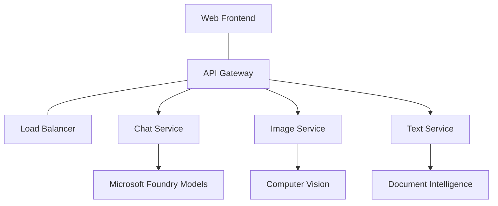

# AI gamybos darbo krūvio gerosios praktikos su AZD

**Skyriaus navigacija:**
- **📚 Kurso pradžia**: [AZD pradedantiesiems](../../README.md)
- **📖 Dabartinis skyrius**: 8 skyrius – Gamybos ir įmonių modeliai
- **⬅️ Ankstesnis skyrius**: [7 skyrius: trikčių šalinimas](../chapter-07-troubleshooting/debugging.md)
- **⬅️ Taip pat susiję**: [AI dirbtuvės laboratorija](../chapter-02-ai-development/ai-workshop-lab.md)
- **🎯 Kurso užbaigimas**: [AZD pradedantiesiems](../../README.md)

## Apžvalga

Ši gidas paaiškina gamybos AI dizaino modelius, naudojant Azure Developer CLI (AZD). Tai yra dizaino nuoroda, o ne diegiamą programą ar gamybos sertifikavimą.

**Pavyzdžių ribos:** Nebent aiškiai aprašyta, kad yra pilnos, Bicep fragmentai numato parametrus ir nuorodas į išteklius iš talpinančio šablono. Jie praleidžia numatomas kompiuterio nuotraukas/planu, tapatybes, vaidmenų priskyrimus, DNS, išeitis ir kitą reikiamą integraciją. YAML tarnybos keliai ir kabliukų/testo skriptai yra iliustraciniai failai, kuriuos reikia sukurti **savo programoje**; jų šis kursas nepateikia. Naudokite veikiančią AZD pavyzdį kaip pagrindą, sukompiliuokite visą infrastruktūrą ir išbandykite izoliuotoje aplinkoje prieš gamybą.

## Pagrindinės sprendžiamos problemos

Įprastinės gamybos problemos apima daugiapakopius diegimus, tapatybės ir slaptumo valdymą, mastelio keitimą, išlaidų kontrolę ir stebėjimą. Šiame dokumente nepretenduojama į matuojamą paplitimą.

## AI gamybos architektūros modeliai

### Modelis 1: mikroservisų AI architektūra

**Kada naudoti**: sudėtingoms AI programoms su keliomis galimybėmis



**AZD įgyvendinimas**:

```yaml
# azure.yaml
name: enterprise-ai-platform
services:
  web:
    project: ./web
    host: staticwebapp
  api-gateway:
    project: ./api-gateway
    host: containerapp
  chat-service:
    project: ./services/chat
    host: containerapp
  vision-service:
    project: ./services/vision
    host: containerapp
  text-service:
    project: ./services/text
    host: containerapp
```

### Modelis 2: įvykių pagrindu AI apdorojimas

**Kada naudoti**: paketinis apdorojimas, dokumentų analizė, asinchroniniai srautų darbai

```bicep
// Event Hub for AI processing pipeline
resource eventHub 'Microsoft.EventHub/namespaces@2024-01-01' = {
  name: eventHubNamespaceName
  location: location
  sku: {
    name: 'Standard'
    tier: 'Standard'
    capacity: 1
  }
}

// Service Bus for reliable message processing
resource serviceBus 'Microsoft.ServiceBus/namespaces@2024-01-01' = {
  name: serviceBusNamespaceName
  location: location
  sku: {
    name: 'Premium'
    tier: 'Premium'
    capacity: 1
  }
}

// Function App for processing
resource functionApp 'Microsoft.Web/sites@2023-01-01' = {
  name: functionAppName
  location: location
  kind: 'functionapp,linux'
  properties: {
    siteConfig: {
      appSettings: [
        {
          name: 'FUNCTIONS_EXTENSION_VERSION'
          value: '~4'
        }
        {
          name: 'AZURE_OPENAI_ENDPOINT'
          value: '@Microsoft.KeyVault(VaultName=${keyVault.name};SecretName=openai-endpoint)'
        }
      ]
    }
  }
}
```

Tai kuria vardų srities fragmentus, o ne centrus, eilutes, prenumeratas ar Function paleidimo įvykius. Veikianti Function taip pat reikalauja talpinimo plano, vykdymo/laikymo konfigūracijos, prijungtos tapatybės, RBAC ir tinklo prieigos. Key Vault nuoroda reikalauja leidimo skaityti slaptumą; pats galinio taško URL nėra autentifikavimo kredencialas.

## Mąstymas apie AI agente sveikatą

Kai tradicinė žiniatinklio programa sugenda, simptomai yra pažįstami: puslapis neįkraunamas, API grąžina klaidą arba diegimas nepavyksta. AI palaikomos programos gali sugesti tais pačiais būdais – bet jos taip pat gali elgtis subtiliau, nepalikdamos akivaizdžių klaidų pranešimų.

Ši skiltis padeda jums sukurti mentalinį modelį AI darbo krūvių stebėjimui, kad žinotumėte, kur žiūrėti, kai kažkas atrodo ne taip.

### Kaip agento sveikata skiriasi nuo tradicinės programos sveikatos

Tradicinėse programose taip pat gali būti subtilių klaidų. AI agentas priduria nedeterministinį atsakymo kokybės aspektą prie įprastų prieinamumo ir teisingumo rūpesčių. Galvokite apie agento sveikatą dviem lygiais:

| Sluoksnis | Ką stebėti | Kur ieškoti |
|----------|------------|------------|
| **Infrastruktūros sveikata** | Ar tarnyba veikia? Ar ištekliai paskirti? Ar galiniai taškai pasiekiami? | `azd monitor`, Azure portal išteklių sveikata, konteinerio/programos žurnalai |
| **Elgesio sveikata** | Ar agentas atsako tiksliai? Ar atsakymai pateikiami laiku? Ar modelis kviečiamas teisingai? | Application Insights įrašai, modelio kvietimo delsos metricai, atsakymų kokybės žurnalai |

Infrastruktūros sveikata yra pažįstama – ji yra tokia pati bet kuriai azd programai. Elgesio sveikata yra naujas sluoksnis, kurį AI darbo krūviai įveda.

### Kur ieškoti, kai AI programos elgiasi ne taip, kaip tikėtasi

Jei jūsų AI programa nesuteikia laukiamų rezultatų, štai konceptualus kontrolinis sąrašas:

1. **Pradėkite nuo pagrindų.** Ar programa veikia? Ar gali pasiekti priklausomybes? Patikrinkite `azd monitor` ir išteklių sveikatą kaip bet kuriai programai.
2. **Patikrinkite modelio ryšį.** Ar jūsų programa sėkmingai kviečia AI modelį? Nepavykę arba baigę laiką modelio kvietimai yra dažniausia AI problemų priežastis ir pasirodys jūsų programos žurnaluose.
3. **Saugiai patikrinkite įvestį ir pagrindimą.** Klaidingi atsakymai gali kilti iš paieškos, nurodymų, modelio apribojimų ar įrankių vykdymo. Naudokite prieigą kontroliuojamus, redaguotus diagnostinius duomenis; neįjunkite neatsargaus užklausų/atsakymų registravimo gamyboje.
4. **Peržiūrėkite atsakymo delsą.** AI modelio kvietimai yra lėtesni nei tipiniai API kvietimai. Jei programa veikia lėtai, patikrinkite, ar modelio atsako laikas padidėjo – tai gali rodyti ribojimą, pajėgumo apribojimus ar regioninį perkrautimą.
5. **Stebėkite išlaidų signalus.** Netikėti šuoliai tokenų arba API kvietimų naudojime gali reikšti ciklą, klaidingai sukonfigūruotą užklausą ar per daug bandymų.

Jums nereikia iš karto išmanyti stebėjimo įrankių. Pagrindinė išvada yra ta, kad AI programos turi papildomą elgesio sluoksnį stebėjimui, o azd įmontuotas stebėjimas (`azd monitor`) suteikia pradžios tašką abiem sluoksniams tirti.

---

## Saugumo gerosios praktikos

### 1. Nulinės pasitikėjimo saugumo modelis

**Įgyvendinimo strategija**:
- Jokių paslaugų tarpusavio ryšių be autentifikavimo
- Visi API kvietimai naudoja valdomas tapatybes
- Tinklo izoliacija su privačiais galiniais taškais
- Mažiausio privilegijų prieigos kontrolė

```bicep
// Managed Identity for each service
resource chatServiceIdentity 'Microsoft.ManagedIdentity/userAssignedIdentities@2023-01-31' = {
  name: 'chat-service-identity'
  location: location
}

// Role assignments with minimal permissions
resource openAIUserRole 'Microsoft.Authorization/roleAssignments@2022-04-01' = {
  scope: openAIAccount
  name: guid(openAIAccount.id, chatServiceIdentity.id, '5e0bd9bd-7b93-4f28-af87-19fc36ad61bd')
  properties: {
    roleDefinitionId: subscriptionResourceId('Microsoft.Authorization/roleDefinitions', '5e0bd9bd-7b93-4f28-af87-19fc36ad61bd')
    principalId: chatServiceIdentity.properties.principalId
    principalType: 'ServicePrincipal'
  }
}
```

### 2. Saugus slaptumų valdymas

**Key Vault integracijos modelis**:

```bicep
// Key Vault with proper access policies
resource keyVault 'Microsoft.KeyVault/vaults@2023-02-01' = {
  name: keyVaultName
  location: location
  properties: {
    tenantId: tenant().tenantId
    sku: {
      family: 'A'
      name: 'standard' // Premium is needed for HSM-backed keys, not ordinary secrets
    }
    enableRbacAuthorization: true  // Use RBAC instead of access policies
    enablePurgeProtection: true    // Prevent accidental deletion
    enableSoftDelete: true
    softDeleteRetentionInDays: 90
  }
}

// Optional legacy key-auth alternative; omit when using Entra ID.
resource openAIKeySecret 'Microsoft.KeyVault/vaults/secrets@2023-02-01' = {
  parent: keyVault
  name: 'openai-api-key'
  properties: {
    value: openAIAccount.listKeys().key1
    attributes: {
      enabled: true
    }
  }
}
```

Priskirkite vykdymo tapatybę `Key Vault Secrets User` tinkamuose aprėpties lygiuose ir prijunkite ją prie kompiuterio; `enableRbacAuthorization` vienas pats neprisideda prie prieigos. Teisinga naudoti OpenAI valdomos tapatybės autentifikavimą su `disableLocalAuth: true`. Pasirinktinė klavišo paslaptis prasminga tik sąmoningai klavišu įgalintam paskyros nustatymui, o tiekimo principas taip pat turi turėti leidimą rašyti paslaptis.

### 3. Tinklo saugumas

**Privataus galinio taško konfigūracija**:

```bicep
// Virtual Network for AI services
resource virtualNetwork 'Microsoft.Network/virtualNetworks@2023-04-01' = {
  name: vnetName
  location: location
  properties: {
    addressSpace: {
      addressPrefixes: ['10.0.0.0/16']
    }
    subnets: [
      {
        name: 'ai-services-subnet'
        properties: {
          addressPrefix: '10.0.1.0/24'
          privateEndpointNetworkPolicies: 'Disabled'
        }
      }
      {
        name: 'app-services-subnet'
        properties: {
          addressPrefix: '10.0.2.0/24'
          delegations: [
            {
              name: 'Microsoft.Web/serverFarms'
              properties: {
                serviceName: 'Microsoft.Web/serverFarms'
              }
            }
          ]
        }
      }
    ]
  }
}

// Private endpoints for all AI services
resource openAIPrivateEndpoint 'Microsoft.Network/privateEndpoints@2023-04-01' = {
  name: '${openAIAccountName}-pe'
  location: location
  properties: {
    subnet: {
      id: virtualNetwork.properties.subnets[0].id
    }
    privateLinkServiceConnections: [
      {
        name: 'openai-connection'
        properties: {
          privateLinkServiceId: openAIAccount.id
          groupIds: ['account']
        }
      }
    ]
  }
}
```

Privatieji galiniai taškai taip pat reikalauja privačių DNS zonų grupių/VNet nuorodų ir programos VNet integracijos. Jie automatiškai neblokuoja viešojo prieigos: po privačios prieigos ir diegimo patvirtinimo išjunkite AI paskyros viešojo tinklo prieigą.

## Veikimo našumas ir mastelio keitimas

### 1. Automatinio mastelio keitimo strategijos

**Konteinerių programų automatinis mastelio keitimas**:

```bicep
resource containerApp 'Microsoft.App/containerApps@2023-05-01' = {
  name: containerAppName
  location: location
  properties: {
    configuration: {
      ingress: {
        external: true
        targetPort: 8000
        transport: 'http'
      }
    }
    template: {
      scale: {
        minReplicas: 2  // Always have 2 instances minimum
        maxReplicas: 50 // Scale up to 50 for high load
        rules: [
          {
            name: 'http-scaling'
            http: {
              metadata: {
                concurrentRequests: '20'  // Scale when >20 concurrent requests
              }
            }
          }
          {
            name: 'cpu-scaling'
            custom: {
              type: 'cpu'
              metadata: {
                type: 'Utilization'
                value: '70'  // Scale when CPU >70%
              }
            }
          }
        ]
      }
    }
  }
}
```

### 2. Kešavimo strategijos

**Redis kešas AI atsakymams**:

```bicep
// Legacy Azure Cache for Redis example (not recommended for new deployments)
resource redisCache 'Microsoft.Cache/redis@2023-04-01' = {
  name: redisCacheName
  location: location
  properties: {
    sku: {
      name: 'Premium'
      family: 'P'
      capacity: 1
    }
    enableNonSslPort: false
    minimumTlsVersion: '1.2'
    redisConfiguration: {
      'maxmemory-policy': 'allkeys-lru'
    }
    // Sharding distributes data; replication/failover provides availability.
    shardCount: 2
  }
}

// Cache configuration in application
var cacheConnectionString = '${redisCache.properties.hostName}:6380,password=${redisCache.listKeys().primaryKey},ssl=True,abortConnect=False'
```

Azure Cache for Redis Basic/Standard/Premium yra [senėjimo procese](https://learn.microsoft.com/azure/azure-cache-for-redis/retirement-faq). Naujiems dizainams naudokite Azure Managed Redis su dokumentuota SKU, tapatybės ir TLS konfigūracija, o ne kopijuokite šį seną išteklių į naują gamybos sistemą. Jungties eilutė yra neveikiantis laikinas simbolis, o ne kredencialas. Dalinkite kešo raktus pagal autorizaciją, modelį/nurodymus ir paieškos versiją su galiojimo laiku; bendras, tik užklausų kešas gali atskleisti kito vartotojo duomenis.

### 3. Apkrovos balansavimas ir srauto valdymas

**Programos vartai su WAF**:

```bicep
// Application Gateway with Web Application Firewall
resource applicationGateway 'Microsoft.Network/applicationGateways@2023-04-01' = {
  name: appGatewayName
  location: location
  properties: {
    sku: {
      name: 'WAF_v2'
      tier: 'WAF_v2'
      capacity: 2
    }
    webApplicationFirewallConfiguration: {
      enabled: true
      firewallMode: 'Prevention'
      ruleSetType: 'OWASP'
      ruleSetVersion: '3.2'
    }
    // Backend pools for AI services
    backendAddressPools: [
      {
        name: 'ai-services-pool'
        properties: {
          backendAddresses: [
            {
              fqdn: '${containerApp.properties.configuration.ingress.fqdn}'
            }
          ]
        }
      }
    ]
  }
}
```

Tai yra dalinė vartų ištekliai: tikras diegimas taip pat reikalauja vartų potinklio/IP konfigūracijos, priekinės IP ir prievadų, TLS klausytojų/certifikatų, galinių HTTP nustatymų/patarimų, maršruto taisyklių ir prioritetų bei peržiūrėtos WAF politikos. TLS pavadinimas/SNI ir autentifikacija turi atitikti konteinerių programos galinę dalį.

## 💰 Išlaidų optimizavimas

### 1. Tinkamas išteklių parinkimas

**Aplinkos specifinės konfigūracijos**:

Šie pavadinimai yra **iliustraciniai pasirinktinių šablonų įvestys**, o ne automatiniai AZD nustatymai. Pirmiausia žemėlapykite kiekvieną į `infra/main.parameters.json`/Bicep ir kompiuterio konfigūraciją. Pvz., RAG pavyzdys naudoja `AZURE_SEARCH_SERVICE_SKU` ir `AZURE_OPENAI_CHATGPT_DEPLOYMENT_CAPACITY`, o ne žemiau pateiktus bendruosius pavadinimus. Duokite konteinerių programoms atmintį su palaikoma vienete, pvz., `1Gi` tikrame ištekliau. Pritaikykite infrastruktūros pakeitimus su `azd up` arba `azd provision`; `azd deploy` vienas pats nepakeičia Bicep.

```bash
# Development environment
azd env new development
azd env set AZURE_OPENAI_SKU "S0"
azd env set AZURE_OPENAI_CAPACITY 10
azd env set AZURE_SEARCH_SKU "basic"
azd env set CONTAINER_CPU 0.5
azd env set CONTAINER_MEMORY 1.0

# Production environment  
azd env new production
azd env set AZURE_OPENAI_SKU "S0"
azd env set AZURE_OPENAI_CAPACITY 100
azd env set AZURE_SEARCH_SKU "standard"
azd env set CONTAINER_CPU 2.0
azd env set CONTAINER_MEMORY 4.0
```

### 2. Išlaidų stebėjimas ir biudžetai

```bicep
// Supply the first day of the current UTC month, e.g. 2026-11-01T00:00:00Z.
param budgetStartDate string

// Cost management and budgets
resource budget 'Microsoft.Consumption/budgets@2024-08-01' = {
  name: 'ai-workload-budget'
  properties: {
    timePeriod: {
      startDate: budgetStartDate
    }
    timeGrain: 'Monthly'
    amount: 2000  // In the billing currency, not necessarily USD
    category: 'Cost'
    notifications: {
      warning: {
        enabled: true
        operator: 'GreaterThan'
        threshold: 80
        contactEmails: [
          'finance@company.com'
          'engineering@company.com'
        ]
        contactRoles: [
          'Owner'
          'Contributor'
        ]
      }
      critical: {
        enabled: true
        operator: 'GreaterThan'
        threshold: 95
        contactEmails: [
          'cto@company.com'
        ]
      }
    }
  }
}
```

Pakeiskite pavyzdinius gavėjus ir patikrinkite aprėptį/leidimus. Biudžeto įspėjimai naudoja atidėtus sąskaitų duomenis ir neįveda išlaidų apribojimų.

### 3. Tokenų naudojimo optimizavimas

**OpenAI išlaidų valdymas**:

Tai tik simbolių kiekiu pagrįstas heuristinis UI peržiūrai, **ne** modelio tokenų ribos tikrintuvas. Gamybos kodas turi naudoti tokenizatorių, skirtą diegiamam modeliui ir atsižvelgti į sistemos nurodymus, įrankių schemas, istoriją ir išeities biudžetą. Atmesti per didelę vartotojo žinutę vietoj tyliai ją sutrumpinant.

```typescript
// Application-level token optimization
class TokenOptimizer {
  private readonly maxTokens = 4000;
  private readonly reserveTokens = 500;
  
  optimizePrompt(userInput: string, context: string): string {
    const availableTokens = this.maxTokens - this.reserveTokens;
    if (this.estimateTokens(userInput) + 8 >= availableTokens) {
      throw new Error("User input exceeds the illustrative prompt budget");
    }
    const estimatedTokens = this.estimateTokens(userInput + context) + 8;
    
    if (estimatedTokens > availableTokens) {
      // Truncate context, not user input
      context = this.truncateContext(context, Math.max(0, availableTokens - this.estimateTokens(userInput) - 8));
    }
    
    return `${context}\n\nUser: ${userInput}`;
  }
  
  private estimateTokens(text: string): number {
    // Rough estimation: 1 token ≈ 4 characters
    return Math.ceil(text.length / 4);
  }

  private truncateContext(text: string, estimatedBudget: number): string {
    return text.slice(0, Math.max(0, estimatedBudget) * 4);
  }
}
```

## Stebėjimas ir pastebimumas

### 1. Visapusiškas Application Insights naudojimas

```bicep
// Application Insights with advanced features
resource applicationInsights 'Microsoft.Insights/components@2020-02-02' = {
  name: applicationInsightsName
  location: location
  kind: 'web'
  properties: {
    Application_Type: 'web'
    WorkspaceResourceId: logAnalyticsWorkspace.id
    SamplingPercentage: 100  // Ingestion setting; review cost and SDK sampling separately
    DisableIpMasking: false  // Retain IP masking
  }
}

// Custom metrics for AI operations
resource aiMetricAlerts 'Microsoft.Insights/metricAlerts@2018-03-01' = {
  name: 'ai-high-error-rate'
  location: 'global'
  properties: {
    description: 'Alert when failed request count exceeds 10 in five minutes'
    severity: 2
    enabled: true
    scopes: [
      applicationInsights.id
    ]
    evaluationFrequency: 'PT1M'
    windowSize: 'PT5M'
    criteria: {
      'odata.type': 'Microsoft.Azure.Monitor.SingleResourceMultipleMetricCriteria'
      allOf: [
        {
          name: 'high-error-rate'
          metricName: 'requests/failed'
          operator: 'GreaterThan'
          threshold: 10
          timeAggregation: 'Count'
        }
      ]
    }
  }
}
```

### 2. AI specifinis stebėjimas

**Individualūs AI metrikų informacijos suvestinės**:

```json
{
  "dashboard": {
    "name": "AI Application Monitoring",
    "tiles": [
      {
        "name": "OpenAI Request Volume",
        "query": "dependencies | where target contains 'openai' | summarize count() by bin(timestamp, 5m)"
      },
      {
        "name": "AI Response Latency",
        "query": "dependencies | where target contains 'openai' | summarize avg(duration) by bin(timestamp, 5m)"
      },
      {
        "name": "Token Usage",
        "query": "customMetrics | where name == 'openai_tokens_used' | summarize sum(value) by bin(timestamp, 1h)"
      },
      {
        "name": "Cost per Hour",
        "query": "customMetrics | where name == 'openai_cost' | summarize sum(value) by bin(timestamp, 1h)"
      }
    ]
  }
}
```

Ši JSON yra programos apibrėžtas eskizas, ne importuojama Azure portalo informacijos suvestinės schema. Tokenų/išlaidų užklausos reikalauja, kad jūsų programa skleistų būtent šiuos pasirinktinius metrikus; jų nekuria AZD. Pritaikykite priklausomybių filtrus pagal tikrą modelio galinio taško/span pavadinimus.

### 3. Sveikatos patikrinimai ir veikimo laiko stebėjimas

```bicep
// Application Insights availability tests
resource availabilityTest 'Microsoft.Insights/webtests@2022-06-15' = {
  name: 'ai-app-availability-test'
  location: location
  tags: {
    'hidden-link:${applicationInsights.id}': 'Resource'
  }
  properties: {
    SyntheticMonitorId: 'ai-app-availability-test'
    Name: 'AI Application Availability Test'
    Description: 'Tests AI application endpoints'
    Enabled: true
    Frequency: 300  // 5 minutes
    Timeout: 120    // 2 minutes
    Kind: 'standard'
    Locations: [
      {
        Id: 'us-east-2-azr'
      }
      {
        Id: 'us-west-2-azr'
      }
    ]
    Request: {
      RequestUrl: 'https://${webApp.properties.defaultHostName}/health'
      HttpVerb: 'GET'
      FollowRedirects: true
      ParseDependentRequests: false
    }
    ValidationRules: {
      ExpectedHttpStatusCode: 200
      SSLCheck: true
      SSLCertRemainingLifetimeCheck: 7
    }
  }
}
```

## Atsparumas nelaimėms ir aukštas prieinamumas

Ankstesnis testas remiasi esama App Service `webApp` ir Application Insights išteklių. Standartiniai prieinamumo testai yra apmokestinami ir reikalauja prieinamo galinio taško; tik privačios programos reikalingas tinkamas privačios priežiūros dizainas. URL ping testai pasenę; naudokite [standartinius prieinamumo testus](https://learn.microsoft.com/azure/azure-monitor/app/availability).

### 1. Daugiarigių diegimas

```yaml
# azure.yaml - Multi-region configuration
name: ai-app-multiregion
services:
  api-primary:
    project: ./api
    host: containerapp
    env:
      AZURE_REGION: eastus
  api-secondary:
    project: ./api
    host: containerapp
    env:
      AZURE_REGION: westus2
```

```bicep
// Separate App Service topology, not the Container Apps declarations above
resource trafficManager 'Microsoft.Network/trafficManagerProfiles@2022-04-01' = {
  name: trafficManagerProfileName
  location: 'global'
  properties: {
    profileStatus: 'Enabled'
    trafficRoutingMethod: 'Priority'
    dnsConfig: {
      relativeName: trafficManagerProfileName
      ttl: 30
    }
    monitorConfig: {
      protocol: 'HTTPS'
      port: 443
      path: '/health'
      intervalInSeconds: 30
      toleratedNumberOfFailures: 3
      timeoutInSeconds: 10
    }
    endpoints: [
      {
        name: 'primary-endpoint'
        type: 'Microsoft.Network/trafficManagerProfiles/azureEndpoints'
        properties: {
          targetResourceId: primaryAppService.id
          endpointStatus: 'Enabled'
          priority: 1
        }
      }
      {
        name: 'secondary-endpoint'
        type: 'Microsoft.Network/trafficManagerProfiles/azureEndpoints'
        properties: {
          targetResourceId: secondaryAppService.id
          endpointStatus: 'Enabled'
          priority: 2
        }
      }
    ]
  }
}
```

Aplinkos kintamieji nepasirenka išteklių vietų. IaC turi paskirti atskirus regioninius kompiuterius ir pririšti kiekvieną tarnybą su `resourceName` arba `azd-service-name` žymomis. Traffic Manager pavyzdys yra **atskira App Service topologija** (`primaryAppService`/`secondaryAppService`), o ne konteinerių programų maršrutizacija. Konteinerių programoms reikalingas tinkamai sukonfigūruotas išorinis galinis taškas/priekinis vartai, TLS/pritaikyta domenų maršrutizacija ir sveikatos patikrinimo signalai.

### 2. Duomenų atsarginė kopija ir atkūrimas

```bicep
// Backup configuration for critical data
resource backupVault 'Microsoft.DataProtection/backupVaults@2023-05-01' = {
  name: backupVaultName
  location: location
  identity: {
    type: 'SystemAssigned'
  }
  properties: {
    storageSettings: [
      {
        datastoreType: 'VaultStore'
        type: 'LocallyRedundant'
      }
    ]
  }
}

```

Vien tik saugykla negarantuoja atsarginės kopijos. Konfigūruokite **darbo krūviui skirtą palaikomą politiką ir atsarginės kopijos egzempliorių**, šaltinio leidimus, laikymą ir atkūrimo testus naudojant [Azure Backup palaikymų matricas](https://learn.microsoft.com/azure/backup/backup-support-matrix). Nėra bendros Azure Backup politikos talpinamoms Azure OpenAI modelių diegimuose. Laikykite infrastruktūros/modelio diegimo apibrėžimus šaltinio valdyme; apsaugokite įkeltus dokumentus, programų duomenis ir tobulinimo artefaktus naudojant kiekvieną palaikomą atsarginės kopijos/eksporto funkciją. Aiškiai apibrėžkite ir patikrinkite RPO/RTO.

## DevOps ir CI/CD integracija

### 1. GitHub Actions darbo eiga

```yaml
# .github/workflows/deploy-ai-app.yml
name: Deploy AI Application

on:
  push:
    branches: [main]
  pull_request:
    branches: [main]

jobs:
  test:
    runs-on: ubuntu-latest
    steps:
      - uses: actions/checkout@v4
      
      - name: Setup Python
        uses: actions/setup-python@v4
        with:
          python-version: '3.11'
          
      - name: Install dependencies
        run: |
          pip install -r requirements.txt
          pip install pytest
          
      - name: Run tests
        run: pytest tests/
        
      - name: AI Safety Tests
        run: |
          python scripts/test_ai_safety.py
          python scripts/validate_prompts.py

```

Tai yra **tik testavimo dalis** darbo eigos ir prielaida, kad sukūrėte `requirements.txt`, `tests/` ir du saugumo skriptus. Pridėkite autentifikuotus OIDC tiekimo/diegimo darbus iš [CI/CD proceso konfigūracijos](#cicd-pipeline-configuration), su `needs: test`, patikimu push/rankiniu paleidimu ir saugomomis GitHub aplinkomis. Nenaudokite nepatikimo pull-request kodo su debesų kredencialais. Šviežias vykdymo agentas neturi pasirinktos vietinės AZD aplinkos; pateikite aplinkos/prenumeratos/vietos įvestis ir naudokite `azd auth login`, ne tik `azure/login`.

### 2. Infrastruktūros patikra

```bash
# scripts/validate_infrastructure.sh
#!/bin/bash
set -euo pipefail

echo "Validating AI infrastructure deployment..."

# Requires Azure CLI login and the resource group selected explicitly.
: "${AZURE_RESOURCE_GROUP:?Set AZURE_RESOURCE_GROUP}"
: "${AZURE_OPENAI_NAME:?Set AZURE_OPENAI_NAME}"
: "${AZURE_OPENAI_CHAT_DEPLOYMENT:?Set the actual deployment name}"

# A successful empty list is not proof that resources exist.
types=("Microsoft.CognitiveServices/accounts" "Microsoft.Search/searchServices"
       "Microsoft.Storage/storageAccounts" "Microsoft.KeyVault/vaults")
for resource_type in "${types[@]}"; do
    count=$(az resource list --resource-group "$AZURE_RESOURCE_GROUP" \
        --resource-type "$resource_type" --query "length(@)" -o tsv)
    if [[ "$count" -lt 1 ]]; then
        echo "ERROR: No $resource_type found in $AZURE_RESOURCE_GROUP"
        exit 1
    fi
done

# Validate OpenAI model deployments
echo "Validating OpenAI model deployments..."
state=$(az cognitiveservices account deployment show \
  --name "$AZURE_OPENAI_NAME" --resource-group "$AZURE_RESOURCE_GROUP" \
  --deployment-name "$AZURE_OPENAI_CHAT_DEPLOYMENT" \
  --query "properties.provisioningState" -o tsv)
if [[ "$state" != "Succeeded" ]]; then
    echo "ERROR: Required model deployment is not provisioned successfully"
    exit 1
fi

echo "Infrastructure validation completed successfully!"
```

Tikėtina: nuline išeities reikšme ir užbaigimo pranešimu tik tada, kai egzistuoja visi tikėtini tipai ir pavadintas modelio diegimas yra paskirtas. Tai tikrina inventorių/tiekimo būseną, **ne** išteklių sveikatą, tikslią topologiją, RBAC, tinklo pasiekiamumą ar modelio elgesį. Priderinkite tikėtinus tipus prie savo architektūros, tada atlikite atskirą autentifikuotą paraiškos paruošimo testą.

## Gamybos pasiruošimo kontrolinis sąrašas

### Saugumas ✅
- [ ] Visos tarnybos naudoja valdomas tapatybes
- [ ] Slaptumai saugomi Key Vault
- [ ] Konfigūruoti privatūs galiniai taškai
- [ ] Įdiegti tinklo saugumo grupės
- [ ] RBAC su mažiausia privilegija
- [ ] Įjungtas WAF viešuose galiniuose taškuose

### Veikimas ✅
- [ ] Konfigūruotas automatinis mastelio keitimas
- [ ] Įdiegta kešavimo sistema
- [ ] Įdiegta apkrovos balansavimo sistema
- [ ] CDN statiniam turiniui
- [ ] Duomenų bazės prijungimo telkinys
- [ ] Tokenų naudojimo optimizavimas

### Stebėjimas ✅
- [ ] Sukonfigūruotas Application Insights
- [ ] Apibrėžti pasirinktiniai matavimai
- [ ] Sukurti įspėjimo taisyklės
- [ ] Sukurta informacijos suvestinė
- [ ] Įdiegti sveikatos patikrinimai
- [ ] Įrašų saugojimo politikos

### Patikimumas ✅
- [ ] Daugiarigių diegimas
- [ ] Atsarginės kopijos ir atkūrimo planas
- [ ] Įdiegti grandinių pertraukikliai
- [ ] Konfigūruotos bandymų politikos
- [ ] Maloni degradacija
- [ ] Sveikatos patikrinimų galiniai taškai

### Išlaidų valdymas ✅
- [ ] Sukonfigūruoti biudžeto įspėjimai
- [ ] Tinkamas išteklių parinkimas
- [ ] Taikomos kūrimo/testavimo nuolaidos
- [ ] Įsigytos rezervuotos instancijos
- [ ] Išlaidų stebėjimo informacijos suvestinė
- [ ] Reguliarūs išlaidų peržiūros

### Atitiktis ✅
- [ ] Įvykdyti duomenų lokalizacijos reikalavimai
- [ ] Įjungtas auditavimo žurnalas
- [ ] Taikomos atitikties politikos
- [ ] Įdiegti saugumo standartai
- [ ] Reguliarios saugumo apžvalgos
- [ ] Incidentų reagavimo planas

## Veikimo našumo etalonai

### Iliustraciniai gamybos tikslai

Tai yra pavyzdiniai SLO, skirtos deryboms ir apkrovos testavimui, ne matuoti etalonai ar garantijos. Atsakymo delsos laikas priklauso nuo modelio/išeities ilgumo; mėnesinės tokenų išlaidos priklauso nuo srauto ir kainų, ne tik nuo tokenų skaičiaus.

| Matmuo | Tikslas | Stebėjimas |
|--------|--------|------------|
| **Atsakymo laikas** | < 2 sekundžių | Application Insights |
| **Prieinamumas** | 99,9 % | Veikimo laiko stebėjimas |
| **Klaidų rodiklis** | < 0,1 % | Programos žurnalai |
| **Modelio išlaidos** | < $500/mėn. (pavyzdinis biudžetas) | Išlaidų valdymas |
| **Vienu metu naudotojai** | 1000+ | Apkrovos testavimas |
| **Atkūrimo laikas** | < 1 valanda | Numatytųjų avarijų atkūrimo testai |

### Apkrovos testavimas

Toliau pateikiamas apkrovos testavimo skripto sąsajos šablonas **kurį turite įgyvendinti**; ši saugykla nepateikia `scripts/load_test.py`. Apibrėžkite užklausų duomenis, autentifikaciją, atstovaujamas apkrovos realijas, procentilinius delsos/klaidų patikrinimus ir išlaidų ribą savo pasirinktame apkrovos testavimo įrankyje prieš jį paleisdami:

```bash
# Load testing script for AI applications
python scripts/load_test.py \
  --endpoint https://your-ai-app.azurewebsites.net \
  --concurrent-users 100 \
  --duration 300 \
  --ramp-up 60
```

## 🤝 Bendruomenės geros praktikos

Remiantis Microsoft Foundry Discord bendruomenės atsiliepimais:

### Pagrindinės bendruomenės rekomendacijos:

1. **Pradėkite nuo mažo, palaipsniui didinkite**: pradėkite nuo pagrindinių SKU ir didinkite pagal tikrą naudojimą
2. **Stebėkite viską**: nustatykite išsamų stebėjimą nuo pirmos dienos
3. **Automatizuokite saugumą**: naudokite infrastruktūrą kaip kodą nuolatiniam saugumui
4. **Atlikite išsamų testavimą**: įtraukite AI specifinius testus į savo procesą
5. **Planuokite išlaidas**: stebėkite žetonų naudojimą ir anksčiau nustatykite biudžeto įspėjimus

### Dažnos klaidos, kurių reikėtų vengti:

- ❌ API raktų įkėlimas tiesiogiai į kodą
- ❌ Netinkamas stebėjimo nustatymas
- ❌ Išlaidų optimizavimo ignoravimas
- ❌ Nepakankamas gedimų scenarijų testavimas
- ❌ Diegimas be sveikatos patikrinimų

## AZD AI CLI komandos ir plėtiniai

AZD įtraukia vis augantį AI specifinių komandų ir plėtinių rinkinį, kuris supaprastina gamybinius AI darbo srautus. Šie įrankiai užpildo spragas tarp vietinio vystymo ir gamybinio diegimo AI darbo krūviams.

> **Leidimo apžvalga (2026-11-04):** Toliau pateiktas CLI vadovas buvo patikrintas pagal paskelbtus `azd` **1.37.2**, `azure.ai.agents` **1.0.0-beta.23** ir `azure.ai.evaluations` **1.0.0-beta.2** leidimus. Agentų beta.23 reikalauja `azd >= 1.37.0`; vertinimų beta.2 reikalauja `azd >= 1.33.0`. Naudokite bent 1.37.0 versiją sujungtam darbo srautui. Tai dokumentacijos/šaltinio peržiūra, ne tiesioginis Azure diegimo patikrinimas.

### AZD plėtiniai AI

AZD naudoja plėtinių sistemą, kad pridėtų AI specifines galimybes. Įdiekite ir valdykite plėtinius naudodami:

```bash
# List all available extensions (including AI)
azd extension list

# Inspect installed extension details
azd version
azd extension show azure.ai.agents

# Install the Foundry agents extension
azd extension install azure.ai.agents

# Install the separate Foundry evaluations extension
azd extension install azure.ai.evaluations

# Install the fine-tuning extension
azd extension install azure.ai.finetune

# Install the custom models extension
azd extension install azure.ai.models

# Upgrade all installed extensions
azd extension upgrade --all
```

**Turimi AI plėtiniai:**

| Plėtinys | Paskirtis | Būsena |
|-----------|---------|--------|
| `azure.ai.agents` | Foundry agentų paslaugų valdymas | Peržiūra |
| `azure.ai.evaluations` | Vertinimo duomenų rinkiniai, vertintojai, vertinimo grupės ir paleidimai | Peržiūra |
| `azure.ai.skills` | Pakartotinai naudojamos agento įgūdžių funkcijos | Peržiūra |
| `azure.ai.connections` | Foundry ryšiai (duomenų šaltiniai, įrankiai) | Peržiūra |
| `azure.ai.finetune` | Foundry modelio tobulinimas | Peržiūra |
| `azure.ai.models` | Foundry pasirinktiniai modeliai | Peržiūra |
| `azure.coding-agent` | Programavimo agento konfigūracija | Prieinama |

> Vykdykite `azd extension list --installed` ir `azd extension show azure.ai.evaluations`, kad peržiūrėtumėte įdiegtas versijas. Pirmiausia atnaujinkite pagrindinį CLI naudodami [įdiegimo/atnaujinimo instrukcijas](https://learn.microsoft.com/azure/developer/azure-developer-cli/install-azd) (Windows winget diegimui: `winget upgrade Microsoft.Azd`), tada vykdykite `azd extension upgrade --all`. Nėra pagrindinės `azd upgrade` komandos. Prieš atnaujindami gamybinę automatizaciją įvertinkite reikšmingus pokyčius; ne tikėkitės, kad plėtinių atnaujinimas išsaugos senas komandos ar konfigūracijos formatų versijas.

### Naujausios leidimo naujovės ir pataisymai

| Leidimas | Pokyčiai šiam kursui |
|---------|------------------------------|
| `azd 1.37.0` | Pridėtos stabilių diegimo peržiūros API ir ištaisytos plėtinių redagavimo klaidos, kai buvo perrašomi nesusiję `azure.yaml` nustatymai. |
| `azd 1.37.1` | Ištaisyta Ctrl+C plėtiniai pranešimų perdavimas ir aiškiai skiriami atšaukimai/laikmačiai nuo bendrųjų klaidų. |
| `azd 1.37.2` | Pagerintas diegimo tikrinimas: kritiniai įspėjimai pagal nutylėjimą **Ne**, nesėkmė be patvirtinimo nepilnamečiuose veikimuose, atšaukimas praleidžia po diegimo vykdomus veiksmus. Taip pat pataisyti neišspręsti aplinkos reikšmių Deployment Stacks draudimų sąrašuose su įjungta alfa funkcija. |
| Agentai `beta.22` | Perkeliamas vertinimas į `azd ai eval`, optimizavimas keičiamas į GA v1 API, reikalaujama daugiskaita `toolboxes`, atskiriami valdomi įrankiai, balso ir ilgalaikio veikimo peržiūros pasirinkimai. Ištaisytas aplinkoje priklausomas modelio pasirinkimas ir įrankio autentifikacija. |
| Agentai `beta.23` | Atskleidžia `init --harness`; pataisyta A2A 0.3 atsakymo išvestis, neteisingi prompt-agent keliai/moduliai visose infrastruktūros sluoksniuose, aktyvavimo laiko diagnostika ir išsaugoti kūrėjo RBAC įspėjimai. |
| Vertinimai `beta.2` | Reikalaujama camelCase vertinimo konfigūracija, pridėtas statinis/simuliuotas pokalbių kūrimas ir aiškūs vietinių failų šaltiniai, pataisyta duomenų rinkinio tapatybės/versijos tvarkymas, kokybės vartų skaičiavimas ir nesėkmingų paleidimų diagnostika. |

Agentų aktyvavimo laiko viršijimas **neįrodo** diegimo nesėkmės: patikrinkite bandomą versiją ir jos būseną prieš bandydami dar kartą. Kūrėjo RBAC įspėjimai gali išlikti net jei diegimas pavyko; išspręskite prieigos trūkumą prieš kviesdami kaip tas kūrėjas.

Šaltiniai: [AZD leidimai](https://github.com/Azure/azure-dev/releases), [agentų beta.23 leidimas](https://github.com/Azure/azure-dev/releases/tag/azd-ext-azure-ai-agents_1.0.0-beta.23), [agentų beta.22 migracija](https://github.com/Azure/azure-dev/releases/tag/azd-ext-azure-ai-agents_1.0.0-beta.22) ir [vertinimų beta.2 leidimas](https://github.com/Azure/azure-dev/releases/tag/azd-ext-azure-ai-evaluations_1.0.0-beta.2).

**Kas yra naujesni `skills` ir `connections` plėtiniai?**

Du peržiūros plėtiniai pasirodė kartu su agentų įrankiais ir verta juos suprasti net ir kaip pradedantysis:

- **`azure.ai.skills`** — **Įgūdis** yra pakartotinai naudojama galimybė (supakuotas įrankis arba elgesys), kurį galite priskirti vienam ar keliems agentams vietoje to, kad kiekvieną kartą jį iš naujo įgyvendintumėte. Tai kaip bendras statybinis blokas: kartą apibrėžkite "ieškoti dokumentacijoje" arba "patikrinti užsakymą" įgūdį ir naudokite jį per agentus. Tai padeda sistemų, turinčių kelis agentus (5 skyrius) nuoseklumui ir išvengia kopijavimo įklijavimo problemų.
- **`azure.ai.connections`** — **Ryšys** yra valdomas nuorodos iš jūsų Foundry projekto į išorinį resursą, kurio agentams reikia — duomenų šaltinį (pvz., Azure AI Search), įrankio galutinį tašką arba kitą paslaugą. Ryšiai centralizuoja *kur* ir *kaip* agentai pasiekia duomenis, taigi prisijungimo duomenys ir galutiniai taškai yra vienoje valdomoje vietoje, o ne pasklidę per kodą.

Jums jų nereikia norint pirmų agentų diegimui – mokykitės su `azure.ai.agents`. Pasiekite `skills`, kai pastebite, kad tas pats įrankis dubliuojamas tarp agentų, ir `connections`, kai keli agentai dalijasi tuo pačiu duomenų šaltiniu.

### Agentų projektų inicijavimas su `azd ai agent init`

Komanda `azd ai agent init` sukuria Microsoft Foundry agentų projektą. Naudokite naują `azure.yaml` projekto šabloną, o ne implicitinį senovinį agento manifestą:

```bash
# Initialize a new agent project from a local project template
azd ai agent init --template ./templates/support-agent/azure.yaml

# Initialize and target a specific Foundry project
azd ai agent init --template ./templates/support-agent/azure.yaml --project-id <foundry-project-id>

# Adopt the template into a different directory
azd ai agent init --template ./templates/support-agent/azure.yaml --src ./agents/my-agent
```

**Pagrindiniai žymekliai:**

| Žymeklis | Aprašymas |
|------|-------------|
| `-t, --template` | Kelias arba palaikomas GitHub URI į `azure.yaml` projekto dokumentą |
| `-p, --project-id` | Esamo Microsoft Foundry projekto ID jūsų azd aplinkai |
| `-s, --src` | Šaltinio katalogas sugeneruotiems agentams arba tikslinis katalogas pradedant naudoti projektą |
| `--kind` | Inicijuoti `hosted`, `prompt` arba peržiūros `prompt-voice` agentą |
| `--harness` | Neprivaloma vykdymo įranga `--kind prompt`; reikalauja peržiūros įgalinimo |
| `-e, --environment` | Naudojama azd aplinka |

`--manifest`/`-m` yra pasenęs `--template`/`-t` alias; pervadinus žymeklį nepasikeis senasis manifestas į dabartinį projekto dokumentą. `--host containerapp` nėra dabartinis agent-init žymeklis. Paprastai Container Apps programai naudokite `azd init --template` su šablonu, deklaruojančiu `host: containerapp`.

Esamam projektui su tik viena `azure.ai.project` paslauga, `azd ai agent add support-agent --file ./agents/support-agent.yaml` pridės ar atnaujins tiesioginio agente apibrėžimą be diegimo ar sklaidos. Vykdymo komandos atmeta senovinį implicitinį `agent.yaml`/AgentManifest ir įdėtuosius paslaugos `config:` apibrėžimus; migruokite juos į dabartinę `azure.ai.agent` paslaugą. Kai init išspausdina `cd` kito žingsnio instrukcijas, atlikite jas prieš `azd up`: init nekeičia jūsų terminalo katalogo.

**Gamybos patarimas**: Naudokite `--project-id`, kad tiesiogiai prisijungtumėte prie esamo Foundry projekto, išlaikant agento kodą ir debesies išteklius susietus nuo pat pradžių.

#### Neprivalomos peržiūros funkcijos

Valdoma įranga, balso ir ilgalaikio kvietimo funkcijos pagal nutylėjimą yra atjungtos. Nustatykite tik reikiamos funkcijos jungiklį **shell/CI proceso aplinkoje**, ne su `azd env set`:

| Funkcija | Proceso aplinkos kintamasis |
|---------|------------------------------|
| Valdoma įranga (`init --kind prompt --harness ...`) | `AZD_ALPHA_ENABLE_AGENTS_MANAGED_HARNESS=true` |
| Balsas (`init --kind prompt-voice`) | `AZD_ALPHA_ENABLE_AGENTS_VOICE=true` |
| Ilgalaikis kvietimas | `AZD_ALPHA_ENABLE_AGENTS_LONG_RUNNING=true` |

Pavyzdžiui, naudokite `export AZD_ALPHA_ENABLE_AGENTS_MANAGED_HARNESS=true` Bash arba `$env:AZD_ALPHA_ENABLE_AGENTS_MANAGED_HARNESS = "true"` PowerShell prieš paleidžiant atitinkamą komandą. Vienas jungiklis neįjungia kitų. Žr. [išleisto agentų README](https://github.com/Azure/azure-dev/blob/azd-ext-azure-ai-agents_1.0.0-beta.23/cli/azd/extensions/azure.ai.agents/README.md), kad sužinotumėte visas peržiūros jungiklius ir apribojimus.

### Agentų gyvavimo ciklo valdymas

Naudokite `azure.ai.agents` testavimui, tikrinimui, optimizavimui ir agentų nutraukimui, o atskirą `azure.ai.evaluations` plėtinį - kokybės matavimui:

```bash
# Invoke a deployed agent and view server response timing
# (total latency and time to first byte)
azd ai agent invoke

# Show the live endpoint configuration before changing it
azd ai agent endpoint show

# Download the deployed source of a code-based hosted agent
# (with SHA-256 verification)
azd ai agent code download

# Delete a hosted agent and all of its versions
# (--force terminates active sessions)
azd ai agent delete --force
```

**Gyvavimo ciklo apžvalga:**

| Etapas | Komanda | Gamybinis naudojimas |
|-------|---------|----------------|
| Testavimas | `azd ai agent invoke` | Patvirtinti atsakymus ir matuoti delsą prieš leidimą |
| Tikrinimas | `azd ai agent endpoint show` | Peržiūrėti galutinio taško autentifikaciją/konfigūraciją; ankstyvas pakeitimų nustatymas |
| Matavimas | `azd ai eval init`, `generate`, `run start` | Apibrėžti, įdiegti ir vykdyti pasikartojančius vertinimus |
| Tobulinimas | `azd ai agent optimize --eval <evaluation-name> --optimize-model <optimizer-deployment>` | Pakartotinai naudoti suderinamą vertinimą agento optimizavimui |
| Atkūrimas | `azd ai agent code download` | Gauti tikslų diegtą šaltinį auditui/atkūrimui |
| Nutraukimas | `azd ai agent delete --force` | Švariai pašalinti agentą ir jo versijas |

> Tai peržiūros komandos ir gali keistis tarp plėtinių leidimų. Vykdykite `azd ai agent --help`, kad pamatytumėte tiksliai prieinamus subkomandas jūsų įdiegtame leidime.

`endpoint show` palaiko talpinamus, promptinius ir balso agentus, tačiau galutinio taško atnaujinimai galioja tik talpinamiems; darbo srauto agentai nepalaikomi. Kodo atsisiuntimas ir talpinamo agento nutraukimo pavyzdys aukščiau nėra bendros operacijos kiekvienam agentų tipui.

#### Vertinimų migracija ir kokybės patikrinimai

Nuo agentų **1.0.0-beta.22 (2026-10-23)** senoviniai `azd ai agent eval` komandų vietoje senojo vertinimo darbo srauto suteikia migracijos gaires. Necituokite senų `eval generate --dataset ...` pavyzdžių: vertinimas dabar yra **`azd ai eval`** požiūryje.

Inicializuotame agentų projekte autentifikuokitės per `azd auth login`, patvirtinkite pasirinktą aplinką/Foundry projektą ir įdiekite `azure.ai.evaluations`. Reikalingas teisėjas modelio diegimui modeliu pagrįstam įvertinimui; generavimas ir pokalbių simuliacija gali reikalauti savo modelio pasirinkimų ir sukelti papildomas išlaidas.

```bash
# Scaffold evals/ and wire an azure.ai.eval service into azure.yaml
azd ai eval init

# Optionally synthesize a rubric and dataset from the agent
azd ai eval generate

# Review generated files, then register datasets, evaluators, and eval groups
azd up

# Start an evaluation and wait for its results
azd ai eval run start --wait

# Inspect runs and available test-case output
azd ai eval run list
azd ai eval run show <run-id>
azd ai eval run output list <run-id>
```

Vadovaukitės interaktyviais pasirinkimais ir spausdinamais tolesniais žingsniais, o ne manykite, kad sugeneruoti turtas jau yra užregistruotas. Vertinimo konfigūracija paprastai yra `evals/azure.eval.yaml`, nurodoma `azure.ai.eval` paslauga `azure.yaml`. Raktai yra **camelCase** (`evaluationLevel`, `maxSamples`, `initializationParameters`, `dataMapping`); senieji snake_case raktai atmetami. Kelių viduje esančios nuorodos sprendžiamos santykinai pagal tą failą, o ne saugyklos šaknį.

Pokalbių vertinimams pasirinkite **statinį**, kad įvertintumėte baigtas transkripcijas be agento kvietimo, arba **simuliaciją** generuoti pokalbius iš scenarijaus sėklų. Simuliacijai reikia agento tikslo, simuliatoriaus modelio ir atskiro teisėjo modelio pasirinkimo. Neprižiūrimoms komandoms pateikite duomenis nurodytus `azd ai eval init --help` ir `azd ai eval generate --help`; ne manykite, kad generavimo modelis yra ir teisėjas ar simuliatorius.

CI konfigūruokite aiškią kokybės politiką naudojant `azd ai eval run start --help` (`--fail-on`) ir traktuokite ne nulį grąžinančią prieglobos programos išeitį kaip nesėkmę. Baigtas paleidimas automatiškai nepatvirtina kokybės. Peržiūrėkite nepavykusių/klaidų įrašų eilutes ir diagnostiką; trūkstami ar nesuderinami rezultatų skaičiavimai nėra sėkmės įrodymas. Užregistruoti duomenų rinkiniai išlaiko savo paslaugos tapatybę/versiją; `--max-samples` negali apriboti užregistruoto duomenų rinkinio. Sąmoningai paskelbkite mažesnį duomenų rinkinį arba naudokite palaikomą vietinių failų šaltinį.

```bash
# Example CI policy: at least 90% of all test cases must pass
azd ai eval run start --wait --fail-on "pass-rate=0.9"
```

Praleidimo laidas naudoja praeitų testų procentą, padalintą iš bendro testų skaičiaus; nepavykę, su klaidomis, praleisti ir kiti nepraėję įrašai vertinami neigiamai. Nesuderinkite laido su `--no-wait`, kuris grąžina rezultatą prieš jam pasiekiant galutinį sprendimą.

#### Optimizavimo konfigūracijos migracija

Optimizavimas dabar naudoja GA v1 API. Norėdami pakartotinai naudoti suderinamą **pakartojamą, duomenų rinkinį palaikantį** vertinimą iš naujojo darbo srauto:

```bash
# Replace placeholders with the evaluation name and optimizer model deployment
azd ai agent optimize --eval-config ./evals/azure.eval.yaml --eval <evaluation-name> --optimize-model <optimizer-deployment>
```

`--eval` pasirenka vertinimą; `--eval-config` pasirenka jo konfigūracijos failą (įskaitant failu pagrįstas apibrėžtis). Vietoje to `--config` priima **savąsias optimizavimo API užklausas** YAML arba JSON formatu. Nepateikite seno agento `eval.yaml` ar naujo `azure.eval.yaml` `--config`, ir nesujunkite `--config` su `--eval`/`--eval-config`. Pokalbio, atsekimo pagrindu ar simuliacijos vertinimai nėra keičiami duomenų rinkinio pagrindu optimizavimo trumpiniu; naudokite palaikomą optimizavimo užklausos formatą tokiems scenarijoms. Peržiūrėkite kandidatus prieš juos taikant ar diegiant.

Žr. [vertinimų referenciją peržiūrėtai versijai](https://github.com/Azure/azure-dev/blob/azd-ext-azure-ai-evaluations_1.0.0-beta.2/cli/azd/extensions/azure.ai.evaluations/README.md) ir [optimizavimo komandų šaltinį peržiūrėtai versijai](https://github.com/Azure/azure-dev/blob/azd-ext-azure-ai-agents_1.0.0-beta.23/cli/azd/extensions/azure.ai.agents/internal/cmd/optimize.go) dėl tikslių pasirinkimų.

#### Tik skaitomojo režimo paskirstyto agento peržiūra

Esamame Foundry susietame aplinkoje su vieningu `azure.ai.agent` paslaugos moduliu `kind: hosted`, palyginkite palaikomą konfigūraciją prieš diegdami:

```bash
azd deploy <service-name> --preview --no-prompt
```

Ši peržiūra nediegia agente. Tai nėra pilnas infrastruktūros/saugumo skirtumas: užduočių/balso/darbo srauto agentai, paveldėtos konfigūracijos išdėstymai ir kai kurios paskirstytos nustatymai nėra įtraukti. Rezultatas `unknown` nėra leidimas diegti. Nėra savarankiškos `azd ai agent deploy` arba agento `--dry-run` komandos; naudokite pagrindinį diegimo darbo srautą.

### Modelio konteksto protokolas (MCP) su `azd mcp`

AZD apima integruotą MCP serverio palaikymą (Alpha versija), leidžiantį AI agentams ir įrankiams bendrauti su jūsų Azure ištekliais per standartizuotą protokolą:

```bash
# Start the MCP server for your project
azd mcp start

# Review current Copilot consent rules for tool execution
azd copilot consent list
```

MCP serveris eksponuoja jūsų azd projekto kontekstą – aplinkas, paslaugas ir Azure išteklius – AI pagrįstiems įrankiams. Tai leidžia:

- **AI pagalba diegimuose**: leiskite kodavimo agentams užklausti projekto būseną ir inicijuoti diegimus
- **Išteklių paieška**: AI įrankiai gali nustatyti, kokius Azure išteklius naudoja jūsų projektas
- **Aplinkos valdymas**: agentai gali pereiti tarp kūrimo/etapo/gamybos aplinkų

### Infrastruktūros generavimas su `azd infra generate`

Gamybos AI darbo krūviams, galite generuoti ir pritaikyti infrastruktūrą kaip kodą vietoje automatinio aprovizavimo:

```bash
# Generate supported infrastructure for this project type
azd infra generate
```

Palaikymas priklauso nuo projekto/šeimininko ir įdiegtų teikėjų; tai nėra bendro pobūdžio Azure išteklių atvirkštinės inžinerijos komanda ar pažadas generuoti tiek Bicep, tiek Terraform. Vykdykite `azd infra generate --help` ir patikrinkite sugeneruotą formatą. Kur palaikoma, rašymas IaC į diską leidžia:
- Peržiūrėti ir audituoti infrastruktūrą prieš diegiant
- Pridėti pasirinktines saugumo politikas (tinklų taisyklės, privačios sąsajos)
- Integruotis su esamais IaC peržiūros procesais
- Atskiroje versijų kontrolėje saugoti infrastruktūros pakeitimus nuo programinės įrangos kodo

### Gamybos gyvavimo ciklo kabliai

AZD kabliai leidžia įkišti pasirinktą logiką kiekviename diegimo gyvavimo ciklo etape — tai būtina gamybos AI darbo krūviams:

```yaml
# azure.yaml - Production hooks example
name: ai-production-app
hooks:
  preprovision:
    shell: sh
    run: scripts/validate-quotas.sh    # Check AI model quota before provisioning
  postprovision:
    shell: sh
    run: scripts/verify-networking.sh  # Verify IaC-provisioned private connectivity
  predeploy:
    shell: sh
    run: scripts/run-ai-safety-tests.sh  # Run prompt safety checks
  postdeploy:
    shell: sh
    run: scripts/smoke-test.sh           # Verify agent responses post-deploy
services:
  agent-api:
    project: ./src/agent
    host: containerapp
    hooks:
      predeploy:
        shell: sh
        run: scripts/validate-model-access.sh  # Per-service hook
```

```bash
# Run a specific hook manually during development
azd hooks run predeploy
```

**Rekomenduojami gamybos kabliai AI darbo krūviams:**

| Kabliukas | Naudojimo atvejis |
|------|----------|
| `preprovision` | Validuoti prenumeratos kvotas AI modelio talpai |
| `postprovision` | Patikrinti privačią jungtį ir reikalingus išeigos išteklius |
| `predeploy` | Vykdyti AI saugumo testus, tikrinti užklausų šablonus |
| `postdeploy` | Atlikti greitus agentų atsakymų testus, patikrinti modelio jungtį |

### CI/CD kanalo (pipeline) konfigūracija

Naudokite `azd pipeline config`, kad sujungtumėte savo projektą su GitHub Actions arba Azure Pipelines su saugiu Azure autentifikavimu:

```bash
# Configure CI/CD pipeline (interactive)
azd pipeline config

# Configure with a specific provider
azd pipeline config --provider github
```

Ši komanda:
- Sukuria arba sukonfigūruoja kanalo tapatybę; peržiūrėkite sugeneruotą vaidmens aprėptį/leidimus, o ne manykite apie mažiausią privilegijų modelį
- Konfigūruoja federuotus kredencialus (be saugomų slaptų duomenų)
- Sugeneruoja arba atnaujina kanalo apibrėžimo failą
- Nustato reikiamus aplinkos kintamuosius jūsų CI/CD sistemoje

#### Žingsnis po žingsnio: jūsų pirmasis GitHub Actions kanalas

Čia yra viskas nuo veiksnaus azd projekto iki automatinių diegimų prie kiekvieno įsipushinimo.

**1. Įsitikinkite, kad jūsų projektas yra GitHub**

```bash
git init
git add .
git commit -m "Initial azd project"
gh repo create my-ai-app --private --source=. --push
```

**2. Paleiskite kanalo konfigūraciją**

```bash
azd pipeline config --provider github
```

azd interaktyviai:
- Paklaus, kurios Azure prenumeratos ir aplinkos taikyti
- Sukurs Entra **programos registraciją + paslaugų paskyrą** kanalui
- Nustatys **federuotus kredencialus (OIDC)** — taip GitHub autentifikuojasi Azure su trumpalaikiais žetonais ir **nėra saugomų slaptų duomenų**
- Įstos reikiamus **kintamuosius** į jūsų GitHub repo (`AZURE_CLIENT_ID`, `AZURE_TENANT_ID`, `AZURE_SUBSCRIPTION_ID`, `AZURE_ENV_NAME`, `AZURE_LOCATION`)

**3. Supraskite sugeneruotą darbo srautą**

Palaikomo šablono atveju sukonfigūruokite/peržiūrėkite `.github/workflows/azure-dev.yml`. Pagrindinės dalys atrodo taip (šablonas privalo pateikti programos įrankių grandinę ir aplinkos parametrus):

```yaml
# .github/workflows/azure-dev.yml
on:
  push:
    branches: [ main ]
  workflow_dispatch:        # lets you run it manually too

permissions:
  id-token: write           # required for OIDC federated login
  contents: read

jobs:
  build:
    runs-on: ubuntu-latest
    env:
      AZURE_CLIENT_ID: ${{ vars.AZURE_CLIENT_ID }}
      AZURE_TENANT_ID: ${{ vars.AZURE_TENANT_ID }}
      AZURE_SUBSCRIPTION_ID: ${{ vars.AZURE_SUBSCRIPTION_ID }}
      AZURE_ENV_NAME: ${{ vars.AZURE_ENV_NAME }}
      AZURE_LOCATION: ${{ vars.AZURE_LOCATION }}
    steps:
      - uses: actions/checkout@v4
      - name: Install azd
        uses: Azure/setup-azd@v2
      - name: Log in with OIDC
        run: azd auth login --client-id "$AZURE_CLIENT_ID" --federated-credential-provider "github" --tenant-id "$AZURE_TENANT_ID"
      - name: Provision infrastructure
        run: azd provision --no-prompt
      - name: Deploy application
        run: azd deploy --no-prompt
```

**4. Patikrinkite, ar veikia**

```bash
# Push a change to trigger the pipeline
git commit -am "Trigger pipeline" --allow-empty
git push
```

Atidarykite **Actions** skirtuką savo GitHub repo ir stebėkite, kaip darbo srautas vyksta automatiškai `azd provision` ir `azd deploy`.

> **Kodėl federuoti kredencialai svarbūs:** senesni kanaliai saugojo kliento slaptą raktą GitHub. OIDC federuoti kredencialai visiškai pašalina tą slaptą raktą — GitHub runtime reikalauja trumpalaikio žetono, kuris yra saugesnis ir nėra ką keisti ar nutekinti. Tai yra numatytoji `azd pipeline config` sąranka.

> **Slaptieji vs. kintamieji:** neskausmingi identifikatoriai (`AZURE_CLIENT_ID` ir kt.) talpinami repozitorijos **kintamuosiuose**. Jei programai iš tiesų reikia slapto rakto build metu, pridėkite jį kaip GitHub **slaptą raktą** ir naudokite `${{ secrets.NAME }}` — bet runtime teikite pirmenybę Key Vault + valdomai tapatybei (žr. [3 skyrių](../chapter-03-configuration/authsecurity.md)).

**Gamybos darbo srautas su kanalo konfigūracija:**

```bash
# 1. Set up production environment
azd env new production
azd env set AZURE_OPENAI_CAPACITY 100

# 2. Configure the pipeline
azd pipeline config --provider github

# 3. Review the generated trigger, provisioning/deployment steps, and approvals
```

#### Žingsnis po žingsnio: Azure DevOps Pipelines

Teikia pirmenybę Azure DevOps vietoje GitHub Actions? azd natūraliai palaiko tai su `azdo` teikėju. Procesas beveik toks pat — azd generuoja kanalo failą, sukuria paslaugų jungtį ir sukonfigūruoja autentifikavimą.

**1. Įsitikinkite, kad turite Azure DevOps projektą**

Reikia organizacijos ir projekto `https://dev.azure.com/<your-org>`. Sugeneruokite Asmeninį Prieigos Raktą (PAT) su **Build (Skaityti ir vykdyti)**, **Code (Skaityti ir rašyti)** ir **Service Connections (Skaityti, užklausyti ir valdyti)** teisėmis — azd paprašys jo.

**2. Konfigūruokite kanalą**

```bash
azd pipeline config --provider azdo
```

azd:
- Paklaus jūsų Azure DevOps organizacijos ir projekto
- Sukurs (arba panaudos esamą) **paslaugų jungtį** Azure su paslaugų paskyra
- Konfigūruos **darbo krūvio tapatybės federaciją (OIDC)**, kad nebūtų saugomas joks kliento slaptas raktas
- Konfigūruos kanalo apibrėžimą (dažniausiai `.azdo/pipelines/azure-dev.yml`) iš projekto kanalo šablono

**3. Peržiūrėkite sugeneruotą kanalą**

Naudokite projekto sugeneruotą kanalą, įskaitant jo **Azure paslaugų jungtį ir AZD autentifikacijos žingsnius**. Oficialus [Azure Pipelines diegimo vadovas](https://learn.microsoft.com/azure/developer/azure-developer-cli/pipeline-azure-pipelines) pateikia montavimo fragmentą žemiau; tai **tik diegimas**, o ne vykdomasis autentifikuotas diegimo darbo srautas:

```yaml
# .azdo/pipelines/azure-dev.yml (installer fragment only)
trigger:
  - main

pool:
  vmImage: ubuntu-latest

steps:
  - task: setup-azd@0
    displayName: Install azd
```

Įdiekite AZD Azure DevOps plėtinį, jei šis uždavinys nėra pasiekiamas jūsų organizacijoje. Nekopijuokite plikų `azd provision`/`azd deploy` apvalkalo žingsnių be autentifikacijos: paslaugų jungties konfigūracija automatiškai neautentifikuoja kiekvieno proceso AZD. Vadovaukitės sugeneruoto šablono OIDC prisijungimu ir įgalioto užduoties kontekstu bei pateikite pasirinktą aplinką/prenumeratą/vietą.

**4. Iš kur gaunami kintamieji**

azd saugo aplinkos reikšmes (`AZURE_ENV_NAME`, `AZURE_LOCATION`, `AZURE_SUBSCRIPTION_ID`) kaip **kintamųjų grupę** Azure DevOps, kad kanalas galėtų jas skaityti. Jas galite peržiūrėti ir redaguoti po **Pipelines → Library**.

> **Tas pats OIDC privalumas kaip ir GitHub:** `azdo` teikėjas taip pat pagal nutylėjimą konfigūruoja darbo krūvio tapatybės federaciją, todėl paslaugų jungtyje nėra saugomo kliento slaptumo — Azure DevOps runtime pakeičia trumpalaikį žetoną. Naudokite `--auth-type client-credentials` tik jei jūsų organizacija dar negali naudoti OIDC.

**5. Vykdykite**

```bash
git commit -am "Add Azure DevOps pipeline" --allow-empty
git push
```

Atidarykite **Pipelines** Azure DevOps, kad stebėtumėte `azd provision` ir `azd deploy` vykdymą.

### Komponentų pridėjimas su `azd add`

Palaipsniui pridėkite Azure paslaugas į esamą projektą:

```bash
# Add a new service component interactively
azd add
```

Tai ypač naudinga plečiant gamybines AI programėles — pavyzdžiui, pridedant vektorinio paieškos paslaugą, naują agentų galinį tašką arba stebėjimo komponentą esamame diegime.

## Papildomi ištekliai

- **Azure Well-Architected Framework**: [AI darbo krūvių gairės](https://learn.microsoft.com/azure/well-architected/ai/)
- **Microsoft Foundry dokumentacija**: [Oficialūs dokumentai](https://learn.microsoft.com/azure/ai-studio/)
- **Bendruomenės šablonai**: [Azure pavyzdžiai](https://github.com/Azure-Samples)
- **Discord bendruomenė**: [#Azure kanalas](https://discord.gg/microsoft-azure)
- **Agentų įgūdžiai Azure**: [microsoft/github-copilot-for-azure puslapyje skills.sh](https://skills.sh/microsoft/github-copilot-for-azure) - Pakartotinai naudojami agentų įgūdžiai Azure AI, Foundry, diegimo, sąnaudų optimizavimo ir diagnostikos srityse. Įdiekite savo redaktoriuje:
  ```bash
  npx skills add microsoft/github-copilot-for-azure
  ```

---

**Skyriaus navigacija:**
- **📚 Kurso pradžia**: [AZD pradedantiesiems](../../README.md)
- **📖 Esamas skyrius**: 8 skyrius - Gamybos ir įmonės šablonai
- **⬅️ Ankstesnis skyrius**: [7 skyrius: trikčių šalinimas](../chapter-07-troubleshooting/debugging.md)
- **⬅️ Taip pat susiję**: [AI dirbtuvių laboratorija](../chapter-02-ai-development/ai-workshop-lab.md)
- **🎯 Kursas baigtas**: [AZD pradedantiesiems](../../README.md)

**Prisiminkite**: Gamybos AI darbo krūviai reikalauja kruopštaus planavimo, stebėjimo ir nuolatinės optimizacijos. Pradėkite nuo šių šablonų ir pritaikykite juos savo konkretiems reikalavimams.

---

<!-- CO-OP TRANSLATOR DISCLAIMER START -->
**Atsakomybės apribojimas**:
Šis dokumentas buvo išverstas naudojant dirbtinio intelekto vertimo paslaugą [Co-op Translator](https://github.com/Azure/co-op-translator). Nors siekiame tikslumo, prašome atkreipti dėmesį, kad automatiniai vertimai gali turėti klaidų ar netikslumų. Originalus dokumentas jo gimtąja kalba laikomas autoritetingu šaltiniu. Svarbiai informacijai rekomenduojama naudoti profesionalų žmogiškąjį vertimą. Mes neatsakome už jokius nesusipratimus ar neteisingą interpretaciją, kilusią naudojantis šiuo vertimu.
<!-- CO-OP TRANSLATOR DISCLAIMER END -->