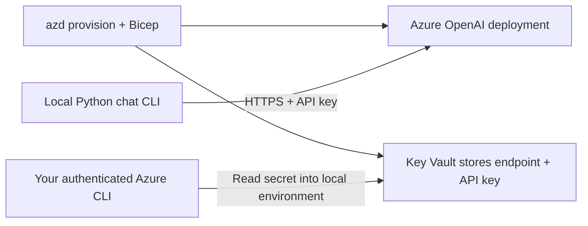

# Azure OpenAI Chat — Vietinė CLI ir AZD infrastruktūra

**Lygis:** Tarpinis · **Laikas:** 35–60 minučių įskaitant diegimą

Šis pavyzdys paruošia **Azure OpenAI resursą ir Key Vault**, tada paleidžia
interaktyvų Python pokalbių CLI **jūsų mašinoje**. Jis nevaldo jokios žiniatinklio programos
ar konteinerių programos. Numatytoji modelio versija yra `gpt-4.1`, versija `2025-04-14`, su
`GlobalStandard` diegimo pajėgumu 20. Patikrinkite dabartinį prieinamumą ir kvotą
pasirinktoje regione prieš diegiant; modelio gyvavimo laiko datos gali keistis.

## Mokymosi tikslai

- Paruošti modelio infrastruktūrą su Bicep ir azd.
- Gauti API raktą iš Key Vault nenustatant jo diegimo išvestyse.
- Siųsti pokalbių užbaigimo užklausas ir išlaikyti pokalbio istoriją.
- Suprasti žetonų skaičių ir kainodaros apribojimų ribas.



Šiame pavyzdyje nėra valdomos tapatybės vykdymo integracijos, daugiaviečio regiono atsarginio veikimo,
pasirinktinio dažnio ribotuvo, srautinio režimo ar valdomos skaičiavimo paslaugos. OpenAI SDK
atlieka iki dviejų pakartotinių bandymų, jei įvyksta pakartotiniai klaidų atvejai; CLI praneša apie likusias klaidas.

## Prieš sąlygos

- Dabartinė stabili [azd](https://learn.microsoft.com/azure/developer/azure-developer-cli/install-azd)
  (žiūrėjimo metu išleista versija: 1.37.2).
- [Azure CLI](https://learn.microsoft.com/cli/azure/install-azure-cli).
- Python **3.10+** (rekomenduojama 3.11) ir virtuali aplinka.
- Azure prenumerata su leidimu kurti Cognitive Services ir Key Vault
  išteklius, diegti modelius ir skaityti raktų saugyklos slaptažodžius.
- Regioninė prieinamumo ir `GlobalStandard` kvota `gpt-4.1`. Prieigos reikalavimai
  priklauso nuo prenumeratos ir funkcijos; nėra garantuoto patvirtinimo laiko.

```bash
azd version
az version
python --version
azd auth login
az login
```

Tai atskiros autentifikacijos sesijos. Pasirinkite tą pačią prenumeratą abiejuose
įrankiuose prieš paleidžiant žemiau esančias komandas.

## Greitas pradėjimas (Bash)

Paleiskite iš saugyklos šaknies:

```bash
cd examples/azure-openai-chat
azd env new myopenai
azd provision
```

Pasirinkite palaikomą regioną. Diegimas sukuria išteklių grupę, OpenAI paskyrą,
modelio diegimą, Key Vault ir `openai-endpoint`/`openai-api-key` slaptažodžius.
Nėra **jokių paslaugų, kurias reikėtų diegti** `azure.yaml`.

Įkelkite neslaptažodinius išvedimus ir gaukite slaptažodį į savo dabartinę komandų eilutę:

```bash
export AZURE_OPENAI_ENDPOINT="$(azd env get-value AZURE_OPENAI_ENDPOINT)"
export AZURE_OPENAI_MODEL="$(azd env get-value AZURE_OPENAI_MODEL)"
KV_NAME="$(azd env get-value AZURE_KEY_VAULT_NAME)"
export AZURE_OPENAI_API_KEY="$(az keyvault secret show \
  --vault-name "$KV_NAME" --name openai-api-key --query value --output tsv)"

python -m venv .venv
source .venv/bin/activate
python -m pip install -r src/requirements.txt
python src/chat.py
```

PowerShell aktyvuokite su `.\.venv\Scripts\Activate.ps1` ir priskirkite aplinkos
kintamuosius su `$env:AZURE_OPENAI_ENDPOINT = azd env get-value AZURE_OPENAI_ENDPOINT`
(ir panašiai su modeliu). Gaukite API raktą naudodami
`$env:AZURE_OPENAI_API_KEY = az keyvault secret show --vault-name $KV_NAME --name openai-api-key --query value -o tsv`.
Pirmiausia nustatykite `$KV_NAME = azd env get-value AZURE_KEY_VAULT_NAME`.

Nespausdinkite, neskelbkite ir neklijuokite API rakto į problemų ataskaitas. CLI skaito proceso
aplinkos kintamuosius; jis **nenuskaitys** Key Vault slaptažodžių ar neįkels `.env` failų.
`config.py` patikrina galinį tašką, žetonų ribą ir temperatūrą paleidimo metu.

Tikėtinas išvestis (turinys ir panaudojimas skiriasi):

```text
Azure OpenAI Chat Application
Model: gpt-4.1
...
You: Say hello in one sentence.
Assistant: Hello! How can I help you today?
[Tokens: ... | Cost: $...]
```

Komandos: `stats` rodo sumas, `clear` išvalo pokalbio istoriją, o
`quit`/`exit` baigia sesiją. Nėra komandų `--stream`, `--show-tokens`, `tokens`,
ar `cost`.

## Patikrinkite diegimą

Po aukščiau užkeltų komandų:

```bash
curl --fail-with-body \
  "${AZURE_OPENAI_ENDPOINT%/}/openai/deployments/${AZURE_OPENAI_MODEL}/chat/completions?api-version=2024-10-21" \
  -H "Content-Type: application/json" \
  -H "api-key: $AZURE_OPENAI_API_KEY" \
  -d '{"messages":[{"role":"user","content":"Say hello!"}],"max_tokens":50}'

az keyvault secret list --vault-name "$KV_NAME" --query "[].name" -o table
```

Sėkmė: API grąžina HTTP 200 su `choices[0].message.content` ir `usage`;
saugykla rodo `openai-api-key` ir `openai-endpoint`. Sėkmingas ARM diegimas
vienas neužtikrina inferencijos patikrinimo.

## Failai ir konfigūracija

```text
azure.yaml                         # Infrastructure-only AZD project
infra/main.bicep                   # Subscription deployment
infra/main.parameters.json         # Environment, location, principal ID
infra/resources/openai.bicep       # Account + model
infra/resources/keyvault.bicep     # Vault + deploying user's secret access policy
infra/resources/secrets.bicep      # Writes secrets, no key output
src/chat.py                        # Interactive CLI
src/config.py                      # Environment validation
src/requirements.txt               # Python packages
```

Norėdami pakeisti paruoštą modelį/versiją/pajėgumą, redaguokite numatytuosius nustatymus
`infra/main.bicep` ir paleiskite `azd provision`. Nustatant `AZURE_OPENAI_MODEL` savo
komandų eilutėje pasirenkama tik **egzistuojančio diegimo pavadinimas**; modelis nebus diegiamas iš naujo.

| Vykdymo kintamasis | Numatytoji reikšmė / šaltinis |
|---|---|
| `AZURE_OPENAI_ENDPOINT` | Privalomas; azd neslaptažodinis išvestis |
| `AZURE_OPENAI_API_KEY` | Privalomas; gaunamas iš Key Vault |
| `AZURE_OPENAI_MODEL` | `gpt-4.1`; Azure diegimo pavadinimas |
| `AZURE_OPENAI_MAX_TOKENS` | 800 (patvirtinimo diapazonas 1–4096) |
| `AZURE_OPENAI_TEMPERATURE` | 0.7 (diapazonas 0–2) |
| `AZURE_OPENAI_INPUT_PRICE_PER_1K` | 0.002 USD; iliustracinis necache'inamas įvesties tarifas |
| `AZURE_OPENAI_OUTPUT_PRICE_PER_1K` | 0.008 USD; iliustracinis išvesties tarifas |

## Išlaidos ir saugumo apribojimai

Kainos rodymas yra **įvertinimas**, ne Azure sąskaita. Jis dauginamas API žetonų
naudojimą pagal nustatytus tarifus ir neatsižvelgia į cache'inimo nuolaidas,
regioninius/SKU skirtumus, mokesčius, kainų pokyčius ar nesėkmingus/perkrautus kvietimus.
Pakeiskite **abu tarifus**, kai naudojate kitą modelį ar SKU, ir patikrinkite dabartines
[Azure OpenAI kainas](https://azure.microsoft.com/pricing/details/cognitive-services/openai-service/).

Iliustracijai, 100 užklausų, naudojant kiekvienos po 500 necache'intų įvesties ir 200 išvesties žetonų,
pagal numatytus tarifus kainuoja `100 × (500/1000 × .002 + 200/1000 × .008) = $0.26`.
Key Vault operacijos/laikymas patiria atskirus mokesčius. Ši vietinė CLI neturi fiksuoto $50/mėn
mokesčio ir šablone nėra valdomos skaičiavimo paslaugos.

Saugykla naudoja prieigos politiką diegimo pagrindui; tai nėra RBAC ar
valdomos tapatybės programos pavyzdys. Viešieji galiniai taškai ir API raktų autentifikacija
naudojami mokymuisi. Apribokite leidimus ir pridėkite tinkamus tapatybės/tinklų
valdiklius prieš adaptuojant jį gamybai.

## Praktinės užduotys

### 1. Patikrinkite kontekstą ir išvalykite jį

**Pradžia:** paleistas CLI. **Tikslas:** stebėti istoriją.
Pasakykite „Prisimink žodį kedras“, tada paklauskite „Kokį žodį paprašiau prisiminti?“
Paleiskite `stats`; du sėkmingi pokalbiai turėtų būti laikomi dviem perduotais pranešimais.
Paleiskite `clear` ir `stats`; perduotų pranešimų turėtų būti nulis (žetonų sumos lieka).
Modelio tikslios formuluotės nėra deterministinės.

### 2. Pakeiskite atsako ribą

**Pradžia:** išeikite iš CLI, naudodami tą pačią komandų eilutę.
Paleiskite `export AZURE_OPENAI_MAX_TOKENS=100`, perkraukite `python src/chat.py` ir paprašykite
trumpą paaiškinimą apie azd. Patikrinkite, ar baneryje rodomas 100.
Atstatykite su `unset AZURE_OPENAI_MAX_TOKENS`. Mažesnė atsako riba nesumažina jau išsiųstų istorijos žetonų.


  pakartokite eksporto veiksmus. Naujo terminalo reikia vėl nustatyti.
- **403 klaida skaitant Key Vault:** patikrinkite Azure CLI prenumeratą/prisijungimą ir pagrindą
  Key Vault prieigos politikoje. Politikos pakeitimams gali užtrukti kol išplis.
- **404 inferencija:** patikrinkite diegimo pavadinimą, galinį tašką ir būseną.
- **429 inferencija:** palaukite kol pasikeis dažnio ribos; patikrinkite regioninę modelio kvotą.
- **429 sprendimas:** palaukite, kol atsistatys greičio ribos; patikrinkite regioninį modelio kvotą.
  CLI pašalina nepavykusias užklausas iš istorijos, todėl pakartotiniai bandymai jų nedubliuoja.
- **Konteksto ilgis:** pavyzdys netrumpina ilgų pokalbių; naudokite `clear`.
- **Modelis nepasiekiamas/panaikintas:** pasitikrinkite dabartinį modelio prieinamumą ir atnaujinkite
  modelio/versijos/SKU nustatymus kartu; API versija ir modelio versija yra skirtingi nustatymai.

## Valymas ir tolesni veiksmai

```bash
azd down
unset AZURE_OPENAI_API_KEY
```

Key Vault minkštojo ištrynimo laikotarpis yra septynios dienos; naikinimui reikalingos atskiros teisės.
Nėra įsipareigoto testų rinkinio; nevykdykite neegzistuojančios `pytest tests/` komandos.
Prieš plečiant kodą pridėkite imituotus API testus.

[Konteinerių pavyzdžiai](../../../../examples/container-app) · [Mažmeninės prekybos architektūros planas](../retail-scenario.md) ·
[Kurso pradžia](../../README.md) · [Pranešti apie problemą](https://github.com/microsoft/AZD-for-beginners/issues)

---

<!-- CO-OP TRANSLATOR DISCLAIMER START -->
**Atsakomybės apribojimas**:
Šis dokumentas buvo išverstas naudojant dirbtinio intelekto vertimo paslaugą [Co-op Translator](https://github.com/Azure/co-op-translator). Nors siekiame tikslumo, prašome atkreipti dėmesį, kad automatiniai vertimai gali turėti klaidų ar netikslumų. Originalus dokumentas jo gimtąja kalba laikomas autoritetingu šaltiniu. Svarbiai informacijai rekomenduojama naudoti profesionalų žmogiškąjį vertimą. Mes neatsakome už jokius nesusipratimus ar neteisingą interpretaciją, kilusią naudojantis šiuo vertimu.
<!-- CO-OP TRANSLATOR DISCLAIMER END -->