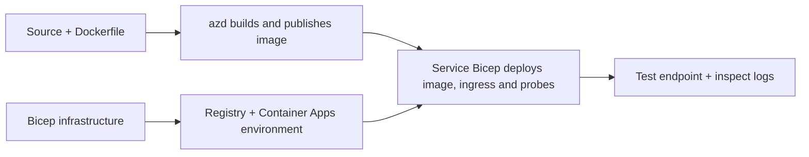

# Konteinerinių programų diegimo pavyzdžiai su AZD

Šiame kataloge yra du mokomieji pavyzdžiai su šaltinio kodu, Dockerfile'ais,
Bicep infrastruktūra ir `azure.yaml`. Nei vienas nėra paruoštas gamybai.

## Pasirinkite pavyzdį

| Pavyzdys | Ką įgyvendina | Išankstinės sąlygos |
|---|---|---|
| [Paprasčiausia Flask API](../../../../examples/container-app/simple-flask-api) | Vienas Python CRUD API, atminties elementai, sveikatos tikrinimo užklausos, HTTP mastelio keitimas | Pagrindinės CLI ir HTTP žinios |
| [Dvieju paslaugų mikroservisai](../../../../examples/container-app/microservices) | Node.js vartai, vidinė tik skaitymui skirta Python produktų paslauga, telemetrija ir mastelio keitimas | Pirmiausia baigti vienos paslaugos pavyzdį |

Skirkite 30–60 minučių, įskaitant diegimą ir tikrinimą. „Azure“ teikimo laikai gali skirtis.

## Išankstinės sąlygos

- [Azure kūrėjo CLI](https://learn.microsoft.com/azure/developer/azure-developer-cli/install-azd)
- [Azure CLI](https://learn.microsoft.com/cli/azure/install-azure-cli) patikros komandoms
- Docker ir jo demonas, veikiantis konteinerių vaizdų kūrimui
- „Azure“ prenumerata su teise kurti išteklius ir pakankamu regioniniu kvotu
- Bash apvalkalui, arba atitinkamos PowerShell komandos

```bash
azd version
az version
docker info
azd auth login
az login
```

Šios dvi priemonės turi atskiras prisijungimo sesijas. Naudokite naujausią stabilią azd versiją; peržiūros metu šiuo metu
paskelbta versija yra 1.37.2. Senesni minimalaus versijos reikalavimai nėra
suderinamumo garantija.

## Greitas pradėjimas

Iš saugyklos šaknies:

```bash
cd examples/container-app/simple-flask-api
azd env new flask-demo
azd up
API_URL=$(azd env get-value API_ENDPOINT)
curl --fail-with-body "${API_URL}/health"
```

Laukiama: HTTP 200 su `"status": "healthy"`. Sekite pavyzdžio READ.me, kad sukurtumėte,
skaitytumėte, atnaujintumėte ir ištrintumėte elementą bei patikrintumėte žurnalus.



Pradinis teikimas naudoja viešą hello-world vaizdą 80 prievade. Paslaugai skirtuose
Bicep parametro failuose leidžiama `azd deploy` pakeisti jį sukurtu programos vaizdu
ir tinkamu programos prievadu/tikrinimo užklausomis (8000 Flask/produktui, 8080 vartams).
Išlaikykite šiuos failus su jų `azure.yaml` `module` nustatymais.

## Konfigūracija: kas keičia ką

`azure.yaml` parenka šaltinio katalogus, kalbas, prieglobas ir diegimo modulius.
Konteinerio CPU/atmintis, įėjimas, tikrinimo užklausos, kopijų skaičius ir mastelio keitimo taisyklės yra apibrėžtos
Bicep **kalboje**, ne atsitiktinės `resources`, `scale` ar `regions` paslaugų savybės.

`azd env set SOME_VALUE ...` saugo reikšmę lokaliai. Tai keičia tik diegiamą
išteklių, kai parametras, aplinkos susiejimas arba kabliukas aiškiai naudoja tą
reikšmę. Šie pavyzdžiai nenaudoja `MAX_REPLICAS`, `SCALE_TO_ZERO_TIMEOUT`,
`CONTAINER_APP_REPLICA_TYPE` ar pasirinktinių canary nustatymų iš azd aplinkos reikšmių.
Redaguokite atitinkamą Bicep ir paleiskite `azd up`, kad pakartotinai suteiktumėte ir diegtumėte.

Neįdėkite programos šaltinio po `infra/`. `project` turi nurodyti į šaltinio
katalogą, kuriame yra Dockerfile ir priklausomybių manifestas.

## Stebėsena ir kaštai

- `azd monitor --logs` atidaro portalą; tai nėra terminalo žurnalo srautas.
  Naudokite `az containerapp logs show --follow` su tikru ištekliaus pavadinimu.
- Paprasta API rašo stdout žurnalus, surinktus per Container Apps/Log Analytics.
  Jos suteiktas Application Insights išteklius nėra automatiškai instrumentuotas.
- Mikroservisų vartai naudoja Node.js Application Insights SDK; Python
  paslauga eksportuoja programos žurnalų trasas. Pilnas Python užklausų/priklausomybių sekimas
  nėra sukonfigūruotas.
- Skalavimas iki nulio gali sumažinti kompiuterių sąnaudas, bet registro ir žurnalų įvedimas/saugojimas
  vis tiek gali kainuoti pinigų. Mikroservisų numatytieji nustatymai palieka kopijas veikiančias.
  Įvertinkite savo regioną ir naudojimąsi
  [Azure kainų skaičiuoklėje](https://azure.microsoft.com/pricing/calculator/).

## Pažangios schemos – neįtrauktos įgyvendinimų dalys

Tai yra dizaino gairės, ne papildomi vietiniai projektai ar kopijuok-paleisk kodai:

- **Nuolatiniai duomenys ir autentifikacija:** pakeiskite atminties parduotuves ir pridėkite
  Microsoft Entra ID autentifikavimą/įgaliojimą prieš gamybą.
- **Mėlyna-žalia/canary:** naudokite Container Apps kelių revizijų režimą, revizijų
  žymes, srauto svorius, sveikatos patikrą ir atstatymo procedūras.
  Šiuose pavyzdžiuose nėra `deploymentStrategy: canary` azd konfigūracijos.
  Žr. [revizijų valdymas](https://learn.microsoft.com/azure/container-apps/revisions).
- **Daugi Regionų:** sukurkite atskiras aplinkas ir programas Bicep'e bei suprojektuokite
  globalų maršrutizavimą ir duomenų nuoseklumą. Paslaugų `regions` sąrašas nėra azd
  diegimo mechanizmas.
- **Eilės darbininkai:** pridėkite darbininko šaltinį, priklausomybes, eilių išteklius, valdomą
  identitetą su duomenų plokštės vaidmenimis ir autentifikuotą skalavimo taisyklę. Nekopijuokite
  tuščio `src/worker` kelio ir nekvieskite, kad projektas veiktų.
- **Dapr:** paruoškite komponentus, sukonfigūruokite šoninį dėžutę, įdiekite atitinkamą SDK
  ir įgyvendinkite būsenos/pub-sub klaidų tvarkymą.
- **Slaptažodžiai:** naudokite valdomą identitetą ir vaidmenų priskyrimą, kur įmanoma. Vien sukūrus
  Key Vault, programos neprieina prie jo ar negali užkrauti slaptažodžių.

## Išvalymas

Iš pavyzdžių katalogo:

```bash
azd down
```

Peržiūrėkite trynimo patvirtinimus ir patvirtinkite, kad atskirta išteklių grupė pašalinta.
Nenaudokite šių pavyzdžių kaip gamybinės bazės be papildomo projektavimo ir testų.

[Pavyzdžių indeksas](../README.md) · [Kurso pradžia](../../README.md) ·
[Container Apps dokumentacija](https://learn.microsoft.com/azure/container-apps/) ·
[Pranešti apie problemą](https://github.com/microsoft/AZD-for-beginners/issues)

---

<!-- CO-OP TRANSLATOR DISCLAIMER START -->
**Atsakomybės apribojimas**:
Šis dokumentas buvo išverstas naudojant dirbtinio intelekto vertimo paslaugą [Co-op Translator](https://github.com/Azure/co-op-translator). Nors siekiame tikslumo, prašome atkreipti dėmesį, kad automatiniai vertimai gali turėti klaidų ar netikslumų. Originalus dokumentas jo gimtąja kalba laikomas autoritetingu šaltiniu. Svarbiai informacijai rekomenduojama naudoti profesionalų žmogiškąjį vertimą. Mes neatsakome už jokius nesusipratimus ar neteisingą interpretaciją, kilusią naudojantis šiuo vertimu.
<!-- CO-OP TRANSLATOR DISCLAIMER END -->