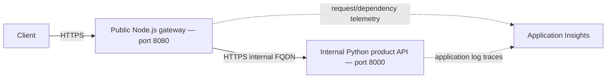

# Dviejų paslaugų mikroservisai — Azure konteinerių programos

**Lygis:** Tarpinis · **Laikas:** 45–60 minučių įskaitant diegimą

Ši mokymosi pavyzdyje įgyvendintas **Node.js API vartų** ir **tik skaitymui skirtos Python
Produkto paslaugos**. Įtraukti šaltiniai, Dockerfailai, Bicep ir azd konfigūracija.
Tai nėra gamybai pritaikyta sistema.

## Ką sužinosite

- Diegti dvi paslaugas nepriklausomai.
- Naudoti vidinį backend FQDN per HTTPS.
- Patikrinti sėkmės, nerasto ir nepasiekiamos paslaugos atsakymus.
- Suprasti telemetriją ir nepriklausomus mastelio ribojimus.



Produkto kataloge yra penki fiksuoti produktai atmintyje. Nėra **POST,
PUT arba DELETE apdorojimo**, duomenų bazės, Service Bus, užsakymų/vartotojų/pranešimų paslaugos,
C# arba Go kodo. Tai ateities plėtros idėjos, neįtrauktos funkcijos.
Vartai neatlieka naudotojų autentifikacijos; vidinis įėjimas nėra programos autorizacijos pakaitalas.


## Prieš pradedant

Pirmiausia užbaikite [vieno Flask API](../../../../../examples/container-app/simple-flask-api).
Įdiekite dabartinę stabilų azd versiją (peržiūros metu paskelbtas leidimas: 1.37.2), Azure CLI,
ir Docker su veikiančiu demonų. Jums reikalinga Azure prenumerata, teisės kurti išteklius,
ir konteinerių programų regioninis kvotas.

```bash
azd version
az version
docker info
azd auth login
az login
```

Naudokite tą pačią prenumeratą abiejuose CLI įrankiuose. Žemiau pateikti komandų pavyzdžiai parašyti Bash.

## Diegimas ir patikrinimas

Iš saugyklos šaknies:

```bash
cd examples/container-app/microservices
azd env new microservices-demo
azd up
GATEWAY_URL=$(azd env get-value API_GATEWAY_URL)
RG_NAME=$(azd env get-value AZURE_RESOURCE_GROUP)
GATEWAY_NAME=$(azd env get-value API_GATEWAY_NAME)
PRODUCT_NAME=$(azd env get-value PRODUCT_SERVICE_NAME)

curl --fail-with-body "${GATEWAY_URL}/health"
curl --fail-with-body "${GATEWAY_URL}/api/products"
curl --fail-with-body "${GATEWAY_URL}/api/products/1"
curl -i "${GATEWAY_URL}/api/products/999"
```

**Sėkmė:** health 200; list 200 su **penkiais** produktais; produktas 1 yra Laptopas
kainuojantis 999,99 su 50 vienetų atsargų; nežinomas produktas grąžina 404.
Aprašymai įtraukti atsakymuose; laiko žymos skiriasi.

Pradinė diegimo stadija naudoja viešai prieinamus hello-world atvaizdus 80 prievade, todėl nemėgina
traukti neegzistuojančių atvaizdų iš tuščios saugyklos. Paslaugai skirtos Bicep moduliai
ir parametrų failai pakeičiami sukurtomis paveikslėliais bei programos prievadais/probomis vykdymo metu
`azd deploy`. Pagrindiniai parametrai išlaiko paskelbtų paveikslėlių pavadinimus tolimesniam paruošimui.

## Paslaugos ir tinklas

| Paslauga | Atidengti galiniai taškai | Numatyti ištekliai |
|---|---|---|
| Vartai | GET `/`, `/health`, `/api/products`, `/api/products/:id` | 1 vCPU, 2 GiB, 2–20 kopijų |
| Produktas | GET `/`, `/health`, `/products`, `/products/<id>` | 0.5 vCPU, 1 GiB, 1–10 kopijų |

Produkto įėjimas turi `external: false` ir `allowInsecure: false`. Bicep įpila
`PRODUCT_SERVICE_URL=https://<actual-internal-fqdn>` į vartus. HTTP būtų
peradresavimas; HTTPS atitinka sukonfigūruotą įėjimą. Trumpas DNS vardas turi atitikti
**tikrą Container App pavadinimą**, o ne loginį paslaugos raktą `product-service`.
Nereikia bandyti tiesiogiai kreiptis į vidinį URL iš savo nešiojamojo kompiuterio.

Vartai turi penkių sekundžių limitą produkto kvietimams. Trūkstami produkto ID
pateikiami kaip 404; transporto nesėkmės/kitos backend klaidos grąžina 503. Vartų
`/health` tik tikrina vartus, o ne backend prieinamumą.

## Failai ir konfigūracija

```text
azure.yaml
infra/main.bicep
infra/main.parameters.json
infra/abbreviations.json
infra/core/container-apps-environment.bicep
infra/core/monitor.bicep
infra/app/api-gateway.bicep
infra/app/api-gateway.parameters.json
infra/app/product-service.bicep
infra/app/product-service.parameters.json
src/api-gateway/{app.js,package.json,Dockerfile}
src/product-service/{main.py,requirements.txt,Dockerfile}
```

Mastelis, CPU/atmintis, prievadai ir probos nustatomi `infra/app/*.bicep`. Pakeiskite
šiuos failus ir paleiskite `azd up`, kad pritaikytumėte infrastruktūrą ir iš naujo paleistumėte. Šiame pavyzdyje nėra
`GATEWAY_MAX_REPLICAS` aplinkos kintamojo parametro.

Tiks kodui skirtų pakeitimų atveju:

```bash
azd deploy product-service
azd deploy api-gateway
```

Node įvaizdis naudoja Node 22; Python įvaizdis naudoja Python 3.11. Abu jungiasi prie
`0.0.0.0`. Įėjimai/probos naudoja atitinkamai prievadus 8080 (vartai) ir 8000 (produktas).

## Vietinis vystymas su Docker

Paleiskite iš šio pavyzdžio katalogo. Naudokite vartotojo apibrėžtą tinklą, **o ne `localhost`,
kad vienas konteineris galėtų pasiekti kitą**:

```bash
docker network create azd-microservices-demo
docker build -t local-product ./src/product-service
docker build -t local-gateway ./src/api-gateway
docker run -d --name azd-product --network azd-microservices-demo local-product
docker run -d --name azd-gateway --network azd-microservices-demo \
  -p 8080:8080 -e PRODUCT_SERVICE_URL=http://azd-product:8000 local-gateway
curl --fail-with-body http://localhost:8080/api/products
```

Laukiama: penki produktai. HTTP naudojamas tik šiam vietiniam Docker tinklui.

```bash
docker stop azd-product azd-gateway
docker rm azd-product azd-gateway
docker network rm azd-microservices-demo
```

## Stebėjimas

```bash
az containerapp logs show --name "$GATEWAY_NAME" --resource-group "$RG_NAME" --follow
# In a separate terminal:
az containerapp logs show --name "$PRODUCT_NAME" --resource-group "$RG_NAME" --tail 100
```

`azd monitor --logs` atidaro portalo vaizdą; nesrautuoja terminalo žurnalų.
Node SDK renka vartų užklausas/priklausomybes. Python `AzureLogHandler`
eksportuoja **žurnalų trasas**, o ne automatinio Flask užklausas, SQL priklausomybes ar pilnas
paskirstytas trasas. OpenCensus yra senstelėjęs SDK; tęsiant šį pavyzdį geriau naudoti Azure Monitor OpenTelemetry.


Application Insights žurnaluose sugeneruokite užklausas ir patikrinkite:

```kusto
requests
| where timestamp > ago(1h)
| where name contains "products"
| summarize RequestCount=count(), AvgDuration=avg(duration) by bin(timestamp, 5m)
```

Python programų žinutėms:

```kusto
traces
| where timestamp > ago(1h)
| where message contains "products"
| project timestamp, message, severityLevel
```

Leiskite įrašymo delsą ir atranką; nesitikėkite tikslaus užklausų skaičiaus ar
garantuoto delsos laiko. Nėra sukonfigūruotų pasirinktinių įspėjimų ar informacinių skydelių.

## Praktiniai užsiėmimai

### Užduotis 1: Keisti katalogą

**Pradinė pozicija:** `src/product-service/main.py`.
**Tikslas:** patikrinti nepriklausomą paslaugos diegimą.
Pakeiskite Laptop atsargas iš 50 į 49 fiksuotame `products` sąraše, paleiskite
`azd deploy product-service`, tada paprašykite `${GATEWAY_URL}/api/products/1`.

**Sėkmės kriterijai / sprendimas:** HTTP 200 su `"stock":49`. Atstatykite 50 ir perkraukite.
**Dažna problema:** redaguojamas gateway, o ne paslauga, kuriai priklauso katalogas.
Tai keičia šaltinio duomenis, ne nuolatinę inventoriaus duomenų bazę.

### Užduotis 2: Patvirtinti kopijos konfigūraciją

**Pradinė pozicija:** `infra/app/product-service.bicep`.
**Tikslas:** stebėti infrastruktūros pasikeitimą be spėjimo apie automatinį mastelį.
Pakeiskite `minReplicas: 1` į `minReplicas: 2`, paleiskite `azd up`, tada:

```bash
az containerapp show --name "$PRODUCT_NAME" --resource-group "$RG_NAME" \
  --query properties.template.scale -o json
```

**Sėkmės kriterijai:** sukonfigūruotas minimumas yra 2, maksimumas lieka 10.
Atstatykite minimumą 1 ir paleiskite `azd up`.
**Dažna problema:** vien `azd deploy` nepakeičia nesusijusios bendros
infrastruktūros. Nesukurkite `maxReplicas` lygų nuliui kaip gedimo simuliacijos.
Tai patvirtina konfigūraciją, ne apkrovos testą ar garantuotą momentinį kopijų skaičių.

### Užduotis 3: Išbandyti nėra-paslaugos valdymą lokaliai

**Pradinė pozicija:** abu aukščiau esantys vietiniai Docker konteineriai veikia.
**Tikslas:** atskirti backend gedimą nuo trūkstamo produkto.
Sustabdykite tik produkto konteinerį:

```bash
docker stop azd-product
curl -i http://localhost:8080/api/products
docker start azd-product
curl --fail-with-body http://localhost:8080/api/products
```

**Sėkmės kriterijai:** sustabdžius gateway grąžina 503 su
`"error":"Product service unavailable"`; po perkrovimo sąrašas grąžina 200.
Pakartokite po trumpo paleidimo delsos, jei reikia.
**Dažna problema:** gateway sustabdymas tikrina kitą klaidą (nėra HTTP atsako).

## Išlaidos ir gamybos spragos

Numatyti minimalūs replikų skaičiai palaiko veikiančią skaičiavimo dalį. Registras ir stebėjimas taip pat sukelia
išlaidas. Nėra patvirtintos fiksuotos 50 $/mėn sumos: įvertinkite regioninį CPU/atmintį,
replikų valandas, užklausas, registrą ir žurnalų saugojimą
[Azure kainų skaičiuoklėje](https://azure.microsoft.com/pricing/calculator/).
Išmoktas resursus ištrinkite operatyviai.

Gamybos darbe yra autentifikacija/autorizacija, aprėpties valdomos tapatybės,
nuolatiniai duomenys, įvesties/atsako tikrinimas, palaikoma stebimumo instrumentacija,
apkrovos/gedimų testavimas, CI/CD, įspėjimai ir atkūrimo procedūros. Užsakymo
paslaugos, eilės ar duomenų bazės pridėjimas yra atskiras įgyvendinimo uždavinys, nebaigtas
pratimas ar jau čia pasiekiama funkcija.

## Gedimų šalinimas ir valymas

- **Paveikslėlis nerastas pirmojo tiekimo metu:** bootstrap turi naudoti viešą vaizdą;
  patikrinkite pagrindinius vaizdo parametro numatytuosius nustatymus ir diegimo modulių žemėlapius.
- **503 produktai:** patikrinkite produkto žurnalus, vaizdo reviziją ir įterptą vidinį HTTPS URL.
- **404 netikėtas kelias:** produkto API yra tik skaitymui; patikrinkite maršrutą, o ne neegzistuojantį CRUD tvarkytoją.
- **Nėra telemetrijos:** patikrinkite vykdymo laiką jungtis be jų atskleidimo ir
  leiskite įrašymo delsa. Python užklausų lentelės neužpildomos jo žurnalų tvarkyklės.

Iš šio pavyzdinio katalogo:

```bash
azd down
```

Peržiūrėkite ištrynimo raginimus ir įsitikinkite, kad skirtas resursų grupė pašalinta.

[Ankstesnis: Flask API](../../../../../examples/container-app/simple-flask-api) · [Tolimesnis: Duomenų bazės programa](../../../../../examples/database-app) ·
[AI vystymas](../../../docs/chapter-02-ai-development/README.md) ·
[Kurso pradžia](../../../README.md) · [Pranešti apie problemą](https://github.com/microsoft/AZD-for-beginners/issues)

---

<!-- CO-OP TRANSLATOR DISCLAIMER START -->
**Atsakomybės apribojimas**:
Šis dokumentas buvo išverstas naudojant dirbtinio intelekto vertimo paslaugą [Co-op Translator](https://github.com/Azure/co-op-translator). Nors siekiame tikslumo, prašome atkreipti dėmesį, kad automatiniai vertimai gali turėti klaidų ar netikslumų. Originalus dokumentas jo gimtąja kalba laikomas autoritetingu šaltiniu. Svarbiai informacijai rekomenduojama naudoti profesionalų žmogiškąjį vertimą. Mes neatsakome už jokius nesusipratimus ar neteisingą interpretaciją, kilusią naudojantis šiuo vertimu.
<!-- CO-OP TRANSLATOR DISCLAIMER END -->