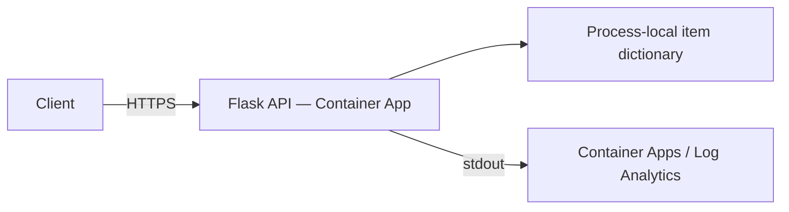

# Paprasta Flask API — Azure Container Apps

**Lygis:** Pradedantysis · **Laikas:** 30–45 minutės įskaitant diegimą

Diegkite Python Flask CRUD API su Azure Developer CLI (azd). Šaltiniai, Dockerfile,
Bicep ir diegimo parametrai įtraukti. Tai yra **mokymosi pavyzdys**, o ne
gamybinės aplinkos API.

## Ko išmoksite

- Sukurti ir publikuoti konteinerį per azd.
- Konfigūruoti įeinančius srautus ir gyvybingumo/pasirengimo patikrinimus.
- Patikrinti CRUD atsakymus ir peržiūrėti programos žurnalus.
- Suprasti, kodėl duomenys atmintyje nėra tinkami patvariosioms programoms.



**Svarbu:** elementai saugomi viename procese. Numatytoji reikšmė yra **vienas Gunicorn darbininkas,
0–1 replikos**, sąmoningai vengiant nekonsistentiškų duomenų tarp darbininkų/replikų.
Elementai prarandami perkrovus, pakeitus versiją arba sumažinus mastelį iki nulio. Replikų didinimas
reikalauja bendros nuolatinės atminties. API neturi autentifikacijos ar autorizacijos.

## Prieš sąlygos

- [Dabartinė stabili azd versija](https://learn.microsoft.com/azure/developer/azure-developer-cli/install-azd)
  (peržiūros metu išleista versija: 1.37.2).
- [Azure CLI](https://learn.microsoft.com/cli/azure/install-azure-cli) patikrinimui.
- Veikiantis Docker su savo demonų; reikalinga numatytajam vietiniam vaizdo kūrimui.
- Azure prenumerata, leidimai kurti išteklius ir Container Apps regiono kvota.
- Bash komandoms žemiau (arba atitinkamas PowerShell).
- Python 3.11 pasirenkamam vietiniam kūrimui.

```bash
azd version
az version
docker info
azd auth login
az login
```

CLI įrankiai turi atskiras prisijungimo sesijas. Abu naudokite tą pačią prenumeratą.

## Greitas pradžia

Iš saugyklos šaknies katalogo:

```bash
cd examples/container-app/simple-flask-api
azd env new flask-demo
azd up
API_URL=$(azd env get-value API_ENDPOINT)
RG_NAME=$(azd env get-value AZURE_RESOURCE_GROUP)
API_NAME=$(azd env get-value API_NAME)
curl --fail-with-body "${API_URL}/health"
```

Laukiamas rezultatas: HTTP 200 ir JSON su `"status":"healthy"`,
`"service":"simple-flask-api"` ir dabartiniu UTC laiku.
Diegimas ir vaizdo kūrimas paprastai trunka keletą minučių; laikas gali skirtis.

Pradinio diegimo metu naudojamas viešas hello-world vaizdas, klausantis 80 prievado.
`azure.yaml` parenka `infra/app/api.bicep` ir jo atitinkamą parametrų failą
paslaugos diegimui, kas perjungia vaizdą, įeinančius srautus ir patikrinimus į 8000 prievadą.
Šių diegimo parametrų naikinti negalima.

## Patikrinkite CRUD

Vykdykite šią seką, kai aktyvi ta pati replika:

```bash
# Create: HTTP 201; note the returned id (1 for a fresh process).
curl -i -X POST "${API_URL}/api/items" \
  -H "Content-Type: application/json" \
  -d '{"name":"Test Item","description":"My first item"}'

# Read list: HTTP 200, total 1 in a fresh process.
curl --fail-with-body "${API_URL}/api/items"

# Replace 1 if your create response returned another id.
curl --fail-with-body "${API_URL}/api/items/1"
curl -i -X PUT "${API_URL}/api/items/1" \
  -H "Content-Type: application/json" -d '{"name":"Updated Item"}'
curl -i -X DELETE "${API_URL}/api/items/1"
curl -i "${API_URL}/api/items/1"
```

Sėkmė: POST 201, skaitymas/PUT 200, DELETE 204 be turinio, tada neegzistuojantis elementas 404.
Netinkamai suformuotas/non-objektinis JSON arba tuščias pavadinimas grąžina 400.
Jei elementas dingsta tarp užklausų, tikrinkite dėl perkrovimo ar mastelio sumažinimo iki nulio;
tai sąmoninga atminties ribojimas, o ne nuolatinis saugojimas.

| Galinis taškas | Metodai |
|---|---|
| `/` | GET — paslaugos informacija |
| `/health` | GET — gyvybingumo/pasirengimo patikrinimai |
| `/api/items` | GET, POST |
| `/api/items/{id}` | GET, PUT, DELETE |

## Žurnalai ir konfigūracija

```bash
az containerapp logs show --name "$API_NAME" --resource-group "$RG_NAME" --follow
```

Laukiamas rezultatas: Gunicorn paleidimas, užklausų prieigos žurnalai ir programos pranešimai.
`azd monitor --logs` atidaro portalo vaizdą; jis neatlieka srauto į terminalą.
Application Insights yra paruoštas, bet **šis Flask kodas jo neprižiūri**;
naudokite Container Apps/Log Analytics stdout žurnalams.

Redaguokite `infra/app/api.bicep` dėl CPU/atminties, replikų ribų ar mastelio taisyklių, tada
paleiskite `azd up`. Numatytoji reikšmė yra 0.5 vCPU, 1 GiB, minimum 0 / maksimum 1 replika ir
HTTP slenkstis 50 vienalaikių užklausų. Mastelio sumazinimas iki nulio gali pridėti šalto paleidimo delsą.

Bet kokios `azd env set MAX_REPLICAS`, `API_KEY`, `LOG_LEVEL` ar
`SCALE_TO_ZERO_TIMEOUT` reikšmės **nėra susietos su šia šablonu ar programa**.
Reikšmės nustatymas automatiškai jos nepadaro aplinkos kintamuoju vykdymo metu.
Vaizdas aiškiai naudoja 8000 prievadą; keisdami prievadą, atnaujinkite Dockerfile, Bicep įėjimą ir patikrinimus
kartu.

## Failai

```text
azure.yaml
infra/main.bicep
infra/main.parameters.json
infra/app/container-apps.bicep       # Environment, registry, monitoring
infra/app/api.bicep                  # App, ingress, probes, scale settings
infra/app/api.parameters.json        # Image and resource values for azd deploy
src/app.py
src/Dockerfile
src/requirements.txt
```

## Vietinis kūrimas

Iš šio pavyzdžio katalogo:

```bash
python -m venv .venv
source .venv/bin/activate  # PowerShell: .\.venv\Scripts\Activate.ps1
python -m pip install -r src/requirements.txt
python src/app.py
```

Kitame terminale išbandykite `http://localhost:8000/health` ir CRUD galinius taškus.
Arba sukurkite ir paleiskite tikrąjį vaizdą:

```bash
docker build -t flask-api:local ./src
docker run --rm -p 8000:8000 flask-api:local
```

Po pirmo diegimo tik kodo pakeitimams paleiskite `azd deploy api`.
Bicep pakeitimams, paleiskite `azd up`, kad perkurtumėte ir įdiegtumėte.

## Praktinės užduotys

### 1. Patvirtinkite įvesties atmetimą

**Pradinė pozicija:** įdiegta API, `API_URL` aukščiau.
**Tikslas:** patikrinti, kad API atmeta netinkamus JSON formatus ir trūkstamus pavadinimus.

```bash
curl -i -X POST "${API_URL}/api/items" \
  -H "Content-Type: application/json" -d '[]'
curl -i -X POST "${API_URL}/api/items" \
  -H "Content-Type: application/json" -d '{"name":""}'
```

**Sėkmės kriterijus / sprendimas:** abu grąžina 400 su JSON klaida, o ne 500.
**Dažnos problemos:** JSON turinio tipo antraštės praleidimas.

### 2. Pridėkite tik skaitymo versijos galinį tašką

**Pradinė pozicija:** `src/app.py`. **Tikslas:** išplėsti ir iš naujo diegti API.
Pridėkite tai prieš `if __name__ == '__main__':` bloką:

```python
@app.route('/version', methods=['GET'])
def version():
    return jsonify({'version': '1.0.0'})
```

Paleiskite `azd deploy api`, tada `curl --fail-with-body "${API_URL}/version"`.
**Sėkmės kriterijus:** HTTP 200 ir `{"version":"1.0.0"}`.
**Dažna problema:** maršruto įrašymas po blokuojančio `app.run()` kvietimo testuojant su
`python src/app.py`.

### Žinių patikra

Kodėl vienas darbininkas nepakankamas patvariems duomenims? Nes net vienas procesas praranda
savo žodyną perkrovus. Gamybinė versija reikalauja nuolatinės bendros atminties,
autentifikacijos, autorizacijos, migracijų, testų ir operacijų stebėjimo.

## Išlaidos ir trikčių šalinimas

Tai nėra garantuotas 0 $ diegimas: Basic registras bei žurnalų saugojimas/įsisavinimas
gali generuoti mokesčius net kai programos skaičiavimo ištekliai yra nuliniai. Naudokite
[kainų skaičiuoklę](https://azure.microsoft.com/pricing/calculator/) savo regionui.

- **Docker kūrimo klaida:** patikrinkite `docker info`, tinklo prieigą ir priklausomybes.
- **Nesveika programa:** peržiūrėkite konsolės/sistemos žurnalus ir patikrinkite vaizdo prievadą, įeinančius srautus,
  bei patikrinimus. Vietoje esančio Flask prievado negalima tikrinti.
- **403/leidimai:** patikrinkite prenumeratos ir išteklių kūrimo leidimus.
- **Elementai dingsta:** atminties būsena iš naujo nustatoma perkrovimo/mastelio sumažinimo iki nulio metu; pridėkite duomenų bazę,
  kad įgyvendintumėte patvarų elgesį.

## Valymas ir tolimesni žingsniai

```bash
azd down
```

Peržiūrėkite ištrynimo patvirtinimą ir įsitikinkite, kad speciali išteklių grupė pašalinta.
Nenaudokite destruktyvaus valymo išteklių grupei, kurioje yra nesusijusių duomenų.

[Toliau: Duomenų bazės programa](../../../../../examples/database-app) · [Mikropaslaugos](../../../../../examples/container-app/microservices) ·
[Konteinerių apžvalga](../README.md) · [Kurso pradžia](../../../README.md) ·
[Pranešti apie problemą](https://github.com/microsoft/AZD-for-beginners/issues)

---

<!-- CO-OP TRANSLATOR DISCLAIMER START -->
**Atsakomybės apribojimas**:
Šis dokumentas buvo išverstas naudojant dirbtinio intelekto vertimo paslaugą [Co-op Translator](https://github.com/Azure/co-op-translator). Nors siekiame tikslumo, prašome atkreipti dėmesį, kad automatiniai vertimai gali turėti klaidų ar netikslumų. Originalus dokumentas jo gimtąja kalba laikomas autoritetingu šaltiniu. Svarbiai informacijai rekomenduojama naudoti profesionalų žmogiškąjį vertimą. Mes neatsakome už jokius nesusipratimus ar neteisingą interpretaciją, kilusią naudojantis šiuo vertimu.
<!-- CO-OP TRANSLATOR DISCLAIMER END -->