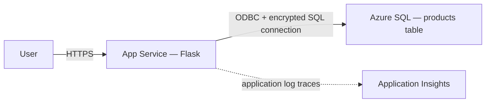

# Flask ir Azure SQL „App Service“

**Lygis:** Tarpinis · **Laikas:** 30–60 minučių įskaitant išankstines sąlygas

Šiame pavyzdyje diegiama Python Flask skaitymo API į **Linux App Service** ir Basic
Azure SQL duomenų bazę. Įtraukti šaltiniai, Bicep ir azd konfigūracija. Tai
mokomoji programa, o ne gamybinio lygio duomenų bazės architektūra.

## Ko išmoksite

- Skirti App Service, SQL ir stebėjimo išteklius su Bicep.
- Konfigūruoti užšifruotą SQL ryšį neįrašant prisijungimo duomenų.
- Inicializuoti schemą prieš pradedant Gunicorn darbininkus.
- Patikrinti įleistas duomenis, neaptikto atsakymus ir duomenų bazės būklę.



Ištekliai: specialus išteklių grupė, B1 Linux App Service planas, Python 3.11 Web
programa, SQL serveris ir Basic 2-GB duomenų bazė, Application Insights ir Log Analytics.
Web programa naudoja **šaltinio / ZIP diegimą ir Oryx priklausomybių įdiegimą**;
`azd deploy` nekompiliuoja ar nediegia pasirenkamo Dockerfile.

## Išankstinės sąlygos

- Dabartinė stabili [azd](https://learn.microsoft.com/azure/developer/azure-developer-cli/install-azd)
  (peržiūros metu išleista versija: 1.37.2).
- [Azure CLI](https://learn.microsoft.com/cli/azure/install-azure-cli) patikrinimui.
- Azure prenumerata, leidimai kurti išvardytus išteklius ir regioninė kvota.
- Python **3.11** vietinei plėtrai; įsipareigota `pyodbc==5.0.1` gali reikalauti
  natyvinių įrankių kompiliavimui naujesnėse Python versijose.
- Microsoft ODBC Driver 18 (arba 17) SQL Server vietiniams kompiuteriams. `pip install
  pyodbc` neįdiegia sistemos tvarkyklės. Žr.
  [ODBC diegimą](https://learn.microsoft.com/sql/connect/odbc/download-odbc-driver-for-sql-server).
- Docker naudojamas tik jei bandomas pasirenkamas konteineris vietoje.

```bash
azd version
az version
azd auth login
az login
```

Naudokite tą pačią prenumeratą abiejuose įrankiuose. Toliau pateikti komandos naudojant Bash.

## Diegimas

Iš saugyklos šaknies:

```bash
cd examples/database-app
azd env new sql-demo
azd provision
azd deploy
WEB_URL=$(azd env get-value WEB_APP_URI)
WEB_NAME=$(azd env get-value WEB_APP_NAME)
RG_NAME=$(azd env get-value AZURE_RESOURCE_GROUP)
```

Pasirinkite palaikomą regioną. `sqlAdminLogin` pagal numatytuosius nustatymus yra `sqladmin`; reikalingas
`sqlAdminPassword` yra saugus parametras. Vykstant prašymui pateikite stiprų slaptažodį.
Nenusiųskite diegimo prisijungimo duomenų į Git ar klaidų ataskaitas. Dabartinis ryšio
eilutės interpolavimas tikisi slaptažodžio be jungčių eilutės skyriklių, tokių
kaip `;`; prieš naudojant tokius reikšmes adaptuokite pabėgimą.

Bicep nustato paleidimo komandą, kuri vykdo `init_database()` **prieš** pradedant Gunicorn darbininkams.
Tai yra būtina, nes importuojant `app:app` neįvykdomas
Python `if __name__ == '__main__'` blokas. Naujoje duomenų bazėje inicializacija
sukuria `products` ir įrašo penkis įrašus. Tai paprastas mokomasis įdėjimas, o ne
vienalaikis migracijos karkasas; naudokite tinkamas migracijas prieš išplėsdami egzempliorius.

Programa pasirenka įdiegtą Microsoft ODBC Driver 18, tada 17, jei ryšio
eilutėje aiškiai nėra nurodytas tvarkyklės pavadinimas. Jei nė viena neegzistuoja, paleidimas nepavyksta su
veiksmine diegimo klaida. Patikrinkite tvarkyklės prieinamumą savo pasirinktoje
App Service vykdymo aplinkoje, o ne spėliokite.

## Patikrinimas

```bash
curl --fail-with-body "${WEB_URL}/"
curl --fail-with-body "${WEB_URL}/health"
curl --fail-with-body "${WEB_URL}/products"
curl --fail-with-body "${WEB_URL}/products/1"
curl -i "${WEB_URL}/products/999"
```

Tikėtasi:

- `/` pateikia galinio taško informaciją.
- `/health` pateikia 200 su `{"status":"healthy","database":"connected"}`.
- `/products` pateikia penkis įdėtus produktus švarioje duomenų bazėje.
- `/products/1` pateikia nešiojamą kompiuterį su kaina 1299.99.
- Neegzistuojantis produktas pateikia 404 su `{"error":"Product not found"}`.

API yra tik skaitymui. Nėra POST/PUT/DELETE maršrutų ar naršyklės sąsajos.
Duomenų bazės ryšio klaida pateikia 503 iš `/health`; tai nėra sėkmė.

## Failai ir konfigūracija

```text
azure.yaml                         # Python App Service source deployment
infra/main.bicep
infra/main.parameters.json
infra/abbreviations.json
infra/resources/sql-server.bicep
infra/resources/sql-database.bicep
infra/resources/app-service-plan.bicep
infra/resources/web-app.bicep       # Settings + initialization/startup command
infra/resources/app-insights.bicep
src/web/app.py
src/web/requirements.txt
src/web/Dockerfile                 # Optional local container, not the azd target
.env.sample
```

`SQL_CONNECTION_STRING` perduodamas kaip saugus Bicep parametras Web App moduliui
ir saugomas App Service nustatymuose, o ne diegimo išvestyse.
`APPLICATIONINSIGHTS_CONNECTION_STRING` konfigūruoja žurnalo eksportą.
`SCM_DO_BUILD_DURING_DEPLOYMENT=true` įjungia serverio priklausomybių įdiegimą.
Savavališki `azd env` nustatymai automatiškai nekeičia programos nustatymų.

SQL ugniasienės `0.0.0.0` taisyklė leidžia ryšius iš **Azure paslaugų,
įskaitant kitų klientų prenumeratas**, su sąlyga, kad yra SQL autentifikacija. Tai
nėra apribota tik šiai programai ar prenumeratai. SQL viešojo tinklo prieiga įjungta.
Naudokite tinklinimą ribotame tinkle ir neadmino programos tapatybę prieš gamybą.

## Vietinė plėtra

Naudokite Python 3.11 ir įdiegtą Microsoft SQL ODBC tvarkyklę:

```bash
python -m venv .venv
source .venv/bin/activate  # PowerShell: .\.venv\Scripts\Activate.ps1
python -m pip install -r src/web/requirements.txt
export SQL_CONNECTION_STRING='Server=tcp:YOUR_SERVER.database.windows.net,1433;Database=YOUR_DATABASE;UID=YOUR_USER;PWD=YOUR_PASSWORD;Encrypt=yes;TrustServerCertificate=no;Connection Timeout=30;'
python src/web/app.py
```

Pakeiskite laikinus simbolius saugiai. Nukopijuotas `.env` failas **nesikrauna automatiškai**
šioje programoje. Vietoje to eksportuokite kintamuosius savo dabartinėje aplinkoje.
Azure SQL iš nešiojamojo leidinio laikinai leiskite tik savo viešąjį IP:

```bash
SQL_SERVER=$(azd env get-value SQL_SERVER_NAME)
MY_IP=YOUR_PUBLIC_IP
az sql server firewall-rule create -g "$RG_NAME" -s "$SQL_SERVER" \
  -n AllowMyLearningIP --start-ip-address "$MY_IP" --end-ip-address "$MY_IP"
```

Pašalinkite taisyklę po testavimo:

```bash
az sql server firewall-rule delete -g "$RG_NAME" -s "$SQL_SERVER" -n AllowMyLearningIP
```

Pasirinktinio konteinerio testas iš šio pavyzdžio katalogo:

```bash
docker build -t sql-flask:local src/web
docker run --rm -p 8000:8000 -e SQL_CONNECTION_STRING sql-flask:local
```

Šis vaizdas įdiegia Driver 18 naudodamas Debian 12 paketo saugyklą, atitinkančią jo
Bookworm bazę, vieną kartą inicializuoja duomenų bazę, tada paleidžia Gunicorn.

## Stebėjimas ir trikčių šalinimas

Įjunkite / stebėkite App Service failų sistemos programos žurnalus diagnozuojant paleidimą:

```bash
az webapp log config --name "$WEB_NAME" --resource-group "$RG_NAME" \
  --application-logging filesystem --level information
az webapp log tail --name "$WEB_NAME" --resource-group "$RG_NAME"
```

Šis kodas eksportuoja programos **žurnalo pėdsakus** per seni OpenCensus tvarkytuvą.
Jis neįjungia automatinio Flask užklausų / priklausomybių sekimo, „Live Metrics“,
SQL audito, diagnostikos nustatymų ar perspėjimų. Tam reikia atskiro nustatymo.
Naujam instrumentavimui siūlyk Azure Monitor OpenTelemetry.

Application Insights žurnaluose, po API užklausų:

```kusto
traces
| where timestamp > ago(1h)
| where message contains "products" or message contains "Health check"
| project timestamp, message, severityLevel
```

Leiskite duomenų įkėlimo delsai. Užklausų lentelės ar „Live Metrics“ veikla nėra baigtumo
kriterijus šiam tik žurnalo instrumentavimui.

- **Trūksta tvarkyklės:** patikrinkite `pyodbc.drivers()` vykdymo aplinkoje ir įdiekite
  palaikomą Microsoft ODBC tvarkyklę. Tik Python paketo neužtenka.
- **Ryšio klaida:** patikrinkite SQL nustatymus, prisijungimo duomenis, ugniasienę ir pasirinktą
  prenumeratą. Nesinaudokite šifravimo išjungimu, kad apeitumėte klaidą.
- **Trūksta produktų lentelės:** patvirtinkite, kad Bicep paleidimo komanda buvo įdiegta;
  tik `gunicorn app:app` paleidimas praleidžia inicializaciją.
- **Paketo kompiliavimo klaida:** naudokite Python 3.11 arba teikite natyvines kompilavimo išankstines sąlygas.
- **Nulinės kainos duomenys:** nulis yra galiojanti dešimtainė kaina; turi būti serializuojama kaip 0.0,
  o ne `null`.

## Praktinės pratybos

### Pratyba 1: Patikrinkite trūkstamo produkto elgseną

**Pradinis taškas:** diegta API ir `WEB_URL` aukščiau.
**Tikslas:** atskirti trūkstamą įrašą nuo sulūžusios duomenų bazės.
Naudokite užklausas `/health` ir `/products/999` naudodami aukščiau pateiktas komandas.
**Sėkmės kriterijai / atsakymas:** būsena 200, neegzistuojantis produktas 404 (ne 500 ar 503).
**Bendra problema:** manyti, kad neaptikto atsakymas įrodo SQL ryšio gedimą.

### Pratyba 2: Pakeiskite įdiegtą reikšmę

**Pradinis taškas:** Azure SQL Query Editor, prijungtas prie pavyzdinės duomenų bazės.
**Tikslas:** parodyti, kad API duomenys saugomi SQL, o ne proceso atmintyje.

```sql
UPDATE products SET price = 0 WHERE id = 1;
SELECT id, name, price FROM products WHERE id = 1;
```

Uždiekite `${WEB_URL}/products/1`. **Sėkmės kriterijus:** kaina yra `0.0`, o ne `null`.
Atstatykite reikšmę:

```sql
UPDATE products SET price = 1299.99 WHERE id = 1;
```

**Bendra problema:** redaguojant Python sėjamąjį sąrašą neatsinaujina jau SQL saugomi įrašai.
Nedarykite schemos / duomenų užduočių gamybinėje duomenų bazėje.

### Pratyba 3: Pridėkite tik skaitomą skaičiaus galinį tašką

**Pradinis taškas:** `src/web/app.py`.
**Tikslas:** išplėsti API naudojant be parametrų agreguotą užklausą.
Pridėkite tai prieš `if __name__ == '__main__':` bloką:

```python
@app.route('/product-count')
def product_count():
    from contextlib import closing
    with closing(get_db_connection()) as conn, closing(conn.cursor()) as cursor:
        cursor.execute("SELECT COUNT(*) FROM products")
        return jsonify({'count': cursor.fetchone()[0]})
```

Paleiskite `azd deploy web`, tada pateikite užklausą `${WEB_URL}/product-count`.
**Sėkmės kriterijai:** 200 su `{"count":5}` įdėtoje duomenų bazėje be pakeitimų.
**Bendra problema:** pakeitus maršrutą bet pamiršus diegti iš naujo.
Gamybai pridėkite klaidų tvarkymą / testus; ši trumpa pratyba skirta užklausai.

## Išlaidos, gamybos spragos ir valymas

B1 App Service ir Basic duomenų bazė yra apmokestinami, kol yra paskirti. Sustabdžius
Web programą, **ne** sustabdomas App Service plano apmokestinimas. Žurnalai ir saugykla gali sukelti papildomų išlaidų.
Naudokite [Azure kainų skaičiuoklę](https://azure.microsoft.com/pricing/calculator/)
dabartinėms regionų kainoms. Pereinant prie F1 taip pat reikia išjungti `alwaysOn`;
tai nėra vienos eilutės keitimasis. SQL be serverio nėra automatiškai nemokamas.

Gamybiniai darbai apima mažiausio teisių programos tapatybę (ne SQL administratorius),
autentifikaciją / autorizaciją, privačius tinklus, saugias migracijas, ryšio
kaupimą / ciklo peržiūrą, telemetrą, auditą, perspėjimus, testus ir atkūrimo procedūras.
Redis talpyklos ir papildomos lentelės yra plėtros idėjos, o ne įgyvendintos užduotys.

Iš šio pavyzdžio katalogo:

```bash
azd down
```

Peržiūrėkite trinimo patvirtinimą ir patikrinkite, ar speciali išteklių grupė pašalinta.
Netrinkite grupių, kuriose yra nesusijusių duomenų.

[Konteinerių pavyzdžiai](../../../../examples/container-app) ·
[DI plėtra](../../docs/chapter-02-ai-development/README.md) ·
[Kurso pradžia](../../README.md) · [Pranešti apie problemą](https://github.com/microsoft/AZD-for-beginners/issues)

---

<!-- CO-OP TRANSLATOR DISCLAIMER START -->
**Atsakomybės apribojimas**:
Šis dokumentas buvo išverstas naudojant dirbtinio intelekto vertimo paslaugą [Co-op Translator](https://github.com/Azure/co-op-translator). Nors siekiame tikslumo, prašome atkreipti dėmesį, kad automatiniai vertimai gali turėti klaidų ar netikslumų. Originalus dokumentas jo gimtąja kalba laikomas autoritetingu šaltiniu. Svarbiai informacijai rekomenduojama naudoti profesionalų žmogiškąjį vertimą. Mes neatsakome už jokius nesusipratimus ar neteisingą interpretaciją, kilusią naudojantis šiuo vertimu.
<!-- CO-OP TRANSLATOR DISCLAIMER END -->