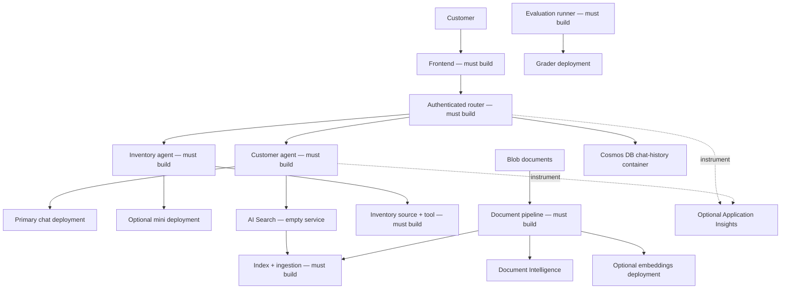

# Daugiaprograminė klientų aptarnavimo sistema — mažmeninės prekybos architektūros modelis

**5 skyrius: Daugiaprograminiai DI sprendimai**

- [Kursų pradžia](../README.md)
- [5 skyrius](../docs/chapter-05-multi-agent/README.md)
- [Išankstinė sąlyga: DI integracija](../docs/chapter-02-ai-development/microsoft-foundry-integration.md)
- [Toliau: Pajėgumų planavimas](../docs/chapter-06-pre-deployment/capacity-planning.md)
- [ARM infrastruktūros karkasas](retail-multiagent-arm-template/README.md)

> **Architektūros vadovas, ne veikianti programa.** Vieninteliai mažmeninės prekybos įgyvendinimo
> failai yra `azuredeploy.json`, `azuredeploy.parameters.json` ir `deploy.sh` kataloge
> `retail-multiagent-arm-template/`. Maršrutizatoriaus/frontend konteineriai yra hello-world
> vietos rezervatoriai. Vietoje nėra jokių mažmeninės prekybos agentų, UI, duomenų įvedimo
> gijų, vertintojų, skaitytuvų ar programos testavimo rinkinių.

## Apžvalga

**Tikslas:** sukurti klientų aptarnavimo sistemą su klientų agentu ir inventoriaus agentu,
nustatyti, ką suteikia infrastruktūra, ir suplanuoti trūkstamus programos
susitarimus bei verifikaciją.

**Auditorija:** programuotojai, kurie baigė vietinę
[pokalbio pavyzdys](../../../examples/azure-openai-chat) ir [dviejų paslaugų konteinerio pavyzdys](../../../examples/container-app/microservices).
Skirkite 2–3 valandas architektūros studijai. Programos kūrimas yra atskiras
projektas: 80–120 darbų valandų yra iliustracinis planavimo įvertis patyrusiems kūrėjams,
**ne pristatymo pažadas**; gamybos parengimas, testavimas,
saugumo peržiūra ir eksploatacija reikalauja papildomo darbo.

### Mokymosi rezultatai

- Paaiškinti maršruto nustatymą, įsišaknijimą, įrankių leidimus ir pokalbio nuosavybę.
- Skirti modelio identifikatorius, diegimo pavadinimus, API versijas ir ARM versijas.
- Sukurti dokumentų įkėlimo ir gavimo dizainą su atitinkančiomis vektorių dimensijomis.
- Apibrėžti patikimus funkcinius, vertinimo ir gedimų atkūrimo reikalavimus.
- Atskirti pasirenkamus architektūros tikslus nuo iš tikrųjų patiektų išteklių.

## Sprendimo architektūra



Tai yra **tikslinė programos architektūra**, o ne veikiančių agentų paslaugų diagrama.
ARM karkasas sukuria tik pagrindines paslaugas ir du rezervinius konteinerius.
Front Door, registras, valdomos tapatybės, vaidmenų priskyrimai,
privatūs galiniai taškai, atsarginis perjungimas, programos instrumentavimas ir įspėjimai neįtraukti.

### Atsakomybės ir sutartys

| Komponentas | Reikalaujamas elgesys | Įrodymai prieš laikant užbaigtu |
|---|---|---|
| Frontend | Autentifikuoti vartotojus, rodyti pokalbį, saugiai įkelti dokumentus | UI ir įkėlimo testai, prieinamos klaidos |
| Maršrutuotojas | Leisti užklausas, pasirinkti agentą, riboti įrankių skambučius/laiko limitus | Maršruto testai, autorizacijos patikrinimai, gedimų testai |
| Kliento agentas | Pagrįsti politikos/produkto atsakymus patvirtintais šaltiniais | Teisingos citatos, susilaikymas kai duomenų nėra |
| Inventoriaus įrankis | Skaityti autoritetingą atsargų informaciją su ribotomis teisėmis | Deterministiniai atsargų testai; nėra išgalvotos prieinamumo info |
| Dokumentų kanalas | Ištraukti, suskaidyti, įdėti, indeksuoti, atnaujinti/ištrinti | Indeksuoti atsarginiai duomenys, pakartotinio bandymo/mirties laiško elgsena |
| Pokalbių saugykla | Izoliuoti vartotojus, taikyti saugojimo terminus | Kryžminių vartotojų autorizacija ir TTL testai |
| Vertinimo vykdytojas | Palyginti rezultatus su tikrumo duomenimis ir vertinimo kriterijais | Aprėpties, gedimų skaičiaus, atkuriamų ataskaitų testai |

Įsivaizduokite maršrutuotoją kaip registratūrą o įrankius – kaip ribotas vidines sistemas:
specialisto pasirinkimas nereiškia leidimo prieiti prie kiekvieno kliento įrašų.
Tapatybę ir leidimus vykdykite programos kode ir duomenų paslaugose, o ne užklausose.

## Infrastruktūra ir programa

Perskaitykite [scaffold README](retail-multiagent-arm-template/README.md) prieš
vykdant diegimą. Jame nurodomi tikslūs ištekliai, režimai, kainos ir apribojimai.

| Loginis naudojimas | ARM diegimo pavadinimas | Modelis / versija | Numatytoji sritis |
|---|---|---|---|
| Kliento pokalbis | `gpt-4.1-chat` | `gpt-4.1` / `2025-04-14` | `eastus2` |
| Inventorius | `gpt-4.1-mini-inventory` | `gpt-4.1-mini` / `2025-04-14` | `westus2`, pasirenkama |
| Įterpiniai | `text-embedding-ada-002` | `text-embedding-ada-002` / `2` | `francecentral`, pasirenkama |
| Vertinimas | `gpt-4.1-grader` | `gpt-4.1` / `2025-04-14` | Pagal nutylėjimą pirminė sritis |

Pasitikrinkite modelio/versijos/SKU prieinamumą ir kvotą **kiekvienoje srityje**. Pokalbiams/mini/vertintojui
naudojamas `GlobalStandard`; įterpiniams - `Standard`. Pajėgumo vienetų ir TPM atitiktys yra
modelio specifinės. Nenaudokite skirtingų pajėgumo vienetų kaip universalaus kvotos garantijos.

Azure OpenAI užklausos `model` argumentas yra **diegimo pavadinimas**, ne
būtinai katalogo modelio identifikatorius. Duomenų plokštės API versija `2024-10-21`
skiriasi nuo modelio versijos `2025-04-14` ir ARM ištekliaus `apiVersion`.
Nepavyks išspręsti neprieinamo modelio tik keisdami duomenų plokštės API versiją.

`--no-multi-region` praleidžia antrinius ir įterpinių paskyras. Išlieka pirminė pokalbio ir nepriklausoma vertintojo paskyra.
Atskirų modelių paskyros nesuteikia automatinio persijungimo; tam reikia programinės įrangos maršrutizavimo, suderinamų diegimų,
būklės patikrinimų, pakartojimų ribų ir duomenų vietos peržiūros.


## Įgyvendinimo planas

### 1. Pradėkite nuo vienos patikrintos sąveikos

Prieš diegiant didelį „scaffold“, naudokite vietinį pokalbio pavyzdį, kad nustatytumėte
įžvalgos ryšį. Apibrėžkite vieną reprezentatyvų kliento klausimą, patvirtintą
atsakymo šaltinį, laukiamą citatą ir klaidos elgesį, kai šis šaltinis prarastas.

### 2. Apibrėžkite maršrutizavimo ir įrankių ribas

Sukurkite savo maršrutizatoriaus šaltinį, priklausomybių manifestą, Dockerfile ir testus. Iliustracinis
kontraktas galėtų būti `POST /chat` su `{"message":"...","conversation_id":"..."}`.
**Šis galinis taškas yra dizaino pasiūlymas; jo neįgyvendina ARM šablonas.**

Patikrinkite kūno tipus/ribas, nustatykite vartotojo tapatybę pagal autentifikaciją, užtikrinkite
pokalbio savininkystę, taikykite užklausų laiko limitus ir grąžinkite prasmingus klaidų kodus.
Nevertinkite HTTP klaidų ar tuščių atsakymų kaip sėkmingo agento rezultato.

### 3. Įgyvendinkite pagrindimą ir įvedimą

ARM šablonas nesukuria paieškos indekso. Tai yra **nuorodos JSON
fragmentas, kurį reikia adaptuoti savo indekso apibrėžime**, o ne failas, jau esantis repozitorijoje:

```json
{
  "name": "retail-product-index",
  "fields": [
    {"name": "id", "type": "Edm.String", "key": true},
    {"name": "title", "type": "Edm.String", "searchable": true},
    {"name": "content", "type": "Edm.String", "searchable": true},
    {"name": "category", "type": "Edm.String", "filterable": true},
    {
      "name": "content_vector",
      "type": "Collection(Edm.Single)",
      "searchable": true,
      "dimensions": 1536,
      "vectorSearchProfile": "retail-profile"
    }
  ],
  "vectorSearch": {
    "algorithms": [{"name": "retail-hnsw", "kind": "hnsw"}],
    "profiles": [{"name": "retail-profile", "algorithm": "retail-hnsw"}]
  }
}
```

Profilis sieja vektorinį lauką su jo algoritmu. Matmenys turi atitikti
faktinį įterpinių išvesties dydį (1536 šiam `ada-002` diegimui). Python paieškai
naudokite `azure.search.documents.models.VectorizedQuery` vietoj neišbaigto
žodyno, kuriame trūksta vektorinio užklausos tipo:

```python
# Reference function only: supply an authenticated async SearchClient and an embedding.
from azure.search.documents.models import VectorizedQuery

async def retrieve(search_client, embedding):
    results = await search_client.search(
        search_text=None,
        vector_queries=[VectorizedQuery(
            vector=embedding,
            k_nearest_neighbors=5,
            fields="content_vector"
        )],
        select=["id", "title", "content"]
    )
    return [document async for document in results]
```

Sukurkite atskirą įvedimo įgyvendinimą, kuris:

1. Leidžia įkelti prieigą ir patikrina turinio tipą bei dydį.
2. Skaito privatų blob'ą naudodamas autentifikuotus SDK kvietimus. Privatų blob URL vienas pats
   **nėra** skaitomas Document Intelligence įvestis; siųskite atsisiųstus baitus su
   `AnalyzeDocumentRequest(bytes_source=...)` arba naudokite tinkamai apribotą,
   trumpalaikį SAS po prieigos reikalavimų peržiūros.
3. Ištraukia tekstą, suskirsto į dalis, kad atitiktų įterpinių ribas, ir generuoja įterpinius.
4. Kuria stabilias galiojančias dokumentų raktus ir įkelia dalis su atitinkančiais vektoriais.
5. Tikrina po dokumento indeksavimo rezultatus, tvarko pakartojimus ir atnaujina/ištrina pasenusius duomenis.

Neįterpkite atsitiktinių vartotojo raktų/reikšmių į OData filtrus. Leiskite tik patvirtintus laukus,
tikrinkite reikšmių tipus ir pabėgkite iš eilutinių kabučių. Loginiai ir skaitmeniniai filtrai turi būti
tipizuoti literalai, o ne kabučių eilutės.

### 4. Interneto pagrindimas

**Bing Search v7 buvo nutrauktas 2025 m. rugpjūčio 11 d.** Senasis `Microsoft.Bing/accounts`
išteklius ir `api.bing.microsoft.com/v7.0/search` pavyzdžiai nėra palaikoma
įgyvendinimo kryptis. Įvertinkite šiuo metu palaikomą pagrindimo integraciją
Microsoft Foundry ir jos SDK, leidimus, apmokestinimą bei citatų reikalavimus;
jokio čia neįgyvendinta. Ji nėra tiesioginė seniai išjungto galinio taško pakaitalas.

### 5. Pridėkite telemetriją ir vertinimą

Application Insights sukūrimas nekonfigūruoja kodo. Naudokite palaikomą Azure Monitor
OpenTelemetry instrumentaciją kuriant naują programėlę, perduokite trasės
kontekstą tarp paslaugų ir venkite fiksuoti kliento užklausas, dokumentus ar slaptus duomenis.
Užklausos sutrumpinimas **neišanonimizuoja** jos.

Matuokite užklausų trukmę, maršrutizavimo/įrankių klaidas, paieškos aktualumą, citatų
teisingumą, žetonų naudojimą ir vengimą. Saugokite faktinius inventoriaus/politikos duomenis
kartu su vertinimo atvejais: vertintojas negali patikimai nustatyti faktinės tikslumo
remdamasis tik klausimu ir atsakymu.

Vertintojo diegimas nėra vertinimo paleidimo priemonė. Įgyvendinkite versijuotą rubriką,
struktūruotą išvestį/schemos patikrinimą, balų diapazono patikras, transporto gedimų skaičiavimą
ir žmogiškai peržiūrėtus atvejus. Praneškite apie nepilnus/klaidų atvejus atskirai; nekeiskite
jų į sėkmingus įvertinimus ar tyliai neįtraukite kaip modelio atsakymus su nulinės kokybės balais.

Taip pat keletas raktinių žodžių patikrinimų nėra saugumo sertifikatas. Nepavykęs HTTP
užklausos bandymas, trūkstama testo strategija ar tuščias atsakymas turi padaryti testą **neaiškiu arba
nepavykusiu**, o ne rezultatuoti „100 % saugiu“ balu. Atlikite autorizuotą testavimą su tinkamais
įrankiais ir žmogišku vertinimu prieš bet kokį gamybos pasirengimo pareiškimą.

### 6. Įdiekite savo programą

Sukurkite savo šaltinių katalogus, manifestus, testus, registrą ir vaizdų traukimo
leidimus. Pakeiskite vietas, kur yra viettovės, su pastatytais vaizdais ir atnaujinkite įeinančius/prieigos patikrinimus,
atitinkančius kiekvienos programos klausymo prievadą. Konfigūruokite aplinkos kintamuosius Bicep
arba aiškiai palaikomame azd aplinkos susiejime.

Nėra bendro `config` žodyno po azd paslauga, kuris automatiškai
sukurtų vykdymo aplinkos kintamuosius. `azd env set` keičia tik tuos resursus, kurie
aiškiai naudoja tas reikšmes. Šiame karkase nėra įgyvendinta jokia kanarėlė, regionų sąrašas ar smulkios derinimo vinys.


## Praktinės dizaino užduotys

Tai yra **architektūros užduotys**, o ne vykdomo pradinio kodo, tinkamo mažmeninei prekybai, pretenzijos.

### Užduotis 1: Patikrink ribą

**Pradžios taškas:** trys failai `retail-multiagent-arm-template/`.
**Tikslas:** atskirti aprūpinimą nuo programos funkcionalumo.
Atidarykite `azuredeploy.json`, suraskite abu konteinerių vaizdus ir `targetPort` reikšmes,
tada išvardykite programos komponentus, kurių trūksta saugykloje.

**Sėkmės kriterijai / atsakymas:** abu vaizdai yra hello-world pakaitalai, klausantys
80 prievadu; agentų, pokalbių vartotojo sąsajos, maršrutizatorių tvarkytojų, indekso/įvedimo, vertintojo ir skenerio nėra.
Sėkmingas pakaitinis pagrindinis užklausimas nepatikrina `/chat`.
**Dažna problema:** resursų pavadinimų, pavyzdžiui, `retail-router`, traktavimas kaip veikiančio kodo.

### Užduotis 2: Sek vektoriaus konfigūraciją

**Pradžios taškas:** aukščiau pateiktas indekso JSON.
**Tikslas:** suprasti laukelio → profilio → algoritmo santykį.
Nustatykite, kurios reikšmės turi keistis pereinant prie įterpimo modelio su
kitokia išvesties dimensija, tada peržiūrėkite `retrieve` funkciją.

**Sėkmės kriterijai / atsakymas:** pakeiskite laukelį `dimensions` į faktinį vektoriaus ilgį;
išlaikykite `vectorSearchProfile` suderintą su paskelbtu profiliu ir jo algoritmu;
užklausoje `fields` turi būti nurodytas vektoriaus laukas. Perkurkite esamus dokumentų vektorius,
kai keičiasi įterpimo modelis.
**Dažna problema:** keičiant tik modelio pavadinimą, bet išlaikant nesuderinamus vektorius.

### Užduotis 3: Apibrėžkite gedimo testą

**Pradžios taškas:** atsakomybės lentelė.
**Tikslas:** užkirsti kelią klaidingam sėkmei.
Parašykite tikėtiną elgesį, kai atsargų API yra nepasiekiama, paieškos indeksas neturi
atitinkančių dokumentų ir įvertinimo užklausa grąžina HTTP 503.

**Sėkmės kriterijai / atsakymas:** nėra išrengtų atsargų reikšmių; aiški susilaikymo ar
eskalavimo reakcija, kai trūksta konteksto; įvertinimas praneša apie transporto gedimą,
o ne apie kokybės ar saugumo patvirtinimą. Pridėkite vykdomuosius testus, kai kuriate programą.
**Dažna problema:** sugaunama kiekviena išimtis ir tęsiama su tuščiu atsakymu.

## Išlaidos, trikčių šalinimas ir valymas

- Infrastruktūrai taikomi nuolatiniai mokesčiai net ir esant tuštiems paieškos indeksams bei pakaitinėms
  programėlėms. Naudokite esamas regionines kainas; nei „minimalus“, nei kelių regionų režimas nėra nemokamas.
- Žetonų sąnaudos priklauso nuo modelio, išankstinės/neišankstinės įvesties, išvesties ir diegimo SKU.
  Maršrutizavimas gali sutaupyti pinigų tik jei išmatuota apkrova ir kokybės rezultatai tai pateisina;
  fixed 60–80% sutaupymai nėra garantuoti.
- Patikrinkite modelio prieinamumą ir kvotas prieš aprūpinimą; atskirkite leidimo,
  diegimo pavadinimo, regiono, modelio versijos ir API versijos klaidas.
- Nesileiskite į paleidimą trūkstamų `setup-data.sh`, vertintojo CLI arba `pytest tests/` komandų.
  Jų įgyvendinimas yra jūsų kūrimo darbų sąraše.
- Šis karkasas skirtas tik ARM architektūrai: laikykitės jo
  [patikros ir valymo instrukcijų](retail-multiagent-arm-template/README.md).
  `azd down` nevaldo tų resursų.

## Susiję resursai

- [Veikiantis vietinis pokalbių pavyzdys](../../../examples/azure-openai-chat)
- [Veikiantis dviejų paslaugų konteinerių pavyzdys](../../../examples/container-app/microservices)
- [AI paieškos vektorių indeksai](https://learn.microsoft.com/azure/search/vector-search-how-to-create-index)
- [Konteinerių programų dokumentacija](https://learn.microsoft.com/azure/container-apps/)
- [Trikčių šalinimas](../docs/chapter-07-troubleshooting/common-issues.md)
- [Pranešti apie problemą](https://github.com/microsoft/AZD-for-beginners/issues)

---

<!-- CO-OP TRANSLATOR DISCLAIMER START -->
**Atsakomybės apribojimas**:
Šis dokumentas buvo išverstas naudojant dirbtinio intelekto vertimo paslaugą [Co-op Translator](https://github.com/Azure/co-op-translator). Nors siekiame tikslumo, prašome atkreipti dėmesį, kad automatiniai vertimai gali turėti klaidų ar netikslumų. Originalus dokumentas jo gimtąja kalba laikomas autoritetingu šaltiniu. Svarbiai informacijai rekomenduojama naudoti profesionalų žmogiškąjį vertimą. Mes neatsakome už jokius nesusipratimus ar neteisingą interpretaciją, kilusią naudojantis šiuo vertimu.
<!-- CO-OP TRANSLATOR DISCLAIMER END -->