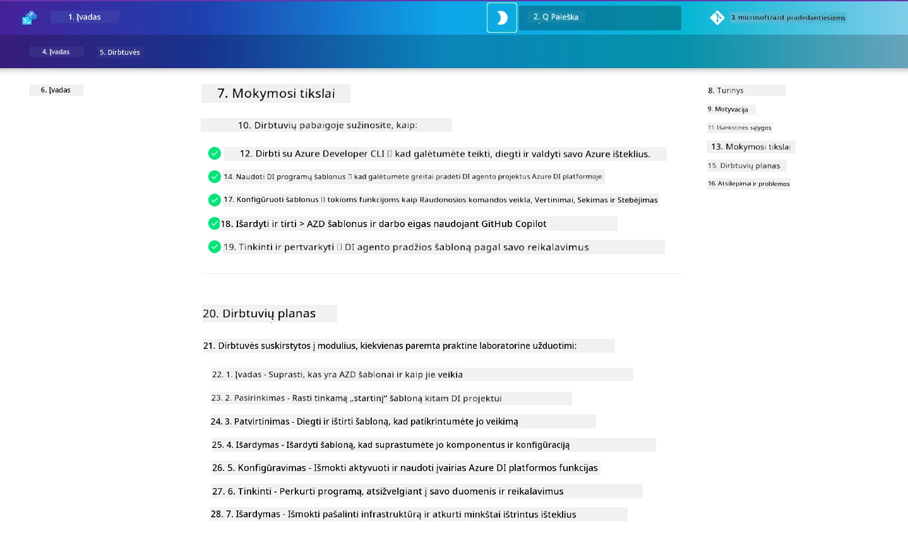

<div align="center">
  <div style="background: linear-gradient(135deg, #0078d4, #106ebe); border-radius: 10px; padding: 20px; margin: 20px 0; box-shadow: 0 4px 15px rgba(0, 120, 212, 0.3); border: 2px solid #005a9e;">
    <h2 style="color: white; margin: 0; font-size: 24px; text-shadow: 1px 1px 2px rgba(0,0,0,0.3);">
      🎯 AZD kūrėjams dirbtinio intelekto srityje dirbantiems dirbtuvės
    </h2>
    <p style="color: white; margin: 10px 0 0 0; font-size: 16px; text-shadow: 1px 1px 2px rgba(0,0,0,0.3);">
      <strong>Praktinės dirbtuvės, skirtos kurti DI programas su Azure Developer CLI.</strong><br>
      Užbaikite 7 modulius, kad įvaldytumėte AZD šablonus ir DI diegimo darbo eigas.
    </p>
    <div style="margin-top: 15px;">
      <span style="background: rgba(255,255,255,0.2); padding: 5px 10px; border-radius: 15px; color: white; font-size: 14px;">
        📅 Šaltinio gairių peržiūra: 2026 m. lapkritis
      </span>
    </div>
  </div>
</div>

# AZD kūrėjams dirbtinio intelekto srityje skirtos dirbtuvės

Sveiki atvykę į praktines dirbtuves, skirtas mokytis Azure Developer CLI (AZD) su dėmesiu DI programų diegimui. Šios dirbtuvės padės jums praktiškai suprasti AZD šablonus per 3 žingsnius:

1. **Atranka** – raskite jums tinkamą šabloną.
1. **Diegimas** – įdiekite ir patikrinkite, ar veikia
1. **Tinkininimas** – modifikuokite ir tobulinkite, kad jis būtų jūsų!

Per šias dirbtuves taip pat susipažinsite su pagrindiniais kūrėjų įrankiais ir darbo eiga, kad padėtumėte supaprastinti visą kūrimo procesą nuo pradžios iki pabaigos.

<br/>

## Naršyklėje veikianti vadovė

Dirbtuvių pamokos pateiktos Markdown formatu. Jas galite naršyti tiesiogiai GitHub – arba paleisti naršyklėje veikiančią peržiūrą, kaip parodyta žemiau esančioje ekrano kopijoje.



Norėdami naudoti šią parinktį – atsiskirkite šį saugyklą į savo profilį ir paleiskite GitHub Codespaces. Kai VS Code terminalas bus aktyvus, įveskite šią komandą:

Ši naršyklės peržiūra veikia GitHub Codespaces, kūrėjų konteineriuose arba vietinėje klono aplinkoje su įdiegtais Python ir MkDocs.

```bash title="" linenums="0"
python -m pip install -r requirements-dev.txt
python -m mkdocs serve --config-file workshop/mkdocs.yml
```

Vykdykite šias komandas iš **kurso saugyklos šaknies**, o ne iš atskirai inicializuoto DI pavyzdžio. Laikykite peržiūrą aktyvią, kad būtų matomos klaidos; sustabdykite ją su Ctrl+C. Norėdami patikrinti svetainę be jos paleidimo, vykdykite `python -m mkdocs build --strict --config-file workshop/mkdocs.yml`.

Po kelių sekundžių pamatysite iššokantį dialogą. Pasirinkite parinktį `Open in browser`. Tada internetinis vadovas atsidarys naujame naršyklės skirtuke. Keletas šios peržiūros privalumų:

1. **Įmontuota paieška** – greitai raskite raktinius žodžius ar pamokas.
1. **Nukopijuoti ikonėlė** – užveskite pelės žymeklį ant kodo blokų ir pamatysite šią parinktį
1. **Temų perjungimas** – pereikite tarp tamsios ir šviesios temos
1. **Pagalba** – spustelėkite Discord ikoną poraštėje, kad prisijungtumėte!

<br/>

## Dirbtuvių apžvalga

**Trukmė:** 3-4 valandos  
**Lygis:** Pradedantiesiems ir vidutiniams  
**Reikalavimai:** Esamas pažinimas apie Azure, DI koncepcijas, VS Code ir komandų eilutės įrankius.

Tai praktinės dirbtuvės, kuriose mokomasi per veiksmą. Baigę pratimus rekomenduojame peržiūrėti AZD Pradedantiesiems mokymų programą, kad tęstumėte mokymąsi apie saugumo ir produktyvumo gerąsias praktikas.

| Laikas| Modulis  | Tikslas |
|:---|:---|:---|
| 15 min | [Įvadas](docs/instructions/0-Introduction.md) | Nustatyti pagrindą, suprasti tikslus |
| 30 min | [Pasirinkti DI šabloną](docs/instructions/1-Select-AI-Template.md) | Išnagrinėti parinktis ir pasirinkti pradžiai | 
| 30 min | [Patikrinti DI šabloną](docs/instructions/2-Validate-AI-Template.md) | Įdiegti numatytąją Azure sprendimą |
| 30 min | [Išardyti DI šabloną](docs/instructions/3-Deconstruct-AI-Template.md) | Išnagrinėti struktūrą ir konfigūraciją |
| 30 min | [Konfigūruoti DI šabloną](docs/instructions/4-Configure-AI-Template.md) | Aktyvuoti ir išbandyti galimas funkcijas |
| 30 min | [Tinkinti DI šabloną](docs/instructions/5-Customize-AI-Template.md) | Priderinti šabloną prie savo poreikių |
| 30 min | [Naikinti infrastruktūrą](docs/instructions/6-Teardown-Infrastructure.md) | Išvalyti ir atleisti išteklius |
| 15 min | [Apibendrinimas ir kiti žingsniai](docs/instructions/7-Wrap-up.md) | Mokymosi šaltiniai, dirbtuvių iššūkis |

<br/>

## Ko išmoksite

Galvokite apie AZD šabloną kaip apie mokymosi smėlio dėžę, skirtą tyrinėti įvairias galimybes ir įrankius pilnam kūrimo ciklui Microsoft Foundry platformoje. Pabaigoje šių dirbtuvių turėtumėte turėti intuiciją apie įvairius įrankius ir koncepcijas šiame kontekste.

| Koncepcija  | Tikslas |
|:---|:---|
| **Azure Developer CLI** | Suprasti įrankio komandas ir darbo eigas|
| **AZD šablonai**| Suprasti projekto struktūrą ir konfigūraciją|
| **Azure DI agentas**| Pateikti ir įdiegti Microsoft Foundry projektą  |
| **Azure DI paieška**| Įgalinti konteksto inžineriją agentais |
| **Stebėjimas**| Išnagrinėti stebėjimą, vertinimą ir monitoringą |
| **Raudonoji komanda**| Išnagrinėti priešiškų bandymų vykdymą ir prevenciją |

<br/>

## Dirbtuvių struktūra

Dirbtuvės yra struktūrizuotos taip, kad nukeliautumėte nuo šablono paieškos iki diegimo, išardymo ir tinkinimo – naudojant oficialų [Pradžia su DI agentais](https://github.com/Azure-Samples/get-started-with-ai-agents) pradinį šabloną kaip pagrindą.

### [Modulis 1: Pasirinkti DI šabloną](docs/instructions/1-Select-AI-Template.md) (30 min)

- Kas yra DI šablonai?
- Kur rasti DI šablonus?
- Kaip pradėti kurti DI agentus?
- **Laboratorinis darbas**: Greitas startas Codespaces arba kūrėjų konteineryje

### [Modulis 2: Patikrinti DI šabloną](docs/instructions/2-Validate-AI-Template.md) (30 min)

- Kokia yra DI šablono architektūra?
- Kas yra AZD kūrimo darbo eiga?
- Kaip gauti pagalbą AZD kūrimui?
- **Laboratorinis darbas**: Įdiegti ir patikrinti DI agentų šabloną

### [Modulis 3: Išardyti DI šabloną](docs/instructions/3-Deconstruct-AI-Template.md) (30 min)

- Išnagrinėti savo aplinką naudojant `.azure/` 
- Išnagrinėti savo išteklių konfigūraciją naudojant `infra/` 
- Išnagrinėti savo AZD konfigūraciją `azure.yaml`
- **Laboratorinis darbas**: Keisti aplinkos kintamuosius ir diegti iš naujo

### [Modulis 4: Konfigūruoti DI šabloną](docs/instructions/4-Configure-AI-Template.md) (30 min)
- Išnagrinėti: Atkuriamąją generaciją
- Išnagrinėti: Agentų vertinimą ir raudonąją komandą
- Išnagrinėti: Sekimą ir monitoringą
- **Laboratorinis darbas**: Tyrinėti DI agentą ir stebėjimą 

### [Modulis 5: Tinkinti DI šabloną](docs/instructions/5-Customize-AI-Template.md) (30 min)
- Apibrėžti: PRD su scenarijų reikalavimais
- Konfigūruoti: Aplinkos kintamuosius AZD
- Įgyvendinti: Gyvavimo ciklo kablius papildomoms užduotims
- **Laboratorinis darbas**: Tinkinti šabloną savo scenarijui

### [Modulis 6: Naikinti infrastruktūrą](docs/instructions/6-Teardown-Infrastructure.md) (30 min)
- Apžvelgti: Kas yra AZD šablonai?
- Apžvelgti: Kodėl naudoti Azure Developer CLI?
- Kiti žingsniai: Išbandyti kitą šabloną!
- **Laboratorinis darbas**: Naikinti infrastruktūrą ir išvalyti

<br/>

## Dirbtuvių iššūkis

Norite sau iškelti aukštesnius tikslus? Štai keletas projekto pasiūlymų – arba pasidalinkite savo idėjomis su mumis!

| Projektas | Aprašymas |
|:---|:---|
|1. **Išardyti sudėtingą DI šabloną** | Naudokite aprašytą darbo eigą ir įrankius ir pažiūrėkite, ar galite įdiegti, patikrinti ir tinkinti kitą DI sprendimo šabloną. _Ką išmokote?_|
|2. **Tinkinti pagal savo scenarijų**  | Pabandykite parašyti PRD (Produkto reikalavimų dokumentą) kitam scenarijui. Tada naudokite GitHub Copilot savo šablono saugykloje Agent Model režimu – ir paprašykite sukurti tinkinimo darbo eigą. _Ką išmokote? Kaip galėtumėte patobulinti šiuos pasiūlymus?_|
| | |

## Turite atsiliepimų?

1. Parašykite problemą šiame saugykloje – pažymėkite ją `Workshop` patogumui.
1. Prisijunkite prie Microsoft Foundry Discord – susisiekite su bendraamžiais!


| | | 
|:---|:---|
| **📚 Kurso pradžia**| [AZD Pradedantiesiems](../README.md)|
| **📖 Dokumentacija** | [Pradžia su DI šablonais](https://learn.microsoft.com/en-us/azure/ai-foundry/how-to/develop/ai-template-get-started)|
| **🛠️DI šablonai** | [Microsoft Foundry šablonai](https://ai.azure.com/templates) |
|**🚀 Tolimesni žingsniai** | [Pradėti dirbtuves](#workshop-overview) |
| | |

<br/>

---

**Navigacija:** [Pagrindinis kursas](../README.md) | [Įvadas](docs/instructions/0-Introduction.md) | [Modulis 1: Pasirinkti šabloną](docs/instructions/1-Select-AI-Template.md)

**Pasiruošę pradėti kurti DI programas su AZD?**

[Pradėti dirbtuves: Įvadas →](docs/instructions/0-Introduction.md)

---

<!-- CO-OP TRANSLATOR DISCLAIMER START -->
**Atsakomybės apribojimas**:
Šis dokumentas buvo išverstas naudojant dirbtinio intelekto vertimo paslaugą [Co-op Translator](https://github.com/Azure/co-op-translator). Nors siekiame tikslumo, prašome atkreipti dėmesį, kad automatiniai vertimai gali turėti klaidų ar netikslumų. Originalus dokumentas jo gimtąja kalba laikomas autoritetingu šaltiniu. Svarbiai informacijai rekomenduojama naudoti profesionalų žmogiškąjį vertimą. Mes neatsakome už jokius nesusipratimus ar neteisingą interpretaciją, kilusią naudojantis šiuo vertimu.
<!-- CO-OP TRANSLATOR DISCLAIMER END -->