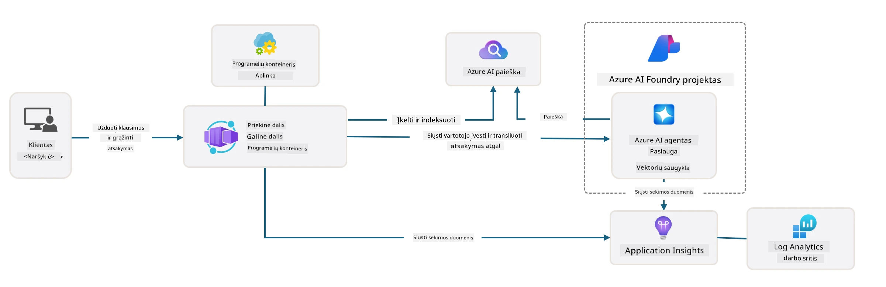

# 3. Išardyti šabloną

!!! tip "ŠIO MODULIO PABAIGOJE JŪS GALĖSITE"

    - [ ] Use GitHub Copilot and optional MCP tools for Azure documentation and read-only exploration
    - [ ] Identify the template's application, infrastructure, configuration, and test entry points
    - [ ] Verify generated explanations against actual repository files
    - [ ] **Lab 3:** Trace one request and one configuration input through the project

---

## 1. Aktyvuokite GitHub Copilot

Atidarykite inicializuotą AI pavyzdį VS Code ir įjunkite [GitHub Copilot](https://code.visualstudio.com/docs/copilot/chat/chat-agent-mode). Prisijunkite su paskyra, turinčia tinkamą planą; naudojimo apribojimai skiriasi. Paprašykite Copilot paaiškinti saugyklą prieš leidžiant keitimus.

### Pasirinktiniai MCP serveriai

Šios paslaugos gali suteikti papildomų įrankių:

- [Azure MCP Server](https://learn.microsoft.com/azure/developer/azure-mcp-server/overview)
- [Microsoft Learn MCP Server](https://learn.microsoft.com/training/support/mcp)

VS Code peržiūrėkite [MCP konfigūracijos instrukcijas](https://code.visualstudio.com/docs/copilot/chat/mcp-servers) ir prireikus sukurkite `.vscode/mcp.json`:

```json
{
  "servers": {
    "Azure MCP Server": {
      "type": "stdio",
      "command": "npx",
      "args": ["-y", "@azure/mcp@latest", "server", "start"]
    },
    "microsoft.docs.mcp": {
      "type": "http",
      "url": "https://learn.microsoft.com/api/mcp"
    }
  }
}
```

`npx` komanda reikalauja palaikomos Node.js/npm diegimo ir atsisiunčia vykdomąjį kodą. Peržiūrėkite paketą ir fiksuokite patvirtintą versiją, kad būtų atkuriama komandos aplinka. Paleiskite serverius naudodami VS Code MCP valdymą ir patikrinkite jų prieinamus įrankius; pavadinimai gali keistis tarp versijų.

**Autentifikacija vykdoma atskirai.** Naudokite `azd auth login` AZD atveju. Sekite Azure MCP dokumentuotą autentifikacijos srauto eigą savo įrankiams; vien AZD prisijungimas nesukuria MCP seanso. Naudokite `az login` atskirai, kai pratimas ar kabliukas kviečia Azure CLI.

Išbandykite tik skaitymo užklausas:

1. „Naudokite Microsoft Learn MCP, kad surastumėte Azure Developer CLI konfigūracijos dokumentaciją.“
2. „Paaiškinkite šios saugyklos `azure.yaml`; nurodykite failus, kurie įgyvendina kiekvieną kabliuką.“
3. „Naudodami prieinamus Azure MCP įrankius, išvardykite mano diegiamus resursus nesikeisdami nieko.“

Patikrinkite pasirinktą nuomininką/prenumeratą ir kiekvieną siūlomą įrankio kvietimą. Nepriimkite resursų kūrimo, šalinimo ar prieigos pokyčių tik tam, kad ištyrinėtumėte architektūrą.

## 2. Supraskite architektūrą

Pavyzdyje talpinamas Python FastAPI backend'as ir React/TypeScript frontend'as Azure Container Apps aplinkoje. Backend'as bendrauja su agentu Microsoft Foundry projekte. Duomenų gavimas ir stebėjimas priklauso nuo įjungtų šablono funkcijų ir sėkmingo nustatymo; jie nėra garantuoti vien tik dėl to, kad programa įdiegta.



Palyginkite šį diagramą su [dabartine aukščiausio lygio diegimo instrukcija](https://github.com/Azure-Samples/get-started-with-ai-agents/blob/main/docs/deployment.md) ir savo tikraisiais resursais. Patikrinkite sukonfigūruotą modelio diegimą, agento įrankius, valdomą tapatybę, vaidmenų priskyrimus ir pasirinktinius AI Search/Application Insights resursus.

**Pratimas:** Paprašykite Copilot sekti pokalbio užklausą nuo frontend'o per API iki Foundry, su failų ir funkcijų nuorodomis. Atidarykite tas nuorodas ir patikrinkite paaiškinimą. Neverskite autentifikacijos, maršruto ar autorizacijos iš diagramų vien tik nuojautos pagrindu.

## 3. Saugyklos struktūra

Toliau nurodyti pasirinkti keliai buvo patikrinti pagal pavyzdį 2026 m. lapkričio 4 d. Jūsų inicializuotas leidimas išlieka tiesos šaltiniu:

```text
get-started-with-ai-agents/
  azure.yaml
  docker-compose.yaml
  requirements-dev.txt
  .devcontainer/
  infra/
    main.bicep
    main.parameters.json
    api.bicep
    core/
  src/
    Dockerfile
    pyproject.toml
    requirements.txt
    api/
      main.py
      routes.py
      search_index_manager.py
    frontend/
      package.json
      src/
    files/
  scripts/
    validate_env_vars.sh
    validate_env_vars.ps1
    postdeploy.sh
    postdeploy.ps1
  tests/
    test_evaluation.py
    test_red_teaming.py
  docs/
    deployment.md
    deploy_customization.md
    ai_search.md
    observability.md
    local_development.md
    troubleshooting.md
```

### Infrastruktūra ir konfigūracija

`infra/main.bicep` orkestruoja resursus; `main.parameters.json` sujungia šablono įvestis su AZD aplinkos reikšmėmis. `azure.yaml` pasirenka programos paslaugą ir gyvavimo ciklo kabliukus. Sekite tokią įvestį kaip `USE_AZURE_AI_SEARCH_SERVICE` per šiuos failus, kad surastumėte, kas iš tikrųjų keičiasi.

### Programa ir tapatybė

Skaitykite kartu `src/api/` ir `src/frontend/`. Nustatykite, kur agentas sukuriamas arba gaunamas, kur konfigūruojamos instrukcijos/įrankiai ir kuri tapatybė naudojama kiekvienam Azure kvietimui. Pavyzdžių failai po `src/files/` yra demonstraciniai duomenys, ne gamybinis katalogas ar autorizacijos modelis.

### Testai ir stebėjimas

Dabartiniai įvertinimo ir raudonojo komandos taškai yra po `tests/`; senesni `evals/` ir `airedteaming/` katalogų nuorodos šiam pavyzdžiui yra pasenusios. Prieš vykdant debesies testus, perskaitykite `docs/observability.md` apie reikalavimus ir išlaidas. Šie Python testai yra atskirti nuo pasirinktino `azure.ai.evaluations` AZD plėtinio.

## 4. Patvirtinkite savo išvadas

- Nustatykite API maršrutą, agento sąveiką ir duomenų gavimo kodą vienam pavyzdiniam klausimui.
- Paaiškinkite, kuri tapatybė pasiekia Foundry ir kuri konfigūracija pasirenka jos galinį tašką.
- Suraskite tikruosius pre-up ir post-deploy scenarijus bei jų klaidų tvarkymo elgseną.
- Išvardykite bet kokius priklausomumus ar pasirinktines funkcijas, kurios nėra jūsų diegime.

Toliau tęskite [Konfigūruoti šabloną](4-Configure-AI-Template.md).

---

<!-- CO-OP TRANSLATOR DISCLAIMER START -->
**Atsakomybės apribojimas**:
Šis dokumentas buvo išverstas naudojant dirbtinio intelekto vertimo paslaugą [Co-op Translator](https://github.com/Azure/co-op-translator). Nors siekiame tikslumo, prašome atkreipti dėmesį, kad automatiniai vertimai gali turėti klaidų ar netikslumų. Originalus dokumentas jo gimtąja kalba laikomas autoritetingu šaltiniu. Svarbiai informacijai rekomenduojama naudoti profesionalų žmogiškąjį vertimą. Mes neatsakome už jokius nesusipratimus ar neteisingą interpretaciją, kilusią naudojantis šiuo vertimu.
<!-- CO-OP TRANSLATOR DISCLAIMER END -->