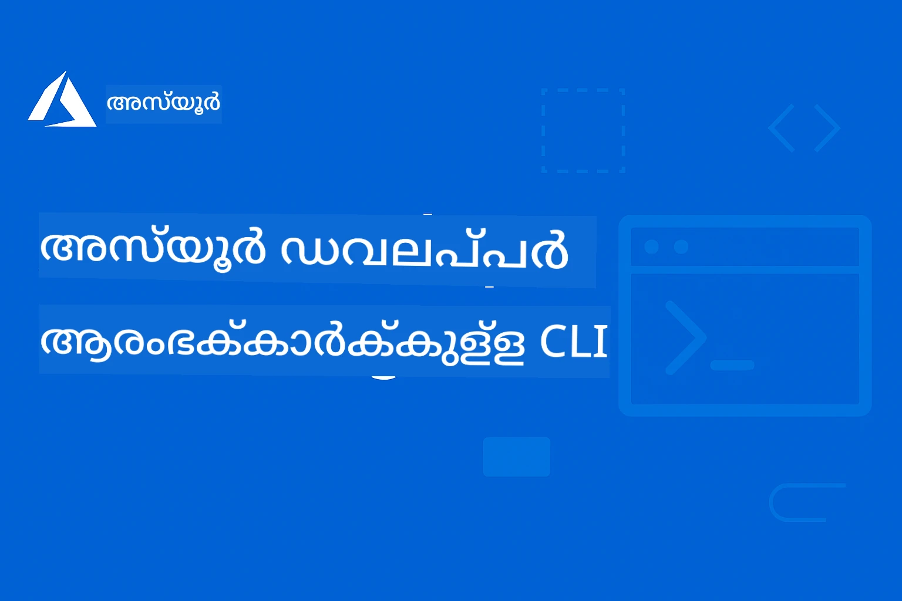

# AZD ആരംഭിക്കുന്നവർക്ക്: ഒരു ഘടനാപരമായ പഠനയാത്ര

 

[](https://github.com/microsoft/AZD-for-beginners)
[](https://GitHub.com/microsoft/azd-for-beginners/network/)
[](https://github.com/microsoft/AZD-for-beginners)

[](https://discord.com/invite/nkVh3dp)
[](https://discord.gg/nTYy5BXMWG)

---

### ഓട്ടോമേറ്റഡ് വിവർത്തനങ്ങൾ (എപ്പോഴും പുതുക്കപ്പെട്ടത്)

<!-- CO-OP TRANSLATOR LANGUAGES TABLE START -->
[Arabic](../ar/README.md) | [Bengali](../bn/README.md) | [Bulgarian](../bg/README.md) | [Burmese (Myanmar)](../my/README.md) | [Chinese (Simplified)](../zh-CN/README.md) | [Chinese (Traditional, Hong Kong)](../zh-HK/README.md) | [Chinese (Traditional, Macau)](../zh-MO/README.md) | [Chinese (Traditional, Taiwan)](../zh-TW/README.md) | [Croatian](../hr/README.md) | [Czech](../cs/README.md) | [Danish](../da/README.md) | [Dutch](../nl/README.md) | [Estonian](../et/README.md) | [Finnish](../fi/README.md) | [French](../fr/README.md) | [German](../de/README.md) | [Greek](../el/README.md) | [Hebrew](../he/README.md) | [Hindi](../hi/README.md) | [Hungarian](../hu/README.md) | [Indonesian](../id/README.md) | [Italian](../it/README.md) | [Japanese](../ja/README.md) | [Kannada](../kn/README.md) | [Khmer](../km/README.md) | [Korean](../ko/README.md) | [Lithuanian](../lt/README.md) | [Malay](../ms/README.md) | [Malayalam](./README.md) | [Manipuri (Meitei Mayek)](../mni/README.md) | [Marathi](../mr/README.md) | [Nepali](../ne/README.md) | [Nigerian Pidgin](../pcm/README.md) | [Norwegian](../no/README.md) | [Persian (Farsi)](../fa/README.md) | [Polish](../pl/README.md) | [Portuguese (Brazil)](../pt-BR/README.md) | [Portuguese (Portugal)](../pt-PT/README.md) | [Punjabi (Gurmukhi)](../pa/README.md) | [Romanian](../ro/README.md) | [Russian](../ru/README.md) | [Serbian (Cyrillic)](../sr/README.md) | [Slovak](../sk/README.md) | [Slovenian](../sl/README.md) | [Spanish](../es/README.md) | [Swahili](../sw/README.md) | [Swedish](../sv/README.md) | [Tagalog (Filipino)](../tl/README.md) | [Tamil](../ta/README.md) | [Telugu](../te/README.md) | [Thai](../th/README.md) | [Turkish](../tr/README.md) | [Ukrainian](../uk/README.md) | [Urdu](../ur/README.md) | [Vietnamese](../vi/README.md)

> **പ്രാദേശികമായി ക്ലോൺ ചെയ്യാൻ ഇഷ്ടപ്പെടുന്നുണ്ടോ?**
>
> ഈ റിപോസിറ്ററിയിൽ 50-ക്കു മുകളിലുള്ള ഭാഷ പരിഭാഷകൾ ഉൾക്കൊള്ളിച്ചിട്ടുണ്ടു, ഇത് ഡൗൺലോഡ് വലുപ്പം നന്നായി വർദ്ധിപ്പിക്കുന്നു. പരിഭാഷകളില്ലാതെ ക്ലോൺ ചെയ്യാൻ sparse checkout ഉപയോഗിക്കുക:
>
> **Bash / macOS / Linux:**
> ```bash
> git clone --filter=blob:none --sparse https://github.com/microsoft/AZD-for-beginners.git
> cd AZD-for-beginners
> git sparse-checkout set --no-cone '/*' '!translations' '!translated_images'
> ```
>
> **CMD (Windows):**
> ```cmd
> git clone --filter=blob:none --sparse https://github.com/microsoft/AZD-for-beginners.git
> cd AZD-for-beginners
> git sparse-checkout set --no-cone "/*" "!translations" "!translated_images"
> ```
>
> ഇത് നിങ്ങൾക്കായി വേഗത്തിൽ ഡൗൺലോഡ് ചെയ്ത് കോഴ്സ് പൂർത്തിയാക്കാനാവശ്യമായ എല്ലാഹിതങ്ങൾ നൽകും.
<!-- CO-OP TRANSLATOR LANGUAGES TABLE END -->

## 🆕 azd-യിൽ ഇന്ന് എന്ത് പുതിയതാണ്

> 📌 **AI CLI റിലീസ് അവലോകനം (2026-11-04):** മാർഗ്ഗനിർദ്ദേശം പ്രസിദ്ധീകരിച്ച **`azd 1.37.2`**, **agents `1.0.0-beta.23`**, மற்றும் **evaluations `1.0.0-beta.2`** നിലവിലുള്ള ഡോക്യുമെന്റേഷൻ/മൂലസ്രോതസുകൾ പ്രകാരം പരിശോധിച്ചു. സംയുക്ത പ്രവർത്തനത്തിനായി `azd >= 1.37.0` ഉപയോഗിക്കുക. എക്സ്റ്റൻഷനുകൾക്ക് മുൻപ് `azd version` പ്രവർത്തിപ്പിച്ച് [കോർ CLI അപ്ഡേറ്റ് ചെയ്യുക](https://learn.microsoft.com/azure/developer/azure-developer-cli/install-azd). [രിലീസ് മാറ്റങ്ങളും തിരുത്തലുകളും കാണുക](docs/chapter-08-production/production-ai-practices.md#recent-release-changes-and-fixes). ഇത് മുഴുവൻ കോഴ്സ് ലൈവ് വിന്യാസ പരിശോധനയല്ല.

Azure Developer CLI വിവിധ ആപ്ലിക്കേഷൻ തരങ്ങൾ പിന്തുണയ്ക്കുന്നു, വെബ് ആപ്പുകൾ, APIs, AI ഏജന്റുകൾ ഉൾപ്പെടെ, പിന്തുണയുള്ള ഹോസ്റ്റുകൾ, ടെംപ്ലേറ്റുകൾ, എക്സ്റ്റൻഷനുകൾ വഴി.

ഇത് നിങ്ങൾക്ക് എന്ത് അർത്ഥമാക്കുന്നതാണ്:

- **AI ഏജന്റുകൾ ഇപ്പോൾ പ്രഥമ നിലവാരമുള്ള azd ജോലികൾ ആക്കപ്പെട്ടു.** നിങ്ങൾ ഇതിനകം അറിയുന്ന പോലെ തന്നെ `azd init` → `azd up` പ്രവൃത്തി പ്രക്രിയ ഉപയോഗിച്ച് AI ഏജന്റ് പ്രോജക്റ്റുകൾ ആരംഭിക്കാൻ, വിന്യാസം ചെയ്യാൻ, നിയന്ത്രിക്കാൻ സാധിക്കും.
- **രണ്ട് എക്സ്റൻഷനുകളിലായി ഒരു ഏജന്റ് ലൈഫ്‌സൈക്കിൾ.** ഏജന്റുകൾ ഇൻഷിയലൈസ് ചെയ്യാനും, വിളിക്കാനും, ഒപ്ടിമൈസുമായും റിട്ടയർ ചെയ്യാനും `azure.ai.agents` ഉപയോഗിക്കുക. **`azure.ai.evaluations`** വേർതിരിഞ്ഞ് ഇൻസ്റ്റാൾ ചെയ്യുക `azd ai eval init`, `generate`, ಮತ್ತು `run start`. ഏജൻറ്സ് beta.22 പൈതൃക മൂല്യനിർണയ പ്രവൃത്തി പ്രവാഹം മാറ്റി ഒപ്റ്റിമൈസേഷൻ കോൺഫിഗറേഷൻ മാറ്റം വരുത്തി; [മൈഗ്രേഷൻ ഗൈഡ്](docs/chapter-08-production/production-ai-practices.md#evaluation-migration-and-quality-checks) പാലിക്കുക.
- **കൂടുതൽ എഐ നിർമ്മാണ ഘടകങ്ങൾ.** പുതിയ പ്രിവ്യൂ എക്സ്റൻഷനുകൾ—`azure.ai.skills`, `azure.ai.connections`— നിങ്ങൾ ആസിഡി ഉപയോഗിച്ച് പുനരുപയോഗിക്കാവുന്ന ഏജന്റ് കഴിവുകളും ഫൗണ്ട്രി കണക്ഷനുകളും നേരിട്ട് നിയന്ത്രിക്കാൻ അനുവദിക്കുന്നു.
- **Microsoft Foundry സംയോജനം** മോഡൽ വിന്യാസം, ഏജന്റ് ഹോസ്റ്റിംഗ്, AI സർവീസ് കോൺഫിഗറേഷൻ എളുപ്പത്തിൽ ആസിഡി ടെംപ്ലേറ്റ് ചുറ്റുപാടിലേക്ക് കൊണ്ടുവരുന്നു.
- **ദിവസേനയുള്ള അടിസ്ഥാന കാര്യങ്ങൾ കൂടുതൽ സുഖമാർന്നവ.** പുതിയ റിലീസ്‌കൾ `azd init` ഐഡംപോടന്റ് (പുനഃസം‌രംഭിക്കാൻ സുരക്ഷിതം) ആക്കി, `azd auth login` സ്വയമേവ പഴക്കം ചെന്ന ടോക്കണുകൾ നീക്കി, സൗഹൃദമുള്ള ആദ്യ പ്രവർത്തന സെറ്റപ്പ് പ്രോംപ്റ്റ് `azd tool` ചേർത്തു.
- **കോർ പ്രവൃത്തി പ്രവാഹം മാറിയിട്ടില്ല.** നിങ്ങൾ ഒരു ടുഡോ ആപ്പ്, ഒരു മൈക്രോസർവീസ്, അല്ലെങ്കിൽ ഒരു മൾട്ടി-ഏജന്റ് AI സൊല്യൂഷൻ വിന്യസിക്കുമ്പോഴും കമാൻഡുകൾ ഒരുപോലെയാണ്.

> **Aspire ഉപയോക്താക്കൾക്കുള്ള കുറിപ്പ്:** Microsoft ഇപ്പോൾ ഉൽപ്പന്നത്തെ സൂത്രവാക്യമായി **Aspire** എന്നും (മുൻപ് ".NET Aspire") വിളിക്കുന്നു. ആസിഡിന്റെ Aspire സഹായം өзгерിച്ചിട്ടില്ല—പേരിൽ മാത്രമാണ് മാറ്റം വന്നത്.

നിങ്ങള്‍ മുമ്പ് ആസിഡി ഉപയോഗിച്ചിട്ടുണ്ടെങ്കിൽ, AI പിന്തുണ സ്വാഭാവികമായ വികസനമാണ്—പുതിയ ടൂൾ അല്ലെങ്കിൽ ഒരു ഉയർന്ന പാതയല്ല. നിങ്ങൾ പുതിയതായി തുടങ്ങിയാൽ, എല്ലായ്പ്പോഴും ഉപയോഗിക്കാൻ പോരുന്ന ഒരു പ്രവൃത്തി പ്രവാഹം പഠിയ്ക്കും.

---

## 🚀 Azure Developer CLI (azd) എന്താണ്?

**Azure Developer CLI (azd)** ഒരു ഡെവലപ്പർ സുഹൃദായ കമാൻഡ് ലൈൻ ഉപകരണം ആണ്, ഇത് Azure ന് അപ്ലിക്കേഷനുകൾ വിന്യസിക്കൽ എളുപ്പമാക്കുന്നു. നിരവധി Azure വിഭവങ്ങൾ മാനുവായി സൃഷ്ടിച്ചു ബന്ധിപ്പിക്കേണ്ട സ്ഥലം, ഒരു കമാൻഡിലൂടെ മുഴുവൻ അപ്ലിക്കേഷനുകളും വിന്യസിക്കാം.

### `azd up`-ന്റെ മായാജാലം

```bash
# This single command does everything:
# ✅ Creates all Azure resources  
# ✅ Configures networking and security
# ✅ Builds your application code
# ✅ Deploys to Azure
# ✅ Gives you a working URL
azd up
```

ടെംപ്ലേറ്റ് അപ്ലിക്കേഷൻ-ഇൻഫ്രാസ്ട്രക്ചർ കോൺഫിഗറേഷൻ നൽകുന്നു. വിജയകരമായ വിന്യാസത്തിന് പിന്തുണയുള്ള സേവനങ്ങൾ/മോഡലുകൾ, അനുയോജ്യമായ കൊറാറ്റയും അവകാശങ്ങളും, ശരിയായ ഇൻപുട്ടുകളും, വിന്യസിച്ച അപ്ലിക്കേഷനിന്റെ സ്ഥിരീകരണവും ആവശ്യമാണ്. `azd up` സ്വയം ഒരു ടെംപ്ലേറ്റ് സുരക്ഷിതം, നിബന്ധനകൾ പാലിക്കുന്നതും പ്രോഡക്ഷൻ റെഡി ആക്കുന്നതുമായ ഒരു സ്വഭാവം നൽകാറില്ല.

---

## ❓ Azure Developer CLI-യും Azure CLI-യും തമ്മിലുള്ള വ്യത്യാസം എന്താണ്?

തുടക്കക്കാരിൽ ഏറ്റവും സാധാരണമായ ചോദ്യം. ഇതാ ലളിതമായ ഉത്തരം:

| ഫീച്ചർ | **Azure CLI (`az`)** | **Azure Developer CLI (`azd`)** |
|---------|---------------------|--------------------------------|
| **ഉദ്ദേശം** | വ്യക്തിഗത Azure വിഭവങ്ങൾ നിയന്ത്രിക്കുക | പൂർണ്ണ അപ്ലിക്കേഷനുകൾ വിന്യസിക്കുക |
| **മനസ്വരം** | ഇൻഫ്രാസ്ട്രക്ചർ-കേന്ദ്രിതം | അപ്ലിക്കേഷൻ-കേന്ദ്രിതം |
| **ഉദാഹരണം** | `az webapp create --name myapp...` | `azd up` |
| **പഠന വളവ്** | Azure സേവനങ്ങൾ അറിയണം | നിങ്ങളുടെ ആപ്പ് അറിയാം کافی |
| **ഉത്തമം** | DevOps, ഇൻഫ്രാസ്ട്രക്ചർ | ഡെവലപ്പർമാർ, പ്രോട്ടോടൈപ്പിംഗ് |

### ലളിതമായ പരാമർശം

- **Azure CLI** ഒരു വീടിന്റെ നിർമ്മാണത്തിന് എല്ലാ ഉപകരണങ്ങളും - മുറുകിയങ്ക, കത്തി, പല്ലി - ഉള്ളതിനുപോലെ ആണ്. നിങ്ങൾക്ക് എന്തും നിർമ്മിക്കാൻ കഴിയും, പക്ഷെ നിർമ്മാണം അറിയണം.
- **Azure Developer CLI** ഒരു കൺട്രാക്ടർ നിയമിക്കുന്നതുപോലെ ആണ് - നിങ്ങൾ എന്ത് വേണമെന്ന് വിവരിച്ചാൽ അവർ നിർമ്മാണം കൈകാര്യം ചെയ്യും.

### ഓരോത് എപ്പോഴാണ് ഉപയോഗിക്കുന്നത്

| സാഹചര്യം | ഇതു ഉപയോഗിക്കുക |
|----------|----------|
| "ഞാൻ എന്റെ വെബ് ആപ്പ് വേഗത്തിൽ വിന്യസിക്കാൻ ആഗ്രഹിക്കുന്നു" | `azd up` |
| "എനിക്ക് ഒരു സ്റ്റോറേജ് അക്കൗണ്ട് സൃഷ്ടിക്കണം" | `az storage account create` |
| "ഞാൻ ഒരു പൂർണ്ണ AI അപ്ലിക്കേഷൻ നിർമ്മിക്കുന്നു" | `azd init --template azure-search-openai-demo` |
| "ഏറ്റവും പ്രത്യേകമായ Azure വിഭവം ഡീബഗ് ചെയ്യണം" | `az resource show` |
| "എനിക്ക് എന്റെ കോൺഫിഗർ ചെയ്ത പ്രൊഡക്ഷൻ പരിസ്ഥിതിയില് വിന്യസിക്കാം" | `azd up --environment production` മുൻപ് കോൺഫിഗറേഷൻ, പ്രവേശനം, ചെലവ്, പ്രവർത്തന ഗേറ്റുകൾ വിലയിരുത്തുക |

### ഒത്തുചേർന്നാണ് അവർ പ്രവർത്തിക്കുന്നത്!

AZDക്കും Azure CLIക്കും വേർവിവിധ ഓത്തന്റിക്കേഷൻ, കോൺഫിഗറേഷൻ ഉണ്ട്. AZDയ്ക്ക് `azd auth login` ഉപയോഗിക്കുക, Azure CLI ആവശ്യമുള്ള ഹുക്ക് അല്ലെങ്കിൽ ഡയഗ്നോസ്റ്റിക് കമാൻഡുകൾക്കായി `az login` ഉപയോഗിക്കുക. നിങ്ങൾ രണ്ട് സംവിധാനങ്ങളും ഉപയോഗിക്കാം:
```bash
# Deploy your app with AZD
azd up

# Then fine-tune specific resources with Azure CLI
az webapp config set --name myapp --always-on true
```

---

## 🌟 Awesome AZD-ൽ ടെംപ്ലേറ്റുകൾ കണ്ടെത്തുക

തുടക്കത്തിൽ നിന്ന് തുടങ്ങരുത്! **Awesome AZD** തയ്യാറാക്കപ്പെട്ട വിന്യാസ ടെംപ്ലേറ്റുകളുടെ സമൂഹ ശേഖരമാണ്:

| വിഭവം | വിവരണം |
|----------|-------------|
| 🔗 [**Awesome AZD Gallery**](https://azure.github.io/awesome-azd/) | 200+ ടെംപ്ലേറ്റുകൾ ഒരു ക്ലിക്കിൽ വിന്യസിക്കുക |
| 🔗 [**Submit a Template**](https://github.com/Azure/awesome-azd/issues) | നിങ്ങളുടെ സ്വകാര്യ ടെംപ്ലേറ്റ് സമൂഹത്തിൾക്ക് സംഭാവന ചെയ്യുക |
| 🔗 [**GitHub Repository**](https://github.com/Azure/awesome-azd) | സോഴ്സ് സ്റ്റാർ ചെയ്യാനും പരിശോധിക്കാനും |

### Awesome AZD-ൽ നിന്നുള്ള ജനപ്രിയ AI ടെംപ്ലേറ്റുകൾ

ഓരോ ടെംപ്ലേറ്റും അവന്റെ ശൂന്യ ഡയറക്ടറിയിൽ തിരഞ്ഞെടുക്കുക; താഴെ കൊടുത്ത കമാൻഡുകൾ ഫലപ്രദമായവിധങ്ങളിൽ ഉണ്ട്. അവസാനത്തെ `.` ആ ഡയറക്ടറി ഇൻഷ്യലൈസ് ചെയ്യുന്നു.

```bash
# RAG Chat with Microsoft Foundry Models + AI Search
azd init --template azure-search-openai-demo .

# Quick AI Chat Application
azd init --template openai-chat-app-quickstart .

# AI Agents with Foundry Agents
azd init --template get-started-with-ai-agents .
```

---

## 🎯 3 ഘട്ടങ്ങളിൽ ആരംഭിക്കുക

തുടങ്ങാനുള്ള മുൻപ്, വിന്യസിക്കാനുദ്ദേശിക്കുന്ന ടെംപ്ലേറ്റിനായി നിങ്ങളുടെ മെഷീൻ തയ്യാറാണെന്ന് ഉറപ്പാക്കുക:

**Windows:**
```powershell
.\validate-setup.ps1
```

**macOS / Linux:**
```bash
bash ./validate-setup.sh
```

ആവശ്യമുള്ള ചെക്കുകളിൽ ഒന്നും പരാജയപ്പെട്ടാൽ, ആദ്യം അതു പരിഹരിച്ച് പിന്നെ ദ്രുതാരംഭം തുടരും.

### ഘട്ടം 1: AZD ഇൻസ്റ്റാൾ ചെയ്യുക (2 മിനിറ്റ്)

**Windows:**
```powershell
winget install microsoft.azd
```

**macOS:**
```bash
brew tap azure/azd && brew install azd
```

**Linux:**
```bash
curl -fsSL https://aka.ms/install-azd.sh | bash
```

### ഘട്ടം 2: AZD-ന് ഓത്തന്റിക്കറ്റ് ചെയ്യുക

```bash
# Optional if you plan to use Azure CLI commands directly in this course
az login

# Required for AZD workflows
azd auth login
```

നിങ്ങൾക്ക് ഏതെന്ന് വ്യക്തമല്ലെങ്കിൽ [ഇൻസ്റ്റലേഷൻ & സെറ്റപ്പ്](docs/chapter-01-foundation/installation.md#authentication-setup) എന്ന പൂർത്തിയായ സെറ്റപ്പ് പ്രവാഹം പിന്തുടരുക.

### ഘട്ടം 3: നിങ്ങളുടെ ആദ്യം അപ്ലിക്കേഷൻ വിന്യസിക്കുക

```bash
# Initialize from a template
azd init --template todo-nodejs-mongo .

# Deploy to Azure (creates everything!)
azd up
```

**🎉 ഇത്രയ്ക്കാ!** നിങ്ങളുടെ അപ്ലിക്കേഷൻ ഇതിനകം Azure-യിൽ ലൈവ് ആണ്.

### ക്ലീൻ അപ്പ് (മറക്കരുത്!)

```bash
# Remove all resources when done experimenting
azd down --force --purge
```

---

## 📚 ഈ കോഴ്സ് എങ്ങനെ ഉപയോഗിക്കാം

ഈ കോഴ്സ് **പ്രോഗ്രസീവ് പഠനത്തിന്** രൂപകൽപ്പന ചെയ്തതാണ് - നിങ്ങൾക്ക് അനുയോജ്യമായിടത്ത് ആരംഭിച്ച് മുകളിലേക്ക് പോകുക:

| നിങ്ങളുടെ പരിചയം | ഇവിടെ തുടങ്ങുക |
|-----------------|------------|
| **Azure-യിൽ പുതിയവർ** | [അദ്ധ്യായം 1: അടിസ്ഥാന കാര്യങ്ങൾ](#-chapter-1-foundation--quick-start) |
| **Azure അറിയാം, AZD പുതിയത്** | [അദ്ധ്യായം 1: അടിസ്ഥാന കാര്യങ്ങൾ](#-chapter-1-foundation--quick-start) |
| **AI ആപ്പ് വിന്യസിക്കാൻ ആഗ്രഹിക്കുന്നു** | [അദ്ധ്യായം 2: AI-പ്രഥമ വികസനം](#-chapter-2-ai-first-development-recommended-for-ai-developers) |
| **പ്രായോഗിക പരിശീലനം വേണം** | [🎓 ഇന്ററാക്ടീവ് വർക്‌ഷോപ്പ്](workshop/README.md) - 3-4 മണിക്കൂർ ഗൈഡ് ചെയ്ത ലാബ് |
| **പ്രൊഡക്ഷൻ മാതൃകകൾ ആവശ്യം** | [അദ്ധ്യായം 8: പ്രൊഡക്ഷൻ & എന്റർപ്രൈസ്](#-chapter-8-production--enterprise-patterns) |

### ദ്രുത സെറ്റപ്പ്

1. **ഈ റിപോസിറ്ററി ഫോർക്ക് ചെയ്യുക**: [](https://GitHub.com/microsoft/azd-for-beginners/fork)
2. **ക്ലോൺ ചെയ്യുക**: `git clone https://github.com/YOUR-USERNAME/azd-for-beginners.git`
3. **സഹായം നേടുക**: [Azure Discord Community](https://discord.com/invite/ByRwuEEgH4)

> **പ്രാദേശികമായി ക്ലോൺ ചെയ്യാനാണ് ഇഷ്ടം?**

> ഈ റിപോസിറ്ററി 50-ൽ അധികം ഭാഷാ വിവർത്തനങ്ങൾ ഉൾക്കൊള്ളുന്നു, ഇത് ഡൗൺലോഡ് വലുപ്പം ഗണ്യമായി വർദ്ധിപ്പിക്കുന്നു. വിവർത്തനങ്ങൾ ഇല്ലാതെ ക്ലോൺ ചെയ്യാൻ sparse checkout ഉപയോഗിക്കുക:
> ```bash
> git clone --filter=blob:none --sparse https://github.com/microsoft/AZD-for-beginners.git
> cd AZD-for-beginners
> git sparse-checkout set --no-cone '/*' '!translations' '!translated_images'
> ```
> ഇത് നിങ്ങൾക്ക് കോഴ്സ് much വേഗത്തിൽ ഡൗൺലോഡ് ചെയ്ത് പൂർത്തിയാക്കുന്നതിനായി ആവശ്യമായ എല്ലാ വസ്തുക്കളും നൽകുന്നു.


## കോഴ്സ് അവലോകനം

തുടർച്ചയായ പഠനത്തിന് രൂപകൽപ്പന ചെയ്ത ഘട്ടങ്ങളിലൂടെയാണ് Azure Developer CLI (azd) പൂർണ്ണമായി പഠിക്കാം. **Microsoft Foundry സംയോജനം കൊണ്ട് AI അപ്ലിക്കേഷൻ വിന്യാസത്തിലേക്ക് പ്രത്യേക ശ്രദ്ധ.**

### ആധുനിക വികസകർക്കുള്ള ഈ കോഴ്സ് അനിവാര്യമായത് എന്തുകൊണ്ട്

AI ജോലികൾ വിന്യസിക്കുന്ന വികസകർ സാധാരണയായി വലിയതോതിൽ സഹായം തേടുന്നു:
- പരീശീലനം ഉള്ള ബහු-സേവന AI ആർക്കിടെക്ചറുകൾ
- ഉത്പാദന AI വിന്യാസ മികച്ച പ്രവൃത്തികൾ  
- Azure AI സേവന സംയോജനം കൂടാതെ ക്രമീകരണം
- AI ജോലികളുടെ ചെലവ് മെച്ചപ്പെടുത്തൽ
- AI-നിർദ്ദിഷട വിന്യാസ പ്രശ്നങ്ങൾ പരിഹരിക്കൽ

### പഠന ലക്ഷ്യങ്ങൾ

ഈ കൃത്യമായ കോഴ്സ് പൂർത്തിയാക്കുമ്പോൾ, നിങ്ങൾക്ക് കഴിയും:
- **AZD അടിസ്ഥാനങ്ങൾ പൂർണ്ണമായി മാനിഫസ്റ്റ് ചെയ്യുക**: പ്രാഥമിക ആശയങ്ങൾ, ഇൻസ്റ്റാളേഷൻ, ക്രമീകരണം
- **AI അപ്ലിക്കേഷനുകൾ വിന്യസിക്കുക**: Microsoft Foundry സേവനങ്ങളോടൊപ്പം AZD ഉപയോഗിക്കുക
- **കോടിങ്ങായി ഇൻഫ്രാസ്ട്രക്ചർ പ്രയോഗിക്കുക**: Bicep ടെംപ്ലേറ്റുകളോട് കൂടിയ Azure വിഭവങ്ങൾ നിയന്ത്രിക്കുക
- **വിന്യാസ പ്രശ്നങ്ങൾ പരിഹരിക്കുക**: സാധാരണ പ്രശ്നങ്ങൾ പരിഹരിക്കൽ, ഡീബഗ് ചെയ്‌തുവെക്കൽ
- **ഉത്പാദനത്തിനായി മെച്ചപ്പെടുത്തുക**: സുരക്ഷ, സ്‌കേലിംഗ്, നിരീക്ഷണം, ചെലവ് നിയന്ത്രണം
- **ബഹുഏജന്റ് പരിഹാരങ്ങൾ നിർമ്മിക്കുക**: സങ്കീർണ്ണമായ AI ആർക്കിടെക്ചറുകൾ വിന്യസിക്കുക

## തുടങ്ങുന്നതിന് മുൻപിൽ: അക്കൗണ്ടുകൾ, ആക്സസ്, ഉദ്ദേശങ്ങൾ

അദ്ധ്യായം 1 തുടങ്ങുന്നതിന് മുൻപായി താഴെക്കൊടുത്ത വിഷയങ്ങൾ ഒരുക്കിയിരിക്കണം. ഈ ഗൈഡിലെ ഇൻസ്റ്റാളേഷൻ ഘടനകൾ ഇതുവരെ ഈ അടിസ്ഥാനങ്ങൾ കൈകാര്യം ചെയ്തിരിക്കുമെന്ന് കരുതുന്നു.

- **ഒരു Azure സബ്‌സ്‌ക്രിപ്ഷൻ**: ജോലിയിൽ നിന്ന് നിലവിലുള്ള സബ്‌സ്‌ക്രിപ്ഷൻ അല്ലെങ്കിൽ നിങ്ങളുടെ സ്വന്തം അക്കൗണ്ട് ഉപയോഗിക്കാം, അല്ലെങ്കിൽ തുടക്കത്തിന് ഒരു [ഫ്രീ ട്രയൽ](https://aka.ms/azurefreetrial) സൃഷ്ടിക്കാം.
- **Azure വിഭവങ്ങൾ സൃഷ്ടിക്കാൻ അനുമതി**: കൂടുതൽ പരിശീലനങ്ങൾക്കായി ലക്ഷ്യ സബ്‌സ്‌ക്രിപ്ഷൻ അല്ലെങ്കിൽ വിഭവ ഗ്രൂപ്പിൽ കുറഞ്ഞത് **Contributor** ആക്സസ് ഉണ്ടായിരിക്കണം. ചില അദ്ധ്യായങ്ങൾ നിങ്ങൾക്ക് വിഭവ ഗ്രൂപ്പുകൾ, മാനേജ് ചെയ്ത തിരിച്ചറിയൽ, RBAC നിയമനങ്ങൾ സൃഷ്ടിക്കാൻ കഴിയുമെന്ന് കരുതും.
- [**ഒരു GitHub അക്കൗണ്ട്**](https://github.com): റിപ്പോസിറ്ററി ഫോർക്കുചെയ്യാനും നിങ്ങളുടെ മാറ്റങ്ങൾ ട്രാക്ക് ചെയ്യാനും GitHub Codespaces ഉപയോഗിച്ച് വർക്ക്‌ഷോപ്പിന് സഹായകമാണ്.
- **ടെംപ്ലേറ്റ് റൺടൈം മുൻ‌നിർത്തലുകൾ**: ചില ടെംപ്ലേറ്റുകൾക്ക് Node.js, Python, Java, Docker പോലെയുള്ള പ്രാദേശിക ടൂളുകൾ വേണം. തുടങ്ങുന്നതിന് മുമ്പായി സജ്ജീകരണ പരിശോധന നടത്തുക, അറിവില്ലായ്മകൾ നേരത്തേ കണ്ടെത്താൻ.
- **അടിസ്ഥാന ടെർമിനൽ പരിചയം**: വിദഗ്ധനല്ലെങ്കിലും, `git clone`, `azd auth login`, `azd up` പോലുള്ള കമാൻഡുകൾ പ്രവർത്തിപ്പിക്കാൻ സുഖകരമായിരിക്കണം.

> **ഒരു എന്റർപ്രൈസ് സബ്‌സ്‌ക്രിപ്ഷനിൽ പ്രവർത്തിക്കുമ്പോഴോ?**
> നിങ്ങൾക്കു് ഉപയോഗിക്കേണ്ട സബ്‌സ്ക്രിപ്ഷൻ അല്ലെങ്കിൽ വിഭവ ഗ്രൂപ്പ് അഡ്മിനിസ്ട്രേറ്റർ നിയന്ത്രിക്കുന്നുണ്ടെങ്കിൽ ആദ്യം ഉറപ്പാക്കുക നിങ്ങൾക്ക് വിഭവങ്ങൾ വിന്യസിക്കാനാകുന്നു. ഇതിനല്ലെങ്കിൽ, തുടങ്ങുന്നതിന് മുമ്പായി സാൻഡ്‌ബോക്സ് സബ്‌സ്‌ക്രിപ്ഷൻ അല്ലെങ്കിൽ Contributor ആക്സസ് അഭ്യർത്ഥിക്കുക.

> **Azure-യിൽ പുതുതായി ആണോ നിങ്ങൾ?**
> തുടക്കത്തിനായി നിങ്ങളുടെ സ്വന്തം Azure ട്രയൽ അല്ലെങ്കിൽ പേ-അസ്-യു-ഗോ സബ്‌സ്ക്രിപ്ഷൻ https://aka.ms/azurefreetrial ആരംഭിക്കുക, അവിടെ പ്രായോഗികം മുഴുവൻ പ്രക്രിയ ഒരിക്കല് പൂർത്തിയാക്കാം, ടെന്നന്റ്-തലം അംഗീകാരം കാത്തിരിക്കാതെ.

## 🗺️ കോഴ്സ് മാനചിത്രം: അദ്ധ്യായം അനുസരിച്ച് വേഗത്തിൽ നാവിഗേറ്റുചെയ്യൽ

ഓരോ അദ്ധ്യായത്തിനും പഠന ലക്ഷ്യങ്ങൾ, തുടക്ക മാർഗ്ഗങ്ങൾ, അഭ്യാസങ്ങൾ ഉൾപ്പെടുന്ന README ഉണ്ട്:

| അദ്ധ്യായം | വിഷയം | പാഠങ്ങൾ | കാലാവധി | സങ്കീർത്തത |
|---------|-------|---------|----------|------------|
| **[അധ്യായം 1: അടിസ്ഥാനങ്ങൾ](docs/chapter-01-foundation/README.md)** | പ്രാരംഭം | [AZD അടിസ്ഥാനങ്ങൾ](docs/chapter-01-foundation/azd-basics.md) &#124; [ഇൻസ്റ്റാളേഷൻ](docs/chapter-01-foundation/installation.md) &#124; [ആദ്യ പ്രോജക്ട്](docs/chapter-01-foundation/first-project.md) | 30-45 മിനിറ്റ് | ⭐ |
| **[അധ്യായം 2: AI വികസനം](docs/chapter-02-ai-development/README.md)** | AI-ഫസ്റ്റ്ആപ്പ് | [Foundry സംയോജനം](docs/chapter-02-ai-development/microsoft-foundry-integration.md) &#124; [AI ഏജൻറുകൾ](docs/chapter-02-ai-development/agents.md) &#124; [മോഡൽ വിന്യാസം](docs/chapter-02-ai-development/ai-model-deployment.md) &#124; [വർക്ക്‌ഷോപ്പ്](docs/chapter-02-ai-development/ai-workshop-lab.md) | 1-2 മണിക്കൂർ | ⭐⭐ |
| **[അധ്യായം 3: ക്രമീകരണം](docs/chapter-03-configuration/README.md)** | ആUTH & സുരക്ഷ | [ക്രമീകരണം](docs/chapter-03-configuration/configuration.md) &#124; [ആUTH & സുരക്ഷ](docs/chapter-03-configuration/authsecurity.md) | 45-60 മിനിറ്റ് | ⭐⭐ |
| **[അധ്യായം 4: ഇൻഫ്രാസ്ട്രക്ചർ](docs/chapter-04-infrastructure/README.md)** | IaC & വിന്യാസം | [വിന്യാസ ഗൈഡ്](docs/chapter-04-infrastructure/deployment-guide.md) &#124; [പ്രൊവിഷനിംഗ്](docs/chapter-04-infrastructure/provisioning.md) | 1-1.5 മണിക്കൂർ | ⭐⭐⭐ |
| **[അധ്യായം 5: ബഹുഏജന്റ്](docs/chapter-05-multi-agent/README.md)** | AI ഏജന്റ് പരിഹാരങ്ങൾ | [റീട്ടെയിൽ സീനാരിയോ](examples/retail-scenario.md) &#124; [സമന്വയ പാറ്റേൺസ്സ്](docs/chapter-06-pre-deployment/coordination-patterns.md) | 2-3 മണിക്കൂർ | ⭐⭐⭐⭐ |
| **[അധ്യായം 6: പ്രീ-ഡിപ്ലോയ്മെന്റ്](docs/chapter-06-pre-deployment/README.md)** | പദ്ധതികൽ & പരിശോധന | [പ്രിഫ്‌ളൈറ്റ് പരിശോധനകൾ](docs/chapter-06-pre-deployment/preflight-checks.md) &#124; [ക്ഷമതാ പദ്ധതികൽ](docs/chapter-06-pre-deployment/capacity-planning.md) &#124; [SKU തിരഞ്ഞെടുപ്പ്](docs/chapter-06-pre-deployment/sku-selection.md) &#124; [ആപ്പ് ഇൻസൈറ്റ്സ്](docs/chapter-06-pre-deployment/application-insights.md) | 1 മണിക്കൂർ | ⭐⭐ |
| **[അധ്യായം 7: പ്രശ്ന പരിഹാരം](docs/chapter-07-troubleshooting/README.md)** | ഡീബഗ് & പരിഹാരം | [പൊതു പ്രശ്നങ്ങൾ](docs/chapter-07-troubleshooting/common-issues.md) &#124; [ഡീബഗ്ഗിംഗ്](docs/chapter-07-troubleshooting/debugging.md) &#124; [AI പ്രശ്നങ്ങൾ](docs/chapter-07-troubleshooting/ai-troubleshooting.md) | 1-1.5 മണിക്കൂർ | ⭐⭐ |
| **[അധ്യായം 8: ഉത്പാദനം](docs/chapter-08-production/README.md)** | എന്റർപ്രൈസ് പാറ്റേൺസ്സ് | [ഉത്പാദന പ്രാക്ടീസുകൾ](docs/chapter-08-production/production-ai-practices.md) | 2-3 മണിക്കൂർ | ⭐⭐⭐⭐ |
| **[🎓 വർക്ക്‌ഷോപ്പ്](workshop/README.md)** | പ്രകടന ലാബ് | [പരിചയം](workshop/docs/instructions/0-Introduction.md) &#124; [തിരഞ്ഞെടുപ്പ്](workshop/docs/instructions/1-Select-AI-Template.md) &#124; [പരിശോധന](workshop/docs/instructions/2-Validate-AI-Template.md) &#124; [വിഭജന](workshop/docs/instructions/3-Deconstruct-AI-Template.md) &#124; [ക്രമീകരണം](workshop/docs/instructions/4-Configure-AI-Template.md) &#124; [ഇനിപ്പോൾ](workshop/docs/instructions/5-Customize-AI-Template.md) &#124; [അടിക്കൽ](workshop/docs/instructions/6-Teardown-Infrastructure.md) &#124; [സംക്ഷേപം](workshop/docs/instructions/7-Wrap-up.md) | 3-4 മണിക്കൂർ | ⭐⭐ |

**ആകെ കോഴ്സ് കാലാവധി:** ഏകദേശം 10-14 മണിക്കൂർ | **ക്ഷമത പുരോഗതി:** തുടക്കക്കാരൻ → ഉത്പാദന-സജ്ജൻ

---

## 📚 പഠന അദ്ധ്യായങ്ങൾ

*അനുഭവ നിലവാരം, ലക്ഷ്യങ്ങൾ അടിസ്ഥാനമാക്കി നിങ്ങളുടെ പഠന മാർഗ്ഗം തിരഞ്ഞെടുക്കുക*

### 🚀 അദ്ധ്യായം 1: അടിസ്ഥാനവും വേഗം ആരംഭിക്കൽ
**അഭിപ്രായങ്ങൾ**: Azure സബ്‌സ്‌ക്രിപ്ഷൻ, അടിസ്ഥാന കമാൻഡ് ലൈൻ അറിവ്  
**കാലാവധി**: 30-45 മിനിറ്റ്  
**സങ്കീർണ്ണത**: ⭐

#### നിങ്ങൾ പഠിക്കുക
- Azure Developer CLI അടിസ്ഥാനങ്ങൾ മനസ്സിലാക്കുക
- നിങ്ങളുടെ പ്ലാറ്റ്ഫോമിൽ AZD ഇൻസ്റ്റാൾ ചെയ്യുക
- നിങ്ങളുടെ ആദ്യ വിജയകരമായ വിന്യാസം

#### പഠന സ്രോതസ്സുകൾ
- **🎯 ഇവിടെ നിന്ന് ആരംഭിക്കുക**: [Azure Developer CLI എന്താണ്?](#-what-is-azure-developer-cli-azd)
- **📖 സിദ്ധാന്തം**: [AZD അടിസ്ഥാനങ്ങൾ](docs/chapter-01-foundation/azd-basics.md) - പ്രാഥമിക ആശയങ്ങളും പദങ്ങൾ
- **⚙️ സജ്ജീകരണം**: [ഇൻസ്റ്റാളേഷൻ & സജ്ജീകരണം](docs/chapter-01-foundation/installation.md) - പ്ലാറ്റ്ഫോം-പ്രത്യേക മാർഗ്ഗനിർദ്ദേശങ്ങൾ
- **🛠️ പ്രായോഗികം**: [നിങ്ങളുടെ ആദ്യ പ്രോജക്ട്](docs/chapter-01-foundation/first-project.md) - ഘട്ടം ഘട്ടമായുള്ള പഠനവഴി
- **📋 വേഗം റഫറൻസ്**: [കമാൻഡ് ചീത് ഷീറ്റ്](resources/cheat-sheet.md)

#### പ്രായോഗിക അഭ്യാസങ്ങൾ
```bash
# Quick installation check
azd version

# Deploy your first application
azd init --template todo-nodejs-mongo .
azd up
```

**💡 അദ്ധ്യായ ഫലം**: AZD ഉപയോഗിച്ച് വളരെ ലളിതമായ ഒരു വെബ് അപ്ലിക്കേഷൻ വിജയകരമായി Azure-ൽ വിന്യസിക്കുക

**✅ വിജയ പരിശോധന:**
```bash
# After completing Chapter 1, you should be able to:
azd version              # Shows installed version
azd init --template todo-nodejs-mongo  # Initializes project
azd up                  # Deploys to Azure
azd show                # Displays running app URL
# Application opens in browser and works
azd down --force --purge  # Cleans up resources
```

**📊 സമയം തുടത്**: 30-45 മിനിറ്റ്  
**📈 കഴിവ് നിലാകിൽ:** അടിസ്ഥാന അപ്ലിക്കേഷനുകൾ സ്വതന്ത്രമായി വിന്യാസം ചെയ്യാനാകും

---

### 🤖 അദ്ധ്യായം 2: AI-ഫസ്റ്റ് വികസനം (AI വികസകർക്കു ശുപാർശ)
**അഭിപ്രായങ്ങൾ**: അദ്ധ്യായം 1 പൂർത്തിയാക്കിയിരിക്കുന്നത്  
**കാലാവധി**: 1-2 മണിക്കൂർ  
**സങ്കീർണ്ണത**: ⭐⭐

#### നിങ്ങൾ പഠിക്കുക
- Microsoft Foundry സംയോജനം AZD-ൽ
- AI ബലം പ്രയോജനപ്പെടുത്തുന്ന അപ്ലിക്കേഷനുകൾ വിന്യസിക്കൽ
- AI സേവന ക്രമീകരണങ്ങൾ മനസ്സിലാക്കുക

#### പഠന സ്രോതസ്സുകൾ
- **🎯 ഇവിടെ നിന്ന് ആരംഭിക്കുക**: [Microsoft Foundry സംയോജനം](docs/chapter-02-ai-development/microsoft-foundry-integration.md)
- **🤖 AI ഏജൻറുകൾ**: [AI ഏജൻറ് മാർഗ്ഗദർശിനി](docs/chapter-02-ai-development/agents.md) - AZD ഉപയോഗിച്ച് ബുദ്ധിമുട്ടുള്ള ഏജൻറുകൾ വിന്യസിക്കുക
- **📖 മാതൃകകൾ**: [AI മോഡൽ വിന്യാസം](docs/chapter-02-ai-development/ai-model-deployment.md) - AI മോഡലുകൾ വിന്യസിക്കുകയും നിയന്ത്രിക്കുകയും ചെയ്യുക
- **🛠️ വർക്ക്‌ഷോപ്പ്**: [AI വർക്ക്‌ഷോപ്പ് ലാബ്](docs/chapter-02-ai-development/ai-workshop-lab.md) - നിങ്ങളുടെ AI പരിഹാരങ്ങൾ AZD-സജ്ജമാക്കുക
- **🎥 ഇന്ററാക്ടീവ് ഗൈഡ്**: [വർക്ക്‌ഷോപ്പ് സാമഗ്രികൾ](workshop/README.md) - MkDocs ഉപയോഗിച്ച് ബ്രൗസറിൽ പഠനം * ഡെവ്‌കൺറ്റെയ്‌നർ പരിതസ്ഥിതി
- **📋 ടെംപ്ലേറ്റ്‌സ്**: [Microsoft Foundry ടെംപ്ലേറ്റുകൾ](#featured-microsoft-foundry-templates)
- **📝 ഉദാഹരണങ്ങൾ**: [AZD വിന്യാസ ഉദാഹരണങ്ങൾ](examples/README.md)

#### പ്രായോഗിക അഭ്യാസങ്ങൾ
```bash
# Deploy your first AI application
azd init --template azure-search-openai-demo .
azd up

# Try additional AI templates
azd init --template openai-chat-app-quickstart .
azd init --template agent-openai-python-prompty .
```

**💡 അദ്ധ്യായ ഫലം**: RAG ശേഷിയുള്ള AI-ബലൻ ചാറ്റ് അപ്ലിക്കേഷൻ വിന്യസിക്കുകയും ക്രമീകരിക്കുകയും ചെയ്യുക

**✅ വിജയ പരിശോധന:**
```bash
# After Chapter 2, you should be able to:
azd init --template azure-search-openai-demo .
azd up
# Test the AI chat interface
# Ask questions and get AI-powered responses with sources
# Verify search integration works
azd monitor  # Check Application Insights shows telemetry
azd down --force --purge
```

**📊 സമയം തുടത്:** 1-2 മണിക്കൂർ  
**📈 കഴിവ് നിലാകിൽ:** AI പഠന അപ്ലിക്കേഷനുകൾ വിന്യസിക്കാനും മേൽക്കോയ്മ ഉത്പാദന സജ്ജത ആവശ്യങ്ങൾ തിരിച്ചറിയാനുമാകും
**💰 ചെലവ് ബോധവത്കരണം:** $80-150/മാസം ഡെവലപ്പ്മെന്റ് ചെലവ്, $300-3500+/മാസം ഉത്പാദന ചെലവ് മനസ്സിലാക്കുക

#### 💰 AI വിന്യാസങ്ങൾക്ക് ചെലവു പരിഗണനകൾ

**വികസന പരിസ്ഥിതി (അനുമാനിച്ച $80-150/മാസം):**
- Microsoft Foundry മോഡലുകൾ (പേ-അസ്-യു-ഗോ): ടോക്കൺ ഉപഭോഗം അനുസരിച്ച് $0-50/മാസം
- AI സെർച്ച് (അടിസ്ഥാന തല): $75/മാസം
- കണ്ടെയ്നർ ആപ്പുകൾ (ഉപഭോഗം അടിസ്ഥാനമാക്കിയുള്ളത്): $0-20/മാസം
- സംഭരണം (സ്റ്റാൻഡേർഡ്): $1-5/മാസം

**ഉത്പാദന പരിസ്ഥിതി (അനുമാനിച്ച $300-3,500+/മാസം):**
- Microsoft Foundry മോഡലുകൾ (കൃത്യമായ പ്രകടനത്തിനായി PTU): $3,000+/മാസം അല്ലെങ്കിൽ വലിയ വോളിയം ഉള്ള പേ-അസ്-ഗോ
- AI സെർച്ച് (സ്റ്റാൻഡേർഡ് തല): $250/മാസം
- കണ്ടെയ്നർ ആപ്പുകൾ (ഡെഡിക്കേറ്റഡ്): $50-100/മാസം
- ആപ്പ് ഇൻസൈറ്റ്സ്: $5-50/മാസം
- സംഭരണം (പ്രീമിയം): $10-50/മാസം

**💡 ചെലവ് മെച്ചപ്പെടുത്തൽ ഉപദേശങ്ങൾ:**
- മോഡൽ ഇൻഫറൻസ് വിലയും അക്കൗണ്ട്-പ്രത്യേക ക്രെഡിറ്റുകളും പരിശോധിക്കുക; Azure OpenAI-യ്ക്ക് കണക്കിലെടുക്കപ്പെട്ട 50,000 ടോക്കൺ മാസാന്ത ഫ്രീ അലവൻസ് ഇല്ല
- തിരഞ്ഞെടുത്ത പരിസ്ഥിതിയ്‌ക്ക് ശേഷം ഉറപ്പ് വരുത്തി, ആവശ്യവുമല്ലാത്ത വിഭവങ്ങൾ ഇല്ലാതാക്കാൻ `azd down` പ്രവർത്തിപ്പിക്കുക
- ഉപഭോഗ അടിസ്ഥാനമായ ബില്ലിംഗ് ആരംഭിക്കുക, ഉത്പാദനത്തിനായി മാത്രം PTU അപ്ഗ്രേഡ് ചെയ്യുക
- കഴിയുന്ന ബിൽഞ്ഞർക്കുള്ള Azure പ്രൈസിംഗ് കാല്കുലേറ്റർ ഉപയോഗിച്ച് സാധ്യതാപരമായ ഘടന പരിശോധിക്കാൻ `azd provision --preview` ഉപയോഗിക്കുക
- സ്വയം സ്‌കേലിംഗ് സജ്ജമാക്കുക: യഥാർത്ഥ ഉപഭോഗത്തിന് മാത്രമേ പണം നൽകേണ്ടിവരൂ

**ചെലവ് നിരീക്ഷണം:**
```bash
# Inspect planned resources (this does not calculate prices)
azd provision --preview

# Monitor actual costs in Azure Portal
az consumption budget list --resource-group <your-rg>
```

---

### ⚙️ അദ്ധ്യായം 3: ക്രമീകരണവും ആUTH ആൻഡ് സുരക്ഷ
**അഭിപ്രായങ്ങൾ**: അദ്ധ്യായം 1 പൂർത്തിയാക്കിയിരിക്കുന്നത്  
**കാലാവധി**: 45-60 മിനിറ്റ്  
**സങ്കീർണ്ണത**: ⭐⭐

#### നിങ്ങൾ പഠിക്കുക
- പരിസ്ഥിതി ക്രമീകരണവും നിയന്ത്രണവും
- ആUTH അടങ്ങിയ സുരക്ഷ മികച്ച പ്രവൃത്തികൾ
- വിഭവ നാമകരണം കൂടാതെ സംഘടന

#### പഠന സ്രോതസ്സുകൾ
- **📖 ക്രമീകരണം**: [ക്രമീകരണ ഗൈഡ്](docs/chapter-03-configuration/configuration.md) - പരിസ്ഥിതി സജ്ജീകരണം
- **🔐 സുരക്ഷ**: [ആUTH മാതൃകകളും മാനേജ് ചെയ്ത തിരിച്ചറിയൽ](docs/chapter-03-configuration/authsecurity.md) - ആUTH മാതൃകകൾ
- **📝 ഉദാഹരണങ്ങൾ**: [ഡാറ്റാബേസ് അപ്ലിക്കേഷൻ ഉദാഹരണം](examples/database-app/README.md) - AZD ഡാറ്റാബേസ് ഉദാഹരണങ്ങൾ

#### പ്രായോഗിക അഭ്യാസങ്ങൾ
- ബഹുമുഖ പരിസ്ഥിതികൾ ക്രമീകരിക്കുക (dev, staging, prod)
- മാനേജ് ചെയ്ത തിരിച്ചറിയൽ ആUTH സജ്ജീകരിക്കുക
- പരിസ്ഥിതിഗത ക്രമീകരണങ്ങൾ പ്രയോഗിക്കുക

**💡 അദ്ധ്യായ ഫലം**: ശരിയായ ആUTHയും സുരക്ഷയും ഉള്ള പല പരിസ്ഥിതികളും നിയന്ത്രിക്കുക

---

### 🏗️ അദ്ധ്യായം 4: ഇൻഫ്രാസ്ട്രക്ചർ അസ്കോഡ് & വിന്യാസം
**അഭിപ്രായങ്ങൾ**: അദ്ധ്യായങ്ങൾ 1-3 പൂർത്തിയാക്കിയിരിക്കുന്നത്  
**കാലാവധി**: 1-1.5 മണിക്കൂർ  
**സങ്കീർണ്ണത**: ⭐⭐⭐

#### നിങ്ങൾ പഠിക്കുക
- ഉയർന്ന നിലവാരമുള്ള വിന്യാസ മാതൃകകൾ
- Bicep ഉപയോഗിച്ച് ഇൻഫ്രാസ്ട്രക്ചർ അസ്കോഡ്
- വിഭവ പ്രൊവിഷനിംഗ് തന്ത്രങ്ങൾ

#### പഠന സ്രോതസ്സുകൾ
- **📖 വിന്യാസം**: [വിന്യാസ ഗൈഡ്](docs/chapter-04-infrastructure/deployment-guide.md) - സമ്പൂർണ്ണ പ്രവാഹങ്ങൾ
- **🏗️ പ്രൊവിഷനിംഗ്**: [പ്രൊവിഷനിംഗ് വിഭവങ്ങൾ](docs/chapter-04-infrastructure/provisioning.md) - Azure വിഭവ മാനേജ്‌മെന്റ്
- **📝 ഉദാഹരണങ്ങൾ**: [കണ്ടെയ്നർ ആപ്പ് ഉദാഹരണം](../../examples/container-app) - കണ്ടെയ്നറുമാർന്ന വിന്യാസങ്ങൾ

#### പ്രായോഗിക അഭ്യാസങ്ങൾ
- ഇഷ്ടാനുസൃത Bicep ടെംപ്ലേറ്റുകൾ സൃഷ്ടിക്കുക
- ബഹുസേവന അപ്ലിക്കേഷനുകൾ വിന്യസിക്കുക
- ബ്ലൂ-ഗ്രീൻ വിന്യാസ തന്ത്രങ്ങൾ പ്രയോഗിക്കുക

**💡 അദ്ധ്യായ ഫലം**: ഇഷ്ടാനുസൃത ഇൻഫ്രാസ്ട്രക്ചർ ടെംപ്ലേറ്റുകൾ ഉപയോഗിച്ച് സങ്കീർണ്ണ ബഹുസേവന അപ്ലിക്കേഷനുകൾ വിന്യസിക്കുക

---

### 🎯 അദ്ധ്യായം 5: ബഹുഏജന്റ് AI പരിഹാരങ്ങൾ (മുന്നേറ്റം)
**അഭിപ്രായങ്ങൾ**: അദ്ധ്യായങ്ങൾ 1-2 പൂർത്തിയാക്കിയിരിക്കുന്നത്  
**കാലാവധി**: 2-3 മണിക്കൂർ  
**സങ്കീർണ്ണത**: ⭐⭐⭐⭐

#### നിങ്ങൾ പഠിക്കുക
- ബഹുഏജന്റ് ആർക്കിടെക്ചർ മാതൃകകൾ
- ഏജന്റ് ഏകീകരണവും സന്വയവും
- ഉത്പാദന-സജ്ജമായ AI വിന്യാസങ്ങൾ

#### പഠന സ്രോതസ്സുകൾ
- **🤖 മാന്യ രൂപകൽപ്പന**: [റീട്ടെയിൽ ബഹുഏജന്റ് പരിഹാരം](examples/retail-scenario.md) - ആർക്കിടെക്ചർ ബ്ലുപ്രിന്റ്, പൂർണ്ണ അപ്ലിക്കേഷൻ അല്ല
- **🛠️ എകർമ്മ ടേംപ്ലേറ്റുകൾ**: [ARM Template Package](../../examples/retail-multiagent-arm-template) - ഇൻഫ്രാസ്ട്രക്ചർ സ്കാഫോൾഡ്; മുൻപരിചയങ്ങൾ പരിശോധിക്കുക మరియు നഷ്ടപ്പെട്ട അപ്ലിക്കേഷൻ ഘടകങ്ങൾ കണ്ടെത്തുക
- **📖 ആർക്കിടെക്ചർ**: [മൾട്ടി-ഏജന്റ് കോഓർഡിനേഷൻ പാറ്റേണുകൾ](docs/chapter-06-pre-deployment/coordination-patterns.md) - പാറ്റേണുകൾ

#### പ്രായോഗിക അഭ്യാസങ്ങൾ
```bash
# Inspect the retail infrastructure scaffold before choosing to deploy it
cd examples/retail-multiagent-arm-template
cat README.md

# After an intentional deployment, inspect infrastructure state
az deployment group show --resource-group <rg-name> --name <deployment-name>
```

**💡 അധ്യായ ഫലങ്ങൾ**: മൾട്ടി-ഏജന്റ് ഡിസൈൻ മനസ്സിലാക്കുക, ഇൻഫ്രാസ്ട്രക്ചർ സ്കാഫോൾഡിനപ്പുറമായ നടപ്പാക്കൽ, സ്ഥിരീകരണം, ഒരുപ്രവൃത്തി പ്രവർത്തനം ആസൂത്രണം ചെയ്യുക

---

### 🔍 അധ്യായം 6: പ്രീ-ഡിപ്ലോയ്മെന്റ് സ്ഥിരീകരണവും പദ്ധതിയിടലും
**മുൻഅടിസ്ഥാനങ്ങൾ**: അധ്യായം 4 പൂർത്തിയായി  
**അവਧി**: 1 മണിക്കൂർ  
**സങ്കീർണ്ണത**: ⭐⭐

#### നിങ്ങളെ പഠിപ്പിക്കുന്നതെന്ത്
- ശേഷി നിർദ്ദേശവും വിഭവ പരിശോധനയും
- SKU തിരഞ്ഞെടുപ്പ് തന്ത്രങ്ങൾ
- പ്രീ-ഫ്ലൈറ്റ് പരിശോധനകൾയും ഓട്ടോമേഷൻ

#### പഠന വിഭവങ്ങൾ
- **📊 ആസൂത്രണം**: [Capacity Planning](docs/chapter-06-pre-deployment/capacity-planning.md) - വിഭവ പരിശോധന
- **💰 തിരഞ്ഞെടുപ്പ്**: [SKU Selection](docs/chapter-06-pre-deployment/sku-selection.md) - ചെലവുകുറഞ്ഞ തിരഞ്ഞെടുപ്പുകൾ
- **✅ സ്ഥിരീകരണം**: [Pre-flight Checks](docs/chapter-06-pre-deployment/preflight-checks.md) - ഓട്ടോമേറ്റഡ് സ്ക്രിപ്റ്റുകൾ

#### പ്രായോഗിക അഭ്യാസങ്ങൾ
- ശേഷി പരിശോധനാ സ്ക്രിപ്റ്റുകൾ പ്രവർത്തിപ്പിക്കുക
- ചെലവിനുയോജ്യമായ SKU തിരഞ്ഞെടുപ്പുകൾ വിപുലീകരിക്കുക
- ഓട്ടോമേറ്റഡ് പ്രീ-ഡിപ്ലോയ്മെന്റ് പരിശോധനകൾ നടപ്പിലാക്കുക

**💡 അധ്യായ ഫലങ്ങൾ**: നിർവ്വഹണത്തിന് മുമ്പ് ഡിപ്ലോയ്മെന്റ് സ്ഥിരീകരിക്കുകയും മെച്ചപ്പെടുത്തുകയും ചെയ്യുക

---

### 🚨 അധ്യായം 7: പ്രശ്നപരിഹാരവും ഡീബഗ് ചെയ്യലും
**മുൻഅടിസ്ഥാനങ്ങൾ**: ഏത് ഡിപ്ലോയ്മെന്റ് അധ്യായവും പൂർത്തിയായി  
**അവധി**: 1-1.5 മണിക്കൂറുകൾ  
**സങ്കീർണ്ണത**: ⭐⭐

#### നിങ്ങളെ പഠിപ്പിക്കുന്നതെന്ത്
- വ്യവസ്ഥാപിത ഡീബഗ് സമീപനങ്ങൾ
- സാധാരണ പ്രശ്നങ്ങളും പരിഹാരങ്ങളും
- AI-സവിശേഷ പ്രശ്നപരിഹാരം

#### പഠന വിഭവങ്ങൾ
- **🔧 സാധാരണ പ്രശ്നങ്ങൾ**: [Common Issues](docs/chapter-07-troubleshooting/common-issues.md) - ആവർത്തിക്കുന്ന ചോദ്യങ്ങളും പരിഹാരങ്ങളും
- **🕵️‍♂️ ഡീബഗ്ഗിംഗ്**: [Debugging Guide](docs/chapter-07-troubleshooting/debugging.md) - ഘട്ടം-ഘട്ടം തന്ത്രങ്ങൾ
- **🤖 AI പ്രശ്നങ്ങൾ**: [AI-Specific Troubleshooting](docs/chapter-07-troubleshooting/ai-troubleshooting.md) - AI സേവന പ്രശ്നങ്ങൾ

#### പ്രായോഗിക അഭ്യാസങ്ങൾ
- ഡിപ്ലോയ്മെന്റ് പരാജയങ്ങൾ തിരിച്ചറിയുക
- പ്രമാണ പത്രപ്രവൃത്തി പ്രശ്നങ്ങൾ പരിഹരിക്കുക
- AI സേവന കണക്റ്റിവിറ്റി ഡീബഗ് ചെയ്യുക

**💡 അധ്യായ ഫലങ്ങൾ**: സ്വതന്ത്രമായി സാധാരണ ഡിപ്ലോയ്മെന്റ് പ്രശ്നങ്ങൾ തിരിച്ചറിയുകയും പരിഹരിക്കുകയും ചെയ്യുക

---

### 🏢 അധ്യായം 8: പ്രൊഡക്ഷൻ & എന്റർപ്രൈസ് പാറ്റേണുകൾ
**മുൻഅടിസ്ഥാനങ്ങൾ**: അധ്യായങ്ങൾ 1-4 പൂർത്തിയായി  
**അവധി**: 2-3 മണിക്കൂറുകൾ  
**സങ്കീർണ്ണത**: ⭐⭐⭐⭐

#### നിങ്ങളെ പഠിപ്പിക്കുന്നതെന്ത്
- പ്രൊഡക്ഷൻ ഡെപ്ലോയ്മെന്റ് തന്ത്രങ്ങൾ
- എന്റർപ്രൈസ് സുരക്ഷാ പാറ്റേണുകൾ
- മോണിറ്റോറിംഗ്, ചെലവ് മെച്ചപ്പെടുത്തൽ

#### പഠന വിഭവങ്ങൾ
- **🏭 പ്രൊഡക്ഷൻ**: [Production AI Best Practices](docs/chapter-08-production/production-ai-practices.md) - എന്റർപ്രൈസ് പാറ്റേണുകൾ
- **📝 ഉദാഹരണങ്ങൾ**: [Microservices Example](../../examples/microservices) - സങ്കീർണ്ണ ആർക്കിടെക്ചറുകൾ
- **📊 മോണിറ്റോർ**: [Application Insights integration](docs/chapter-06-pre-deployment/application-insights.md) - മോണിറ്റോറിംഗ്

#### പ്രായോഗിക അഭ്യാസങ്ങൾ
- എന്റർപ്രൈസ് സുരക്ഷാ പാറ്റേണുകൾ നടപ്പിലാക്കുക
- സമഗ്രമായ മോണിറ്റോറിംഗ് സജ്ജമാക്കുക
- ശരിയായ മുൻനിയന്ത്രണത്തോടെ പ്രൊഡക്ഷൻ ഡിപ്ലോയ്മെന്റ് നടപ്പാക്കുക

**💡 അധ്യായ ഫലങ്ങൾ**: പ്രൊഡക്ഷൻ ശേഷിയുള്ള എന്റർപ്രൈസ്-സജ്ജമായ അപ്ലിക്കേഷനുകൾ ഡിപ്ലോയ്മെന്റ് ചെയ്യുക

---

## 🎓 വർക്‌ഷോപ്പ് അവലോകനം: കൈകൾ-ഓൺ പഠന അനുഭവം

> **⚠️ വർക്ക്‌ഷോപ്പ് നില: സജീവ വികസനം**  
> വർക്‌ഷോപ്പ് മെറ്റീരിയലുകൾ നിലവിൽ വികസിപ്പിക്കുകയും മെച്ചപ്പെടുത്തുകയും ചെയ്യുന്നു. കോർ മോട്യൂളുകൾ പ്രവർത്തനക്ഷമമാണ്, എന്നാൽ ചില മുന്നേറ്റ വിഭാഗങ്ങൾ പൂര്‍ത്തിയാകാത്ത അവസ്ഥയിലാണ്. ഞങ്ങൾ എല്ലാ ഉള്ളടക്കം പൂർത്തിയാക്കാൻ പ്രാപ്തമാണ്. [എന്നുള്ള പുരോഗതി ട്രാക്ക് ചെയ്യുക →](workshop/README.md)

### ഇന്ററാക്ടീവ് വർക്‌ഷോപ്പ് മെറ്റീരിയലുകൾ
**ബ്രൗസർ അടിസ്ഥാനമാക്കിയുള്ള ഉപകരണങ്ങൾ കൂടാതെ മാർഗ്ഗനിർദേശ അധ്യാസസഹായങ്ങൾ ഉൾപ്പെടുത്തുന്ന സമ്പൂർണ്ണ കൈകൾ-ഓൺ പഠനം**

ഞങ്ങളുടെ വർക്ക്‌ഷോപ്പ് മെറ്റീരിയലുകൾ മേൽപ്പറഞ്ഞ അധ്യായ അധിഷ്ഠിത പഠന ക്രമരീതിക്കും അനുയോജ്യമായ ഘടനാപരവും ഇഷ്ടാനുസൃതവുമാണെന്ന് ഉറപ്പുവരുത്തുന്നു. സ്വയം പഠനത്തിനും അധ്യാപന-നയതന്ത്ര സെഷനുകൾക്കുമായി രൂപപ്പെടുത്തിയിട്ടുണ്ട്.

#### 🛠️ വർക്‌ഷോപ്പ് സവിശേഷതകൾ
- **ബ്രൗസർ അധിഷ്ഠിത ഇന്റർഫെയ്‌സ്**: MkDocs ചാലിത വർക്‌ഷോപ്പ്, തിരയൽ, പകർത്തൽ, തീം സവിശേഷതകൾ ഉൾപ്പെടെ
- **GitHub Codespaces സംയോജനം**: ഒറ്റ ക്ലിക്ക് ഡെവലപ്പ്മെന്റ് എൻവയോൺമെന്റ് സജ്ജീകരണം
- **സംവിധാന പഠന പാത**: 8 മോട്യൂൾ മാർഗ്ഗനിർദ്ദേശ അഭ്യാസങ്ങൾ (മൊത്തം 3-4 മണിക്കൂർ)
- **徐 പരീക്ഷണ രീതിശാസ്ത്രം**: പരിചയം → തിരഞ്ഞെടുപ്പ് → സ്ഥിരീകരണം → വിഘടനം → കോൺഫിഗറേഷൻ → കസ്റ്റമൈസേഷൻ → അവസാനിക്കുന്നു → സമാപനം
- **ഇന്ററാക്ടീവ് ഡെവ്‌കന്റെർ എൻവയോൺമെന്റ്**: മുൻകൂട്ടി ക്രമീകരിച്ച ഉപകരണങ്ങളും ആശ്രിതങ്ങളും

#### 📚 വർക്‌ഷോപ്പ് മോട്യൂൾ ഘടന
വർക്‌ഷോപ്പ് **8 മോട്യൂൾ 徐 പരീക്ഷണ രീതിശാസ്ത്രം** പിന്തുടരുന്നു, കണ്ടെത്തലിൽ നിന്നു ഡെപ്ലോയ്മെന്റ് പ്രാവീണ്യത്തിലേക്ക്:

| മോട്യൂൾ | പ്രമേയം | നിങ്ങൾ ചെയ്യേണ്ടതെന്ത് | अवधि |
|--------|-------|----------------|----------|
| **0. പരിചയം** | വർക്‌ഷോപ്പ് അവലോകനം | പഠന ലക്ഷ്യങ്ങൾ, മുൻഅടിസ്ഥാനങ്ങൾ, വർക്ക്‌ഷോപ്പ് ഘടന മനസ്സിലാക്കുക | 15 മിനിറ്റ് |
| **1. തിരഞ്ഞെടുപ്പ്** | ടെംപ്ലേറ്റ് കണ്ടെത്തൽ | AZD ടെംപ്ലേറ്റുകൾ പരിശോധിച്ച് നിങ്ങളുടെ സാഹചര്യംക്കായി ശരിയായ AI ടെംപ്ലേറ്റ് തിരഞ്ഞെടുക്കുക | 20 മിനിറ്റ് |
| **2. സ്ഥിരീകരണം** | ഡിപ്ലോയ് ചെയ്തു സ്ഥിരീകരിക്കുക | `azd up` ഉപയോഗിച്ച് ടെംപ്ലേറ്റ് ഡിപ്ലോയ്മെന്റ് ചെയ്ത് ഇൻഫ്രാസ്ട്രക്ചർ പ്രവർത്തനക്ഷമമാകുന്നുവെന്ന് സ്ഥിരീകരിക്കുക | 30 മിനിറ്റ് |
| **3. വിഘടനം** | ഘടന മനസ്സിലാക്കുക | GitHub Copilot ഉപയോഗിച്ച് ടെംപ്ലേറ്റ് ആർക്കിടെക്ചർ, Bicep ഫയലുകൾ, കോഡ് സംഘടന പരിശോധിക്കുക | 30 മിനിറ്റ് |
| **4. കോൺഫിഗറേഷൻ** | azure.yaml വിശദമായ പഠനം | `azure.yaml` കോൺഫിഗറേഷൻ, ലൈഫ്‌സൈക്കിൾ ഹുക്കുകൾ, എൻവയോൺമെന്റ് വേരിയബിളുകൾ മാസ്റ്റർ ചെയ്യുക | 30 മിനിറ്റ് |
| **5. കസ്റ്റമൈസേഷൻ** | നിങ്ങളുടെ രീതിയിൽ മാറ്റങ്ങൾ വരുത്തുക | AI സെർച്ച്, ട്രേസിംഗ്, വിലയിരുത്തൽ പ്രവർത്തനങ്ങൾ സജീവമാക്കുകയും നിങ്ങളുടെ സാഹചര്യത്തിന് ഇനിപ്പാട് കസ്റ്റമൈസ് ചെയ്യുക | 45 മിനിറ്റ് |
| **6. അവസാനിക്കുന്നു** | ക്ലീൻ അപ് | `azd down --purge` ഉപയോഗിച്ച് വിഭവങ്ങൾ സുരക്ഷിതമായി ഡീപ്രൊവിഷൻ ചെയ്യുക | 15 മിനിറ്റ് |
| **7. സമാപനം** | അടുത്ത ഘട്ടങ്ങൾ | സംഭാവനകൾ, പ്രധാന ആശയങ്ങൾ അവലോകനം ചെയ്യുകയും നിങ്ങളുടെ പഠന യാത്ര തുടരുകയും ചെയ്യുക | 15 മിനിറ്റ് |

**വർക്‌ഷോപ്പ് പ്രവാഹം:**
```
Introduction → Selection → Validation → Deconstruction → Configuration → Customization → Teardown → Wrap-up
     ↓            ↓           ↓              ↓               ↓              ↓            ↓           ↓
  Overview    Find the     Deploy &      Explore        Master         Customize     Clean up    Review &
             right        verify        code &        azure.yaml      for your      resources   next steps
             template                   structure                     scenario
```

#### 🚀 വർക്‌ഷോപ്പ് ആരംഭിക്കൽ
```bash
# Option 1: GitHub Codespaces (Recommended)
# Click "Code" → "Create codespace on main" in the repository

# Option 2: Local Development
git clone https://github.com/microsoft/azd-for-beginners.git
cd azd-for-beginners/workshop
# Follow the setup instructions in workshop/README.md
```

#### 🎯 വർക്‌ഷോപ്പ് പഠന ഫലങ്ങൾ
വർക്‌ഷോപ്പ് പൂർത്തീകരിക്കുന്നവർക്കു:
- **പ്രൊഡക്ഷൻ AI അപ്ലിക്കേഷനുകൾ ഡിപ്ലോയ്മെന്റ് ചെയ്യുക**: AZD Microsoft Foundry സേവനങ്ങളുമായി ഉപയോഗിക്കുക
- **മൾട്ടി-ഏജന്റ് ആർക്കിടെക്ചറുകൾ മാസ്റ്റർ ചെയ്യുക**: കോഓർഡിനേറ്റ് ചെയ്ത AI ഏജന്റ് പരിഹാരങ്ങൾ നടപ്പിലാക്കുക
- **സുരക്ഷാ ഏറ്റവും മികച്ച പ്രവൃത്തികൾ നടപ്പിലാക്കുക**: authentication‌നും access control-നും ക്രമീകരണം നടത്തുക
- **സ്കെയിലിനായി മെച്ചപ്പെടുത്തുക**: ചെലവുകുറഞ്ഞ, മികച്ച പ്രകടനം നൽകുന്ന ഡിപ്ലോയ്മെന്റുകൾ ഡിസൈൻ ചെയ്യുക
- **ഡിപ്ലോയ്മെന്റ് പ്രശ്നങ്ങൾ പരിഹരിക്കുക**: സാധാരണ പ്രശ്നങ്ങൾ സ്വതന്ത്രമായി പരിഹരിക്കുക

#### 📖 വർക്‌ഷോപ്പ് വിഭവങ്ങൾ
- **🎥 ഇന്ററാക്ടീവ് മാർഗ്ഗനിർദ്ദേശം**: [വർക്‌ഷോപ്പ് മെറ്റീരിയലുകൾ](workshop/README.md) - ബ്രൗസർ അധിഷ്ഠിത പഠന പരിസ്ഥിതി
- **📋 മോട്യൂൾ-മോട്യൂൾ നിർദ്ദേശങ്ങൾ**:
  - [0. പരിചയം](workshop/docs/instructions/0-Introduction.md) - വർക്‌ഷോപ്പ് അവലോകനവും ലക്ഷ്യങ്ങൾയും
  - [1. തിരഞ്ഞെടുപ്പ്](workshop/docs/instructions/1-Select-AI-Template.md) - AI ടെംപ്ലേറ്റുകൾ കണ്ടെത്തുക, തിരഞ്ഞെടുക്കുക
  - [2. സ്ഥിരീകരണം](workshop/docs/instructions/2-Validate-AI-Template.md) - ടെംപ്ലേറ്റ് ഡിപ്ലോയ്മെന്റ് ചെയ്ത് നിർവഹണം ഉറപ്പാക്കുക
  - [3. വിഘടനം](workshop/docs/instructions/3-Deconstruct-AI-Template.md) - ടെംപ്ലേറ്റ് ആർക്കിടെക്ചർ പരിശോധിക്കുക
  - [4. കോൺഫിഗറേഷൻ](workshop/docs/instructions/4-Configure-AI-Template.md) - azure.yaml മാസ്റ്റർ ചെയ്യുക
  - [5. കസ്റ്റമൈസേഷൻ](workshop/docs/instructions/5-Customize-AI-Template.md) - നിങ്ങളുടെ സാഹചര്യത്തിന് അനുസൃതമാക്കുക
  - [6. അവസാനിക്കുന്നു](workshop/docs/instructions/6-Teardown-Infrastructure.md) - വിഭവങ്ങൾ ശുചീകരിക്കുക
  - [7. സമാപനം](workshop/docs/instructions/7-Wrap-up.md) - അവലോകനവും അടുത്ത ചുവടുകളും
- **🛠️ AI വർക്‌ഷോപ്പ് ലാബ്**: [AI Workshop Lab](docs/chapter-02-ai-development/ai-workshop-lab.md) - AI കേന്ദ്രീകൃത അഭ്യാസങ്ങൾ
- **💡 ത്വരിതാരംഭം**: [വർക്‌ഷോപ്പ് സെറ്റപ്പ് ഗൈഡ്](workshop/README.md#browser-based-guide) - പരിസ്ഥിതി കോൺഫിഗറേഷൻ

**ഉപയോഗത്തിനായി അനുയോജ്യം**: കോർപ്പറേറ്റ് പരിശീലനം, സർവകലാശാല കോഴ്സുകൾ, സ്വയം പഠനം, ഡെവലപ്പർ ബൂട്ട്കാമ്പുകൾ.

---

## 📖 ആഴത്തിലുള്ള പഠനം: AZD ശേഷികൾ

അടിസ്ഥാനങ്ങൾക്കപ്പുറം, AZD പ്രൊഡക്ഷൻ ഡിപ്ലോയ്മെന്റുകൾക്കായി ശക്തമായ സവിശേഷതകൾ നൽകുന്നു:

- **ടേംപ്ലേറ്റ് അടിസ്ഥാനമാക്കിയുള്ള ഡിപ്ലോയ്മെന്റുകൾ** - സാധാരണ അപ്ലിക്കേഷൻ പാറ്റേണുകൾക്കായി മുൻകൂട്ടി തയ്യാറാക്കിയ ടെംപ്ലേറ്റുകൾ ഉപയോഗിക്കുക
- **Infrastructure as Code** - Bicep അല്ലെങ്കിൽ Terraform ഉപയോഗിച്ച് Azure വിഭവങ്ങൾ നിയന്ത്രിക്കുക  
- **സംയോജിത പ്രവർത്തനച്ചുറ്റം** - അപ്ലിക്കേഷനുകൾ സൗകര്യപ്രദമായി പ്രൊവിഷൻ, ഡിപ്ലോയ്, മോണിറ്റർ ചെയ്യുക
- **ഡെവലപ്പർ സൗഹൃദം** - ഡെവലപ്പർ ഉത്പാദകതക്കും അനുഭവത്തിനും അനുയോജ്യമായി ഒപ്റ്റിമൈസ് ചെയ്തിട്ടുണ്ട്

### **AZD + Microsoft Foundry: AI ഡിപ്ലോയ്മെന്റുകൾക്കായ് പരിണിതം**

**എന്തുകൊണ്ട് AI പരിഹാരങ്ങൾക്ക് AZD?** AZD AI ഡെവലപ്പർമാരുടെ പ്രധാന വെല്ലുവിളികളെ പരിഹരിക്കുന്നു:

- **AI-സജ്ജമായ ടെംപ്ലേറ്റുകൾ** - Microsoft Foundry മോഡലുകൾക്കും Azure AI സേവനങ്ങൾക്കും ML വർക്ക്‌ലോഡുകൾക്കും മുൻകൂട്ടി ക്രമീകരിച്ച ടെംപ്ലേറ്റുകൾ
- **സുരക്ഷിത AI ഡിപ്ലോയ്മെന്റുകൾ** - AI സേവനങ്ങൾ, API കീകൾ, മോഡൽ എൻഡ്‌പോയിന്റുകൾ എന്നിവയ്ക്കായി ഇൻബിൽറ്റ് സുരക്ഷാ പാറ്റേണുകൾ  
- **പ്രൊഡക്ഷൻ AI പാറ്റേണുകൾ** - സ്കെയിലബിള്, ചെലവുകുറഞ്ഞ AI അപ്ലിക്കേഷൻ ഡിപ്ലോയ്മെന്റിനുള്ള മികച്ച പ്രവൃത്തികള്
- **അന്ത്യേന്തം AI പ്രവൃത്തിസഞ്ചാരങ്ങൾ** - മോഡൽ വികസനത്തിൽ നിന്ന് പ്രൊഡക്ഷൻ ഡിപ്ലോയ്മെന്റിലേക്കുള്ള അനുയോജ്യമായ മോണിറ്റോറിങ്ങിനോടു കൂടിയ പ്രവൃത്തികൾ
- **ചെലവ് മെച്ചപ്പെടുത്തൽ** - AI വർക്ക്‌ലോഡുകൾക്കായി സ്മാർട്ട് വിഭവ നിമാർത്ഥവും സ്കെയ്ലിങ് തന്ത്രങ്ങളും
- **Microsoft Foundry സംയോജനം** - Microsoft Foundry മോഡൽ കാറ്റലോഗിനും എൻഡ്‌പോയിന്റുകൾക്കും സൗകര്യപ്രദമായ കണക്ഷൻ

---

## 🎯 ടെംപ്ലേറ്റുകളും ഉദാഹരണങ്ങളുടെ ലൈബ്രറി

### പ്രശസ്തം: Microsoft Foundry ടെംപ്ലേറ്റുകൾ
**AI അപ്ലിക്കേഷനുകൾ ഡിപ്ലോയ്മെന്റിനായി ഇവിടെയാണ് തുടക്കം എടുക്കണം!**

> **കുറിപ്പ്:** ഈ ടെംപ്ലേറ്റുകൾ വിവിധ AI പാറ്റേണുകൾ പ്രദർശിപ്പിക്കുന്നു. ചിലത് എക്സ്‌റ്റർണൽ Azure സാംപിളുകൾ, മറ്റുള്ളവ രാജ്യാന്തര നടപ്പായിത്തീര്‍ന്നവയാണ്.

| ടെംപ്ലേറ്റ് | അധ്യായം | സങ്കീർണ്ണത | സേവനങ്ങൾ | തരം |
|----------|---------|------------|----------|------|
| [**AI ചാറ്റ് ആരംഭിക്കുക**](https://github.com/Azure-Samples/get-started-with-ai-chat) | അധ്യായം 2 | ⭐⭐ | AzureOpenAI + Azure AI Model Inference API + Azure AI Search + Azure Container Apps + Application Insights | എക്സ്‌റ്റേണൽ |
| [**AI ഏജന്റുകളുമായി ആരംഭിക്കുക**](https://github.com/Azure-Samples/get-started-with-ai-agents) | അധ്യായം 2 | ⭐⭐ | Foundry Agents + AzureOpenAI + Azure AI Search + Azure Container Apps + Application Insights| എക്സ്‌റ്റേണൽ |
| [**Azure Search + OpenAI ഡെമോ**](https://github.com/Azure-Samples/azure-search-openai-demo) | അധ്യായം 2 | ⭐⭐ | Azure OpenAI + Azure AI Search + Container Apps (ഡീഫോൾട്ട്) + സ്റ്റോറേജ് | എക്സ്‌റ്റേണൽ |
| [**OpenAI ചാറ്റ് ആപ്പ് ക്വിക്ക്സ്റ്റാർട്ട്**](https://github.com/Azure-Samples/openai-chat-app-quickstart) | അധ്യായം 2 | ⭐ | AzureOpenAI + Container Apps + Application Insights | എക്സ്‌റ്റേണൽ |
| [**Agent OpenAI Python Prompty**](https://github.com/Azure-Samples/agent-openai-python-prompty) | അധ്യായം 5 | ⭐⭐⭐ | AzureOpenAI + Azure Functions + Prompty | എക്സ്‌റ്റേണൽ |
| [**Contoso Chat RAG**](https://github.com/Azure-Samples/contoso-chat) | അധ്യായം 8 | ⭐⭐⭐⭐ | AzureOpenAI + AI Search + Cosmos DB + Container Apps | എക്സ്‌റ്റേണൽ |
| [**റിറ്റെയിൽ മൾട്ടി-ഏജന്റ് പരിഹാരം**](examples/retail-scenario.md) | അധ്യായം 5 | ⭐⭐⭐⭐ | നിർദേശിച്ച ആർക്കിടെക്ചറും ഇൻഫ്രാസ്ട്രക്ചർ സ്കാഫോൾഡും; അപ്ലിക്കേഷൻ നടപ്പിലാക്കൽ ആവശ്യമാണ് | **രാജ്യാന്തര ബ്ലൂപ്രിന്റ്** |

### പ്രശസ്തം: സമ്പൂർണ്ണ പഠന സാഹചര്യങ്ങൾ
**പഠന അധ്യായങ്ങളുമായി ബന്ധിപ്പിച്ച പ്രൊഡക്ഷൻ റെഡിയായ അപ്ലിക്കേഷൻ ടെംപ്ലേറ്റുകൾ**

| ടെംപ്ലേറ്റ് | പഠന അധ്യായം | സങ്കീർണ്ണത | പ്രധാന പഠനം |
|----------|------------------|------------|--------------|
| [**openai-chat-app-quickstart**](https://github.com/Azure-Samples/openai-chat-app-quickstart) | അധ്യായം 2 | ⭐ | അടിസ്ഥാന AI ഡിപ്ലോയ്മെന്റ് പാറ്റേണുകൾ |
| [**azure-search-openai-demo**](https://github.com/Azure-Samples/azure-search-openai-demo) | അധ്യായം 2 | ⭐⭐ | RAG നടപ്പാക്കൽ Azure AI സെർച്ചുമായി |
| [**get-started-with-ai-agents**](https://github.com/Azure-Samples/get-started-with-ai-agents) | അധ്യായം 2 | ⭐⭐ | ഏജന്റ്-ആധാരിത ചാറ്റും സാമ്പിൾ-സ്പെസിഫിക് മൂല്യനിർണയ പരിശോധനകളും |
| [**agent-openai-python-prompty**](https://github.com/Azure-Samples/agent-openai-python-prompty) | അധ്യായം 5 | ⭐⭐⭐ | ഏജന്റ് ഫ്രെയിംവർക്കും ഫംഗ്ഷൻ കോളിംഗും |
| [**contoso-chat**](https://github.com/Azure-Samples/contoso-chat) | അധ്യായം 8 | ⭐⭐⭐ | എന്റർപ്രൈസ് AI ഓർക്കസ്ട്രേഷൻ |
| [**retail-multi-agent-solution**](examples/retail-scenario.md) | അധ്യായം 5 | ⭐⭐⭐⭐ | ഉപഭോക്തൃ-അറിയേണ്ടക്കാരും ഇൻവെന്ററി ഏജന്റുമടങ്ങിയ മൾട്ടി-ഏജന്റ് ആർക്കിടെക്ചർ |

### ഉദാഹരണ തരം അനുസരിച്ചു പഠനം

> **📌 പ്രാദേശികവും എക്സ്‌റ്റേണലും ഉദാഹരണങ്ങൾ:**  
> **പ്രാദേശിക ഉദാഹരണങ്ങൾ** (ഈ റെപൊയിൽ) = നടപ്പാക്കിയ നിലയും മുൻഅടിസ്ഥാനങ്ങളും README-യിൽ പരിശോധിക്കുക
> **എക്സ്‌റ്റേണൽ ഉദാഹരണങ്ങൾ** (Azure Samples) = ലിങ്കുചെയ്തിരിക്കുന്ന റെപ്പോസിറ്ററിമുകളിൽ നിന്നു ക്ലോൺ ചെയ്യുക

#### പ്രാദേശിക ഉദാഹരണങ്ങൾ (ഉപയോഗത്തിനുള്ളത്)
- [**റിറ്റെയിൽ മൾട്ടി-ഏജന്റ് പരിഹാരം**](examples/retail-scenario.md) - ആർക്കിടെക്ചർ ബ്ലൂപ്രിന്റും ARM ഇൻഫ്രാസ്ട്രക്ചർ സ്കാഫോൾഡും
  - നിർദേശിച്ച ഉപഭോക്തൃ-ഇൻവെന്ററി ഏജന്റ് വേഷങ്ങൾ
  - മോണിറ്ററിംഗ്, മൂല്യനിർണയം, അപ്ലിക്കേഷൻ കോഡ് നടപ്പിലാക്കി സ്ഥിരീകരിക്കണം
  - വിഭവങ്ങൾ പ്രൊവിഷൻ ചെയ്യുന്നത് മാത്രമല്ല ഒരു പ്രവർത്തിക്കുന്ന റിറ്റെയിൽ അപ്ലിക്കേഷൻ സൃഷ്ടിക്കാൻ പോര

#### പ്രാദേശിക ഉദാഹരണങ്ങൾ - കണ്ടെയ്‌നർ അപ്ലിക്കേഷനുകൾ (അധ്യായങ്ങൾ 2-5)
**ഈ റെപ്പോസിറ്ററിയിൽ സമ്പൂർണ്ണ കണ്ടെയ്‌നർ ഡിപ്ലോയ്മെന്റ് ഉദാഹരണങ്ങൾ:**
- [**കണ്ടെയ്‌നർ ആപ്പ് ഉദാഹരണങ്ങൾ**](examples/container-app/README.md) - കണ്ടെയ്‌നറൈസ്ഡ് ഡിപ്ലോയ്മെന്റുകൾക്കായുള്ള സമഗ്ര മാർഗ്ഗനിർദ്ദേശം
  - [സാധാരണ Flask API](../../examples/container-app/simple-flask-api) - സ്കെയിലിംഗ് പോകുക-സീറോയിൽ ഉള്ള അടിസ്ഥാന REST API
  - [മൈക്രോസർവീസ് ആർക്കിടെക്ചർ](../../examples/container-app/microservices) - രണ്ട്-സർവീസ് പഠന സാമ്പിൾ; പ്രൊഡക്ഷൻ ഹാർഡനിംഗ് അധിക പ്രവൃത്തി
  - ക്വിക് സ്റ്റാർട്ട്, പ്രൊഡക്ഷൻ, അഡ്വാൻസ്ഡ് ഡിപ്ലോയ്മെന്റ് പാറ്റേണുകൾ
  - മോണിറ്ററിംഗ്, സുരക്ഷ, ചെലവ് മെച്ചപ്പെടുത്തൽ മാർഗ്ഗനിർദ്ദേശം

#### എക്സ്‌റ്റേണൽ ഉദാഹരണങ്ങൾ - ലളിത അപ്ലിക്കേഷനുകൾ (അധ്യായങ്ങൾ 1-2)
**പ്രാരംഭമാക്കാൻ ഈ Azure Samples റെപ്പോസിറ്ററികൾ ക്ലോൺ ചെയ്യുക:**
- [സിമ്പിൾ വെബ് ആപ്പ് - Node.js + MongoDB](https://github.com/Azure-Samples/todo-nodejs-mongo) - അടിസ്ഥാന ഡിപ്ലോയ്മെന്റ് പാറ്റേണുകൾ
- [സ്റ്റാറ്റിക് വെബ്സൈറ്റ് - React SPA](https://github.com/Azure-Samples/todo-csharp-sql-swa-func) - സ്റ്റാറ്റിക് കൺറന്റ് ഡിപ്‌ളോയ്മെന്റ്
- [കണ്ടെയ്‌നർ ആപ്പ് - Python Flask](https://github.com/Azure-Samples/container-apps-store-api-microservice) - REST API ഡിപ്ലോയ്മെന്റ്

#### എക്സ്‌റ്റേണൽ ഉദാഹരണങ്ങൾ - ഡാറ്റാബേസ് ഇന്റഗ്രേഷൻ (അധ്യായം 3-4)  
- [ഡേറ്റാബേസ് ആപ്പ് - C# + SQL](https://github.com/Azure-Samples/todo-csharp-sql) - ഡേറ്റാബേസ് കണക്ടിവിറ്റി പാറ്റേണുകൾ  
- [ഫังก്ഷനുകൾ + കോസ്‌మോസ് ഡിബി](https://github.com/Azure-Samples/todo-python-mongo-swa-func) - സെർവർലെസ് ഡാറ്റ വർക്‌ഫ്ലോ  

#### എക്സ്റ്റെർണൽ ഉദാഹരണങ്ങൾ - പുരോഗമന പാറ്റേണുകൾ (അധ്യായങ്ങൾ 4-8)  
- [ജാവാ മൈക്രോസെർവീസുകൾ](https://github.com/Azure-Samples/java-microservices-aca-lab) - മൾട്ടി-സെർവീസ് ആർക്കിടെക്ചറുകൾ  
- [കന്റെയ്‌നർ ആപ്സ് ജോബ്സ്](https://github.com/Azure-Samples/container-apps-jobs) - പശ്ചാത്തല പ്രോസസ്സിംഗ്  
- [എന്റർപ്രൈസ് എംഎൽ പൈപ്പ്‌ലൈന്‍](https://github.com/Azure/mlops-v2) - MLOps റഫറൻസ് പാറ്റേണുകൾ; ഡോപ്പ്-ഇൻ AZD ടെംപ്ലേറ്റ് അല്ല  

### എക്സ്റ്റെർണൽ ടെംപ്ലേറ്റ് കലക്ഷനുകൾ  
- [**അധികൃത AZD ടെംപ്ലേറ്റ് ഗാലറി**](https://azure.github.io/awesome-azd/) - അധികൃതവും കമ്മ്യൂണിറ്റി ടെംപ്ലേറ്റുകളുടെയും ക്യൂറേറ്റഡ് കലക്ഷൻ  
- [**അസ്യൂർ ഡെവലപ്പർ CLI ടെംപ്ലേറ്റുകൾ**](https://learn.microsoft.com/en-us/azure/developer/azure-developer-cli/azd-templates) - Microsoft Learn ടെംപ്ലേറ്റ് രേഖകൾ  
- [**ഉദാഹരണങ്ങളുടെ ഡയറക്ടറി**](examples/README.md) - വിശദീകരണങ്ങളോടെയുള്ള ലോക്കൽ പഠന ഉദാഹരണങ്ങൾ  

---

## 📚 പഠന വിഭവങ്ങളും റഫറൻസുകളും  

### ദ്രുത റഫറൻസുകൾ  
- [**കമാൻഡ് ചീറ്റ്ഷീറ്റ്**](resources/cheat-sheet.md) - അധ്യായാനുസൃതമായി ക്രമീകരിച്ച പ്രധാന azd കമാൻഡുകൾ  
- [**ഗ്ലോസറി**](resources/glossary.md) - അസ്യൂറും azd തർക്കം‌പദങ്ങളും  
- [**FAQ**](resources/faq.md) - പഠന അധ്യായത്തിനനുസരിച്ച് ക്രമീകരിച്ച പൊതു ചോദ്യങ്ങൾ  
- [**അധ്യയന ഗൈഡ്**](resources/study-guide.md) - സമഗ്രമായ പരിശീലന അഭ്യാസങ്ങൾ  

### പ്രായോഗിക വർക്ഷോപ്പുകൾ  
- [**AI വർക്ഷോപ്പ് ലാബ്**](docs/chapter-02-ai-development/ai-workshop-lab.md) - നിങ്ങളുടെ AI പരിഹാരങ്ങൾ AZD-ഡിപ്ലോയബിൾ ആക്കൂ (2-3 മണിക്കൂർ)  
- [**ഇന്ററാക്ടീവ് വർക്ഷോപ്പ്**](workshop/README.md) - MkDocs, GitHub Codespaces ഉപയോഗിച്ച് 8-മൊഡ്യൂൾ ഗൈഡഡ് അഭ്യാസങ്ങൾ  
  - തുടര്‍ന്നു നിൽക്കുന്നു: പരിചയം → തിരഞ്ഞെടുപ്പ് → പരിശോധന → വിഭജനം → കോൺഫിഗറേഷൻ → ഇഷ്ടാനുസരണം → അവസാനിക്കൽ → സമാപനം  

### എക്സ്റ്റേണ്‌ൽ പഠന വിഭവങ്ങൾ  
- [അസ്യൂർ ഡെവലപ്പർ CLI ഡോക്യുമെന്റേഷൻ](https://learn.microsoft.com/en-us/azure/developer/azure-developer-cli/)  
- [അസ്യൂർ ആർക്കിടെക്ചർ സെന്റർ](https://learn.microsoft.com/en-us/azure/architecture/)  
- [അസ്യൂർ വില കണക്കുകൂട്ടി](https://azure.microsoft.com/pricing/calculator/)  
- [അസ്യൂർ സ്റ്റാറ്റസ്സ്](https://status.azure.com/)  

### നിങ്ങളുടെ എഡിറ്ററിനുള്ള AI ഏജന്റ് സ്കില്ലുകൾ  
- [**Microsoft Azure Skills on skills.sh**](https://skills.sh/microsoft/github-copilot-for-azure) - Azure AI, Foundry, ഡിപ്ലോയ്മെന്റ്, ഡയഗ്നോസ്റ്റിക്സ്, ചെലവു കുറച്ചല്‍ തുടങ്ങിയവയ്ക്ക് 37 തുറന്ന ഏജന്റ് സ്കില്ലുകൾ. GitHub Copilot, Cursor, Claude Code അല്ലെങ്കിൽ പിന്തുണയുള്ള ഏജന്റുകളിൽ ഇൻസ്റ്റാൾ ചെയ്യുക:  
  ```bash
  npx skills add microsoft/github-copilot-for-azure
  ```

---

## 🔧 വേഗത്തിലുള്ള പ്രശ്നപരിഹാര ഗൈഡ്  

**ഇതിഹാസ പ്രസവിക്കാർ നേരിടുന്ന പൊതു പ്രശ്നങ്ങളും ഉടൻ പരിഹാരങ്ങളും:**  

<details>
<summary><strong>❌ "azd: കമാൻഡ് കണ്ടെത്താനായില്ല"</strong></summary>

```bash
# Install AZD first
# Windows (PowerShell):
winget install microsoft.azd

# macOS:
brew tap azure/azd && brew install azd

# Linux:
curl -fsSL https://aka.ms/install-azd.sh | bash

# Verify installation
azd version
```
</details>

<details>
<summary><strong>❌ "സബ്സ്ക്രിപ്ഷൻ കണ്ടെത്തിയില്ല" അല്ലെങ്കിൽ "സബ്സ്ക്രിപ്ഷൻ സെറ്റ് ചെയ്തിട്ടില്ല"</strong></summary>

```bash
# List available subscriptions
az account list --output table

# Set default subscription
az account set --subscription "<subscription-id-or-name>"

# Set for AZD environment
azd env set AZURE_SUBSCRIPTION_ID "<subscription-id>"

# Verify
az account show
```
</details>

<details>
<summary><strong>❌ "InsufficientQuota" അല്ലെങ്കിൽ "ക്വോട്ടാ മീതെയാണ്"</strong></summary>

```bash
# Try different Azure region
azd env set AZURE_LOCATION "westus2"
azd up

# Or use smaller SKUs in development
# Edit infra/main.parameters.json:
{
  "sku": "B1"  // Instead of "P1V2"
}
```
</details>

<details>
<summary><strong>❌ "azd up" ഒരിടത്തേക്ക് എത്തിയപ്പോൾ പരാജയപ്പെട്ടു</strong></summary>

```bash
# Option 1: Inspect the error and retry after correcting its cause
azd show
azd up --debug

# Option 2: Just fix infrastructure
azd provision

# Option 3: Check detailed status
azd show

# Option 4: Check logs in Azure Monitor
azd monitor --logs
```
</details>

<details>
<summary><strong>❌ "ഓതന്റിക്കേഷൻ പരാജയപ്പെട്ടു" അല്ലെങ്കിൽ "ടോക്കൺ കാലഹരണപ്പെട്ടു"</strong></summary>

```bash
# Re-authenticate for AZD
azd auth logout
azd auth login

# Optional: refresh Azure CLI too if you are running az commands
az logout
az login

# Verify authentication
az account show
```
</details>

<details>
<summary><strong>❌ "റിസോഴ്‌സ് ഇതിനകം നിലവിലുണ്ട്" അല്ലെങ്കിൽ നാമകരണ തർക്കങ്ങൾ</strong></summary>

```bash
# Inspect the conflicting resource before changing or deleting anything.
# For an isolated new deployment, create a separate environment:
azd env new dev-v2
azd up
```
</details>

<details>
<summary><strong>❌ ടെംപ്ലേറ്റ് ഡിപ്ലോയ്മെന്റ് വളരെ പിന്നോട്ട് പോകുന്നു</strong></summary>

**സാധാരണ കാത്തിരിപ്പ് സമയം:**  
- ലളിതമായ വെബ് ആപ്പ്: 5-10 മിനിറ്റ്  
- ഡേറ്റാബേസ് ഉള്ള ആപ്പ്: 10-15 മിനിറ്റ്  
- AI ആപ്ലിക്കേഷനുകൾ: 15-25 മിനിറ്റ് (OpenAI പ്രൊവിഷനിംഗ് മന്ദഗതിയുള്ളതാണ്)  

```bash
# Check progress
azd show

# If stuck >30 minutes, check Azure Portal:
azd monitor --overview
# Look for failed deployments
```
</details>

<details>
<summary><strong>❌ "അനുമതി നിഷേധിക്കപ്പെട്ടു" അല്ലെങ്കിൽ "നിരോധന"</strong></summary>

```bash
# Check your Azure role
az role assignment list --assignee $(az account show --query user.name -o tsv)

# You need at least "Contributor" role
# Ask your Azure admin to grant:
# - Contributor (for resources)
# - User Access Administrator (for role assignments)
```
</details>

<details>
<summary><strong>❌ ഡിപ്ലോയ്മെന്റ് ചെയ്ത പ്രയോഗത്തിന്റെ URL കണ്ടെത്താൻ സാധിക്കില്ല</strong></summary>

```bash
# Show all service endpoints
azd show

# Or open Azure Portal
azd monitor

# Check specific service
azd env get-values
# Look for *_URL variables
```
</details>

### 📚 സമ്പൂര്ണ്ണ പ്രശ്നപരിഹാര വിഭവങ്ങൾ  

- **പൊതു പ്രശ്നങ്ങൾ ഗൈഡ്:** [വിശദമായ പരിഹാരങ്ങൾ](docs/chapter-07-troubleshooting/common-issues.md)  
- **AI-നിർദിഷ്ട പ്രശ്നങ്ങൾ:** [AI പ്രശ്നപരിഹാരങ്ങൾ](docs/chapter-07-troubleshooting/ai-troubleshooting.md)  
- **ഡീബഗ്ഗിംഗ് ഗൈഡ്:** [പടി-പടി ഡീബഗ്ഗിംഗ്](docs/chapter-07-troubleshooting/debugging.md)  
- **സഹായം നേടുക:** [അസ്യൂർ ഡിസ്കോർഡ്](https://discord.gg/microsoft-azure) #azure-developer-cli  

---

## 🎓 കോഴ്‌സ് പൂർത്തീകരണവും സർട്ടിഫിക്കേഷനും  

### പുരോഗതി ട്രാക്കിംഗ്  
നിങ്ങളുടെ പഠന പുരോഗതി ഓരോ അധ്യായത്തിനും തുറന്നറിയുക:  

- [ ] **അധ്യായം 1**: അടിസ്ഥാനവും ദ്രുതപരിചയവും ✅  
- [ ] **അധ്യായം 2**: AI-ഫസ്റ്റ് ഡെവലപ്പ്മെന്റ് ✅  
- [ ] **അധ്യായം 3**: കോൺഫിഗറേഷൻ & ഓതന്റിക്കേഷൻ ✅  
- [ ] **അധ്യായം 4**: ഇൻഫ്രാസ്ട്രക്ചർ ആസ് കോഡ് & ഡിപ്ലോയ്മെന്റ് ✅  
- [ ] **അധ്യായം 5**: മൾട്ടി-ഏജന്റ് AI പരിഹാരങ്ങൾ ✅  
- [ ] **അധ്യായം 6**: മുൻ-ഡിപ്ലോയ്മെന്റ് പരിശോധന & പ്ലാനിങ് ✅  
- [ ] **അധ്യായം 7**: പ്രശ്നപരിഹാരം & ഡീബഗ്ഗിംഗ് ✅  
- [ ] **അധ്യായം 8**: പ്രൊഡക്ഷൻ & എന്റർപ്രൈസ് പാറ്റേണുകൾ ✅  

### പഠനം സ്ഥിരീകരിക്കൽ  
ഓരോ അധ്യായവും പൂർത്തിയാക്കിയ ശേഷം നിങ്ങളുടെ അറിവ് സ്ഥിരീകരിക്കുക:  
1. **പ്രായോഗിക അഭ്യാസം**: അധ്യായത്തിലെ ഹാൻഡ്‌സ്-ഓൺ ഡിപ്ലോയ്മെന്റ് പൂർത്തിയാക്കുക  
2. **അറിവ് പരിശോധന**: നിങ്ങളുടെ അധ്യായത്തിനുള്ള FAQ വിഭാഗം പരിശോധിക്കുക  
3. **കമ്മ്യൂണിറ്റി ചർച്ച**: Azure Discord-ലേക്ക് താങ്കളുടെ അനുഭവം പങ്കിടുക  
4. **അടുത്ത അധ്യായം**: അടുത്ത സങ്കീർണ്ണതാ നിലയിലേക്കു செல்லുക  

### കോഴ്‌സ് പൂർത്തീകരണത്തിൽ ലഭിക്കുന്ന നന്മകൾ  
എല്ലാ അധ്യായങ്ങളും പൂർത്തിയാക്കുമ്പോൾ, നിങ്ങൾക്ക് ലഭിക്കും:  
- **പ്രൊഡക്ഷൻ അനുഭവം**: അസ്യൂറിലേക്ക് യാഥാർത്ഥ AI ആപ്ലിക്കേഷനുകൾ ഡിപ്ലോയ് ചെയ്തിട്ടുള്ളത്  
- **പ്രൊഫഷണൽ നൈപുണ്യങ്ങൾ**: എന്റർപ്രൈസ്-സജ്ജമായ ഡിപ്ലോയ്മെന്റ് കഴിവുകൾ  
- **കമ്മ്യൂണിറ്റി അംഗീകാരം**: അസ്യൂർ ഡെവലപ്പർ കമ്മ്യൂണിറ്റിയിൽ സജീവ അംഗം  
- **കയർ വളർച്ച**: ആവശ്യമുള്ള AZD, AI ഡിപ്ലോയ്മെന്റ് വിദഗ്ദ്ധത  

---

## 🤝 കമ്മ്യൂണിറ്റി & പിന്തുണ  

### സഹായം & പിന്തുണ നേടുക  
- **സാങ്കേതിക പ്രശ്നങ്ങൾ**: [ബഗുകൾ റിപ്പോർട്ട് ചെയ്ത് ഫീച്ചറുകൾ അഭ്യർത്ഥിക്കുക](https://github.com/microsoft/azd-for-beginners/issues)  
- **പഠന ചോദ്യങ്ങൾ**: [Microsoft Azure Discord Community](https://discord.gg/microsoft-azure) & [](https://discord.gg/nTYy5BXMWG)  
- **AI-നേതൃത്വ സഹായം**: ചേരുക [](https://discord.gg/nTYy5BXMWG)
- **ഡോക്യുമെന്റേഷൻ**: [അധികൃത Azure Developer CLI ഡോക്യുമെന്റേഷൻ](https://learn.microsoft.com/en-us/azure/developer/azure-developer-cli/)

### Microsoft Foundry Discordൽ നിന്നുള്ള കമ്മ്യൂണിറ്റി洞察ങ്ങൾ

**കമ്മ്യൂണിറ്റി ചർച്ച ചെയ്ത വിഷങ്ങൾ:**
- ബഹുസേവന ഡിസ്പ്ലോയ്‌മെന്റുകൾ, ക്രെഡൻഷ്യൽ മാനേജ്മെന്റ്, പ്രൊഡക്ഷൻ റെഡിനസ്
- AI-നേതൃത്വ ടെംപ്ലേറ്റുകൾ, തെറ്റു തിരുത്തൽ മാർഗ്ഗനിർദ്ദേശങ്ങൾ, മികച്ച പ്രവർത്തന രീതി

**കമ്മ്യൂണിറ്റിയിൽ ചേരുക:**
- നിങ്ങളുടെ AZD + AI അനുഭവങ്ങൾ പങ്കുവെക്കുകയും സഹായം നേടുകയും ചെയ്യാം
- പുതിയ AI ടെംപ്ലേറ്റുകളുടെ മുൻ താരതമ്യങ്ങൾ ആക്‌സസ്സ് ചെയ്യുക
- AI ഡിസ്പ്ലോയ്‌മെന്റ് മികച്ച രീതികളുടെ സംഭാവന ചെയ്യുക
- ഭാവി AI + AZD സവിശേഷത വികസനത്തെ ബാധിക്കുക

### കോഴ്സിനുള്ള സംഭാവനകൾ
ഞങ്ങൾ സംഭാവനകൾ സ്വാഗതം ചെയ്യുന്നു! ദയവായി വിശദാംശങ്ങൾക്കായി ഞങ്ങളുടെ [സംഭാവന മാർഗ്ഗനിർദ്ദേശം](CONTRIBUTING.md) വായിക്കുക:
- **ഉള്ളടക്ക മെച്ചപ്പെടുത്തലുകൾ**: നിലവിലുള്ള അധ്യായങ്ങളും ഉദാഹരണങ്ങളും മെച്ചപ്പെടുത്തുക
- **പുതിയ ഉദാഹരണങ്ങൾ**: യഥാർത്ഥ ലോക സന്നിവേശങ്ങളും ടെംപ്ലേറ്റുകളും ചേർക്കുക  
- **ഭാഷാന്തരം**: ബഹുഭാഷാ പിന്തുണ നിലനിർത്തുന്നതിൽ സഹായിക്കുക
- **ബഗ് റിപ്പോർട്ടുകൾ**: കൃത്യതയും വ്യക്തമാക്കലും മെച്ചപ്പെടുത്തുക
- **സമൂഹ മാനദണ്ഡങ്ങൾ**: ഉൾക്കൊള്ളുന്ന സമൂഹ മാർഗ്ഗനിർദ്ദേശങ്ങൾ പാലിക്കുക

---

## 📄 കോഴ്സ് വിവരങ്ങൾ

### ലൈസൻസ്
ഈ പദ്ധതി MIT ലൈസൻസിനുഭേദാർഹമാണ് - വിശദാംശങ്ങൾക്കായി [LICENSE](../../LICENSE) ഫയൽ കാണുക.

### ಸಂಬಂಧിച്ച Microsoft പഠന വിഭവങ്ങൾ

ഞങ്ങളുടെ സംഘത്തിന് മറ്റ് സമഗ്ര പഠന കോഴ്സുകൾ ഉണ്ട്:

<!-- CO-OP TRANSLATOR OTHER COURSES START -->
### LangChain
[](https://aka.ms/langchain4j-for-beginners)
[](https://aka.ms/langchainjs-for-beginners?WT.mc_id=m365-94501-dwahlin)
[](https://github.com/microsoft/langchain-for-beginners?WT.mc_id=m365-94501-dwahlin)
---

### ഏസ്യൂർ / എഡ്ജ് / MCP / ഏജന്റുമാർ
[](https://github.com/microsoft/AZD-for-beginners?WT.mc_id=academic-105485-koreyst)
[](https://github.com/microsoft/edgeai-for-beginners?WT.mc_id=academic-105485-koreyst)
[](https://github.com/microsoft/mcp-for-beginners?WT.mc_id=academic-105485-koreyst)
[](https://github.com/microsoft/ai-agents-for-beginners?WT.mc_id=academic-105485-koreyst)

---
 
### ജനറേറ്റീവ് AI പരമ്പര
[](https://github.com/microsoft/generative-ai-for-beginners?WT.mc_id=academic-105485-koreyst)
[-9333EA?style=for-the-badge&labelColor=E5E7EB&color=9333EA)](https://github.com/microsoft/Generative-AI-for-beginners-dotnet?WT.mc_id=academic-105485-koreyst)
[-C084FC?style=for-the-badge&labelColor=E5E7EB&color=C084FC)](https://github.com/microsoft/generative-ai-for-beginners-java?WT.mc_id=academic-105485-koreyst)
[-E879F9?style=for-the-badge&labelColor=E5E7EB&color=E879F9)](https://github.com/microsoft/generative-ai-with-javascript?WT.mc_id=academic-105485-koreyst)

---
 
### കോർ പഠനം
[](https://aka.ms/ml-beginners?WT.mc_id=academic-105485-koreyst)
[](https://aka.ms/datascience-beginners?WT.mc_id=academic-105485-koreyst)
[](https://aka.ms/ai-beginners?WT.mc_id=academic-105485-koreyst)
[](https://github.com/microsoft/Security-101?WT.mc_id=academic-96948-sayoung)
[](https://aka.ms/webdev-beginners?WT.mc_id=academic-105485-koreyst)
[](https://aka.ms/iot-beginners?WT.mc_id=academic-105485-koreyst)
[](https://github.com/microsoft/xr-development-for-beginners?WT.mc_id=academic-105485-koreyst)

---
 
### കോപിലോട്ട് സീരീസ്
[](https://aka.ms/GitHubCopilotAI?WT.mc_id=academic-105485-koreyst)
[](https://github.com/microsoft/mastering-github-copilot-for-dotnet-csharp-developers?WT.mc_id=academic-105485-koreyst)
[](https://github.com/microsoft/CopilotAdventures?WT.mc_id=academic-105485-koreyst)
<!-- CO-OP TRANSLATOR OTHER COURSES END -->

---

## 🗺️ കോഴ്‌സ് നാവിഗേഷൻ

**🚀 പഠനം ആരംഭിക്കാൻ തയ്യാറാണോ?**

**ആരംഭകര്‍ക്ക്**: തുടങ്ങുക [അദ്ധ്യായം 1: അടിസ്ഥാനവും വേഗതയുള്ള തുടക്കവും](#-chapter-1-foundation--quick-start)  
**AI ഡെവലപ്പർമാർക്ക്**: നീന്തുക [അദ്ധ്യായം 2: AI-ഫസ്റ്റ് ഡെവലപ്പ്മെന്റ്](#-chapter-2-ai-first-development-recommended-for-ai-developers)  
**അനുഭവസമ്പന്നരായ ഡെവലപ്പർമാർക്ക്**: തുടങ്ങുക [അദ്ധ്യായം 3: കോन्फിഗറേഷൻ & ഓത്തന്റിക്കേഷൻ](#️-chapter-3-configuration--authentication)

**അടുത്തഘട്ടങ്ങൾ**: [ആരംഭിക്കുക അദ്ധ്യായം 1 - AZD അടിസ്ഥാനങ്ങൾ](docs/chapter-01-foundation/azd-basics.md) →

---

<!-- CO-OP TRANSLATOR DISCLAIMER START -->
**അറിയിപ്പ്**:
ഈ രേഖ AI പരിഭാഷാ സേവനം [Co-op Translator](https://github.com/Azure/co-op-translator) ഉപയോഗിച്ച് പരിഭാഷപ്പെടുത്തിയതാണ്. ഞങ്ങൾ കൃത്യതയ്ക്കായി ശ്രമിക്കുന്നുവെങ്കിലും, ഓട്ടോമേറ്റഡ് പരിഭാഷകളിൽ പിഴവുകൾ അല്ലെങ്കിൽ തെറ്റായ വിവരങ്ങൾ ഉണ്ടാകാൻ സാധ്യതയുണ്ട്. അതിന്റെ സ്വാഭാവിക ഭാഷയിലുള്ള അസൽ രേഖയാണ് പ്രാമാണികമായ ഉറവിടമായി പരിഗണിക്കേണ്ടത്. നിർണായകമായ വിവരങ്ങൾക്ക്, പ്രൊഫഷണൽ മനുഷ്യ പരിഭാഷ ശുപാർശ ചെയ്യുന്നു. ഈ പരിഭാഷ ഉപയോഗിച്ച് ഉണ്ടാകുന്ന തെറ്റിദ്ധാരണകൾ അല്ലെങ്കിൽ തെറ്റായ വ്യാഖ്യാനങ്ങൾക്കായി ഞങ്ങൾ ഉത്തരവാദികളല്ല.
<!-- CO-OP TRANSLATOR DISCLAIMER END -->