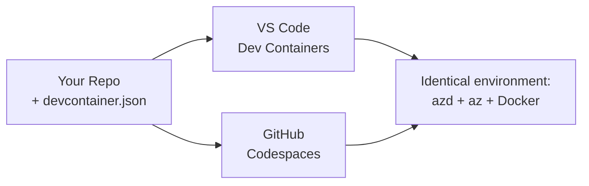

# ഡെവ് കൺറ്റെയിനറുകളും GitHub കോഡ്സ്പേസ്-കളും azd-ക്കായി

**അധ്യായം നാവിഗേഷൻ:**
- **📚 കോഴ്സ് ഹോം**: [AZD For Beginners](../../README.md)
- **📖 പ്രస్తుత അധ്യായം**: അധ്യായം 1 - അടിസ്ഥാനവും ദ്രുതാരംഭവും
- **⬅️ മുൻപ്**: [Bring Your Own App](bring-your-own-app.md)
- **🚀 അടുത്ത അധ്യായം**: [അദ്ധ്യായം 2: AI-First Development](../chapter-02-ai-development/README.md)

> കമാൻഡ് ആൻഡ് കോൺഫിഗറേഷൻ അവലോകന ലക്ഷ്യം: `azd 1.37.2` (നവംബർ 2026). കൺറ്റെയിനർ ബിൽഡുകളും ആസ്യൂർ ഡിപ്ലോയ്മെന്റുകളും ഈ അവലോകനത്തിന്റെ ഭാഗമായിരുന്നില്ല.

## പരിചയം

azd, ശരിയായ ഭാഷാ റൻടൈം, ഡോക്കർ, ആസ്യൂർ CLI എല്ലാം ഓരോ യന്ത്രത്തിലും ഇൻസ്റ്റാൾ ചെയ്യുന്നത് ഒരു തൊഴിൽ ആണ്—അതും "എന്റെ മെഷീനിൽ പ്രവർത്തിക്കുന്ന" ഒരു ട്യൂട്ടോറിയൽ മറ്റൊരാളിൻറെ മെഷീനിൽ പരാജയപ്പെടുന്നതിനുള്ള പ്രധാന കാരണം ആണ്. ഒരു **ഡെവ് കൺറ്റെയിനർ** ഇത് പരിഹരിക്കുന്നു, നിങ്ങളുടെ മുഴുവൻ ടൂൾചെയിനും ഒരു ഫയലിൽ വിവരണം നൽകുന്നു. പ്രോജക്ട് VS കോഡിലോ GitHub Codespaces-ലോ ആരെങ്കിലും തുറക്കുമ്പോൾ, azd ഇതിനകം ഇൻസ്റ്റാൾ ചെയ്ത ഒരു സമാനമായ പരിസ്ഥിതി ലഭിക്കും. ഈ പാഠം നിങ്ങളെ അതിനെ ചേർക്കുന്നത് കാണിക്കും.

## പഠന ലക്ഷ്യങ്ങൾ

ഈ പാഠം അവസാനിക്കുന്നതോടെ, നിങ്ങൾക്ക്:
- ഡെവ് കൺറ്റെയിനർ എന്നത് എന്തെന്ന്, azd-യെ സഹായിക്കുന്ന വഴികൾ ഉൾപ്പെടെ മനസ്സിലാക്കുക
- ഒരു കുറഞ്ഞ വലുപ്പമുള്ള `.devcontainer/devcontainer.json` ഒരു പ്രോജക്ടിലേക്ക് ഉൾപ്പെടുത്തുക
- ഡെവ് കൺറ്റെയിനർ *സവിശേഷതകൾ* വഴി azd, ആസ്യൂർ CLI, ഡോക്കർ ഉൾപ്പെടുത്തുക
- പ്രോജക്ട് GitHub Codespaces അല്ലെങ്കിൽ VS കോഡിൽ തുറക്കുക

## പഠനഫലങ്ങൾ

ഈ പാഠം പൂർത്തിയാക്കുമ്പോൾ, നിങ്ങൾ കഴിയും:
- azd പ്രോജക്ട്‌ക്കു വേണ്ടി `devcontainer.json` എഴുതുക
- azd, ആസ്യൂർ ടൂളിംഗ് കൈമാറാതെ ചേർക്കുക
- കൺറ്റെയിനറിനുള്ളിൽ അല്ലെങ്കിൽ Codespace-ൽ നിന്ന് `azd up` ഓടിക്കുക

---

## ഡെവ് കൺറ്റെയിനർ എന്താണ്?

ഡെവ് കൺറെയിനർ നിങ്ങളുടെ റിപോസിറ്ററിയിൽ ഉള്ള ഒരു `.devcontainer/devcontainer.json` ഫയൽ നിർവചിക്കുന്ന ഡോക്കർ-അടിസ്ഥാനമാക്കിയ ഡെവലപ്പ്മെന്റ് പരിസ്ഥിതിയാണ്. നിങ്ങൾ പ്രോജക്ട് തുറക്കുമ്പോൾ:

- **VS കോഡ്** (ഡെവ് കൺടെയിനർസ് എക്‌സ്റ്റൻഷനൊപ്പം) കൺറെയിനർ നിർമ്മിച്ച് അതോടൊപ്പം ചേക്കേറുന്നു.
- **GitHub Codespaces** അതേ കൺറെയിനർ ക്ലൗഡിൽ നിർമ്മിച്ച് ബ്രൗസർ അധിഷ്ഠിത എഡിറ്റർ നിങ്ങൾക്ക് നൽകുന്നു.

ഏതുവിധേന ആയാലും, ഓരോ സംഭാവകനും സമാനമായ ഉപകരണങ്ങൾ ലഭിക്കുന്നു—"azd ഇൻസ്റ്റാൾ ചെയ്തോ?" എന്ന തെളിവെടുപ്പുകൾ വേണ്ടാതിരിക്കും.



---

## ഘട്ടം 1: devcontainer ഫയൽ സൃഷ്ടിക്കുക

നിങ്ങളുടെ പ്രോജക്ടിന്റെ റൂട്ടിൽ `.devcontainer/devcontainer.json` സൃഷ്ടിക്കുക:

```json
{
  "name": "azd-project",
  "image": "mcr.microsoft.com/devcontainers/base:bookworm",
  "features": {
    "ghcr.io/devcontainers/features/azure-cli:1": {},
    "ghcr.io/azure/azure-dev/azd:0": { "version": "1.37.2" },
    "ghcr.io/devcontainers/features/docker-in-docker:2": {},
    "ghcr.io/devcontainers/features/node:1": {}
  },
  "customizations": {
    "vscode": {
      "extensions": [
        "ms-azuretools.azure-dev",
        "ms-azuretools.vscode-bicep"
      ]
    }
  },
  "forwardPorts": [3000],
  "postCreateCommand": "azd version"
}
```

ഓരോ ഭാഗവും ചെയ്യുന്നത്:

| കീ | ഉദ്ദേശ്യം |
|-----|---------|
| `image` | കൺറെയിനറിന്റെ അടിസ്ഥാന ഓപറേറ്റിംഗ് സിസ്റ്റം |
| `features` | മുൻകൂട്ടി നിർമ്മിച്ച ഇൻസ്റ്റാളറുകൾ—ഇവിടെ: ആസ്യൂർ CLI, **azd**, ഡോക്കർ, നോഡ്.js |
| `customizations.vscode.extensions` | azd, Bicep VS കോഡ് എക്സ്റ്റൻഷനുകൾ സ്വയം ഇൻസ്റ്റാൾ ചെയ്യുന്നു |
| `forwardPorts` | നിങ്ങളുടെ ആപ്ലിക്കേഷന്റെ പോർട്ട് ബ്രൗസറിലേക്ക് തുറക്കുന്നു |
| `postCreateCommand` | കൺറെയിനർ നിർമ്മിച്ചതിന് ശേഷം ഒരിക്കൽ ഓടുന്നു (ഇവിടെ, ഒരു സാനിറ്റി നൽകൽ പരിശോധ) |

> സവിശേഷത വേർഷൻ (`azd:0`) ഇൻസ്റ്റാൾ ചെയ്ത CLI വേർഷനിൽ നിന്ന് വ്യത്യസ്തമാണ്. CLI പിന്ബിടാൻ സവിശേഷതയുടെ `version` ഓപ്ഷൻ `"1.37.2"` ആക്കുക; CLI വേർഷൻ സവിശേഷത ടാഗായി ഉപയോഗിക്കരുത്.

---

## ഘട്ടം 2: സവിശേഷത നിങ്ങളുടെ ആപ്പിന്റെ ഭാഷയുമായി പൊരുത്തപ്പെടുത്തുക

നിങ്ങളുടെ ആപ്പ് ഉപയോഗിക്കുന്നത് എന്തെങ്കിലും ആയാലും `node` സവിശേഷത മാറ്റി വെയ്ക്കുക:

```jsonc
// Python project
"ghcr.io/devcontainers/features/python:1": {},

// .NET project
"ghcr.io/devcontainers/features/dotnet:2": {},

// Java project
"ghcr.io/devcontainers/features/java:1": {},

// Go project
"ghcr.io/devcontainers/features/go:1": {}
```

ചിത്രംങ്ങളോട് പ്രവർത്തിക്കുമ്പോൾ `docker-in-docker` നിലനിർത്തുക. ഒരു ക്രമീകരിച്ച റിമോട്ട് ACR ബിൽഡ് (`docker.remoteBuild: true`) ഒരു പര്യായമാണ്; ഹോസ്റ്റ് തരം മാത്രം 항상 ലൊക്കൽ Docker ആവശ്യപ്പെടുന്നില്ല.

---

## പടി 3: തുറക്കുക

**VS കോഡിൽ:**
1. **Dev Containers** വിപുലീകരണം ഇൻസ്റ്റാൾ ചെയ്യുക.
2. പ്രോജക്റ്റ് ഫോൾഡർ തുറക്കുക.
3. ആവശ്യപ്പെട്ടപ്പോള്‍ **Reopen in Container** ക്ലിക്ക് ചെയ്യുക (അല്ലെങ്കില്‍ *Dev Containers: Reopen in Container* റൺ ചെയ്യുക).

**GitHub Codespaces-ൽ:**
1. റീപോ GitHub-ലേക്ക് പുഷ് ചെയ്യുക.
2. **Code → Codespaces → Create codespace on main** ക്ലിക്ക് ചെയ്യുക.
3. കണ്ടെയ്‌നർ നിർമ്മിക്കുവാനുള്ള കാത്തിരിപ്പ് — ടർമിനലിൽ azd സജ്ജമാണ്.

---

## പടി 4: കണ്ടെയ്‌നറിനുള്ളിൽ നിന്ന് വിന്യസിക്കുക

കണ്ടെയ്‌നറിൽ azd ഇൻസ്റ്റാൾ ചെയ്തിരിക്കുന്നു, അതിനാൽ സാധാരണ പ്രവൃത്തി പ്രവാഹം പ്രവർത്തിക്കും:

```bash
azd auth login --use-device-code   # device code is handy inside Codespaces
azd up
```

> **എന്തുകൊണ്ട് `--use-device-code`?** റിമോട്ട് കണ്ടെയ്‌നർ അല്ലെങ്കിൽ Codespace-ൽ ലൊക്കൽ ബ്രൗസർ ഇല്ലാത്തതിനാൽ, ഡിവൈസ്-കോഡ് ലോഗിൻ ഉറപ്പുള്ള മാർഗമാണ്. സെയിന് ഇൻ പൂർത്തിയാക്കാൻ ബ്രൗസർ ടാബിൽ ഒരു കോഡ് പേസ്റ്റ് ചെയ്യും.

---

## സാധാരണ പിഴവുകൾ

| പിഴവ് | പരിഹാരം |
|---------|-----|
| `azd up` ഒരു ചിത്രം നിർമ്മിക്കാൻ കഴിയുന്നില്ല | `docker-in-docker` സവിശേഷത ചേർക്കുക |
| Codespaces-ൽ ബ്രൗസർ ലോഗിൻ തളർന്നുപോകുന്നു | `azd auth login --use-device-code` ഉപയോഗിക്കുക |
| ഉപകരണങ്ങൾ സംഘാംഗങ്ങൾക്കിടയിൽ വ്യത്യസ്തമാണ് | azd സവിശേഷതയുടെ `version` ഓപ്ഷനിലൂടെ CLI പിന്ചെയ്യൂമാക്കുക, ഭാഷാ റൺടൈംകൾ പിന്ചെയ്യൂമാക്കുക |
| ബ്രൗസറിൽ ആപ്പ് എത്താനാകുന്നില്ല | പോർട്ട് `forwardPorts`-ലേക്ക് ചേർക്കുക |

---

## സംക്ഷേപം

- ഒരു ഡെവ് കണ്ടെയ്‌നർ നിങ്ങളുടെ azd ടൂൾചെയിൻ എല്ലാവർക്കും പുനരുപയോഗയോഗ്യമാക്കി മാറ്റുന്നു.
- azd, Azure CLI, Docker Dev Container *സവിശേഷതകൾ* വഴിയുള്ള ഉപയോഗം.
- നിങ്ങളുടെ ആപ്ലിക്കേഷനൊപ്പം ഭാഷാ സവിശേഷത പൊരുത്തപ്പെടുത്തുക, കണ്ടെയ്‌നർ ഹോസ്റ്റുകൾക്ക് `docker-in-docker` നിലനിർത്തുക.
- Codespaces-ൽ പ്രവർത്തിക്കുമ്പോൾ ഡിവൈസ്-കോഡ് ലോഗിൻ ഉപയോഗിക്കുക.

---

## 🔗 ദിശനിർദ്ദേശം

| ദിശ | വിഭവം |
|-----------|----------|
| **മുൻപ്** | [നിങ്ങളുടെ സ്വന്തം ആപ്പ് കൊണ്ടുവരുക](bring-your-own-app.md) |
| **അധ്യായം ഹോം** | [അധ്യായം 1: അടിസ്ഥാനവും ഉരുകിയാരംഭവും](README.md) |
| **അടുത്ത അധ്യായം** | [അധ്യായം 2: AI-ഫസ്റ്റ് വികസനം](../chapter-02-ai-development/README.md) |

## 📖 ബന്ധപ്പെട്ട വിഭവങ്ങൾ

- [ഇൻസ്റ്റലേഷൻ & ക്രമീകരണം](installation.md)
- [കമാൻഡ് ചീറ്റ്ഷീറ്റ്](../../resources/cheat-sheet.md)
- [അധികൃത Dev Containers വിശദീകരണം](https://containers.dev/)
- [azd Dev Container സവിശേഷത](https://github.com/Azure/azure-dev/tree/main/ext/devcontainer)

---

<!-- CO-OP TRANSLATOR DISCLAIMER START -->
**അറിയിപ്പ്**:
ഈ രേഖ AI പരിഭാഷാ സേവനം [Co-op Translator](https://github.com/Azure/co-op-translator) ഉപയോഗിച്ച് പരിഭാഷപ്പെടുത്തിയതാണ്. ഞങ്ങൾ കൃത്യതയ്ക്കായി ശ്രമിക്കുന്നുവെങ്കിലും, ഓട്ടോമേറ്റഡ് പരിഭാഷകളിൽ പിഴവുകൾ അല്ലെങ്കിൽ തെറ്റായ വിവരങ്ങൾ ഉണ്ടാകാൻ സാധ്യതയുണ്ട്. അതിന്റെ സ്വാഭാവിക ഭാഷയിലുള്ള അസൽ രേഖയാണ് പ്രാമാണികമായ ഉറവിടമായി പരിഗണിക്കേണ്ടത്. നിർണായകമായ വിവരങ്ങൾക്ക്, പ്രൊഫഷണൽ മനുഷ്യ പരിഭാഷ ശുപാർശ ചെയ്യുന്നു. ഈ പരിഭാഷ ഉപയോഗിച്ച് ഉണ്ടാകുന്ന തെറ്റിദ്ധാരണകൾ അല്ലെങ്കിൽ തെറ്റായ വ്യാഖ്യാനങ്ങൾക്കായി ഞങ്ങൾ ഉത്തരവാദികളല്ല.
<!-- CO-OP TRANSLATOR DISCLAIMER END -->