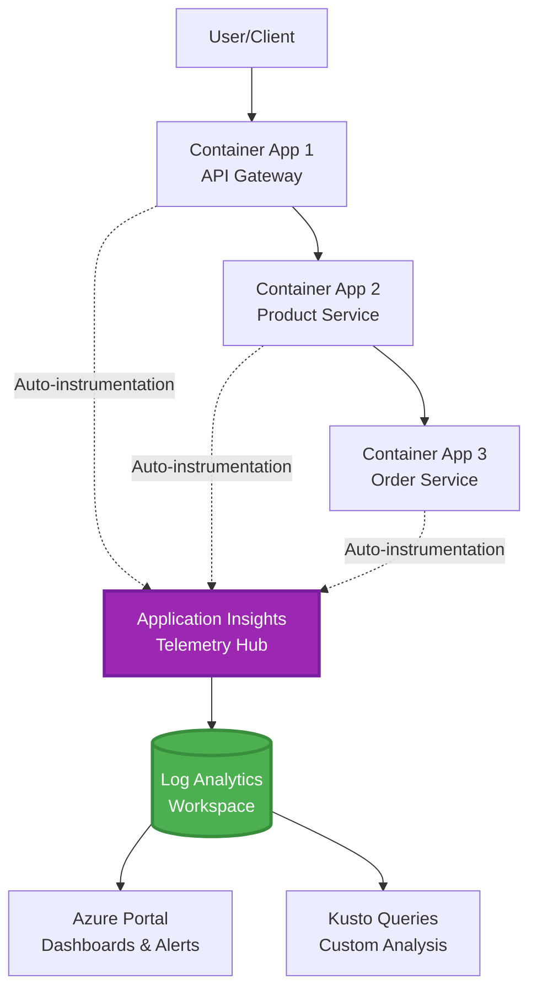
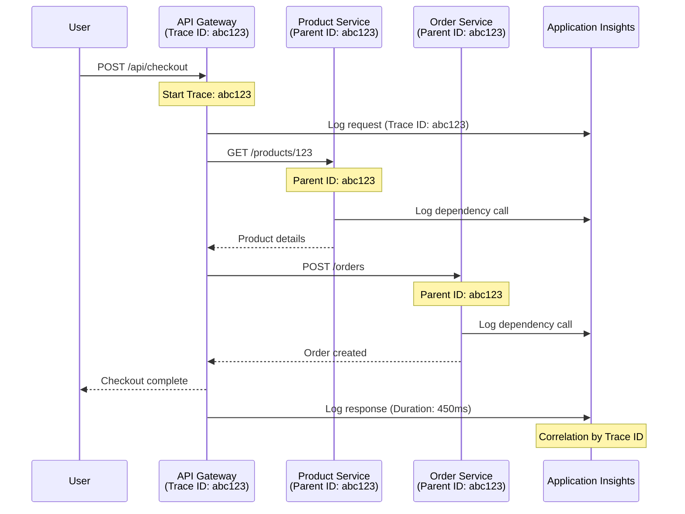

# AZD-ഉം Application Insights സംയോജനം

⏱️ **അനുമാനിക്കപ്പെട്ട സമയം**: 40-50 മിനിറ്റ് | 💰 **ചെലവ് സ്വാധീനം**: ~$5-15/മാസം | ⭐ **സങ്കീർണത**: മധ്യത്തിലിലായി

**📚 പഠന പാത:**
- ← മുന്‍പ്: [Preflight Checks](preflight-checks.md) - മുൻ-പ്രവർത്തന പരിശോധന
- 🎯 **നീ നിങ്ങൾ ഇവിടെ**: Application Insights സംയോജനം (മോണിറ്ററിംഗ്, ടെലിമെട്രി, ഡിബഗ്ഗിംഗ്)
- → അടുത്തത്: [Deployment Guide](../chapter-04-infrastructure/deployment-guide.md) - Azure-ിലേക്ക് വിന്യമാനം
- 🏠 [കോഴ്സ് ഹോം](../../README.md)

---

## നിങ്ങൾ പഠിക്കാനുളളത്

ഈ പാഠം പൂർത്തിയാക്കിയാൽ നിങ്ങൾക്ക് കഴിയും:
- AZD ഇൻഫ്രാസ്ട്രക്ചറിൽ **Application Insights** പ്രഖ്യാപിച്ച് SDK ഇൻസ്ട്രുമെന്റേഷൻ ക്രമീകരിക്കുക
- മൈക്രോസർവീസുകൾക്കായി **വിതരണ ട്രേസിംഗ്** ക്രമീകരിക്കുക
- **കസ്റ്റം ടെലിമെട്രി** (മെട്രിക്ക്സ്, ഇവന്റുകൾ, ആശ്രിതങ്ങൾ) നടപ്പിലാക്കുക
- ലൈവ് മെട്രിക്കുകൾ റിയൽ-ടൈം സെറ്റപ്പ് ചെയ്യുക
- AZD വിന്യാസങ്ങളിൽ നിന്ന് **അറിയിപ്പുകളും ഡാഷ്ബോർഡുകളും** സൃഷ്ടിക്കുക
- **ടെലിമെട്രി ക്വെറിയുകൾ** ഉപയോഗിച്ച് പ്രൊഡക്ഷൻ പ്രശ്നങ്ങൾ ഡിബഗ് ചെയ്യുക
- **ചെലവും സാമ്പിൾനിംഗ്** തന്ത്രങ്ങൾ ഒപ്റ്റിമൈസ് ചെയ്യുക
- **AI/LLM അപ്ലിക്കേഷനുകളെ** നിരീക്ഷിക്കുക (ടോക്കണുകൾ, ദൈർഘ്യം, ചെലവ്)

## AZD-ന്‍റെ Application Insights പ്രാധാന്യം

### വെല്ലുവിളി: പ്രൊഡക്ഷൻ നിരീക്ഷണം

**Application Insights ഇല്ലാതെ:**
```
❌ No visibility into production behavior
❌ Manual log aggregation across services
❌ Reactive debugging (wait for customer complaints)
❌ No performance metrics
❌ Cannot trace requests across services
❌ Unknown failure rates and bottlenecks
```

**Application Insights + AZD ഉപയോഗിച്ചാൽ:**
```
✅ Automatic telemetry collection
✅ Centralized logs from all services
✅ Proactive issue detection
✅ End-to-end request tracing
✅ Performance metrics and insights
✅ Real-time dashboards
✅ AZD provisions the monitoring declared in your templates
```

**ഉദാഹരണം**: Application Insights നിങ്ങളുടെ അപ്ലിക്കേഷനുള്ള "ബ്ലാക്ക് ബോക്സ്" ഫ്ലൈറ്റ് റെക്കോർഡർ + കോക്‌പിറ്റ് ഡാഷ്ബോർഡ് പോലെയാണ്. നിങ്ങൾക്ക് റിയൽ-ടൈത്തിൽ എല്ലാ സംഭവങ്ങളും കാണാം, ഏതെങ്കിലും ഉള്ള പ്രശ്‌നം വീണ്ടും പ്ലേ ചെയ്യാം.

---

## ആർക്കിടെക്ചർ അവലോകനം

### AZD ആർക്കിടെക്ചറിലെ Application Insights



### എന്താണ് ഓട്ടോമാറ്റിക്കായി നിരീക്ഷിക്കുന്നത്

പിന്തുണയുള്ള ഓട്ടോ-ഇൻസ്ട്രുമെന്റേഷൻ ഇൻസ്ട്രുമെന്റ് ചെയ്ത ലൈബ്രറികളിൽ അപേക്ഷകൾ/അന്തരികളെടുക്കലുകൾ പിടിച്ചെടുക്കുന്നു. കസ്റ്റം ഇവന്റുകളും മെട്രിക്ക്സും അപേക്ഷാ കോഡ് ആവശ്യമാണ്; ലഭ്യത പരിശോധനകൾ വേർതിരിച്ചും ക്രമീകരിക്കേണ്ടത് ആണ്. ഉറവിടം ഉണ്ടെന്നതിനാൽ എല്ലാ വരി ശേഖരിക്കില്ല.

| ടെലിമെട്രി തരം | അത് എന്ത് പിടിച്ചെടുക്കുന്നു | ഉപയോഗ കേസ് |
|----------------|------------------|----------|
| **അപേക്ഷകൾ** | HTTP അഭ്യർത്ഥനകൾ, സ്റ്റാറ്റസ് കോഡുകൾ, ദൈർഘ്യം | API പ്രകടന മോണിറ്ററിംഗ് |
| **അന്തരി** | പുറം കോളുകൾ (DB, APIകൾ, സ്റ്റോറേജ്) | ബോട്ടിൽനെക്കുകൾ കണ്ടെത്തുക |
| **പിഴവുകൾ** | സ്റ്റാക്ക് ട്രേസുകൾ സഹിതം കൈകാര്യമില്ലാത്ത പിശകുകൾ | പിഴവുകൾ ഡിബഗ് ചെയ്യൽ |
| **കസ്റ്റം ഇവന്റുകൾ** | ബിസിനസ്സ് ഇവന്റുകൾ (സൈൻഅപ്പ്, വാങ്ങൽ) | വിശകലനവും ഫണലുകളും |
| **മെട്രിക്ക്സ്** | പ്രകടന കൗണ്ടറുകൾ, കസ്റ്റം മെട്രിക്ക്സ് | ശേഷി പദ്ധതിയിടലിന് |
| **ട്രേസ്** | ഗുരുത്വമുള്ള ലോഗ് സന്ദേശങ്ങൾ | ഡിബഗ്ഗിംഗ്, ഓഡിറ്റിംഗ് |
| **ലഭ്യത** | അപ്‌ടൈം, പ്രതികരണ സമയം പരിശോധനകൾ | SLA നിരീക്ഷണം |

---

## മുൻകൂട്ടി തയാറെടുപ്പ്

### ആവശ്യമായ ഉപകരണങ്ങൾ

```bash
# Verify Azure Developer CLI
azd version
# Command reference baseline: azd 1.37.2

# Verify Azure CLI
az --version
# ✅ Expected: azure-cli 2.50.0 or higher
```

### Azure ആവശ്യകതകൾ

- സജീവ Azure സബ്സ്ക്രിപ്ഷൻ
- സൃഷ്ടിക്കാൻ അനുമതികൾ:
  - Application Insights വിഭവങ്ങൾ
  - ലോഗ് അനലിറ്റിക്സ് വർക്ക്സ്പേസുകൾ
  - കണ്ടെയ്‌നർ ആപ്പുകൾ
  - റിസോഴ്സ് ഗ്രൂപ്പുകൾ

### അറിവ് മുൻപറിയിപ്പ്

നിങ്ങൾ ഇതിനകം പൂർത്തിയാക്കിയിരിക്കണം:
- [AZD അടിസ്ഥാനങ്ങൾ](../chapter-01-foundation/azd-basics.md) - AZD മുഖ്യ ആശയങ്ങൾ
- [ക്രമീകരണം](../chapter-03-configuration/configuration.md) - പരിസ്ഥിതി ക്രമീകരണം
- [ആദ്യ പ്രോജക്ട്](../chapter-01-foundation/first-project.md) - അടിസ്ഥാന വിന്യാസം

---

## പാഠം 1: AZD-യുമായി ഓട്ടോമാറ്റിക് Application Insights

### AZD എങ്ങനെ Application Insights പ്രൊവിഷൻ ചെയ്യുന്നു

AZD Application Insights **പോരโ്കളയിൽ ഇത്തരത്തിൽ പ്രഖ്യാപിച്ചപ്പോൾ മാത്രമേ പ്രൊവിഷൻ ചെയ്യൂ**. `azure.yaml` മാത്രമാകാതെ കണക്കാക്കപ്പെടൽ അല്ലെങ്കിൽ അഭ്യർത്ഥന കോഡിനെ ഇൻസ്ട്രുമെന്റ് ചെയ്യുക.

> **ഉദാഹരണ പരിധി:** ഈ പാഠത്തിൽ സംയോജനം ഘടകങ്ങൾ അടങ്ങിയിട്ടുണ്ട്, ഈ റെപ്പോസിറ്ററിയിലെ ഒരു പൂർണ്ണ `monitored-app` പ്രോജക്റ്റ് അല്ല. ഒരു മേൻ ടെമ്പ്ൾറ്റും, പാരാമീറ്റർ മാപ്പിംഗും, കണ്ടെയ്‌നർ ആപ്പുകൾ പരിസ്ഥിതിയും റെജിസ്ട്രി / ഇമേജ് ആൻഡ് ഐഡന്‍റിറ്റി ക്രമീകരണവും, Dockerfile, സർവീസ് ടാഗുകൾ എന്നിവ നൽകാതെ വിന്യമാനം നടത്തരുത്. പിന്നീട് പാഠങ്ങളിൽ വിപുലീകരിച്ച ഘടകങ്ങൾ കാണിക്കും, പൂർണ്ണമായി ചേർക്കാവുന്ന ഫയലുകൾ അല്ല. ഒരു പ്രവർത്തന ബേസ്ലൈൻ ആവശ്യമെങ്കിൽ [മൈക്രസർവീസസ് ഉദാഹരണം](../../../../examples/microservices) ഉപയോഗിച്ച് ആരംഭിക്കുക.

### പ്രോജക്റ്റ് ഘടന

```
monitored-app/
├── azure.yaml                     # AZD configuration
├── infra/
│   ├── main.bicep                # Main infrastructure
│   ├── core/
│   │   └── monitoring.bicep      # Application Insights + Log Analytics
│   └── app/
│       └── api.bicep             # Container App with monitoring
└── src/
    ├── app.py                    # Application with telemetry
    ├── requirements.txt
    └── Dockerfile
```

---

### ഘട്ടം 1: AZD ക്രമീകരിക്കൽ (azure.yaml)

**ഫയർ: `azure.yaml`**

```yaml
name: monitored-app
metadata:
  template: monitored-app@1.0.0

services:
  api:
    project: ./src
    language: python
    host: containerapp

# Monitoring must be declared in infra/ and enabled in application code.
```

ഇത് വിന്യസിക്കാവുന്ന സേവനം പ്രഖ്യാപിക്കുന്നു. താഴെയുള്ള Bicep, SDK ക്രമീകരണങ്ങൾ മോണിറ്ററിംഗ് നൽകുന്നു; azd അവ സ്വയം ചേർക്കുന്നില്ല.

---

### ഘട്ടം 2: നിരീക്ഷണ ഇൻഫ്രാസ്ട്രക്ചർ (Bicep)

**ഫയർ: `infra/core/monitoring.bicep`**

```bicep
param logAnalyticsName string
param applicationInsightsName string
param location string = resourceGroup().location
param tags object = {}

// Log Analytics Workspace (required for Application Insights)
resource logAnalytics 'Microsoft.OperationalInsights/workspaces@2022-10-01' = {
  name: logAnalyticsName
  location: location
  tags: tags
  properties: {
    sku: {
      name: 'PerGB2018'  // Pay-as-you-go pricing
    }
    retentionInDays: 30  // Keep logs for 30 days
    features: {
      enableLogAccessUsingOnlyResourcePermissions: true
    }
  }
}

// Application Insights
resource applicationInsights 'Microsoft.Insights/components@2020-02-02' = {
  name: applicationInsightsName
  location: location
  tags: tags
  kind: 'web'
  properties: {
    Application_Type: 'web'
    WorkspaceResourceId: logAnalytics.id
    IngestionMode: 'LogAnalytics'
    publicNetworkAccessForIngestion: 'Enabled'
    publicNetworkAccessForQuery: 'Enabled'
  }
}

// Outputs for Container Apps
output logAnalyticsWorkspaceId string = logAnalytics.id
output logAnalyticsWorkspaceName string = logAnalytics.name
output applicationInsightsConnectionString string = applicationInsights.properties.ConnectionString
output applicationInsightsInstrumentationKey string = applicationInsights.properties.InstrumentationKey
output applicationInsightsName string = applicationInsights.name
output applicationInsightsId string = applicationInsights.id
```

---

### ഘട്ടം 3: കണ്ടെയ്‌നർ ആപ്പ് Application Insights-നുമായി കണക്റ്റ് ചെയ്യുക

**ഫയർ: `infra/app/api.bicep`**

```bicep
param name string
param location string
param tags object = {}
param containerAppsEnvironmentId string
param containerImage string
param applicationInsightsConnectionString string

resource containerApp 'Microsoft.App/containerApps@2023-05-01' = {
  name: name
  location: location
  tags: tags
  properties: {
    managedEnvironmentId: containerAppsEnvironmentId
    configuration: {
      ingress: {
        external: true
        targetPort: 8000
      }
      secrets: [
        {
          name: 'appinsights-connection-string'
          value: applicationInsightsConnectionString
        }
      ]
    }
    template: {
      containers: [
        {
          name: 'api'
          image: containerImage // Supply an accessible image and registry authentication
          resources: {
            cpu: json('0.5')
            memory: '1Gi'
          }
          env: [
            {
              name: 'APPLICATIONINSIGHTS_CONNECTION_STRING'
              secretRef: 'appinsights-connection-string'
            }
            {
              name: 'APPLICATIONINSIGHTS_ENABLED'
              value: 'true'
            }
          ]
        }
      ]
    }
  }
}

output uri string = 'https://${containerApp.properties.configuration.ingress.fqdn}'
```

---

### ഘട്ടം 4: ടെലിമെട്രിയോടെ അപേക്ഷ കോഡ്

**ഫയർ: `src/app.py`**

```python
from flask import Flask, request, jsonify
from azure.monitor.opentelemetry import configure_azure_monitor
import logging
import os

app = Flask(__name__)

# Get Application Insights connection string
connection_string = os.environ.get('APPLICATIONINSIGHTS_CONNECTION_STRING')

if connection_string:
    # Azure Monitor OpenTelemetry instruments supported libraries, including Flask.
    configure_azure_monitor(
        connection_string=connection_string,
        logger_name=__name__,
        enable_live_metrics=True
    )
    logger = logging.getLogger(__name__)
    logger.setLevel(logging.INFO)
    
    print("✅ Application Insights enabled")
else:
    logger = logging.getLogger(__name__)
    logger.setLevel(logging.INFO)
    print("⚠️ Application Insights not configured")

@app.route('/health')
def health():
    logger.info('Health check endpoint called')
    return jsonify({'status': 'healthy', 'monitoring': 'enabled' if connection_string else 'disabled'})

@app.route('/api/products')
def get_products():
    logger.info('Fetching products')
    
    # In-memory fixture: this is not a database dependency call.
    products = [
        {'id': 1, 'name': 'Laptop', 'price': 999.99},
        {'id': 2, 'name': 'Mouse', 'price': 29.99},
        {'id': 3, 'name': 'Keyboard', 'price': 79.99}
    ]
    
    logger.info(f'Returned {len(products)} products')
    return jsonify(products)

@app.route('/api/error-test')
def error_test():
    """Test error tracking"""
    logger.error('Testing error tracking')
    try:
        raise ValueError('This is a test exception')
    except Exception as e:
        logger.exception('Exception occurred in error-test endpoint')
        return jsonify({'error': str(e)}), 500

@app.route('/api/slow')
def slow_endpoint():
    """Test performance tracking"""
    import time
    logger.info('Slow endpoint called')
    time.sleep(3)  # Simulate slow operation
    logger.warning('Endpoint took 3 seconds to respond')
    return jsonify({'message': 'Slow operation completed'})

if __name__ == '__main__':
    app.run(host='0.0.0.0', port=8000)
```

**ഫയർ: `src/requirements.txt`**

```txt
Flask
azure-monitor-opentelemetry
gunicorn
requests
openai
```

ഈ ആശ്രിതത്വങ്ങൾ നിങ്ങളുടെ പ്രോജക്റ്റിൽ പരിഹരിക്കുക, ഒന്നിച്ച് പരിശോധിക്കുക, ലഭ്യമായ പതിപ്പുകൾ ലോക്ക് ചെയ്യുക. പുതിയ പ്രോജക്റ്റുകൾ Azure Monitor OpenTelemetry ഉപയോഗിക്കണം, പരിħaാരപ്പെടുത്തിയ OpenCensus Python എക്സ്പോർട്ടറുകൾ അല്ല.

---

### ഘട്ടം 5: വിന്യമാനം ചെയ്യുക, സ്ഥിരീകരിക്കുക

```bash
# Deploy only after completing and wiring the infrastructure fragments above
azd up

# Get app URL
APP_URL=$(azd env get-value API_URL) # Requires this output in main.bicep

# Generate telemetry
curl $APP_URL/health
curl $APP_URL/api/products
curl $APP_URL/api/error-test
curl $APP_URL/api/slow
```

**✅ പ്രതീക്ഷിക്കുന്ന ഔട്ട്‌പുട്ട്:**
```json
{
  "status": "healthy",
  "monitoring": "enabled"
}
```

---

### ഘട്ടം 6: Azure പോർട്ടലിൽ ടെലിമെട്രി കാണുക

```bash
# Get Application Insights details
azd env get-values | grep APPLICATIONINSIGHTS

# Open in Azure Portal
az monitor app-insights component show \
  --app $(azd env get-values | grep APPLICATIONINSIGHTS_NAME | cut -d '=' -f2 | tr -d '"') \
  --resource-group $(azd env get-values | grep AZURE_RESOURCE_GROUP | cut -d '=' -f2 | tr -d '"') \
  --query "appId" -o tsv
```

**Azure പോർട്ടലിലേക്കു പോകൂ → Application Insights → Transaction Search**

നിങ്ങൾക്ക് കാണാൻപെടുന്നതാണ്:
- ✅ HTTP അഭ്യർത്ഥനകളും സ്റ്റാറ്റസ് കോഡുകളും
- ✅ അഭ്യർത്ഥന ദൈർഘ്യം (3+ സെക്കൻഡ് `/api/slow` വേണ്ടി)
- ✅ `/api/error-test`-ൽ നിന്നുള്ള പിഴവ് വിവരങ്ങൾ
- ✅ കസ്റ്റം ലോഗ് സന്ദേശങ്ങൾ

---

## പാഠം 2: കസ്റ്റം ടെലിമെട്രി, ഇവന്റുകൾ

### ബിസിനസ്സ് ഇവന്റുകൾ ട്രാക്ക് ചെയ്യുക

ബിസിനസ്സ്-പ്രധാന ഇവന്റുകൾക്കായി കസ്റ്റം ടെലിമെട്രി ചേర్చുക.

**ഫയർ: `src/telemetry.py`**

```python
from contextlib import contextmanager
from azure.monitor.opentelemetry import configure_azure_monitor
from opentelemetry import metrics, trace
from opentelemetry.trace import SpanKind
import logging
import os

class TelemetryClient:
    """Custom telemetry client for Application Insights"""
    
    def __init__(self, connection_string=None):
        self.connection_string = connection_string or os.environ.get('APPLICATIONINSIGHTS_CONNECTION_STRING')
        
        # Configure once per process. If app.py already calls this, keep only
        # one configure_azure_monitor call and use logger_name='telemetry'.
        if self.connection_string:
            configure_azure_monitor(
                connection_string=self.connection_string,
                logger_name=__name__,
                enable_live_metrics=True
            )
        self.logger = logging.getLogger(__name__)
        self.logger.setLevel(logging.INFO)
        self.tracer = trace.get_tracer(__name__)
        self.meter = metrics.get_meter(__name__)
        self.instruments = {}
    
    def track_event(self, event_name: str, properties: dict = None):
        """Track custom business event"""
        properties = properties or {}
        self.logger.info(
            f"CustomEvent: {event_name}",
            extra={
                # OTel log attributes become customDimensions in App Insights.
                    'event_name': event_name,
                    **properties
            }
        )
    
    def track_metric(self, metric_name: str, value: float, properties: dict = None):
        """Track custom metric"""
        properties = properties or {}
        if metric_name not in self.instruments:
            self.instruments[metric_name] = self.meter.create_histogram(metric_name)
        self.instruments[metric_name].record(value, attributes=properties)
    
    @contextmanager
    def track_dependency(self, name: str):
        """Time the real operation inside a client span; exceptions mark failure."""
        with self.tracer.start_as_current_span(name, kind=SpanKind.CLIENT) as span:
            yield span

# Global telemetry client
telemetry = TelemetryClient()
```

### കസ്റ്റം ഇവന്റുകളോടെ അപേക്ഷ അപ്ഡേറ്റ് ചെയ്യുക

**ഫയർ: `src/app.py` (മെച്ചപ്പെടുത്തിയ)**

നിലവിലുള്ള Flask ആപ്പിലേക്കു ഈ റൂട്ടുകൾ ചേർക്കുക; മുമ്പത്തെ health/test റൂട്ടുകൾ സൂക്ഷിക്കുക. താഴെ കൊടുത്തിരിക്കുന്ന ബ്ലോക്ക് വ്യത്യാസമുണ്ട് വേണ്ടത്ര വ്യക്തതക്കായി വ്യത്യസ്ത ആപ്പ് കാണിക്കുന്നു. ടെലിമെട്രി ഇൻഷെഷ്യലൈസേഷൻ ഇപ്പോള്‍ `telemetry.py`ൽ ആണ് — എക്സ്പോർട്ടറുകൾ ഇരട്ടിയാക്കേണ്ടതില്ല.

```python
from flask import Flask, request, jsonify
from telemetry import telemetry
import time
import random
import os

app = Flask(__name__)

@app.route('/api/purchase', methods=['POST'])
def purchase():
    """Track purchase event with custom telemetry"""
    data = request.get_json(silent=True) or {}
    product_id = data.get('product_id')
    quantity = data.get('quantity', 1)
    price = data.get('price', 0)
    if not isinstance(quantity, int) or quantity < 1 or \
       not isinstance(price, (int, float)) or price < 0:
        return jsonify({'error': 'quantity and price must be non-negative numbers; quantity >= 1'}), 400
    
    # Track business event
    telemetry.track_event('Purchase', {
        'product_id': product_id,
        'quantity': quantity,
        'total_amount': price * quantity,
        'user_id': request.headers.get('X-User-Id', 'anonymous')
    })
    
    # Track revenue metric
    telemetry.track_metric('Revenue', price * quantity, {
        'product_id': product_id,
        'currency': 'USD'
    })
    
    return jsonify({
        'order_id': f'ORD-{random.randint(1000, 9999)}',
        'status': 'confirmed',
        'total': price * quantity
    })

@app.route('/api/search')
def search():
    """Track search queries"""
    query = request.args.get('q', '')
    
    start_time = time.time()
    
    # Simulate search (would be real database query)
    results = [{'id': 1, 'name': f'Result for {query}'}]
    
    duration = (time.time() - start_time) * 1000  # Convert to ms
    
    # Track search event
    telemetry.track_event('Search', {
        'query': query,
        'results_count': len(results),
        'duration_ms': duration
    })
    
    # Track search performance metric
    telemetry.track_metric('SearchDuration', duration, {
        'query_length': len(query)
    })
    
    return jsonify({'results': results, 'count': len(results)})

@app.route('/api/external-call')
def external_call():
    """Track external API dependency"""
    import requests
    
    try:
        # Set an actual test endpoint; api.example.com is not a working API.
        with telemetry.track_dependency('ExternalAPI'):
            response = requests.get(os.environ['EXTERNAL_API_URL'], timeout=5)
            response.raise_for_status()
            result = response.json()
    except Exception as e:
        return jsonify({'error': 'External dependency failed'}), 502
    
    return jsonify(result)

if __name__ == '__main__':
    app.run(host='0.0.0.0', port=8000)
```

### കസ്റ്റം ടെലിമെട്രി കണക്കുകൾ പരിശോധിക്കുക

```bash
# Track purchase event
curl -X POST $APP_URL/api/purchase \
  -H "Content-Type: application/json" \
  -H "X-User-Id: user123" \
  -d '{"product_id": 1, "quantity": 2, "price": 29.99}'

# Track search event
curl "$APP_URL/api/search?q=laptop"

# Track external dependency
curl $APP_URL/api/external-call
```

**Azure പോർട്ടലിൽ കാണുക:**

Application Insights → Logs-ലേക്ക് പോയി, പിന്നീട് ഓടിക്കുക:

```kusto
// View purchase events
traces
| where customDimensions.event_name == "Purchase"
| project 
    timestamp,
    product_id = tostring(customDimensions.product_id),
    total_amount = todouble(customDimensions.total_amount),
    user_id = tostring(customDimensions.user_id)
| order by timestamp desc

// Revenue recorded in Purchase events (not a billing ledger)
traces
| where customDimensions.event_name == "Purchase"
| summarize TotalRevenue = sum(todouble(customDimensions.total_amount)) by bin(timestamp, 1h)
| render timechart

// View search performance
traces
| where customDimensions.event_name == "Search"
| summarize 
    AvgDuration = avg(todouble(customDimensions.duration_ms)),
    SearchCount = count()
  by bin(timestamp, 5m)
| render timechart
```

---

## പാഠം 3: മൈക്രോസർവീസുകൾക്കുള്ള വിതരണ ട്രേസിംഗ്

### ക്രോസ്-സർവീസ് ട്രേസിംഗ് സജ്ജമാക്കുക

അനുകൂലമായ ഇൻസ്ട്രുമെന്റേഷനും W3C ട്രേസ്-കോണ്‍ടെക്സ്റ്റ് പ്രചരിപ്പിക്കുകയും വേണം, Application Insights അഭ്യർത്ഥനകൾ സർവീസുകൾ തമ്മിൽ ബന്ധപ്പെട്ട് കാണിക്കുന്നു. ഒരു കണക്ഷൻ സ്ട്രിംഗ് പങ്കുവെക്കുന്നത് തന്നെ പാരന്റ്-ചൈൽഡ് സ്പാൻസ് സൃഷ്ടിക്കില്ല. താഴെയുള്ള ആർക്കിടെക്ചർ ഭാഗം നിങ്ങൾ നടപ്പാക്കേണ്ട മോഡ്യൂളുകൾ ഉദ്ദേശിക്കുന്നു.

**ഫയർ: `infra/main.bicep`**

```bicep
targetScope = 'subscription'

param environmentName string
param location string = 'eastus'

var tags = { 'azd-env-name': environmentName }

resource rg 'Microsoft.Resources/resourceGroups@2021-04-01' = {
  name: 'rg-${environmentName}'
  location: location
  tags: tags
}

// Monitoring (shared by all services)
module monitoring './core/monitoring.bicep' = {
  name: 'monitoring'
  scope: rg
  params: {
    logAnalyticsName: 'log-${environmentName}'
    applicationInsightsName: 'appi-${environmentName}'
    location: location
    tags: tags
  }
}

// API Gateway
module apiGateway './app/api-gateway.bicep' = {
  name: 'api-gateway'
  scope: rg
  params: {
    name: 'ca-gateway-${environmentName}'
    location: location
    tags: union(tags, { 'azd-service-name': 'gateway' })
    applicationInsightsConnectionString: monitoring.outputs.applicationInsightsConnectionString
  }
}

// Product Service
module productService './app/product-service.bicep' = {
  name: 'product-service'
  scope: rg
  params: {
    name: 'ca-products-${environmentName}'
    location: location
    tags: union(tags, { 'azd-service-name': 'products' })
    applicationInsightsConnectionString: monitoring.outputs.applicationInsightsConnectionString
  }
}

// Order Service
module orderService './app/order-service.bicep' = {
  name: 'order-service'
  scope: rg
  params: {
    name: 'ca-orders-${environmentName}'
    location: location
    tags: union(tags, { 'azd-service-name': 'orders' })
    applicationInsightsConnectionString: monitoring.outputs.applicationInsightsConnectionString
  }
}

output APPLICATIONINSIGHTS_CONNECTION_STRING string = monitoring.outputs.applicationInsightsConnectionString
output GATEWAY_URL string = apiGateway.outputs.uri
```

### എൻഡ്-ടു-എൻഡ് ട്രാൻസാക്ഷൻ കാണുക



**എൻഡ്-ടു-എൻഡ് ട്രേസ് ക്വെറി:**

```kusto
// Find complete request flow
let traceId = "abc123...";  // Copy operation_Id from a request in Application Insights
dependencies
| union requests
| where operation_Id == traceId
| project 
    timestamp,
    type = itemType,
    name,
    duration,
    success,
    cloud_RoleName
| order by timestamp asc
```

---

## പാഠം 4: ലൈവ് മെട്രിക്കുകൾ, റിയൽ-ടൈം മോണിറ്ററിംഗ്

### ലൈവ് മെട്രിക്ക്സ് സ്ട്രീം എനേബിൾ ചെയ്യുക

ലൈവ് മെട്രിക്ക്സ് സപ്പോർട്ടുചെയ്യുമ്പോഴും SDK-ൽ സജീവമാക്കുമ്പോഴും ഘടനാമിക ടെലിമെട്രി നൽകുന്നു. ഇത് ലാറ്റൻസി SLA അല്ല. മുകളിലുള്ള Python OpenTelemetry ക്രമീകരണം `enable_live_metrics=True` ഉപയോഗിച്ച് എത്തിപ്പെടുന്നു.

**ലൈവ് മെട്രിക്ക്സിൽ പ്രവേശിക്കാം:**

```bash
# Get Application Insights resource
APPI_NAME=$(azd env get-values | grep APPLICATIONINSIGHTS_NAME | cut -d '=' -f2 | tr -d '"')

# Get resource group
RG_NAME=$(azd env get-values | grep AZURE_RESOURCE_GROUP | cut -d '=' -f2 | tr -d '"')

echo "Navigate to: Azure Portal → Resource Groups → $RG_NAME → $APPI_NAME → Live Metrics"
```

**റിയൽ-ടൈം കാണുന്നതെന്താണ്:**
- ✅ വരുന്ന അഭ്യർത്ഥന നിരക്ക് (requests/sec)
- ✅ പുറം ആശ്രിത കോളുകൾ
- ✅ പിഴവ് എണ്ണം
- ✅ CPU, മെമ്മറി ഉപയോഗം
- ✅ സജീവ സർവർ എണ്ണം
- ✅ സാമ്പിൽ ടെലിമെട്രി

### ടെസ്റ്റിങ്ങിന് ലോഡ് സൃഷ്ടിക്കുക

```bash
# Generate load to see live metrics
for i in {1..100}; do
  curl --silent --max-time 10 "$APP_URL/api/products"
  curl --silent --max-time 10 "$APP_URL/api/search?q=test$i"
done

# Watch live metrics in Azure Portal
# You should see request rate spike
```

---

## പ്രായോഗിക പരിശീലനങ്ങൾ

### പരിശീലനം 1: അറിയിപ്പുകൾ ക്രമീകരിക്കുക ⭐⭐ (മധ്യം)

**ലക്ഷ്യം**: ഉയർന്ന പിഴവ് നിരക്കും മന്ദഗതിയായ പ്രതികരണങ്ങൾക്കും അറിയിപ്പുകൾ സൃഷ്ടിക്കുക.

**ഘട്ടങ്ങൾ:**

1. **പിഴവ് നിരക്ക് അറിയിപ്പ് സൃഷ്ടിക്കുക:**

```bash
# Get Application Insights resource ID
APPI_ID=$(az monitor app-insights component show \
  --app $APPI_NAME \
  --resource-group $RG_NAME \
  --query "id" -o tsv)

# Create metric alert for failed requests
az monitor metrics alert create \
  --name "High-Error-Rate" \
  --resource-group $RG_NAME \
  --scopes $APPI_ID \
  --condition "count requests/failed > 10" \
  --window-size 5m \
  --evaluation-frequency 1m \
  --description "Alert when failed request count exceeds 10 per 5 minutes"
```

2. **മന്ദഗതിയുള്ള പ്രതികരണങ്ങൾക്കായി അറിയിപ്പ് സൃഷ്ടിക്കുക:**

```bash
az monitor metrics alert create \
  --name "Slow-Responses" \
  --resource-group $RG_NAME \
  --scopes $APPI_ID \
  --condition "avg requests/duration > 3000" \
  --window-size 5m \
  --evaluation-frequency 1m \
  --description "Alert when average response time exceeds 3 seconds"
```

3. **Bicep വഴി അറിയിപ്പ് സൃഷ്ടിക്കുക (AZD-യ്ക്ക് മുൻഗണന):**

**ഫയർ: `infra/core/alerts.bicep`**

```bicep
param applicationInsightsId string
param actionGroupId string = ''
param location string = resourceGroup().location

// High error rate alert
resource errorRateAlert 'Microsoft.Insights/metricAlerts@2018-03-01' = {
  name: 'high-error-rate'
  location: 'global'
  properties: {
    description: 'Alert when error rate exceeds threshold'
    severity: 2
    enabled: true
    scopes: [
      applicationInsightsId
    ]
    evaluationFrequency: 'PT1M'
    windowSize: 'PT5M'
    criteria: {
      'odata.type': 'Microsoft.Azure.Monitor.SingleResourceMultipleMetricCriteria'
      allOf: [
        {
          name: 'Error rate'
          metricName: 'requests/failed'
          operator: 'GreaterThan'
          threshold: 10
          timeAggregation: 'Count'
        }
      ]
    }
    actions: actionGroupId != '' ? [
      {
        actionGroupId: actionGroupId
      }
    ] : []
  }
}

// Slow response alert
resource slowResponseAlert 'Microsoft.Insights/metricAlerts@2018-03-01' = {
  name: 'slow-responses'
  location: 'global'
  properties: {
    description: 'Alert when response time is too high'
    severity: 3
    enabled: true
    scopes: [
      applicationInsightsId
    ]
    evaluationFrequency: 'PT1M'
    windowSize: 'PT5M'
    criteria: {
      'odata.type': 'Microsoft.Azure.Monitor.SingleResourceMultipleMetricCriteria'
      allOf: [
        {
          name: 'Response duration'
          metricName: 'requests/duration'
          operator: 'GreaterThan'
          threshold: 3000
          timeAggregation: 'Average'
        }
      ]
    }
  }
}

output errorAlertId string = errorRateAlert.id
output slowResponseAlertId string = slowResponseAlert.id
```

4. **അറിയിപ്പുകൾ പരീക്ഷിക്കുക:**

```bash
# Generate errors
for i in {1..20}; do
  curl $APP_URL/api/error-test
done

# Generate slow responses
for i in {1..10}; do
  curl $APP_URL/api/slow
done

# Check rule configuration (not fired/resolved alert-instance history)
az monitor metrics alert list \
  --resource-group $RG_NAME \
  --query "[].{Name:name, Enabled:enabled}" \
  --output table
```

**✅ വിജയ മാനദണ്ഡങ്ങൾ:**
- ✅ അറിയിപ്പുകൾ വിജയകരമായി സൃഷ്ടിച്ചു
- ✅ പരിധികൾ മറികടന്നപ്പോൾ അറിയിപ്പുകൾ പ്രവർത്തിച്ചു
- ✅ Azure പോർട്ടലിൽ അറിയിപ്പ് ചരിത്രം കാണാം
- ✅ AZD വിന്യാസവുമായി സംയോജിപ്പിച്ചു

**സമയം**: 20-25 മിനിറ്റ്

---

### പരിശീലനം 2: കസ്റ്റം ഡാഷ്ബോർഡ് സൃഷ്ടിക്കുക ⭐⭐ (മധ്യം)

**ലക്ഷ്യം**: പ്രധാന അപ്ലിക്കേഷൻ മെട്രിക്ക്സ് കാണിക്കുന്ന ഡാഷ്ബോർഡുകൾ നിർമ്മിക്കുക.

**ഘട്ടങ്ങൾ:**

1. **Azure പോർട്ടൽ വഴി ഡാഷ്ബോർഡ് സൃഷ്ടിക്കുക:**

ജാലകം തുറക്കുക: Azure Portal → Dashboards → New Dashboard

2. **പ്രധാന മെട്രിക്ക്സ് ടൈലുകൾ ചേർക്കുക:**

- കഴിഞ്ഞ 24 മണിക്കൂർ അഭ്യർത്ഥനകൾ
- ശരാശരി പ്രതികരണ സമയം
- പിഴവുകളുടെ നിരക്ക്
- മുൻനിലവിലുള്ള 5 മന്ദഗതിയുള്ള പ്രവർത്തനങ്ങൾ
- ഉപയോക്താക്കളുടെ ഭൂമികോടികളെ тарқുന്നത്

3. **Bicep വഴി ഡാഷ്ബോർഡ് സൃഷ്ടിക്കുക:**

**ഫയർ: `infra/core/dashboard.bicep`**

```bicep
param dashboardName string
param applicationInsightsId string
param location string = resourceGroup().location

resource dashboard 'Microsoft.Portal/dashboards@2020-09-01-preview' = {
  name: dashboardName
  location: location
  properties: {
    lenses: [
      {
        order: 0
        parts: [
          // Request count
          {
            position: {
              x: 0
              y: 0
              rowSpan: 4
              colSpan: 6
            }
            metadata: {
              type: 'Extension/Microsoft_OperationsManagementSuite_Workspace/PartType/LogsDashboardPart'
              inputs: [
                {
                  name: 'resourceId'
                  value: applicationInsightsId
                }
                {
                  name: 'query'
                  value: '''
                    requests
                    | summarize RequestCount = count() by bin(timestamp, 1h)
                    | render timechart
                  '''
                }
              ]
            }
          }
          // Error rate
          {
            position: {
              x: 6
              y: 0
              rowSpan: 4
              colSpan: 6
            }
            metadata: {
              type: 'Extension/Microsoft_OperationsManagementSuite_Workspace/PartType/LogsDashboardPart'
              inputs: [
                {
                  name: 'resourceId'
                  value: applicationInsightsId
                }
                {
                  name: 'query'
                  value: '''
                    requests
                    | summarize 
                        Total = count(),
                        Failed = countif(success == false)
                    | extend ErrorRate = (Failed * 100.0) / Total
                    | project ErrorRate
                  '''
                }
              ]
            }
          }
        ]
      }
    ]
  }
}

output dashboardId string = dashboard.id
```

4. **ഡാഷ്ബോർഡ് വിന്യമാനം ചെയ്യുക:**

```bicep
// Add to a subscription-scoped main.bicep with rg and monitoring declared
module dashboard './core/dashboard.bicep' = {
  name: 'dashboard'
  scope: rg
  params: {
    dashboardName: 'dashboard-${environmentName}'
    applicationInsightsId: monitoring.outputs.applicationInsightsId
    location: location
  }
}
```

```bash
# Deploy
azd up
```

**✅ വിജയ മാനദണ്ഡങ്ങൾ:**
- ✅ ഡാഷ്ബോർഡ് പ്രധാന മെട്രിക്കുകൾ പ്രദർശിപ്പിക്കുന്നു
- ✅ Azure പോർട്ടലിലേക്കു പിന് ചെയ്യാം
- ✅ റിയൽ-ടൈം നവീകരണങ്ങൾ
- ✅ AZD വഴി വിന്യമാനം ചെയ്യാവുന്നത്

**സമയം**: 25-30 മിനിറ്റ്

---

### പരിശീലനം 3: AI/LLM അപ്ലിക്കേഷൻ നിരീക്ഷണം ⭐⭐⭐ (മുൻനിര)

**ലക്ഷ്യം**: Microsoft Foundry മോഡലുകളുടെ ഉപയോഗം ട്രാക്ക് ചെയ്യുക (ടോക്കണുകൾ, ചെലവ്, ലാറ്റൻസി).

**ഘട്ടങ്ങൾ:**

1. **AI നിരീക്ഷണ റാപ്പർ സൃഷ്ടിക്കുക:**

**ഫയർ: `src/ai_telemetry.py`**

```python
from telemetry import telemetry
from openai import AzureOpenAI
import time

class MonitoredAzureOpenAI:
    """Microsoft Foundry Models client with automatic telemetry"""
    
    def __init__(self, api_key, endpoint, input_usd_per_million,
                 output_usd_per_million, api_version="2024-10-21"):
        self.client = AzureOpenAI(
            api_key=api_key,
            api_version=api_version,
            azure_endpoint=endpoint
        )
        self.input_rate = input_usd_per_million
        self.output_rate = output_usd_per_million
    
    def chat_completion(self, model: str, messages: list, **kwargs):
        """Track chat completion with telemetry"""
        start_time = time.time()
        
        try:
            # Call Microsoft Foundry Models
            response = self.client.chat.completions.create(
                model=model,
                messages=messages,
                **kwargs
            )
            
            duration = (time.time() - start_time) * 1000  # ms
            
            # Extract usage
            usage = response.usage
            prompt_tokens = usage.prompt_tokens
            completion_tokens = usage.completion_tokens
            total_tokens = usage.total_tokens
            
            # Approximation: supply actual deployment/region/contract rates.
            # Cached input, batch, provisioned and other charges need separate accounting.
            prompt_cost = (prompt_tokens / 1_000_000) * self.input_rate
            completion_cost = (completion_tokens / 1_000_000) * self.output_rate
            total_cost = prompt_cost + completion_cost
            
            # Track custom event
            telemetry.track_event('OpenAI_Request', {
                'model': model,
                'prompt_tokens': prompt_tokens,
                'completion_tokens': completion_tokens,
                'total_tokens': total_tokens,
                'duration_ms': duration,
                'cost_usd': total_cost,
                'success': True
            })
            
            # Track metrics
            telemetry.track_metric('OpenAI_Tokens', total_tokens, {
                'model': model,
                'type': 'total'
            })
            
            telemetry.track_metric('OpenAI_Cost', total_cost, {
                'model': model,
                'currency': 'USD'
            })
            
            telemetry.track_metric('OpenAI_Duration', duration, {
                'model': model
            })
            
            return response
            
        except Exception as e:
            duration = (time.time() - start_time) * 1000
            
            telemetry.track_event('OpenAI_Request', {
                'model': model,
                'duration_ms': duration,
                'success': False,
                'error': str(e)
            })
            
            raise
```

2. **നിരീക്ഷിച്ച ക്ലയന്റ് ഉപയോഗിക്കുക:**

```python
from flask import Flask, request, jsonify
from ai_telemetry import MonitoredAzureOpenAI
import os

app = Flask(__name__)

# Initialize monitored OpenAI client
openai_client = MonitoredAzureOpenAI(
    api_key=os.environ['AZURE_OPENAI_API_KEY'],
    endpoint=os.environ['AZURE_OPENAI_ENDPOINT'],
    input_usd_per_million=float(os.environ['INPUT_USD_PER_MILLION']),
    output_usd_per_million=float(os.environ['OUTPUT_USD_PER_MILLION'])
)

@app.route('/api/chat', methods=['POST'])
def chat():
    data = request.json
    user_message = data.get('message')
    
    # Call with automatic monitoring
    response = openai_client.chat_completion(
        model=os.environ['AZURE_OPENAI_DEPLOYMENT'], # Deployment name, not catalog ID
        messages=[
            {'role': 'user', 'content': user_message}
        ]
    )
    
    return jsonify({
        'response': response.choices[0].message.content,
        'tokens': response.usage.total_tokens
    })
```

3. **AI മെട്രിക്കുകൾ ക്വറി ചെയ്യുക:**

```kusto
// Total AI spend over time
traces
| where customDimensions.event_name == "OpenAI_Request"
| where tobool(customDimensions.success) == true
| summarize TotalCost = sum(todouble(customDimensions.cost_usd)) by bin(timestamp, 1h)
| render timechart

// Token usage by model
traces
| where customDimensions.event_name == "OpenAI_Request"
| summarize 
    TotalTokens = sum(toint(customDimensions.total_tokens)),
    RequestCount = count()
  by Model = tostring(customDimensions.model)

// Average latency
traces
| where customDimensions.event_name == "OpenAI_Request"
| summarize AvgDuration = avg(todouble(customDimensions.duration_ms))
| project AvgDurationSeconds = AvgDuration / 1000

// Cost per request
traces
| where customDimensions.event_name == "OpenAI_Request"
| extend Cost = todouble(customDimensions.cost_usd)
| summarize 
    TotalCost = sum(Cost),
    RequestCount = count(),
    AvgCostPerRequest = avg(Cost)
```

**✅ വിജയ മാനദണ്ഡങ്ങൾ:**
- ✅ എല്ലാ OpenAI കോളുകളും സ്വമേധയാ ട്രാക്ക് ചെയ്യുന്നു
- ✅ ടോക്കൺ ഉപയോഗവും ചെലവുകളും കാണാം
- ✅ ലാറ്റൻസി നിരീക്ഷണം
- ✅ ബഡ്ജറ്റ് അറിയിപ്പുകൾ സജ്ജീകരിക്കാൻ കഴിയുന്നു

**സമയം**: 35-45 മിനിറ്റ്

---

## ചെലവ് ഒപ്റ്റിമൈസേഷൻ

### സാമ്പിളിംഗ് തന്ത്രങ്ങൾ

ടെലിമെട്രി സാമ്പിളിങ്ങ് വഴി ചെലവ് നിയന്ത്രിക്കുക:

```python
import os

# Configure before the one configure_azure_monitor() call in your process.
os.environ["OTEL_TRACES_SAMPLER"] = "microsoft.fixed_percentage"
os.environ["OTEL_TRACES_SAMPLER_ARG"] = "0.1" # 10% trace sampling
```

ട്രേസ് സാമ്പിളിങ്ങ് എല്ലാ ടെലിമെട്രി വിഭാഗവും 90% കുറയ്ക്കുന്നില്ല. മെട്രിക്ക്സും സ്വതന്ത്രമായി പുറത്തിറക്കുന്ന ലോഗുകളും ഓരോന്നും വേറെ വാള്യം നിയന്ത്രണങ്ങൾ ആവശ്യമാണ്. നിരീക്ഷണ ആവശ്യങ്ങൾ അടിസ്ഥാനമാക്കി നിരക്ക് തിരഞ്ഞെടുക്കുക, പ്രോഡക്ഷൻ വിലക്കില്ലാതെ.

SDK സാമ്പിളിംഗ് വ്യക്തമായി ക്രമീകരിക്കുക; ഘടകത്തിന്റെ `SamplingPercentage` സ്വത്ത് Python OpenTelemetry സാമ്പ്ലറിന്റെ ക്രമീകരണത്തിന് പരിവർത്തനമാണ് അല്ല.

### ഡാറ്റാ സൂക്ഷിപ്പ്

```bicep
resource logAnalytics 'Microsoft.OperationalInsights/workspaces@2022-10-01' = {
  name: logAnalyticsName
  properties: {
    retentionInDays: 30  // Minimum (cheapest)
    // Options: 30, 31, 60, 90, 120, 180, 270, 365, 550, 730
  }
}
```

### മാസപ്പൂറിൽ ചെലവു കണക്കുകൾ

| ഡാറ്റ വോള്യം | സൂക്ഷിപ്പ് കാലാവധി | മാസ ചെലവ് |
|-------------|-----------|--------------|
| 1 GB/മാസം | 30 ദിവസം | ~$2-5 |
| 5 GB/മാസം | 30 ദിവസം | ~$10-15 |
| 10 GB/മാസം | 90 ദിവസം | ~$25-40 |
| 50 GB/മാസം | 90 ദിവസം | ~$100-150 |

ഈ കണക്കുകൾ ഉദ്ധരണികൾ അല്ല, ഉദാഹരണത്തെയാണ്. നിങ്ങളുടെ പ്രദേശത്തെയും കരാറിന്റെയും അടിസ്ഥാനത്തിൽ ഇൻജെക്ഷൻ, സൂക്ഷിപ്പ്, അലേർട്ട്, ടെസ്റ്റ് വിലകൾ പരിശോധിക്കുക; സൗജന്യ അലവഞ്ചുകൾ Azure Monitor വിലനിർണ്ണയ പ്രകാരം പങ്കുവെക്കുന്നു/പരിധിയിൽ വയ്ക്കുന്നു, Application Insights വിഭവം ഓരോന്നിന് തന്നെ ഉറപ്പുള്ള സൗജന്യ SKU അല്ല.

---

## അറിവ് പരിശോധനാ പോയിന്റ്

### 1. അടിസ്ഥാന സംയോജനം ✓

നിങ്ങളുടെ അറിവ് പരീക്ഷിക്കുക:

- [ ] **Q1**: AZD എങ്ങനെ Application Insights പ്രൊവിഷൻ ചെയ്യുന്നു?
  - **ഉത്തരം**: പ്രോജക്റ്റിന്റെ Bicep/Terraform ടെംപ്ലേറ്റുകളിൽ വ്യക്തമാക്കിയ നിരീക്ഷണ വിഭവങ്ങൾ വിന്യമാനം ചെയ്യുന്നു.

- [ ] **Q2**: ഏതു പരിസ്ഥിതി വേരിയബിൾ Application Insights സജ്ജമാക്കുന്നു?
  - **ഉത്തരം**: `APPLICATIONINSIGHTS_CONNECTION_STRING`

- [ ] **Q3**: പ്രധാന മൂന്ന് ടെലിമെട്രി തരം എന്തൊക്കെയാണ്?
  - **ഉത്തരം**: അപേക്ഷകൾ (HTTP അഭ്യർത്ഥനകൾ), ആശ്രിതങ്ങൾ (പുറങ്ങളിലെ വിളികൾ), പിഴവുകൾ (എററുകൾ)

**ഹാൻഡ്‌സ്-ഓൺ പരിശോധന:**
```bash
# Check if Application Insights is configured
azd env get-values | grep APPLICATIONINSIGHTS

# Verify telemetry is flowing
az monitor app-insights metrics show \
  --app $APPI_NAME \
  --resource-group $RG_NAME \
  --metric "requests/count"
```

---

### 2. കസ്റ്റം ടെലിമെട്രി ✓

നിങ്ങളുടെ അറിവ് പരിശോധിക്കുക:

- [ ] **Q1**: കസ്റ്റം ബിസിനസ്സ് ഇവന്റുകൾ എങ്ങനെ ട്രാക്ക് ചെയ്യാം?
  - **ഉത്തരം**: ഈ പാഠത്തിലെ റാപ്പർ `event_name` ഗുണങ്ങൾ ഉള്ള OTel ലോഗുകൾ എഴുതുന്നു, `traces`-ൽ ക്വെറി ചെയ്യാവുന്നതാണ്; ഇവ സ്വയം `customEvents` അല്ല.

- [ ] **Q2**: ഇവന്റുകളും മെട്രിക്ക്സും തമ്മിലുള്ള വ്യത്യാസം എന്ത്?
  - **ഉത്തരം**: ഇവന്റുകൾ വ്യത്യസ്ത സംഭവങ്ങളാണ്, മെട്രിക്ക്സ് സംഖ്യാലഘുകമാണു്.

- [ ] **Q3**: ടെലിമെട്രി സർവീസുകളിൽ തമ്മിൽ ബന്ധിപ്പിക്കുന്നത് എങ്ങനെ?
  - **ഉത്തരം**: Application Insights സ്വമേധയാ `operation_Id` ഉപയോഗിക്കുന്നു.

**ഹാൻഡ്‌സ്-ഓൺ പരിശോധന:**
```kusto
// Verify custom events
traces
| where customDimensions.event_name != ""
| summarize count() by tostring(customDimensions.event_name)
```

---

### 3. പ്രൊഡക്ഷൻ നിരീക്ഷണം ✓

അറിയുക:

- [ ] **Q1**: സാമ്പിളിംഗ് എന്ത്? എന്തിനാണ് ഉപയോഗിക്കുന്നത്?
  - **ഉത്തരം**: ടെലിമെട്രി ഡാറ്റ വോള്യം (ചെലവും) കുറയ്ക്കാൻ നമ്പർ ഭാഗം മാത്രം ക്യാച്ച് ചെയ്യുക.

- [ ] **Q2**: അറിയിപ്പുകൾ എങ്ങനെ ക്രമീകരിക്കും?
  - **ഉത്തരം**: Application Insights മെട്രിക്ക്സ് അടിസ്ഥാനമാക്കി Bicep അല്ലെങ്കിൽ Azure പോർട്ടലിൽ മെട്രിക് അറിയിപ്പുകൾ ഉപയോഗിക്കുക.

- [ ] **Q3**: Log Analytics, Application Insights തമ്മിലുള്ള വ്യത്യാസം എന്ത്?
  - **ഉത്തരം**: Application Insights ഡാറ്റ Log Analytics വർക്ക്സ്പേസിൽ സൂക്ഷിക്കുന്നു; App Insights അപേക്ഷാസംബന്ധിയായ കാഴ്ചകൾ നൽകുന്നു.

**ഹാൻഡ്‌സ്-ഓൺ പരിശോധന:**
```bash
# Check the sampler configured for the running application, not only the ARM component.
az containerapp show --name "$APP_NAME" --resource-group "$RG_NAME" \
  --query "properties.template.containers[].env[?starts_with(name, 'OTEL_TRACES_SAMPLER')]"
```

---

## മികച്ച പ്രവർത്തന രീതി

### ✅ ചെയ്യുക:

1. **ബന്ധമുണ്ടാക്കുന്ന ഐഡിയുകൾ ഉപയോഗിക്കുക**
   ```python
   logger.info('Processing order', extra={
           'order_id': order_id,
           'user_id': user_id
   })
   ```

2. **പ്രാധാന്യമുള്ള മെട്രിക്ക്സുകളിലേക്ക് അറിയിപ്പുകൾ സജ്ജമാക്കുക**
   ```bicep
   // Error rate, slow responses, availability
   ```

3. **ഘടിതമായ ലോഗിംഗ് ഉപയോഗിക്കുക**
   ```python
   # ✅ GOOD: Structured
   logger.info('User signup', extra={'user_id': 'pseudonymous-id'})
   
   # ❌ BAD: Unstructured
   logger.info(f'User 123 signed up')
   ```

4. **അന്തരികൾ നിരീക്ഷിക്കുക**
   ```python
   # Automatically track database calls, HTTP requests, etc.
   ```

5. **വിന്യാസ സമയത്ത് ലൈവ് മെട്രിക്ക്സ് ഉപയോഗിക്കുക**

### ❌ഒന്നും ചെയ്തുകൂടാ:

1. **സംവേദനാത്മക ഡാറ്റ രേഖപ്പെടുത്തേണ്ട**
   ```python
   # ❌ BAD
   logger.info(f'Login: {username}:{password}')
   
   # ✅ GOOD
   logger.info('Login attempt', extra={'result': 'failed'})
   ```

2. **മാപനവും ഡയഗ്നോസ്റ്റിക് ആവശ്യങ്ങളും ഇല്ലാതെ സാമ്പളിങ് തിരഞ്ഞെടുക്കരുത്**
   ```python
   # ❌ Expensive
   # 100% traces may be appropriate for a small workload or investigation.
   
   # ✅ Cost-effective
   # A lower trace rate reduces visibility; validate coverage before enabling.
   ```

3. **ഡെഡ് ലെറ്റർ ക്യൂകൾ അവഗണിക്കരുത്**

4. **ഡാറ്റ റിട്ടെൻഷൻ പരിധികൾ സജ്ജമാക്കാൻ മറക്കരുത്**

---

## പ്രശ്നപരിഹാരം

### പ്രശ്നം: ടെലിമെട്രി ഒന്നും കാണുന്നതില്ല

**നിർണ്ണയം:**
```bash
# Check connection string is set
azd env get-values | grep APPLICATIONINSIGHTS

# Check application logs via Azure Monitor
azd monitor --logs

# Or use Azure CLI for Container Apps:
az containerapp logs show --name $APP_NAME --resource-group $RG_NAME --tail 50
```

**പരിഹാരം:**
```bash
# Verify connection string in Container App
az containerapp show \
  --name $APP_NAME \
  --resource-group $RG_NAME \
  --query "properties.template.containers[0].env" \
  | grep -i applicationinsights
```

---

### പ്രശ്നം: ഉയർന്ന ചിലവുകൾ

**നിർണ്ണയം:**
```bash
# Query ingestion volume in the linked Log Analytics workspace.
# WORKSPACE_ID is the workspace customer ID (GUID), not its ARM resource ID.
az monitor log-analytics query --workspace "$WORKSPACE_ID" \
  --analytics-query "Usage | where TimeGenerated > ago(30d) | where IsBillable == true | summarize IngestedMB=sum(Quantity) by DataType"
```

**പരിഹാരം:**
- സാമ്പളിങ് നിരക്ക് കുറയ്ക്കുക
- റിട്ടെൻഷൻ കാലയളവ് കുറയ്ക്കുക
- വേർബോസ് ലോഗിങ്ങ് നീക്കംചെയ്യുക

---

## കൂടുതൽ പഠിക്കുക

### ഔദ്യോഗിക ഡോക്യുമെന്റേഷൻ
- [അപ്ലിക്കേഷൻ ഇൻസൈറ്റ്സ് അവലോകനം](https://learn.microsoft.com/azure/azure-monitor/app/app-insights-overview)
- [അഴ്യൂർ മോണിറ്റർ ഓപ്പൺടെലിമെട്രി സജ്ജീകരണം](https://learn.microsoft.com/azure/azure-monitor/app/opentelemetry-enable?tabs=python)
- [കുസ്തോ ക്വറി ഭാഷ](https://learn.microsoft.com/azure/data-explorer/kusto/query/)
- [AZD മോണിറ്ററിംഗ്](https://learn.microsoft.com/azure/developer/azure-developer-cli/monitor-your-app)

### ഈ കോഴ്സിലെ അടുത്തപടി
- ← മുൻപത്തെ: [പ്രിഫ്‌ലൈറ്റ് ചെക്കുകൾ](preflight-checks.md)
- → അടുത്തത്: [ഡിപ്ലോയ്മെന്റ് ഗൈഡ്](../chapter-04-infrastructure/deployment-guide.md)
- 🏠 [കോഴ്സ് ഹോം](../../README.md)

### ബന്ധപ്പെട്ട ഉദാഹരണങ്ങൾ
- [മൈക്രോസോഫ്‌ട് ഫൗൻഡറി മോഡലുകൾ ഉദാഹരണം](../../../../examples/azure-openai-chat) - AI ടെലിമെട്രി
- [മൈക്രോസർവിസസ് ഉദാഹരണം](../../../../examples/microservices) - വിതരണം ചെയ്ത ട്രേസിംഗ്

---

## സംഗ്രഹം

**നിങ്ങൾ പഠിച്ചത്:**
- ✅ AZD ഉപയോഗിച്ചാകയിൽഓട്ടോമാറ്റിക്കായി അപ്ലിക്കേഷൻ ഇൻസൈറ്റ്സ് പ്രൊവിഷനിംഗ്
- ✅ കസ്റ്റം ടെലിമെട്രി (ഇവന്റുകൾ, മെട്രിക്‌സ്, ഡിപെൻഡൻസികൾ)
- ✅ മൈക്രോസർവിസസ് വ വളർത്തിയുള്ള വിതരണം ചെയ്ത ട്രേസിംഗ്
- ✅ ലൈവ് മെട്രിക്‌സ്, റിയൽ-ടൈം മോണിറ്ററിംഗ്
- ✅ അലർട്ടുകൾ, ഡാഷ്ബോർഡുകൾ
- ✅ AI/LLM ആപ്പ് മോണിറ്ററിംഗ്
- ✅ ചിലവ് സംരക്ഷണ തന്ത്രങ്ങൾ

**പ്രധാനപ്പെട്ട നിർദ്ദേശങ്ങൾ:**
1. **മോണിറ്ററിംഗ് വ്യക്തമാക്കുക** - AZD നിങ്ങളുടെ ടെംപ്ലേറ്റുകൾ ഡിപ്ലോയ്മെന്റ് ചെയ്യുന്നു; SDK ഇൻസ്ട്രുമെന്റേഷൻ ടെലിമെട്രി അയയ്ക്കുന്നു
2. **സംഘടിതമായ ലോഗിങ്ങ് ഉപയോഗിക്കുക** - ക്വയറി എളുപ്പമാക്കും
3. **ബിസിനസ് ഇവന്റുകൾ ട്രാക്ക് ചെയ്യുക** - ടെക്‌നിക്കൽ മെട്രിക്‌സല്ലാതെ
4. **AI ചിലവുകൾ നിരീക്ഷിക്കുക** - ടോക്കണുകളും ചെലവുകളും ട്രാക്ക് ചെയ്യുക
5. **അലർട്ടുകൾ സജ്ജമാക്കുക** - പ്രതികരണമല്ല മറിച്ച് പ്രൊആക്റ്റീവ് ആയിരിക്കുക
6. **ചിലവുകൾ അനുകൂലിപ്പിക്കുക** - സാമ്പളിങ് ഉപയോഗിക്കുകയും റിട്ടെൻഷൻ പരിധികളും സജ്ജീകരിക്കുക

**അടുത്തപടി:**
1. പ്രായോഗിക അഭ്യാസങ്ങൾ പൂർത്തിയാക്കുക
2. നിങ്ങളുടെ AZD പ്രോജക്റ്റുകളിൽ അപ്ലിക്കേഷൻ ഇൻസൈറ്റ്സ് ചേർക്കുക
3. നിങ്ങളുടെ സംഘത്തിനായി കസ്റ്റം ഡാഷ്ബോർഡുകൾ സൃഷ്‌ടിക്കുക
4. പഠിക്കുക [ഡിപ്ലോയ്മെന്റ് ഗൈഡ്](../chapter-04-infrastructure/deployment-guide.md)

---

<!-- CO-OP TRANSLATOR DISCLAIMER START -->
**അറിയിപ്പ്**:
ഈ രേഖ AI പരിഭാഷാ സേവനം [Co-op Translator](https://github.com/Azure/co-op-translator) ഉപയോഗിച്ച് പരിഭാഷപ്പെടുത്തിയതാണ്. ഞങ്ങൾ കൃത്യതയ്ക്കായി ശ്രമിക്കുന്നുവെങ്കിലും, ഓട്ടോമേറ്റഡ് പരിഭാഷകളിൽ പിഴവുകൾ അല്ലെങ്കിൽ തെറ്റായ വിവരങ്ങൾ ഉണ്ടാകാൻ സാധ്യതയുണ്ട്. അതിന്റെ സ്വാഭാവിക ഭാഷയിലുള്ള അസൽ രേഖയാണ് പ്രാമാണികമായ ഉറവിടമായി പരിഗണിക്കേണ്ടത്. നിർണായകമായ വിവരങ്ങൾക്ക്, പ്രൊഫഷണൽ മനുഷ്യ പരിഭാഷ ശുപാർശ ചെയ്യുന്നു. ഈ പരിഭാഷ ഉപയോഗിച്ച് ഉണ്ടാകുന്ന തെറ്റിദ്ധാരണകൾ അല്ലെങ്കിൽ തെറ്റായ വ്യാഖ്യാനങ്ങൾക്കായി ഞങ്ങൾ ഉത്തരവാദികളല്ല.
<!-- CO-OP TRANSLATOR DISCLAIMER END -->