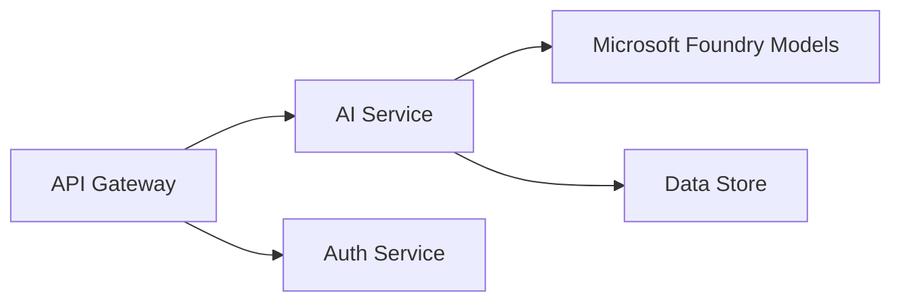
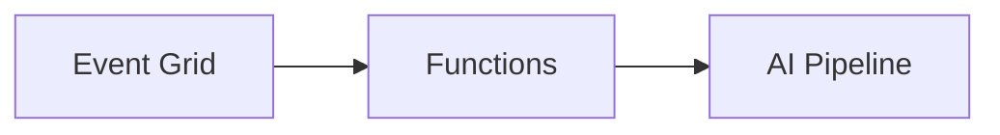

# അധ്യായം 8: ഉത്പാദനവും സംരംഭ മാതൃകകളും

**📚 കോഴ്‌സ്**: [AZD For Beginners](../../README.md) | **⏱️ ദൈര്‍ഘ്യം**: 2-3 മണിക്കൂര്‍ | **⭐ സങ്കീർണം**: മുന്നേറ്റം

---

## അവലോകനം

ഈ അധ്യായം സംരംഭ സജ്ജമായ വിന്യാസ മാതൃകകൾ, സുരക്ഷ ഹാർഡനിംഗ്, നിരീക്ഷണം, ഉത്പാദന AI ഭാരങ്ങൾക്കുള്ള ചെലവ് പരിമിതീകരണം എന്നിവ ഉൾക്കൊള്ളുന്നു.

ഇത് ഒരു ആർക്കിടെക്ചറൽ റഫറൻസാണ്, പൂർണമായ വിന്യാസ പ്രോട്ടോടൈപ്പ് അല്ല. ഉദാഹരണങ്ങളിൽ നിങ്ങളുടെ സ്വന്തം അപ്ലിക്കേഷനിൽ നൽകിയും പരീക്ഷിക്കയും ചെയ്യേണ്ട ഇന്റഗ്രേഷൻ വിശദാംശങ്ങൾ ഒഴിവാക്കപ്പെട്ടിട്ടുണ്ട്; നിശ്ചല പട്ടിക വായിച്ചാൽ ഉത്പാദന സജ്ജത്വം ഉറപ്പാകില്ല.

> **Foundry GA അപ്ഡേറ്റ് (2026-11-09):** Foundry വർക്ക്‌ഫ്ലോയിനായി `azd >= 1.37.0`  ഉം പൊതുവായി ലഭ്യമായ `microsoft.foundry` 1.0 ബണ്ടിൽ ഉപയോഗിക്കുക; മൂല്യനിർണയങ്ങൾ വ്യക്തമായും ഇൻസ്റ്റാൾ ചെയ്യപ്പെടുന്നു. [വിമോചന പരിധി, പുനർവ്യാപനം](production-ai-practices.md#recent-release-changes-and-fixes) കാണുക, [ഓതന്റിക്കേറ്റഡ് പൈപ്പ്‌ലൈൻ ഉദാഹരണം](production-ai-practices.md#cicd-pipeline-configuration) കാണുക. ഇത് ഡോക്യുമെന്റേഷൻ അവലോകനമാണ്, ലൈവ് വിന്യാസ സ്ഥിരീകരണം അല്ല, അല്ലെങ്കിൽ ഓപ്ഷണൽ പ്രിവ്യൂ ഫീച്ചറുകൾക്കുള്ള പൊതുവായ GA നിലയല്ല.

## പഠന ലക്ഷ്യങ്ങൾ

ഈ അധ്യായം പൂർത്തിയാക്കിയാൽ നിങ്ങൾക്കാകും:
- മൾട്ടി-റീജിയൻ ഭാഗ്യ പരിപാടികൾ വിന്യസിക്കുക
- സംരംഭ സുരക്ഷ മാതൃകകൾ നടപ്പാക്കുക
- സമ്പൂർണ്ണ നിരീക്ഷണം ക്രമീകരിക്കുക
- ചെലവുകൾ സ്‌കെയിലിൽ മികച്ചത് ആക്കുക
- AZD ഉപയോഗിച്ച് CI/CD പൈപ്പ്‌ലൈനുകൾ സജ്ജീകരിക്കുക

---

## 📚 പാഠങ്ങൾ

| # | പാഠം | വിവരണം | സമയം |
|---|--------|-------------|------|
| 1 | [ഉത്പാദന AI പ്രാക്ടീസുകൾ](production-ai-practices.md) | സംരംഭ വിന്യാസ മാതൃകകൾ | 90 മിനറ്റ് |

---

## 🚀 ഉത്പാദന പരിശോധന പട്ടിക

- [ ] മൾട്ടി-റീജിയൻ ഭാഗ്യ വിന്യാസം
- [ ] മാനേജുചെയ്ത ഐഡൻറ്റിറ്റി അംഗീകാരം (കീകൾ ഇല്ലാതെ)
- [ ] ആപ്ലിക്കേഷൻ ഇൻസൈറ്റ്സ് നിരീക്ഷണത്തിനു വേണ്ടി
- [ ] ചെലവ് ബജറ്റുകളും അലർട്ടുകളും ക്രമീകരിച്ചിട്ടുള്ളത്
- [ ] സുരക്ഷാ സ്കാനിംഗ് സജ്ജീകരിച്ചിട്ടുള്ളത്
- [ ] CI/CD പൈപ്പ്‌ലായ്ൻ ഇന്റഗ്രേഷൻ
- [ ] ദുരന്തശാഖാ പദ്ധതി

---

## 🏗️ ആർക്കിടെക്ചർ മാതൃകകൾ

### മാതൃക 1: മൈക്രോസർവീസസ് AI



### മാതൃക 2: ഇവന്റ്-ആധാരിത AI



---

## 🔐 സുരക്ഷ മികച്ച പ്രാക്ടീസുകൾ

```bicep
// Illustrative properties from different resources, NOT a standalone Bicep file.
// Attach identity to the application host:
identity: {
  type: 'SystemAssigned'
}

// AI account properties (also require private endpoints, DNS and app connectivity):
properties: {
  publicNetworkAccess: 'Disabled'
  networkAcls: {
    defaultAction: 'Deny'
  }
}
```

---

## 💰 ചെലവ് മെച്ചപ്പെടുത്തൽ

| രണനീതി | പ്രധാന പരിധി |
|----------|---------|
| സീറോ വരെ സ്‌കെയിൽ ചെയ്യുക (കണ്ടെയ്‌നർ ആപ്പ്സ്) | അനുയോജ്യമായ ട്രിഗ്ഗർ ആവശ്യമാണ്; മറ്റ് സർവ്വീസുകൾക്ക് ചെലവ് വന്നേക്കാം |
| ഡെവലപ്മെന്റിന് കൺസംപ്ഷൺ ടിയർസ് ഉപയോഗിക്കുക | തിരഞ്ഞെടുക്കപ്പെട്ട സർവീസ് വിലയും ഭാരവും താരതമ്യം ചെയ്യുക |
| നിശ്ചിത സമയ സ്‌കെയ്ലിംഗ് | പിന്തുണയുള്ള അധിസ്ഥാനം/ഓട്ടോമേഷൻ വഴി സ്കെയിൽ ചെയ്യുക |
| റിസർവേഷനുകൾ/റിസോർവഡ് കപ്പാസിറ്റി | പിന്തുണയുള്ളപ്പോൾ മാത്രം; പ്രതിബന്ധങ്ങൾ നൽകി ഓഫ്ലൈനായ ചെലവ് വർദ്ധിക്കാം |

സാധുവായ ആരംഭ തീയതി, ബില്ലിംഗ് പരിധി, സ്വീകരകർ, അവകാശങ്ങൾ ഒപ്പം [സമ്പൂർണ ബജറ്റ് റിസോഴ്‌സ് മാതൃക](production-ai-practices.md#2-cost-monitoring-and-budgets) ഉപയോഗിക്കുക. ഒരു ബജറ്റ് അലർട്ടുകൾ അയയ്‌ക്കുന്നു; ചെലവുകൾക്ക് പരിമിതിയില്ല. ലാഭം അളന്ന ഉപയോഗത്തെ അടിസ്ഥാനമാക്കിയതാണ്, ഉറപ്പായ ശതമാനങ്ങൾ അല്ല.

---

## 📊 നിരീക്ഷണം ക്രമീകരണം

```bash
# Open the Application Insights logs view (requires configured monitoring)
azd monitor --logs

# Check Application Insights
azd monitor --overview

# View metrics
az monitor metrics list --resource <resource-id>
```

---

## 🔗 നാവിഗേഷൻ

| ദിശ | അധ്യായം |
|-----------|---------|
| **മുൻപത്തെ** | [അധ്യായം 7: പ്രശ്ന പരിഹാരം](../chapter-07-troubleshooting/README.md) |
| **കോഴ്സ് പൂർത്തിയായി** | [കോഴ്സ് ഹോം](../../README.md) |

---

## 📖 ബന്ധപ്പെട്ട വസ്തുക്കൾ

- [AI ഏജൻറുകൾ ഗൈഡ്](../chapter-02-ai-development/agents.md)
- [ആപ്ലിക്കേഷൻ ഇൻസൈറ്റ്സ്](../chapter-06-pre-deployment/application-insights.md)
- [മൾട്ടി-ഏജന്റ് സൊല്യൂഷൻസ്](../chapter-05-multi-agent/README.md)
- [മൈക്രോസർവീസസ് ഉദാഹരണം](../../examples/microservices/README.md)

---

<!-- CO-OP TRANSLATOR DISCLAIMER START -->
**അറിയിപ്പ്**:
ഈ രേഖ AI പരിഭാഷാ സേവനം [Co-op Translator](https://github.com/Azure/co-op-translator) ഉപയോഗിച്ച് പരിഭാഷപ്പെടുത്തിയതാണ്. ഞങ്ങൾ കൃത്യതയ്ക്കായി ശ്രമിക്കുന്നുവെങ്കിലും, ഓട്ടോമേറ്റഡ് പരിഭാഷകളിൽ പിഴവുകൾ അല്ലെങ്കിൽ തെറ്റായ വിവരങ്ങൾ ഉണ്ടാകാൻ സാധ്യതയുണ്ട്. അതിന്റെ സ്വാഭാവിക ഭാഷയിലുള്ള അസൽ രേഖയാണ് പ്രാമാണികമായ ഉറവിടമായി പരിഗണിക്കേണ്ടത്. നിർണായകമായ വിവരങ്ങൾക്ക്, പ്രൊഫഷണൽ മനുഷ്യ പരിഭാഷ ശുപാർശ ചെയ്യുന്നു. ഈ പരിഭാഷ ഉപയോഗിച്ച് ഉണ്ടാകുന്ന തെറ്റിദ്ധാരണകൾ അല്ലെങ്കിൽ തെറ്റായ വ്യാഖ്യാനങ്ങൾക്കായി ഞങ്ങൾ ഉത്തരവാദികളല്ല.
<!-- CO-OP TRANSLATOR DISCLAIMER END -->