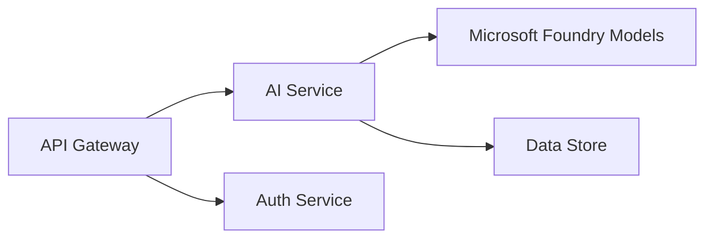
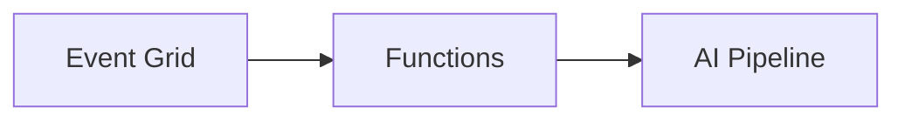

# അദ്ധ്യായം 8: ഉത്പാദനവും സംരംഭ രീതികളും

**📚 കോഴ്‌സ്**: [AZD ഫോർ ബിഗിന്നേഴ്സ്](../../README.md) | **⏱️ ദൈർഘ്യം**: 2-3 മണിക്കൂർ | **⭐ സങ്കീർണത**: പ്രഗത്ഭൻ

---

## അവലോകനം

ഈ അദ്ധ്യായം സംരംഭത്തിന് അനുയോജ്യമായ വിന്യാസരീതികൾ, സുരക്ഷാ ശക്തീകരണം, സംവിധാന നിരീക്ഷണം, ഉത്പാദന AI പ്രവൃത്തി ഭാരം ചെലവു കുറവ് എന്നിവ ഉൾക്കൊള്ളുന്നു.

ഇത് ഒരു ആർക്കിടെക്ചറ reference (റഫറൻസ്) ആയിരിക്കുകയാണ്, പൂർത്തിയായ ഉത്പാദന വിന്യാസ ടെംപ്ലേറ്റ് അല്ല. ഉദാഹരണങ്ങൾ സമഗ്രമായ സമന്വയ വിവരങ്ങൾ ഒഴിവാക്കി നൽകിയിട്ടുണ്ട്, നിങ്ങളുടെ ആപ്ലിക്കേഷനിൽ അവ നൽകുകയും ടെസ്റ്റ് ചെയ്യുകയും ചെയ്യണം; ചෙක්ലിസ്റ്റ് വായിക്കുന്നതുകൊണ്ട് ഉത്പാദന സജ്ജത്വം ഉറപ്പുവരുത്തുന്നില്ല.

> **റിലീസ് നിരീക്ഷണം (2026-11-04):** AI CLI മാർഗ്ഗദർശനം `azd 1.37.2`, ഏജന്റുകൾ `1.0.0-beta.23`, വിലയിരുത്തലുകൾ `1.0.0-beta.2` ഡോക്യുമെന്റേഷൻ/സ്രോതസ് എന്നിവയുമായി പരിശോധിച്ചു. പൊരുത്തക്കേടുകളും മൈഗ്രേഷൻ വിശദാംശങ്ങളും കാണാൻ [റിലീസ് മാറ്റങ്ങളും പരിഹാരങ്ങളും](production-ai-practices.md#recent-release-changes-and-fixes) കാണുക; ഇത് ഒരു ലൈവ് ഡിസ്പ്ലോയ്മെന്റ് പരിശോധനയല്ല.

## പഠന ലക്ഷ്യങ്ങൾ

ഈ അദ്ധ്യായം പൂർത്തിയാക്കിയാൽ, നിങ്ങൾക്ക് സാധിക്കും:
- ബഹുമേഖല പ്രതിരോധ ശേഷിയുള്ള ആപ്ലിക്കേഷനുകൾ വിന്യാസമാക്കുക
- സംരംഭ.security(masuuvettangal) നടപ്പാക്കുക
- സമഗ്രമായ നിരീക്ഷണം ക്രമീകരിക്കുക
- വലുപ്പത്തെ ആശ്രയിച്ച ചെലവു ഹ്രാസ്‌വം ചെയ്യുക
- AZD ഉപയോഗിച്ച് CI/CD പൈപ്പ്ലൈനുകൾ ക്രമീകരിക്കുക

---

## 📚 പാഠങ്ങൾ

| # | പാഠം | വിവരണം | സമയം |
|---|--------|-------------|------|
| 1 | [ഉത്പാദന AI പ്രാക്ടിസസ്](production-ai-practices.md) | സംരംഭ വിന്യാസരീതികൾ | 90 മിനിറ്റ് |

---

## 🚀 ഉത്പാദന ചേച്ച്‌ലിസ്റ്റ്

- [ ] പ്രതിരോധത്തിനുള്ള ബഹുമേഖല വിന്യാസം
- [ ] ഓതന്റിക്കേഷൻക്ക് മാനേജ് ചെയ്ത ഐഡൻറിറ്റി (കീ ഇല്ലാതെ)
- [ ] നിരീക്ഷണത്തിന് ആപ്ലിക്കേഷന് ഇൻസൈറ്റ്‌സ്
- [ ] ചെലവ് ബജറ്റുകളും അറിയിച്ചു ക്രമീകരിച്ചിട്ടുള്ളത്
- [ ] സുരക്ഷാ സ്കാനിംഗ് സജ്ജമാക്കിയിട്ടുണ്ട്
- [ ] CI/CD പൈപ്പ്ലൈൻ സമന്വയം
- [ ] ദുരന്ത വീണ്ടെടുക്കൽ പദ്ധതി

---

## 🏗️ ആർക്കിടെക്ചർ രീതികൾ

### പാറ്റേൺ 1: മൈക്രോserviceകൾ AI



### പാറ്റേൺ 2: ഇവന്റ്-ഡ്രൈവ് AI



---

## 🔐 മികച്ച സുരക്ഷാ പ്രാക്ടിസുകൾ

```bicep
// Illustrative properties from different resources, NOT a standalone Bicep file.
// Attach identity to the application host:
identity: {
  type: 'SystemAssigned'
}

// AI account properties (also require private endpoints, DNS and app connectivity):
properties: {
  publicNetworkAccess: 'Disabled'
  networkAcls: {
    defaultAction: 'Deny'
  }
}
```

---

## 💰 ചെലവ് മെച്ചപ്പെടുത്തൽ

| തന്ത്രം | പ്രധാന നിയന്ത്രണം |
|----------|---------|
| പൂജ്യം വരെ വലുപ്പം (Container Apps) | അനുയോജ്യമായ ട്രിഗർ ആവശ്യമാണ്; മറ്റ് സേവനങ്ങൾക്ക് ചെലവുണ്ടാകും |
| ഡെവലപ്മെന്റിനുള്ള ഉപയോഗനിരക്ക് തരങ്ങൾ | തിരഞ്ഞെടുത്ത സേവന വിലയും പ്രവൃത്തി ഭാരവും താരതമ്യം ചെയ്യുക |
| ഷെഡ്യൂൾ ചെയ്ത വലുപ്പം | പിന്തുണയുള്ള അടിസ്ഥാനസൗകര്യവും ആറ്റോമേഷൻ വഴിയും വലുപ്പത്തേക്കും |
| റിസർവേഷൻ / പ്രൊവിഷൻ ചെയ്ത ശേഷിയുള്ളത് | പിന്തുണയുള്ളപ്പോൾ മാത്രം; പ്രത്യയങ്ങളാൽ നിർജ്ജീവ ചെലവുകൾ കൂടാം |

സാധുവായ തുടക്കം തീയതി, ബില്ലിംഗ് സ്‌കോപ്പ്, സ്വീകരിക്കാൻ എല്ലാവർക്കും, അനുമതികൾ എന്നിവയോടുകൂടി [പൂർണ്ണ ബജറ്റ് റിസോഴ്‌സ് പാറ്റേൺ](production-ai-practices.md#2-cost-monitoring-and-budgets) ഉപയോഗിക്കുക. ഒരു ബജറ്റ് അലർട്ടുകൾ അയയ്ക്കും; അത് ചെലവ് പരിധി വയ്ക്കുന്നില്ല. ലാഭം അളക്കപ്പെട്ട ഉപയോഗനിരക്കിനെ ആശ്രയിച്ചിരിക്കും, ഉറപ്പുവരുത്തപ്പെട്ട ശതമാനമല്ല.

---

## 📊 നിരീക്ഷണ ക്രമീകരണം

```bash
# Open the Application Insights logs view (requires configured monitoring)
azd monitor --logs

# Check Application Insights
azd monitor --overview

# View metrics
az monitor metrics list --resource <resource-id>
```

---

## 🔗 നാവിഗേഷൻ

| ദിശ | അദ്ധ്യായം |
|-----------|---------|
| **മുമ്പത്തേതിന്** | [അദ്ധ്യായം 7: പ്രശ്ന പരിഹാരം](../chapter-07-troubleshooting/README.md) |
| **കോഴ്‌സ് പൂർത്തിയായി** | [കോഴ്‌സ് ഹോം](../../README.md) |

---

## 📖 ബന്ധപ്പെട്ട സ്രോതസുകൾ

- [AI ഏജന്റുകളുടെ മാർഗ്ഗനിർദേശം](../chapter-02-ai-development/agents.md)
- [ആപ്ലിക്കേഷൻ ഇൻസൈറ്റ്സ്](../chapter-06-pre-deployment/application-insights.md)
- [ബഹുഏജന്റ് പരിഹാറങ്ങൾ](../chapter-05-multi-agent/README.md)
- [മൈക്രോസർവീസുകൾ ഉദാഹരണം](../../examples/microservices/README.md)

---

<!-- CO-OP TRANSLATOR DISCLAIMER START -->
**അറിയിപ്പ്**:
ഈ രേഖ AI പരിഭാഷാ സേവനം [Co-op Translator](https://github.com/Azure/co-op-translator) ഉപയോഗിച്ച് പരിഭാഷപ്പെടുത്തിയതാണ്. ഞങ്ങൾ കൃത്യതയ്ക്കായി ശ്രമിക്കുന്നുവെങ്കിലും, ഓട്ടോമേറ്റഡ് പരിഭാഷകളിൽ പിഴവുകൾ അല്ലെങ്കിൽ തെറ്റായ വിവരങ്ങൾ ഉണ്ടാകാൻ സാധ്യതയുണ്ട്. അതിന്റെ സ്വാഭാവിക ഭാഷയിലുള്ള അസൽ രേഖയാണ് പ്രാമാണികമായ ഉറവിടമായി പരിഗണിക്കേണ്ടത്. നിർണായകമായ വിവരങ്ങൾക്ക്, പ്രൊഫഷണൽ മനുഷ്യ പരിഭാഷ ശുപാർശ ചെയ്യുന്നു. ഈ പരിഭാഷ ഉപയോഗിച്ച് ഉണ്ടാകുന്ന തെറ്റിദ്ധാരണകൾ അല്ലെങ്കിൽ തെറ്റായ വ്യാഖ്യാനങ്ങൾക്കായി ഞങ്ങൾ ഉത്തരവാദികളല്ല.
<!-- CO-OP TRANSLATOR DISCLAIMER END -->