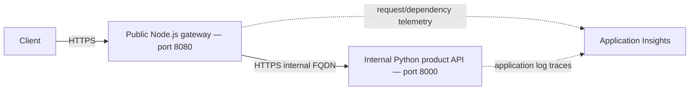

# രണ്ടു-സേവന മൈക്രോസേവിസുകൾ — അസ്യൂർ കൺറ്റെയ്നർ ആപ്പുകൾ

**തരം:** ഇടക്കാല · **സമയം:** 45–60 മിനിറ്റ് ഒരുക്കലുകൾ ഉൾപ്പെടെ

ഈ പഠന സാമ്പിൾ ഒരു **Node.js API ഗേറ്റ്വേയും** ഒരു **വായനയ്‌ക്ക് മാത്രം ഉള്ള Python
പ്രോഡക്റ്റ് സർവീസും** നടപ്പാക്കിയിട്ടുണ്ട്. സോഴ്‌സ്, ഡോക്കർഫയലുകൾ, ബൈസിപ്, azd കോൺഫിഗറേഷൻ ഉൾപ്പെടുത്തി.
ഇത് ഒരു പ്രൊഡക്ഷൻ-ഹാർഡനുചെയ്യപ്പെട്ട സംവിധാനമല്ല.

## നിങ്ങൾക്കു പഠിക്കാനുണ്ടത്

- രണ്ട് സെർവിസുകളും സ്വതന്ത്രമായി വിന്യസിക്കുക.
- HTTPS മുഖാന്തിരം ഒരു ആന്തരിക ബക്എണ്ടും FQDN ഉപയോഗിക്കുക.
- വിജയകരം, കണ്ടെത്താനാകാത്ത, ലഭ്യമല്ലാത്ത-സെർവീസ് പ്രതികരണങ്ങൾ പരിശോധിക്കുക.
- ടെലിമെട്രി, സ്വതന്ത്ര സ്കെയിലിങ് പരിധികൾ മനസിലാക്കുക.



ഉൽപ്പന്ന കാറ്റലോഗിൽ മെമ്മറിയിൽ നിശ്ചിത അഞ്ച് ഉൽപ്പന്നങ്ങൾ അടങ്ങിയിരിക്കുന്നു. **POST,
PUT, അല്ലെങ്കിൽ DELETE ഹാൻഡിലർമാരില്ല**, ഡാറ്റാബേസ്, സർവീസ് ബസ്, ഓർഡർ/ഉപയോക്താവ്/നോട്ടിഫിക്കേഷൻ സർവീസ്,
C#, അല്ലെങ്കിൽ Go കോഡ് ഇല്ല. അവ ഭാവിയിൽ വികസിപ്പിക്കാനുള്ള ആശയങ്ങളാണ്, ഉള്‍പ്പെടുത്തിയിട്ടില്ല.
ഗേറ്റ്വേ ഉപയോക്താക്കളെസ്ഥാപിക്കാറില്ല; ആന്തരിക ഇംഗ്രസ് അപേക്ഷാ അവകാശം നൽകുന്നതിനുള്ള പകരമല്ല.


## മുൻ‌മുഖ്യമെന്ന ആവശ്യങ്ങൾ

ആദ്യം [സിംഗിൾ ഫ്ലാസ്‌ക് API](../../../../../examples/container-app/simple-flask-api) പൂര്‍ത്തീകരിക്കുക.
നിലവിലെ സ്ഥിരതയുള്ള azd (പരിശോധന സമയത്ത് പ്രസിദ്ധീകരിച്ച പതിപ്പ്: 1.37.2), അഴ്യൂർ CLI,
ഡോക്കർ ഡീമൺ ഓടിക്കുന്നവ സ്ഥാപിക്കുക. നിങ്ങൾക്ക് ഒരു അഴ്യൂർ സബ്സ്ക്രിപ്ഷൻ, ആവശ്യമായ
റിസോഴ്സ് സൃഷ്ടി അനുമതികളും കൺ്റെയ്്നർ ആപ്സ് പ്രാദേശിക ക്വോട്ടയും വേണം.

```bash
azd version
az version
docker info
azd auth login
az login
```

CLI രണ്ട് ഉപകരണങ്ങളിലും അതേ സബ്സ്ക്രിപ്ഷൻ ഉപയോഗിക്കുക. താഴെ കൊടുത്ത കമാൻഡുകൾ ബാഷ് ഉപയോഗിക്കുന്നു.

## വിന്യസിക്കുക ഒപ്പം ഉറപ്പാക്കുക

റിപ്പോസിറ്ററി റൂട്ടിൽ നിന്ന്:

```bash
cd examples/container-app/microservices
azd env new microservices-demo
azd up
GATEWAY_URL=$(azd env get-value API_GATEWAY_URL)
RG_NAME=$(azd env get-value AZURE_RESOURCE_GROUP)
GATEWAY_NAME=$(azd env get-value API_GATEWAY_NAME)
PRODUCT_NAME=$(azd env get-value PRODUCT_SERVICE_NAME)

curl --fail-with-body "${GATEWAY_URL}/health"
curl --fail-with-body "${GATEWAY_URL}/api/products"
curl --fail-with-body "${GATEWAY_URL}/api/products/1"
curl -i "${GATEWAY_URL}/api/products/999"
```

**വിജയം:** ഹെൽത്ത് 200; ലിസ്റ്റ് 200 **അഞ്ച്** ഉത്പന്നങ്ങളോടൊപ്പം; ഉത്പന്നം 1 ആയത് ലാപ്‌ടോപ്പാണ്,
വില 999.99, സ്റ്റോക്ക് 50; അജ്ഞാത ഉത്പന്നം 404 റിട്ടേൺ ചെയ്യുന്നു.
വിവരങ്ങൾ മറുപടികളിൽ ഉൾക്കൊള്ളുന്നു; ടൈംസ്റ്റാമ്പുകൾ വ്യത്യാസപ്പെടാം.

പ്രാരംഭ പ്രൊവിഷൻ പൊതു ഹെലോ-വേൾഡ് ഇമേജുകൾ പോർട്ട് 80-ൽ ഉപയോഗിക്കുന്നു, ശൂന്യ റെജിസ്റ്ററിയിൽ നിന്ന്
നിലനിൽക്കുന്നില്ലാത്ത ഇമേജുകൾ പുൽ ചെയ്യാനിടയില്ല. സർവീസ്-നിർദ്ദിഷ്ട Bicep മോഡ്യൂളുകൾ
ആൻഡ് പാരാമീറ്റർ ഫയലുകൾ അവരെ നിർമ്മിച്ച ഇമേജുകളും ആപ്പ് പോർട്ടുകളും/പ്രോബുകളും ഉപയോഗിച്ച് മാറ്റുന്നു
`azd deploy`. പ്രധാന പാരാമീറ്ററുകൾ പ്രസിദ്ധീകരിച്ച ഇമേജ് പേരുകൾ പിന്നീട് പ്രൊവിഷനിങ്ങിന് നിലനിർത്തുന്നു.

## സേവനങ്ങളും നെറ്റ്‌വർകിംഗും

| സേവനം |പ്രകടിപ്പിച്ച എൻഡ്‌പോയിന്റുകൾ | ചുമത്തിയ വിഭവങ്ങൾ |
|---|---|---|
| ഗേറ്റ്‌വേ | GET `/`, `/health`, `/api/products`, `/api/products/:id` | 1 vCPU, 2 GiB, 2–20 റിപ്ലിക്കാസുകൾ |
| പ്രൊഡക്‌ട് | GET `/`, `/health`, `/products`, `/products/<id>` | 0.5 vCPU, 1 GiB, 1–10 റിപ്ലിക്കാസുകൾ |

ഉൽപ്പന്ന ഇൻഗ്രസിന് `external: false` ഉം `allowInsecure: false` ഉം ഉണ്ട്. ബൈസപ് 
ഗേറ്റ്വേക്കു എന്തെന്ന് `PRODUCT_SERVICE_URL=https://<actual-internal-fqdn>` ഇൻജെക്ട് ചെയ്യുന്നു. HTTP 
റീഡയറക്ട് ചെയ്യും; HTTPS കോൺഫിഗർ ചെയ്ത ഇൻഗ്രസുമായി പൊരുത്തപ്പെടുന്നു. ഒരു ചെറിയ DNS പേര് 
**അസൽ കണ്ടെയ്‌നർ ആപ്പ് നാമം**ആവണം, ലൊജിക്കൽ സർവീസ് കീ ആയ `product-service` അല്ല. 
നിങ്ങളുടെ ലാപ്ടോപ്പിൽനിന്ന് നേരിട്ടുള്ള ഇന്റേണൽ URL വിളിക്കാൻ ശ്രമിക്കരുത്.

ഗേറ്റ്വേയ്ക്ക് ഉൽപ്പന്ന കോളുകൾക്കായി അഞ്ച് സെക്കന്റ് സമയപരിധി ഉണ്ട്. മിസ്റ്റായ ഉൽപ്പന്ന ഐഡികൾ
404 ആയി പ്രചരിക്കും; ട്രാൻസ്പോർട്ട് പരാജയങ്ങൾ/ഇതര ബാക്ക്‌എൻഡ് പരാജയങ്ങൾ 503 മടങ്ങും. ഗേറ്റ്വേ
`/health` ഗേറ്റ്വേ മാത്രം പരിശോധിക്കുന്നു, ബാക്ക്‌എൻഡ് സേവന പരുപാലനം അല്ല.

## ഫയലുകളും കോൺഫിഗറേഷനും

```text
azure.yaml
infra/main.bicep
infra/main.parameters.json
infra/abbreviations.json
infra/core/container-apps-environment.bicep
infra/core/monitor.bicep
infra/app/api-gateway.bicep
infra/app/api-gateway.parameters.json
infra/app/product-service.bicep
infra/app/product-service.parameters.json
src/api-gateway/{app.js,package.json,Dockerfile}
src/product-service/{main.py,requirements.txt,Dockerfile}
```

സ്കെയിലിംഗ്, CPU/മെമ്മറി, പോർട്ടുകൾ, പ്ര probingൾസ് എന്നിവ `infra/app/*.bicep`ൽ ക്രമീകരിച്ചിരിക്കുന്നു. ആ   
ഫയലുകൾ മാറ്റി `azd up` പ്രവർത്തിപ്പിച്ച് ഇൻഫ്രാസ്ട്രക്ചർ പ്രയോഗിച്ച് പുനഃപ്രവർത്തിപ്പിക്കുക. ഈ സാമ്പിൾസിൽ 
`GATEWAY_MAX_REPLICAS` പരിസ്ഥിതി ചാരമാനിക പാരാമീറ്റർ ഇല്ല.

കോഡ്-മാത്രം മാറ്റങ്ങൾക്കായി:

```bash
azd deploy product-service
azd deploy api-gateway
```

Node ഇമേജ് Node 22 ഉപയോഗിക്കുന്നു; Python ഇമേജ് Python 3.11 ഉപയോഗിക്കുന്നു. രണ്ട് ഇമേജുകളും ബന്ധിപ്പിക്കുന്നു
`0.0.0.0`. ഇൻഗ്രസ്സ്/പ്രോബുകൾ क्रमशः 8080 (ഗേറ്റ്വേ) અને 8000 (ഉൽപ്പന്നം) പോർട്ടുകൾ ഉപയോഗിക്കുന്നു.

## Docker ഉപയോഗിച്ച് പ്രാദേശിക വികസനം

ഈ ഉദാഹരണ ഡയറക്ടറിയിൽ നിന്ന് പ്രവർത്തിപ്പിക്കുക. ഒരു ഉപഭോക്തൃ നിർവചിച്ച നെറ്റ്വർക്കിനെ ഉപയോഗിക്കുക, **ഒരുകോണടെയ്‌നറിൽ നിന്ന് മറ്റൊരു കോണടെയ്‌നറിൽ എത്താൻ `localhost`
ഉപയോഗikkaruth**:

```bash
docker network create azd-microservices-demo
docker build -t local-product ./src/product-service
docker build -t local-gateway ./src/api-gateway
docker run -d --name azd-product --network azd-microservices-demo local-product
docker run -d --name azd-gateway --network azd-microservices-demo \
  -p 8080:8080 -e PRODUCT_SERVICE_URL=http://azd-product:8000 local-gateway
curl --fail-with-body http://localhost:8080/api/products
```

പ്രതീക്ഷിക്കുന്നത്: അഞ്ചു ഉത്പന്നങ്ങൾ. HTTP ഈ പ്രാദേശിക Docker നെറ്റ്‌വർക്ക് മാത്രമേ ഉപയോഗിക്കൂ.

```bash
docker stop azd-product azd-gateway
docker rm azd-product azd-gateway
docker network rm azd-microservices-demo
```

## നിരീക്ഷണം

```bash
az containerapp logs show --name "$GATEWAY_NAME" --resource-group "$RG_NAME" --follow
# In a separate terminal:
az containerapp logs show --name "$PRODUCT_NAME" --resource-group "$RG_NAME" --tail 100
```

`azd monitor --logs` ഒരു പോർട്ടൽ കാഴ്ച തുറക്കും; ഇത് ടെർമിനൽ ലോങ്ങൾ സ്ട്രീം ചെയ്യുകയല്ല.
നോഡ് SDK ഗേറ്റ്വേ ആവശ്യകതകൾ/ആശ്രിത പ്രത്യയങ്ങൾ ശേഖരിക്കുന്നു. പൈതന്റെ `AzureLogHandler`
**ലോഗ് ട്രേസുകൾ** എക്സ്പോർട് ചെയ്യുന്നു, ഓട്ടോമാറ്റിക് ഫ്ലാസ് ആവശ്യകതകൾ, SQL ആശ്രിത പ്രത്യയങ്ങൾ അല്ലെങ്കിൽ പൂർണ്ണം
വിതരണം ചെയ്ത ട്രേസുകൾ അല്ല. OpenCensus ഒരു പാസ്സായ SDK ആണ്; ഈ ഉദാഹരണം വികസിപ്പിക്കുമ്പോൾ Azure Monitor OpenTelemetry പ്രധാനം ചെയ്യുക.


Application Insights ലോഗുകളിൽ, അഭ്യർത്ഥനകൾ സൃഷ്‌ടിച്ച് പരിശോധിക്കുക:

```kusto
requests
| where timestamp > ago(1h)
| where name contains "products"
| summarize RequestCount=count(), AvgDuration=avg(duration) by bin(timestamp, 5m)
```

Python ആപ്ലിക്കേഷൻ സന്ദേശങ്ങൾക്ക്:

```kusto
traces
| where timestamp > ago(1h)
| where message contains "products"
| project timestamp, message, severityLevel
```

ഇൻജെക്ഷൻ വൈകിയതും സാമ്പിളിംഗ് അനുവദിക്കുക; കൃത്യമായ അഭ്യർത്ഥന എണ്ണവും
ഉറപ്പുള്ള വിമർശന സമയവും പ്രതീക്ഷിക്കരുത്. കരാറായ അലർട്ടുകളോ ഡാഷ്‌ബോർഡുകളോ ക്രമീകരിച്ചിട്ടില്ല.

## പ്രായോഗിക അഭ്യാസങ്ങൾ

### അഭ്യാസം 1: കാറ്റലോഗ് മാറ്റുക

**ആരംഭിക സ്ഥലം:** `src/product-service/main.py`.
**ലക്ഷ്യം:** സ്വതന്ത്ര സേവന വിന്യാസം പരിശോധന.
Laptop സ്റ്റോക്ക് 50-ൽ നിന്നും 49-ആയി ക്രമീകരിച്ച `products` പട്ടികയിൽ മാറ്റം വരുത്തുക,
`azd deploy product-service` നിർവഹിച്ച്, പിന്നെ `${GATEWAY_URL}/api/products/1` അഭ്യർത്ഥിക്കുക.

**വിജയ മാനദണ്ഡങ്ങൾ / പരിഹാരം:** HTTP 200 കൂടാതെ `"stock":49`. 50 പുനസ്ഥാപിച്ച് വീണ്ടും വിന്യസിക്കുക.
**സാധാരണ പ്രശ്നം:** കാറ്റലോഗിന് പകരം അതിന്റെ സേവനം എഡിറ്റ് ചെയ്യുക.
ഇത് സ്രോതസ്സ് ഡാറ്റ മാറ്റുന്നു, സ്ഥിരമായ ഇൻവെന്ററി ഡേറ്റാബേസ് അല്ല.

### പരീക്ഷണം 2: റെപ്ലിക്ക കോൺഫിഗറേഷൻ പരിശോധന

**തുടക്കം പോയിന്റ്:** `infra/app/product-service.bicep`.
**ലക്ഷ്യം:** ഓട്ടോസ്കെയിലിംഗ് കരുതാതെ ഒരു ഇൻഫ്രാസ്ട്രക്ചർ മാറ്റം നിരീക്ഷിക്കുക.
`minReplicas: 1` ൽ നിന്ന് `minReplicas: 2` ആയി മാറ്റുക, `azd up` പ്രവർത്തിപ്പിക്കുക, ശേഷം:

```bash
az containerapp show --name "$PRODUCT_NAME" --resource-group "$RG_NAME" \
  --query properties.template.scale -o json
```

**വിജയ മാനദണ്ഡങ്ങൾ:** കോൺഫിഗർ ചെയ്ത കുറഞ്ഞത് 2 ആയിരിക്കണം, മാക്സിമം 10 ആയിരിക്കും.
കുറഞ്ഞത് 1 പുനസ്ഥാപിച്ച് `azd up` പ്രവർത്തിപ്പിക്കുക.
**സാധാരണ പ്രശ്നം:** `azd deploy` ഒറ്റയ്ക്ക് ബന്ധപ്പെട്ടിട്ടില്ലാത്ത പങ്കുവെച്ച
ഇൻഫ്രാസ്ട്രക്ചറിലേക്ക് മാറ്റങ്ങൾ ബാധകമാക്കുന്നില്ല. പരാജയ സിമുലേഷനായി `maxReplicas` നുള്ളിലേക്ക് ക്രമീകരിക്കരുത്.
ഇത് കോൺഫിഗറേഷൻ പരിശോധിക്കുന്നു, ലോഡ്-ടെസ്റ്റ് അല്ല അല്ലെങ്കിൽ ഉറപ്പുള്ള തൽക്ഷണ റെപ്ലിക്കയുടെ എണ്ണം.

### പരീക്ഷണം 3: ലൊക്കലായി ലഭ്യമല്ലാത്ത-സേവനം കൈകാര്യം ചെയ്യൽ പരിശോധന

**തുടക്കം പോയിന്റ്:** മുകളിൽ ഉള്ള രണ്ട് ലൊക്കൽ ഡോക്കർ കണ്ടെയ്‌നറുകളും പ്രവർത്തിക്കുകയാണ.
**ലക്ഷ്യം:** ബാക്ക്എൻഡ് പരാജയം ഒരു നഷ്ടപ്പെട്ട ഉൽപന്നത്തിൽ നിന്നായി വേർതിരിക്കുക.
ഉൽപന്ന കണ്ടെയ്‌നർ മാത്രം നിർത്തുക:

```bash
docker stop azd-product
curl -i http://localhost:8080/api/products
docker start azd-product
curl --fail-with-body http://localhost:8080/api/products
```

**വിജയ മാനദണ്ഡങ്ങൾ:** നിർത്തിയിരിക്കുന്നപ്പോൾ, ഗേറ്റ്വേ 503 റിട്ടേൺ ചെയ്യുകയും
`"error":"Product service unavailable"` കൂടെ; പുനരാരംഭിച്ച ശേഷം, ലിസ്റ്റ് 200 റിട്ടേൺ ചെയ്യുക.
ആവശ്യമുണ്ടെങ്കിൽ ചെറിയ സ്റ്റാർട്ടപ്പ് വൈകിയ്ക്കൽക്ക് ശേഷം വീണ്ടും ശ്രമിക്കുക.
**സാധാരണ പ്രശ്നം:** ഗേറ്റ്വേ നിർത്തുന്നത് ഒരു മറ്റ് പരാജയം പരിശോധിക്കുന്നതാണ് (HTTP പ്രതികരണം ഇല്ല).

## ചെലവുകളും പ്രൊഡക്ഷൻ വ്യവസ്ഥകളും

ഡീഫോൾട് കുറഞ്ഞ റെപ്ലിക്കകൾ കമ്പ്യൂട്ട് പ്രവർത്തനക്ഷമമാക്കുന്നു. റെജിസ്ട്രിയും മോണിറ്ററിംഗും കൂടി
ചാർജുകൾ വരുന്നു. ഒട്ടുമിക്ക $50 / മാസം ആകെ ഉറപ്പിക്കപ്പെട്ടിട്ടില്ല: പ്രാദേശിക CPU / മെമ്മറി,
റെപ്ലിക്ക മണിക്കൂറുകൾ, അപേക്ഷകൾ, റെജിസ്ട്രി, ലോഗ് സൂക്ഷണമുള്‍പ്പടെ കണക്കാക്കുക.
[Azure വില നിരക്കുകളെ കാൽക്കുലേറ്റർ](https://azure.microsoft.com/pricing/calculator/).
പഠന വലയം ഔദ്യോഗികമായി മായ്ക്കുക.

ഉത്പാദന പ്രവർത്തനങ്ങൾക്ക് ഉൾപ്പെടുന്നതാണ് ഓതന്റിക്കേഷനും അഥോറൈസേഷനും, സ്‌കോപ്പുചെയ്‌ത മാനേജ് ചെയ്ത ഐഡൻറിറ്റികൾ,
സ്ഥിരതയുള്ള ഡേറ്റ, ഇൻപുട്ട്/പ്രതികരണം വാലിഡേഷൻ, പിന്തുണയുള്ള നിരീക്ഷണ ഉപകരണങ്ങൾ,
ലോഡ്/ഫെയിലിയർ ടെസ്റ്റിംഗ്, CI/CD, അലേർട്ടുകൾ, വീണ്ടെടുക്കൽ നടപടിക്രമങ്ങൾ എന്നിവ. ഓർഡർ
സേവനം, ക്യൂ, അല്ലെങ്കിൽ ഡാറ്റാബേസ് ചേർക്കുന്നത് വേറിട്ട ഒരു നടപ്പാക്കൽ ജോലി ആണ്; ഇത് ഇവിടെ ഇതിനകം ലഭ്യമാക്കിയ
ഒരു സമാപിത പരീക്ഷണമല്ല.

## പ്രശ്‌ന പരിഹാരവും ശുചിത്വവും

- **ആദ്യ പ്രൊവിഷൻ സമയത്ത് ചിത്രം കണ്ടില്ല:** പബ്ലിക് ചിത്രം ഉപയോഗിച്ച് ബൂട്ട്സ്ട്രാപ്പ് ചെയ്യേണ്ടതാണ്;
  പ്രധാന ചിത്രം പാരാമീറ്റർ ഡിഫോൾട്ടുകളും ഡിപ്ലോയ്മെന്റ് മോഡ്യൂൾ മാപ്പിംഗുകളും പരിശോധിക്കുക.
- **503 ഉൽപ്പന്നങ്ങൾ:** ഉൽപ്പന്ന ലോഗുകൾ, ചിത്രം പതിപ്പ്, ഇഞ്ചക്റ്റ് ചെയ്ത ആന്തരിക HTTPS URL എന്നിവ പരിശോധിക്കുക.
- **404 അപ്രതീക്ഷിത പാത:** ഉൽപ്പന്ന API വായന മാത്രം ആണ്; പാത ഉറപ്പാക്കുക, നിലവിലില്ലാത്ത CRUD ഹാൻഡിലർ അല്ല.
- **ടെലിമെട്രി ഇല്ല:** റൺടൈം കണക്ഷൻ സ്ട്രിങ്‌സ് പുറത്താക്കാതെ പരിശോധിക്കുക
  ingestion വൈകിപ്പ് അനുവദിക്കുക. Python അഭ്യർത്ഥന ടേബിളുകൾ അതിന്റെ ലോഗ് ഹാൻഡിലർ ഉപയോഗിച്ച് പൂർണമാക്കുന്നില്ല.

ഈ സാമ്പിൾ ഡയറക്ടറിയിൽ നിന്നും:

```bash
azd down
```

മായ്ക്കൽ പ്രോമ്പ്റ്റുകൾ അവലോകനം ചെയ്യുകയും സമർപ്പിച്ച റിസോഴ്‌സ് ഗ്രൂപ്പിൻറെ ഒഴിവാക്കൽ പൂർണമാണ് എങ്കിൽ ഉറപ്പാക്കുക.

[മുൻപ്: Flask API](../../../../../examples/container-app/simple-flask-api) · [അടുത്തത്: ഡേറ്റാബേസ് ആപ്പ്](../../../../../examples/database-app) ·
[AI വികസനം](../../../docs/chapter-02-ai-development/README.md) ·
[കോഴ്സ് മുഖപുസ്തകം](../../../README.md) · [ഒരു പ്രശ്‌നം റിപ്പോർട്ട് ചെയ്യുക](https://github.com/microsoft/AZD-for-beginners/issues)

---

<!-- CO-OP TRANSLATOR DISCLAIMER START -->
**അറിയിപ്പ്**:
ഈ രേഖ AI പരിഭാഷാ സേവനം [Co-op Translator](https://github.com/Azure/co-op-translator) ഉപയോഗിച്ച് പരിഭാഷപ്പെടുത്തിയതാണ്. ഞങ്ങൾ കൃത്യതയ്ക്കായി ശ്രമിക്കുന്നുവെങ്കിലും, ഓട്ടോമേറ്റഡ് പരിഭാഷകളിൽ പിഴവുകൾ അല്ലെങ്കിൽ തെറ്റായ വിവരങ്ങൾ ഉണ്ടാകാൻ സാധ്യതയുണ്ട്. അതിന്റെ സ്വാഭാവിക ഭാഷയിലുള്ള അസൽ രേഖയാണ് പ്രാമാണികമായ ഉറവിടമായി പരിഗണിക്കേണ്ടത്. നിർണായകമായ വിവരങ്ങൾക്ക്, പ്രൊഫഷണൽ മനുഷ്യ പരിഭാഷ ശുപാർശ ചെയ്യുന്നു. ഈ പരിഭാഷ ഉപയോഗിച്ച് ഉണ്ടാകുന്ന തെറ്റിദ്ധാരണകൾ അല്ലെങ്കിൽ തെറ്റായ വ്യാഖ്യാനങ്ങൾക്കായി ഞങ്ങൾ ഉത്തരവാദികളല്ല.
<!-- CO-OP TRANSLATOR DISCLAIMER END -->