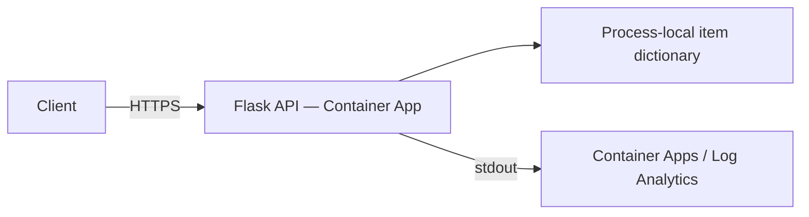

# സിമ്പിൾ ഫ്ലാസ്‌ക് API — അസ്യൂർ കണ്ടെയ്‌നർ ആപ്സ്

**നിലവാരം:** തുടക്കക്കാരൻ · **സമയം:** സെറ്റപ്പ് ഉൾപ്പെടെ 30–45 മിനിറ്റ്

അസ്യൂർ ഡെവലപ്പർ CLI (azd) ഉപയോഗിച്ച് ഒരു Python Flask CRUD API വിന്യസിക്കുക. സോഴ്‌സ്, Dockerfile,
Bicep,യും വിന്യസിക്കൽ പാരാമീറ്ററുകളും ഉൾപ്പെടുന്നു. ഇത് ഒരു **അറിയുന്നതിനുള്ള സാമ്പിൾ** മാത്രമാണ്,
ഉത്പാദനത്തിനായി സജ്ജമാക്കിയ API അല്ല.

## നിങ്ങൾ പഠിക്കുന്നതു

- azd വഴിയുള്ള കൺടെയ്‌നർ നിർമ്മിക്കുകയും പ്രസിദ്ധീകരിക്കുകയും ചെയ്യുക.
- ഇൻ‌ഗ്രസ്, ലിവ്‌നെസ്സ്/റെഡിയ്നസ് പ്രോബുകൾ ക്രമീകരിക്കുക.
- CRUD പ്രതികരണങ്ങൾ പരിശോധിക്കുകയും ആപ്ലിക്കേഷൻ ലോഗുകൾ നിരീക്ഷിക്കുകയും ചെയ്യുക.
- സ്ഥിരം ആപ്ലിക്കേഷനുകൾക്ക് in-memory ഡേറ്റ യോജിച്ചിട്ടില്ലാത്തതിന്റെ കാരണം മനസ്സിലാക്കുക.



**മഹത്തരമാണ്:** ഇനം ഐറ്റങ്ങൾ ഒറ്റ പ്രോസസിൽ സൂക്ഷിച്ചിരിക്കുന്നു. ഡിഫോൾട്ട് **ഒറ്റ Gunicorn വർക്കർ,
0–1 നകൽ** എന്നതാണ്, വർക്കർമാർ/നകലുകൾ തമ്മിൽ അസമ്മത ഡേറ്റ ഒഴിവാക്കാൻ ഉദ്ദേശിച്ചുള്ളത്.
റീസ്റ്റാർട്ടിന്, പതിപ്പുതീർക്കലിനോ, സ്കെയിൽ-ടു-സീറോയ്ക്ക് ഐറ്റങ്ങൾ ഹാനിയാക്കപ്പെടും. നകൽ সংখ্যা വർദ്ധിപ്പിക്കുന്നതിന്
പങ്കുവെക്കുന്ന നിലനിർത്തൽ സംഭരണം ആവശ്യമാണ്. API യ്ക്ക് അംഗീകാരം അല്ലെങ്കിൽ അനുമതിയില്ല.

## മുൻകൂട്ടി ആവശ്യം

- [ഇപ്പോഴത്തെ സ്ഥിര azd](https://learn.microsoft.com/azure/developer/azure-developer-cli/install-azd)
  (പരിശോധന സമയത്ത് പ്രസിദ്ധീകരിച്ച റിലീസ്: 1.37.2).
- പരിശോദിക്കാനായി [Azure CLI](https://learn.microsoft.com/cli/azure/install-azure-cli).
- Docker അതിന്റെ ഡെയ്‍മൺ പ്രവർത്തിക്കുന്ന നിലയിൽ; ഡിഫോൾട്ട് ലോക്കൽ ഇമേജ് നിർമ്മാണത്തിന് ആവശ്യമാണ്.
- അസ്യൂർ സബ്‌സ്‌ക്രിപ്ഷൻ, റിസോഴ്സ് സൃഷ്ടി അനുവാദങ്ങൾ, കൺടെയ്‌നർ ആപ്സ് പ്രാദേശിക പരിമിതി.
- താഴെയുള്ള കമാൻഡുകൾക്കായി ബാഷ് (അഥവാ സമാനമായ PowerShell).
- ഓപ്ഷണൽ ലോക്കൽ ഡെവലപ്മെന്റിനായി Python 3.11.

```bash
azd version
az version
docker info
azd auth login
az login
```

CLI ടൂളുകൾക്ക് വേറെ ലോഗിൻ സെഷനുകൾ ഉണ്ട്. ഇരട്ടിലും ആ സബ്‌സ്‌ക്രിപ്ഷൻ ഉപയോഗിക്കുക.

## വേഗത്തിലുള്ള ആരംഭം

റിപ്പോസിറ്ററി റൂട്ടിൽ നിന്ന്:

```bash
cd examples/container-app/simple-flask-api
azd env new flask-demo
azd up
API_URL=$(azd env get-value API_ENDPOINT)
RG_NAME=$(azd env get-value AZURE_RESOURCE_GROUP)
API_NAME=$(azd env get-value API_NAME)
curl --fail-with-body "${API_URL}/health"
```

പ്രതീക്ഷിക്കുന്നത്: HTTP 200 കൂടാതെ `"status":"healthy"` അടങ്ങുന്ന JSON,
`"service":"simple-flask-api"`, കൂടാതെ ഒരു നിലവിലെ UTC ടൈംസ്റ്റാമ്പ്.
പ്രൊവിഷനിംഗ് ಮತ್ತು ഇമേജ് നിർമ്മാണം സാധാരണയായി കുറെ മിനിറ്റുകൾ എടുക്കുന്നു; സമയം വ്യത്യാസപ്പെടാം.

പ്രാഥമിക പ്രൊവിഷനിംഗ് പോർട്ട് 80ൽ കേൾക്കുന്ന ഒരു പൊതു ഹെല്ലോ-വേൾഡ് ഇമേജ് ഉപയോഗിക്കുന്നു.
`azure.yaml` സേവന ഡിപ്പ്ലോയ്മെന്റിനായി `infra/app/api.bicep` ഒപ്പം അതിന്റെ പൊരുത്തമുള്ള പാരാമീറ്റർ ഫയൽ തിരഞ്ഞെടുക്കുന്നു,
ഇത് ഇമേജ്, ഇൻഗ്രസ്, പ്രോബുകൾ പോർട്ട് 8000 ലേക്ക് മാറ്റുന്നു.
ആ ഡിപ്പ്ലോയ്മെന്റ് പാരാമീറ്ററുകൾ ഇല്ലാതാക്കരുത്.

## CRUD സ്ഥിരീകരിക്കുക

തുടർച്ചയായി താഴെയുള്ളവ നടത്തുക, ഒരേ റെപ്ലിക്ക എക്റ്റീവ് ആയിരിക്കുന്നത് തുടരുമ്പോൾ:

```bash
# Create: HTTP 201; note the returned id (1 for a fresh process).
curl -i -X POST "${API_URL}/api/items" \
  -H "Content-Type: application/json" \
  -d '{"name":"Test Item","description":"My first item"}'

# Read list: HTTP 200, total 1 in a fresh process.
curl --fail-with-body "${API_URL}/api/items"

# Replace 1 if your create response returned another id.
curl --fail-with-body "${API_URL}/api/items/1"
curl -i -X PUT "${API_URL}/api/items/1" \
  -H "Content-Type: application/json" -d '{"name":"Updated Item"}'
curl -i -X DELETE "${API_URL}/api/items/1"
curl -i "${API_URL}/api/items/1"
```

വിജയകരം: POST 201, reads/PUT 200, DELETE 204 ബോഡിയില്ലാതെ, തുടർന്ന് മിസ്റ്റിങ്ങായ ഐറ്റം 404.
തെറ്റായ/അബ്ജക്ട് അല്ലാത്ത JSON അല്ലെങ്കിൽ ഒരു ശൂന്യമുള്ള പേര് 400 തിരികെ നൽകും.
ഒരു ഐറ്റം അഭ്യർത്ഥനകൾക്കിടയിൽ കാണാതായാൽ, റീസ്റ്റാർട്ട് അല്ലെങ്കിൽ സ്കെയിൽ-ടു-സീറോ പരിശോധിക്കുക;
ഇത് സൂക്ഷിപ്പിന് അല്ല,意図പൂർവ്വമായ ഒരു ഇൻ-മെമ്മറി പരിമിതിയാണ്.

| എൻഡ്‌പോയിൻറ് | മേധഡുകൾ |
|---|---|
| `/` | GET — സേവന വിവരങ്ങൾ |
| `/health` | GET — ലൈവ്നസ്/റീഡിനസ് |
| `/api/items` | GET, POST |
| `/api/items/{id}` | GET, PUT, DELETE |

## ലോഗുകൾയും കോൺഫിഗറേഷനും

```bash
az containerapp logs show --name "$API_NAME" --resource-group "$RG_NAME" --follow
```

പ്രതീക്ഷിക്കുന്നത്: ഗണിക്കോൺ സ്റ്റാർട്ടപ്പ്, അഭ്യർത്ഥന ആക്സസ് ലോഗുകൾ, ആപ്ലിക്കേഷൻ സന്ദേശങ്ങൾ.
`azd monitor --logs` ഒരു പോർട്ടൽ വ്യൂ തുറക്കുന്നു; ഇത് ടെർമിനലിലേക്ക് സ്ട്രീം ചെയ്യാറില്ല.
അപ്ലിക്കേഷൻ ഇൻസൈറ്റ്സ് പ്രൊവിഷനാണ് ചെയ്തിട്ടുള്ളത്, പക്ഷേ **ഈ ഫ്ലാസ്ക് കോഡ് ഇതിന്റെ ഇൻസ്ട്രുമെന്റേഷൻ ചെയ്യാറില്ല**;
സ്റ്റ്ഡൗട്ട് ലോഗുകൾക്ക് കൺറ്റെയ്‌നർ ആപ്സ്/ലോഗ് അനലിറ്റിക്സ് ഉപയോഗിക്കുക.

CPU/മെമ്മറി, റെപ്ലിക്ക പരിധികൾ, അല്ലെങ്കിൽ സ്കെയിൽ നിയമങ്ങൾക്കായി `infra/app/api.bicep` എഡിറ്റ് ചെയ്യുക, തുടർന്ന്
ഓടിക്കുക `azd up`. ഡിഫോള्टുകള്‍ 0.5 vCPU, 1 GiB, കുറഞ്ഞത് 0 / പരമാവധി 1 റിപ്പ്ലിക്ക, കൂടാതെ ഒരു
HTTP അളവ് 50 സമകാലിക അഭ്യര്‍ഥനകള്‍. സ്‌കെയില്‍-ടു-സീറോ കോള്ട്-സ്റ്റാര്‍ട്ട് ലാറ്റന്‍സി കൂട്ടിയേക്കാം.

മനസ്സിലാക്കിയ `azd env set MAX_REPLICAS`, `API_KEY`, `LOG_LEVEL`, അല്ലെങ്കില്‍
`SCALE_TO_ZERO_TIMEOUT` മൂല്യങ്ങള്‍ **ഈ ടെംപ്ലേറ്റ് അല്ലെങ്കില്‍ ആപ്പുമായി ബന്ധിപ്പിച്ചിട്ടില്ല**.
ഒരു മൂല്യം സജ്ജീകരിക്കുന്നത് സ്വയം അത് ഒരു റണ്‍ടൈവും പരിതസ്ഥിതി വ്യത്യാസമാക്കുകയില്ല.
ഇമേജ് തുറമുഖം 8000 നു വ്യക്തമായി ബൈന്‍ഡ് ചെയ്യുന്നു; തുറമുഖം മാറ്റുമ്പോള്‍ ഡോക്കര്‍ഫൈല്‍, ബൈസിപ് ഇന്‍ഗ്രസ്, പ്രോബുകള്‍
ചേര്‍ന്ന് അപ്ഡേറ്റ് ചെയ്യുക.

## ഫയലുകള്‍

```text
azure.yaml
infra/main.bicep
infra/main.parameters.json
infra/app/container-apps.bicep       # Environment, registry, monitoring
infra/app/api.bicep                  # App, ingress, probes, scale settings
infra/app/api.parameters.json        # Image and resource values for azd deploy
src/app.py
src/Dockerfile
src/requirements.txt
```

## പ്രാദേശിക വികസനം

ഈ ഉദാഹരണ ഡയറക്ടറിയില്‍ നിന്നാണ്:

```bash
python -m venv .venv
source .venv/bin/activate  # PowerShell: .\.venv\Scripts\Activate.ps1
python -m pip install -r src/requirements.txt
python src/app.py
```

മറ്റൊരു ടെര്‍മിനലില്‍, `http://localhost:8000/health` നെയും CRUD എന്റ്പോയിന്റുകളും പരിശോദിക്കുക.
അല്ലെങ്കില്‍ യഥാർത്ഥ ഇമേജ് നിര്‍മ്മിച്ചു ഓടിക്കുക:

```bash
docker build -t flask-api:local ./src
docker run --rm -p 8000:8000 flask-api:local
```

ആദ്യ വിന്യാസത്തിനു ശേഷമുള്ള കോഡ് മാത്രം മാറ്റങ്ങള്‍ക്കായി, ഓടിക്കുക `azd deploy api`.
ബൈസിപ്പിലെ മാറ്റങ്ങള്‍ക്ക്, ഓടിക്കുക `azd up` വീണ്ടും പ്രൊവിഷന്‍ ചെയ്തു വിന്യസിക്കാനായി.

## പ്രായോഗിക പഠനങ്ങള്‍

### 1. ഇന്‍പ്പുട്ട് നിരസിക്കല്‍ പരിശോദിക്കുക

**ആരംഭ സ്തലം:** വിന്യസിച്ച API, മുകളില്‍ `API_URL`.
**ലക്ഷ്യം:** API തെറ്റായ JSON രൂപങ്ങളും നഷ്ടപ്പെട്ട പേര്‍ പോലുള്ളവ നിരസിക്കുന്നുണ്ടോ എന്ന് പരിശോധിക്കുക.

```bash
curl -i -X POST "${API_URL}/api/items" \
  -H "Content-Type: application/json" -d '[]'
curl -i -X POST "${API_URL}/api/items" \
  -H "Content-Type: application/json" -d '{"name":""}'
```

**വിജയ മാനദണ്ഡം / പരിഹാരം:** ഇരുവരും 400 JSON പിഴച്ചു ബന്ധമില്ലാതെ, 500 അല്ല.
**സാധാരണ പ്രശ്നം:** JSON content-type ഹെഡര്‍ ഒഴിവാക്കുന്നു.

### 2. വായന മാത്രം പതിപ്പ് എന്റ്പോയിന്റ് ചേർക്കുക

**ആരംഭ സ്തലം:** `src/app.py`. **ലക്ഷ്യം:** API വികസിപ്പിച്ച് വീണ്ടും വിന്യസിക്കുക.
`if __name__ == '__main__':` ബ്ലോക്കിന് മുൻപ് ഇത് ചേർക്കുക:

```python
@app.route('/version', methods=['GET'])
def version():
    return jsonify({'version': '1.0.0'})
```

`azd deploy api` പ്രവർത്തിപ്പിക്കുക, പിന്നെ `curl --fail-with-body "${API_URL}/version"`.
**വിജയ മാനദണ്ഡങ്ങൾ:** HTTP 200 കൂടാതെ `{"version":"1.0.0"}`.
**പൊതുവായ പ്രശ്നം:** ടെസ്റ്റിങ് ചെയ്യുമ്പോൾ ബ്ലോക്കിംഗ് `app.run()` കോളിന് ശേഷം റൂട്ടു ചേർക്കുക
`python src/app.py` ഉപയോഗിച്ച്.

### അറിവിന്റെ പരിശോധനാബിന്ദു

ദീർഘകാല ഡാറ്റയ്ക്കായി ഒരാൾ മാത്രം വർക്കർ为什么 പര്യാപ്തമല്ല? കാരണം ഒരേ പ്രോസസും പുനരാരംഭിക്കുമ്പോൾ അതിന്റെ നിഘണ്ടു നഷ്ടപ്പെടുന്നു. പ്രൊഡക്ഷൻ പതിപ്പിന് സ്ഥിരതയുള്ള പങ്കുവെക്കുന്ന സંગ્રഹണവും,
പ്രാമാണീകരണവും, അധികാരപത്രവും, മൈഗ്രേഷനുകളും, പരീക്ഷണങ്ങളും, പ്രവർത്തന നിയന്ത്രണങ്ങളും ആവശ്യമുണ്ട്.


## ചെലവുകളും പിശകു പരിഹാരങ്ങളും

ഇത് $0 ഡീപ്ലോയ്മെന്റ് എന്ന ഉറപ്പില്ല: അടിസ്ഥാന രജിസ്ട്രിയും ലോക്ക് സഞ്ചയവും/ഇൻജഷനും
അപ്ലിക്കേഷൻ കംപ്യൂട്ട് പൂജ്യം ആണെങ്കിലും ചിലവ് ഉണ്ടാകാം. നിങ്ങളുടെ പ്രദേശത്തിന്
[വില കാൽക്കുലേറ്റർ](https://azure.microsoft.com/pricing/calculator/) ഉപയോഗിക്കുക.

- **ഡോക്കർ ബിൽഡ് പരാജയം:** `docker info`, നെറ്റ്‌വർക്കിലേക്ക് പ്രവേശനം, ആശ്രിതങ്ങൾ സ്ഥിരീകരിക്കുക.
- **അസുഖകരമായ ആപ്പ്:** കൺസോളിന്റെ/സിസ്റ്റത്തിന്റെ ലോഗുകൾ പരിശോധിച്ച് ഇമേജിന്റെ പോർട്ട്, ഇൻഗ്രസ്,
  പ്രോബ്‌സ് എന്നിവ ഓർത്തുവെക്കുക. ഫ്‌ലാസ്ക് പോർട്ടിൽ ഒരു പ്ലേസ്‌ഹോൾഡർ പ്രോബ്ബ് ചെയ്യരുത്.
- **403/അധികാരം:** സബ്സ്ക്രിപ്ഷനും റിസോഴ്‌സ് സൃഷ്ടി അധികാരങ്ങളും സ്ഥിരീകരിക്കുക.
- **ഐറ്റങ്ങൾ അകത്താക്കുന്നു:** റീസ്റ്റാർട്ടിലും സ്‌കെയിൽ-ടു-പൂജ്യത്തിലുമുള്ള ഓർമ്മയിൽ സ്ഥിതിവിവരക്കണക്കുകൾ പുന:ക്രമീകരിക്കുന്നു; ദീർഘകാല പ്രവർത്തനത്തിനായി ഒരു ഡാറ്റാബേസ് ചേർക്കുക.


## സാഫായും അടുത്ത ചുവടുകളും

```bash
azd down
```

ഇല്ലാതാക്കൽ പ്രോംപ്റ്റ് പരിശോധിച്ച് സമർപ്പിത റിസോഴ്‌സ് ഗ്രൂപ്പ് നീക്കപ്പെട്ടതാണോ എന്ന് സ്ഥിരീകരിക്കുക.
ബന്ധപ്പെട്ടിട്ടില്ലാത്ത ഡാറ്റ ഉള്ള റിസോഴ്‌സ് ഗ്രൂപ്പിൽ നാശകരമായ ക്ലീനപ്പ് ഉപയോഗിക്കരുത്.

[അടുത്തത്: ഡാറ്റാബേസ് ആപ്പ്](../../../../../examples/database-app) · [മൈക്രോസർവീസുകൾ](../../../../../examples/container-app/microservices) ·
[കോണ്ടെയ്‌നർ അവലോകനം](../README.md) · [കോഴ്‌സ് ഹോം](../../../README.md) ·
[പ്രശ്നം റിപ്പോർട്ട് ചെയ്യുക](https://github.com/microsoft/AZD-for-beginners/issues)

---

<!-- CO-OP TRANSLATOR DISCLAIMER START -->
**അറിയിപ്പ്**:
ഈ രേഖ AI പരിഭാഷാ സേവനം [Co-op Translator](https://github.com/Azure/co-op-translator) ഉപയോഗിച്ച് പരിഭാഷപ്പെടുത്തിയതാണ്. ഞങ്ങൾ കൃത്യതയ്ക്കായി ശ്രമിക്കുന്നുവെങ്കിലും, ഓട്ടോമേറ്റഡ് പരിഭാഷകളിൽ പിഴവുകൾ അല്ലെങ്കിൽ തെറ്റായ വിവരങ്ങൾ ഉണ്ടാകാൻ സാധ്യതയുണ്ട്. അതിന്റെ സ്വാഭാവിക ഭാഷയിലുള്ള അസൽ രേഖയാണ് പ്രാമാണികമായ ഉറവിടമായി പരിഗണിക്കേണ്ടത്. നിർണായകമായ വിവരങ്ങൾക്ക്, പ്രൊഫഷണൽ മനുഷ്യ പരിഭാഷ ശുപാർശ ചെയ്യുന്നു. ഈ പരിഭാഷ ഉപയോഗിച്ച് ഉണ്ടാകുന്ന തെറ്റിദ്ധാരണകൾ അല്ലെങ്കിൽ തെറ്റായ വ്യാഖ്യാനങ്ങൾക്കായി ഞങ്ങൾ ഉത്തരവാദികളല്ല.
<!-- CO-OP TRANSLATOR DISCLAIMER END -->