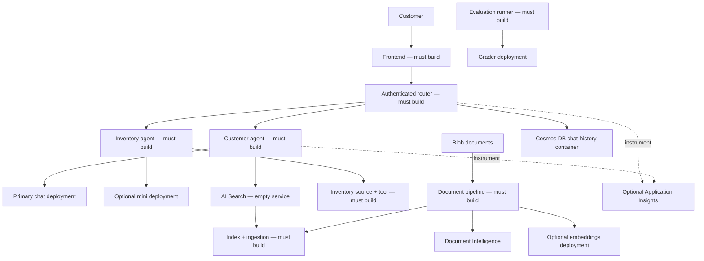

# മൾട്ടി-ഏജന്റ് കസ്റ്റമർ സപ്പോർട്ട് — റീറ്റെയിൽ ആർക്കിടെക്ചർ ബ്ലൂപ്രിന്റ്

**അദ്ധ്യായം 5: മൾട്ടി-ഏജന്റ് എ.ഐ. പരിഹാരങ്ങൾ**

- [കോഴ്‌സ് ഹോം](../README.md)
- [അദ്ധ്യായം 5](../docs/chapter-05-multi-agent/README.md)
- [മുമ്പ്: എ.ഐ. സംയോജനം](../docs/chapter-02-ai-development/microsoft-foundry-integration.md)
- [അടുത്തത്: ശേഷീകരണ പദ്ധതി](../docs/chapter-06-pre-deployment/capacity-planning.md)
- [ARM ഇൻഫ്രാസ്ട്രക്ചർ സ്കാഫോൾഡ്](retail-multiagent-arm-template/README.md)

> **ആർക്കിടെക്ചർ ഗൈഡ്, പ്രവർത്തനപരമായ അപ്ലിക്കേഷനല്ല.** ഏകദേശം റീറ്റെയിൽ നടപ്പാക്കൽ
> ഫയലുകൾ `azuredeploy.json`, `azuredeploy.parameters.json`, ಮತ್ತು `deploy.sh` ആണ്
> `retail-multiagent-arm-template/`-ൽ. റൂട്ടർ/ഫ്രണ്ട്‌എൻഡ് കണ്ടെയ്‌നറുകൾ ഹലോ-വേൾഡ്
> പ്ലേസ്‌ഹോൾഡറുകളാണ്. ലൊക്കലായി ചെറിയ ഏജന്റ്, UI, ഇൻ‌ജെക്ഷൻ പൈപ്പ്‌ലൈൻ, മൂല്യനിർണയകൻ, സ്കാനർ, അല്ലെങ്കിൽ
> അപ്ലിക്കേഷൻ ടെസ്റ്റ് സ്യൂട് ഇല്ല.

## അവലോകനം

**ലക്ഷ്യം:** ഒരു കസ്റ്റമർ-സപ്പോർട്ട് സിസ്റ്റം രൂപകൽപ്പന ചെയ്‌തു, കസ്റ്റമർ ഏജന്റും ഇൻവെന്ററി
ഏജന്റും ഉണ്ടാക്കി, ഇൻ‌ഫ്രാസ്ട്രക്ചർ എന്ത് നൽകുന്നത് തിരിച്ചറിയുക, കൂടാതെ കുറവുള്ള അപ്ലിക്കേഷൻ
കരാറുകളും പരിശോധനയും പദ്ധതി തയ്യാറാക്കുക.

**പ്രേക്ഷകർ:** ലോക്കലിൽ പൂർത്തിയാക്കിയ ഡെവലപ്പർമാരെ ചിന്തിച്ച്  
[ചാറ്റ് സാമ്പിൾ](../../../examples/azure-openai-chat) ആന [രണ്ട്-സേവ‌സ് കണ്ടെയ്‌നർ സാമ്പിൾ](../../../examples/container-app/microservices).
രൂപകൽപ്പന അദ്ധ്യയനത്തിന് 2–3 മണിക്കൂർ അനുവദിക്കുക. അപ്ലിക്കേഷൻ നിർമ്മാണം വേർതിരിച്ച
പ്രോജക്ടാണ്: 80–120 വികസന മണിക്കൂർ പരിചയസമ്പന്നരായ ഡെവലപ്പർമാർക്കുള്ള സൂചനാത്മക പദ്ധതി മൂല്യനിർണയമാണ്,
**വിതരണ വാഗ്ദാനം അല്ല**; ഉല്പാദന കർശനത, പരീക്ഷണങ്ങൾ,
സുരക്ഷാ അവലോകനം, ഓപ്പറേഷൻസ് എന്നിവയ്ക്ക് അധിക പ്രവര്‍ത്തനം ആവശ്യമാണ്.

### പഠന ഫലങ്ങൾ

- റൂട്ടിംഗ്, ഗ്രൗണ്ടിംഗ്, ടൂൾ അനുമതികൾ, സംവാദ ഉടമസ്ഥത വിശദീകരിക്കുക.
- മോഡൽ തിരിച്ചറിയുക, വിന്യാസ നാമങ്ങൾ, API പതിപ്പുകൾ, ARM പതിപ്പുകൾ വേർതിരിക്കുക.
- രേഖ ഇൻജെഷൻ, വീത്കൽ ഡൈമെൻഷനുകളും ചേർന്ന് പുനഃപ്രാപ്‌താഫലമാക്കുക.
- ആധികാരപരമായ ഫംഗ്ഷണൽ, മൂല്യനിർണയ, പരാജയ-പുനരുദ്ധാരണം ആവശ്യകതകൾ നിർവചിക്കുക.
- ഒപ്ഷണൽ ആർക്കിടെക്ച്ചർ ലക്ഷ്യങ്ങളെ പ്രദാനം ചെയ്ത რესോഴ്‌സുകളിൽ നിന്ന് വേർതിരിക്കുക.

## പരിഹാര ആർക്കിടെക്ച്ചർ



ഇത് ഒരു **ലക്ഷ്യ അപ്ലിക്കേഷൻ ആർക്കിടെക്ച്ചർ** ആണ്, പ്രവർത്തിക്കുന്ന ഏജന്റ്
സേവനങ്ങളുടെ ഡയഗ്രാം അല്ല. ARM സ്കാഫോൾഡ് അടിസ്ഥാന സേവനങ്ങളും രണ്ട് പ്ലേസ്ഹോൾഡർ
കണ്ടെയ്‌നറുകളും മാത്രമേ ഉണ്ടാക്കൂ. ഫ്രണ്ട് ഡോർ, രജിസ്ട്രി, മാനേജുചെയ്യുന്ന ഐഡന്റിറ്റികൾ, റോള നിയോഗങ്ങൾ,
പ്രൈവറ്റ് എൻഡ്‌പോയിന്റുകൾ, ഫെയ്‌ലോവർ, അപ്ലിക്കേഷൻ ഇൻസ്ട്രുമെന്റേഷൻ, അലേർട്ടുകൾ ഉൾപ്പെടുന്നില്ല.

### ഉത്തരവാദിത്വങ്ങളും കരാറുകളും

| ഘടകം | ആവശ്യമായ പെരുമാറ്റം | പൂർത്തിയായതിനു മുൻപുള്ള തെളിവ് |
|---|---|---|
| ഫ്രണ്ട്‌എൻഡ് | ഉപഭോക്താക്കളെ പ്രമാണിക്കുക, ചാറ്റ് റെൻഡർ ചെയ്യുക, രേഖകൾ സുരക്ഷിതമായി അപ്‌ലോഡ് ചെയ്യുക | UIയും അപ്‍ലോഡ് പരീക്ഷണങ്ങളും, വായനാനുയോജ്യമായ പിശകുകൾ |
| റൂട്ടർ | അഭ്യർത്ഥനകൾ അധികാരപത്രത്തിൽ ഒപ്പിടുക, ഏജന്റ് തിരഞ്ഞെടുക്കുക, ബന്ധം ടൂൾ കോളുകളും/ടൈംഔട്ടുകളും | റൂട്ടിംഗ് പരീക്ഷണങ്ങൾ, അധികാര പരിശോധനകൾ, പരാജയ പരീക്ഷണങ്ങൾ |
| കസ്റ്റമർ ഏജന്റ് | അംഗീകരിച്ച ഉറവിടങ്ങളിൽ നയം/ഉൽപ്പന്ന ഉത്തരം ഗ്രൗണ്ട് ചെയ്യുക | ശരിയായ ഉദ്ധരണികൾ, ഡാറ്റ ഇല്ലാത്തപ്പോഴുള്ള ഒഴിവാക്കൽ |
| ഇൻവെന്ററി ടൂൾ | അടിസ്ഥാനപരമായ സ്റ്റോക്ക് സ്കോപ്പ് അനുമതികളോടെ വായിക്കുക | നിശ്ചിത സ്റ്റോക്ക് പരീക്ഷണങ്ങൾ; സൃഷ്ടിച്ച ലഭ്യത ഇല്ല |
| രേഖ പൈപ്പ്‌ലൈൻ | എക്‌സ്‌ട്രാക്റ്റ്, ചങ്ക്, എംബെഡ്, ഇൻഡക്സ്, അപ്‌ഡേറ്റ്/മാറ്റുക | ഇൻഡക്സ് ചെയ്ത ഫിക്‌സ്ചറുകളും റിട്രൈ/ഡെഡ്-ലേറ്റർ പെരുമാറ്റവും |
| സംവാദ സംഭരണം | ഉപയോക്താക്കളെ വേർതിരിക്കുക, നിലനിർത്തൽ പ്രാബല്യത്തിൽ വയ്ക്കുക | ഉപയോക്തৃ-മിടപാടില്ലാത്ത അധികാരപരിശോധന ഒപ്പം TTL പരീക്ഷണങ്ങൾ |
| മൂല്യനിർണയ റണ്ണർ | ഔട്ടുപുട്ടുകൾ ഗ്രൗണ്ട് ട്രൂത്ത്, റൂബ്രിക്കായി താരതമ്യം ചെയ്യുക | കവറേജ്, പരാജയ എണ്ണങ്ങൾ, പുനരുജ്ജീവന പരീക്ഷണ റിപ്പോർട്ടുകൾ |

റൂട്ടറെ ഒരു സ്വാഗത ഡെസ്കായും ടൂൾസുകൾ നിയന്ത്രിത അകത്ത് സിസ്റ്റങ്ങളായും കരുതുക:
ഒരു വിദഗ്ദ്ധനെ തെരഞ്ഞെടുത്താൽ എല്ലാ ഉപഭോക്താക്കളുടെ രേഖകളിലേക്കും പ്രവേശനത്തിനുള്ള അവകാശം നൽകുന്നില്ല.
അപേക്ഷാ കോഡിലും ഡാറ്റാ സേവനങ്ങളിലും വ്യക്തിത്വവും അനുവാദങ്ങളും പ്രയോജനപ്പെടുത്തുക, പ്രൊംപ്ടുകളിലല്ല.

## അടിസ്ഥാനസൗകര്യവും അപേക്ഷയും

പ്രൊവിഷനിംഗ് ചെയ്‌തുമുമ്പ് [scaffold README](retail-multiagent-arm-template/README.md) വായിക്കൂ.
അതില്‍ കൃത്യമായ വിഭവങ്ങള്‍, മോഡുകള്‍, ചെലവുകള്‍, പരിമിതികള്‍ പട്ടികയിലുണ്ട്.

| ലോഗിക്കല്‍ ഉപയോഗം | ARM ഡിപ്ലോയ്മെന്റ് പേര് | മോഡല്‍ / പതിപ്പ് | ഡീഫോള്‍ട്ട് പ്രദേശം |
|---|---|---|---|
| ഉപഭോക്തൃ ചാറ്റ് | `gpt-4.1-chat` | `gpt-4.1` / `2025-04-14` | `eastus2` |
| സ്റ്റോക്ക് | `gpt-4.1-mini-inventory` | `gpt-4.1-mini` / `2025-04-14` | `westus2`, ആവശ്യാനുസരണം |
| എംബഡ്ഡിംഗ്സ് | `text-embedding-ada-002` | `text-embedding-ada-002` / `2` | `francecentral`, ആവശ്യാനുസരണം |
| മൂല്യനിര്‍ണയം | `gpt-4.1-grader` | `gpt-4.1` / `2025-04-14` | ആദ്യം പ്രാഥമിക പ്രദേശം |

ഓരോ പ്രദേശത്തും മോഡല്‍/പതിപ്പ്/SKU ലഭ്യതയും ക്വോട്ടയും പരിശോധിക്കുക. ചാറ്റ്/മിനി/ഗ്രേഡര്‍
`GlobalStandard` ഉപയോഗിക്കും; എംബഡ്ഡിംഗ്സ് `Standard` ഉപയോഗിക്കും. ശേഷി യൂണിറ്റ് നിന്നും TPM-വരെ
യോജിപ്പുകള്‍ മോഡലിനനുസരിച്ചാണ്. വ്യത്യസ്ത ശേഷി യൂണിറ്റുകള്‍ യൂണിവേഴ്സല്‍ ക്വോട്ടായി കൂട്ടിക്കൂടരുത്.

ഒരു Azure OpenAI അഭ്യര്‍ത്ഥനയുടെ `model` ആര്‍ഗുമെന്റ് **ഡിപ്ലോയ്മെന്റ് പേര്** ആകുന്നു, അതല്ല
നിർബന്ധമായും കാറ്റലോഗ് മോഡൽ ഐഡന്റിഫയറല്ല. ഡാറ്റാ-പ്ലെയിൻ API വേർഷൻ `2024-10-21`
മോഡൽ വേർഷൻ `2025-04-14`നും ARM റിസോഴ്‌സ് `apiVersion`നും നിന്ന് വ്യത്യസ്തമാണ്.
ഡാറ്റാ-പ്ലെയിൻ API വേർഷൻ മാത്രം മാറ്റി ലഭ്യമല്ലാത്ത മോഡൽ എടുക്കാൻ സാധിക്കില്ല.

`--no-multi-region` സെങ്കണ്ടറി കൂടാതെ എംബെഡിങ്ങ് അക്കൗണ്ടുകളും ഒഴിവാക്കുന്നു. ഒരു പ്രാഥമിക ചാറ്റും
സ്വതന്ത്ര ഗ്രേഡർ അക്കൗണ്ടും നിലനിർത്തുന്നു. വേർതിരിച്ച മോഡൽ അക്കൗണ്ടുകൾ സ്വയം
ഫെയിൽഓവർ നൽകുന്നില്ല; അത് അപേക്ഷ റൂട്ടിംഗും, പൊരുത്തപ്പെടുന്ന ഡിപ്പ്ലോയ്മെന്റുകളും, ആരോഗ്യ പരിശോധനകളും,
റിട്രൈ പരിധികളും, ഡാറ്റ-റസിഡൻസി റിവ്യൂവുമാണ് ആവശ്യമായത്.

## നടപ്പിലാക്കൽ റോഡ്‌മാപ്

### 1. ഒന്ന് പരിശോധന നടത്തിയ ഇന്ററാക്ഷനോടെ ആരംഭിക്കുക

വലിയ സ്കാഫോൾഡ് പ്രൊവിഷൻ ചെയ്തുതുടങ്ങുന്നതിന് മുമ്പ്, ലൊക്കൽ ചാറ്റ് സാമ്പിൾ ഉപയോഗിച്ച്
ഇൻഫെൻസ്സ് കണക്ടിവിറ്റി ഉറപ്പാക്കുക. ഒരു പ്രതിനിധി കസ്റ്റമർ ചോദ്യവും, അംഗീകരിച്ച
മറുപടി ഉറവിടവും, പ്രതീക്ഷിച്ച സൈറ്റേഷനും, ആ ഉറവിടം ലഭ്യമല്ലെങ്കിൽ പരാജയ ബീഹേവിയറും നിർവചിക്കുക.

### 2. റൂട്ടിംഗ്, ടൂൾ ബൗണ്ടറികൾ നിർവചിക്കുക

നിങ്ങളുടെ സ്വന്തം റൂട്ടർ സോഴ്‌സ്, ഡിപൻഡൻസി മാനിഫസ്റ്റ്, Dockerfile, ടെസ്റ്റുകൾ ഉണ്ടാക്കുക. ഒരു
ഉദാഹരണ കരാർ ആണ് `POST /chat`, `{"message":"...","conversation_id":"..."}` ഉൾപ്പെടെ.
**ആ അന്ത്യബിന്ദു ഒരു ഡിസൈൻ നിർദ്ദേശമാണ്; അത് ARM ടെംപ്ലേറ്റ് നടപ്പിലാക്കിയിട്ടില്ല.**

ബോഡി തരം/പരിധികൾ വാലിഡേറ്റ് ചെയ്യുക, ഓതന്റിക്കേഷൻ വഴി ഉപയോക്തൃ ഐഡന്റിറ്റി കണ്ടെത്തുക,
സംവാദ ഉടമസ്ഥത പ്രാബല്യത്തിൽ വരുത്തുക, അഭ്യർത്ഥനയുടെ ടൈംഔട്ടുകൾ പ്രയോഗിക്കുക, പ്രാധാന്യമുള്ള പിശക് കോഡുകൾ മടക്കുക.
HTTP പരാജയങ്ങളെ അല്ലെങ്കിൽ ശൂന്യമായ മറുപടികളെ വിജയകരമായ ഏജന്റ് ഫലമായി കാണരുത്.

### 3. ഗ്രൗണ്ടിങ്, ഇൻജെക്ഷൻ നടപ്പിലാക്കുക

ARM ടെംപ്ലേറ്റ് ഒരു സെർച്ചിൻഡക്സ് സൃഷ്ടിക്കുന്നില്ല. ഇത് ഒരു **റഫറൻസ് JSON
ഫ്രാഗ്മെന്റ് മാത്രമാണ്, നിങ്ങളുടെ സ്വന്തമായ ഇൻഡക്സ് നിർവചനത്തിൽ നീ ഇന്ത്യോപിക്കേണ്ടത്**, റെപ്പോയിലെ ഫയൽ അല്ല:

```json
{
  "name": "retail-product-index",
  "fields": [
    {"name": "id", "type": "Edm.String", "key": true},
    {"name": "title", "type": "Edm.String", "searchable": true},
    {"name": "content", "type": "Edm.String", "searchable": true},
    {"name": "category", "type": "Edm.String", "filterable": true},
    {
      "name": "content_vector",
      "type": "Collection(Edm.Single)",
      "searchable": true,
      "dimensions": 1536,
      "vectorSearchProfile": "retail-profile"
    }
  ],
  "vectorSearch": {
    "algorithms": [{"name": "retail-hnsw", "kind": "hnsw"}],
    "profiles": [{"name": "retail-profile", "algorithm": "retail-hnsw"}]
  }
}
```

പ്രൊഫൈൽ വെക്ടർ ഫീൽഡിനെയും അതിന്റെ ആൽഗോരിതത്തിനെയും ബന്ധിപ്പിക്കുന്നു. അളവുകൾ
യഥാർത്ഥ എംബഡിങ്ങ് ഔട്ട്പുട്ടിനൊപ്പം ಹೊಂದണം (ഈ `ada-002` ഡിപ്പ്ലോയ്മെന്റിനായി 1536). പൈത്തൺ റീട്രീവലിനായി,
vector query kind ഇല്ലാത്ത অসম്പൂർണ്ണമായ ഒരു മാനദണ്ഡം dictionary ഒഴിവാക്കി `azure.search.documents.models.VectorizedQuery` ഉപയോഗിക്കുക:


```python
# Reference function only: supply an authenticated async SearchClient and an embedding.
from azure.search.documents.models import VectorizedQuery

async def retrieve(search_client, embedding):
    results = await search_client.search(
        search_text=None,
        vector_queries=[VectorizedQuery(
            vector=embedding,
            k_nearest_neighbors=5,
            fields="content_vector"
        )],
        select=["id", "title", "content"]
    )
    return [document async for document in results]
```

വേർതിരിച്ചുള്ള ingestion നടപ്പാക്കലൊന്ന് സൃഷ്ടിക്കുക, അത്:

1. അപ്‌ലോഡ് ആക്‌സസിന് അധികാരമനുവദിക്കുകയും ഉള്ളടക്ക തരം, ആകൃതിയും സാധൂകരിക്കുകയും ചെയ്യും.
2. ഓതന്റിക്കേറ്റ്ട് ചെയ്ത SDK കോൾസ് ഉപയോഗിച്ച് സ്വകാര്യ ബ്ലോബ് വായിക്കുന്നു. ഒരു സ്വകാര്യ ബ്ലോബ് URL തന്നെയാണ്
   ഒരു വായിക്കാവുന്ന ഡോക്യുമെന്റ് ഇന്റലിജൻസ് ഇൻപുട്ട് **അല്ല**; ഡൗൺലോഡ് ചെയ്ത ബൈറ്റുകൾ
   `AnalyzeDocumentRequest(bytes_source=...)` ഉപയോഗിച്ച് അയയ്ക്കുക അല്ലെങ്കിൽ ആക്സസ് ആവശ്യകതകൾ അവലോകനം ചെയ്ത ശേഷം
   അനുയോജ്യമുള്ള പരിധിയിലുള്ള, കുറഞ്ഞ കാലാവധിയുള്ള SAS ഉപയോഗിക്കുക.
3. എഴുത്തുക്കളിനെ പുറത്തെടുക്കുന്നു, എംബെഡ്ഡിങ് പരിധികൾക്ക് അനുയോജ്യമായി ചുങ്കുകളായി വിഭജിക്കുന്നു,
4. സ്ഥിരതയുള്ള സാധുവായ ദസ്താവേജു കീകൾ സൃഷ്‌ടിക്കുകയും ചുങ്കുകളെ അനുയോജ്യമായ വെക്ടറുകളുമായ് അപ്‌ലോഡ് ചെയ്യുകയും ചെയ്യുന്നു.
5. പ്രമാണം തിരശ്ചീനത ഫലങ്ങൾ പരിശോധിക്കുകയും, പുനരാരംഭങ്ങൾ കൈകാര്യം ചെയ്യുകയും, പഴകിയ ഡാറ്റ അപ്‌ഡേറ്റ്/ഇല്ലാതാക്കുകയും ചെയ്യുന്നു.

ഓഡാറ്റ ഫിൽട്ടറുകളിലേക്ക് അനിഷ്ടമായ ഉപയോക്തൃ കീകൾ/മൂല്യങ്ങൾ ഇടുകതൽ ഒഴിവാക്കുക. ഫീൽഡുകൾ അനുവദനീയമായ ലിസ്റ്റിൽ ഉൾപ്പെടുത്തുക,
മൂല്യങ്ങളുടെ തരം പരിശോദിക്കുക, സ്റ്റ്രിങ് ഉദ്ധരണികൾ കടന്നുകടക്കുക. ബൂളിയൻ-സ്വഭാവമുള്ള നൂറ് ഫിൽട്ടറുകൾക്ക് ടൈപ്പുചെയ്ത ലിറ്ററലുകൾ ആവശ്യമാണ്, ഉദ്ധരണികളുള്ള സ്റ്റ്രിങ് ഇല്ല.


### 4. വെബ് ഗ്രൗണ്ടിംഗ്

**Bing Search v7 ഓഗസ്റ്റ് 11, 2025 ന് വിരമിച്ചു.** പഴയ `Microsoft.Bing/accounts` 
റിസോഴ്‌സ് ಮತ್ತು `api.bing.microsoft.com/v7.0/search` ഉദാഹരണങ്ങൾ പിന്തുണയുള്ള നടപ്പാക്കൽ മാർഗം അല്ല. നിലവിൽ പിന്തുണയുള്ള ഗ്രൗണ്ടിംഗ് ഇന്റഗ്രേഷൻ
മൈക്രോസോഫ്റ്റ് ഫൗണ്ട്രി, അതിന്റെ SDK, അനുമതികൾ, ബില്ലിംഗ്, ഉദ്ധരണി ആവശ്യകതകൾ എന്നിവ അവലോകനം ചെയ്യുക;
ഇതിൽ ആർക്കും നടപ്പാക്കിയിട്ടില്ല. വിരമിച്ച എൻഡ്‌പോയിന്റിന് ഇഷ്ടാനുസൃത പകരം ഇത് അല്ല.


### 5. ടെലിമെട്രി மற்றும் വിലയിരുത്തൽ ചേർക്കുക

ആപ്ലിക്കേഷൻ ഇൻസൈറ്റ്സ് സൃഷ്‌ടിക്കുന്നത് കോഡ് ഇൻസ്ട്രുമെന്റ് ചെയ്യുന്നതല്ല. പുതിയ ആപ്ലിക്കേഷൻ നിർമ്മിക്കുമ്പോൾ പിന്തുണയുള്ള Azure Monitor
OpenTelemetry ഇൻസ്ട്രുമെന്റേഷൻ ഉപയോഗിച്ച് ട്രേസ് കോൺടെക്‌സ് സروسുകളില്‍ പ്രചരിപ്പിക്കുക, ഉപഭോക്തൃ പ്രോമ്പ്റ്റുകൾ, രേഖകൾ അല്ലെങ്കിൽ രഹസ്യങ്ങൾ لاഗിലെ ശേഖരിക്കുന്നത് ഒഴിവാക്കുക.
ഒരു ക്വറി ചുരുക്കുന്നതിൽ അതിന്റെ ഗോപ്യത ഇല്ല.


ടോക്കൺ ഉപയോഗം, നിരസിക്കൽ എന്നിവ അളക്കുക. നിലനിൽക്കുന്ന സത്യമായ വസ്തുതകളും നയം വസ്തുതകളും
കൂടെ വിലയിരുത്തൽ കേസുകൾ സൂക്ഷിക്കുക: ഒരു ഗ്രേഡർ വെറും ചോദ്യംയും ഉത്തരവും മാത്രം ഉപയോഗിച്ച് സത്യസന്ധത വിശ്വസിയ്ക്കാൻ കഴിയില്ല.


ഘടനയുള്ള ഔട്ട്പുട്ട്/സ്കീമാ വാലിഡേഷൻ, സ്കോർ പരിധി പരിശോധനകൾ, ട്രാൻസ്പോർട്ട് പരാജയങ്ങളുടെ എണ്ണം,
മനുഷ്യപരിശോധന ചെയ്ത കേസുകൾ. പൂർണ്ണമല്ലാത്ത/സന്ദർഭരഹിതമായ കേസുകൾ വേറിട്ടാണ് റിപ്പോർട്ട് ചെയ്യുക; ഇവയെ വിജയകരമായ ഗ്രേഡുകളായി മാറ്റരുത് അല്ലെങ്കിൽ ശൂന്യ-ഗുണമേന്മയുള്ള മോഡൽ പ്രതികരണങ്ങളായി മൗനം ചേർക്കരുത്.


അഭ്യർത്ഥന, പോരായ്മപ്പെട്ട ടെസ്റ്റ് സ്റ്റ്രാറ്റജി, അല്ലെങ്കിൽ ശൂന്യമായ പ്രതികരണം ടെസ്റ്റ് **ഫലം ഇല്ലാത്തതാക്കണം അല്ലെങ്കിൽ
പരാജയപ്പെട്ടതാക്കണം**, "100% സുരക്ഷിതമായ" സ്കോർ നൽകരുത്. ഉചിതമായ ടൂൾസും മനുഷ്യപരിശോധനയും
ഉപയോഗിച്ചുള്ള അംഗീകൃത പരീക്ഷണം നടത്തുക മുൻ പരിപാടി നേടാനുള്ള അവകാശം പ്രസ്താവിക്കുന്നതിന് മുമ്പ്.


### 6. നിങ്ങളുടെ ആപ്ലിക്കേഷൻ വിന്യസിക്കുക

നിങ്ങളുടെ സ്വന്തം സ്രോതസ് ഡയറക്ടറികൾ, മാനിഫെസ്റ്റുകൾ, പരിശോധനകൾ, റെജിസ്ട്രി, ഇമേജ് പുൾ
അനുമതികൾ സൃഷ്‌ടിക്കുക. പ്ലേസ്‌ഹോൾഡറുകൾ മാറി നിർമ്മിച്ച ഇമേജുകൾ ഉപയോഗിച്ച് മാറ്റി അഡ്രസ്സ്/പ്രോബുകൾ
ആപ്ലിക്കേഷനുകളുടെ ഓരോ കേൾവി പോർട്ടിനും അനുയോജ്യമാക്കുക. ബൈസിപിൽ അല്ലെങ്കിൽ പ്രകടമായ പിന്തുണയുള്ള azd പരിസ്ഥിതി മാപ്പിംഗിൽ
റൺടൈം പരിസ്ഥിതി വേരിയബിളുകൾ ക്രമീകരിക്കുക.

azd സർവിസിനുള്ളിൽ അംഗീകൃതമായ ഒരു പൊതു `config` ഡിക്ഷണറി നിലവിലില്ല,
അത് സ്വയം റൺടൈം പരിസ്ഥിതി വേരിയബിളുകൾ സൃഷ്‌ടിക്കുന്നില്ല. `azd env set` ആ മൂല്യങ്ങൾ
പ്രകടമായി ഉപയോഗിക്കുന്ന റിസോഴ്‌സുകൾ മാത്രമേ മാറ്റൂ. ഈ സ്കാഫോൾഡിൽ ഒരു കാനറി, പ്രദേശങ്ങളുടെ പട്ടിക, അല്ലെങ്കിൽ
ഫൈൻ-ട്യൂണിംഗ് ഹുക്ക് നടപ്പിലില്ല.

## പ്രായോഗിക രൂപകൽപ്പന പ്രവർത്തനങ്ങൾ

ഇവ **വാസ്തവിക രൂപകൽപ്പന വ്യായാമങ്ങൾ** ആണ്, നടത്ത ejecutable റീട്ടെയിൽ സ്റ്റാർട്ടർ കോഡുകളുടെ അവകാശവാദങ്ങൾ അല്ല.

### വ്യായാമം 1: അതിരു പരിശോധിക്കുക

**ആരംഭസ്ഥലം:** `retail-multiagent-arm-template/` ലെ മൂന്ന് ഫയലുകൾ.
**ലക്ഷ്യം:** പ്രൊവൈഷനിങ്ങിലും ആപ്ലിക്കേഷൻ പ്രവർത്തനത്തിലുമുള്ള വ്യത്യാസം തിരിച്ചറിയുക.
Open `azuredeploy.json`, ഇരുവശവും ഉള്ള കണ്ടെയ്‌നർ ഇമേജുകളും `targetPort` മൂല്യങ്ങളും ലഭ്യമാക്കുക,
പിന്നീട് റിപ്പൊസിറ്ററിയിൽ നിന്ന് കാണാനാകാത്ത ആപ്പ്ലിക്കേഷൻ ഘടകങ്ങൾ ലിസ്റ്റ് ചെയ്യുക.

**വിജയം മാനദണ്ഡം / ഉത്തരം:** ഇരുപതും ഹലോ-വേൾഡ് പ്ലേസ്ഹോൾഡറുകൾ പോർട്ട് 80-ൽ കേൾക്കുന്നു
; ഏജന്റുകൾ, ചാറ്റ് UI, റൂട്ടർ ഹാൻഡ്ലറുകൾ, ഇൻഡക്സ് / ഇൻജെക്ഷൻ, ഇവാല്യുവേറ്റർ, സ്‌കാനർ
ഇല്ലാതെയാണ്. വിജയകരമായ പ്ലേസ്ഹോൾഡർ റൂട്ട് അഭ്യർത്ഥനം `/chat` സ്ഥിരീകരിക്കുന്നില്ല.
**സാധാരണ പ്രശ്നം:** `retail-router` പോലുള്ള റിസോഴ്സ് പേരുകൾ പ്രവർത്തിക്കുന്ന കോഡായി വ്യാഖ്യാനിക്കുന്നത്.

### അഭ്യാസം 2: വെക്റ്റർ കോൺഫിഗറേഷൻ പിന്തുടരുക

**ആരംഭബിന്ദു:** മുകളിൽ നൽകിയ ഇൻഡക്സ് JSON.
**ലക്ഷ്യം:** ഫീൽഡ് → പ്രൊഫൈൽ → ആൽഗോറിതം ബന്ധം മനസിലാക്കുക.
embeddings മോഡലിലേക്ക് മാറ്റുമ്പോൾ ഏത് മൂല്യങ്ങൾ മാറ്റേണ്ടതായി വരും എന്ന് തിരിച്ചറിഞ്ഞു
ശേഷം `retrieve` ഫംഗ്ഷൻ പരിശോധിക്കുക.

**വിജയത്തിന്റെ മാനദണ്ഡങ്ങൾ / ഉത്തരം:** ഫീൽഡ് `dimensions` യഥാർത്ഥ വെക്ടർ നീളത്തിലേക്ക് മാറ്റുക;
പ്രഖ്യാപിച്ച പ്രൊഫൈലും ആൽഗോരിഥവും അനുസരിച്ച് `vectorSearchProfile` നിലനിർത്തുക;
കൊറിയ `fields` വെക്ടർ ഫീൽഡ് നാമകരണം ചെയ്യണം. embeddings മോഡൽ മാറാൻ കോൺഡോക്‌മെന്റ് വെക്ടറുകൾ പുനഃജനനം ചെയ്യുക.
**സাধാരണ പ്രശ്നം:** വെക്ടറുകൾ അനുസരിക്കാത്തവയായി നിന്ന് മോഡൽ നാമം മാത്രമേ മാറ്റുന്നത്.


**ലക്ഷ്യം:** തെറ്റായ വിജയത്തെ തടയുക.
ലഭ്യമല്ലാത്ത ഇൻവെന്ററി API യ്ക്ക് പ്രതീക്ഷിച്ച പെരുമാറ്റം എഴുതി, യുവ് ചാരപ്രമാണങ്ങളിൽ യാതൊരു പൊരുത്തവും ഇല്ലാത്ത തിരച്ചിൽ സൂചികയും, HTTP 503 നൽകുന്ന മൂല്യനിർണയ അഭ്യർഥനയും.

**വിജയത്തിന്റെ മാനദണ്ഡങ്ങൾ / ഉത്തരം:** സൃഷ്ടിച്ച ഇൻവെന്ററി മൂല്യങ്ങൾ ഇല്ല; സന്ദർഭം ഇല്ലെങ്കിൽ വ്യക്തമായ നിരാകരണം അല്ലെങ്കിൽ ഉയർത്തൽ; മൂല്യനിർണയം ഗുണനിലവാരം അല്ലെങ്കിൽ സുരക്ഷാ പാസ്സ് അല്ല ട്രാൻസ്പോർട്ട് പരാജയം റിപ്പോർട്ട് ചെയ്യണം. ആപ്പ്ലിക്കേഷൻ നിർമ്മിക്കുമ്പോൾ നിർവഹണപരിശോധനകൾ ചേർക്കുക.


ഘടക വിവരം ലഭ്യമാകാത്തപ്പോള്‍ ഉയര്‍ത്തല്‍; മികവ് അല്ലെങ്കില്‍ സുരക്ഷ പാരിതോഷികമല്ലാതെ ഒരു ട്രാന്‍സ്പോര്‍ട്ട് പരാജയം ആയി വിലയിരുത്തല്‍ റിപ്പോര്‍ട്ട് ചെയ്യുന്നു.
അപ്ലിക്കേഷന്‍ നിര്‍മ്മിക്കുമ്പോള്‍ നിര്‍വഹണയോഗ്യമുള്ള ടെസ്റ്റുകള്‍ ചേര്‍ക്കുക.
**സാധാരണ പ്രശ്‌നം:** എല്ലാ ഒഴിവുകളും പിടിച്ച് ശൂന്യമായ മറുപടിയോടെ തുടരുമെന്നു.

## ചെലവുകള്‍, പ്രശ്നപരിഹാരവും ശുചീകരണവും

- വാഹനസൗകര്യത്തിന് ശൂന്യമായ തിരയൽ സൂചികകളും പ്ലെയ്സ്‌ഹോൾഡർ ആപ്പുകളും ഉണ്ടായാലും തുടർച്ചയായ ചാർജുകൾ ഉണ്ടാകും.
  നിലവിലുള്ള പ്രദേശിക വിലകൾ ഉപയോഗിക്കുക; "കുറഞ്ഞത്" അല്ലെങ്കിൽ ബഹു-പ്രദേശികം സൗജന്യമാണ് എന്ന് അർഥമാകുന്നില്ല.
- ടോക്കൺ ചെലവുകൾ മോഡൽ, കാഷ് ചെയ്ത/ചെയ്യാത്ത ഇൻപുട്ട്, ഔട്ട്പുട്ട്, വിനിയോഗിച്ച ഡിപ്ലോയ്മെന്റ് SKU എന്നിവയിൽ ആശ്രിതമാണ്.
  റോട്ടിങ്ങ് ചെലവ് ഉരുത്തിരിയുന്ന വിദഗ്ധതയും ഫലം തെളിയിച്ചാൽ മാത്രം പണം മുടക്കാതെ നടത്താനാകും;
  60-80% സ്ഥിരതയുള്ള സാമ്പത്തിക ലാഭം ഉറപ്പില്ല.
- വിതരണത്തിന് മുമ്പ് മോഡൽ ലഭ്യതയും ക്വോട്ടയും പരിശോധിക്കുക; അനുവാദം, 
  ഡിപ്ലോയ്മെന്റ്-നാമം, മേഖല, മോഡൽ പതിപ്പ്, API-പതിപ്പ് എന്നിവയിലെ പിശകുകൾ വേർതിരിക്കുക.
- നഷ്ടപ്പെട്ട `setup-data.sh`, ഇവാലുവേറ്റർ CLIകൾ, അല്ലെങ്കിൽ `pytest tests/` കമാൻഡുകൾ പ്രവർത്തിപ്പിക്കരുത്.
  അവയുടെ റൺടൈം വികസന ലിസ്റ്റിന്റെ ഭാഗമാണ്.
- സ്കാഫോൾഡ് ARM മാത്രമാണ്: അതിന്റെ
  [പരിശോധനയും ശുചീകരണ നിർദേശങ്ങളും](retail-multiagent-arm-template/README.md) പിന്തുടരുക.
  `azd down` അതുമായി ബന്ധപ്പെട്ട ആ സമ്പദ്വ്യവസ്ഥകളെ നിയന്ത്രിക്കുന്നില്ല.

## ബന്ധപ്പെട്ട വనറുകൾ

- [പ്രവർത്തിക്കുന്ന പ്രാദേശിക ചാറ്റ് ചൂഷണമodel](../../../examples/azure-openai-chat)
- [പ്രവർത്തിക്കുന്ന രണ്ട്-സേവന കണ്ടെയ്‌നർ മാതൃക](../../../examples/container-app/microservices)
- [AI Search വെക്ടർ സൂചികകൾ](https://learn.microsoft.com/azure/search/vector-search-how-to-create-index)
- [കണ്ടെയ്‌നർ ആപ്പുകളുടെ ഡോക്യുമെന്റേഷൻ](https://learn.microsoft.com/azure/container-apps/)
- [പ്രശ്നപരിഹാരം](../docs/chapter-07-troubleshooting/common-issues.md)
- [ഒരു പ്രശ്നം റിപ്പോർട്ട് ചെയ്യുക](https://github.com/microsoft/AZD-for-beginners/issues)

---

<!-- CO-OP TRANSLATOR DISCLAIMER START -->
**അറിയിപ്പ്**:
ഈ രേഖ AI പരിഭാഷാ സേവനം [Co-op Translator](https://github.com/Azure/co-op-translator) ഉപയോഗിച്ച് പരിഭാഷപ്പെടുത്തിയതാണ്. ഞങ്ങൾ കൃത്യതയ്ക്കായി ശ്രമിക്കുന്നുവെങ്കിലും, ഓട്ടോമേറ്റഡ് പരിഭാഷകളിൽ പിഴവുകൾ അല്ലെങ്കിൽ തെറ്റായ വിവരങ്ങൾ ഉണ്ടാകാൻ സാധ്യതയുണ്ട്. അതിന്റെ സ്വാഭാവിക ഭാഷയിലുള്ള അസൽ രേഖയാണ് പ്രാമാണികമായ ഉറവിടമായി പരിഗണിക്കേണ്ടത്. നിർണായകമായ വിവരങ്ങൾക്ക്, പ്രൊഫഷണൽ മനുഷ്യ പരിഭാഷ ശുപാർശ ചെയ്യുന്നു. ഈ പരിഭാഷ ഉപയോഗിച്ച് ഉണ്ടാകുന്ന തെറ്റിദ്ധാരണകൾ അല്ലെങ്കിൽ തെറ്റായ വ്യാഖ്യാനങ്ങൾക്കായി ഞങ്ങൾ ഉത്തരവാദികളല്ല.
<!-- CO-OP TRANSLATOR DISCLAIMER END -->