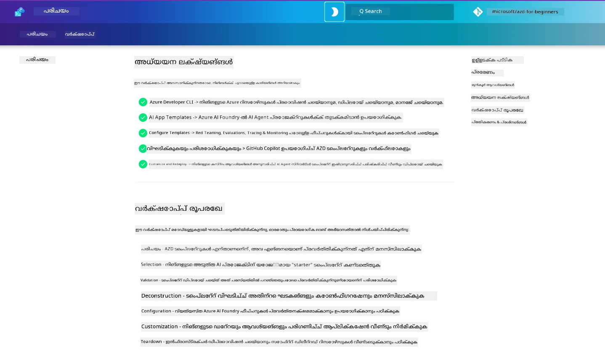

<div align="center">
  <div style="background: linear-gradient(135deg, #0078d4, #106ebe); border-radius: 10px; padding: 20px; margin: 20px 0; box-shadow: 0 4px 15px rgba(0, 120, 212, 0.3); border: 2px solid #005a9e;">
    <h2 style="color: white; margin: 0; font-size: 24px; text-shadow: 1px 1px 2px rgba(0,0,0,0.3);">
      🎯 AI ഡെവലപ്പർമാർക്കുള്ള AZD വർക്ക്ഷോപ്പ്
    </h2>
    <p style="color: white; margin: 10px 0 0 0; font-size: 16px; text-shadow: 1px 1px 2px rgba(0,0,0,0.3);">
      <strong>Azure Developer CLI ഉപയോഗിച്ച് AI ആപ്ലിക്കേഷനുകൾ നിർമ്മിക്കാൻ ഒരു ഹാൻഡ്‌സോൺ വർക്ക്ഷോപ്പ്.</strong><br>
      AZD ടെംപ്ലേറ്റുകളും AI ഡെപ്ലോയ്‌മെന്റ് വർക്ക് ഫ്ലോകളും നന്നായി മനസ്സിലാക്കാൻ 7 മോഡ്യൂളുകൾ പൂർത്തിയാക്കുക.
    </p>
    <div style="margin-top: 15px;">
      <span style="background: rgba(255,255,255,0.2); padding: 5px 10px; border-radius: 15px; color: white; font-size: 14px;">
        📅 ഉറവിട മാർഗ്ഗനിർദ്ദേശം പരിശോധിച്ചത്: നവംബർ 2026
      </span>
    </div>
  </div>
</div>

# AI ഡെവലപ്പർമാർക്കുള്ള AZD വർക്ക്ഷോപ്പ്

Azure Developer CLI (AZD) പഠിക്കാനുളള ഹാൻഡ്‌സോൺ വർക്ക്ഷോപ്പിലേക്ക് സ്വാഗതം, പ്രത്യേകിച്ച് AI ആപ്ലിക്കേഷൻ ഡെപ്ലോയ്മെന്റിൽ ધ્યાન കേന്ദ്രീകരിച്ചു. ഈ വർക്ക്ഷോപ്പ് AZD ടെംപ്ലേറ്റുകളുടെ പ്രായോഗികമായ ഒരു മനസ്സിലാക്കൽ 3 ഘട്ടങ്ങളിൽ സഹായിക്കുന്നു:

1. **ശോധനം** - നിങ്ങൾക്കു ശരിയായ ടെംപ്ലേറ്റ് കണ്ടെത്തുക.
1. **ഡെപ്ലോയ്മെന്റ്** - ഡെപ്ലോയ്ചെയ്ത് അത് ശരിയെന്ന് സ്ഥിരീകരിക്കുക
1. **കസ്റ്റമൈസേഷൻ** - മാറ്റം വരുത്തി നിങ്ങളുടെ പ്രോജക്ടായി മാറ്റുക!

ഈ വർക്ക്ഷോപ്പിന്റെ ഇടയിലൂടെ, കോർ ഡെവലപ്പർ ഉപകരണങ്ങളും വർക്ക് ഫ്ലോകളും പരിചയപ്പെടുകയും അന്തിമ വികസന യാത്ര എളുപ്പമാക്കുന്നതിനായുള്ള സഹായങ്ങൾ ലഭ്യമാക്കുകയും ചെയ്യും.

<br/>

## ബ്രൗസർ അടിസ്ഥാന ഗൈഡ്

വർക്ക്ഷോപ്പ് പാഠങ്ങൾ മാർക്ക്ഡൗണിൽ ആണ്. നിങ്ങൾക്ക് അതിനെ നേരിട്ടു GitHub-ൽ നവിเกറ്റ് ചെയ്യാം - അല്ലെങ്കിൽ താഴെയുള്ള സ്‌ക്രീൻഷോട്ടിൽ കാണുന്ന പോലെ ബ്രൗസർ അടിസ്ഥാന പ്രിവ്യൂ ആരംഭിക്കാം.



ഈ ഓപ്‌ഷൻ ഉപയോഗിക്കാൻ - റിപ്പോസിറ്ററി നിങ്ങളുടെ പ്രൊഫൈൽ തരംമാറ്റം ചെയ്യുക, GitHub Codespaces ആരംഭിക്കുക. VS Code ടെർമിനൽ സജീവമായാൽ, ഈ കമാൻഡ് ടൈപ്പ് ചെയ്യുക:

ഈ ബ്രൗസർ പ്രിവ്യൂ GitHub Codespaces, ഡെവ് കണ്ടെയ്‌നറുകൾ, അല്ലെങ്കിൽ Python, MkDocs ഇൻസ്റ്റാൾ ചെയ്ത ലോക്കൽ ക്ലോണിൽ പ്രവർത്തിക്കുന്നു.

```bash title="" linenums="0"
python -m pip install -r requirements-dev.txt
python -m mkdocs serve --config-file workshop/mkdocs.yml
```

ഈ കമാൻഡുകൾ **കോഴ്സ് റിപ്പോസിറ്ററി റൂട്ട്**-ത്തിൽ നിന്നും പ്രവർത്തിക്കണം, പ്രത്യേകമായി തുടക്കത്തിൽ ഒരുക്കിയ AI സാമ്പിൽല്ല. പ്രിവ്യൂ മുൻപിൽ തന്നെ നിലനിര്‍ത്തുക, പിഴവുകൾ കാണാൻ; അവസാനിപ്പിക്കാൻ Ctrl+C അമർത്തുക. സൈറ്റ് സർവ് ചെയ്യാതെ പരിശോധിക്കാൻ `python -m mkdocs build --strict --config-file workshop/mkdocs.yml` പ്രവർത്തിപ്പിക്കുക.

ചില സെക്കൻഡുകൾക്കുള്ളിൽ, ഒരു പോപ്-അപ്പ് ഡയലോഗ് കാണും. `Open in browser` ഓപ്ഷൻ തിരഞ്ഞെടുക്കുക. വെബ് അധിഷ്ഠിത ഗൈഡ് പുതിയ ബ്രൗസർ ടാബിൽ തുറക്കും. ഈ പ്രിവ്യൂ ചില ഗുണങ്ങൾ:

1. **ഇടക്കാല തിരച്ചിൽ** - കീവർഡുകളോ പാഠങ്ങളോ ഉടൻ കണ്ടെത്തും.
1. **പ്രതി കോപ്പി ഐകൺ** - കോഡ് ബ്ലോക്ക് മുകളിൽ ഹോവർ ചെയ്യുമ്പോൾ കാണാം
1. **തീം മാറ്റൽ** - ഡാർക്ക്, ലൈറ്റ് തീംമുകളിൽ മാറ്റം വരുത്തുക
1. **സഹായം നേടുക** - അടിക്കുറിപ്പിലെ ഡിസ്കോർഡ് ഐകൺ ക്ലിക്ക് ചെയ്ത് ചേരുക!

<br/>

## വർക്ക്ഷോപ്പ് അവലോകനം

**ദൈർഘ്യം:** 3-4 മണിക്കൂർ  
**നില:** തുടങ്ങിയവ മുതൽ മധ്യമനില വരെ  
**ഇതുവരെ ഉള്ള പരിചയം:** Azure, AI ആശയങ്ങൾ, VS Code & കമാൻഡ് ലൈൻ ടൂളുകളിലെ പരിചയം.

ഇത് പ്രായോഗികമായി പഠിക്കുന്ന ഒരു ഹാൻഡ്‌സോൺ വർക്ക്ഷോപ്പ് ആണ്. വിന്യാസങ്ങൾ പൂർത്തിയാക്കിയശേഷം, നിങ്ങൾക്ക് AZD For Beginners പാഠ്യപദ്ധതിയുടെ പരിശോധന ശുപാർശ ചെയ്യപ്പെടുന്നു, സുരക്ഷയും ഉൽപ്പാദ്യതയും സംബന്ധിച്ച മികച്ച പ്രവൃത്തികൾ പഠിക്കാൻ തുടരണം.

| സമയം| മോഡ്യൂൾ  | ലക്ഷ്യം |
|:---|:---|:---|
| 15 മിനിറ്റ് | [പരിചയം](docs/instructions/0-Introduction.md) | കാര്യങ്ങൾ അറിയുക, ലക്ഷ്യങ്ങൾ മനസ്സിലാക്കുക |
| 30 മിനിറ്റ് | [AI ടെംപ്ലേറ്റ് തിരഞ്ഞെടുക്കുക](docs/instructions/1-Select-AI-Template.md) | ഓപ്ഷനുകൾ അന്വേഷണം ചെയ്ത് തുടക്കക്കാർ തിരഞ്ഞെടുക്കുക |
| 30 മിനിറ്റ് | [AI ടെംപ്ലേറ്റ് പരിശോധിക്കുക](docs/instructions/2-Validate-AI-Template.md) | ഡിഫോൾട്ട് പരിഹാരം Azure-ൽ ഡെപ്ലോയ് ചെയ്യുക |
| 30 മിനിറ്റ് | [AI ടെംപ്ലേറ്റ് പിരിച്ചുകളയുക](docs/instructions/3-Deconstruct-AI-Template.md) | ഘടനയും കോൺഫിഗറേഷനും അന്വേഷിക്കുക |
| 30 മിനിറ്റ് | [AI ടെംപ്ലേറ്റ് കോൺഫിഗർ ചെയ്യുക](docs/instructions/4-Configure-AI-Template.md) | ലഭ്യമായ ഫീച്ചറുകൾ സജീവമാക്കുക, പരീക്ഷിക്കുക |
| 30 മിനിറ്റ് | [AI ടെംപ്ലേറ്റ് കസ്റ്റമൈസ് ചെയ്യുക](docs/instructions/5-Customize-AI-Template.md) | ടെംപ്ലേറ്റ് നിങ്ങളുടെ ആവശ്യമനുസരിച്ച് മാറ്റൂ |
| 30 മിനിറ്റ് | [ഇൻഫ്രാസ്ട്രക്ചർ അലൈക്കുറിക്കുക](docs/instructions/6-Teardown-Infrastructure.md) | ക്ലീൻ അപ്പ് ചെയ്ത് വിഭവങ്ങൾ വിടുക |
| 15 മിനിറ്റ് | [അവസാനവും അടുത്ത നടപടി ക്രമങ്ങളും](docs/instructions/7-Wrap-up.md) | പഠന വിഭവങ്ങൾ, വർക്ക്ഷോപ്പ് ചാലഞ്ച് |

<br/>

## നിങ്ങൾ പഠിക്കേണ്ടത്

AZD ടെംപ്ലേറ്റിനെ Microsoft Foundry-ൽ എന്റു-ടു-എൻഡ് ഡെവലപ്പ്മെന്റ് വിശാലമായ കഴിവുകളും ഉപകരണങ്ങളും കണ്ടെത്താനുളള പഠന ബോക്സായി കരുതുക. ഈ വർക്ക്ഷോപ്പ് കഴിഞ്ഞാൽ, ഈ പശ്ചാത്തലത്തിൽ വിവിധ ഉപകരണങ്ങളുടെയും ആശയങ്ങളുടെയും സംവേദനാത്മക അറിവ് ലഭിക്കണം.

| ആശയം  | ലക്ഷ്യം |
|:---|:---|
| **Azure Developer CLI** | ഉപകരണ കമാൻഡുകളും വർക്ക് ഫ്ലോകളും മനസ്സിലാക്കുക |
| **AZD ടെംപ്ലേറ്റുകൾ**| പ്രോജക്ട് ഘടനയും കോൺഫിഗറേഷനും മനസ്സിലാക്കുക |
| **Azure AI ഏജന്റ്**| Microsoft Foundry പ്രോജക്ട് പ്രൊവിഷൻ & ഡെപ്ലോയ് ചെയ്യുക |
| **Azure AI സെർച്ച്**| ഏജന്റുകളിലൂടെ സന്ദർഭ എൻജിനീയറിംഗ് സജ്ജമാക്കുക |
| **ഓബ്സർവബിലിറ്റി**| ട്രേസിംഗ്, നിരീക്ഷണം, മൂല്യനിർണ്ണയം അന്വേഷിക്കുക |
| **റെഡ് ടീം**| എതിര്‍പ്പിലെ പരീക്ഷണവും തടസ്സങ്ങൾ ഒന്നിച്ച് പഠിക്കുക |

<br/>

## വർക്ക്ഷോപ്പ് ഘടന

വർക്ക്ഷോപ്പ് ടെംപ്ലേറ്റ് ശോധനം, ഡെപ്ലോയ്‌മെന്റ്, പിരിച്ചുകളയൽ, കസ്റ്റമൈസേഷൻ എന്ന പ്രക്രിയകൾ വഴി നയിക്കുന്നു - ഔദ്യോഗിക [Getting Started with AI Agents](https://github.com/Azure-Samples/get-started-with-ai-agents) സ്റ്റാർട്ടർ ടെംപ്ലേറ്റ് അടിസ്ഥാനമാക്കിയുള്ളതാണ്.

### [മോഡ്യൂൾ 1: AI ടെംപ്ലേറ്റ് തിരഞ്ഞെടുക്കുക](docs/instructions/1-Select-AI-Template.md) (30 മിനിറ്റ്)

- AI ടെംപ്ലേറ്റുകൾ എന്താണ്?
- എവിടെ AI ടെംപ്ലേറ്റുകൾ ലഭിക്കും?
- AI ഏജന്റുകൾ നിർമ്മിക്കാൻ എങ്ങനെ തുടങ്ങാം?
- **ലാബ്**: Codespaces-ൽ അല്ലെങ്കിൽ ഡെവ് കണ്ടെയ്‌നറിൽ ക്വിക് സ്റ്റാർട്ട്

### [മോഡ്യൂൾ 2: AI ടെംപ്ലേറ്റ് പരിശോധന](docs/instructions/2-Validate-AI-Template.md) (30 മിനിറ്റ്)

- AI ടെംപ്ലേറ്റ് ആർക്കിടെക്ചർ എന്താണ്?
- AZD ഡെവലപ്പ്മെന്റ് വർക്ക്‌ഫ്ലോ എന്തൊക്കെയാണ്?
- AZD ഡെവലപ്പ്മെന്റിന് എങ്ങനെ സഹായം ലഭിക്കും?
- **ലാബ്**: AI ഏജന്റ് ടെംപ്ലേറ്റ് ഡെപ്ലോയ് & സ്ഥിരീകരിക്കുക

### [മോഡ്യൂൾ 3: AI ടെംപ്ലേറ്റ് പിരിച്ചുകളയൽ](docs/instructions/3-Deconstruct-AI-Template.md) (30 മിനിറ്റ്)

- നിങ്ങളുടെ പരിസരം `.azure/`-ൽ പരിശോധിക്കുക  
- നിങ്ങളുടെ റിസോഴ്‌സ് ക്രമീകരണം `infra/`-ൽ പരിശോധിക്കുക  
- നിങ്ങളുടെ AZD കോൺഫിഗറേഷൻ `azure.yaml`-ൽ പരിശോധിക്കുക  
- **ലാബ്**: പരിസ്ഥിതി വേരിയബിളുകൾ മാറ്റി പുനഃഡെപ്ലോയ് ചെയ്യുക

### [മോഡ്യൂൾ 4: AI ടെംപ്ലേറ്റ് കോൺഫിഗർ ചെയ്യൽ](docs/instructions/4-Configure-AI-Template.md) (30 മിനിറ്റ്)
- പരീക്ഷിക്കുക: റീട്രീവൽ ഓഗ്മെന്റഡ് ജനറേഷൻ
- പരീക്ഷിക്കുക: ഏജന്റ് വിലയിരുത്തൽ & റെഡ് ടീമിംഗ്
- പരീക്ഷിക്കുക: ട്രേസിംഗ് & നിരീക്ഷണം
- **ലാബ്**: AI ഏജന്റ് + ഓബ്സർവബിലിറ്റി പരിശോധിക്കുക

### [മോഡ്യൂൾ 5: AI ടെംപ്ലേറ്റ് കസ്റ്റമൈസ് ചെയ്യൽ](docs/instructions/5-Customize-AI-Template.md) (30 മിനിറ്റ്)
- നിർവചിക്കുക: സന്നാഹം ആവശ്യകതകളുള്ള PRD
- കോൺഫിഗർ ചെയ്യുക: AZD-യ്ക്ക് പരിസ്ഥിതി വേരിയബിളുകൾ
- നടപ്പിലാക്കുക: കൂടി ജോലികൾക്കുള്ള ലൈഫ്‌സൈക്കിൾ ഹുക്കുകൾ
- **ലാബ്**: എന്റെ സന്നാഹത്തിന് പരിശോധനിച്ച് ടെംപ്ലേറ്റ് കസ്റ്റമൈസ് ചെയ്യുക

### [മോഡ്യൂൾ 6: ഇൻഫ്രാസ്ട്രക്ചർ അഴിച്ചേൽപ്പ്](docs/instructions/6-Teardown-Infrastructure.md) (30 മിനിറ്റ്)
- മടങ്ങി പറഞ്ഞാൽ: AZD ടെംപ്ലേറ്റുകൾ എന്തെല്ലാം?
- മടങ്ങി പറഞ്ഞാൽ: Azure Developer CLI എന്തുകൊണ്ട് ഉപയോഗിക്കണം?
- അടുത്ത ഘട്ടങ്ങൾ: വേറെ ടെംപ്ലേറ്റ് പരീക്ഷിക്കുക!
- **ലാബ്**: ഇൻഫ്രാസ്ട്രക്ചർ ഡിപ്രൊവിഷൻ & ക്ലീൻ അപ്പ്

<br/>

## വർക്ക്ഷോപ്പ് ചാലഞ്ച്

കൂടുതൽ ചെയ്യാൻ നിങ്ങളെ വെല്ലുവിളിക്കാൻ ആഗ്രഹമുണ്ടോ? ഇവിടെ ചില പ്രോജക്ട് നിർദേശങ്ങൾ - അല്ലെങ്കിൽ നിങ്ങളുടെ ആശയങ്ങൾ ഞങ്ങളോട് പങ്കുവെക്കൂ!!

| പ്രോജക്ട് | വിവരണം |
|:---|:---|
|1. **ഒരു ഉൾക്കൊള്ളുന്ന AI ടെംപ്ലേറ്റ് പിരിച്ചു കാണുക** | നാം നൽകിയ വർക് ഫ്ലോവും ഉപകരണവും ഉപയോഗിച്ച് മറ്റൊരു AI പരിഹാര ടെംപ്ലേറ്റ് നിങ്ങൾക്ക് ഡെപ്ലോയ്ചെയ്യാമോ, പരിശോധന നടത്താമോ, കസ്റ്റമൈസ് ചെയ്യാമോ എന്ന് നോക്കുക. _നിങ്ങൾ എന്താണ് പഠിച്ചത്?_|
|2. **നിങ്ങളുടെ സന്നാഹം ഉൾപ്പെടുത്തി കസ്റ്റമൈസ് ചെയ്യുക**  | വേറെ ഒരു സന്നാഹത്തിന് PRD (ഉൽപ്പന്ന ആവശ്യകതകൾ രേഖ) തയ്യാറാക്കുക. തുടർന്ന് GitHub Copilot ഉപയോഗിച്ച് Agent Model-ലുള്ള ടെംപ്ലേറ്റ് റിപ്പോയിൽ കസ്റ്റമൈസേഷൻ വർക്ക് ഫ്ലോ സൃഷ്ടിക്കാൻ ചോദിക്കുക. _നിങ്ങൾ എന്താണ് പഠിച്ചത്? ഈ നിർദേശങ്ങളെ നിങ്ങൾ എങ്ങനെ മെച്ചപ്പെടുത്തുമെന്ന് കരുതുന്നു?_|
| | |

## അഭിപ്രായമുണ്ടോ?

1. ഈ റിപ്പോയിൽ ഒരു ഇഷ്യു പോസ്റ്റ് ചെയ്യൂ - സൗകര്യത്തിനായി അത് `Workshop` ടാഗ് ചെയ്യുക.
1. Microsoft Foundry Discord-ൽ ചേരൂ - നിങ്ങളുടെ കൂട്ടുകാർക്കൊപ്പം ബന്ധപ്പെടൂ!


| | | 
|:---|:---|
| **📚 കോഴ്സ് ഹോം**| [AZD For Beginners](../README.md)|
| **📖 ഡോക്യുമെന്റേഷൻ** | [AI ടെംപ്ലേറ്റുകൾക്കൊപ്പം ആരംഭിക്കുക](https://learn.microsoft.com/en-us/azure/ai-foundry/how-to/develop/ai-template-get-started)|
| **🛠️AI ടെംപ്ലേറ്റുകൾ** | [Microsoft Foundry ടെംപ്ലേറ്റുകൾ](https://ai.azure.com/templates) |
|**🚀 അടുത്ത ഘട്ടങ്ങൾ** | [വർക്ക്ഷോപ്പ് ആരംഭിക്കുക](#workshop-overview) |
| | |

<br/>

---

**നാവിഗേഷൻ:** [പ്രധാന കോഴ്സ്](../README.md) | [പരിചയം](docs/instructions/0-Introduction.md) | [മോഡ്യൂൾ 1: ടെംപ്ലേറ്റ് തിരഞ്ഞെടുക്കുക](docs/instructions/1-Select-AI-Template.md)

**AZD ഉപയോഗിച്ച് AI ആപ്ലിക്കേഷനുകൾ നിർമ്മിക്കാൻ തയ്യാറാണോ?**

[വർക്ക്ഷോപ്പ് ആരംഭിക്കുക: പരിചയം →](docs/instructions/0-Introduction.md)

---

<!-- CO-OP TRANSLATOR DISCLAIMER START -->
**അറിയിപ്പ്**:
ഈ രേഖ AI പരിഭാഷാ സേവനം [Co-op Translator](https://github.com/Azure/co-op-translator) ഉപയോഗിച്ച് പരിഭാഷപ്പെടുത്തിയതാണ്. ഞങ്ങൾ കൃത്യതയ്ക്കായി ശ്രമിക്കുന്നുവെങ്കിലും, ഓട്ടോമേറ്റഡ് പരിഭാഷകളിൽ പിഴവുകൾ അല്ലെങ്കിൽ തെറ്റായ വിവരങ്ങൾ ഉണ്ടാകാൻ സാധ്യതയുണ്ട്. അതിന്റെ സ്വാഭാവിക ഭാഷയിലുള്ള അസൽ രേഖയാണ് പ്രാമാണികമായ ഉറവിടമായി പരിഗണിക്കേണ്ടത്. നിർണായകമായ വിവരങ്ങൾക്ക്, പ്രൊഫഷണൽ മനുഷ്യ പരിഭാഷ ശുപാർശ ചെയ്യുന്നു. ഈ പരിഭാഷ ഉപയോഗിച്ച് ഉണ്ടാകുന്ന തെറ്റിദ്ധാരണകൾ അല്ലെങ്കിൽ തെറ്റായ വ്യാഖ്യാനങ്ങൾക്കായി ഞങ്ങൾ ഉത്തരവാദികളല്ല.
<!-- CO-OP TRANSLATOR DISCLAIMER END -->