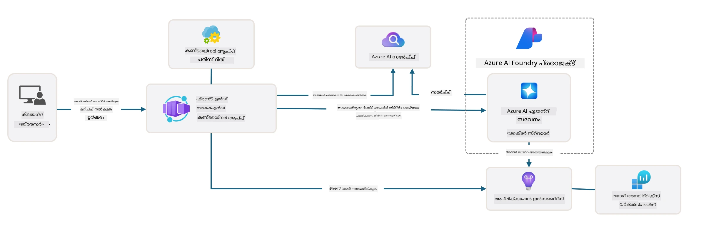

# 3. ഒരു ടെംപ്ലേറ്റ് ഡീകോൺസ്ട്രക്ട് ചെയ്യുക

!!! tip "ഈ മോഡ്യൂളിന്‍റെ അവസാനത്തിൽ നിങ്ങൾ കഴിയും"

    - [ ] Use GitHub Copilot and optional MCP tools for Azure documentation and read-only exploration
    - [ ] Identify the template's application, infrastructure, configuration, and test entry points
    - [ ] Verify generated explanations against actual repository files
    - [ ] **Lab 3:** Trace one request and one configuration input through the project

---

## 1. GitHub Copilot സജീവമാക്കുക

VS Code-ൽ ആരംഭിച്ച AI സാമ്പിൾ തുറന്ന് [GitHub Copilot](https://code.visualstudio.com/docs/copilot/chat/chat-agent-mode) സജീവമാക്കുക. യോഗ്യമായ പദ്ധതി ഉള്ള അക്കൗണ്ടിൽ സൈൻ ഇൻ ചെയ്യുക; ഉപയോഗ പരിധികൾ വ്യത്യസ്തമാണ്. മാറ്റങ്ങൾ അനുവദിക്കാൻ മുമ്പായി കോപ്പിൽറ്റിന് റീപോസിറ്ററി വിശദീകരിക്കാൻ പറയുക.

### ഐച്ഛിക MCP സെർവറുകൾ

ഈ സേവനങ്ങൾ അധിക ഉപകരണങ്ങൾ നൽകാം:

- [Azure MCP Server](https://learn.microsoft.com/azure/developer/azure-mcp-server/overview)
- [Microsoft Learn MCP Server](https://learn.microsoft.com/training/support/mcp)

VS Code-ൽ, [MCP ക്രമീകരണ മാർഗ്ഗനിർദേശം](https://code.visualstudio.com/docs/copilot/chat/mcp-servers) പരിശോധിച്ച് ആവശ്യമായെങ്കിൽ `.vscode/mcp.json` രൂപപ്പെടുത്തുക:

```json
{
  "servers": {
    "Azure MCP Server": {
      "type": "stdio",
      "command": "npx",
      "args": ["-y", "@azure/mcp@latest", "server", "start"]
    },
    "microsoft.docs.mcp": {
      "type": "http",
      "url": "https://learn.microsoft.com/api/mcp"
    }
  }
}
```

`npx` കമാൻഡ് പിന്തുണയുള്ള Node.js/npm ഇൻസ്റ്റലേഷൻ ആവശ്യമാണ്, കൂടാതെ എക്സിക്‌യൂട്ടബിൾ കോഡ് ഡൗൺലോഡ് ചെയ്യും. പാക്കേജ് പരിശോധിച്ച് അംഗീകൃത പതിപ്പ് നിശ്ചയിച്ച് ടീമിന് പുനരാവർത്തനയോഗ്യമായ ക്രമീകരണം ഉറപ്പ് വരുത്തുക. VS Code-യുടെ MCP നിയന്ത്രണങ്ങൾ ഉപയോഗിച്ച് സർവറുകൾ ആരംഭിച്ച് അതിൽ ലഭ്യമായ ഉപകരണങ്ങൾ പരിശോധിക്കുക; നാമങ്ങൾ പതിപ്പുകൾക്കിടയിൽ മാറ്റാം.

**പ്രമാണീകരണം വേർതിരിച്ചിരിക്കുന്നു.** AZD-യ്ക്ക് `azd auth login` ഉപയോഗിക്കൂ. Azure MCP ന്റെ രേഖപ്പെടുത്തിയ പ്രമാണീകരണ പ്രവാഹം പിന്തുടരുക; AZD ലോഗിൻ മാത്രം MCP സെഷൻ സൃഷ്ടിക്കുന്നില്ല. ഒരു വ്യായാമം അല്ലെങ്കിൽ ഹുക്ക് Azure CLI വിളിക്കുന്നപ്പോൾ വേർതിരിച്ച് `az login` ഉപയോഗിക്കുക.

വായനയ്ക്കുള്ള പ്രോപ്ടുകൾ ശ്രമിക്കുക:

1. “Microsoft Learn MCP ഉപയോഗിച്ച് Azure Developer CLI ക്രമീകരണ രേഖ കണ്ടെത്തുക.”
2. “ഈ റീപോസിറ്ററിയുടെ `azure.yaml` വിശദീകരിക്കുക; ഓരോ ഹുക്കും നടപ്പിലാക്കുന്ന ഫയലുകൾ സൂചിപ്പിക്കുക.”
3. “ലഭ്യമായ Azure MCP ഉപകരണങ്ങൾ ഉപയോഗിച്ച്, ആരും മാറ്റങ്ങൾ വരുത്താതെ എന്റെ വിന്യസിച്ചിട്ടുള്ള റിസോഴ്‌സുകൾ പട്ടികയാക്കുക.”

തെരഞ്ഞെടുത്ത ടനന്റ്/സബ്‌സ്‌ക്രിപ്ഷനും ഓരോ നിർദ്ദേശിച്ച ഉപകരണ വിളിയും പരിശോധിക്കുക. സാങ്കേതിക ഘടന പരിശോധിക്കാൻ മാത്രമായി റിസോഴ്‌സ് സൃഷ്ടിക്കൽ, അ deletion, അല്ലെങ്കിൽ ആക്സസ് മാറ്റങ്ങൾ അംഗീകരിക്കേണ്ട.

## 2. സാങ്കേതിക ഘടന മനസിലാക്കുക

സാമ്പിൾ ഒരു Python FastAPI ബാക്ക്‌എൻഡ് ആയും React/TypeScript ഫ്രന്റ്‌എൻഡ് ആയും Azure Container Apps-ൽ ഹോസ്റ്റ് ചെയ്യുന്നു. ബാക്ക്‌എൻഡ് Microsoft Foundry പ്രോജക്ടിലുള്ള ഒരു ഏജന്റുമായ് ആശയവിനിമയം നടത്തുന്നു. റിട്രീവൽ, ഒബ്സർവബിലിറ്റി Templates സവിശേഷതകളും വിജയകരമായ ക്രമീകരണവും ആശ്രയിച്ചിരിക്കുന്നു; ആപ്പ് വിന്യസിച്ചിട്ടുള്ളത് കൊണ്ട് മാത്രമേ ഉറപ്പ് നല്കൂ.



ഈ രേഖചിത്രം [നിലവിലെ അപ്സ്ട്രീം വിന്യസിക്കൽ മാർഗ്ഗനിർദേശം](https://github.com/Azure-Samples/get-started-with-ai-agents/blob/main/docs/deployment.md) കൂടാതെ നിങ്ങളുടെ യഥാർത്ഥ റിസോഴ്‌സുകളുമായി താരതമ്യം ചെയ്യുക. ക്രമീകരിച്ച മോഡൽ വിന്യസിക്കൽ, ഏജന്റ് ഉപകരണങ്ങൾ, മാനേജ് ചെയ്‌ത ഐഡന്റിറ്റി, റോളുകൾ, ഐച്ഛിക AI Search/Application Insights റിസോഴ്‌സുകൾ പരിശോധിക്കുക.

**വ്യായാമം:** കോപ്പിലോട്ട്-നോട് ഫ്രണ്ട്‌എൻഡിൽ നിന്ന് API മുഖേന Foundry വരെ ഒരു ചാറ്റ് അഭ്യർത്ഥന എങ്ങനെ പിന്വലിക്കാൻ പറയുക, ഫയൽ, ഫംഗ്‌ഷൻ റഫറൻസുകൾ ഉൾക്കൊള്ളിക്കുക. ആ റഫറൻസുകൾ തുറന്ന് വിശദീകരണം പരിശോധിക്കുക. ഒരു ചിത്രരേഖ മാത്രം അടിസ്ഥാനമാക്കി പ്രമാണീകരണം, റൂട്ടിംഗ് അല്ലെങ്കിൽ അനുമതി അവലംബിക്കരുത്.

## 3. റീപോസിറ്ററി ഘടന

താഴെ പറയുന്ന തിരഞ്ഞെടുക്കപ്പെട്ട പാതകൾ 2026 നവംബർ 4-ന് സാമ്പിളിനോട് പരിശോധിച്ചവയാണ്. നിങ്ങളുടെ ആരംഭം ചെയ്ത പതിപ്പ് ശരിയായ ഉറവിടമാണ്:

```text
get-started-with-ai-agents/
  azure.yaml
  docker-compose.yaml
  requirements-dev.txt
  .devcontainer/
  infra/
    main.bicep
    main.parameters.json
    api.bicep
    core/
  src/
    Dockerfile
    pyproject.toml
    requirements.txt
    api/
      main.py
      routes.py
      search_index_manager.py
    frontend/
      package.json
      src/
    files/
  scripts/
    validate_env_vars.sh
    validate_env_vars.ps1
    postdeploy.sh
    postdeploy.ps1
  tests/
    test_evaluation.py
    test_red_teaming.py
  docs/
    deployment.md
    deploy_customization.md
    ai_search.md
    observability.md
    local_development.md
    troubleshooting.md
```

### ഇൻഫ്രാസ്ട്രക്ചർ, ക്രമീകരണം

`infra/main.bicep` റിസോഴ്‌സുകൾ ഏകോപിപ്പിക്കും; `main.parameters.json` ടെംപ്ലേറ്റ് ഡാറ്റ AZD പരിസര മൂല്യങ്ങളുമായി ബന്ധിപ്പിക്കും. `azure.yaml` ആപ്പ്ലിക്കേഷൻ സർവ്വീസ്, ലൈഫ്‌സൈക്കിൾ ഹുക്കുകൾ തിരഞ്ഞെടുക്കും. `USE_AZURE_AI_SEARCH_SERVICE` പോലുള്ള ഇൻപുട്ടുകൾ ഈ ഫയലുകൾ വഴി പിന്തുടർന്ന് എന്താണ് മാറുന്നത് കണ്ടെത്തുക.

### ആപ്പ്ലിക്കേഷൻ, ഐഡന്റിറ്റി

`src/api/`, `src/frontend/` ചേർന്ന് വായിക്കുക. ഏജന്റ് എവിടെ സൃഷ്ടിക്കുകയോ തിരികെ കാണിക്കുകയോ ചെയ്യുന്നു, നിർദ്ദേശങ്ങൾ ഏവിടെ ക്രമീകരിച്ചിരിക്കുന്നു, ഏത് ഐഡന്റിറ്റി ഓരോ Azure കോളിനും ഉപയോഗിക്കുന്നു എന്ന് തിരിച്ചറ്റുക. `src/files/` കീഴിലുള്ള സാമ്പിൾ ഫയലുകൾ പ്രമാണം അല്ല, പ്രൊഡക്ഷൻ കാറ്റലോഗ് അല്ല, അനുമതിയുള്ള മാതൃക അല്ല.

### ടെസ്റ്റുകൾ, ഒബ്സർവബിലിറ്റി

നിലവിലെ മൂല്യനിർണയവും റെഡ് ടീമിംഗ് എൻട്രി പോയിന്റുകളും `tests/` കീഴിലാണ്; പഴയ `evals/`, `airedteaming/` ഡയറക്ടറി റഫറൻസുകൾ ഈ സാമ്പിളിനായുള്ളതാണ് അവഗണനീയമായത്. ക്ലൗഡ് ടെസ്റ്റുകൾ നടത്താൻ മുമ്പ് ആവശ്യങ്ങളും ചെലവുകളും `docs/observability.md` വായിക്കുക. ഈ Python ടെസ്റ്റുകൾ ഐച്ഛികമായ `azure.ai.evaluations` AZD എക്സ്ടൻഷനിൽ നിന്ന് വേർതിരിച്ചിരിക്കുന്നു.

## 4. നിങ്ങളുടെ കണ്ടെത്തലുകൾ സ്ഥിരീകരിക്കുക

- ഒരു സാമ്പിൾ ചോദ്യത്തിന് API റൂട്ടും ഏജന്റ് ഇടപെടലും റിട്രീവൽ കോഡും തിരിച്ചറിയുക.
- ഏത് ഐഡന്റിറ്റി Foundry ആക്‌സസ് ചെയ്യുന്നു, ഏത് ക്രമീകരണം അതിന്റെ എൻ‌ഡ്‌പോയിന്റ് തിരഞ്ഞെടുക്കുന്നു എന്ന് വിശദീകരിക്കുക.
- യഥാർത്ഥ പ്രീ-അപ്പ്, പോസ്റ്റ്-ഡിപ്ലോയ് സ്ക്രിപ്റ്റുകളും അവയുടെ എറർ-ഹാൻഡലിംഗ് പെരുമാറ്റവും കണ്ടെത്തുക.
- നിങ്ങളുടെ വിന്യസണത്തിൽ ഇല്ലാത്ത ആശ്രിതത്വങ്ങൾ അല്ലെങ്കിൽ ഐച്ഛിക സവിശേഷതകൾ പട്ടികയാക്കുക.

തുടര്‍ന്നായി [Configure a Template](4-Configure-AI-Template.md) കാണുക.

---

<!-- CO-OP TRANSLATOR DISCLAIMER START -->
**അറിയിപ്പ്**:
ഈ രേഖ AI പരിഭാഷാ സേവനം [Co-op Translator](https://github.com/Azure/co-op-translator) ഉപയോഗിച്ച് പരിഭാഷപ്പെടുത്തിയതാണ്. ഞങ്ങൾ കൃത്യതയ്ക്കായി ശ്രമിക്കുന്നുവെങ്കിലും, ഓട്ടോമേറ്റഡ് പരിഭാഷകളിൽ പിഴവുകൾ അല്ലെങ്കിൽ തെറ്റായ വിവരങ്ങൾ ഉണ്ടാകാൻ സാധ്യതയുണ്ട്. അതിന്റെ സ്വാഭാവിക ഭാഷയിലുള്ള അസൽ രേഖയാണ് പ്രാമാണികമായ ഉറവിടമായി പരിഗണിക്കേണ്ടത്. നിർണായകമായ വിവരങ്ങൾക്ക്, പ്രൊഫഷണൽ മനുഷ്യ പരിഭാഷ ശുപാർശ ചെയ്യുന്നു. ഈ പരിഭാഷ ഉപയോഗിച്ച് ഉണ്ടാകുന്ന തെറ്റിദ്ധാരണകൾ അല്ലെങ്കിൽ തെറ്റായ വ്യാഖ്യാനങ്ങൾക്കായി ഞങ്ങൾ ഉത്തരവാദികളല്ല.
<!-- CO-OP TRANSLATOR DISCLAIMER END -->