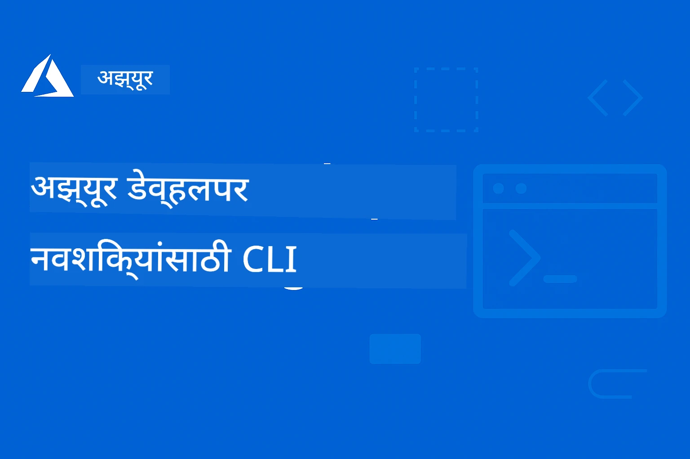

# AZD नवीनांसाठी: एक रचनेत शिक्षण प्रवास

 

[](https://github.com/microsoft/AZD-for-beginners)
[](https://GitHub.com/microsoft/azd-for-beginners/network/)
[](https://github.com/microsoft/AZD-for-beginners)

[](https://discord.com/invite/nkVh3dp)
[](https://discord.gg/nTYy5BXMWG)

---

### स्वयंचलीत अनुवाद (सतत अद्ययावत)

<!-- CO-OP TRANSLATOR LANGUAGES TABLE START -->
[Arabic](../ar/README.md) | [Bengali](../bn/README.md) | [Bulgarian](../bg/README.md) | [Burmese (Myanmar)](../my/README.md) | [Chinese (Simplified)](../zh-CN/README.md) | [Chinese (Traditional, Hong Kong)](../zh-HK/README.md) | [Chinese (Traditional, Macau)](../zh-MO/README.md) | [Chinese (Traditional, Taiwan)](../zh-TW/README.md) | [Croatian](../hr/README.md) | [Czech](../cs/README.md) | [Danish](../da/README.md) | [Dutch](../nl/README.md) | [Estonian](../et/README.md) | [Finnish](../fi/README.md) | [French](../fr/README.md) | [German](../de/README.md) | [Greek](../el/README.md) | [Hebrew](../he/README.md) | [Hindi](../hi/README.md) | [Hungarian](../hu/README.md) | [Indonesian](../id/README.md) | [Italian](../it/README.md) | [Japanese](../ja/README.md) | [Kannada](../kn/README.md) | [Khmer](../km/README.md) | [Korean](../ko/README.md) | [Lithuanian](../lt/README.md) | [Malay](../ms/README.md) | [Malayalam](../ml/README.md) | [Manipuri (Meitei Mayek)](../mni/README.md) | [Marathi](./README.md) | [Nepali](../ne/README.md) | [Nigerian Pidgin](../pcm/README.md) | [Norwegian](../no/README.md) | [Persian (Farsi)](../fa/README.md) | [Polish](../pl/README.md) | [Portuguese (Brazil)](../pt-BR/README.md) | [Portuguese (Portugal)](../pt-PT/README.md) | [Punjabi (Gurmukhi)](../pa/README.md) | [Romanian](../ro/README.md) | [Russian](../ru/README.md) | [Serbian (Cyrillic)](../sr/README.md) | [Slovak](../sk/README.md) | [Slovenian](../sl/README.md) | [Spanish](../es/README.md) | [Swahili](../sw/README.md) | [Swedish](../sv/README.md) | [Tagalog (Filipino)](../tl/README.md) | [Tamil](../ta/README.md) | [Telugu](../te/README.md) | [Thai](../th/README.md) | [Turkish](../tr/README.md) | [Ukrainian](../uk/README.md) | [Urdu](../ur/README.md) | [Vietnamese](../vi/README.md)

> **स्थानिक क्लोन करणे प्राधान्य?**
>
> या रेपॉझिटरीमध्ये ५०+ भाषा अनुवादांचा समावेश आहे, ज्यामुळे डाउनलोड आकार मोठा होतो. अनुवादांशिवाय क्लोन करण्यासाठी, sparse checkout वापरा:
>
> **Bash / macOS / Linux:**
> ```bash
> git clone --filter=blob:none --sparse https://github.com/microsoft/AZD-for-beginners.git
> cd AZD-for-beginners
> git sparse-checkout set --no-cone '/*' '!translations' '!translated_images'
> ```
>
> **CMD (Windows):**
> ```cmd
> git clone --filter=blob:none --sparse https://github.com/microsoft/AZD-for-beginners.git
> cd AZD-for-beginners
> git sparse-checkout set --no-cone "/*" "!translations" "!translated_images"
> ```
>
> यामुळे तुम्हाला कोर्स पूर्ण करण्यासाठी आवश्यक सर्वकाही मिळेल आणि डाउनलोड खूप जलद होईल.
<!-- CO-OP TRANSLATOR LANGUAGES TABLE END -->

## 🆕 azd मध्ये आज काय नवीन आहे

> 📌 **AI CLI रिलिज समीक्षा (2026-11-04):** मार्गदर्शन प्रसिद्ध **`azd 1.37.2`**, **एजंट्स `1.0.0-beta.23`**, आणि **मूल्यांकन `1.0.0-beta.2`** दस्तऐवज/स्रोतांच्या विरूद्ध तपासले गेले. एकत्रित वर्कफ्लोसाठी `azd >= 1.37.0` वापरा. एक्स्टेंशन्स आधी `azd version` चालवा आणि [कोर CLI अद्यतनित करा](https://learn.microsoft.com/azure/developer/azure-developer-cli/install-azd). [रिलिज मध्ये बदल आणि सुधारणा](docs/chapter-08-production/production-ai-practices.md#recent-release-changes-and-fixes) पहा. हे पूर्ण कोर्सचे थेट डिप्लॉयमेंट प्रमाणन नाही.

Azure Developer CLI अनेक प्रकारच्या ऍप्लिकेशनना समर्थन देते, ज्यात वेब ऍप्लिकेशन्स, API, आणि AI एजंट्स यांचा समावेश आहे, समर्थित होस्ट, टेम्पलेट्स, आणि एक्स्टेंशन्सद्वारे.

याचा तुमच्यासाठी काय अर्थ आहे:

- **AI एजंट्स आता प्रथम श्रेणीचे azd वर्कलोड आहेत.** तुम्ही आधीच परिचित असलेल्या `azd init` → `azd up` वर्कफ्लो वापरून AI एजंट प्रोजेक्ट्स सुरू करू, डिप्लॉय करू, आणि व्यवस्थापित करू शकता.
- **दोन विस्तारांमधील एजंट जीवनचक्र.** एजंट्सला सुरू करण्यासाठी, कॉल करण्यासाठी, ऑप्टिमाइझ करण्यासाठी, आणि निवृत्त करण्यासाठी `azure.ai.agents` वापरा. **`azure.ai.evaluations`** स्वतंत्रपणे `azd ai eval init`, `generate`, आणि `run start` साठी स्थापित करा. एजंट्स beta.22 यांनी जुने मूल्यांकन कार्यप्रवाह बदलले आणि ऑप्टिमायझेशन कॉन्फिगरेशन बदलले; [मायग्रेशन गाईड](docs/chapter-08-production/production-ai-practices.md#evaluation-migration-and-quality-checks) अनुसरा.
- **अधिक AI बिल्डिंग ब्लॉक्स.** नवीन प्रिव्ह्यू एक्सटेंशन्स—`azure.ai.skills` आणि `azure.ai.connections`—आपल्याला पुनर्वापर करण्यायोग्य एजंट कौशल्ये आणि Foundry कनेक्शन थेट azd सह व्यवस्थापित करण्यास परवानगी देतात.
- **Microsoft Foundry एकत्रीकरण** मॉडेल तैनात करणे, एजंट होस्टिंग, आणि AI सेवा कॉन्फिगरेशन थेट azd टेम्प्लेट पर्यावरणामध्ये आणते.
- **दररोजच्या मूलभूत गोष्टी अधिक सुरळीत.** अलीकडील रीलिझेसने `azd init` ला आयडेम्पोटंट (पुन्हा चालवणे सुरक्षित) बनवले, `azd auth login` स्वयंचलितपणे जुनाट टोकन्स साफ करतात, आणि एक मैत्रीपूर्ण `azd tool` प्रथम-चालू सेटअप प्रॉम्प्ट जोडले.
- **कोर कार्यप्रवाह बदलला नाही.** तुम्ही एक todo अॅप, एक मायक्रोसर्व्हिस, किंवा एक मल्टी-एजंट AI सोल्यूशन तैनात करत असलात तरी, कमांडस सारख्याच आहेत.

> **Aspire वापरकर्त्यांसाठी नोंद:** Microsoft आता उत्पादनाला फक्त **Aspire** (पूर्वी ".NET Aspire") असे संबोधते. azd ची Aspire समर्थन अचूक आहे—फक्त नाव अपग्रेड केले गेले आहे.

जर तुम्ही पूर्वी azd वापरले असेल, तर AI समर्थन एक नैसर्गिक विस्तार आहे—वेगळे साधन नाही किंवा प्रगत ट्रॅक नाही. जर तुम्ही नवीन प्रारंभ करत असाल, तर तुम्ही एकच कार्यप्रवाह शिकाल जे सर्वकाहीसाठी काम करते.

---

## 🚀 Azure Developer CLI (azd) काय आहे?

**Azure Developer CLI (azd)** हा एक विकसक-मित्रत्वपूर्ण कमांड-लाइन टूल आहे जो Azure वर अॅप्लिकेशन्स तैनात करणे सोपे करतो. अनेक Azure संसाधने मॅन्युअली तयार करण्याऐवजी, तुम्ही एकाच कमांडने पूर्ण अॅप्लिकेशन्स तैनात करू शकता.

### `azd up` चं जादू

```bash
# This single command does everything:
# ✅ Creates all Azure resources  
# ✅ Configures networking and security
# ✅ Builds your application code
# ✅ Deploys to Azure
# ✅ Gives you a working URL
azd up
```

टेम्प्लेट अ‍ॅप्लिकेशन आणि इन्फ्रास्ट्रक्चर कॉन्फिगरेशन पुरवते. यशस्वी तैनातीसाठी अजूनही समर्थित सेवा/मॉडेल्स, पुरेसा कोटा व परवानग्या, योग्य इनपुट्स आणि तैनात केलेल्या अनुप्रयोगाची तपासणी आवश्यक आहे. `azd up` आपोआप टेम्प्लेट सुरक्षित, अनुरूप, किंवा उत्पादनायोग्य करत नाही.

---

## ❓ Azure Developer CLI vs Azure CLI: काय फरक आहे?

हे नवशिक्यांनी विचारले जाणारे सर्वात सामान्य प्रश्न आहे. सोपा उत्तर असा आहेः

| वैशिष्ट्य | **Azure CLI (`az`)** | **Azure Developer CLI (`azd`)** |
|---------|---------------------|--------------------------------|
| **उद्दिष्ट** | वैयक्तिक Azure संसाधने व्यवस्थापित करा | संपूर्ण अॅप्लिकेशन्स तैनात करा |
| **दृष्टीकोन** | इन्फ्रास्ट्रक्चर-केंद्रित | अनुप्रयोग-केंद्रित |
| **उदाहरण** | `az webapp create --name myapp...` | `azd up` |
| **शिकण्याची वक्रता** | Azure सेवा माहित असावी | तुमचा अॅप माहित असावा |
| **उत्तम** | DevOps, इन्फ्रास्ट्रक्चर | विकसक, प्रोटो टायपिंग |

### सोपी उपमा

- **Azure CLI** म्हणजे घर बांधण्यासाठी सगळे साधने मिळवणे - हातोडे, आरी, लाकडी किंवा लोखंडी नखे. तुम्ही काहीही बांधू शकता, पण बांधकामाची माहिती असणे आवश्यक आहे.
- **Azure Developer CLI** म्हणजे कंत्राटदार भाड्याने घेणे - तुम्ही काय हवे ते सांगा, ते बांधकाम सांभाळतील.

### प्रत्येक कधी वापरावे

| परिस्थिती | हे वापरा |
|----------|----------|
| "माझं वेब अॅप जलद तैनात करायचं आहे" | `azd up` |
| "मला फक्त एक स्टोरेज खाते तयार करायचे आहे" | `az storage account create` |
| "मी पूर्ण AI अनुप्रयोग तयार करत आहे" | `azd init --template azure-search-openai-demo` |
| "मला विशिष्ट Azure संसाधन डिबग करायचे आहे" | `az resource show` |
| "मला माझ्या कॉन्फिगर केलेल्या उत्पादन वातावरणात तैनात करायचे आहे" | कॉन्फिगरेशन, प्रवेश, खर्च आणि ऑपरेशनल गेट्सचा आढावा घ्या आधी `azd up --environment production` |

### ते एकत्र काम करतात!

AZD आणि Azure CLI यांची स्वतंत्र प्रमाणीकरण आणि कॉन्फिगरेशन आहे. AZD साठी `azd auth login` वापरा, आणि जेव्हा हुक किंवा डायग्नोस्टिक आदेश स्पष्टपणे Azure CLI ची गरज असते तेव्हा `az login` वापरा. तुम्ही दोन्ही वापरू शकता:
```bash
# Deploy your app with AZD
azd up

# Then fine-tune specific resources with Azure CLI
az webapp config set --name myapp --always-on true
```

---

## 🌟 Awesome AZD मध्ये टेम्पलेट्स शोधा

शून्यातून सुरू करू नका! **Awesome AZD** हे समुदाय कलेक्शन आहे तत्पर-तैनातीसाठी टेम्पलेट्सचे:

| स्रोत | वर्णन |
|----------|-------------|
| 🔗 [**Awesome AZD Gallery**](https://azure.github.io/awesome-azd/) | एक-क्लिक तैनातीसह 200+ टेम्पलेट्स पहा |
| 🔗 [**Submit a Template**](https://github.com/Azure/awesome-azd/issues) | आपले स्वतःचे टेम्पलेट समुदायाला द्या |
| 🔗 [**GitHub Repository**](https://github.com/Azure/awesome-azd) | स्तार द्या आणि स्रोत एक्सप्लोर करा |

### Awesome AZD मधील लोकप्रिय AI टेम्पलेट्स

त्याच्या स्वतःच्या रिकाम्या निर्देशिकेत एक टेम्पलेट निवडा; खालील आदेश पर्याय आहेत. शेवटी `.` त्या निर्देशिकेची सुरुवात करतो.

```bash
# RAG Chat with Microsoft Foundry Models + AI Search
azd init --template azure-search-openai-demo .

# Quick AI Chat Application
azd init --template openai-chat-app-quickstart .

# AI Agents with Foundry Agents
azd init --template get-started-with-ai-agents .
```

---

## 🎯 3 पावलांत प्रारंभ करा

सुरू करण्यापूर्वी, तुमचे मशीन तुम्ही तैनात करू इच्छित टेम्पलेटसाठी तयार आहे की नाही ते पाहा:

**Windows:**
```powershell
.\validate-setup.ps1
```

**macOS / Linux:**
```bash
bash ./validate-setup.sh
```

कोणताही आवश्यक तपास अपयशी ठरल्यास, प्रथम तो दुरुस्त करा आणि मग जलद प्रारंभ सुरू ठेवा.

### पाऊल 1: AZD स्थापित करा (2 मिनिटे)

**Windows:**
```powershell
winget install microsoft.azd
```

**macOS:**
```bash
brew tap azure/azd && brew install azd
```

**Linux:**
```bash
curl -fsSL https://aka.ms/install-azd.sh | bash
```

### पाऊल 2: AZD साठी प्रमाणीकरण करा

```bash
# Optional if you plan to use Azure CLI commands directly in this course
az login

# Required for AZD workflows
azd auth login
```

तुम्हाला खात्री नसेल की कोणते आवश्यक आहे, तर पूर्ण सेटअप प्रवाहाला अनुसरून चला [Installation & Setup](docs/chapter-01-foundation/installation.md#authentication-setup).

### पाऊल 3: तुमचा पहिला अॅप तैनात करा

```bash
# Initialize from a template
azd init --template todo-nodejs-mongo .

# Deploy to Azure (creates everything!)
azd up
```

**🎉 एवढेच!** तुमचा अॅप आता Azure वर लाईव्ह आहे.

### साफसफाई करा (भूलू नका!)

```bash
# Remove all resources when done experimenting
azd down --force --purge
```

---

## 📚 हा अभ्यासक्रम कसा वापरायचा

हा अभ्यासक्रम **प्रगत शिकण्यासाठी** डिझाइन केला आहे - जिथून आपल्याला सोयीस्कर वाटते तिथून सुरू करा आणि पुढे जा:

| तुमचा अनुभव | येथे सुरु करा |
|-----------------|------------|
| **Azure मध्ये नवीन** | [अध्याय 1: पाया](#-chapter-1-foundation--quick-start) |
| **Azure माहिती आहे, AZD नवीन आहे** | [अध्याय 1: पाया](#-chapter-1-foundation--quick-start) |
| **AI अॅप्स तैनात करू इच्छिता** | [अध्याय 2: AI-फर्स्ट विकास](#-chapter-2-ai-first-development-recommended-for-ai-developers) |
| **प्रायोगिक सराव करू इच्छिता** | [🎓 इंटरएक्टिव वर्कशॉप](workshop/README.md) - 3-4 तासांचे मार्गदर्शक लॅब |
| **उत्पादन पॅटर्नची गरज** | [अध्याय 8: उत्पादन आणि उद्यम](#-chapter-8-production--enterprise-patterns) |

### जलद सेटअप

1. **हा रेपॉझिटरी फोर्क करा**: [](https://GitHub.com/microsoft/azd-for-beginners/fork)
2. **क्लोन करा**: `git clone https://github.com/YOUR-USERNAME/azd-for-beginners.git`
3. **मदत मिळवा**: [Azure Discord Community](https://discord.com/invite/ByRwuEEgH4)

> **स्थानिकरित्या क्लोन करायचे का प्राधान्य?**

> या रेपॉझिटरीमध्ये ५०+ भाषांतर समाविष्ट आहेत ज्यामुळे डाउनलोड आकार लक्षणीय वाढतो. भाषांतराशिवाय क्लोन करण्यासाठी, sparse checkout वापरा:
> ```bash
> git clone --filter=blob:none --sparse https://github.com/microsoft/AZD-for-beginners.git
> cd AZD-for-beginners
> git sparse-checkout set --no-cone '/*' '!translations' '!translated_images'
> ```
> हे आपल्याला कोर्स पूर्ण करण्यासाठी आवश्यक असलेली सर्व काही अतिशय जलद डाउनलोडसह देते.


## कोर्सचा आढावा

प्रगत शिक्षणासाठी रचलेले अध्याय वापरून Azure Developer CLI (azd) मध्ये पारंगत व्हा. **Microsoft Foundry समाकलनासह AI अनुप्रयोग वितरणावर विशेष लक्ष.**

### आधुनिक विकासकांसाठी हा कोर्स का आवश्यक आहे

AI वर्कलोड्स वितरित करताना विकासकांना सामान्यतः मार्गदर्शन आवश्यक असते:
- क्लिष्ट मल्टी-सर्व्हिस AI आर्किटेक्चर्स
- उत्पादन AI वितरण सर्वोत्तम पद्धती
- Azure AI सेवा समाकलन आणि कॉन्फिगरेशन
- AI वर्कलोडसाठी खर्च कार्यक्षमतेसाठी
- AI-विशिष्ट वितरण समस्या सोडविणे

### शिकण्याचे उद्दिष्टे

हा रचलेला कोर्स पूर्ण करून, आपण:
- **AZD मूलतत्त्वे शिकणे**: मुख्य संकल्पना, स्थापना, आणि कॉन्फिगरेशन
- **AI अनुप्रयोग वितरण**: Microsoft Foundry सेवांसह AZD वापरणे
- **इन्फ्रास्ट्रक्चर अस कोड लागू करणे**: Bicep टेम्पलेट्ससह Azure संसाधने व्यवस्थापित करणे
- **वितरण त्रुटी शोधणे**: सामान्य समस्या सोडविणे आणि डीबग करणे
- **उत्पादनासाठी ऑप्टिमायझेशन**: सुरक्षा, स्केलिंग, मॉनिटरिंग, आणि खर्च व्यवस्थापन
- **मल्टी-एजंट सोल्युशन्स तयार करणे**: क्लिष्ट AI आर्किटेक्चर वितरित करणे

## सुरुवातीपूर्वी: खाते, प्रवेश, आणि गृहितके

अध्याय 1 सुरू करण्यापूर्वी, खालील बाबी ठरविलेल्या असाव्यात. या मार्गदर्शनातील स्थापना टप्पे ह्या मूलभूत गोष्टी आधीच हाताळल्या असल्याचे गृहित धरले आहेत.

- **एक Azure सदस्यता**: आपण कामाच्या किंवा स्वतःच्या खात्यातील विद्यमान सदस्यता वापरू शकता, किंवा सुरुवात करण्यासाठी [मुफ्त ट्रायल](https://aka.ms/azurefreetrial) तयार करू शकता.
- **Azure संसाधने तयार करण्याची परवानगी**: बहुतेक सरावांसाठी, लक्ष्य सदस्यता किंवा संसाधन गटावर किमान **Contributor** प्रवेश असणे आवश्यक आहे. काही अध्याय ही गृहित धरू शकतात की आपण संसाधन गट, व्यवस्थापित ओळखी, आणि RBAC नेमणुका तयार करू शकता.
- [**एक GitHub खाते**](https://github.com): संरचीत साठवण फोर्क करण्यासाठी, स्वतःचे बदल ट्रॅक करण्यासाठी, आणि वर्कशॉपसाठी GitHub Codespaces वापरण्यास उपयुक्त.
- **टेम्पलेट रनटाइम पूर्वापेक्षा**: काही टेम्पलेट्सना स्थानिक साधने जसे Node.js, Python, Java, किंवा Docker आवश्यक असू शकतात. सुरुवात करण्याआधी सेटअप व्हॅलिडेटर चालवा जेणेकरून गहाळ साधने लवकर लक्षात येतील.
- **मूलभूत टर्मिनल परिचय**: विशेषज्ञ असण्याची गरज नाही, परंतु `git clone`, `azd auth login`, आणि `azd up` सारखे आदेश चालवायला आरामदायक असावे.

> **एंटरप्राइझ सदस्यता वापरताय?**
> जर आपले Azure वातावरण प्रशासकाद्वारे व्यवस्थापित केले जात असेल, तर वापरण्यासाठी निवडलेल्या सदस्यता किंवा संसाधन गटात संसाधने प्रदान करू शकता का याची आधीच पुष्टी करा. शक्य नसेल तर, सुरुवात करण्याआधी सॅंडबॉक्स सदस्यता किंवा Contributor प्रवेश मागवा.

> **Azure मध्ये नवीन आहात?**
> आपल्या स्वतःच्या Azure ट्रायल किंवा पे-एज-यू-गो सदस्यतेपासून सुरुवात करा https://aka.ms/azurefreetrial जेणेकरून आपण टेनंट-स्तरीय मंजुरीला वाट न पाहता संपूर्ण सराव पूर्ण करू शकता.

## 🗺️ कोर्स नकाशा: अध्यायानुसार जलद नेव्हिगेशन

प्रत्येक अध्यायासाठी समर्पित README आहे ज्यात शिकण्याची उद्दिष्टे, जलद प्रारंभ, आणि सराव आहेत:

| अध्याय | विषय | धडे | कालावधी | गुंतागुंत |
|---------|-------|---------|----------|------------|
| **[अध्याय 1: पाया](docs/chapter-01-foundation/README.md)** | सुरूवात | [AZD मूलतत्त्वे](docs/chapter-01-foundation/azd-basics.md) &#124; [स्थापना](docs/chapter-01-foundation/installation.md) &#124; [पहिला प्रकल्प](docs/chapter-01-foundation/first-project.md) | 30-45 मिनिटे | ⭐ |
| **[अध्याय 2: AI विकास](docs/chapter-02-ai-development/README.md)** | AI-प्रथम अनुप्रयोग | [Foundry समाकलन](docs/chapter-02-ai-development/microsoft-foundry-integration.md) &#124; [AI एजंट्स](docs/chapter-02-ai-development/agents.md) &#124; [मॉडेल वितरण](docs/chapter-02-ai-development/ai-model-deployment.md) &#124; [वर्कशॉप](docs/chapter-02-ai-development/ai-workshop-lab.md) | 1-2 तास | ⭐⭐ |
| **[अध्याय 3: कॉन्फिगरेशन](docs/chapter-03-configuration/README.md)** | प्रमाणीकरण & सुरक्षा | [कॉन्फिगरेशन](docs/chapter-03-configuration/configuration.md) &#124; [प्रमाणीकरण & सुरक्षा](docs/chapter-03-configuration/authsecurity.md) | 45-60 मिनिटे | ⭐⭐ |
| **[अध्याय 4: इन्फ्रास्ट्रक्चर](docs/chapter-04-infrastructure/README.md)** | IaC & वितरण | [वितरण मार्गदर्शक](docs/chapter-04-infrastructure/deployment-guide.md) &#124; [पुरवठा](docs/chapter-04-infrastructure/provisioning.md) | 1-1.5 तास | ⭐⭐⭐ |
| **[अध्याय 5: मल्टी-एजंट](docs/chapter-05-multi-agent/README.md)** | AI एजंट सोल्युशन्स | [रिटेल संदर्भ](examples/retail-scenario.md) &#124; [समन्वय नमुने](docs/chapter-06-pre-deployment/coordination-patterns.md) | 2-3 तास | ⭐⭐⭐⭐ |
| **[अध्याय 6: वितरण पूर्व](docs/chapter-06-pre-deployment/README.md)** | नियोजन & तपासणी | [पूर्वतपास](docs/chapter-06-pre-deployment/preflight-checks.md) &#124; [क्षमता नियोजन](docs/chapter-06-pre-deployment/capacity-planning.md) &#124; [SKU निवड](docs/chapter-06-pre-deployment/sku-selection.md) &#124; [अॅप इनसाइट्स](docs/chapter-06-pre-deployment/application-insights.md) | 1 तास | ⭐⭐ |
| **[अध्याय 7: समस्या निराकरण](docs/chapter-07-troubleshooting/README.md)** | डीबग & दुरुस्ती | [सामान्य समस्या](docs/chapter-07-troubleshooting/common-issues.md) &#124; [डीबगिंग](docs/chapter-07-troubleshooting/debugging.md) &#124; [AI समस्या](docs/chapter-07-troubleshooting/ai-troubleshooting.md) | 1-1.5 तास | ⭐⭐ |
| **[अध्याय 8: उत्पादन](docs/chapter-08-production/README.md)** | एंटरप्राइझ नमुने | [उत्पादन पद्धती](docs/chapter-08-production/production-ai-practices.md) | 2-3 तास | ⭐⭐⭐⭐ |
| **[🎓 वर्कशॉप](workshop/README.md)** | हाताने स्वरूपित प्रयोगशाळा | [परिचय](workshop/docs/instructions/0-Introduction.md) &#124; [निवड](workshop/docs/instructions/1-Select-AI-Template.md) &#124; [तपासणी](workshop/docs/instructions/2-Validate-AI-Template.md) &#124; [विखंडन](workshop/docs/instructions/3-Deconstruct-AI-Template.md) &#124; [कॉन्फिगरेशन](workshop/docs/instructions/4-Configure-AI-Template.md) &#124; [सानुकूलन](workshop/docs/instructions/5-Customize-AI-Template.md) &#124; [उतारणा](workshop/docs/instructions/6-Teardown-Infrastructure.md) &#124; [पूर्णविराम](workshop/docs/instructions/7-Wrap-up.md) | 3-4 तास | ⭐⭐ |

**एकूण कोर्स कालावधी:** ~10-14 तास | **कौशल्य प्रगती:** प्रारंभिक → उत्पादन-तयार

---

## 📚 शिकण्यासाठी अध्याय

*आपल्या अनुभव पातळी आणि उद्दिष्टांनुसार शिकण्याचा मार्ग निवडा*

### 🚀 अध्याय 1: पाया & जलद प्रारंभ
**पूर्वापेक्षा आवश्यक**: Azure सदस्यता, मूलभूत कमांड लाइन ज्ञान  
**कालावधी**: 30-45 मिनिटे  
**गुंतागुंत**: ⭐

#### आपण काय शिकाल
- Azure Developer CLI मूलतत्त्वे समजून घेणे
- आपल्या प्लॅटफॉर्मवर AZD स्थापित करणे
- आपले पहिले यशस्वी वितरण

#### शिकण्याचे स्रोत
- **🎯 येथे प्रारंभ करा**: [Azure Developer CLI काय आहे?](#-what-is-azure-developer-cli-azd)
- **📖 सिद्धांत**: [AZD मूलतत्त्वे](docs/chapter-01-foundation/azd-basics.md) - मुख्य संकल्पना आणि संज्ञाशास्त्र
- **⚙️ सेटअप**: [स्थापना & सेटअप](docs/chapter-01-foundation/installation.md) - प्लॅटफॉर्म-विशिष्ट मार्गदर्शक
- **🛠️ हाताळणी**: [आपला पहिला प्रकल्प](docs/chapter-01-foundation/first-project.md) - टप्प्याटप्प्याने मार्गदर्शक
- **📋 जलद संदर्भ**: [कमांड चीट शीट](resources/cheat-sheet.md)

#### व्यावहारिक सराव
```bash
# Quick installation check
azd version

# Deploy your first application
azd init --template todo-nodejs-mongo .
azd up
```

**💡 अध्याय परिणाम**: AZD वापरून Azure वर एक सोपी वेब अनुप्रयोग यशस्वीरीत्या वितरित करा

**✅ यशाची पुष्टी:**
```bash
# After completing Chapter 1, you should be able to:
azd version              # Shows installed version
azd init --template todo-nodejs-mongo  # Initializes project
azd up                  # Deploys to Azure
azd show                # Displays running app URL
# Application opens in browser and works
azd down --force --purge  # Cleans up resources
```

**📊 वेळ गुंतवणूक:** 30-45 मिनिटे  
**📈 नंतरची कौशल्य पातळी:** मूलभूत अनुप्रयोग स्वतंत्रपणे वितरित करू शकतात

---

### 🤖 अध्याय 2: AI-प्रथम विकास (AI विकासकांसाठी शिफारस केलेले)
**पूर्वापेक्षा आवश्यक**: अध्याय 1 पूर्ण  
**कालावधी**: 1-2 तास  
**गुंतागुंत**: ⭐⭐

#### आपण काय शिकाल
- Microsoft Foundry समाकलन AZD सह
- AI-चालित अनुप्रयोग वितरित करणे
- AI सेवा कॉन्फिगरेशन समजून घेणे

#### शिकण्याचे स्रोत
- **🎯 येथे प्रारंभ करा**: [Microsoft Foundry समाकलन](docs/chapter-02-ai-development/microsoft-foundry-integration.md)
- **🤖 AI एजंट्स**: [AI एजंट गाइड](docs/chapter-02-ai-development/agents.md) - AZD सह बुद्धिमान एजंट्स वितरित करणे
- **📖 नमुने**: [AI मॉडेल वितरण](docs/chapter-02-ai-development/ai-model-deployment.md) - AI मॉडेल्स वितरित व व्यवस्थापित करणे
- **🛠️ वर्कशॉप**: [AI वर्कशॉप लॅब](docs/chapter-02-ai-development/ai-workshop-lab.md) - AI सोल्यूशन्सना AZD-सज्ज बनविणे
- **🎥 संवादात्मक मार्गदर्शक**: [वर्कशॉप साहित्य](workshop/README.md) - MkDocs * DevContainer पर्यावरणासह ब्राउझर आधारित शिक्षण
- **📋 टेम्पलेट्स**: [Microsoft Foundry टेम्पलेट्स](#featured-microsoft-foundry-templates)
- **📝 उदाहरणे**: [AZD वितरण उदाहरणे](examples/README.md)

#### व्यावहारिक सराव
```bash
# Deploy your first AI application
azd init --template azure-search-openai-demo .
azd up

# Try additional AI templates
azd init --template openai-chat-app-quickstart .
azd init --template agent-openai-python-prompty .
```

**💡 अध्याय परिणाम**: RAG क्षमता असलेल्या AI-चालित चॅट अनुप्रयोगाचे वितरण आणि कॉन्फिगरेशन करा

**✅ यशाची पुष्टी:**
```bash
# After Chapter 2, you should be able to:
azd init --template azure-search-openai-demo .
azd up
# Test the AI chat interface
# Ask questions and get AI-powered responses with sources
# Verify search integration works
azd monitor  # Check Application Insights shows telemetry
azd down --force --purge
```

**📊 वेळ गुंतवणूक:** 1-2 तास  
**📈 नंतरची कौशल्य पातळी:** AI शिकणारे अनुप्रयोग वितरित करू शकतात आणि अतिरिक्त उत्पादन-तयारी आवश्यकता ओळखू शकतात
**💰 खर्च जागरूकता:** $80-150/महिना विकास खर्च, $300-3500/महिना उत्पादन खर्च समजून घ्या

#### 💰 AI वितरणासाठी खर्च विचार

**विकास पर्यावरण (अंदाजे $80-150/महिना):**
- Microsoft Foundry मॉडेल्स (पे-एज-यू-गो): $0-50/महिना (टोकन वापरांवर आधारित)
- AI सर्च (मूलभूत स्तर): $75/महिना
- कंटेनर अॅप्स (उपभोगावर आधारित): $0-20/महिना
- स्टोरेज (मानक): $1-5/महिना

**उत्पादन पर्यावरण (अंदाजे $300-3,500+/महिना):**
- Microsoft Foundry मॉडेल्स (सुसंगत कामगिरीसाठी PTU): $3,000+/महिना किंवा उच्च प्रमाणात पे-एज-यू-गो
- AI सर्च (मानक स्तर): $250/महिना
- कंटेनर अॅप्स (समर्पित): $50-100/महिना
- अॅप्लिकेशन इनसाइट्स: $5-50/महिना
- स्टोरेज (प्रीमियम): $10-50/महिना

**💡 खर्च ऑप्टिमायझेशन सूचना:**
- मॉडेल इन्फरन्स किंमत तपासा आणि खाते-विशिष्ट क्रेडिट्स; Azure OpenAI मध्ये सार्वत्रिक 50,000 टोकन मासिक विनामूल्य मर्यादा नाही
- निवडलेल्या पर्यावरणाचा आढावा घेतल्यानंतर संसाधने न लागल्यावर हटविण्यासाठी `azd down` चालवा
- सुरुवात उपभोग-आधारित बिलिंगने करा, उत्पादनासाठी PTU मध्ये उन्नती करा
- नियोजित इन्फ्रास्ट्रक्चर तपासण्यासाठी `azd provision --preview` वापरा, नंतर Azure प्राइसिंग कॅल्क्युलेटरने संसाधनांची किंमत काढा
- ऑटो-स्केलिंग सक्षम करा: फक्त प्रत्यक्ष वापरासाठी पैसे द्या

**खर्च मॉनिटरिंग:**
```bash
# Inspect planned resources (this does not calculate prices)
azd provision --preview

# Monitor actual costs in Azure Portal
az consumption budget list --resource-group <your-rg>
```

---

### ⚙️ अध्याय 3: कॉन्फिगरेशन & प्रमाणीकरण
**पूर्वापेक्षा आवश्यक**: अध्याय 1 पूर्ण  
**कालावधी**: 45-60 मिनिटे  
**गुंतागुंत**: ⭐⭐

#### आपण काय शिकाल
- पर्यावरण कॉन्फिगरेशन आणि व्यवस्थापन
- प्रमाणीकरण आणि सुरक्षा सर्वोत्तम पद्धती
- संसाधनांचे नावकरण आणि संघटना

#### शिकण्याचे स्रोत
- **📖 कॉन्फिगरेशन**: [कॉन्फिगरेशन मार्गदर्शक](docs/chapter-03-configuration/configuration.md) - पर्यावरण सेटअप
- **🔐 सुरक्षा**: [प्रमाणीकरण नमुने आणि व्यवस्थापित ओळख](docs/chapter-03-configuration/authsecurity.md) - प्रमाणीकरण नमुने
- **📝 उदाहरणे**: [डेटाबेस अॅप उदाहरण](examples/database-app/README.md) - AZD डेटाबेस उदाहरणे

#### व्यावहारिक सराव
- विविध पर्यावरण कॉन्फिगर करा (dev, staging, prod)
- व्यवस्थापित ओळख प्रमाणीकरण सेट करा
- पर्यावरण-विशिष्ट कॉन्फिगरेशन लागू करा

**💡 अध्याय परिणाम**: योग्य प्रमाणीकरण आणि सुरक्षिततेसह विविध पर्यावरणे व्यवस्थापित करा

---

### 🏗️ अध्याय 4: इन्फ्रास्ट्रक्चर अस कोड & वितरण
**पूर्वापेक्षा आवश्यक**: अध्याय 1-3 पूर्ण  
**कालावधी**: 1-1.5 तास  
**गुंतागुंत**: ⭐⭐⭐

#### आपण काय शिकाल
- प्रगत वितरण नमुने
- Bicep सह इन्फ्रास्ट्रक्चर अस कोड
- संसाधन पुरवठा धोरणे

#### शिकण्याचे स्रोत
- **📖 वितरण**: [वितरण मार्गदर्शक](docs/chapter-04-infrastructure/deployment-guide.md) - पूर्ण कार्यप्रवाह
- **🏗️ पुरवठा**: [संसाधन पुरवठा](docs/chapter-04-infrastructure/provisioning.md) - Azure संसाधन व्यवस्थापन
- **📝 उदाहरणे**: [कंटेनर अॅप उदाहरण](../../examples/container-app) - कंटेनराइज्ड वितरण

#### व्यावहारिक सराव
- सानुकूल Bicep टेम्पलेट्स तयार करा
- मल्टि-सर्व्हिस अनुप्रयोग वितरित करा
- ब्लू-ग्रीन वितरण धोरणे लागू करा

**💡 अध्याय परिणाम**: सानुकूल इन्फ्रास्ट्रक्चर टेम्पलेट्स वापरून क्लिष्ट मल्टी-सर्व्हिस अनुप्रयोग वितरित करा

---

### 🎯 अध्याय 5: मल्टी-एजंट AI सोल्युशन्स (प्रगत)
**पूर्वापेक्षा आवश्यक**: अध्याय 1-2 पूर्ण  
**कालावधी**: 2-3 तास  
**गुंतागुंत**: ⭐⭐⭐⭐

#### आपण काय शिकाल
- मल्टी-एजंट आर्किटेक्चर नमुने
- एजंट समन्वय आणि समन्वय
- उत्पादन-तयार AI वितरण

#### शिकण्याचे स्रोत
- **🤖 वैशिष्ट्यीकृत डिझाइन**: [रिटेल मल्टी-एजंट सोल्युशन](examples/retail-scenario.md) - आर्किटेक्चर ब्लूप्रिंट, पूर्ण अनुप्रयोग नाही
- **🛠️ ARM टेम्पलेट्स**: [ARM टेम्पलेट पॅकेज](../../examples/retail-multiagent-arm-template) - इन्फ्रास्ट्रक्चर स्कॅफोल्ड; आवश्यकतांची तपासणी आणि अनुप्रयोग घटकांची कमतरता तपासा
- **📖 आर्किटेक्चर**: [मुल्टि-एजंट समन्वय पॅटर्न्स](docs/chapter-06-pre-deployment/coordination-patterns.md) - पॅटर्न्स

#### व्यावहारिक सराव
```bash
# Inspect the retail infrastructure scaffold before choosing to deploy it
cd examples/retail-multiagent-arm-template
cat README.md

# After an intentional deployment, inspect infrastructure state
az deployment group show --resource-group <rg-name> --name <deployment-name>
```

**💡 अध्यायाचा परिणाम**: मल्टि-एजंट डिझाइन समजून घ्या आणि इन्फ्रास्ट्रक्चर स्कॅफोल्डपेक्षा पुढील अमलबजावणी, पडताळणी आणि ऑपरेशनल काम ओळखा

---

### 🔍 अध्याय 6: प्री-डिप्लॉयमेंट पडताळणी आणि नियोजन
**आवश्यकता**: अध्याय 4 पूर्ण  
**कालावधी**: 1 तास  
**कठीणाई**: ⭐⭐

#### तुम्ही काय शिकाल
- क्षमतेचे नियोजन आणि संसाधन पडताळणी
- SKU निवड धोरणे
- प्री-फ्लाइट तपासणी आणि ऑटोमेशन

#### शिकण्याची साधने
- **📊 नियोजन**: [क्षमता नियोजन](docs/chapter-06-pre-deployment/capacity-planning.md) - संसाधन पडताळणी
- **💰 निवड**: [SKU निवड](docs/chapter-06-pre-deployment/sku-selection.md) - खर्च प्रभावी निवडी
- **✅ पडताळणी**: [प्री-फ्लाइट तपासण्या](docs/chapter-06-pre-deployment/preflight-checks.md) - ऑटोमेटेड स्क्रिप्ट्स

#### व्यावहारिक सराव
- क्षमता पडताळणी स्क्रिप्ट्स चालवा
- खर्च कमी करण्यासाठी SKU निवडी ऑप्टिमाइझ करा
- स्वयंचलित प्री-डिप्लॉयमेंट तपासण्या अमलात आणा

**💡 अध्यायाचा परिणाम**: अंमलबजावणीपूर्वी डिप्लॉयमेंट्सची पडताळणी आणि ऑप्टिमायझेशन करा

---

### 🚨 अध्याय 7: तक्रारी निवारण आणि डिबगिंग
**आवश्यकता**: कोणताही डिप्लॉयमेंट अध्याय पूर्ण  
**कालावधी**: 1-1.5 तास  
**कठीणाई**: ⭐⭐

#### तुम्ही काय शिकाल
- प्रणालीबद्ध डिबगिंग पद्धती
- सामान्य समस्या आणि उपाय
- AI-संबंधित तक्रारी निवारण

#### शिकण्याची साधने
- **🔧 सामान्य समस्या**: [सामान्य समस्या](docs/chapter-07-troubleshooting/common-issues.md) - FAQ आणि उपाय
- **🕵️ डिबगिंग**: [डिबगिंग मार्गदर्शक](docs/chapter-07-troubleshooting/debugging.md) - टप्पा टप्पा धोरणे
- **🤖 AI समस्या**: [AI-संबंधित तक्रारी निवारण](docs/chapter-07-troubleshooting/ai-troubleshooting.md) - AI सेवा समस्या

#### व्यावहारिक सराव
- डिप्लॉयमेंट अपयशांचे निदान करा
- प्रमाणीकरण समस्या सोडवा
- AI सेवा कनेक्टिव्हिटी डिबग करा

**💡 अध्यायाचा परिणाम**: सामान्य डिप्लॉयमेंट समस्या स्वतंत्रपणे निदान आणि सोडवा

---

### 🏢 अध्याय 8: उत्पादन आणि एंटरप्राइज पॅटर्न्स
**आवश्यकता**: अध्याय 1-4 पूर्ण  
**कालावधी**: 2-3 तास  
**कठीणाई**: ⭐⭐⭐⭐

#### तुम्ही काय शिकाल
- उत्पादन डिप्लॉयमेंट धोरणे
- एंटरप्राइज सुरक्षा पॅटर्न्स
- मॉनिटरिंग आणि खर्च ऑप्टिमायझेशन

#### शिकण्याची साधने
- **🏭 उत्पादन**: [उत्पादन AI सर्वोत्तम पद्धती](docs/chapter-08-production/production-ai-practices.md) - एंटरप्राइज पॅटर्न्स
- **📝 उदाहरणे**: [मायक्रोसर्व्हिसेज उदाहरण](../../examples/microservices) - गुंतागुंतीची आर्किटेक्चर
- **📊 मॉनिटरिंग**: [अ‍ॅप्लिकेशन इन्साईट्स इंटिग्रेशन](docs/chapter-06-pre-deployment/application-insights.md) - मॉनिटरिंग

#### व्यावहारिक सराव
- एंटरप्राइज सुरक्षा पॅटर्न्स लागू करा
- सर्वंकष मॉनिटरिंग सेट करा
- योग्य शासनासह उत्पादनात डिप्लॉय करा

**💡 अध्यायाचा परिणाम**: पूर्ण उत्पादन क्षमता असलेल्या एंटरप्राइज-तयार अनुप्रयोगांचे वितरण करा

---

## 🎓 कार्यशाळा आढावा: हस्तकला अनुभव

> **⚠️ कार्यशाळा स्थिती: सक्रिय विकास**  
> कार्यशाळा साहित्य सध्या विकसित आणि परिष्कृत केले जात आहे. मुख्य मॉड्यूल्स कार्यक्षम आहेत, परंतु काही प्रगत भाग अपूर्ण आहेत. आम्ही सर्व सामग्री पूर्ण करण्यासाठी सक्रियपणे प्रयत्न करत आहोत. [प्रगती ट्रॅक करा →](workshop/README.md)

### इंटरएक्टिव्ह कार्यशाळा साहित्य
**ब्राउझर-आधारित साधने आणि मार्गदर्शित सरावांसह संपूर्ण हस्तकला शिक्षण**

आमचे कार्यशाळा साहित्य अध्याय-आधारित अभ्यासक्रमास पूरक अशी रचना केलेली, इंटरएक्टिव्ह शिक्षण अनुभव प्रदान करते. कार्यशाळा स्वयंपाक आणि प्रशिक्षक-नेतृत्व सत्रांसाठी डिझाइन केली आहे.

#### 🛠️ कार्यशाळेचे वैशिष्ट्ये
- **ब्राउझर-आधारित इंटरफेस**: शोध, कॉपी, आणि थीम वैशिष्ट्यांसह पूर्ण MkDocs-शक्ती कार्यशाळा
- **GitHub Codespaces समाकलन**: एका क्लिकमध्ये विकास वातावरण सेटअप
- **संरचित शिक्षण मार्ग**: 8-मॉड्यूल मार्गदर्शित सराव (एकूण 3-4 तास)
- **प्रगत पद्धतशास्त्र**: परिचय → निवड → पडताळणी → विघटन → कॉन्फिगरेशन → सानुकूलन → विघटन → Wrap-up
- **इंटरएक्टिव्ह DevContainer वातावरण**: पूर्व-कॉन्फिगर केलेली साधने आणि अवलंबन

#### 📚 कार्यशाळा मॉड्यूल संरचना
कार्यशाळा एक **8-मॉड्यूल प्रगत पद्धतशास्त्र** अनुसरते जी तुम्हाला शोधापासून डिप्लॉयमेंट मास्टरीपर्यंत घेऊन जाते:

| मॉड्यूल | विषय | तुम्ही काय कराल | कालावधी |
|--------|-------|----------------|----------|
| **0. परिचय** | कार्यशाळा आढावा | शिकण्याचे उद्दिष्ट, आवश्यकतांचा आढावा, आणि कार्यशाळा संरचना समजून घ्या | 15 मिनिटे |
| **1. निवड** | टेम्पलेट शोध | AZD टेम्पलेट्स एक्सप्लोर करा आणि तुमच्या परिस्थितीसाठी योग्य AI टेम्पलेट निवडा | 20 मिनिटे |
| **2. पडताळणी** | डिप्लॉय आणि पडताळणी | टेम्पलेट `azd up` वापरून डिप्लॉय करा आणि इन्फ्रास्ट्रक्चर कार्यक्षम आहे का ते पडताळा | 30 मिनिटे |
| **3. विघटन** | रचना समजून घ्या | GitHub Copilot वापरून टेम्पलेट आर्किटेक्चर, Bicep फाइल्स आणि कोड संघटना एक्सप्लोर करा | 30 मिनिटे |
| **4. कॉन्फिगरेशन** | azure.yaml सखोल अभ्यास | `azure.yaml` कॉन्फिगरेशन, लाइफसायकल हुक्स आणि पर्यावरणीय चल समजून घ्या | 30 मिनिटे |
| **5. सानुकूलन** | तुमच्यासाठी बनवा | AI सर्च, ट्रेसिंग, मूल्यमापन सक्षम करा आणि तुमच्या परिस्थितीसाठी सानुकूल करा | 45 मिनिटे |
| **6. विघटन** | साफसफाई करा | सुरक्षितपणे संसाधने डिप्रॉव्हिजन करण्यासाठी `azd down --purge` वापरा | 15 मिनिटे |
| **7. Wrap-up** | पुढील पावले | कामगिरीचे पुनरावलोकन करा, मुख्य संकल्पना लक्षात ठेवा, आणि शिकण्याचा प्रवास सुरू ठेवा | 15 मिनिटे |

**कार्यशाळा प्रवाह:**
```
Introduction → Selection → Validation → Deconstruction → Configuration → Customization → Teardown → Wrap-up
     ↓            ↓           ↓              ↓               ↓              ↓            ↓           ↓
  Overview    Find the     Deploy &      Explore        Master         Customize     Clean up    Review &
             right        verify        code &        azure.yaml      for your      resources   next steps
             template                   structure                     scenario
```

#### 🚀 कार्यशाळेस सुरुवात करा
```bash
# Option 1: GitHub Codespaces (Recommended)
# Click "Code" → "Create codespace on main" in the repository

# Option 2: Local Development
git clone https://github.com/microsoft/azd-for-beginners.git
cd azd-for-beginners/workshop
# Follow the setup instructions in workshop/README.md
```

#### 🎯 कार्यशाळेतील शिकण्याचे परिणाम
कार्यशाळा पूर्ण केल्यावर, सहभागींना:
- **उत्पादन AI अनुप्रयोग डिप्लॉय करा**: Microsoft Foundry सेवांसह AZD वापरा
- **मुल्टि-एजंट आर्किटेक्चर मास्टरी करा**: समन्वित AI एजंट सोल्युशन्स अमलात आणा
- **सुरक्षा सर्वोत्तम पद्धती अमलात आणा**: प्रमाणीकरण आणि प्रवेश नियंत्रण कॉन्फिगर करा
- **स्केलसाठी ऑप्टिमायझ करा**: खर्च प्रभावी, कार्यक्षम डिप्लॉयमेंट डिझाइन करा
- **डिप्लॉयमेंट्सचे त्रुटी निवारण करा**: सामान्य समस्या स्वतंत्रपणे सोडवा

#### 📖 कार्यशाळा साधने
- **🎥 इंटरएक्टिव्ह मार्गदर्शक**: [कार्यशाळा साहित्य](workshop/README.md) - ब्राउझर-आधारित शिक्षण वातावरण
- **📋 मॉड्यूलनिहाय सूचना**:
  - [0. परिचय](workshop/docs/instructions/0-Introduction.md) - कार्यशाळेचा आढावा आणि उद्दिष्टे
  - [1. निवड](workshop/docs/instructions/1-Select-AI-Template.md) - AI टेम्पलेट्स शोधा आणि निवडा
  - [2. पडताळणी](workshop/docs/instructions/2-Validate-AI-Template.md) - टेम्पलेट्स डिप्लॉय आणि पडताळणी करा
  - [3. विघटन](workshop/docs/instructions/3-Deconstruct-AI-Template.md) - टेम्पलेट आर्किटेक्चर एक्सप्लोर करा
  - [4. कॉन्फिगरेशन](workshop/docs/instructions/4-Configure-AI-Template.md) - azure.yaml मास्टरी करा
  - [5. सानुकूलन](workshop/docs/instructions/5-Customize-AI-Template.md) - तुमच्या परिस्थितीसाठी सानुकूल करा
  - [6. विघटन](workshop/docs/instructions/6-Teardown-Infrastructure.md) - संसाधने साफ करा
  - [7. Wrap-up](workshop/docs/instructions/7-Wrap-up.md) - पुनरावलोकन आणि पुढील पावले
- **🛠️ AI कार्यशाळा लॅब**: [AI कार्यशाळा लॅब](docs/chapter-02-ai-development/ai-workshop-lab.md) - AI-केंद्रित सराव
- **💡 जलद सुरुवात**: [कार्यशाळा सेटअप मार्गदर्शक](workshop/README.md#browser-based-guide) - पर्यावरण संरचना

**परिपूर्ण आहे**: कॉर्पोरेट प्रशिक्षण, विद्यापीठ कोर्सेस, स्वयंपाक शिक्षणासाठी, आणि विकासक बूटकॅम्पसाठी.

---

## 📖 सखोल अभ्यास: AZD क्षमता

मूलभूतांपलीकडे, AZD उत्पादन डिप्लॉयमेंटसाठी सामर्थ्यशाली वैशिष्ट्ये प्रदान करते:

- **टेम्पलेट-आधारित डिप्लॉयमेंट** - सामान्य अनुप्रयोग पॅटर्नसाठी पूर्वनिर्मित टेम्पलेट्स वापरा
- **इन्फ्रास्ट्रक्चर अ‍ॅज कोड** - Bicep किंवा Terraform वापरून Azure संसाधने व्यवस्थापित करा  
- **एकत्रिकृत वर्कफ्लोज़** - सुलभपणे अनुप्रयोगांचे प्रावधान, डिप्लॉयमेंट, आणि मॉनिटरिंग करा
- **विकसक-मित्रत्वपूर्ण** - विकासक उत्पादकता आणि अनुभवासाठी ऑप्टिमायझ्ड

### **AZD + Microsoft Foundry: AI डिप्लॉयमेंटसाठी परिपूर्ण**

**AI सोल्युशन्ससाठी AZD का?** AZD AI विकासकांना येणाऱ्या मुख्य अडचणींना उत्तर देते:

- **AI-तयार टेम्पलेट्स** - Microsoft Foundry मॉडेल्स, Azure AI सेवा, आणि ML वर्कलोडसाठी पूर्व-कॉन्फिगर केलेले टेम्पलेट्स
- **सुरक्षित AI डिप्लॉयमेंट** - AI सेवा, API कीज, आणि मॉडेल एंडपॉइंटसाठी अंगभूत सुरक्षा पॅटर्न  
- **उत्पादन AI पॅटर्न्स** - स्केलेबल, खर्च-प्रभावी AI अनुप्रयोग डिप्लॉयमेंटसाठी सर्वोत्तम पद्धती
- **संपूर्ण AI वर्कफ्लोज़** - मॉडेल विकासापासून उत्पादन पर्यंत योग्य मॉनिटरिंगसह
- **खर्च ऑप्टिमायझेशन** - AI वर्कलोडसाठी स्मार्ट संसाधन वाटप आणि स्केलिंग धोरणे
- **Microsoft Foundry समाकलन** - Microsoft Foundry मॉडेल कॅटलॉग आणि एंडपॉइंटसशी सुलभ कनेक्शन

---

## 🎯 टेम्पलेट्स आणि उदाहरणे लायब्ररी

### वैशिष्ट्यीकृत: Microsoft Foundry टेम्पलेट्स
**तुम्ही AI अनुप्रयोग डिप्लॉय करत असाल तर येथे सुरू करा!**

> **टीप:** हे टेम्पलेट्स विविध AI पॅटर्न्स दर्शवितात. काही बाह्य Azure नमुने आहेत, तर काही स्थानिक अंमलबजावणी आहेत.

| टेम्पलेट | अध्याय | कठीणाई | सेवा | प्रकार |
|----------|---------|------------|----------|------|
| [**AI चॅटसह सुरू करा**](https://github.com/Azure-Samples/get-started-with-ai-chat) | अध्याय 2 | ⭐⭐ | AzureOpenAI + Azure AI मॉडेल इन्फरन्स API + Azure AI सर्च + Azure कंटेनर अॅप्स + अ‍ॅप्लिकेशन इन्साईट्स | बाह्य |
| [**AI एजंट्ससह सुरू करा**](https://github.com/Azure-Samples/get-started-with-ai-agents) | अध्याय 2 | ⭐⭐ | Foundry एजंट्स + AzureOpenAI + Azure AI सर्च + Azure कंटेनर अॅप्स + अ‍ॅप्लिकेशन इन्साईट्स| बाह्य |
| [**Azure सर्च + OpenAI डेमो**](https://github.com/Azure-Samples/azure-search-openai-demo) | अध्याय 2 | ⭐⭐ | Azure OpenAI + Azure AI सर्च + कंटेनर अॅप्स (डिफॉल्ट) + स्टोरेज | बाह्य |
| [**OpenAI चॅट अॅप जलद प्रारंभ**](https://github.com/Azure-Samples/openai-chat-app-quickstart) | अध्याय 2 | ⭐ | AzureOpenAI + कंटेनर अॅप्स + अ‍ॅप्लिकेशन इन्साईट्स | बाह्य |
| [**एजंट OpenAI Python Prompty**](https://github.com/Azure-Samples/agent-openai-python-prompty) | अध्याय 5 | ⭐⭐⭐ | AzureOpenAI + Azure Functions + Prompty | बाह्य |
| [**Contoso Chat RAG**](https://github.com/Azure-Samples/contoso-chat) | अध्याय 8 | ⭐⭐⭐⭐ | AzureOpenAI + AI सर्च + Cosmos DB + कंटेनर अॅप्स | बाह्य |
| [**Retail मल्टि-एजंट सोल्यूशन**](examples/retail-scenario.md) | अध्याय 5 | ⭐⭐⭐⭐ | प्रस्तावित आर्किटेक्चर आणि इन्फ्रास्ट्रक्चर स्कॅफोल्ड; अनुप्रयोग अमल आवश्यक | **स्थानिक आराखडा** |

### वैशिष्ट्यीकृत: पूर्ण शिकण्याचे परिदृश्ये
**उत्पादन-तयार अनुप्रयोग टेम्पलेट्स ज्यांनी शिक्षण अध्यायांसह नकाशा तयार केला आहे**

| टेम्पलेट | शिकण्याचा अध्याय | कठीणाई | मुख्य शिक्षण |
|----------|------------------|------------|--------------|
| [**openai-chat-app-quickstart**](https://github.com/Azure-Samples/openai-chat-app-quickstart) | अध्याय 2 | ⭐ | मूलभूत AI डिप्लॉयमेंट पॅटर्न्स |
| [**azure-search-openai-demo**](https://github.com/Azure-Samples/azure-search-openai-demo) | अध्याय 2 | ⭐⭐ | Azure AI सर्चसह RAG अमलात आणणे |
| [**get-started-with-ai-agents**](https://github.com/Azure-Samples/get-started-with-ai-agents) | अध्याय 2 | ⭐⭐ | एजंट-समर्थित चॅट आणि नमुना-विशिष्ट मूल्यमापन चाचण्या |
| [**agent-openai-python-prompty**](https://github.com/Azure-Samples/agent-openai-python-prompty) | अध्याय 5 | ⭐⭐⭐ | एजंट फ्रेमवर्क आणि फंक्शन कॉलिंग |
| [**contoso-chat**](https://github.com/Azure-Samples/contoso-chat) | अध्याय 8 | ⭐⭐⭐ | एंटरप्राइज AI ऑर्केस्ट्रेशन |
| [**retail-multi-agent-solution**](examples/retail-scenario.md) | अध्याय 5 | ⭐⭐⭐⭐ | Customer आणि Inventory एजंटसह मल्टि-एजंट आर्किटेक्चर |

### उदाहरण प्रकारानुसार शिकणे

> **📌 स्थानिक विरुद्ध बाह्य उदाहरणे:**  
> **स्थानिक उदाहरणे** (या रेपॉमध्ये) = अंमलबजावणी स्थितीसाठी आणि आवश्यकतांसाठी उदाहरणाच्या README तपासा
> **बाह्य उदाहरणे** (Azure नमुने) = लिंक केलेल्या रेपॉजिटरीजमधून क्लोन करा

#### स्थानिक उदाहरणे (वापरासाठी तयार)
- [**Retail मल्टि-एजंट सोल्यूशन**](examples/retail-scenario.md) - आर्किटेक्चर ब्लूप्रिंटसह ARM इन्फ्रास्ट्रक्चर स्कॅफोल्ड
  - प्रस्तावित Customer आणि Inventory एजंट भूमिका
  - मॉनिटरिंग, मूल्यमापन, आणि अनुप्रयोग कोड अमलात आणणे व पडताळणी आवश्यक आहे
  - फक्त संसाधने पुरवणे चालू रिटेल अनुप्रयोग तयार करत नाही

#### स्थानिक उदाहरणे - कंटेनर अनुप्रयोग (अध्याय 2-5)
**या रेपॉमध्ये संपूर्ण कंटेनर डिप्लॉयमेंट उदाहरणे:**
- [**कंटेनर अॅप उदाहरणे**](examples/container-app/README.md) - कंटेनराइज्ड डिप्लॉयमेंट्सचे संपूर्ण मार्गदर्शन
  - [साधे Flask API](../../examples/container-app/simple-flask-api) - स्केल-टू-झीरो सोबत मूलभूत REST API
  - [मायक्रोसर्व्हिसेस आर्किटेक्चर](../../examples/container-app/microservices) - दोन-सेवा शिकण्याचा नमुना; उत्पादन सुलभता अतिरिक्त काम
  - जलद प्रारंभ, उत्पादन, आणि प्रगत डिप्लॉयमेंट पॅटर्न्स
  - मॉनिटरिंग, सुरक्षा, आणि खर्च ऑप्टिमायझेशन मार्गदर्शन

#### बाह्य उदाहरणे - साधे अनुप्रयोग (अध्याय 1-2)
**या Azure नमुना रेपॉजिटरीज क्लोन करा आणि सुरू करा:**
- [साधे वेब अॅप - Node.js + MongoDB](https://github.com/Azure-Samples/todo-nodejs-mongo) - मूलभूत डिप्लॉयमेंट पॅटर्न्स
- [स्टॅटिक वेबसाईट - React SPA](https://github.com/Azure-Samples/todo-csharp-sql-swa-func) - स्थिर सामग्री वितरण
- [कंटेनर अॅप - Python Flask](https://github.com/Azure-Samples/container-apps-store-api-microservice) - REST API डिप्लॉयमेंट

#### बाह्य उदाहरणे - डेटाबेस समाकलन (अध्याय 3-4)  
- [डेटाबेस अॅप - C# + SQL](https://github.com/Azure-Samples/todo-csharp-sql) - डेटाबेस कनेक्टिव्हिटी पॅटर्न्स
- [फंक्शन्स + कॉसमॉस DB](https://github.com/Azure-Samples/todo-python-mongo-swa-func) - सर्व्हरलेस डेटा वर्कफ्लो

#### बाह्य उदाहरणे - प्रगत पॅटर्न्स (अध्याय 4-8)
- [जावा मायक्रोसर्व्हिसेस](https://github.com/Azure-Samples/java-microservices-aca-lab) - मल्टी-सर्व्हिस आर्किटेक्चर्स
- [कंटेनर अॅप्ज जॉब्स](https://github.com/Azure-Samples/container-apps-jobs) - बॅकग्राऊंड प्रक्रिया  
- [एंटरप्राइज एमएल पाइपलाइन](https://github.com/Azure/mlops-v2) - MLOps संदर्भ पॅटर्न्स; AZD टेम्प्लेटसाठी नाही

### बाह्य टेम्प्लेट संग्रह
- [**अधिकृत AZD टेम्प्लेट गॅलरी**](https://azure.github.io/awesome-azd/) - अधिकृत आणि समुदाय टेम्प्लेट्सचा शुद्ध संग्रह
- [**अझूर डेव्हलपर CLI टेम्प्लेट्स**](https://learn.microsoft.com/en-us/azure/developer/azure-developer-cli/azd-templates) - मायक्रोसॉफ्ट लर्न टेम्प्लेट दस्तऐवजीकरण
- [**उदाहरणे निर्देशिका**](examples/README.md) - स्थानिक शिक्षण उदाहरणे सविस्तर स्पष्टीकरणांसह

---

## 📚 शिक्षण साधने आणि संदर्भ

### जलद संदर्भ
- [**कमांड चीट शीट**](resources/cheat-sheet.md) - प्रत्येक अध्यायानुसार केलीली आवश्यक azd कमांड्स
- [**शब्दकोश**](resources/glossary.md) - अझूर आणि azd संज्ञाशास्त्र  
- [**वारंवार विचारले जाणारे प्रश्न**](resources/faq.md) - शिका अध्यायानुसार सामान्य प्रश्न
- [**अभ्यास मार्गदर्शक**](resources/study-guide.md) - सर्वसमावेशक प्रॅक्टिस व्यायाम

### प्रत्यक्ष कार्यशाळा
- [**AI कार्यशाळा लॅब**](docs/chapter-02-ai-development/ai-workshop-lab.md) - तुमचे AI उपाय AZD-डिप्लॉय करण्यायोग्य बनवा (2-3 तास)
- [**परस्परसंवादी कार्यशाळा**](workshop/README.md) - MkDocs आणि GitHub Codespaces सह 8-मॉड्यूल मार्गदर्शित व्यायाम
  - अनुसरण: परिचय → निवड → प्रमाणीकरण → विघटन → संरचना → सानुकूलन → समाप्ती → संक्षेप

### बाह्य शिक्षण साधने
- [अझूर डेव्हलपर CLI दस्तऐवज](https://learn.microsoft.com/en-us/azure/developer/azure-developer-cli/)
- [अझूर आर्किटेक्चर सेंटर](https://learn.microsoft.com/en-us/azure/architecture/)
- [अझूर किंमत कॅल्क्युलेटर](https://azure.microsoft.com/pricing/calculator/)
- [अझूर स्थिती](https://status.azure.com/)

### तुमच्या संपादकासाठी AI एजंट कौशल्ये
- [**Microsoft Azure कौशल्ये skills.sh वर**](https://skills.sh/microsoft/github-copilot-for-azure) - Azure AI, Foundry, डिप्लॉयमेंट, डायग्नोस्टिक्स, खर्च ऑप्टिमायझेशन आणि अधिकसाठी 37 मुक्त एजंट कौशल्ये. त्यांना GitHub Copilot, Cursor, Claude Code किंवा कोणत्याही समर्थित एजंटमध्ये इंस्टॉल करा:
  ```bash
  npx skills add microsoft/github-copilot-for-azure
  ```

---

## 🔧 जलद समस्या निवारण मार्गदर्शक

**सामान्य समस्या ज्याचा सामना नवशिक्यांना होतो आणि त्वरित उपाय:**

<details>
<summary><strong>❌ "azd: command not found"</strong></summary>

```bash
# Install AZD first
# Windows (PowerShell):
winget install microsoft.azd

# macOS:
brew tap azure/azd && brew install azd

# Linux:
curl -fsSL https://aka.ms/install-azd.sh | bash

# Verify installation
azd version
```
</details>

<details>
<summary><strong>❌ "No subscription found" वा "Subscription not set"</strong></summary>

```bash
# List available subscriptions
az account list --output table

# Set default subscription
az account set --subscription "<subscription-id-or-name>"

# Set for AZD environment
azd env set AZURE_SUBSCRIPTION_ID "<subscription-id>"

# Verify
az account show
```
</details>

<details>
<summary><strong>❌ "InsufficientQuota" वा "Quota exceeded"</strong></summary>

```bash
# Try different Azure region
azd env set AZURE_LOCATION "westus2"
azd up

# Or use smaller SKUs in development
# Edit infra/main.parameters.json:
{
  "sku": "B1"  // Instead of "P1V2"
}
```
</details>

<details>
<summary><strong>❌ "azd up" अर्धवट अयशस्वी</strong></summary>

```bash
# Option 1: Inspect the error and retry after correcting its cause
azd show
azd up --debug

# Option 2: Just fix infrastructure
azd provision

# Option 3: Check detailed status
azd show

# Option 4: Check logs in Azure Monitor
azd monitor --logs
```
</details>

<details>
<summary><strong>❌ "Authentication failed" वा "Token expired"</strong></summary>

```bash
# Re-authenticate for AZD
azd auth logout
azd auth login

# Optional: refresh Azure CLI too if you are running az commands
az logout
az login

# Verify authentication
az account show
```
</details>

<details>
<summary><strong>❌ "Resource already exists" वा नाव ठराविकपणी संघर्ष</strong></summary>

```bash
# Inspect the conflicting resource before changing or deleting anything.
# For an isolated new deployment, create a separate environment:
azd env new dev-v2
azd up
```
</details>

<details>
<summary><strong>❌ टेम्प्लेट डिप्लॉयमेंट फार वेळ घेत आहे</strong></summary>

**सामान्य प्रतीक्षा वेळा:**
- सोपी वेब अॅप: 5-10 मिनिटे
- डेटाबेससह अॅप: 10-15 मिनिटे
- AI अॅप्लिकेशन्स: 15-25 मिनिटे (OpenAI पुरवठा हळू)

```bash
# Check progress
azd show

# If stuck >30 minutes, check Azure Portal:
azd monitor --overview
# Look for failed deployments
```
</details>

<details>
<summary><strong>❌ "Permission denied" वा "Forbidden"</strong></summary>

```bash
# Check your Azure role
az role assignment list --assignee $(az account show --query user.name -o tsv)

# You need at least "Contributor" role
# Ask your Azure admin to grant:
# - Contributor (for resources)
# - User Access Administrator (for role assignments)
```
</details>

<details>
<summary><strong>❌ डिप्लॉय केलेले अॅप्लिकेशन URL सापडत नाही</strong></summary>

```bash
# Show all service endpoints
azd show

# Or open Azure Portal
azd monitor

# Check specific service
azd env get-values
# Look for *_URL variables
```
</details>

### 📚 पूर्ण समस्या निवारण साधने

- **सामान्य समस्या मार्गदर्शक:** [सविस्तर उपाय](docs/chapter-07-troubleshooting/common-issues.md)
- **AI-विशेष समस्या:** [AI समस्या निराकरण](docs/chapter-07-troubleshooting/ai-troubleshooting.md)
- **डीबगिंग मार्गदर्शक:** [स्टेप-बाय-स्टेप डीबगिंग](docs/chapter-07-troubleshooting/debugging.md)
- **मदत मिळवा:** [अझूर डिस्कॉर्ड](https://discord.gg/microsoft-azure) #azure-developer-cli

---

## 🎓 कोर्स पूर्णता आणि प्रमाणपत्र

### प्रगती ट्रॅकिंग
प्रत्येक अध्यायातील तुमच्या शिकण्याची प्रगती ट्रॅक करा:

- [ ] **अध्याय 1**: पाया आणि जलद प्रारंभ ✅
- [ ] **अध्याय 2**: AI-प्रथम विकास ✅  
- [ ] **अध्याय 3**: कॉन्फिगरेशन आणि प्रमाणीकरण ✅
- [ ] **अध्याय 4**: इन्फ्रास्ट्रक्चर अ‍ॅज कोड आणि डिप्लॉयमेंट ✅
- [ ] **अध्याय 5**: मल्टि-एजंट AI उपाय ✅
- [ ] **अध्याय 6**: प्री-डिप्लॉयमेंट वैधता आणि नियोजन ✅
- [ ] **अध्याय 7**: समस्या निवारण आणि डीबगिंग ✅
- [ ] **अध्याय 8**: उत्पादन आणि एंटरप्राइज पॅटर्न्स ✅

### शिक्षण सत्यापन
प्रत्येक अध्याय पूर्ण केल्यानंतर, तुमचे ज्ञान तपासा:
1. **व्यावहारिक व्यायाम**: अध्यायातील प्रत्यक्ष डिप्लॉयमेंट पूर्ण करा
2. **ज्ञान तपासणी**: तुमच्या अध्यायासाठी FAQ विभाग पुनरावलोकन करा
3. **समुदाय चर्चा**: Azure डिस्कॉर्डमध्ये तुमचा अनुभव शेअर करा
4. **पुढील अध्याय**: पुढील जटिलता पातळीवर जा

### कोर्स पूर्णतेचे फायदे
सर्व अध्याय पूर्ण केल्यानंतर, तुम्हाला मिळेल:
- **उत्पादन अनुभव**: Azure वर प्रत्यक्ष AI अॅप्लिकेशन्स डिप्लॉय केले
- **व्यावसायिक कौशल्ये**: एंटरप्राइज-तयार डिप्लॉयमेंट क्षमता  
- **समुदाय मान्यता**: Azure डेव्हलपर समुदायाचा सक्रिय सदस्य
- **करिअर प्रगती**: मागणीतील AZD आणि AI डिप्लॉयमेंट कौशल्ये

---

## 🤝 समुदाय आणि सहाय्य

### मदत आणि सहाय्य मिळवा
- **तांत्रिक समस्या**: [बग रिपोर्ट करा आणि फिचर मागणी करा](https://github.com/microsoft/azd-for-beginners/issues)
- **शिकण्याच्या प्रश्नांसाठी**: [Microsoft Azure Discord Community](https://discord.gg/microsoft-azure) आणि [](https://discord.gg/nTYy5BXMWG)
- **एआय-विशिष्ट मदत**: सामील व्हा [](https://discord.gg/nTYy5BXMWG)
- **दस्तऐवज**: [अधिकृत Azure Developer CLI दस्तऐवज](https://learn.microsoft.com/en-us/azure/developer/azure-developer-cli/)

### मायक्रोसॉफ्ट फाउंड्री डिस्कॉर्डवरून समुदायाच्या अंतर्दृष्टी

**समुदायाद्वारे चर्चा केलेले विषय:**
- मल्टी-सर्व्हिस वितरण, क्रेडेन्शियल व्यवस्थापन, आणि उत्पादन तयारी
- एआय-विशिष्ट टेम्पलेट्स, समस्या निवारण मार्गदर्शक, आणि सर्वोत्तम पद्धती

**आमच्या समुदायात सामील व्हा जेणेकरून:**
- तुमचा AZD + AI अनुभव शेअर करा आणि मदत मिळवा
- नवीन एआय टेम्पलेट्सच्या प्राथमिक आवृत्त्यांमध्ये प्रवेश करा
- एआय वितरणातील सर्वोत्तम पद्धतींना योगदान द्या
- भविष्यातील एआय + AZD वैशिष्ट्य विकासावर प्रभाव टाकाअ

### कोर्समध्ये योगदान देणे
आम्ही योगदानांचे स्वागत करतो! कृपया खालील बाबतीत तपशीलांसाठी आमचा [योगदान मार्गदर्शक](CONTRIBUTING.md) वाचा:
- **सामग्री सुधारणा**: विद्यमान अध्याय आणि उदाहरणांना सुधारित करा
- **नवे उदाहरणे**: वास्तविक जीवनातील परिस्थिती आणि टेम्पलेट्स जोडा  
- **भाषांतर**: बहुभाषिक समर्थन राखण्यास मदत करा
- **बग अहवाल**: अचूकता आणि स्पष्टता सुधारा
- **समुदाय मानके**: आमच्या सर्वसमावेशक समुदाय मार्गदर्शकांचे पालन करा

---

## 📄 कोर्स माहिती

### परवाना
हा प्रकल्प MIT परवान्याखाली परवानाधारित आहे - तपशीलांसाठी [LICENSE](../../LICENSE) फाइल पहा.

### संबंधित Microsoft शिक्षण स्रोत

आमची टीम इतर सर्वसमावेशक शिक्षण कोर्स तयार करते:

<!-- CO-OP TRANSLATOR OTHER COURSES START -->
### LangChain
[](https://aka.ms/langchain4j-for-beginners)
[](https://aka.ms/langchainjs-for-beginners?WT.mc_id=m365-94501-dwahlin)
[](https://github.com/microsoft/langchain-for-beginners?WT.mc_id=m365-94501-dwahlin)
---

### Azure / Edge / MCP / एजंट्स
[](https://github.com/microsoft/AZD-for-beginners?WT.mc_id=academic-105485-koreyst)
[](https://github.com/microsoft/edgeai-for-beginners?WT.mc_id=academic-105485-koreyst)
[](https://github.com/microsoft/mcp-for-beginners?WT.mc_id=academic-105485-koreyst)
[](https://github.com/microsoft/ai-agents-for-beginners?WT.mc_id=academic-105485-koreyst)

---
 
### जनरेटिव्ह AI सिरीज
[](https://github.com/microsoft/generative-ai-for-beginners?WT.mc_id=academic-105485-koreyst)
[-9333EA?style=for-the-badge&labelColor=E5E7EB&color=9333EA)](https://github.com/microsoft/Generative-AI-for-beginners-dotnet?WT.mc_id=academic-105485-koreyst)
[-C084FC?style=for-the-badge&labelColor=E5E7EB&color=C084FC)](https://github.com/microsoft/generative-ai-for-beginners-java?WT.mc_id=academic-105485-koreyst)
[-E879F9?style=for-the-badge&labelColor=E5E7EB&color=E879F9)](https://github.com/microsoft/generative-ai-with-javascript?WT.mc_id=academic-105485-koreyst)

---
 
### मुख्य शिक्षण
[](https://aka.ms/ml-beginners?WT.mc_id=academic-105485-koreyst)
[](https://aka.ms/datascience-beginners?WT.mc_id=academic-105485-koreyst)
[](https://aka.ms/ai-beginners?WT.mc_id=academic-105485-koreyst)
[](https://github.com/microsoft/Security-101?WT.mc_id=academic-96948-sayoung)
[](https://aka.ms/webdev-beginners?WT.mc_id=academic-105485-koreyst)
[](https://aka.ms/iot-beginners?WT.mc_id=academic-105485-koreyst)
[](https://github.com/microsoft/xr-development-for-beginners?WT.mc_id=academic-105485-koreyst)

---
 
### कॉपायलट सिरीज
[](https://aka.ms/GitHubCopilotAI?WT.mc_id=academic-105485-koreyst)
[](https://github.com/microsoft/mastering-github-copilot-for-dotnet-csharp-developers?WT.mc_id=academic-105485-koreyst)
[](https://github.com/microsoft/CopilotAdventures?WT.mc_id=academic-105485-koreyst)
<!-- CO-OP TRANSLATOR OTHER COURSES END -->

---

## 🗺️ कोर्स नेव्हिगेशन

**🚀 शिकायला सुरूवात करण्यास तयार?**

**सुरुवातीसाठी**: सुरू करा [अध्याय 1: पाया आणि जलद प्रारंभ](#-chapter-1-foundation--quick-start)  
**एआय विकसकांसाठी**: पुढे जा [अध्याय 2: एआय-प्रथम विकास](#-chapter-2-ai-first-development-recommended-for-ai-developers)  
**अनुभवी विकसक**: सुरू करा [Chapter 3: Configuration & Authentication](#️-chapter-3-configuration--authentication)

**पुढील टप्पे**: [अध्याय 1 - AZD मूलभूत गोष्टी सुरु करा](docs/chapter-01-foundation/azd-basics.md) →

---

<!-- CO-OP TRANSLATOR DISCLAIMER START -->
**अस्वीकरण**:
हा दस्तऐवज AI भाषांतर सेवा [Co-op Translator](https://github.com/Azure/co-op-translator) चा वापर करून अनुवादित केला आहे. जरी आम्ही अचूकतेसाठी प्रयत्न करतो, तरी कृपया लक्षात घ्या की स्वयंचलित भाषांतरांमध्ये त्रुटी किंवा अचूकतेची कमतरता असू शकते. मूळ दस्तऐवज त्याच्या मूळ भाषेत अधिकृत स्रोत मानला पाहिजे. महत्त्वाची माहिती असल्यास, व्यावसायिक मानवी भाषांतराची शिफारस केली जाते. या भाषांतराच्या वापरामुळे उद्भवणाऱ्या कोणत्याही गैरसमज किंवा चुकीच्या अर्थलावणीसाठी आम्ही जबाबदार नाही.
<!-- CO-OP TRANSLATOR DISCLAIMER END -->